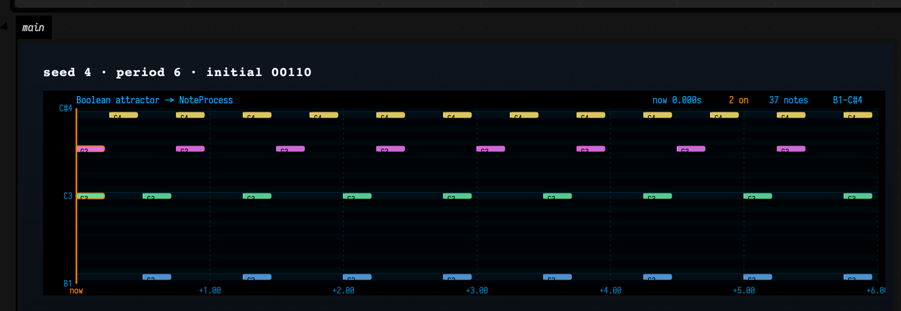
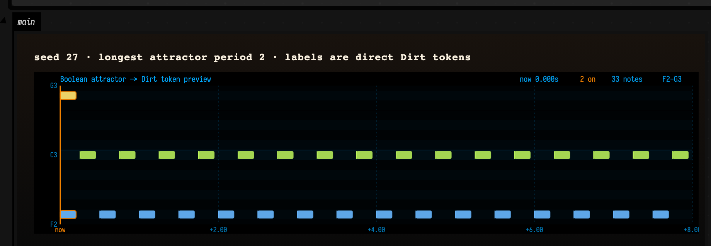
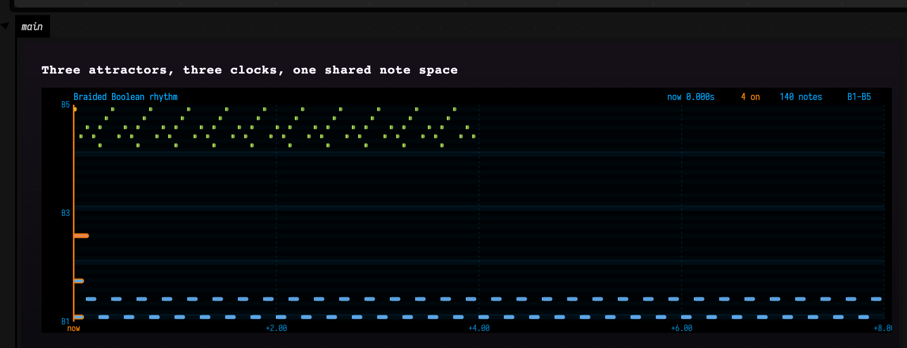
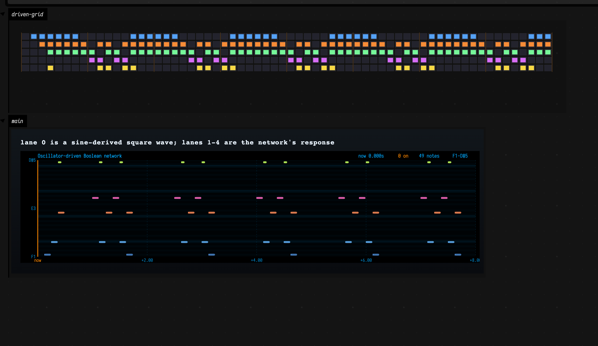

# Boolean network music examples

Boolean networks become musically useful the moment their states acquire time. Once each network step is given a duration, the state stream can be read as notes, labels, triggers, and sample hits. The point of this page is to make that bridge explicit inside `afield.four.synth`, not just as an ad hoc trick in a box.

The bridge now lives in four pieces:

- `scheduledSteps(...)` for timed Boolean states.
- `scheduledNotes(...)` for direct `Iterator<ScheduledNote>` mapping.
- `asNoteProcess(...)` for piano-roll friendly note streams.
- `scheduledDrivenSteps(...)` and `asDrivenNoteProcess(...)` for external clocks and oscillators.
- `respondAhead(...)` for live clocked side effects such as sample triggering.

## From attractor cycle to `NoteProcess`

The first useful test is the simplest one: take a small attractor, map rising edges to pitches, and render the result as a piano roll. That confirms that the network is no longer only a graph; it is a timed note source.

```diffstatic_runner {data-lang=kotlin screenshot="assets/boolean_network_music_examples/noteprocess_roll.png" wait="1.0" capture="box"}
:::static
import afield.four.synth.*
import afield.stdlib.*

data class Candidate(val seed: Int, val net: BooleanNetwork, val attr: Attractor)

val chosen =
    (0..80).mapNotNull { seed ->
        val net = kauffmanNetwork(n = 5, k = 2, seed = seed.toLong())
        val attr = net.findAttractors().filter { it.period >= 6 }.maxByOrNull { it.period } ?: return@mapNotNull null
        Candidate(seed, net, attr)
    }.first()

val pitches = listOf(36, 43, 48, 55, 60)
val labels = listOf("C2", "G2", "C3", "G3", "C4")
val colors = listOf("#63b3ff", "#ff9b54", "#6df0a7", "#f67bff", "#ffe46b")

val process =
    chosen.net.asNoteProcess(
        initialState = chosen.attr.cycle.first(),
        stepDuration = 0.25,
        steps = 24,
    ) { step ->
        step.lanes(BooleanTriggerMode.RISING_EDGE).map { lane ->
            note(
                pitch = pitches[lane],
                duration = step.duration * 0.84,
                start = step.start,
                velocity = 0.74 + lane * 0.04,
                label = labels[lane],
                color = colors[lane],
            )
        }
    }

val preview = process.notesBetween(0.0, 2.5).take(8).joinToString("\n")

display(
    "main",
    """
    <div style="padding:22px;background:linear-gradient(180deg,#0d141d,#090b10);color:#eef3ff">
      <div style="font:600 13px Iosevka Web, IBM Plex Mono, monospace;letter-spacing:0.04em;margin-bottom:12px">
        seed ${chosen.seed} · period ${chosen.attr.period} · initial ${chosen.attr.cycle.first().joinToString("") { if (it) "1" else "0" }}
      </div>
      ${process.pianoRollSvg(widthPx = 860, heightPx = 210, pastSeconds = 0.0, futureSeconds = 6.0, title = "Boolean attractor -> NoteProcess")}
      <pre style="margin:14px 0 0 0;padding:14px;background:#0f1722;border:1px solid rgba(255,255,255,0.08);font:12px/1.4 Iosevka Web, IBM Plex Mono, monospace;white-space:pre-wrap">${preview}</pre>
    </div>
    """.trimIndent()
)
```

That picture is already a useful bridge. The network is still the source of structure, but the resulting object is now a standard `NoteProcess`, which means it can be visualized, sliced, cached, and combined with the rest of the synth tooling.



## Previewing Dirt tokens before playback

Pitched notes are only one interpretation. The same timing layer can just as easily carry Dirt sample labels instead of note names. That lets you inspect the Boolean rhythm as a sample rack before you commit to actual playback.

```diffstatic_runner {data-lang=kotlin screenshot="assets/boolean_network_music_examples/dirt_token_roll.png" wait="1.0" capture="box"}
:::static
import afield.four.synth.*
import afield.stdlib.*

val net = kauffmanNetwork(n = 5, k = 2, seed = 27L)
val attr = net.findAttractors().maxByOrNull { it.period }!!
val tokens = listOf("bd:3", "sn:1", "hh:4", "cp:0", "perc:5")
val colors = listOf("#69b8ff", "#ff8e5a", "#c4ff5f", "#ff6cc4", "#ffe36e")

val preview =
    net.asNoteProcess(
        initialState = attr.cycle.first(),
        stepDuration = 0.25,
        steps = 32,
    ) { step ->
        step.lanes(BooleanTriggerMode.RISING_EDGE).map { lane ->
            note(
                pitch = 42 + lane * 3,
                duration = step.duration * 0.8,
                start = step.start,
                velocity = if (lane == 0) 1.0 else 0.82,
                label = tokens[lane],
                color = colors[lane],
            )
        }
    }

display(
    "main",
    """
    <div style="padding:22px;background:linear-gradient(180deg,#18120d,#090909);color:#f9f0df">
      <div style="font:600 13px Iosevka Web, IBM Plex Mono, monospace;letter-spacing:0.04em;margin-bottom:12px">
        seed 27 · longest attractor period ${attr.period} · labels are direct Dirt tokens
      </div>
      ${preview.pianoRollSvg(widthPx = 860, heightPx = 210, pastSeconds = 0.0, futureSeconds = 8.0, title = "Boolean attractor -> Dirt token preview")}
    </div>
    """.trimIndent()
)
```

That preview does two jobs. It shows the timing behavior, and it shows the exact sample symbols that a live Dirt player would receive. You can decide whether the network is musically interesting before it ever touches the audio engine.



## Braiding several Boolean rhythms together

Once the network can produce timed notes, the next step is layering. The example below braids three different Boolean attractors at different temporal resolutions: a kick-like layer on eighths, a change-trigger layer on dotted eighths, and a high-density active-state shimmer on sixteenths.

```diffstatic_runner {data-lang=kotlin screenshot="assets/boolean_network_music_examples/braided_rhythm.png" wait="1.0" capture="box"}
:::static
import afield.four.synth.*
import afield.stdlib.*

fun <T> Iterator<T>.collectAll(): List<T> {
    val out = mutableListOf<T>()
    while (hasNext()) out += next()
    return out
}

data class Layer(
    val seed: Long,
    val stepDuration: Double,
    val steps: Int,
    val mode: BooleanTriggerMode,
    val basePitch: Int,
    val label: String,
    val color: String,
    val velocity: Double,
)

data class Chosen(val layer: Layer, val net: BooleanNetwork, val attr: Attractor)

val layers =
    listOf(
        Layer(seed = 27L, stepDuration = 0.125, steps = 64, mode = BooleanTriggerMode.RISING_EDGE, basePitch = 36, label = "bd", color = "#69b8ff", velocity = 0.98),
        Layer(seed = 11L, stepDuration = 0.1875, steps = 48, mode = BooleanTriggerMode.CHANGE, basePitch = 50, label = "sn", color = "#ff8e5a", velocity = 0.76),
        Layer(seed = 42L, stepDuration = 0.0625, steps = 64, mode = BooleanTriggerMode.ACTIVE, basePitch = 74, label = "hh", color = "#c4ff5f", velocity = 0.42),
    )

val chosen =
    layers.map { layer ->
        val net = kauffmanNetwork(n = 5, k = 2, seed = layer.seed)
        val attr = net.findAttractors().maxByOrNull { it.period }!!
        Chosen(layer, net, attr)
    }

val notes =
    buildList {
        chosen.forEach { ch ->
            addAll(
                ch.net.scheduledNotes(
                    initialState = ch.attr.cycle.first(),
                    stepDuration = ch.layer.stepDuration,
                    steps = ch.layer.steps,
                ) { step ->
                    val lanes =
                        when (ch.layer.mode) {
                            BooleanTriggerMode.ACTIVE ->
                                step.state.indices.filter { lane -> step.isActive(lane) && (lane + step.stepIndex.toInt()) % 2 == 0 }.take(2)
                            else -> step.lanes(ch.layer.mode)
                        }

                    lanes.map { lane ->
                        note(
                            pitch = ch.layer.basePitch + lane * 2,
                            duration = if (ch.layer.mode == BooleanTriggerMode.ACTIVE) step.duration * 0.42 else step.duration * 0.78,
                            start = step.start,
                            velocity = (ch.layer.velocity - lane * 0.04).coerceAtLeast(0.2),
                            label = "${ch.layer.label}:$lane",
                            color = ch.layer.color,
                        )
                    }
                }.collectAll()
            )
        }
    }.sortedWith(compareBy<ScheduledNote> { it.start }.thenBy { it.pitch })

val process =
    noteProcess(defaultPastSeconds = 0.0, defaultFutureSeconds = 8.0) {
        for (scheduled in notes) emit(scheduled)
    }

val summary =
    chosen.joinToString("\n") { ch ->
        "${ch.layer.label} seed ${ch.layer.seed} · period ${ch.attr.period} · ${ch.layer.mode} every ${ch.layer.stepDuration}s"
    }

display(
    "main",
    """
    <div style="padding:22px;background:linear-gradient(180deg,#151018,#09090c);color:#f8f4ff">
      <div style="font:600 13px Iosevka Web, IBM Plex Mono, monospace;letter-spacing:0.04em;margin-bottom:12px">
        Three attractors, three clocks, one shared note space
      </div>
      ${process.pianoRollSvg(widthPx = 900, heightPx = 260, pastSeconds = 0.0, futureSeconds = 8.0, title = "Braided Boolean rhythm")}
      <pre style="margin:14px 0 0 0;padding:14px;background:#100f16;border:1px solid rgba(255,255,255,0.08);font:12px/1.45 Iosevka Web, IBM Plex Mono, monospace;white-space:pre-wrap">${summary}</pre>
    </div>
    """.trimIndent()
)
```

This is where the Boolean approach starts to feel compositional rather than merely algorithmic. Each layer is still just a state machine, but the combined piano roll behaves more like a small rhythmic ensemble.



## Driving the network with an oscillatory input

Not every useful rhythm has to come from a free-running attractor. Sometimes the interesting case is a Boolean network that is being pushed by an external clock lane. The new driven scheduling helpers make that explicit: an oscillator forces one node each step, while the rest of the network reacts to it.

```diffstatic_runner {data-lang=kotlin screenshot="assets/boolean_network_music_examples/oscillator_driven.png" wait="1.0" capture="box"}
:::static
import afield.four.synth.*
import afield.stdlib.*
import kotlin.math.PI
import kotlin.math.sin

fun <T> Iterator<T>.collectAll(): List<T> {
    val out = mutableListOf<T>()
    while (hasNext()) out += next()
    return out
}

val net =
    BooleanNetwork(
        listOf(
            BoolNode("clk", "external", emptyList()) { s -> s[0] },
            BoolNode("kick", "clk XOR clap", listOf(0, 3)) { s -> s[0] xor s[3] },
            BoolNode("snare", "kick OR hat", listOf(1, 4)) { s -> s[1] || s[4] },
            BoolNode("clap", "snare AND NOT clk", listOf(2, 0)) { s -> s[2] && !s[0] },
            BoolNode("hat", "kick XOR snare", listOf(1, 2)) { s -> s[1] xor s[2] },
        )
    )

val driver = { stepIndex: Long, _: Double, _: Double, state: BooleanArray ->
    state[0] = sin(2.0 * PI * stepIndex.toDouble() / 12.0) > 0.0
}

val steps =
    net.scheduledDrivenSteps(
        initialState = BooleanArray(net.size),
        stepDuration = 0.125,
        steps = 64,
        driver = driver,
    ).collectAll()

val labels = listOf("clk", "bd", "sn", "cp", "hh")
val pitches = listOf(30, 36, 50, 57, 74)
val colors = listOf("#5fa8ff", "#69b8ff", "#ff8e5a", "#ff6cc4", "#c4ff5f")

val process =
    net.asDrivenNoteProcess(
        initialState = BooleanArray(net.size),
        stepDuration = 0.125,
        steps = 64,
        driver = driver,
    ) { step ->
        step.lanes(BooleanTriggerMode.RISING_EDGE).map { lane ->
            note(
                pitch = pitches[lane],
                duration = if (lane == 4) step.duration * 0.45 else step.duration * 0.9,
                start = step.start,
                velocity = if (lane == 0) 0.4 else 0.78 + lane * 0.04,
                label = labels[lane],
                color = colors[lane],
            )
        }
    }

lines(
    drawRhythmGrid(steps.map { it.state }, cellW = 18.0, cellH = 16.0, stepGap = 3.0, laneGap = 4.0, accentEvery = 8),
    channel = "driven-grid",
    w = 1080.0,
    h = 170.0,
    fitToSize = true,
)

display(
    "main",
    """
    <div style="padding:18px;background:linear-gradient(180deg,#11161b,#090b0f);color:#eaf4ff">
      <div style="font:600 13px Iosevka Web, IBM Plex Mono, monospace;letter-spacing:0.04em;margin-bottom:10px">
        lane 0 is a sine-derived square wave; lanes 1-4 are the network's response
      </div>
      ${process.pianoRollSvg(widthPx = 900, heightPx = 220, pastSeconds = 0.0, futureSeconds = 8.0, title = "Oscillator-driven Boolean network")}
    </div>
    """.trimIndent()
)
```

The upper grid shows the raw Boolean state evolution. The piano roll underneath shows the same run interpreted as musical events. This is the important bridge: external periodic structure can push a Boolean network, and the network can still be read back out through the standard synth objects.



## Driving a live Dirt player

The live bridge is the launchable responder. `respondAhead(...)` clocks the Boolean network in real time and calls back with `BooleanNetworkStep` values. That is enough to drive a `DirtSamplePlayer` directly.

```kotlin
import afield.four.synth.*
import afield.stdlib.*

val clock = musicClock().reset(started = true)
val net = kauffmanNetwork(n = 5, k = 2, seed = 27L)
val attr = net.findAttractors().maxByOrNull { it.period }!!
val tokens = listOf("bd:3", "sn:1", "hh:4", "cp:0", "perc:5")

val lib = dirt("/absolute/path/to/Dirt-Samples", preload = false)
val kit = dirtPlayer(library = lib, voices = 24, gain = 0.22.p)

audio { kit } +
    net.respondAhead(
        initialState = attr.cycle.first(),
        ahead = 0.05,
        stepDuration = 0.25,
        clock = clock,
    ) { step ->
        step.lanes(BooleanTriggerMode.RISING_EDGE).forEach { lane ->
            kit.trigger(
                token = tokens[lane],
                gain = if (lane == 0) 1.15f else 0.82f,
                pan = (lane - 2) * 0.18f,
            )
        }
    }.onBeat(every = 1.0, clock = clock)
```

That is the full bridge in one place: network state becomes timed steps, timed steps become rising-edge decisions, and those decisions become Dirt sample triggers. The Boolean network stays responsible for structure, while the synth layer stays responsible for sound.

For the underlying state-space pictures, continue with [Boolean networks examples](boolean_networks_examples.md). For piano-roll and synth display tooling, see [Visualizers & Controls](visualizers.md).
