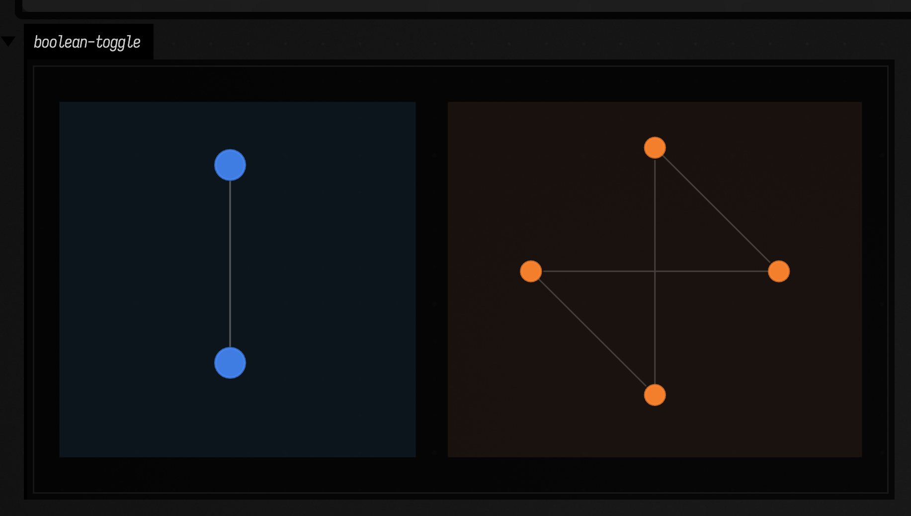
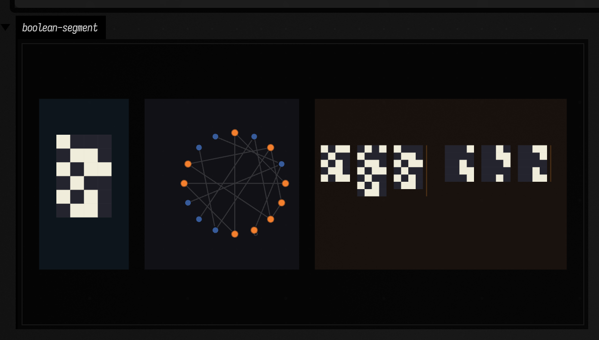
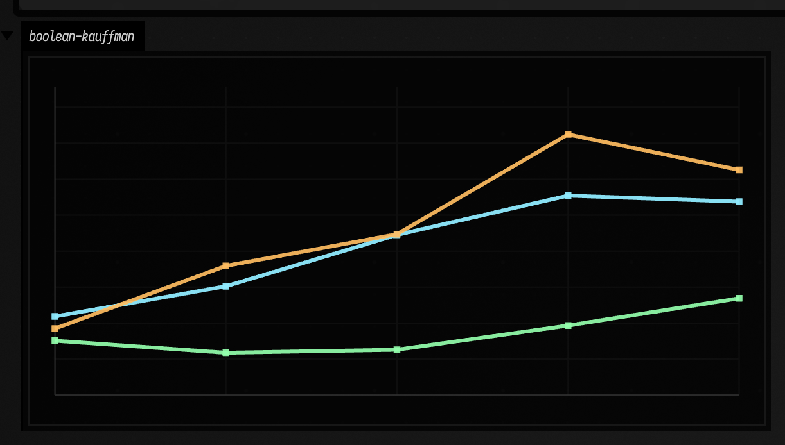
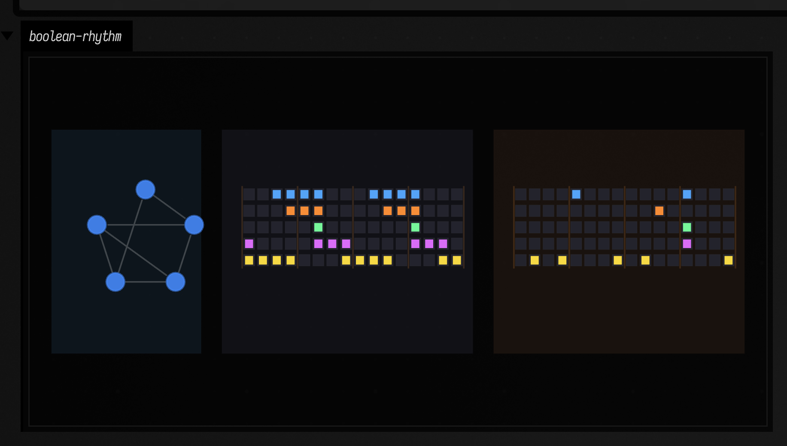

# Boolean networks to FLine examples

*Every public declaration used below is listed, with its KDoc, in the codebase reference: [`booleannetworks.kt`](reference/data.md#booleannetworks-kt). Start from [what's already in the box](reference/index.md).*

Boolean networks are clean material for drawing dynamics. The state space is finite, the update rule is explicit, and attractors are actual loops or fixed points you can enumerate. That makes them good for pictures that mix mechanism and behavior.

## Wiring and state-space, side by side

Start with the smallest interesting network. `toggleNetwork()` has only two nodes, but it already separates two useful views: the causal wiring graph and the induced state-transition graph.

```diffstatic_runner {data-lang=kotlin screenshot="assets/boolean_networks_examples/toggle_state_space.png" wait="1.0" capture="box"}
:::static
import afield.graphics.FLine

val net = toggleNetwork()
val attrs = net.findAttractors()

fun shift(lines: List<FLine>, dx: Double, dy: Double) = lines.map { it + vec(dx, dy, 0) }

fun panel(x: Double, y: Double, w: Double, h: Double, color: Vec4) = fline {
    moveTo(x, y)
    lineTo(x + w, y)
    lineTo(x + w, y + h)
    lineTo(x, y + h)
    close()
    filled = true
    stroked = true
    thickness = 1.0
    this.color = color
}

lines(
    listOf(
        panel(30.0, 40.0, 430.0, 430.0, vec(0.08, 0.13, 0.18, 0.56)),
        panel(500.0, 40.0, 500.0, 430.0, vec(0.16, 0.11, 0.08, 0.54)),
    ) +
        shift(net.drawNetworkGraph(radius = 120.0, nodeR = 18.0), 80.0, 80.0) +
        shift(net.drawStateTransitionGraph(radius = 150.0), 560.0, 55.0),
    channel = "boolean-toggle",
    w = 1060.0,
    h = 520.0,
    fitToSize = true
)
```

The left image tells you what depends on what; the right image tells you what that dependency does to every possible state. In this tiny case the whole state space is one period-4 loop. There is no hidden basin, no dead branch, only one circulating attractor that visits every binary configuration.



## Segment-polarity basins and a real transient

Small synthetic networks are good for intuition. Multiple attractors make the pictures richer. The simplified segment-polarity example has enough structure for basin sketches to be worth drawing.

```diffstatic_runner {data-lang=kotlin screenshot="assets/boolean_networks_examples/segment_basins.png" wait="1.0" capture="box"}
:::static
import afield.graphics.FLine

val net = segmentPolarityNetwork()
val attrs = net.findAttractors().sortedByDescending { it.basin.size }
val largest = attrs.first()
val cycleStates = largest.cycle.map { net.stateToInt(it) }.toSet()
val start = largest.basin.firstOrNull { it !in cycleStates } ?: largest.basin.first()
val trajectory = net.trajectoryUntilCycle(net.intToState(start))
val shown = attrs.take(2)

fun shift(lines: List<FLine>, dx: Double, dy: Double) = lines.map { it + vec(dx, dy, 0) }

fun panel(x: Double, y: Double, w: Double, h: Double, color: Vec4) = fline {
    moveTo(x, y)
    lineTo(x + w, y)
    lineTo(x + w, y + h)
    lineTo(x, y + h)
    close()
    filled = true
    stroked = true
    thickness = 1.0
    this.color = color
}

lines(
    listOf(
        panel(30.0, 40.0, 220.0, 420.0, vec(0.08, 0.13, 0.18, 0.56)),
        panel(290.0, 40.0, 380.0, 420.0, vec(0.10, 0.10, 0.14, 0.56)),
        panel(710.0, 40.0, 620.0, 420.0, vec(0.16, 0.11, 0.08, 0.54)),
    ) +
        shift(net.drawUnrolled(trajectory, cellSize = 34.0), 72.0, 128.0) +
        shift(net.drawStateTransitionGraph(radius = 125.0), 347.0, 83.0) +
        shift(net.drawAttractorBasins(shown, samplesPerAttractor = 3, cellSize = 18.0), 724.0, 154.0),
    channel = "boolean-segment",
    w = 1360.0,
    h = 520.0,
    fitToSize = true
)
```

The left panel is one concrete transient, the middle panel is the whole 16-state transition graph, and the right panel samples the two largest basins as miniature spacetime strips. In practice, Boolean models often ask about long-term regimes as much as next states.



## Random Kauffman regimes as a plotted sweep

This experiment steps away from one hand-made network and asks a population question. As in-degree `k` increases in random `N-K` Kauffman systems, the typical attractor counts and periods move. The trend belongs in a plot, not only a table.

```diffstatic_runner {data-lang=kotlin screenshot="assets/boolean_networks_examples/kauffman_sweep.png" wait="1.0" capture="box"}
:::static
import afield.graphics.FLine

data class SweepRow(val k: Int, val attractors: Double, val period: Double, val fixed: Double)

val rows = (1..5).map { k ->
    val runs = (0 until 18).map { seed ->
        val attrs = kauffmanNetwork(n = 8, k = k, seed = seed.toLong()).findAttractors()
        Triple(
            attrs.size.toDouble(),
            if (attrs.isEmpty()) 0.0 else attrs.map { it.period.toDouble() }.average(),
            attrs.count { it.period == 1 }.toDouble(),
        )
    }
    SweepRow(
        k = k,
        attractors = runs.map { it.first }.average(),
        period = runs.map { it.second }.average(),
        fixed = runs.map { it.third }.average(),
    )
}

val maxY = listOf(
    rows.maxOf { it.attractors },
    rows.maxOf { it.period },
    rows.maxOf { it.fixed }
).max() + 0.5

fun guides() = listOf(
    fline {
        moveTo(80, 580); lineTo(1100, 580)
        moveTo(80, 120); lineTo(80, 580)
        color = vec(1, 1, 1, 0.22)
        thickness = 1.1
    },
    fline {
        for (i in 0..8) {
            val y = 580.0 - i / 8.0 * 430.0
            moveTo(80, y); lineTo(1100, y)
        }
        for (i in rows.indices) {
            val x = 80.0 + i.toDouble() / (rows.size - 1).coerceAtLeast(1).toDouble() * 1020.0
            moveTo(x, 120.0); lineTo(x, 580.0)
        }
        color = vec(1, 1, 1, 0.08)
        thickness = 1.0
    }
)

fun curve(values: List<Double>, color: Vec4, thickness: Double): FLine = fline {
    values.forEachIndexed { i, value ->
        val x = 80.0 + i.toDouble() / (values.size - 1).coerceAtLeast(1).toDouble() * 1020.0
        val y = 580.0 - value / maxY * 430.0
        if (i == 0) moveTo(x, y) else lineTo(x, y)
    }
    this.color = color
    this.thickness = thickness
}

fun markers(values: List<Double>, color: Vec4, size: Double): FLine = fline {
    filled = true
    stroked = false
    values.forEachIndexed { i, value ->
        val x = 80.0 + i.toDouble() / (values.size - 1).coerceAtLeast(1).toDouble() * 1020.0
        val y = 580.0 - value / maxY * 430.0
        moveTo(x - size, y - size)
        lineTo(x + size, y - size)
        lineTo(x + size, y + size)
        lineTo(x - size, y + size)
        close()
    }
    this.color = color
}

lines(
    guides() + listOf(
        curve(rows.map { it.attractors }, vec(0.56, 0.92, 1.0, 0.95), 3.0),
        curve(rows.map { it.period }, vec(1.0, 0.74, 0.38, 0.92), 3.0),
        curve(rows.map { it.fixed }, vec(0.58, 1.0, 0.68, 0.92), 3.0),
        markers(rows.map { it.attractors }, vec(0.56, 0.92, 1.0, 0.95), 5.0),
        markers(rows.map { it.period }, vec(1.0, 0.74, 0.38, 0.92), 5.0),
        markers(rows.map { it.fixed }, vec(0.58, 1.0, 0.68, 0.92), 5.0),
    ),
    channel = "boolean-kauffman",
    w = 1180.0,
    h = 660.0,
    fitToSize = true
)
```

This picture shows how the ensemble changes as connectivity rises. Some regimes favor many short-term destinations, some produce longer cycles, some keep a healthy fixed-point population around. Once the sweep is visible, "ordered versus chaotic" becomes something you can inspect.



## Boolean attractors as drum grids

Once you have a limit cycle, you have a rhythm. You can treat each node as a lane directly, or gate the cycle with a beat phase such as `step % 4` and turn the same binary motion into kick / snare / hat style triggers.

```diffstatic_runner {data-lang=kotlin screenshot="assets/boolean_networks_examples/rhythm_cycles.png" wait="1.0" capture="box"}
:::static
import afield.graphics.FLine

data class RhythmCandidate(val seed: Int, val net: BooleanNetwork, val attr: Attractor, val score: Double)

fun activity(attr: Attractor, net: BooleanNetwork): Double =
    attr.cycle.sumOf { state -> state.count { it } }.toDouble() / (attr.period * net.size).toDouble()

val candidate =
    (0..240).mapNotNull { seed ->
        val net = kauffmanNetwork(n = 5, k = 2, seed = seed.toLong())
        net.findAttractors()
            .filter { it.period in 5..10 }
            .map { attr ->
                val density = activity(attr, net)
                val periodScore = 1.0 - kotlin.math.abs(attr.period - 8) / 8.0
                val densityScore = 1.0 - kotlin.math.abs(density - 0.42)
                val basinScore = attr.basin.size.toDouble() / (1 shl net.size).toDouble()
                RhythmCandidate(seed, net, attr, periodScore * 1.6 + densityScore * 1.2 + basinScore)
            }
            .maxByOrNull { it.score }
    }.maxByOrNull { it.score }!!

val natural = candidate.attr.repeatedCycle(16)
val gated =
    natural.mapIndexed { step, state ->
        booleanArrayOf(
            state[0] && step % 4 == 0,
            state[1] && step % 4 == 2,
            state[2] && step % 2 == 0,
            state[3] && (step % 8 == 4 || step % 8 == 12),
            state[4] && (step % 4 == 1 || step % 4 == 3),
        )
    }

fun shift(lines: List<FLine>, dx: Double, dy: Double) = lines.map { it + vec(dx, dy, 0) }

fun panel(x: Double, y: Double, w: Double, h: Double, color: Vec4) = fline {
    moveTo(x, y)
    lineTo(x + w, y)
    lineTo(x + w, y + h)
    lineTo(x, y + h)
    close()
    filled = true
    stroked = true
    thickness = 1.0
    this.color = color
}

lines(
    listOf(
        panel(30.0, 40.0, 280.0, 420.0, vec(0.08, 0.13, 0.18, 0.56)),
        panel(350.0, 40.0, 470.0, 420.0, vec(0.10, 0.10, 0.14, 0.56)),
        panel(860.0, 40.0, 470.0, 420.0, vec(0.16, 0.11, 0.08, 0.54)),
    ) +
        shift(candidate.net.drawNetworkGraph(radius = 96.0, nodeR = 17.0), 76.0, 118.0) +
        shift(drawRhythmGrid(natural, cellW = 21.0, cellH = 22.0, stepGap = 5.0, laneGap = 9.0, accentEvery = 4), 390.0, 150.0) +
        shift(drawRhythmGrid(gated, cellW = 21.0, cellH = 22.0, stepGap = 5.0, laneGap = 9.0, accentEvery = 4), 900.0, 150.0),
    channel = "boolean-rhythm",
    w = 1380.0,
    h = 520.0,
    fitToSize = true
)
```

The middle grid is the raw attractor repeated over two bars. The right grid is the same cycle clock-gated into something closer to kick / snare / hat / clap / percussion lanes, which means those five rows could be sent straight to a Drift-style sample rack. The network is not "playing audio" by itself; it is producing a stable, inspectable rhythmic grammar.



Boolean networks sit at a useful point in Field: code, graphs, dynamics, and rhythm can all fit on one page. For the next step, where those rhythms become `NoteProcess` objects and live Dirt triggers, continue with [Boolean network music examples](boolean_network_music_examples.md). For related work where static structure and measured behavior are plotted together, continue with [Values over time (interpolants, keyframes, correlations & estimation)](interpolants_examples.md) and [Sorting networks examples](sorting_networks_examples.md).
