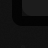
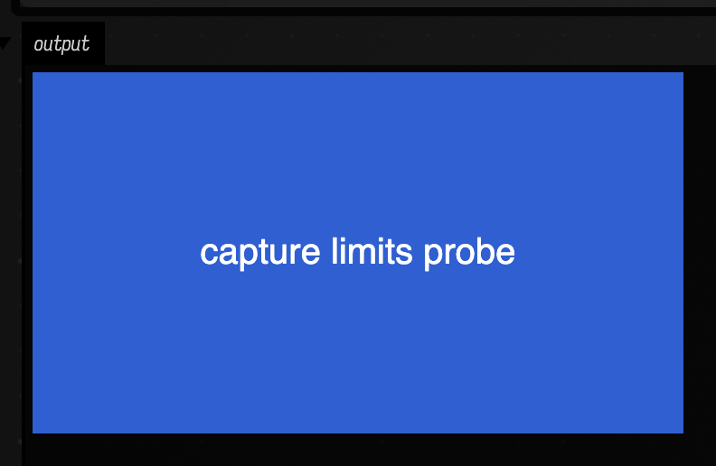

# What a capture can and cannot show

For anything visual, *it compiles* is not verification. The way to know a change worked is to drive
it to pixels and look at them, and [Letting an Agent Drive](automating_field.md) is how that is
done here without a human in the chair.

So the useful question is not whether captures work. It is **which pictures cannot be taken at
all**, because that is the boundary of what anyone — a person or an agent — can claim about a
running document. The native-window capture fences in this repo sit close to that boundary, and
the boundary itself used to be scattered across other pages as asides.

The limits sort into three kinds, and the ordering matters more than the list:

| kind | what you get | what it costs you |
|---|---|---|
| **Loud** | the capture fails and names what blocked it | a minute |
| **Quiet** | the capture times out | an hour, guessing why |
| **Silent** | the capture succeeds and shows the wrong thing | a published figure that is wrong |

Almost all the attention in this repo has gone to the loud ones, because they are the ones that
announce themselves. The silent ones are the subject of this page.

---

## A former silent failure: a capture that reports success

`screenshot-box` used to return a picture of nothing with `ok: true`. Captures requesting open
outputs now reject missing content and unsettled layout. These two historical captures show the
failure that motivated that check.

Here are two runs of the **same box** with the **same command**. One variable changes: whether a
browser client was attached at the moment the box ran.

```diffstatic {data-lang=kotlin}
display("<div style='width:360px;height:200px;background:#2f5fd0'>capture limits probe</div>")
displayOpen("output")
println("PROBE-DONE")
```

Run it with no client attached, attach one afterwards, then photograph it:



That is the figure, reproduced at its real size. The capture reported:

```diffstatic {data-lang=json}
{ "ok": true, "kind": "box",
  "clip":     { "x": 23.0, "y": 286.0, "w": 24.0,  "h": 24.0  },
  "viewport": { "x": 0.0,  "y": 0.0,   "w": 2200.0, "h": 2800.0 } }
```

Run the same box with the client already attached and everything else identical:



```diffstatic {data-lang=json}
{ "ok": true, "kind": "box",
  "clip":     { "x": 23.0, "y": 290.0, "w": 396.0, "h": 258.0 },
  "viewport": { "x": 0.0,  "y": 0.0,   "w": 2200.0, "h": 2800.0 } }
```

Both historical replies say `ok: true`. The **clip** distinguishes them, and remains worth checking
even with readiness checks: automation cannot know which picture you intended.

### Why it happens

`displayOpen(channel)` does not open a panel. It sends an `output-control` message *to a client*
(`afield/outputs.kt`). With no client connected there is nobody to receive it, so the panel is never
created, and the box collapses to its handle.

The capture then clips to whatever the box's element measures on the page —
`getBoundingClientRect`, in the prep script inside `afield/docs/screenshot.kt`. A collapsed box
measures 24 × 24 logical pixels, and at this display's 2× scale that is a 48 × 48 PNG.

That is also why the number is not a constant, and why looking for "48 × 48" is the wrong habit.
`dev_docs/MARF_DEMO.md` and `dev_docs/OUTPUT_PANEL_SIZING.md` both report 48 × 48;
`dev_docs/path_tracer_instrument.md` reports 40 × 40 for a box with no open display panel. These do
not disagree. **The clip is the box's own rectangle**, so its size is whatever that particular box
collapsed to, times the device pixel ratio. The signature to watch for is not a number — it is a
clip much smaller than the output you were expecting.

### How it is now rejected

`screenshot-box` already opens outputs by default (`--open-outputs` is the default in
`tools/field_backdoor.py`; `--no-open-outputs` turns it off), and the prep script does hold a
readiness precondition before shooting — deliberately so, after a figure published with a "loading
waveform" badge in the corner.

Checking only whether anything **declares itself busy** misses an output area that was never
populated. Box and targeted window captures now open the disclosures first, then require visible,
populated content, loaded images and iframes, and stable geometry within the preparation deadline.
An expired layout wait is a failure, not permission to photograph a box handle. Animation inside
a fixed-size output is still allowed: this checks geometry, not whether the pixels stop moving.

There is no minimum image size; tiny valid outputs are allowed. For an intentional box-handle
capture use `--no-open-outputs`. For an editor-only window capture, omit `--open-outputs`.

### What to do instead

Attach the client *before* the box runs, so the panel exists when `displayOpen` fires:

```diffstatic {data-lang=bash}
python3 tools/field_backdoor.py --port <port> --with-playwright \
  --command "run <uid>" \
  --command "wait-output <uid> --contains DONE --timeout 240" \
  --command "screenshot-box <uid> out.png"
```

Or open the document in a browser first. And whichever you do, **read the `clip` in the reply**. It
is the one field that separates a good capture from a plausible one.

---

## The other silent one: the right size, the wrong frame

A capture can be correctly sized, correctly timed, and still of the wrong thing.

- **The previous selection can still be in focus.** `screenshot-box` selects the box, but the
  canvas's depth-of-field can lag, and the result is a plausible-looking blurred figure.
  `dev_docs/chart_primitive.md` records the reliable recipe — `editor-open <uid> --open-outputs`,
  settle, then `screenshot-box --preserve-selection` — and records that two consecutive
  `screenshot-box` calls on the same box sometimes work and sometimes do not.
- **Neighbouring panels bleed in.** With several output panels open on one canvas, the clip around
  the target can contain its neighbours' panels too (`dev_docs/chart_bad_separation.md`).
- **The box capture path pans, and panning drops the selection.** A figure whose subject *is* the
  selection — a navigation highlight, say — cannot use that path at all, which is why
  [Spatial Navigation](spatial_navigation.md) drives its own capture.

---

## The quiet one: the native window times out

The `afield.four` graphics window is photographed by a different mechanism: the renderer copies its
own swapchain, as a Vulkan transfer-source, straight to a file. No screen recording permission, no
window raising, works headless.

One budget — 15 seconds by default — covers renderer readiness, settling *and* the copy; it is not
a fresh allowance per stage (`afield/docs/doc.kt`). When it expires you get "Timed out waiting for
native renderer" and no information about which stage ate it.

Three per-frame operations have been measured against this path, in `dev_docs/SKINNED_CHARACTERS.md`
and `dev_docs/GPU_SKINNING.md`, one variable at a time on the same scene:

| the box does this every frame | native capture |
|---|---|
| nothing | works |
| skins the mesh on the CPU, 118 fps | works |
| rewrites a 128-matrix buffer, ~120 fps | works |
| reads a box property with `getPropertyRaw` | times out |
| re-uploads vertices with `applyToMesh` | times out |

**Deformation is innocent and buffer writes are innocent.** The trap is the per-frame *vertex re-upload* specifically, and separately a per-frame box-property
read. A page that says "per-frame GPU work cannot be photographed" is claiming something much
larger than what was measured.

??? aside "Where those five rows come from"

    They are carried over from the skinning work and were **not** re-run for this page.

A related limit is not a timeout at all and is easy to mistake for one: **`MeshInstance.applyToMesh`
cannot run from a `main` in the first place.** Its buffers come from `defaultBuffer { … }.buffer`,
which allocates through a renderer parameter defaulting to `fromContext()` — and `fromContext` reads
`Box.context`, which is a box. From a `main` there is no box, and it throws
`Cannot invoke "afield.Box.getProperties()"` before any capture is attempted. Since every smoke test
and every evidence renderer is a `main`, that is the environment most likely to meet it.

---

## The structural ones: pictures that cannot exist

**There is no moving picture of the native window that an agent can take.** The backdoor's
`record-window`, `record-editor` and `record-box` all record the *browser*, through the page. A
docs fence that asks for `capture="native-window"` together with `video=` is accepted, falls through
to the browser recorder, and silently records the wrong window
(`dev_docs/DOCS_RUNNER_GPU_CAPTURES.md`). No published page currently does this, so the trap is real
and unsprung.

A native-window recorder **does** exist: `Window.raiseAndRecord`, in
`afield/docs/doc.kt`, raises the GLFW window and records its rectangle with macOS `screencapture`.
Its only caller is the `render_clip` comment command in the same file, which neither the backdoor nor
the docs fence harness reaches.

It is also on the *old* mechanism. The still path was moved to the renderer's own swapchain copy and
the recording path was not, so the recorder that exists needs Screen-Recording permission and fails
headless — the same contrast `dev_docs/imgui_vr_panel.md` draws between its `capture` and
`capture-gpu` modes. So a moving GPU figure is a still plus a plot of the signal it follows, and
pages have been caught implying a clip they do not have.

Two more pictures cannot be taken, for reasons that have nothing to do with the capture code:

- **A static capture cannot click.** Anything whose subject is an interaction — picking two
  elements to measure between them, in `dev_docs/three_inspector.md` — has to be driven by the `ui`
  capture mode or left to a demo.
- **Some figures need hardware or a build the clone does not ship.** The Ceres figure on
  `polytope_examples.md` needs a native wrapper with no committed binary, and the GPU capture path
  cannot run in the macOS working loop or on a runner with no GPU. `dev_docs/DOCS_RUNNER_GPU_CAPTURES.md`
  gives explicit licence to skip these and say why. A faked capture is worse than none.

---

## Telling a timed-out capture from a broken subject

This is the hard one, and today the two look identical: "Timed out waiting for native renderer",
with no hint whether the scene failed to draw or the capture path failed to fetch it. A theory
about a timeout is self-confirming — you will always find something slow to blame.

There is a technique in the repo that settles it: a **trusted control**. Alongside the thing you are trying to photograph, capture something whose committed
figures prove it worked before. Then:

| your subject | the control | verdict |
|---|---|---|
| times out | works | the subject is broken; debug the scene |
| times out | times out too | the **capture path** is broken in this environment; debug nothing else |
| works | — | you have your picture |

`dev_docs/FIELDML_HOST_BRIDGE.md` records it in use: a scene
would not photograph, and the existing `fieldml_frames_demo` — whose committed captures prove it
worked — failed identically. That is what said the fault was the environment and not the scene, and
it is what stopped an hour going into the wrong thing.

Three things make this cheap enough to be a habit:

1. **A control is already sitting in the tree.** Any page with a committed native-window capture is
   one.
2. **For box captures, the `clip` is the control.** You do not need a second run — compare the clip
   in the reply against the size you expected, as the two figures at the top of this page do.
3. **Run the control in the same invocation.** A separate run is a different session, a different
   browser context and a different scratch document, so a control run later has already changed the
   variable you were holding still.

---

## Where each limit is written down

| limit | recorded in |
|---|---|
| outputs closed with no client → a box-handle-sized capture, `ok: true` | `dev_docs/MARF_DEMO.md`, `dev_docs/OUTPUT_PANEL_SIZING.md`, `dev_docs/path_tracer_instrument.md` |
| stale selection blurs a box capture; repeats are flaky | `dev_docs/chart_primitive.md` |
| neighbouring panels inside the clip | `dev_docs/chart_bad_separation.md` |
| box capture pans and drops the selection | [Spatial Navigation](spatial_navigation.md) |
| per-frame vertex re-upload and property read time out the native capture | `dev_docs/SKINNED_CHARACTERS.md`, `dev_docs/GPU_SKINNING.md` |
| `applyToMesh` throws from a `main` | `dev_docs/GPU_SKINNING.md` |
| no native-window video on any agent-facing path | `dev_docs/DOCS_RUNNER_GPU_CAPTURES.md`, [Pattern → particles](chain_pattern_particles.md) |
| `screencapture` needs permission; the swapchain copy does not | `dev_docs/imgui_vr_panel.md` |
| a static capture cannot click | `dev_docs/three_inspector.md` |
| captures with a build prerequisite, and host-gated captures | `dev_docs/DOCS_RUNNER_GPU_CAPTURES.md`, `dev_docs/NVFLOW_BINDINGS.md` |
| a capture that cannot be recreated | `dev_docs/docs_capture_staleness.md` |
