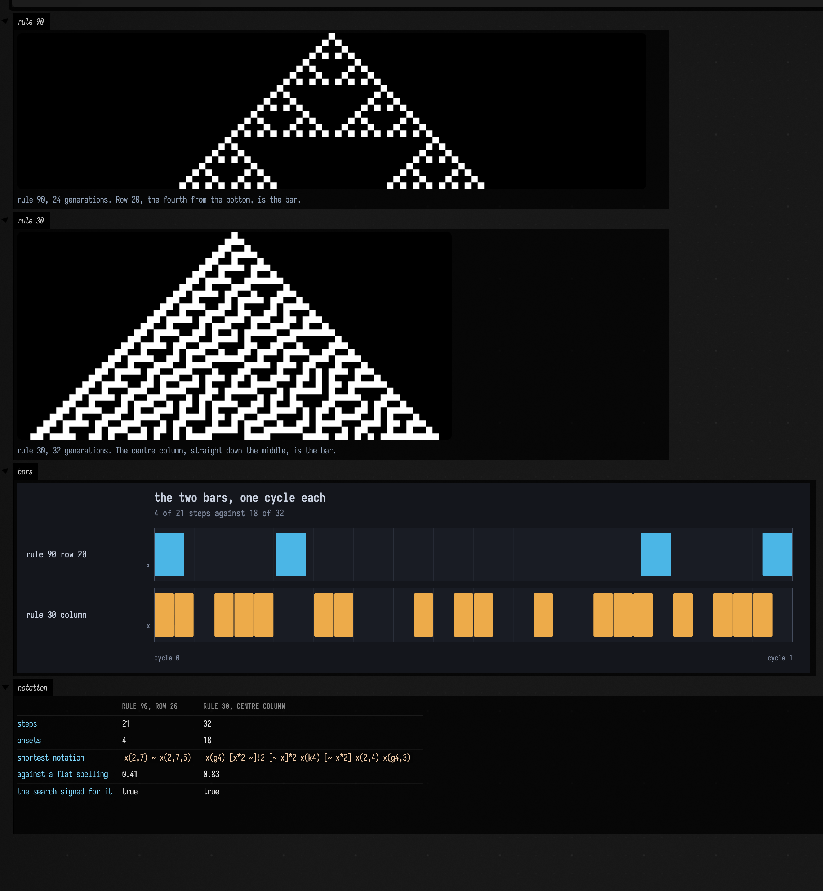
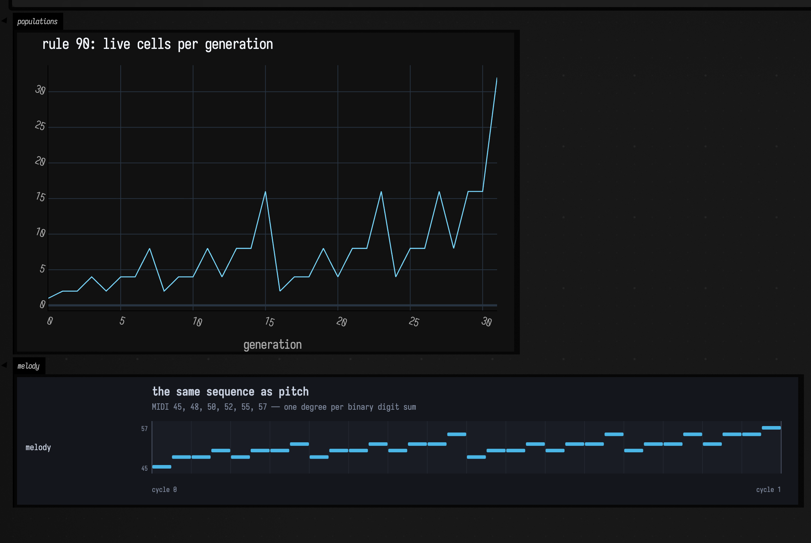
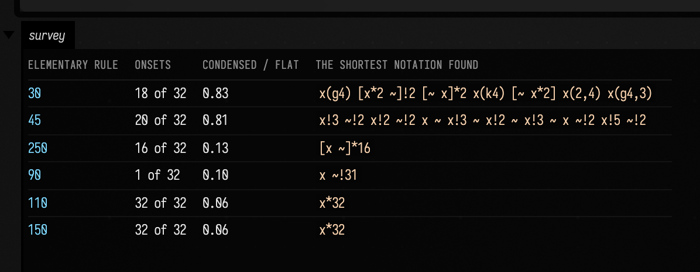

# A cellular automaton you can hear

Four steps, four parts of Field. `alife_ca.kt` steps one of Wolfram's 256 elementary rules.
One row or one column of the result becomes a step mask. `patCondense` searches for the shortest
mini-notation that plays that mask. `patRenderStereo` plays the notation through a small
deterministic voice, offline, into a `.wav`.

The third step is where the measurement is. `patCondense` is the mini-notation parser run backwards,
and the length of what it returns is a number about the rhythm it was given: a rhythm with structure
gets a much shorter spelling than one without. So the notation a CA's row condenses to is a
statement about the rule, and the audio is that statement played.

## The same rule, twice, with the answers known in advance

Rule 90 is `left XOR right`. From a single live cell its space-time diagram is Pascal's triangle
mod 2, which is where the second column of the figure below comes from: `binomialParity` computes
what row 20 should be from Kummer's theorem, without stepping anything, and
[`CaSoundDocs.gasketBar`](reference/patterns.md#casounddocs-kt-casounddocs) checks the real CA
against it cell by cell before any sound is made.

Rule 30's centre column has no such formula, which is the reason it is here.

```diffstatic_runner {data-lang=kotlin screenshot="assets/chain_ca_sound/rules.png" wait="8" capture="box" open-outputs="true" w="1180" h="300" padding="18" timeout="120" name="chain-ca-rules" embed=true}
:::static
import afield.four.synth.CaSoundDocs

// Both derivations run the real stepper. gasketBar additionally checks its row against
// binomialParity before returning, so a wrong answer here throws rather than plays.
val gasket = CaSoundDocs.gasketBar(20)
val chaos = CaSoundDocs.rule30Bar(32)

:::fold the two space-time diagrams, the two bars, and the two notations
// Two showImg calls rather than one montage: montage draws its labels into the pixels with a
// bitmap font and clips them to the cell, while showImg's `caption` is ordinary text beneath the
// image. `toImg(2)` is the STATE COUNT, not a scale: upscaleNearest is what makes a 97-cell row
// visible, and passing the upscale to toImg instead dims the live cells to 1/7 grey with no error.
showImg(
    elementaryCa(90, 97, 24).toImg(2).upscaleNearest(9),
    channel = "rule 90",
    maxSide = 1000,
    caption = "rule 90, 24 generations. Row 20, the fourth from the bottom, is the bar.",
)
showImg(
    elementaryCa(30, 67, 32).toImg(2).upscaleNearest(9),
    channel = "rule 30",
    maxSide = 1000,
    caption = "rule 30, 32 generations. The centre column, straight down the middle, is the bar.",
)

showPatRollOf(
    "rule 90 row 20" to gasket.pattern,
    "rule 30 column" to chaos.pattern,
    title = "the two bars, one cycle each",
    subtitle = "${gasket.onsets} of ${gasket.steps} steps against ${chaos.onsets} of ${chaos.steps}",
    cycles = 1,
    channel = "bars",
)

markdown("notation", """
| | rule 90, row 20 | rule 30, centre column |
|---|---|---|
| steps | ${gasket.steps} | ${chaos.steps} |
| onsets | ${gasket.onsets} | ${chaos.onsets} |
| shortest notation | `${gasket.condensation.notation}` | `${chaos.condensation.notation}` |
| against a flat spelling | ${"%.2f".format(gasket.compression)} | ${"%.2f".format(chaos.compression)} |
| the search signed for it | ${gasket.condensation.exact} | ${chaos.condensation.exact} |
""", width = 1000)
:::endfold
```



Rule 90's row condenses to two Euclidean figures with a rest between them, and the second is the
first turned: `x(2,7)` and `x(2,7,5)` are the same two-in-seven pattern at two rotations. Pascal's
triangle is symmetric in *k*, so the bar has to read the same backwards, and that is the form the
symmetry takes once a notation is asked for it. Nothing in the condenser knows about binomial
coefficients.

Rule 30's column condenses as well. A flat spelling carries overhead that any grouping saves, so the
number to read is never whether a rhythm compresses but how far, against another rhythm on the same
denominator.

Here is the rule-90 bar, four cycles at one cycle per second:

```diffstatic_runner {data-lang=kotlin audio="assets/chain_ca_sound/gasket-bar.wav" audio-spec="gasket-bar" audio-renderer="afield.four.synth.CaSoundDocs" embed=true hidden=true name="chain-ca-gasket-audio"}
// Offline-rendered by CaSoundDocs.renderWav("gasket-bar").
```

And rule 30's column, three cycles, thirty-two steps each:

```diffstatic_runner {data-lang=kotlin audio="assets/chain_ca_sound/rule30-hats.wav" audio-spec="rule30-hats" audio-renderer="afield.four.synth.CaSoundDocs" embed=true hidden=true name="chain-ca-rule30-audio"}
// Offline-rendered by CaSoundDocs.renderWav("rule30-hats").
```

The first is a figure. The second is thirty-two steps that never become one, and the two compression
numbers are that difference written down.

!!! note "Compression is a ratio of characters, so the atom's length moves it"

    Both bars above use `x` as their atom for exactly this reason. Spelling the same rhythm with
    `hh` changes the numerator and the denominator by different amounts, and rule 30's 0.83 reads as
    0.73 instead. Compare two rhythms only when they are spelled with the same atom.

## The same rule read as pitch

Row *n* of Pascal's triangle mod 2 has exactly `2^popcount(n)` odd entries, so the population of
rule 90's rows is the binary digit sum of the generation index. `CaSoundDocs.gasketScale` counts the
real CA's rows, checks each count against that formula, and maps the digit sum to a degree of a
minor pentatonic. The tune is therefore the binary expansion of 0, 1, 2, … read out loud: it falls
back to the root at every power of two and climbs through the carries in between.

```diffstatic_runner {data-lang=kotlin screenshot="assets/chain_ca_sound/scale.png" wait="8" capture="box" open-outputs="true" w="1180" h="280" padding="18" timeout="120" name="chain-ca-scale" embed=true}
:::static
import afield.four.synth.CaSoundDocs

// gasketPopulations counts the real space-time diagram and throws unless every row's count is
// 2^popcount(n), so reaching the next line is the check. Plotting the formula as a second trace
// would put it exactly under this one and show nothing.
val populations = CaSoundDocs.gasketPopulations()
val notes = CaSoundDocs.gasketScale()

:::fold the populations, and the melody they become
showSignals(
    "live cells per generation" to populations,
    // Short, because a plotly title wider than the plot is clipped rather than wrapped. The
    // claim that this equals 2^popcount(n) is the `check` inside gasketPopulations, not a caption.
    title = "rule 90: live cells per generation",
    xTitle = "generation",
    channel = "populations",
)

showPatRollOf(
    "melody" to pat(notes.joinToString(" ")),
    title = "the same sequence as pitch",
    subtitle = "MIDI ${notes.distinct().sorted().joinToString(", ")} — one degree per binary digit sum",
    cycles = 1,
    pitched = true,
    channel = "melody",
)
:::endfold
```



```diffstatic_runner {data-lang=kotlin audio="assets/chain_ca_sound/gasket-scale.wav" audio-spec="gasket-scale" audio-renderer="afield.four.synth.CaSoundDocs" embed=true hidden=true name="chain-ca-scale-audio"}
// Offline-rendered by CaSoundDocs.renderWav("gasket-scale").
```

## Six rules, one denominator

The same 32-step centre column, taken from six rules, condensed with the same atom. This is the
measurement the two audio clips above are one comparison from.

```diffstatic_runner {data-lang=kotlin screenshot="assets/chain_ca_sound/survey.png" wait="8" capture="box" open-outputs="true" w="1180" h="300" padding="18" timeout="120" name="chain-ca-survey" embed=true}
:::static
import afield.four.synth.CaSoundDocs

// The same six rules the harness surveys, so the page and the FIELD_TEST cannot disagree.
val bars = CaSoundDocs.CONDENSATION_SURVEY.map { CaSoundDocs.centreColumnBar(it) }

:::fold lay the six out, worst compression first
val rows = CaSoundDocs.CONDENSATION_SURVEY.zip(bars)
    .sortedByDescending { (_, bar) -> bar.compression }
    .joinToString("\n") { (rule, bar) ->
        "| $rule | ${bar.onsets} of ${bar.steps} | ${"%.2f".format(bar.compression)} | " +
            "`${bar.condensation.notation}` |"
    }
markdown("survey", """
| elementary rule | onsets | condensed / flat | the shortest notation found |
|---|---|---|---|
$rows
""", width = 1080)
:::endfold
```



Two rules resist, and they are the two usually called chaotic. Every other column collapses to a
spelling a person could have typed in one breath: `x*32`, `[x ~]*16`, `x ~!31`. What produced that
ordering is a music-notation compressor looking for a short spelling, and it agrees with the
classification those two rules are famous for.

!!! warning "The slice matters as much as the rule"

    Rule 90's *centre column* compresses to 0.10 and its *row 20* to 0.41, and they are the same
    rule. The column is nearly empty because from one seed only every other cell is ever reachable,
    so the centre is live only at generation zero. Pick the slice before comparing anything.

## Where each piece is documented

* [Spatial Artificial Life](alife_examples.md) for the automata: the elementary rules as space-time
  rasters, Life, cyclic multi-state CA, and the independent oracles the same way this page uses them.
* [Patterns & Rhythm](pattern_language.md) for the event model and the mini-notation, and
  `dev_docs/PAT_CONDENSE.md` for the condenser, including the bounds it searches under and what it
  refuses.
* [Sound](sound.md) and [Making a Sound, Every Path There Is](sound_paths.md) for the voice and for
  why every audio figure in these docs comes out of the offline `wav-file` sink.
* [Boolean Network Music Examples](boolean_network_music_examples.md) is the neighbouring chain: a
  different discrete dynamical system, into `NoteProcess` and live Dirt triggers rather than into
  notation.
