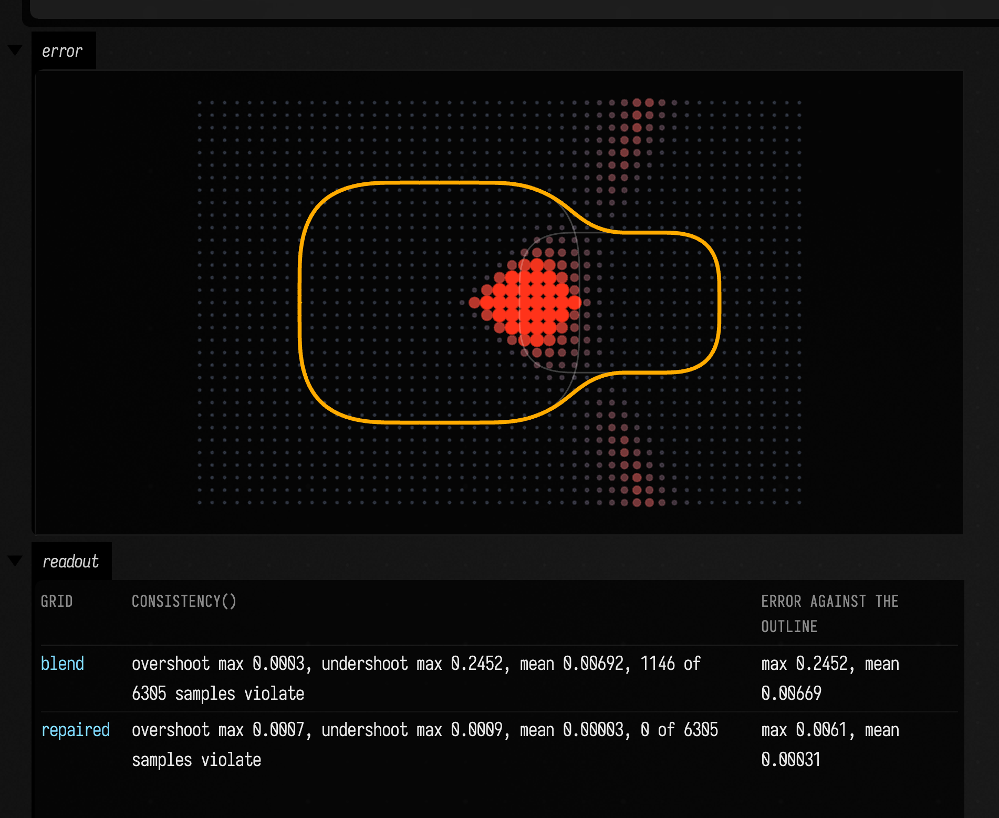
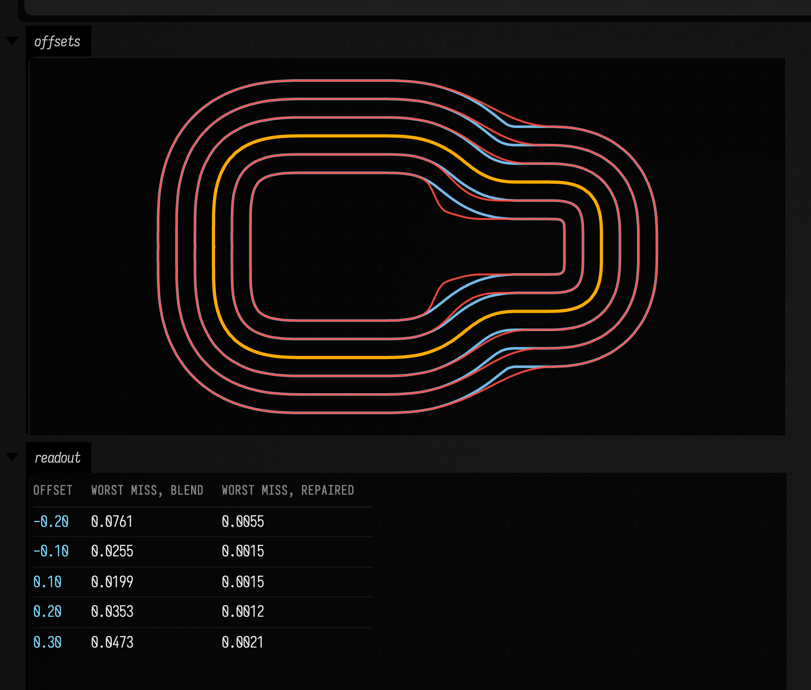
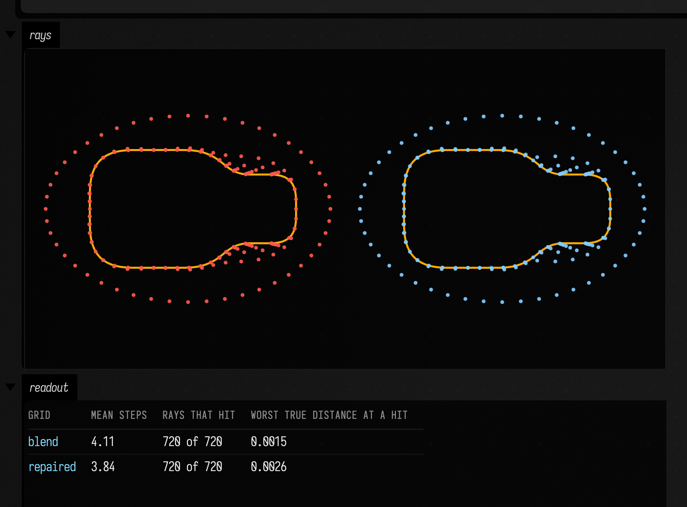

# A Drawn Outline, Repaired and Offset

Smooth-min two rounded rectangles together and you get a shape with a soft waist where they meet.
The outline is exactly where you want it. The numbers either side of it, the ones that are meant
to say how far each point is from that outline, are not: inside the overlap and outside the waist
they come out closer to zero than the true distance. This page follows one such shape through four steps, from drawn
[squircles](fline_examples.md#squircles-squirclefrom-and-squirclerectfrom) to a signed distance
field, through the [repair](mesh_examples.md#repairing-a-field-that-is-only-a-bound) that makes the
distances honest again, and on to the two things that read them: offset contours and sphere
tracing.

## Two squircles as distance fields

The shape starts as two `squircleRectFrom` rectangles with clothoid corners, the corner style whose
curvature never jumps. `signedDistance2D()` turns a closed `FLine` into its exact signed distance,
negative inside, and a smooth min joins the two fields with a fillet of radius `k`. `sdfGrid2D`
samples the result on a 97 × 65 grid, and `repaired()` rebuilds every sample from the outline the
grid itself implies.

The box below does all of that, then measures the blended grid. Each dot is one sample (every other
one is drawn), sized and reddened by how far its value is from the true distance to the orange
outline. The thin white lines are the two squircles before blending.

```diffstatic_runner {data-lang=kotlin screenshot="assets/chain_squircle_offsets/error.png" wait="2.0" capture="box" open-outputs="true" padding="20" alt="An orange outline of a large rounded rectangle joined by a soft waist to a smaller one on its right, over a grid of dots. Dots inside the overlap of the two shapes are large and red, and two faint red columns run up and down from the waist; elsewhere the dots are small and grey"}
:::static
// Two squircle rectangles with clothoid corners, overlapping.
val big = squircleRectFrom(-1.0, -0.6, 1.4, 1.2, radius = 0.5, gauge = 0.79, style = SquircleStyle.Clothoid)
val small = squircleRectFrom(0.1, -0.35, 1.0, 0.7, radius = 0.3, gauge = 0.79, style = SquircleStyle.Clothoid)

// Each outline as an exact signed distance, then the two joined with a smooth min.
val da = big.signedDistance2D()
val db = small.signedDistance2D()
val k = 0.25
val blend = { x: Double, y: Double ->
    val p = da(x, y)
    val q = db(x, y)
    val t = (0.5 + 0.5 * (q - p) / k).coerceIn(0.0, 1.0)
    q + (p - q) * t - k * t * (1 - t)
}

val pseudo = sdfGrid2D(xMin = -1.5, yMin = -1.0, xMax = 1.5, yMax = 1.0, n = 97, field = blend)
val fixed = pseudo.repaired()
:::fold trace the blended outline finely, to have a true distance to compare with
// The answer to check against: the exact distance to the blend's own outline, traced finely.
val traced = FLine()
for (contour in generateIsoContours(blend, -1.5, 1.5, -1.0, 1.0, 600, 400, 0.0)) {
    traced.moveTo(contour[0])
    for (p in contour.drop(1)) traced.lineTo(p)
    traced.close()
}
val truth = traced.signedDistance2D()
:::endfold
// what consistency() finds in each grid, and each grid's error against the traced outline
val table = buildString {
    appendLine("| grid | consistency() | error against the outline |")
    appendLine("|---|---|---|")
    appendLine("| blend | ${pseudo.consistency()} | ${pseudo.errorAgainst(truth)} |")
    appendLine("| repaired | ${fixed.consistency()} | ${fixed.errorAgainst(truth)} |")
}
:::fold draw every other sample, sized by its error
// one dot per sample, sized and reddened by how far the blend's value is from the true distance
val scale = 150.0
val drawn = ArrayList<FLine>()
for (j in 0 until pseudo.ny step 2) for (i in 0 until pseudo.nx step 2) {
    val x = pseudo.x(i)
    val y = pseudo.y(j)
    val e = (abs(pseudo[i, j] - truth(x, y)) / 0.1).coerceIn(0.0, 1.0)
    drawn += fline { circle(x * scale, -y * scale, 1.0 + 4.0 * e) }.apply {
        filled = true
        color = vec(0.35 + 0.65 * e, 0.4 - 0.2 * e, 0.5 - 0.4 * e, 0.4 + 0.6 * e)
    }
}
for (shape in [big, small]) drawn += shape.transform { vec(it.x * scale, -it.y * scale, 0.0) }.apply { color = vec(1.0, 1.0, 1.0, 0.35) }
drawn += traced.transform { vec(it.x * scale, -it.y * scale, 0.0) }.apply {
    thickness = 2.5
    color = vec(1.0, 0.67, 0.0, 1.0)
}
lines(drawn, channel = "error", w = 640.0, h = 430.0, fitToSize = true)
:::endfold
markdown("readout", table)
```



Two places are wrong, and the table under the figure says by how much. Inside the overlap each sample only
knows how far it is from the nearer squircle's own edge, which is now buried inside the shape, so
the value is closer to zero than it should be. Outside the waist the smooth min pulls values down to make the fillet, and
that reaches outwards in the two columns above and below it. `consistency()` finds both without
being told the truth: it checks each sample's circle against the zero crossings of the grid, and
the blend's circles fall short. After `repaired()` none do, and the error against the traced
outline drops to the size of a grid cell's interpolation error.

## Offsetting the outline

An offset contour is the set of points at a given distance from the outline: draw the field's level
set at `d` instead of at zero. That is the first thing that goes wrong with a field whose values are
only bounds, because a value closer to zero than the true distance puts the contour further from the outline
than it should be. The box draws the
offsets at −0.2, −0.1, 0.1, 0.2 and 0.3 from both grids: red from the blend, blue from the repaired
grid, over the outline in orange. The table measures each contour against the true distance.

```diffstatic_runner {data-lang=kotlin screenshot="assets/chain_squircle_offsets/offsets.png" wait="2.0" capture="box" open-outputs="true" padding="20" alt="Five pairs of nested offset contours around the orange blended outline. Red and blue agree along the straight sides and corners; around the waist the red contours part from the blue ones, most visibly on the innermost inset, where the red line reaches further into the larger shape"}
:::static
:::fold the shapes, the blend, its grids and the traced outline, as above
// Two squircle rectangles with clothoid corners, overlapping.
val big = squircleRectFrom(-1.0, -0.6, 1.4, 1.2, radius = 0.5, gauge = 0.79, style = SquircleStyle.Clothoid)
val small = squircleRectFrom(0.1, -0.35, 1.0, 0.7, radius = 0.3, gauge = 0.79, style = SquircleStyle.Clothoid)

// Each outline as an exact signed distance, then the two joined with a smooth min.
val da = big.signedDistance2D()
val db = small.signedDistance2D()
val k = 0.25
val blend = { x: Double, y: Double ->
    val p = da(x, y)
    val q = db(x, y)
    val t = (0.5 + 0.5 * (q - p) / k).coerceIn(0.0, 1.0)
    q + (p - q) * t - k * t * (1 - t)
}

val pseudo = sdfGrid2D(xMin = -1.5, yMin = -1.0, xMax = 1.5, yMax = 1.0, n = 97, field = blend)
val fixed = pseudo.repaired()
// The answer to check against: the exact distance to the blend's own outline, traced finely.
val traced = FLine()
for (contour in generateIsoContours(blend, -1.5, 1.5, -1.0, 1.0, 600, 400, 0.0)) {
    traced.moveTo(contour[0])
    for (p in contour.drop(1)) traced.lineTo(p)
    traced.close()
}
val truth = traced.signedDistance2D()
:::endfold
// Offset contours read off each grid, and how far each lands from the distance it was asked for.
val offsets = [-0.2, -0.1, 0.1, 0.2, 0.3]
fun offset(grid: SdfGrid2D, d: Double) = generateIsoContours({ x, y -> grid.bilinear(x, y) }, -1.5, 1.5, -1.0, 1.0, 300, 200, d)
fun worst(contours: List<List<Vec2>>, d: Double) = contours.flatten().maxOf { abs(truth(it.x.toDouble(), it.y.toDouble()) - d) }
val table = buildString {
    appendLine("| offset | worst miss, blend | worst miss, repaired |")
    appendLine("|---|---|---|")
    for (d in offsets) appendLine("| %.2f | %.4f | %.4f |".format(d, worst(offset(pseudo, d), d), worst(offset(fixed, d), d)))
}
:::fold draw the offsets from both grids over the outline
val scale = 150.0
val drawn = ArrayList<FLine>()
fun draw(contours: List<List<Vec2>>, tint: Vec4, width: Double) {
    for (c in contours) drawn += polylineFrom(c.map { vec(it.x * scale, -it.y * scale) }, closed = true).apply {
        thickness = width
        color = tint
    }
}
draw(offset(fixed, 0.0), vec(1.0, 0.67, 0.0, 1.0), 2.5)
for (d in offsets) {
    draw(offset(fixed, d), vec(0.5, 0.8, 1.0, 0.9), 2.0)
    draw(offset(pseudo, d), vec(1.0, 0.3, 0.25, 0.9), 1.5)
}
lines(drawn, channel = "offsets", w = 640.0, h = 430.0, fitToSize = true)
:::endfold
markdown("readout", table)
```



Away from the waist the two sets of contours lie on top of each other, since there the blend is
exactly one squircle's distance. At the waist they part. The inset at −0.2 is the worst: it runs
through the overlap, where the blend's values are furthest off, and the table shows it missing by
more than a third of the distance it was asked for. The repaired grid's contours stay within a fifth of
a grid cell (the cell here is 0.03125) of where they should be. The sharp corners on
the outer blue offsets are correct: the true offset of an inward curve tighter than the offset
distance comes to a point, and the blend's red contours round them off.

## Sphere tracing

A sphere tracer steps along a ray by the field's value at each point, which is safe as long as the
value never overestimates the distance. A field that underestimates is safe but slow, so the repair
should save steps. `sphereTrace` marches 720 rays from a ring around the shape towards a point
inside the larger squircle, through each grid. The figure draws every step of 48 of them: the blend
on the left, the repaired grid on the right.

```diffstatic_runner {data-lang=kotlin screenshot="assets/chain_squircle_offsets/rays.png" wait="2.0" capture="box" open-outputs="true" padding="20" alt="Two copies of the orange blended outline, each ringed by dots where 48 rays start. Dots step inwards along each ray to the outline; near the waist they bunch up"}
:::static
:::fold the shapes, the blend, its grids and the traced outline, as above
// Two squircle rectangles with clothoid corners, overlapping.
val big = squircleRectFrom(-1.0, -0.6, 1.4, 1.2, radius = 0.5, gauge = 0.79, style = SquircleStyle.Clothoid)
val small = squircleRectFrom(0.1, -0.35, 1.0, 0.7, radius = 0.3, gauge = 0.79, style = SquircleStyle.Clothoid)

// Each outline as an exact signed distance, then the two joined with a smooth min.
val da = big.signedDistance2D()
val db = small.signedDistance2D()
val k = 0.25
val blend = { x: Double, y: Double ->
    val p = da(x, y)
    val q = db(x, y)
    val t = (0.5 + 0.5 * (q - p) / k).coerceIn(0.0, 1.0)
    q + (p - q) * t - k * t * (1 - t)
}

val pseudo = sdfGrid2D(xMin = -1.5, yMin = -1.0, xMax = 1.5, yMax = 1.0, n = 97, field = blend)
val fixed = pseudo.repaired()
// The answer to check against: the exact distance to the blend's own outline, traced finely.
val traced = FLine()
for (contour in generateIsoContours(blend, -1.5, 1.5, -1.0, 1.0, 600, 400, 0.0)) {
    traced.moveTo(contour[0])
    for (p in contour.drop(1)) traced.lineTo(p)
    traced.close()
}
val truth = traced.signedDistance2D()
:::endfold
// 720 rays from a ring around the shape, each aimed at a point inside the larger squircle.
val rays = 720
fun march(grid: SdfGrid2D) = (0 until rays).map { r ->
    val a = 2 * PI * r / rays
    val ox = 1.45 * cos(a)
    val oy = 0.95 * sin(a)
    grid.sphereTrace(ox, oy, -0.3 - ox, -oy)
}
val table = buildString {
    appendLine("| grid | mean steps | rays that hit | worst true distance at a hit |")
    appendLine("|---|---|---|---|")
    for ((name, grid) in ["blend" to pseudo, "repaired" to fixed]) {
        val traces = march(grid)
        val hits = traces.filter { it.hit }
        val worst = hits.maxOf { abs(truth(it.x, it.y)) }
        appendLine("| $name | %.2f | %d of %d | %.4f |".format(traces.map { it.steps }.average(), hits.size, rays, worst))
    }
}
:::fold draw every step of 48 of the rays, through each grid
val scale = 110.0
val drawn = ArrayList<FLine>()
for ((panel, grid) in [pseudo, fixed].withIndex()) {
    val dx = panel * 3.2
    drawn += traced.transform { vec((it.x + dx) * scale, -it.y * scale, 0.0) }.apply {
        thickness = 2.0
        color = vec(1.0, 0.67, 0.0, 1.0)
    }
    for (r in 0 until rays step 15) {
        val a = 2 * PI * r / rays
        var x = 1.45 * cos(a)
        var y = 0.95 * sin(a)
        val len = hypot(-0.3 - x, -y)
        val ux = (-0.3 - x) / len
        val uy = -y / len
        for (step in 0 until 64) {
            val d = grid.bilinear(x, y)
            drawn += fline { circle((x + dx) * scale, -y * scale, 1.6) }.apply {
                filled = true
                color = if (panel == 0) vec(1.0, 0.35, 0.3, 0.9) else vec(0.5, 0.8, 1.0, 0.9)
            }
            if (d < 1e-3) break
            x += ux * d
            y += uy * d
        }
    }
}
lines(drawn, channel = "rays", w = 660.0, h = 240.0, fitToSize = true)
:::endfold
markdown("readout", table)
```



Every ray hits through both grids, and the repaired grid takes fewer steps on average. The saving
is small, as it is for the [cut box on the mesh page](mesh_examples.md#repairing-a-field-that-is-only-a-bound):
a ray only passes through the blend's bad values when it comes in towards the waist, and most rays
land on a plain side. The hits through the repaired grid sit slightly further from the true outline
than the blend's, because the repair rebuilds each value from the grid's linear zero crossings, and
those sit a little off the curve.

## What passes along the chain, and what is lost

- **Outline to field.** `signedDistance2D()` flattens the `FLine`, 24 points per cubic, and
  resamples its edges finely; the distance is exact to that flattening. Inside and outside follow
  the even-odd rule, so a counter wound either way is a hole.
- **Field to blend.** The smooth min keeps the zero set exactly and loses the distances: the error
  figure shows where.
- **Blend to grid.** Sampling keeps the sign of every sample and nothing finer than a cell. The
  repair trusts those signs, so a feature thinner than a cell is lost before it starts.
- **Grid to offsets and rays.** Both read values only, through `bilinear`. Whatever the values say,
  the contours and the steps believe.

## Where to go next

- [Squircles](fline_examples.md#squircles-squirclefrom-and-squirclerectfrom) compares the five
  corner styles and their curvature.
- [Repairing a field that is only a bound](mesh_examples.md#repairing-a-field-that-is-only-a-bound)
  shows the circles the repair works with, and `upsampled` for refining a coarse grid.
- [Examples that cross several parts of Field](chains.md) lists the other chains.
