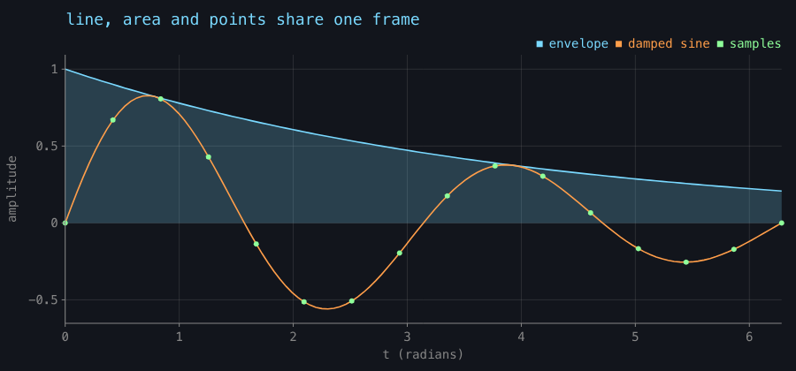
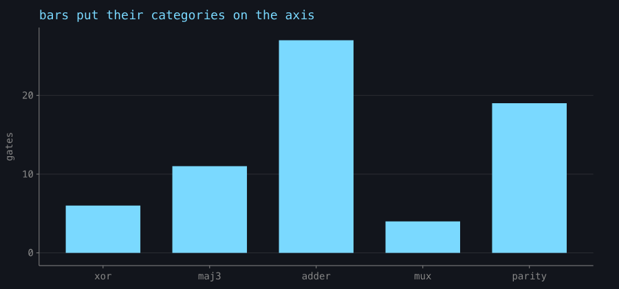
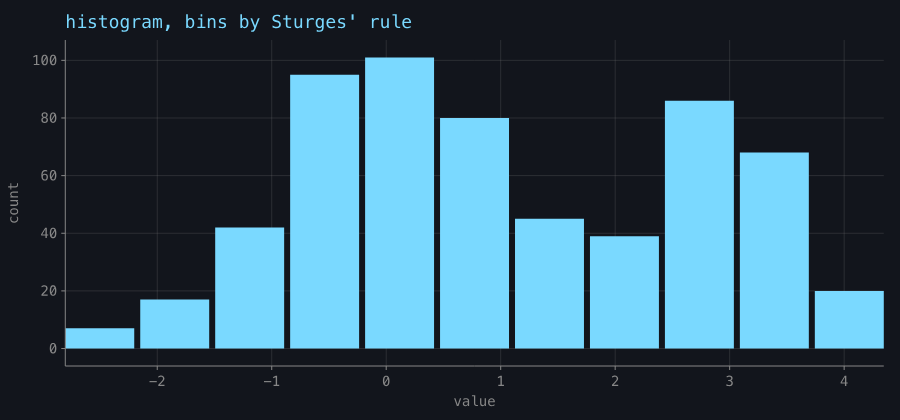
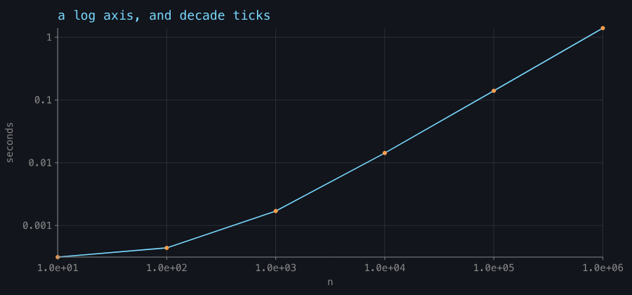
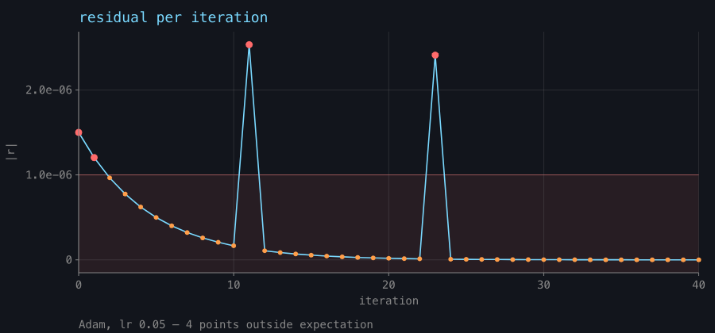

# Charts as FLines

*`chart()` builds a plot out of geometry rather than out of a browser — which matters for exactly three things, and for nothing else.*

`afield.Chart` is to a plot what `Table` is to a grid: build it, hand it to `showChart`, and it arrives
in the repo's style with no markup in the way. It implements `ToHTML`, so `showChart(c)`,
`display(channel, c)`, `c.h`, and a box whose last expression is a `Chart` all render the same figure.

```diffstatic {data-lang=kotlin}
Chart(title = "residual per iteration", xLabel = "iteration", yLabel = "|r|")
    .line("residual", iterations, residual)
    .points("residual", iterations, residual)
    .expect(max = 1e-6, because = "converged below 1e-6")
```

## Read this first: reach for Plotly, not for this

Field already has [Plotly](visualizers.md) — `linePlot`, `scatter`, `violin`, `showSignals` — and it is
a browser page, so the docs build captures it headlessly like anything else. **For a general plot
Plotly is the better answer**, and it is not close: it has real filled text with font fallback and
shaping, a legend with line swatches, axes that autorange, and it reflows to whatever shape you give
it. A `Chart` is fixed geometry that gets fitted and centred, so any aspect mismatch is empty margin,
and its text is geometry that scales with the fit rather than staying screen-relative. Neither of
those is a bug; both are reasons to default to Plotly.

The rule, decided after building this and comparing the two side by side:

> FLine is for what Plotly cannot do. Rasterisation is for what FLine cannot do.

Three things survive that comparison, and none of them is "drawing a plot":

1. **Composition with other FLine geometry** under one shared transform. Plotly owns its own canvas
   and cannot participate. This is the architectural reason and the strongest one.
2. **The pick path into Field's interactive SVG** — a mark that yields a hit record naming the
   element plus a local `(u, v)`.
3. **`expect()` as a drawn claim.** Plotly has no notion of it.

If none of those three applies to what you are doing, use Plotly.

## The marks

`points`, `line`, `area`, `bars`, `histogram`, plus `rule`, `vrule` and `band` for annotation. Marks
over the same numbers share one frame and one legend.

```diffstatic {data-lang=kotlin}
val xs = (0..120).map { it / 120.0 * 6.28318 }
val decay = xs.map { exp(-it * 0.25) * sin(it * 2.0) }
val envelope = xs.map { exp(-it * 0.25) }

Chart(title = "line, area and points share one frame", xLabel = "t (radians)", yLabel = "amplitude")
    .area("envelope", xs, envelope)
    .line("damped sine", xs, decay)
    .points("samples", xs.filterIndexed { i, _ -> i % 8 == 0 },
                       decay.filterIndexed { i, _ -> i % 8 == 0 })
```



`bars` takes categories and puts them on the axis, so you do not index them yourself:

```diffstatic {data-lang=kotlin}
Chart(title = "bars put their categories on the axis", yLabel = "gates")
    .bars("cost", listOf("xor", "maj3", "adder", "mux", "parity"), listOf(6, 11, 27, 4, 19))
```



`histogram` bins for you by Sturges' rule:



## Ticks, and why they are shared

`Scale(lo, hi, pixelLo, pixelHi, kind)` maps data to pixels with `toPixel`/`toData`. A y scale is
built *inverted*, because y grows downwards in Field's 2D outputs — that inversion is the whole
reason to have a type here rather than two closures.

Tick selection is `niceTicks(lo, hi, target)`, `logTicks`, `niceNumber`, `tickLabel` and `tickLabels`,
and the point of them being public is that Heckbert's nice-number algorithm had been written **five
times** privately across this repo — in `RectSL.kt`, twice in the AWT galleries, and twice more as
JavaScript inside string literals. Every copy was `private` or unreachable, so no caller could share
one and two of them could silently disagree about where a gridline goes.

Values are snapped to their own step, so an axis never reads `0.30000000000000004`, and `tickLabels`
picks one notation for a whole axis rather than per label.

Set `xKind`/`yKind` to `ScaleKind.LOG` for a log axis. A log scale **refuses** a non-positive domain,
and a non-positive datum maps to `NaN` and is dropped rather than clamped — clamping would draw a lie.

```diffstatic {data-lang=kotlin}
val n = (1..6).map { 10.0.pow(it) }
val time = n.map { it * 1.4e-6 + 3e-4 }

Chart(title = "a log axis, and decade ticks", xLabel = "n", yLabel = "seconds")
    .also { it.xKind = ScaleKind.LOG; it.yKind = ScaleKind.LOG }
    .line("measured", n, time)
    .points("measured", n, time)
```



## `expect()` — a claim you can watch fail

This is the part that is not formatting, and the reason to have a plot tier at all.
`expect(min, max, series, because)` **draws** the claim: the accepted range becomes a band across the
plot, the bounds it names are ruled, data outside recolours, and the footnote counts the violations.
An unbounded side draws no edge, which is the visual difference between "at most 1e-6" and "between
0 and 1e-6".

```diffstatic {data-lang=kotlin}
Chart(title = "residual per iteration", xLabel = "iteration", yLabel = "|r|", note = "Adam, lr 0.05")
    .line("residual", iterations, residual)
    .points("residual", iterations, residual)
    .expect(max = 1e-6, because = "converged below 1e-6")
```



Two things make this more than a shaded rectangle:

- **`Chart.deviations` hands the same list to a test**, so the figure a reader sees and the assertion
  a build runs are the same claim rather than two descriptions of it. There is also a predicate form,
  `expect(series, because) { x, y -> … }`, with no shape to draw.
- **It is `distinct()` by datum.** A `line` for the trend plus `points` to make it clickable is two
  marks over one datum; before the dedup the footnote said "8 points outside expectation" above four
  visibly red dots.

## Marks pick themselves up

`Box.lines` switches to the interactive SVG renderer the moment any line carries `onClick` or
`hoverColor`. Point and bar marks set both, plus a `label` naming the datum, so hovering a bar and
clicking a point work by construction:

```diffstatic {data-lang=kotlin}
val c = Chart(yLabel = "gates").bars("cost", "xor" to 6, "adder" to 27)
c.onPick = { pick -> print("${pick.series}/${pick.category} = ${pick.y}") }
showChart(c)
```

`pickable = false` is the escape hatch and `pickLimit` (default 400) is where a mark stops being
individually live.

Dots are real twelve-segment polygons rather than `pointed` nodes, which is a measured choice, not a
stylistic one: Skia's SVG export has no circle primitive and writes a `pointed` node as roughly
**5 kB of quadratic Béziers**, so a 90-point cloud came to 458 kB for one panel. A polygon is a few
hundred bytes, and unlike a `pointed` node it is a line of its own that can carry its own callback.

## From a DataFrame

`DataFrame<*>.chart()` picks the axes so you do not have to name them for a quick look — the first
numeric column for x if the frame has two or more, otherwise the first column as categories,
otherwise the row index; then every remaining numeric column as a series.

```diffstatic {data-lang=kotlin}
val people = dataFrameOf("name", "age")("Alice", 15, "Bob", 30, "Cara", 45)

people.chart()             // bars: age per name
people.chart(x = "age")    // age on the x axis
showChart(runs)            // straight from a frame to the screen
```

Series are capped for auto-selection, because a legend with fifteen entries in it is not a figure, and
the per-datum dots are dropped automatically for a frame with more rows than `pickLimit`. See
[DataFrames in a Box](dataframe.md).

## Down to geometry

`toFLines()` lowers the whole figure to `List<FLine>` in pixel space and `plotRect()` reports the
frame the derived insets landed on — which is what makes reason 1 above real: the chart can go into
the same drawing as the rest of your geometry, under one transform. `toHTML()` goes through
`afield.graphics.linesToHTML`, the same markup `Box.lines` builds.

Labels are glyph outlines, and there are three traps in that which `labelLines` avoids deliberately —
each has been got wrong in this repo before. `TextLayout.toFLines()` is **plural**, never one filled
`toFLine()`, whose triangulator fans disjoint contours from a shared origin and draws a starburst
where a word should be. Placement goes through `FLine.transform`, which copies control points too;
offsetting `node.to` alone leaves every cubic handle at the origin and smears each letter into a
streak. And the whole thing is wrapped in `runCatching`, because a headless machine with no fonts
should get an *unlabelled* chart rather than an exception in the middle of a figure.

## Where the pictures come from

The five figures above are **committed captures** from the `visualization.chart-gallery` FIELD_TEST,
rendered through the real path — `Chart.toFLines()` → Skia's `outputTo` on a raster surface → PNG —
with no AWT, no GPU and no Field window. Regenerate them with:

```bash
CHART_GALLERY_DIR=public/docs/assets/chart_gallery python3 tools/run_field_tests.py --id visualization.chart-gallery
```

They are committed rather than built by the docs runner, so they need that command re-run to reflect a
change. What stops them rotting silently is that the gallery is a FIELD_TEST rather than a script, and
its floors are set near measurements rather than at "more than nothing":

| guard | floor | measured |
|---|---|---|
| inked fraction | 4.5% | 5.7% (sparsest figure), 23–36% (the rest) |
| left gutter ink | 400 px | 490–978 |
| bottom gutter ink | 500 px | 606–2411 |
| counterfactual — same chart, different data | 8000 px moved | 10193 of 243200 |
| tick spacing spread | < 1e-3 px | 0.00e+00 |

The gutters are measured against `Chart.plotRect()` rather than a hard-coded strip, because the insets
are derived from the widest tick label. They exist because an overall ink floor cannot notice a chart
that lost its glyph outlines — the data is most of the ink. The counterfactual exists because
blank-versus-blank passes at zero differences.

The gallery also drives the interactive path live: `linesToHTML` must emit exactly one registered
callback per bar, and one is looked up and fired through `FLineClick.toIntersection()`, the same
conversion the server's `fline-click` route uses. What that does **not** cover is Chromium deciding
which `<g>` a click landed in; `tools/fline_hit_proof.py` covers that half.

The arithmetic is tested separately from the pixels — `afield.ChartTest` owns ticks, mapping, log
refusals and expectations:

```bash
./gradlew jvmTest --no-daemon --tests 'afield.ChartTest'
```

## Reference

The generated API listing is under [Visualization](reference/visualization.md); the source is
`visualization/charts.kt`, with the DataFrame entry point in `DataFrameCharts.kt`. Implementation
notes, the full Plotly comparison and the list of what was deliberately *not* built are in
`dev_docs/chart_primitive.md`.
