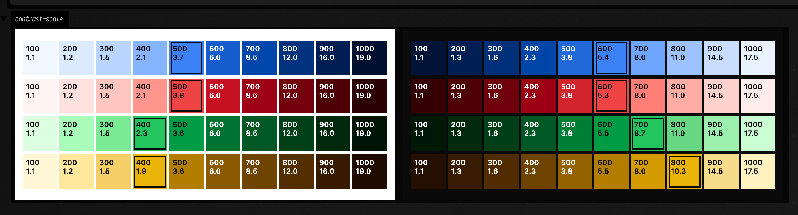
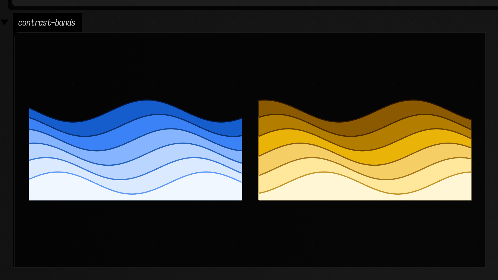
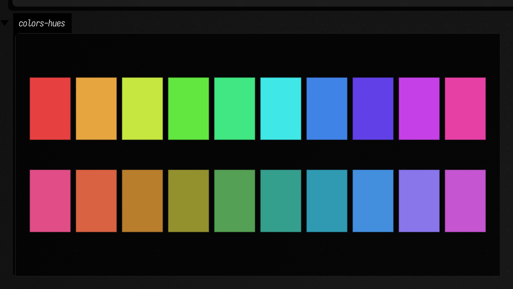

# Color trajectories and palettes

Start with two colours and draw the space between them. A ramp is a function of position, so
you can paint a sequence of swatches, colour a path, or move through it with a slider. Change
the interpolation space and the same endpoints give you a different middle.

## The same stops, four routes

Compare four blue-to-gold ramps. Move the position slider to mark the same point on every
route, then change the endpoint colours and see where the routes diverge.

```diffstatic_runner {data-lang=kotlin screenshot="assets/colors_examples/interpolation.png" alt="Four blue-to-gold ramps with their midpoints marked." wait="1.0" capture="box" open-outputs="true" w="760" h="220" name="four-routes" embed=true}
:::static
var first = colorHex("#3744df")
var last = colorHex("#ffd062")
var position = 0.5

fun drawRamps() {
    val stops: List<Vec4> = [first, last]
    val ramps: List<ColorTrajectory> = [
        colorRamp(stops, ColorSpace.SRGB),
        colorRamp(stops, ColorSpace.LINEAR_SRGB),
        colorRamp(stops, ColorSpace.OKLAB),
        colorRamp(stops, ColorSpace.OKLCH, HuePath.LONGER),
    ]

    :::fold Draw the strips and position markers
    val drawing = ramps.flatMapIndexed { row, ramp ->
        val y = 12.0 + row * 51.0
        ramp.sample(72).mapIndexed { i, swatch ->
            fline {
                rect(16.0 + i * 10.0, y, 10.2, 32.0)
                filled = true
                stroked = false
                color = swatch
            }
        } +
            fline {
                circle(21.0 + position * 710.0, y + 40.0, 4.0)
                filled = true
                stroked = false
                color = ramp(position)
            }
    }
    lines(drawing, channel = "Interpolation", w = 752.0, h = 213.0)
    :::endfold
}

drawRamps()
controlGroup("Endpoints") {
    colorPicker("Start", first) {
        first = it
        drawRamps()
    }
    colorPicker("End", last) {
        last = it
        drawRamps()
    }
    slider("Position", initialValue = position) {
        position = it
        drawRamps()
    }
}
```

Read the strips from top to bottom. **sRGB** averages the numbers you would type into a CSS
colour. **Linear sRGB** averages light and often makes a brighter middle. **OKLab** takes a
straight line in coordinates designed to make equal distances look more nearly equal.
**OKLCH** lets you choose which way to turn around the hue circle. Try `SHORTER` in the last
row, then add a third stop to all four ramps. Stops are evenly spaced in the parameter range.
Call `byPerceptualDistance()` to redistribute samples along the displayed path.

## Bend a path through OKLab

In OKLab, `L` is lightness and `a` and `b` are opponent axes. An OKLCH view rewrites the two
axes as chroma and hue. This box draws the sRGB gamut at a single lightness and lays a Bézier
trajectory across it. Edit the two handles to pull the trajectory around the grey centre.

```diffstatic_runner {data-lang=kotlin screenshot="assets/colors_examples/gamut-path.png" alt="An OKLab gamut slice crossed by a curve of marked swatches, with the resulting ramp at the right." wait="1.0" capture="box" open-outputs="true" w="620" h="365" name="gamut-path" embed=true}
:::static
val lightness = 0.71
fun point(a: Double, b: Double) = ColorCoordinates(ColorSpace.OKLAB, lightness, a, b)
val path = colorBezier(point(-0.13, 0.06), point(-0.04, -0.29), point(0.23, -0.08), point(0.08, 0.13))
val swatches = path.byPerceptualDistance().sample(12)

:::fold Draw the slice, trajectory and ramp
val slice = buildList {
    for (j in -19..19) for (i in -30..30) {
        val p = point(i * 0.009, j * 0.009)
        if (p.isInSrgb())
            add(
                fline {
                    rect(224.0 + i * 8.0, 164.0 - j * 8.0, 8.3, 8.3)
                    filled = true
                    stroked = false
                    color = p.toSrgb()
                },
            )
    }
}
val markers = swatches.map { swatch ->
    val p = colorCoordinates(swatch)
    fline {
        circle(228.0 + p.y / 0.009 * 8.0, 168.0 - p.z / 0.009 * 8.0, 5.0)
        filled = false
        stroked = true
        thickness = 2.0
        color = colorHex("#16151c")
    }
}
val strip = swatches.mapIndexed { i, swatch ->
    fline {
        rect(490.0, 19.0 + i * 25.0, 82.0, 24.0)
        filled = true
        stroked = false
        color = swatch
    }
}
lines(slice + markers + strip, channel = "OKLab slice", w = 595.0, h = 332.0)
:::endfold
```

For a path with changing lightness, try `colorHelix(startLightness = 0.22, endLightness = 0.91,
startHueDegrees = 285.0, turns = -0.8)`. The helix takes a share of the available chroma at
each point, so the path stays inside sRGB as it approaches white or black. A rising lightness
helps show an ordered quantity. Field’s [named colormaps](reference/graphics.md#colormaps-kt)
offer another starting point.

## Pick swatches by contrast

Give `contrastPalette` a trajectory and target ratios, as in Adobe’s Leonardo. This instrument
runs three hue trajectories against one background. Each column requests a higher ratio.
Try darkening the ground to reach the last target. [Adobe Leonardo](https://github.com/adobe/leonardo)

```diffstatic_runner {data-lang=kotlin screenshot="assets/colors_examples/contrast-instrument.png" alt="Three hue families on a dark ground. Small outlined circles mark unreachable contrast targets." wait="1.0" capture="box" open-outputs="true" w="690" h="250" name="contrast-instrument" embed=true}
:::static
val targets: List<Double> = [1.5, 3.0, 4.5, 7.0, 12.0]
var groundLightness = 0.32
var chroma = 0.77

fun drawPalette() {
    val ground = oklch(groundLightness, 0.025, 265)
    val rows =
        [28.0, 157.0, 270.0].map { hue ->
            val path = colorHelix(groundLightness, 0.93, hue, turns = -0.13, chromaFraction = chroma)
            contrastPalette(path, ground, targets)
        }

    :::fold Draw on the actual ground and mark misses
    val paper = fline {
        rect(0.0, 0.0, 682.0, 226.0)
        filled = true
        stroked = false
        color = ground
    }
    val swatches = rows.flatMapIndexed { row, colors ->
        colors.flatMapIndexed { col, swatch ->
            val x = 22.0 + col * 135.0
            val y = 20.0 + row * 69.0
            val tile = fline {
                rect(x, y, 98.0, 48.0)
                filled = true
                stroked = false
                color = swatch.color
            }
            val tileAndMarker: List<FLine> =
                if (swatch.reached) [tile]
                else
                    [
                        tile,
                        fline {
                            circle(x + 113, y + 24, 5.0)
                            filled = false
                            stroked = true
                            color = colorHex("#f3efea")
                        },
                    ]
            tileAndMarker
        }
    }
    lines([paper] + swatches, channel = "Contrast on ground", w = 682.0, h = 226.0)
    :::endfold
    markdown(
        "Ratios",
        rows.joinToString("\n\n") { row ->
            row.joinToString(" · ") { swatch ->
                val actual = "%.2f".format(java.util.Locale.ROOT, swatch.achieved)
                "${swatch.target} → $actual" + if (swatch.reached) "" else " (miss)"
            }
        },
        open = false,
    )
}

drawPalette()
controlGroup("Palette") {
    slider("Ground lightness", min = 0.08, max = 0.78, initialValue = groundLightness) {
        groundLightness = it
        drawPalette()
    }
    slider("Chroma fraction", initialValue = chroma) {
        chroma = it
        drawPalette()
    }
}
```

The search measures the drawable colour over the opaque ground. It samples the whole path
and refines the first detected crossing. Raise `resolution` if the curve has narrow peaks.
**3:1** and **4.5:1** are WCAG’s large-text and body-text AA thresholds respectively.
Those ratios describe each swatch against the ground. Use `deltaEOK` to compare distances
*between* swatches. For a quick categorical ring, use `paletteForBackground` below.
[WCAG contrast definition](https://www.w3.org/TR/WCAG22/#dfn-contrast-ratio)

### One colour, ten steps: contrastScale

`contrastPalette` takes a trajectory and any list of targets. `contrastScale` is the recipe for the common case, after [TaishoDS's one-colour palette method](https://taisho.design/en/blog/accessible-color-palette-from-one-color) (MIT): you give it one colour and a background, and it returns a fixed ten-step scale (100 to 1000) of `ContrastSwatch`es, each step at a set WCAG contrast against that background, with your colour on it exactly. On white the targets are 1.08, 1.22, 1.5, 2.1, 3.6, 6, 8.5, 12, 16 and 19. Your colour goes on the step whose target is closest to its own contrast and stays there unchanged. Every other step runs `contrastPalette` along an OKLCH lightness trajectory through your colour's hue, with the chroma eased off toward both ends. Yellows are the one exception: they turn toward orange as they darken, so the dark end comes out amber instead of olive.

The box below builds a scale for Tailwind's `#3b82f6` blue and three other colours, once on white and once on near-black. Each swatch is labelled with its step and its measured contrast, in the text colour the scale picks for it, and an inset outline marks the colour you passed in.

```diffstatic_runner {data-lang=kotlin screenshot="assets/colors_examples/contrast_scale_light_dark.png" wait="1.0" capture="box" open-outputs="true"}
:::static
val seeds = ["#3b82f6", "#ef4444", "#22c55e", "#eab308"].map { colorHex(it) }
val white = vec(1.0, 1.0, 1.0, 1.0)
val nearBlack = colorHex("#0a0a0a")

fun css(c: Vec4) = "rgb(${(c.x * 255).roundToInt()},${(c.y * 255).roundToInt()},${(c.z * 255).roundToInt()})"

fun panel(background: Vec4): String {
    val rows =
        seeds.joinToString("") { seed ->
            val scale = contrastScale(seed, background)
            val cells =
                scale.colors.indices.joinToString("") { i ->
                    val step = contrastScaleSteps[i]
                    val ring =
                        if (step == scale.seedStep) "outline:2px solid ${css(scale.textOn[i])};outline-offset:-4px;"
                        else ""
                    "<div style='width:52px;height:52px;background:${css(scale.colors[i])};color:${css(scale.textOn[i])};$ring" +
                        "font:600 11px system-ui;padding:5px;box-sizing:border-box'>$step<br>${scale.swatches[i].achieved.f1}</div>"
                }
            "<div style='display:flex;gap:3px;margin:5px 0'>$cells</div>"
        }
    return "<div style='background:${css(background)};padding:12px'>$rows</div>"
}

display("contrast-scale", "<div style='display:flex;gap:12px'>${panel(white)}${panel(nearBlack)}</div>")
```



On white the blue keeps its place on 500 at 3.7:1. On near-black the same blue measures about 5.4:1 and goes to 600, because a dark ground has its own targets (`contrastTargetsDark`: 1.08, 1.25, 1.6, 2.3, 3.8, 5.5, 8, 11, 14.5, 17.5), not the light ones reversed. The green and the yellow are too light for 500 on white, so they go to 400 and 500 is computed for them at 3.6:1. Tailwind's own green-500 and yellow-500 measure only 2.3:1 and 1.9:1. Steps 600 to 1000 always clear 4.5:1 against the background, so any of them can be used for text; 100 to 300 are for surfaces and borders. `scale.textOn` gives the better of near-black and white for text on each step, and `scale[700]` is that step's swatch.

#### Ramps on plots

A scale is ordered by contrast, so it works as a sequential colour map wherever a plot needs one. Here two ramps fill stacked bands: each band takes the next step, and the line along its top edge is the step four higher, which always stands out from the fill beneath it.

```diffstatic_runner {data-lang=kotlin screenshot="assets/colors_examples/contrast_scale_bands.png" wait="1.0" capture="box" open-outputs="true"}
:::static
val white = vec(1.0, 1.0, 1.0, 1.0)
val blues = contrastScale(colorHex("#3b82f6"), white)
val ambers = contrastScale(colorHex("#eab308"), white)

fun bands(scale: ContrastScale, x0: Double, phase: Double): List<FLine> =
    (0 until 6)
        .map { k ->
            val top = { x: Double -> 260.0 - k * 34.0 - 26.0 * sin(x * 0.018 + phase + k * 0.5) }
            fline {
                moveTo(x0, 300.0)
                for (i in 0..100) {
                    val x = x0 + i * 5.0
                    lineTo(x, top(x))
                }
                lineTo(x0 + 500.0, 300.0)
                lineTo(x0, 300.0)
                filled = true
                color = scale.colors[k]
            }
        }
        .reversed()

fun edges(scale: ContrastScale, x0: Double, phase: Double): List<FLine> =
    (0 until 6).map { k ->
        fline {
            for (i in 0..100) {
                val x = x0 + i * 5.0
                val y = 260.0 - k * 34.0 - 26.0 * sin(x * 0.018 + phase + k * 0.5)
                if (i == 0) moveTo(x, y) else lineTo(x, y)
            }
            stroked = true
            color = scale.colors[k + 4]
            thickness = 1.5
        }
    }

lines(
    bands(blues, 20.0, 0.0) + edges(blues, 20.0, 0.0) + bands(ambers, 560.0, 1.3) + edges(ambers, 560.0, 1.3),
    channel = "contrast-bands",
    w = 1080.0,
    h = 320.0,
    fitToSize = true,
)
```



The yellow bands go from pale lemon to amber and do not turn olive.

For categorical series, use `paletteForBackground` below, which gives *different hues* at one lightness and repairs only the ones that fail. For one colour used for a surface, a border, text and its hover state, use `contrastScale`: step 700 of a blue scale and step 700 of a red one stand out from the ground by the same amount.

Two differences from TaishoDS: the dark-mode targets here are Field's own (the post does not publish its numbers), and v0.17's "contrast zone" shift is not implemented, the rule that moves a seed near 4.5:1 until text on it also passes. Here a seed is never moved. Steps 600 and up still clear 4.5:1 against the background, because the boundary between 500 and 600 sits above 4.5 in both modes. Over all 4,096 colours of a 16-level sRGB grid, on white and on `#0a0a0a`, the lowest text-step contrast is 4.57:1 (the same after rounding to 8 bits), and every one of the 8,192 scales gets steadily further from the background, step by step.

## Mix paint with the same endpoints

Take two named tubes and draw their thick paint colours at the edges. The top row interpolates
in OKLab. The middle feeds the same endpoints to the spectral Kubelka–Munk mixer, which
estimates reflectance from RGB. The bottom mixes named tubes as Field’s brush palette does,
including their tinting strengths. In the bottom row, 50% means equal parts by volume.

```diffstatic_runner {data-lang=kotlin screenshot="assets/colors_examples/paint-trajectories.png" alt="Three rows from yellow to blue, comparing an OKLab ramp with spectral mixtures and the brush’s named-tube mixtures." wait="1.0" capture="box" open-outputs="true" requires="paint" w="700" h="215" name="paint-trajectories" embed=true}
:::static
val yellow = "cadmium yellow"
val blue = "ultramarine blue"
val first = Tubes[yellow].color
val last = Tubes[blue].color
val rows: List<ColorTrajectory> = [
    colorRamp([first, last]),
    spectralColorRamp(first, last),
    tubeColorRamp(yellow, blue),
]

val chips = rows.flatMapIndexed { row, ramp ->
    ramp.sample(17).mapIndexed { i, swatch ->
        fline {
            rect(18.0 + i * 39.0, 15.0 + row * 59.0, 36.0, 42.0)
            filled = true
            stroked = false
            color = swatch
        }
    }
}
lines(chips, channel = "Yellow into blue", w = 698.0, h = 193.0)
```

Use completion inside either quoted argument of `tubeColorRamp` to swap in a stronger blue
or a less opaque yellow. `Tubes.names` lists the full catalogue. To turn a point on
the bottom row into a brush load, pass the same parts to `brush.load(mapOf(yellow to
(1.0 - t), blue to t))`. The strip shows the mixture’s masstone, the colour of a thick
application. See what thickness, solvent and the ground do to a stroke. [Paint canvas](paint_canvas.md)

## One colour on two grounds

In Josef Albers’s *Interaction of Color*, a single piece of coloured paper can appear to
change when it sits on two different grounds. The two inner squares below share one sRGB
value. Enable **Neutral grounds** to compare the squares directly. Change the centre colour
and see how much the surrounds shift it.
[Interaction of Color](https://yalebooks.yale.edu/book/9780300179354/interaction-of-color/)

```diffstatic_runner {data-lang=kotlin screenshot="assets/colors_examples/one-color-two-grounds.png" alt="Identical muted squares on navy and apricot grounds. The centre appears lighter on the darker ground." wait="1.0" capture="box" open-outputs="true" w="685" h="235" name="two-grounds" embed=true}
:::static
var patch = colorHex("#a4968e")
var neutral = false

fun square(x: Double, y: Double, side: Double, pigment: Vec4) = fline {
    rect(x, y, side, side)
    filled = true
    stroked = false
    color = pigment
}

fun showGrounds() {
    val grey = colorHex("#808080")
    val left = if (neutral) grey else colorHex("#25345d")
    val right = if (neutral) grey else colorHex("#f8b177")
    lines(
        square(110.0, 10.0, 220.0, left),
        square(340.0, 10.0, 220.0, right),
        square(184.0, 84.0, 72.0, patch),
        square(414.0, 84.0, 72.0, patch),
        channel = "One colour, two grounds",
        w = 670.0,
        h = 240.0,
    )
}

showGrounds()
controlGroup("Surrounds") {
    colorPicker("Centre", patch) {
        patch = it
        showGrounds()
    }
    checkbox("Neutral grounds") {
        neutral = it
        showGrounds()
    }
}
```

Goethe’s *Theory of Colours* asks what the eye contributes over time. Try an afterimage
with this drawing. Look at an uninterrupted area of the apricot ground for several seconds,
then move your gaze to a blank pale area. You may see a fleeting cool patch. The two-ground
exercise changes the two surrounds concurrently. The afterimage follows a change in where
you look. An OKLCH half-turn designs an opposing hue for a palette. The appearance of an
afterimage depends on the viewer and the viewing conditions.
[Goethe’s *Theory of Colours*, Physiological Colours](https://www.gutenberg.org/ebooks/50572)

## Coordinates, gamut and drawing values

Read a drawing colour with `colorCoordinates(color, space)`. For an out-of-gamut colour you
want to keep editing, start with `ColorCoordinates` and use `convert`. Call `toSrgb()` when
you need a `Vec4` for a line, fill or shader. The default gamut mapping reduces OKLCH chroma
at fixed lightness and hue. Use `ColorGamut.CLIP` to compare with per-channel clipping.

| Space | Coordinates |
| --- | --- |
| `SRGB`, `LINEAR_SRGB` | Encoded RGB and linear light respectively. Reference white has channels of 1. |
| `DISPLAY_P3` | Display P3 primaries with the sRGB transfer curve. |
| `XYZ_D65` | Tristimulus coordinates with a D65 white and reference Y of 1. |
| `LAB_D65` | CIELAB relative to D65. Lightness runs from 0 to 100. |
| `OKLAB` | Lightness from 0 to 1, then two opponent axes. |
| `OKLCH` | OKLab lightness, chroma and hue in degrees. |

For the models and conversion conventions, see [Björn Ottosson’s Oklab derivation](https://bottosson.github.io/posts/oklab/),
[CSS Color 4](https://www.w3.org/TR/css-color-4/) and
[Color.js’s interpolation examples](https://colorjs.io/docs/interpolation.html).

For a literal colour, use `colorHex("#c66c5f")`, `rgb255(198, 108, 95)` or
`rgb(0.78, 0.42, 0.37)`. With `rgb`, any RGB channel above 1 selects the 0–255 scale for
all three. For a hue wheel, `hsl`, `okhsl` and `okhsv` accept turns up to magnitude 1
and degrees above that. `cssHsla` always accepts degrees.

## HSL vs OKHSL hue sets

Stepping evenly round the hue wheel is the obvious way to ask for ten distinguishable colors, and it mostly works. What drifts is perceived weight. One swatch shouts, the next one disappears, and ten colors that were meant to read as a family stop doing so.

```diffstatic_runner {data-lang=kotlin screenshot="assets/colors_examples/hsl_okhsl_sets.png" wait="1.0" capture="box"}
:::static
fun swatchRow(y0: Double, colors: List<Vec4>, h: Double): List<FLine> = colors.mapIndexed { i, c ->
    val x0 = 40.0 + i * 90.0
    fline {
        rect(x0, y0, 78.0, h)
        filled = true
        stroked = true
        color = c
        thickness = 1.2
    }
}

val hslSet = hueSetHsl(10, saturation = 0.78, lightness = 0.58)
val okhslSet = hueSetOkhsl(10, saturation = 0.78, lightness = 0.58)

lines(
    swatchRow(120.0, hslSet, 120.0) + swatchRow(300.0, okhslSet, 120.0),
    channel = "colors-hues",
    w = 1000.0,
    h = 560.0,
    fitToSize = true,
)
```

The `swatchRow(...)` helper removes everything except the palette itself: same count, same geometry, same spacing, same background, one row per hue system.



In the HSL row on top, the third and sixth swatches (a yellow-green and a cyan) come forward off the black; the OKHSL row below holds one weight across all ten. `okhsl`'s `l` is perceived lightness rather than an HSL number, so no entry ends up conspicuously brighter than its neighbours the way an HSL yellow does.

## paletteForBackground on layered paths

A palette can look fine in isolation and fail against a real background. The colors have to read against the ground and against each other, and on a dark canvas the ones that fail are the dark ones.

```diffstatic_runner {data-lang=kotlin screenshot="assets/colors_examples/palette_background_paths.png" wait="1.0" capture="box" open-outputs="true"}
:::static
val bg = rgb(0.06, 0.08, 0.11, 1.0)
val palette = paletteForBackground(bg, count = 7, saturation = 0.78, lightness = 0.63, minContrast = 3.5)

fun ring(radius: Double, phase: Double, color: Vec4): FLine = fline {
    val n = 260
    breakNext()
    for (i in 0..n) {
        val t = i / n.toDouble() * PI * 2.0
        val x = 540.0 + cos(t + phase) * radius
        val y = 340.0 + sin(t + phase * 1.4) * radius * 0.55
        lineTo(x, y)
    }
    stroked = true
    filled = false
    this.color = color
    this.thickness = 3.0
}

val ground = fline {
    rect(160.0, 130.0, 760.0, 420.0)
    filled = true
    stroked = false
    color = bg
}
val rings = palette.mapIndexed { i, c -> ring(80.0 + i * 38.0, i * 0.21, c) }

lines([ground] + rings, channel = "colors-rings", w = 760.0, h = 420.0, fitToSize = true)
```

`paletteForBackground(...)` starts from the same evenly spaced okhsl ring as `hueSetOkhsl`, then for any entry whose WCAG contrast against the background falls short of `minContrast` it walks that entry's lightness until it clears the bar; a dark background is searched lighter first. Here it gets `minContrast = 3.5`, a little above the WCAG large-text threshold of 3, and all seven colors go on nested rings where a weak one would be easy to spot.


The ring generator always returns the requested count. When a hue misses the threshold, you
get its highest-contrast candidate from the search. Measure each colour with
`wcagContrast(it, bg)` to see which ones cleared the target. For the geometry and signals
that can drive the palette, see [FLine examples](fline_examples.md) and
[Functions examples](functions_examples.md).

See the [trajectory API](reference/graphics.md#colortrajectory-kt),
[coordinate conversions](reference/graphics.md#colorcoordinates-kt), and
[original color constructors](reference/graphics.md#colors-kt).
