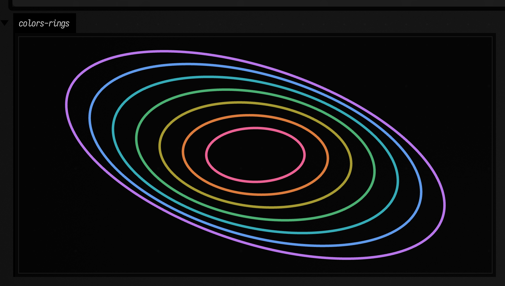

# Colors to FLine examples

A colour can look good on its own and disappear beside its neighbours. These examples draw a
whole palette as geometry, so you can see how its colours work together.

Every constructor returns an sRGB-encoded `Vec4` with components in `[0,1]`. There are four color spaces to build from:

- **sRGB**: `rgb(r, g, b, a)` (alias `rgba`) takes components already sRGB-encoded, on 0..1 or 0..255. The scale is guessed per call: any of `r`, `g`, `b` above 1 means 0..255. `rgb255(...)` is the same thing always on 0..255, so nothing is guessed.
- **HSL**: `hsl(h, s, l, a)` (alias `hsla`) is the classic cylinder on sRGB-encoded values, so it gives the same colour as CSS `hsl()` for the same numbers. `cssHsla` is the same colour with CSS's conventions: hue always in degrees.
- **OKHSL**: `okhsl(h, s, l, a)` is hue, saturation and lightness built on Oklab, with `l` as *perceived* lightness and `s = 1` at the gamut edge for that hue.
- **OKHSV**: `okhsv(h, s, v, a)` is the HSV-shaped version of the same, where `v` dims a color toward black.

The three hue-based spaces read `h` as a fraction of a turn below 1 and as degrees from 1 up. Each one also has a ring generator that spaces `count` hues evenly: `hueSetHsl`, `hueSetOkhsl` and `hueSetOkhsv`, with the short aliases `hslSet`, `okhslSet` and `okhsvSet`. `paletteForBackground` builds an OKHSL ring and then corrects it for contrast. Oklab itself is used inside the file and has no public constructor.

## HSL vs OKHSL hue sets

Stepping evenly round the hue wheel is the obvious way to ask for ten distinguishable colors, and it mostly works. What drifts is perceived weight. One swatch shouts, the next one disappears, and ten colors that were meant to read as a family stop doing so.

```diffstatic_runner {data-lang=kotlin screenshot="assets/colors_examples/hsl_okhsl_sets.png" wait="1.0" capture="box"}
:::static
fun swatchRow(y0: Double, colors: List<Vec4>, h: Double): List<FLine> = colors.mapIndexed { i, c ->
    val x0 = 40.0 + i * 90.0
    fline {
        rect(x0, y0, 78.0, h)
        filled = true
        stroked = true
        color = c
        thickness = 1.2
    }
}

val hslSet = hueSetHsl(10, saturation = 0.78, lightness = 0.58)
val okhslSet = hueSetOkhsl(10, saturation = 0.78, lightness = 0.58)

lines(
    swatchRow(120.0, hslSet, 120.0) + swatchRow(300.0, okhslSet, 120.0),
    channel = "colors-hues",
    w = 1000.0,
    h = 560.0,
    fitToSize = true,
)
```

The `swatchRow(...)` helper removes everything except the palette itself: same count, same geometry, same spacing, same background, one row per hue system.


In the HSL row on top, the third and sixth swatches (a yellow-green and a cyan) come forward off the black; the OKHSL row below holds one weight across all ten. `okhsl`'s `l` is perceived lightness rather than an HSL number, so no entry ends up conspicuously brighter than its neighbours the way an HSL yellow does.

## paletteForBackground on layered paths

A palette can look fine in isolation and fail against a real background. The colors have to read against the ground and against each other, and on a dark canvas the ones that fail are the dark ones.

```diffstatic_runner {data-lang=kotlin screenshot="assets/colors_examples/palette_background_paths.png" wait="1.0" capture="box" open-outputs="true"}
:::static
val bg = rgb(0.06, 0.08, 0.11, 1.0)
val palette = paletteForBackground(bg, count = 7, saturation = 0.78, lightness = 0.63, minContrast = 3.5)

fun ring(radius: Double, phase: Double, color: Vec4): FLine = fline {
    val n = 260
    breakNext()
    for (i in 0..n) {
        val t = i / n.toDouble() * PI * 2.0
        val x = 540.0 + cos(t + phase) * radius
        val y = 340.0 + sin(t + phase * 1.4) * radius * 0.55
        lineTo(x, y)
    }
    stroked = true
    filled = false
    this.color = color
    this.thickness = 3.0
}

val rings = palette.mapIndexed { i, c -> ring(80.0 + i * 38.0, i * 0.21, c) }

lines(rings, channel = "colors-rings", w = 1120.0, h = 740.0, fitToSize = true)
```

`paletteForBackground(...)` starts from the same evenly spaced okhsl ring as `hueSetOkhsl`, then for any entry whose WCAG contrast against the background falls short of `minContrast` it walks that entry's lightness until it clears the bar; a dark background is searched lighter first. Here it gets `minContrast = 3.5`, a little above the WCAG large-text threshold of 3, and all seven colors go on nested rings where a weak one would be easy to spot.



Every ring stays readable and none sinks into the background. If nothing reaches `minContrast` the best candidate found is returned rather than an exception, so the call always hands back the count you asked for and it is the picture that tells you whether it managed. For more on constructing the underlying paths, see [FLine examples](fline_examples.md); for functional signal stacks that can drive color or geometry, see [Functions examples](functions_examples.md).

## One colour, ten steps: contrastScale

`paletteForBackground` repairs colours after the fact. `contrastScale` works the other way round, after [TaishoDS's one-colour palette method](https://taisho.design/en/blog/accessible-color-palette-from-one-color) (MIT): you give it one colour and a background, and it builds a ten-step ramp (100 to 1000) in which every step sits at a set WCAG contrast against that background. On white the targets are 1.08, 1.22, 1.5, 2.1, 3.6, 6, 8.5, 12, 16 and 19. Your colour goes on the step whose target is closest to its own contrast and stays there unchanged. Every other step keeps its OKLCH hue and gets the lightness that hits its target. Yellows are the one exception: they turn toward orange as they darken, so the dark end comes out amber instead of olive.

The box below builds a scale for Tailwind's `#3b82f6` blue and three other colours, once on white and once on near-black. Each swatch is labelled with its step and its measured contrast, in the text colour the scale picks for it, and an inset outline marks the colour you passed in.

```diffstatic_runner {data-lang=kotlin screenshot="assets/colors_examples/contrast_scale_light_dark.png" wait="1.0" capture="box" open-outputs="true"}
:::static
val seeds = ["#3b82f6", "#ef4444", "#22c55e", "#eab308"].map { hexColor(it) }
val white = vec(1.0, 1.0, 1.0, 1.0)
val nearBlack = hexColor("#0a0a0a")

fun css(c: Vec4) = "rgb(${(c.x * 255).roundToInt()},${(c.y * 255).roundToInt()},${(c.z * 255).roundToInt()})"

fun panel(background: Vec4): String {
    val rows = seeds.joinToString("") { seed ->
        val scale = contrastScale(seed, background)
        val cells = scale.colors.indices.joinToString("") { i ->
            val step = contrastScaleSteps[i]
            val ring = if (step == scale.seedStep) "outline:2px solid ${css(scale.textOn[i])};outline-offset:-4px;" else ""
            "<div style='width:52px;height:52px;background:${css(scale.colors[i])};color:${css(scale.textOn[i])};$ring" +
                "font:600 11px system-ui;padding:5px;box-sizing:border-box'>$step<br>${scale.contrasts[i].f1}</div>"
        }
        "<div style='display:flex;gap:3px;margin:5px 0'>$cells</div>"
    }
    return "<div style='background:${css(background)};padding:12px'>$rows</div>"
}

display("contrast-scale", "<div style='display:flex;gap:12px'>${panel(white)}${panel(nearBlack)}</div>")
```


On white the blue keeps its place on 500 at 3.7:1. On near-black the same blue measures about 5.4:1 and goes to 600, because a dark ground has its own targets (`contrastTargetsDark`: 1.08, 1.25, 1.6, 2.3, 3.8, 5.5, 8, 11, 14.5, 17.5), not the light ones reversed. The green and the yellow are too light for 500 on white, so they go to 400 and 500 is computed for them at 3.6:1. Tailwind's own green-500 and yellow-500 measure only 2.3:1 and 1.9:1. Steps 600 to 1000 always clear 4.5:1 against the background, so any of them can be used for text; 100 to 300 are for surfaces and borders. `scale.textOn` gives the better of near-black and white for text on each step, and `wcagContrast(a, b)` measures any pair.

### Ramps on plots

A scale is ordered by contrast, so it works as a sequential colour map wherever a plot needs one. Here two ramps fill stacked bands: each band takes the next step, and the line along its top edge is the step four higher, which always stands out from the fill beneath it.

```diffstatic_runner {data-lang=kotlin screenshot="assets/colors_examples/contrast_scale_bands.png" wait="1.0" capture="box" open-outputs="true"}
:::static
val white = vec(1.0, 1.0, 1.0, 1.0)
val blues = contrastScale(hexColor("#3b82f6"), white)
val ambers = contrastScale(hexColor("#eab308"), white)

fun bands(scale: ContrastScale, x0: Double, phase: Double): List<FLine> = (0 until 6).map { k ->
    val top = { x: Double -> 260.0 - k * 34.0 - 26.0 * sin(x * 0.018 + phase + k * 0.5) }
    fline {
        moveTo(x0, 300.0)
        for (i in 0..100) {
            val x = x0 + i * 5.0
            lineTo(x, top(x))
        }
        lineTo(x0 + 500.0, 300.0)
        lineTo(x0, 300.0)
        filled = true
        color = scale.colors[k]
    }
}.reversed()

fun edges(scale: ContrastScale, x0: Double, phase: Double): List<FLine> = (0 until 6).map { k ->
    fline {
        for (i in 0..100) {
            val x = x0 + i * 5.0
            val y = 260.0 - k * 34.0 - 26.0 * sin(x * 0.018 + phase + k * 0.5)
            if (i == 0) moveTo(x, y) else lineTo(x, y)
        }
        stroked = true
        color = scale.colors[k + 4]
        thickness = 1.5
    }
}

lines(bands(blues, 20.0, 0.0) + edges(blues, 20.0, 0.0) + bands(ambers, 560.0, 1.3) + edges(ambers, 560.0, 1.3), channel = "contrast-bands", w = 1080.0, h = 320.0, fitToSize = true)
```


The yellow bands go from pale lemon to amber and do not turn olive.

### contrastScale against paletteForBackground

The two answer different questions. `paletteForBackground(bg, count)` gives *different hues* at one lightness, and fixes only the entries that fall below `minContrast`, by moving each one as little as it can. Its output therefore clears the bar by different margins: the colours that needed no fixing keep their margin, and the fixed ones sit just over it. `contrastScale(seed, bg)` gives *one hue* at ten set contrasts, so step 700 of a blue scale and step 700 of a red one stand out from the ground by the same amount. For categorical series, use `paletteForBackground`. For one colour used for a surface, a border, text and its hover state, use `contrastScale`. For both, build one `contrastScale` per `paletteForBackground` colour and take the same step from each.

Two differences from TaishoDS: the dark-mode targets here are Field's own (the post does not publish its numbers), and v0.17's "contrast zone" shift is not implemented, the rule that moves a seed near 4.5:1 until text on it also passes. Here a seed is never moved. Steps 600 and up still clear 4.5:1 against the background, because the boundary between 500 and 600 sits above 4.5 in both modes. Over all 4,096 colours of a 16-level sRGB grid, on white and on `#0a0a0a`, the lowest text-step contrast is 4.57:1 (the same after rounding to 8 bits), and every one of the 8,192 scales gets steadily further from the background, step by step.

*The public declarations used on this page are listed, with their KDoc, in the codebase reference: [`colors.kt`](reference/graphics.md#colors-kt). Start from [what's already in the box](reference/index.md).*
