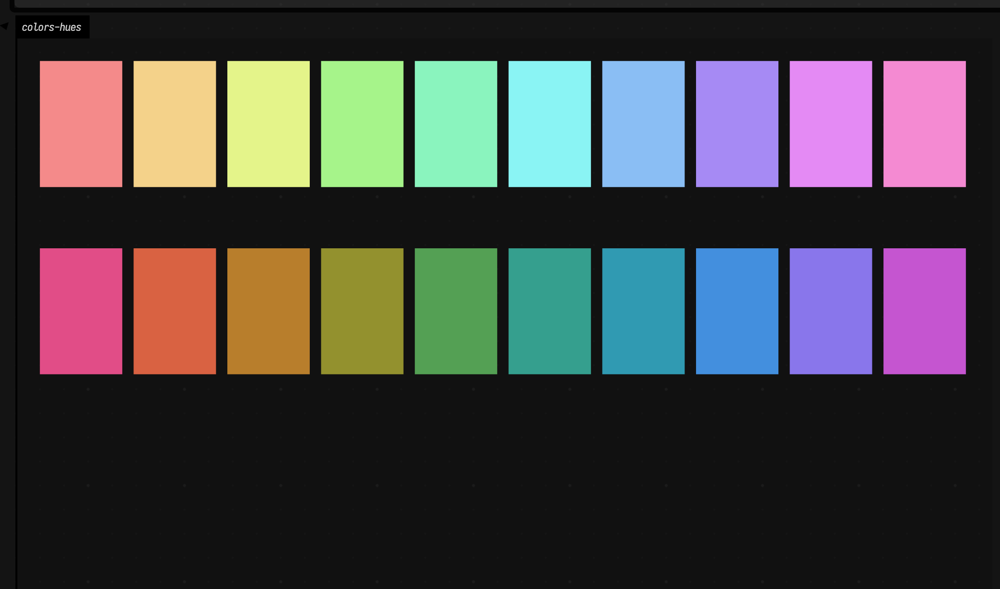
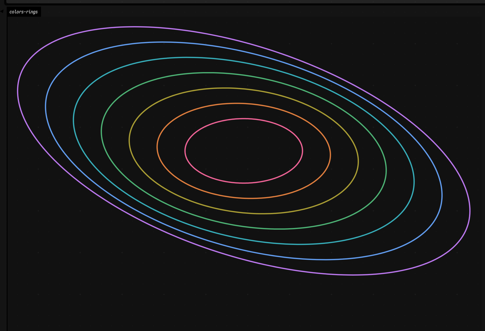

# Colors to FLine examples

Color is one of those subjects that everybody thinks they understand until they have to pick five related colors that all survive on the same page. In creative coding the failure mode is muddy geometry; in data visualization it is two series that can no longer be distinguished; in music tools it is a control surface that stops reading at a glance. These examples keep color attached to shapes, where those problems become obvious quickly.

## HSL vs OKHSL hue sets

What goes wrong when you generate a palette by "just stepping the hue"? Often the colors do change, but their *weight* does not stay put: one swatch shouts, the next swatch disappears, and the whole set refuses to behave as a family. That matters for legends, note lanes, overlays, and any drawing where several related colors need to coexist without fighting each other.

```diffstatic_runner {data-lang=kotlin screenshot="assets/colors_examples/hsl_okhsl_sets.png" wait="1.0" capture="box"}
:::static
import afield.graphics.FLine
import afield.stdlib.*

fun swatchRow(y0: Double, colors: List<Vec4>, h: Double): List<FLine> = colors.mapIndexed { i, c ->
    val x0 = 40.0 + i * 90.0
    val x1 = x0 + 78.0
    fline {
        moveTo(x0, y0)
        lineTo(x1, y0)
        lineTo(x1, y0 + h)
        lineTo(x0, y0 + h)
        close()
        filled = true
        stroked = true
        color = c
        thickness = 1.2
    }
}

val hslSet = hueSetHsl(10, saturation = 0.78, lightness = 0.58)
val okhslSet = hueSetOkhsl(10, saturation = 0.78, lightness = 0.58)

lines(
    swatchRow(120.0, hslSet, 120.0) + swatchRow(300.0, okhslSet, 120.0),
    channel = "colors-hues",
    w = 1000.0,
    h = 560.0,
    fitToSize = true
)
```

So here we ask two different hue systems the same question. A small `swatchRow(...)` helper removes everything except the palette itself: same number of colors, same geometry, same spacing, same background.



Once the rows are on screen, the issue stops being theoretical. The HSL set drifts more in perceived brightness, while the OKHSL set holds together more evenly. If you are coloring repeated geometry, multiple voices, or several plotted series, that steadier lightness is often the difference between "this reads immediately" and "why does one of these look louder than the others?" For more shape-oriented examples, continue with [FLine examples](fline_examples.md) and [Functions examples](functions_examples.md).

## paletteForBackground on layered paths

A palette can look fine in isolation and still fail the moment it touches a real background. This comes up constantly: dark canvases, projected work, score-like overlays, dashboards, control panels. Can you choose several colors that all stay legible *against the ground* and *against each other*?

```diffstatic_runner {data-lang=kotlin screenshot="assets/colors_examples/palette_background_paths.png" wait="1.0" capture="box" open-outputs="true"}
:::static
import afield.graphics.FLine
import afield.stdlib.*
import kotlin.math.PI
import kotlin.math.cos
import kotlin.math.sin

val bg = rgb(0.06, 0.08, 0.11, 1.0)
val palette = paletteForBackground(bg, count = 7, saturation = 0.78, lightness = 0.63, minContrast = 3.5)

fun ring(radius: Double, phase: Double, color: Vec4): FLine = fline {
    val n = 260
    for (i in 0..n) {
        val t = i / n.toDouble() * PI * 2.0
        val x = 540.0 + cos(t + phase) * radius
        val y = 340.0 + sin(t + phase * 1.4) * radius * 0.55
        if (i == 0) moveTo(x, y) else lineTo(x, y)
    }
    stroked = true
    filled = false
    this.color = color
    this.thickness = 3.0
}

val rings = palette.mapIndexed { i, c -> ring(80.0 + i * 38.0, i * 0.21, c) }

lines(rings, channel = "colors-rings", w = 1120.0, h = 740.0, fitToSize = true)
```

That is the question this example asks. We give `paletteForBackground(...)` a dark field, ask for several usable colors, and then spend all of them on a set of overlapping rings. The repeated geometry makes it hard for a weak palette to hide.



The result is the kind of picture you actually need in practice: several close curves, all still readable, none collapsing into the background. That matters in annotations, multichannel plots, layered motion studies, and generative drawings with families of related paths. For more on constructing the underlying paths, see [FLine examples](fline_examples.md); for functional signal stacks that can drive color or geometry, see [Functions examples](functions_examples.md).
