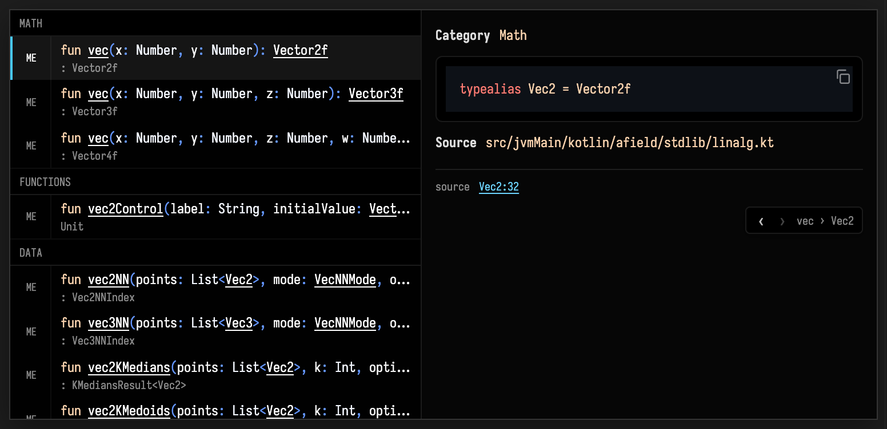

# The completion panel is a code browser

When you trigger autocomplete (`ctrl-space`), the panel on the right of the
popup is not just a static blurb. Every `[Symbol]` cross-reference in a KDoc
comment — and the `source …:line` footer at the bottom of a card — is a live
link. Click one and the panel *re-renders as that symbol's own card*: the same
category header, the same highlighted signature, the same rendered
documentation. A small back / forward control with a breadcrumb trail appears so
you can retrace your steps. In other words, the documentation panel quietly
becomes a recursive mini-browser over Field's code, without ever leaving the
editor.

Crucially, links only appear when they actually resolve. A `[Symbol]` that Field
can't find stays plain text — there are no dead links to click.

## A worked example

Start typing a value and ask for completions. Here we type `val axis = vec` and
press `ctrl-space`. The best match is `vec`, the function that builds a 2D
vector, and its documentation reads *"Creates a mutable 2D `Vec2` from numeric
coordinates."* Because `Vec2` resolves — it is a real type alias in Field's
standard library — the `[Vec2]` token in that sentence is rendered as a link:

```diffstatic_runner {data-lang=kotlin capture="ui" region="window" clip-selector=".afield-suggest" warm-completion=true screenshot="assets/docpanel-code-link.png" padding="6" wait="0" timeout="120" embed=true hidden=true name="docpanel-code-link" alt="A completion doc panel with a clickable Vec2 code-link in the KDoc"}
// Fresh, deterministic capture: forget recency ranking and hide the run-tick overlay.
ui.eval("window.localStorage.removeItem('field.suggest.recency.v1'); var s=document.createElement('style');s.textContent='.tick_text.ok{display:none !important}';document.head.appendChild(s);return 'setup';")
ui.openEditor(id)
ui.pause(700)
ui.clickSelector(".monaco-editor")
ui.pause(300)
ui.press("Control+A")
ui.type("val axis = vec")
ui.pause(300)
ui.press("Control+Space")
// warm-completion=true built the K1 completion engine up front, so the enriched
// RPC — the type-based completion and its KDoc — resolves headlessly. Wait for the
// linkified [Vec2] token itself, so the still shows a live code-link (not just the
// item, and not the instant quick-stub).
ui.waitForSelector("a[href^=\"field-source:\"]", 15000.0)
ui.pause(800)
// Best-effort second frame: follow the [Vec2] link into its own card and grab the
// breadcrumb, then step back so the fence's end-screenshot above is still the
// linkified panel. Wrapped so a navigation hiccup can never fail the primary still.
// Target only the KDoc [Vec2] link (the source-footer link also uses field-source:,
// and Playwright's strict locator refuses a two-match click).
try {
  ui.clickSelector("a[href^=\"field-source:\"]:not(.afield-suggest-source-link)")
  ui.waitForSelector(".afield-suggest-nav-crumbs", 8000.0)
  ui.pause(700)
  ui.shotClip("public/docs/assets/docpanel-breadcrumb.png", ".afield-suggest")
  ui.clickSelector(".afield-suggest-nav-btn[data-nav=\"back\"]")
  ui.waitForSelector("a[href^=\"field-source:\"]:not(.afield-suggest-source-link)", 8000.0)
  ui.pause(400)
} catch (e: Throwable) {}
```

The `Vec2` in the documentation is underlined — that is the code-link. Notice
what sits right next to it: the sentence ends *"…converting each component to
[Float]."* with `[Float]` left as plain, bracketed text. `Float` is a
classpath-only type that this build's source index can't resolve, so rather than
offer a link that would go nowhere, Field leaves it literal. Resolved cross-refs
become links; unresolved ones never do. (The `source …:line` line at the very
bottom of the card is a link too, pointing straight at the definition's location
in the source.)

## Following a link

Click `[Vec2]` and the panel hops to the `Vec2` card. Nothing about the editor
or your code changes — only the documentation panel re-renders, now showing
`Vec2`'s own signature (it is a `typealias`) and its documentation. A floating
control has appeared in the corner with a `‹` / `›` pair and a breadcrumb trail
that reads back to where you started:



From here the browsing is recursive. `Vec2`'s card is itself linkified, so any
`[Symbol]` it mentions is another hop deeper. The `‹` back button (or the
breadcrumb) returns you to the `vec` card you came from; `›` goes forward again.
Closing the completion popup resets the trail.

## Why this is useful

Reading one symbol's documentation almost always raises a question about a
*neighbouring* symbol — the type it returns, the class it extends, the helper it
mentions. Normally that means leaving what you are doing to go hunting. Here the
answer is one click away and one click back, inside the same popup you already
opened to write the line. It turns the completion panel from a label into a way
to read the codebase by following its own cross-references.

The same card viewer backs the conversational
[documentation & code search](semantic_index.md), and the underlying
autocomplete is covered in the [Survival Guide](survivalGuide.md#autocomplete).
