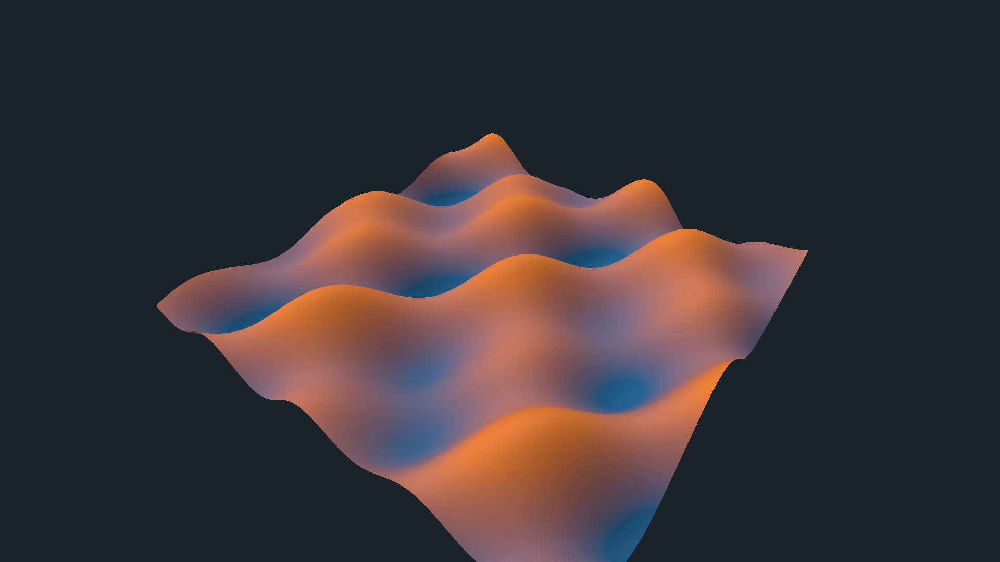
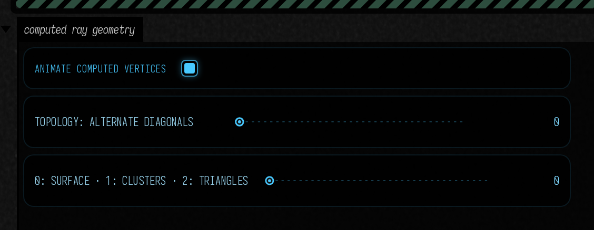

# Compute your ray-traced geometry

Your compute shader can write the triangles that the ray tracer sees. This experiment connects ordinary Field GPU buffers to NVIDIA's cluster acceleration structures, often called **RTX Mega Geometry**. The terrain below is generated in Field each frame, including its index topology; there is no imported mesh or native sample renderer.



## Open and edit

Open **Starting points → computed_ray_geometry** on a device with enabled `VK_NV_cluster_acceleration_structure` and ray-tracing pipelines. The capability check runs before the scene allocates geometry. This extension needs no additional SDK or native library in Field.

The **compute** property contains the producer. Edit the height function, the coordinates or the triangle indices. Field's `computeModuleHere()` keeps the last working shader after a compilation failure. Keep its push-constant layout while editing; changes to buffer layouts or capacities require stopping and recreating the scene.

### Start with the shader

This is the complete **compute** shader from the Starting Point, formatted for reading. One invocation produces one cluster: a 9 × 9 grid of vertices and 128 triangles. Expand the folds to inspect the buffer declarations and validation checks; **Copy** includes the entire shader. `pc.time` comes from the animation control; `pc.positions` is the GPU buffer that will become ray-traceable geometry.

```diffstatic {data-lang=glsl}
:::fold Buffer layouts and push constants
#version 460
#extension GL_EXT_buffer_reference : require
layout(local_size_x = 64) in;
layout(buffer_reference, std430, buffer_reference_align = 16) buffer Positions {
    vec4 data[];
};
layout(buffer_reference, std430, buffer_reference_align = 4) buffer Indices {
    uint data[];
};
struct Cluster { uvec4 range; uvec4 identity; };
layout(buffer_reference, std430, buffer_reference_align = 16) buffer Clusters {
    Cluster data[];
};
layout(push_constant) uniform Generate {
    Positions positions;
    Indices indices;
    Clusters descriptions;
    uint columns;
    uint rows;
    float time;
    uint topology;
    int invalidCluster;
    int invalidMode;
} pc;
:::endfold

void main() {
    uint id = gl_GlobalInvocationID.x;
    if (id >= pc.columns * pc.rows) return;
    uint cx = id % pc.columns, cy = id / pc.columns;

    for (uint y = 0; y < 9; y++) for (uint x = 0; x < 9; x++) {
        vec2 p = (vec2(cx, cy) + vec2(x, y) / 8)
               / vec2(pc.columns, pc.rows) * 8 - 4;

        // Edit this expression: it determines the surface's height.
        float z = .55 * sin(p.x * 1.7 + pc.time)
                     * cos(p.y * 1.3 - pc.time * .7)
                + .2 * sin(p.x * 3 + p.y * 2 + pc.time * 1.3);

        pc.positions.data[id * 81 + y * 9 + x] = vec4(p.x, z, p.y, 1);
    }

    // Two triangles per grid cell, with indices local to this cluster.
    for (uint y = 0; y < 8; y++) for (uint x = 0; x < 8; x++) {
        uint a = y * 9 + x, b = a + 1, c = a + 10, d = a + 9,
             o = id * 384 + (y * 8 + x) * 6;
        bool flip = ((x + y + pc.topology) & 1) != 0;
        pc.indices.data[o]     = a;
        pc.indices.data[o + 1] = flip ? d : c;
        pc.indices.data[o + 2] = b;
        pc.indices.data[o + 3] = flip ? b : a;
        pc.indices.data[o + 4] = d;
        pc.indices.data[o + 5] = c;
    }

    pc.descriptions.data[id] = Cluster(
        uvec4(id * 81, id * 384, 81, 128), uvec4(id, id, 0, 0));

:::fold Invalid-input injection for the GPU checks (disabled in the scene)
    // Deliberate invalid address-range injection exercises the public builder's GPU guard.
    if (int(id) == pc.invalidCluster) {
        if (pc.invalidMode == 1) pc.descriptions.data[id].range.x = 0xffffffffu;
        if (pc.invalidMode == 2) pc.indices.data[id * 384] = 100000u;
        if (pc.invalidMode == 4) pc.positions.data[id * 81].x = uintBitsToFloat(0x7fc00000u);
    }
:::endfold
}
```

Try changing `.55` to `1.1` and use **Update Compute Shader**. The waves become taller, and the next cluster build traces the changed vertices. Here the local variable `z` is written to world **Y**; `p` spans the horizontal X/Z plane. The second loop writes local triangle indices, and the record below it describes each cluster's slices. You can also [download the shader](assets/agent_transcripts/computed_ray_geometry/computed_ray_geometry_compute_.glsl).

**Animate computed vertices** moves the surface. **Topology: alternate diagonals** changes the actual triangles. The three views show the surface, cluster identities and triangle edges. The viewer computes normals from the generated triangles, so geometry edits affect shading too.

<video controls muted loop playsinline preload="metadata" src="assets/computed_ray_geometry/animation.mp4" width="1920" height="1080" style="max-width:100%;height:auto;aspect-ratio:16/9"></video>



## The general input contract

`ClusterGeometry` accepts three caller-owned `VulkanBuffer`s. They may be filled by a Field compute pass or uploaded by your own code. All need device addresses; the producer retains ownership through GPU completion.

| Buffer | Layout | Meaning |
| --- | --- | --- |
| `positions` | 16-byte `vec4` | Object-space xyz; w is ignored |
| `indices` | 4-byte unsigned integer | Indices **local to each cluster's vertex slice**; three per triangle |
| `clusters` | 32-byte record | `firstVertex, firstIndex, vertexCount, triangleCount, clusterId, geometryId, 0, 0` |

Offsets count vertices or indices, not bytes. `TriangleCluster.write()` writes the same record from Kotlin into a native-order buffer. A cluster contains indexed triangles; this first adapter does not partition an arbitrary mesh for you. A procedural generator often knows its own patches already. Each patch here has 81 vertices and 128 triangles.

```diffstatic {data-lang=kotlin}
val geometry = ClusterGeometry(renderer,
    capacity = 768, verticesPerCluster = 81,
    trianglesPerCluster = 128, maxGeometryId = 767)
val inputs = ClusterGeometryInput(positions, indices, descriptions)

// Inside your Target.render(), on Field's graphics queue:
producer.current.render(command, Rectanglef())
geometry.build(command, rayPipeline, inputs)
// Use geometry as the BLAS address in a RayTracingInstance,
// rebuild the containing TLAS, then record the ray-tracing pass.
```

The ray pipeline is Field's `RayTracingModule`, with `allowClusterAccelerationStructure=true`. Vulkan requires that opted-in pipeline to be bound during cluster builds. The builder handles that bind; the later trace pass binds its own state normally. A cluster BLAS has a device address rather than a `VkAccelerationStructure` handle, which is why `RayTracingInstance` accepts the narrower `AccelerationStructureAddress` interface.

The editable example uses this exact path:

```diffstatic {data-lang=kotlin}
val lab = ClusterGeometryDemo(renderer,
    producerFactory = { computeModuleHere(it) }).install()
```

`ClusterGeometryDemo` is the terrain viewer. `ClusterGeometry` is the reusable builder: its inputs need not resemble terrain, use the sample's patch counts, or originate in GLSL. A Slang producer can write the same buffers. The builder's returned address can be instanced with ordinary TLAS transforms.

## Builds, validation and ownership

A build records GPU input validation, conversion to Vulkan's cluster records, cluster builds and one aggregate BLAS build. Buffer bounds come from the actual allocations. Invalid descriptions, out-of-range local indices and nonfinite positions become degenerate geometry and set bits in `geometry.status`: **1**, **2** and **4**, respectively. A valid cluster has zero status. This GPU buffer is available to your diagnostics; the normal build path never reads it back.

The builder owns fixed-capacity storage, scratch, sanitized geometry and record buffers. It borrows your producer buffers. Static geometry needs one explicit build; retain its BLAS and skip later calls. Rebuild after position or topology changes, and rebuild the TLAS when bounds change. Recreate the builder to increase capacity. This first version rebuilds clusters; it does not yet implement template instantiation, compaction, LOD streaming or selective cluster reuse.

Everything runs on Field's graphics queue, with dependencies between producer, converter, cluster build, BLAS build and tracing. Stop/close defers destruction through Field's normal retirement mechanism. A GPU-written 64-byte instance buffer can also be passed to `AccelerationStructure.buildTopLevel()`; synchronize its producer before that call. Use a fresh TLAS owner: the first GPU-buffer build fixes its instance count and flags. Transform/address edits within those records are supported; recreate the TLAS and defer retiring the old one if its count or flags must change.

## What was measured

The 1920 × 1080 experiment on the RTX 4090 generates **768 clusters / 98,304 triangles**. The [measurement record](assets/computed_ray_geometry/measurements.json) separates the guarded cluster/BLAS build from the complete producer → build → TLAS → trace → output pass and records builder storage. These are measured rebuild costs, not a claim that clusters beat ordinary BLAS builds for this small scene.

In the recorded run, guarded cluster/BLAS construction took **1.30 ms median / 1.31 ms p95**; the complete pass took **2.36 / 2.39 ms**. Builder storage was **6.57 MiB**, excluding caller buffers, TLAS and output images.

The device advertises at most 256 vertices and 256 triangles per cluster, 256-byte scratch alignment, 128-byte cluster alignment and 256-byte BLAS alignment. The adapter queries these values; they are not portable constants. Tests cover native record strides, moving vertices, changed indices, all three invalid-input cases and resource retirement under Vulkan validation.

This preview uses ray-tracing pipelines. It does not silently replace the path tracer's ray-query geometry or Fabricate's mesh ownership. Ordinary geometry and compute workflows remain available without the extension. See the [implementation and reproduction record](https://github.com/OpenEndedGroup/Field4/blob/main/dev_docs/lighting/ADVANCED_VULKAN.md) for the exact environment and limitations.
