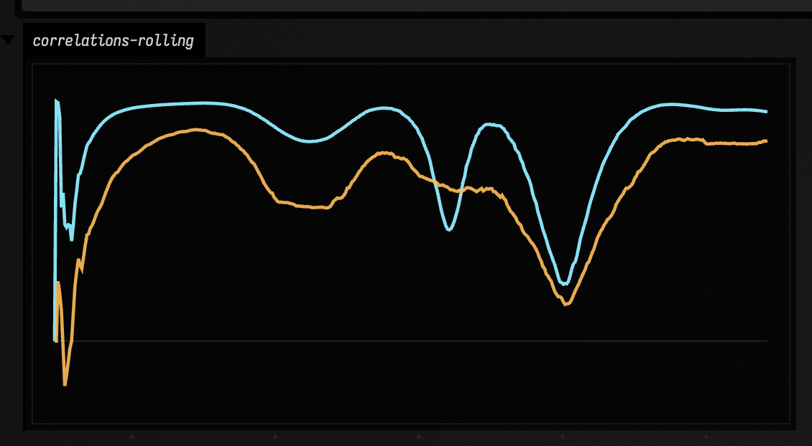
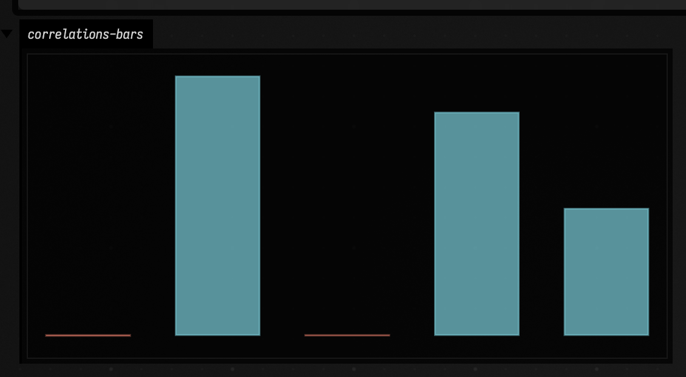

# Correlations to FLine examples

Correlation compresses a relationship into one number. That is useful, and it is also the problem. It can hide a nonlinear dependency, blur the coupling between gestures, or flatten timing and phrasing into a statistic that sounds more certain than it is. These examples keep the numbers tied to pictures.

## Rolling distance correlation and xi

Two signals can clearly belong together without forming a straight-line relationship. Bowed shapes, gestural curves, timbral motion, and many sensor relationships behave that way. A rolling metric is useful when that relationship drifts over time.

```diffstatic_runner {data-lang=kotlin screenshot="assets/correlations_examples/rolling_dependence.png" wait="1.0" capture="box" open-outputs="true"}
:::static
import afield.graphics.FLine

val rollingD = RollingDistanceCorrelation(windowSize = 84)
val rollingXi = RollingXiCorrelation(windowSize = 84)

val dVals = mutableListOf<Float>()
val xiVals = mutableListOf<Float>()

for (i in 0 until 420) {
    val t = i / 420.0
    val x = t * 2.0 - 1.0
    val y = x * x + sin(t * PI * 8.0) * 0.08 + (-0.04 + random() * 0.08)
    dVals += (rollingD.push(x, y) ?: 0.0).toFloat()
    xiVals += (rollingXi.push(x, y) ?: 0.0).toFloat()
}

fun line(values: List<Float>, y0: Double, amp: Double, c: Vec4): FLine = fline {
    val n = values.size.coerceAtLeast(2)
    values.forEachIndexed { i, v ->
        val x = 50.0 + i.toDouble() / (n - 1).toDouble() * 980.0
        val y = y0 - v * amp
        if (i == 0) moveTo(x, y) else lineTo(x, y)
    }
    color = c
    thickness = 2.3
}

val guide = fline { moveTo(50, 500); lineTo(1030, 500); color = vec(1,1,1,0.2); thickness = 1.1 }

lines(
    listOf(
        guide,
        line(dVals, 500.0, 330.0, vec(0.56, 0.92, 1.0, 0.95)),
        line(xiVals, 500.0, 330.0, vec(1.0, 0.74, 0.35, 0.9))
    ),
    channel = "correlations-rolling",
    w = 1080.0,
    h = 640.0,
    fitToSize = true
)
```

The same nonlinear stream goes into `RollingDistanceCorrelation` and `RollingXiCorrelation`. The window size stays fixed, and both traces share a baseline.



The agreement and disagreement are visible. The two traces do not coincide; both track the same evolving dependency. Use this kind of sanity check before trusting a rolling metric on sensor streams, musical features, or exploratory data analysis. For similar rolling summaries on raw signals, continue with [Timeseries examples](fline_examples.md#drawing-timeseries-as-layered-curves) and [Stats examples](stats_examples.md).

## StatsDependence metric profile on one dataset

Sometimes you need a fast comparison of several metrics on one dataset. Which metric notices the shape? Which one punishes you for asking a linear question of a nonlinear cloud?

```diffstatic_runner {data-lang=kotlin screenshot="assets/correlations_examples/metric_profile.png" wait="1.0" capture="box" open-outputs="true"}
:::static
import afield.graphics.FLine

val n = 320
val x = DoubleArray(n) { i -> i.toDouble() / (n - 1).toDouble() * 2.0 - 1.0 }
val y = DoubleArray(n) { i -> x[i] * x[i] + (-0.05 + random() * 0.10) }

val metrics = listOf(
    "pearson" to StatsDependence.pearson(x, y),
    "spearman" to StatsDependence.spearman(x, y),
    "kendall" to StatsDependence.kendallTauB(x, y),
    "xi" to StatsDependence.xi(x, y),
    "dcor" to StatsDependence.distanceCorrelation(x, y)
)

val bars = metrics.mapIndexed { i, (_, v) ->
    val vv = v.coerceIn(-1.0, 1.0)
    val x0 = 120.0 + i * 170.0
    val x1 = x0 + 110.0
    val y0 = 520.0
    val y1 = 520.0 - vv * 340.0
    fline {
        moveTo(x0, y0)
        lineTo(x1, y0)
        lineTo(x1, y1)
        lineTo(x0, y1)
        close()
        filled = true
        stroked = true
        color = if (vv >= 0.0) vec(0.56, 0.94, 1.0, 0.6) else vec(1.0, 0.54, 0.46, 0.6)
        thickness = 1.4
    }
}

lines(bars, channel = "correlations-bars", w = 1080.0, h = 640.0, fitToSize = true)
```

One fixed dataset goes in; a handful of `StatsDependence` measures come out; the answers are drawn as bars because bars are easier to compare than decimals.



The metrics are no longer abstract names in a list. They visibly disagree about the same sample. That mismatch is worth seeing before choosing a statistic for an experiment, a gesture dataset, or a musical feature extractor. For neighborhood-based structure, see [Smile neighbors examples](smile_neighbors_examples.md); for graph-based structure, see [Graph connectivity examples](graph_connectivity_examples.md).
