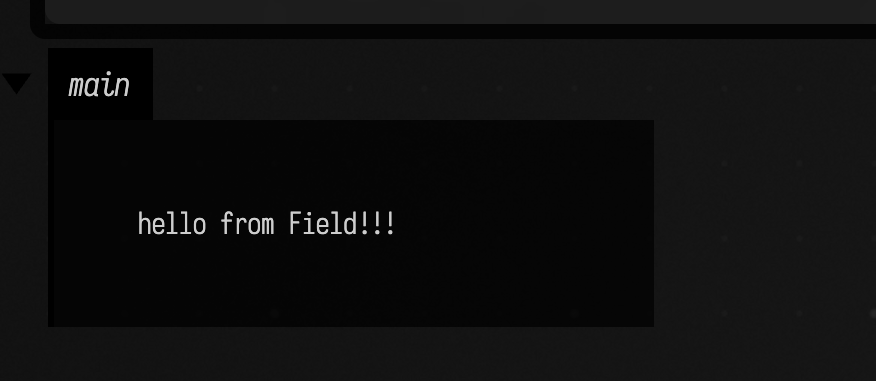

# Code Diff Player

The diff player assets are included site-wide by the docs build, so you only need the markup. The player is styled to match the dark theme gutter and line numbers.

## Quick start
- Use the `diff` fence for animated before/after, and `diffstatic` for a single snippet.
- The fence-upgrade script rewrites these into the player markup automatically, then `CodeDiffPlayer.mountAll()` binds them.

Example animated fence:

```diff {data-lang=kotlin}
:::before
lines.clear()

loop {
  var f = FLine()

  while (stereo.controllerState().triggerValue > 0.0) {
    val at = stereo.controllerState().position
    f.lineTo(at)
    lines["ourLine"] = f
    frame()
  }

  frame()
}
:::after
lines.clear()

loop {
  var f = FLine()

  while (stereo.controllerState().triggerValue > 0.0) {
    val at = stereo.controllerState().position
    f.lineTo(at + vec(0, 0, 0.1))
    lines["ourLine"] = f
  }

  frame()
}
```

Example static fence:

```diffstatic {data-lang=kotlin}
:::static
fun greet() {
  println("hello")
}
```

## Live demo
```diff {data-lang=kotlin}
:::before
lines.clear() // clear the list of lines to draw

loop { // do this forever (or until we stop this box)
  var f = FLine()    // make a new line for our drawing

  while(stereo.controllerState().triggerValue > 0.0) { // while the trigger is down
    var at = stereo.controllerState().position // get its position
    f.lineTo(at) // extend the drawing to this position
    lines["ourLine"] = f // put this line onto the screen under the name "ourLine"
    frame() // WAIT for a frame to come out of the screen
  }

  while(stereo.controllerState().triggerValue <= 0.0) { // while the trigger isn't down
    frame() // WAIT for a frame to come out of the screen
  }
}
:::after
lines.clear() // clear the list of lines to draw

loop { // do this forever (or until we stop this box)
  var f = FLine()    // make a new line for our drawing

  while(stereo.controllerState().triggerValue > 0.0) { // while the trigger is down
    var at = stereo.controllerState().position // get its position
    f.lineTo(at + vec(0,0,0.1)) // extend the drawing to this position
    lines["ourLine"] = f // put this line onto the screen under the name "ourLine"
  }

  while(stereo.controllerState().triggerValue <= 0.0) { // while the trigger isn't down
    frame() // WAIT for a frame to come out of the screen
  }

  frame() // WAIT for a frame to come out of the screen
}
```

## Static live demo
<!--
FIELD_TEST
id: docs.diff-player.static-greet
runner: backdoor-box
tags: [docs, diff-player, kotlin, print]
timeoutSec: 30
expect:
  outputContains:
    - "Hello, Field4"
  eventKinds:
    - output
-->
```diffstatic {data-lang=kotlin}
:::static
val greet = { name: String ->
  println("Hello, $name")
}

greet("Field4")
```

## Notes
- Set `data-language` to any highlight.js language key (e.g., `python`, `javascript`).
- For static blocks use only a `data-state="before"` block (or `data-state="single"`) to reuse the same styling without animation; the play control hides automatically.
- Multiple players on one page are supported; `mountAll()` binds everything with the `code-diff-player` class.
- The component lazy-loads highlight.js if it is not already present on the page.
- Source `<pre>` blocks are hidden after upgrade, so the page remains readable when JavaScript is disabled.

## Superfence shorthand
You can now author with fenced blocks and let the site JS convert them:

- Animated diff:

```diff {data-lang=kotlin}
:::before
fun hello() = println("hi")
:::after
fun hello(name: String) = println("hi $name")
```

- Static block:

```diffstatic {data-lang=kotlin}
fun greet() {
    println("hello")
}
```

These render into the same player automatically (via `fence-upgrade.js`), so you don’t have to write the HTML wrapper yourself.

## Screenshot runner
`diffstatic_runner` uses the same rendered code block, but during the docs build it also runs the snippet through `tools/field_backdoor.py` and saves a screenshot.

`diff_runner` does the same thing for animated `diff` fences, except it executes only the `:::after` section for the screenshot while leaving the rendered block as a normal before/after diff.

Use `screenshot="..."` to choose where the image lands, relative to the current markdown file. The build keeps execution in a scratch session, waits briefly, and then captures either the box or the whole window.

The docs runner also has an execution mode:

- `FIELD_DOCS_RUNNER_MODE=incremental` is the default and is the right choice while writing docs. It reuses an existing screenshot when the source page has not changed since that screenshot was written, and it skips rerunning a fence when the runnable code and capture options still match the cache.
- `FIELD_DOCS_RUNNER_MODE=strict` is the testing mode. It invalidates screenshots when the runner itself changes and forces a fresh end-to-end render.

For both `diff` and `diff_runner`, if `:::before` is omitted, Field will inherit it from the previous block's effective result: the previous `:::after` for a diff, or the full contents of the previous `diffstatic`.

````text
```diffstatic_runner {data-lang=kotlin screenshot="assets/hello-runner.png" wait="1.0" capture="box"}
:::static
display("main", "<div style=\"padding:24px\">hello from Field</div>")
```
````

Supported runner attributes:

- `screenshot="assets/example.png"` sets the screenshot output path. At least one of `screenshot` or `video` is required.
- `video="assets/example.mp4"` records a short H.264/MP4 video clip instead of (or alongside) a screenshot.
- `duration="5"` sets the video recording length in seconds (default 5).
- `fps="30"` sets the video frame rate (default 30).
- `capture="box" | "window" | "window-editor" | "editor"` defaults to `box`.
- `execution="run" | "launch"` defaults to `run`. `launch` waits for the box to start, sleeps for `wait="..."`, captures, and then sends `stop`.
- `wait="0.75"` adds a post-run delay before capture.
- `padding="16"` applies to `capture="box"` and `capture="editor"`.
- `timeout="45"` sets the backdoor timeout.
- `embed="true"` appends the generated image below the code block in the rendered page.
- `macro-file="../../dev_docs/agents/transcripts/hello_display.yaml"` writes and runs an `OperationTranscript` YAML macro before capture.
- `capture-box="agent_hello_display"` selects the box to crop after macro replay.
- `name`, `x`, `y`, `w`, `h`, `document`, `property`, `open-outputs`, and `with-editor` map to the corresponding backdoor/session behavior.

Use `capture="editor"` when you want the Monaco pane itself rather than the whole browser window. This is useful for inline visualizers such as histogram and piano-roll decorations.

````text
```diffstatic_runner {data-lang=kotlin screenshot="assets/editor-inline-histogram.png" wait="1.0" capture="editor"}
:::static
val hist = __m("docs-hist")
listOf(0.14, 0.36, 0.49, 0.81, 0.63, 0.52, 0.27, 0.71, 0.58).forEach { value ->
    hist.histogram(value, dur = 24)
}
println("inline histogram ready")
```
````

`diff_runner` example:

````text
```diff_runner {data-lang=kotlin screenshot="assets/hello-runner-after.png" wait="1.0" capture="box"}
:::before
display("main", "<div style=\"padding:24px;background:#fbb\">before</div>")
:::after
display("main", "<div style=\"padding:24px;background:#bfb\">after</div>")
```
````

Plain `diff` shorthand works the same way:

````text
```diff {data-lang=kotlin}
:::after
display("main", "<div style=\"padding:24px;background:#bfb\">after</div>")
```
````

And, for the purposes of end to end testing, here's a version of the above that's actually live:

<!--
FIELD_TEST
id: docs.diff-player.runner-display
runner: backdoor-box
tags: [docs, diff-player, display, visual]
timeoutSec: 45
withPlaywright: true
waitSec: 1.0
expect:
  outputContains:
    - "hello from Field!!!"
  eventKinds:
    - set-output
  screenshot:
    kind: box
    padding: 16
-->
```diffstatic_runner {data-lang=kotlin screenshot="assets/hello-runner.png" wait="1.0" capture="box" embed=true}
:::static
display("main", "<div style=\"padding:24px\">hello from Field!!!</div>")
```

<!-- yields:

 -->

And here is the same screenshot path driven through a reusable YAML macro instead of inline box construction:

```diffstatic_runner {data-lang=kotlin screenshot="assets/macro-hello-display.png" wait="1.0" wait-output=true wait-output-kind="display" wait-output-contains="hello from OperationTranscript" capture="box" padding="18" embed=true force=true name="macro-hello-display" macro-file="../../dev_docs/agents/transcripts/hello_display.yaml" capture-box="agent_hello_display"}
// This capture is generated by dev_docs/agents/transcripts/hello_display.yaml.
// The fence body documents the macro path; OperationTranscript creates and runs the box.
```
