# Direct-lighting laboratory

Experiment with a moving rectangular light inside Field's existing Vulkan renderer. Rasterization supplies the visible surfaces; a compute shader samples the emitter and optionally traces finite shadow rays through opaque triangles. The original renderer remains available with an immediate switch.

The optional **RTXDI path now runs initial reservoir sampling, temporal reuse, spatial reuse and final ray-query visibility inside Field**. Each reuse stage is independently switchable. It supports stable IDs for moving, inserted, deleted and reordered rectangular lights. The baseline one-light path builds without any NVIDIA SDK. Both paths are mono and diffuse; neither applies denoising or DLSS.

| Unshadowed | Ray-query shadows | Moved light |
| --- | --- | --- |
| 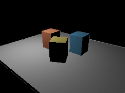 | 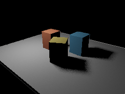 | 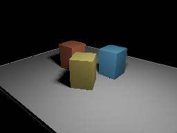 |

These are actual RTX 4090 GPU readbacks at 256×192, displayed with Reinhard tone mapping and gamma. The tests compare unclamped linear FP32 pixels.

## RTXDI results

| Four candidates, no reuse | Temporal + spatial reuse | 256-sample reference |
| --- | --- | --- |
| 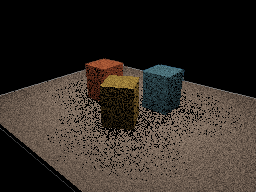 |  | 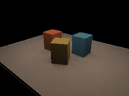 |

These are raw lighting estimates from the same 16-light scene, without a temporal color filter. The full-reuse mean was **0.1227025**, versus **0.1227156** for the reference, with combined standard error **0.0000628** across 16 independent scene-mean trials. Initial, temporal-only and spatial-only estimates also agreed within measured uncertainty.

<video controls loop muted playsinline src="assets/direct_lighting/rtxdi-moving.mp4" width="512"></video>

## Run the editable scene

To enable RTXDI, first build its optional shaders on Linux x86-64:

```bash
uv run python tools/lighting/build_rtxdi.py --prepare
```

This fetches the pinned RTXDI SDK and DXC into ignored `build/` storage, verifies the SDK revision and compiler/library checksums, and compiles Field's HLSL bridge. Review NVIDIA's `Libraries/Rtxdi/LICENSE.txt` in the downloaded checkout. Vendor headers and binaries are not bundled with Field. Skip this step for the ordinary one-light experiment; Gradle never downloads or loads RTXDI on its own.

From the checkout, with a working graphical session:

```bash
uv run --project . --group backdoor python tools/field_backdoor.py \
  --json --with-playwright --port 9720 --timeout 180 \
  --command 'macro write direct_lighting --file dev_docs/agents/transcripts/direct_lighting.yaml' \
  --command 'macro run direct_lighting' \
  --command 'wait-native-renderer agent_graphics_context --frames 5' \
  --command 'native-screenshot build/direct-lighting.png --uid agent_graphics_context'
```

[Open the editable starting point ↗](offline.html?file=assets/agent_transcripts/direct_lighting/metadata.edn)

<video controls loop muted playsinline src="assets/direct_lighting/moving-light.mp4" width="512"></video>

The macro creates a renderer parent and an editable laboratory box. The Kotlin is also in `dev_docs/agents/demos/direct_lighting/example.kt`. Run that code beneath an existing renderer box for an ordinary live-coding session. The output controls work in the box and on `/controllers`:

- **Original renderer** bypasses the experimental lighting.
- **Ray-query shadows** switches visibility while the scene continues running. Unsupported devices use unshadowed light.
- **RTXDI** selects SDK resampling; **Reference estimator** selects uniform multi-light integration instead. These controls appear after the optional SDK build succeeds.
- **Temporal reuse**, **Spatial neighbors** (zero disables), **Area lights**, and **Reset history** control sampling and deliberate discontinuities.
- **Animate light**, **Light phase**, **Samples**, **Radiance**, and **Effect weight** shape the experiment.
- **View** selects radiance, normals, depth, visibility, motion, stable light IDs, reservoir M, inverse-PDF weight, or history rejection. The reference mode always shows radiance. The baseline uses a fixed seed; RTXDI advances its reproducible sequence each frame.
- Field's `keyCamera` supplies keyboard movement in the native window: arrows move, with its usual modifiers.

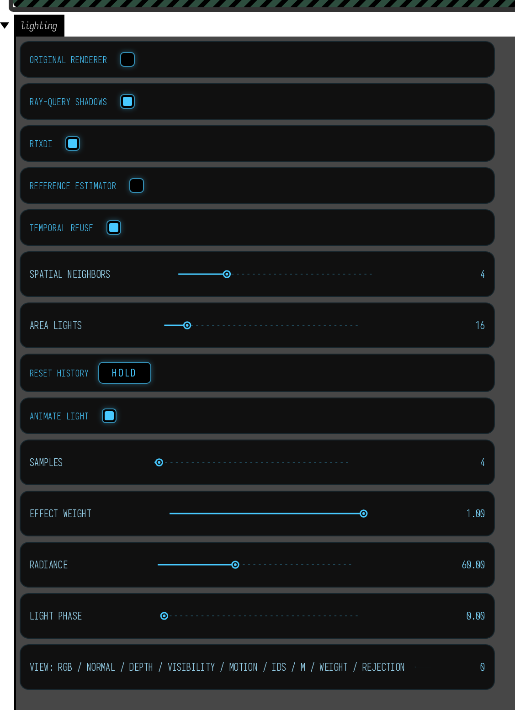

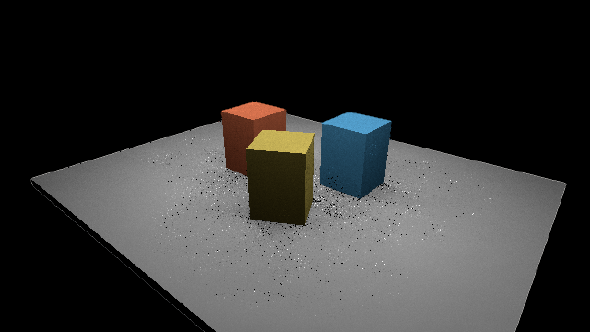

<details><summary>Baseline controls without the optional SDK</summary>

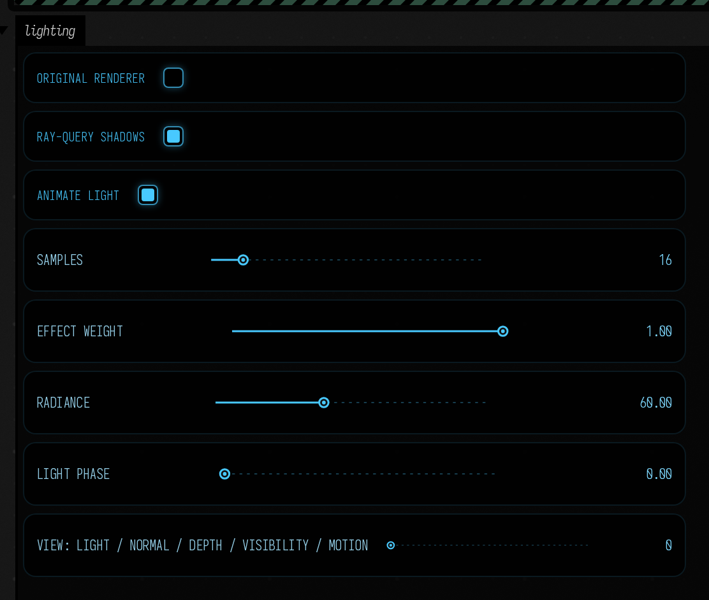

</details>

Relaunching the box closes and replaces the previous experiment. Controls publish values; the frame loop applies them between frames. Keep the Field session open for interactive work; the command above is a capture session and detaches when it completes.

For a minimal box without controls:

```kotlin
import afield.four.lighting.*
import afield.four.modules.fromContext

val renderer: Renderer = fromContext()
val lab = DirectLightingDemo(renderer, 640, 360)
lab.lighting.samples = 16
lab.lighting.mode = if (lab.visibility.available)
    DirectLighting.Mode.RAY_QUERY else DirectLighting.Mode.UNSHADOWED
frames {
    var t = 0.0
    while (true) {
        lab.animate(t)
        t += 1.0 / 60.0
        frame()
    }
}
```

Close `lab` before replacing it. To change an instance while keeping raster and ray geometry together, call `lab.moveObject(index, matrix)` between frames. `lab.lighting.seed` controls repeatable sampling; the demo deliberately does not scramble it every frame.

## Minimal RTXDI API

Add this before the final `frames { ... }` expression in a renderer-connected box:

```kotlin
import afield.four.fabricated.rtxdiSettings
import afield.four.lighting.*

val settings = lab.bundle.rtxdiSettings()
settings.commitLights(listOf(IdentifiedAreaLight(42, lab.lighting.emitter)))
lab.lighting.enableRtxdi(RtxdiProgram.load(), settings).getOrThrow()
lab.lighting.mode = DirectLighting.Mode.RTXDI
lab.lighting.samples = 4
settings.temporal = true
settings.spatialSamples = 4 // zero disables spatial reuse
```

After moving an emitter, call `settings.commitLights(...)` again between frames. It snapshots the vectors; editing your original list or emitter does not mutate GPU history. Retain each light's integer ID across moves and reordering. Removed IDs map to −1; both previous and current emitter parameters remain available for the SDK's bias correction. Up to 4096 lights are accepted; the measured sweep covers 1, 16 and 128.

For non-Fabricate surfaces, construct `RtxdiSettings(view = { currentView }, projection = { currentProjection })`. Supply the **same** view and Vulkan [0,1] projection used for primary visibility, with Field's negative-height raster viewport. The snapshot pass reconstructs previous-pixel minus current-pixel displacement in pixels and previous-depth minus current-depth; no jitter is supported here. It does not reinterpret the existing motion texture's units.

`settings.resetHistory("material or shader semantics changed")` explicitly rejects history. Camera cuts, projection changes, ray-scene commits, mode changes, sampling-setting changes and successful RTXDI reloads also invalidate it. Smooth camera motion reprojects against the previous surface snapshot. Material compatibility currently compares diffuse albedo, world normal, linear depth and world position; categorical object/material attachments are **not implemented**. Call reset for edits to material meaning that do not change these inputs.

## Use with Fabricate or your own surfaces

For a [Fabricate bundle](fabricate_renderer.md), create an `OpaqueRayScene(renderer)`, commit `OpaqueInstance` values, then call `bundle.directLighting(visibility).attach()` **after** `bundle.attachTo(renderer)`. Present `lighting.output` instead of the bundle's source. `registerOpaqueTriangles(name, geometry, color, transform)` feeds Fabricate's existing pulling meshes from the same indexed snapshot used by the ray scene.

For ordinary `afield.four`, construct `DirectLighting(renderer, surfaces, visibility, width, height)`. `DirectLightSurfaces` takes five point-sampled textures:

| Input | Contract |
| --- | --- |
| position | World XYZ; W is Vulkan depth, 0 near to 1 far, background clear 1; no reversed Z |
| normal | World-space shading normal; this demo uses flat geometric normals |
| albedo | Linear RGB, not pigment or latent channels |
| source | Original color to preserve for bypass, background and effect-weight blending |
| motion | Current UV minus previous UV, Y down, unjittered; diagnostic for the baseline; RTXDI reconstructs its own reprojection from camera matrices |

Attach the pass after all input producers on Field's graphics queue. `lighting.output` is RGBA32F. `readLinear()` provides blocking raw FP32 readback for diagnosis: RGB is lighting, W is visibility or −1 for background. SOURCE preserves the original RGBA. Presentation alpha is opaque. Existing alpha is never used as an effect mask; the separate `effectWeight` scalar ranges from 0 (source) to 1 (full effect).

An `AreaEmitter` has a center, two **full** edge vectors, and linear radiance. Their cross product points toward the emitting side. The estimator samples uniform area and includes both cosine factors, area, inverse squared distance, and Lambertian `albedo/pi`. The emitter is an illumination primitive, not visible geometry in this first scene.

`OpaqueTriangles` copies indexed XYZ arrays. One static BLAS is cached per geometry object. Transform edits build a fresh TLAS; a new geometry snapshot builds a new BLAS. There is no implicit refit or per-frame static rebuild. Builds currently wait on the graphics queue, so edits can stall. Old resources retire through Field's frames-in-flight cleanup queue.

## Shader experiments and diagnostics

```kotlin
val source = DirectLighting.shader(lab.visibility.available)
val result = lab.lighting.reload(source) // or editable GLSL from your box
result.onFailure { println(it.message) }
println(lab.lighting.gpuMilliseconds.takeLast(10))
```

Reload compiles and reflects a candidate before swapping. Syntax errors, incompatible layouts and changed workgroup sizes preserve the working pipeline. A layout change or resolution change requires a new pass and matching surface textures. The output resolution is fixed per instance; resizing the window scales its presentation.

| Normals | Visibility |
| --- | --- |
| 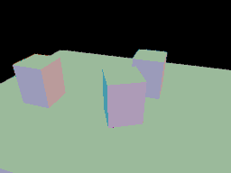 | 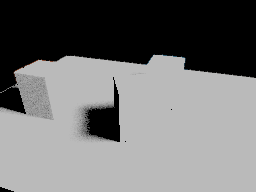 |

The baseline has no history. RTXDI stores two surface snapshots and three SDK reservoir slices. No color-history filter hides the raw result. M is shown divided by `maxHistory + 1`; spatial reuse can produce larger values. Weight is the SDK's finalized inverse PDF, unclamped. Black in the history-rejection view means accepted history, white means no reusable sample.

| Temporal only | Spatial only | History rejection |
| --- | --- | --- |
|  | 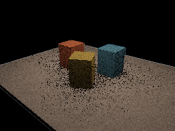 | 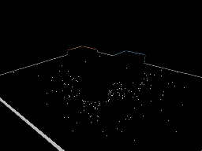 |

| Stable light IDs | Reservoir M | Reservoir weight | Reprojection |
| --- | --- | --- | --- |
| 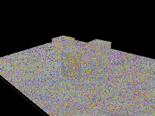 | 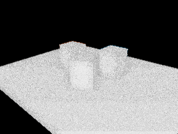 | 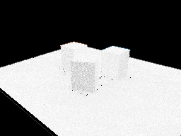 | 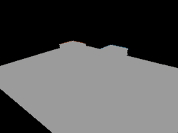 |

To reload HLSL, run `uv run python tools/lighting/build_rtxdi.py`, then call `lab.lighting.reloadRtxdi(RtxdiProgram.load())` between frames. A failed DXC build preserves the last manifest. Checksum, reflected push/structure/descriptor layouts and dispatch dimensions are validated before activation; incompatible resources are rejected. Successful reload resets history. `lab.lighting.rtxdiTimings`, `rtxdiResetReason` and `rtxdiHistoryValid` expose diagnostics to live code.

Categorical material/object attachments, per-pixel effect weights, alpha testing, transmission, emissive meshes, non-diffuse materials, GI, stereo and VR remain outside this experiment. Existing pigment workflows must convert to linear RGB before this lighting boundary.

## Verification and measured limits

Run the standalone Field smoke, including capability JSON, readback assertions, PNGs and timestamps:

```bash
uv run --project . --group backdoor python tools/run_field_tests.py \
  --id four.direct-lighting.smoke --port 9722 --refresh-catalog
```

For fallback on an already-running isolated server:

```bash
uv run --project . --group backdoor python tools/field_backdoor.py \
  --json --attach-existing --port 9720 --timeout 420 \
  --command 'run-jvm-main afield.four.lighting.DirectLightingSmoke --arg=--fallback --timeout 300'
```

Artifacts go to `build/lighting-experiment/gpu/` or `fallback/`. The capability report distinguishes physical support from enabled features. Ordinary Field startup and the SOURCE/UNSHADOWED modes do not require ray-query support; ray-tracing pipelines are probed separately and are not required by this pass.

On 24 September 2026, RTX 4090, NVIDIA 610.43.02, Vulkan 1.4.341: the full GPU check and disabled-ray fallback passed without Vulkan validation errors. At 256×192, 32 samples, after 16 warm-up frames, the visibility/shading compute pass measured **0.138 ms median / 0.147 ms p95** over 100 frames. The raw buffer and output image contain 1.5 MiB; this excludes input surfaces, acceleration structures, scratch and allocator padding. These are validation-enabled, tiny-scene measurements, not a frame-rate target or a full renderer benchmark.

Twelve 8-sample seeded estimates gave a mean of 0.09909455; twelve 256-sample references gave 0.09909922, combined standard error 0.00000575. This checks the direct estimator's scene average, not every possible material or sampling configuration. The smoke also checks finite rays, moving lights/instances, camera cuts, dark surfaces, bypass, reload rollback and mode restoration. Minimize/restore, actual unsupported hardware, repeated resize stress and AS-build GPU timing remain unvalidated; the RTXDI continuation also tests one window resize and render-resolution recreation.

The checkout also has focused JVM tests for independent feature gating, geometry/transform validation and reflected shader layouts. Implementation details, dependency commits, exact machine reports and launch workarounds are in `dev_docs/lighting/IMPLEMENTATION.md` and `dev_docs/lighting/results/`.

## RTXDI verification

After building the optional shaders, on an isolated Field server:

```bash
uv run --project . --group backdoor python tools/field_backdoor.py \
  --json --attach-existing --port 9724 --timeout 600 \
  --command 'run-jvm-main afield.four.lighting.RtxdiLightingSmoke --arg=--clip --timeout 540'
```

The result must contain `RTXDI LIGHTING CHECK DONE`, `ok: true`, and no Vulkan validation errors. Reports, raw-lighting PNGs and 120 moving-light frames go to `build/lighting-experiment/rtxdi-gpu/`. The command passed on the same RTX 4090. Failed optional shader compilation was also tested to preserve the working manifest.

At 256×192, 16 lights, eight candidates, four spatial neighbors and temporal history capped at eight, stage timings were:

| GPU interval | Median ms | p95 ms |
| --- | ---: | ---: |
| Surface snapshot | 0.0195 | 0.0235 |
| Initial candidates + source visibility | 0.0251 | 0.0264 |
| Temporal reuse + visibility | 0.0561 | 0.0589 |
| Spatial reuse | 0.0483 | 0.0498 |
| Final visibility/shading | 0.0226 | 0.0235 |

Each distribution contains 96 frames after 24 warm-up frames, with Vulkan validation enabled. These intervals exclude rasterization, AS builds, output resolve and presentation; their medians are not a measured full-frame time. The working allocation count was **14,944,832 bytes** including raw/output, surface history, reservoirs, neighbor offsets and frame-indexed light/matrix buffers, excluding G-buffer, AS/scratch, allocator padding and query pools. Full distributions and light/sample sweeps are in `dev_docs/lighting/results/rtxdi-measurements.json`.

Static history rejection was 1.93%; after a small camera move it was 11.11%. These scene-specific checks, plus camera cuts, deletion/reordering, instance moves, dark output after deleting every light, reload and bypass checks passed. The expanded check also passed tiny bright emitters, black materials, non-tiled 173×119 output, pass recreation and a window resize. This is measured scene-average agreement, not a proof of per-pixel convergence for arbitrary content.

## Reconstruction

Field uses RTXDI library commit `f12037fa8e97ebc08e9e3edfd2de528ed1772a4b`, pinned through upstream checkout `a6efab966b7c3b272da0461578eb56ac61c7cbff`. Kotlin owns resource allocation, light identity, history and submission. HLSL uses the SDK reservoir/temporal/spatial functions with ray-traced bias correction; no C++ wrapper or per-pixel JNI is involved. See the [upstream integration guide](https://github.com/NVIDIA-RTX/RTXDI/blob/a6efab966b7c3b272da0461578eb56ac61c7cbff/Doc/Integration.md).

The separate DLSS discovery probe found SR, RR and Frame Generation available on this machine, but no evaluated DLSS frames or presentation integration were tested. No DLSS 5 neural-rendering API was found in the pinned public SDK. Exact APIs, licensing, platform caveats and blockers are recorded in `dev_docs/lighting/DLSS_FEASIBILITY.md`; the lighting experiment has no DLSS dependency.
