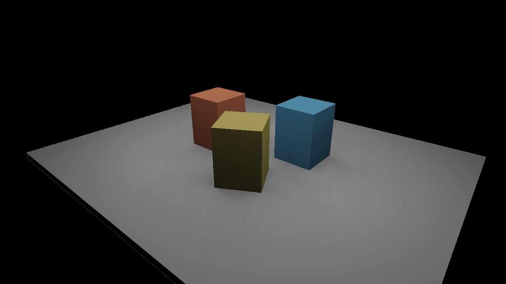

# Direct lighting

Move an area light and watch its shadow travel across a scene. Add more lights, change
their colors, or edit the geometry while Field keeps drawing. This renderer uses rasterized
surfaces and Vulkan ray queries for shadows; optional RTXDI sampling makes a larger set
of lights practical without tracing a shadow ray to every light at every pixel.



<video controls loop muted playsinline src="assets/direct_lighting/rtxdi-moving.mp4" width="1280" height="720" style="max-width:100%;height:auto;aspect-ratio:16/9" poster="../assets/direct_lighting/rtxdi-reconstructed.png"></video>

The still and movie render at **1280 × 720**, with 16 candidates per pixel, temporal
reservoir reuse, eight spatial neighbors and three reconstruction passes. Reconstruction
smooths sampling noise while respecting surface normals, depth and material boundaries.
It uses the current frame only, so it does not drag old colors behind a moving light.
It can soften a sharp shadow edge; turn it off when inspecting the estimator.

## Start here

On Field's welcome screen, open **Starting points**, search for **direct_lighting**, and
open an editable copy. Run the **renderer** parent, then **direct lighting**.
The parent supplies `renderer` to the scene box through Field's normal property inheritance.
Use the arrow keys in the native window to move the camera.

[Browse the starting point ↗](offline.html?file=assets/agent_transcripts/direct_lighting/metadata.edn)

The starting point works without the optional SDK. It opens a one-light scene and uses
ray-query shadows when the device supports them. The **Original renderer** switch returns
to the source image immediately; **Ray-query shadows** lets you compare the same scene
with and without occlusion.

??? aside "Enable the optional RTXDI controls"

    In a Linux x86-64 checkout, run `uv run python tools/lighting/build_rtxdi.py --prepare`
    once, then relaunch the scene box. This prepares the pinned SDK and shader compiler in
    `build/`; ordinary Field builds do not download them. The controls appear when both
    the shader bundle and ray-query device features are available. The downloaded SDK's
    `Libraries/Rtxdi/LICENSE.txt` contains its license.

## Shape the light

**Animate light** and **Light phase** move the emitters. **Radiance** changes their strength;
**Area lights** changes how many share that energy. Try pausing the animation, dragging
phase through a full turn, and watching the contact shadows beneath the boxes.

**Samples** sets the initial candidate budget. **Temporal reuse** shares useful samples
between frames; **Spatial neighbors** shares them between nearby compatible surfaces.
Neither switch averages the final image. **Reconstruct lighting** is the separate spatial
filter that turns those noisy estimates into the opening image. **Reset history** clears
reservoir history when you want to watch it start again.


**View** switches among the presented image, normals, depth, visibility, motion, light IDs,
reservoir count, reservoir weight, history rejection and raw lighting. These views bypass
reconstruction. **Reference estimator** uses uniformly sampled lights for comparison.
**Effect weight** blends the source image and reconstructed lighting, preserving the
original source at zero.

??? aside "Baseline controls without the optional SDK"

    

## What reuse does — and what reconstruction does

A reservoir retains one selected light sample per pixel. Even after reuse, that sample can
be occluded: a dark pixel among bright neighbors is often Monte Carlo variance, not missing
geometry. Reuse improves which samples survive; reconstruction combines their image estimates.
The raw image remains available because a smooth picture alone cannot validate the sampler.

**Raw temporal and spatial reuse — the same frame as the opening image:**


**Uniform reference, averaged to 4,096 samples per pixel:**


All three use the same geometry, camera, lights and display transform. The reference and
raw estimator are compared in linear RGB before tone mapping. Reconstruction is deliberately
separate from reservoir storage: it cannot change later sample selection. It is a small
surface-guided filter, not DLSS or a learned denoiser.

## Edit the scene

In a box connected below the renderer parent, a small one-light experiment is:

```diffstatic {data-lang=kotlin}
import afield.four.lighting.*

val study = DirectLightingDemo(renderer, 1280, 720)
study.lighting.samples = 32
study.lighting.mode = if (study.visibility.available)
    DirectLighting.Mode.RAY_QUERY else DirectLighting.Mode.UNSHADOWED
frames {
    var t = 0.0
    while (true) {
        study.animate(t)
        t += 1.0 / 60.0
        frame()
    }
}
```

Close `study` before replacing it; the Starting Point already handles replacement on relaunch.
The camera lives at `study.bundle.scene.camera`. Call `study.moveObject(index, matrix)` to
move one of its opaque objects and update both raster geometry and shadow visibility.
The resolution belongs to the study; resizing the native window scales its presentation.

To sample several lights, add this before the frame loop:

```diffstatic {data-lang=kotlin}
import afield.four.fabricated.rtxdiSettings

val settings = study.bundle.rtxdiSettings()
settings.commitLights(listOf(IdentifiedAreaLight(42, study.lighting.emitter)))
study.lighting.enableRtxdi(RtxdiProgram.load(), settings).getOrThrow()
study.lighting.mode = DirectLighting.Mode.RTXDI
study.lighting.samples = 16
settings.temporal = true
settings.spatialSamples = 8
settings.denoisePasses = 3 // zero gives the raw estimate
```

An `AreaEmitter` has a center, two full edge vectors and linear RGB radiance. The cross
product of the edges points toward its emitting side. Change the edge lengths to change
shadow softness. The emitter supplies illumination; it is not automatically drawn as a
visible rectangle.

Keep each light's ID across movement and reordering. After editing lights, call
`settings.commitLights(...)` between frames; it copies the list and its vectors. Deleted
IDs are rejected from history. Use `settings.resetHistory("material edit")` after changing
material meaning. Camera cuts, projection changes, geometry commits and sampling changes
also reset reuse automatically.

## Bring your own geometry

For a [Fabricate](fabricate_renderer.md) bundle, build an `OpaqueRayScene(renderer)`, commit
its `OpaqueInstance` values, then attach `bundle.directLighting(visibility)` after the
bundle's surface passes. Present `lighting.output`. `registerOpaqueTriangles(...)` uses
the same indexed geometry for rasterization and shadow rays.

For `afield.four` surfaces, `DirectLighting(renderer, surfaces, visibility, width, height)`
accepts point-sampled world positions, world normals, linear RGB albedo, original source
color and motion. `RtxdiSettings` additionally takes the same view and Vulkan projection
matrices used for rasterization. Convert pigment or latent colors to linear RGB at this
boundary. Coverage alpha is not an effect mask.

This path currently supports opaque triangles, diffuse surfaces and rectangular area
lights, in mono. Use the [path tracer](path_tracing.md) for glass, reflective materials,
indirect bounces and participating media.

## Inspect a result

`lighting.readLinear()` returns the untouched linear estimate;
`lighting.readPresentedLinear()` includes reconstruction when enabled. Neither applies the
display transform. `lighting.rtxdiTimings` reports candidate generation, temporal reuse,
spatial reuse, visibility and reconstruction separately.

A shader edit is transactional: compilation or layout failure preserves the working
pipeline. `lighting.reload(...)` replaces the baseline GLSL. For RTXDI, rebuild the optional
shaders and call `lighting.reloadRtxdi(RtxdiProgram.load())` between frames; successful
replacement resets reservoir history.

??? aside "Measurements and implementation details"

    The estimator, feature fallback, history invalidation, light identity and shader reload
    checks are recorded in `dev_docs/lighting/IMPLEMENTATION.md`. Full-resolution pixel-error
    and reconstruction timings are in `dev_docs/lighting/results/quality-measurements.json`.
    The captures use Reinhard tone mapping and gamma; the checks use unclamped FP32 RGB.
    The optional SDK pins, exact toolchain and DLSS feasibility investigation live in the
    same developer documentation directory.
