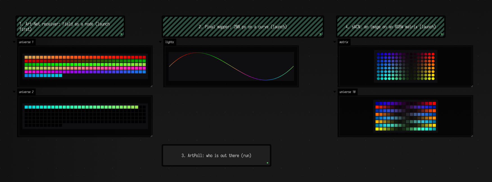
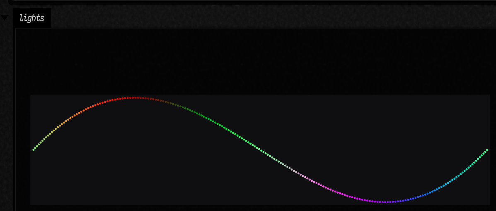
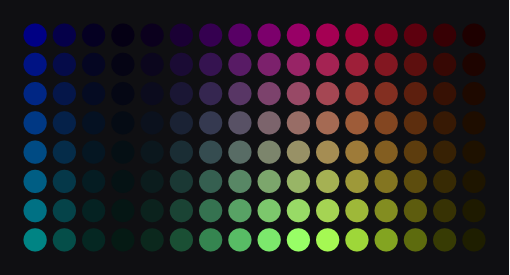
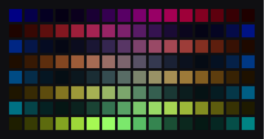
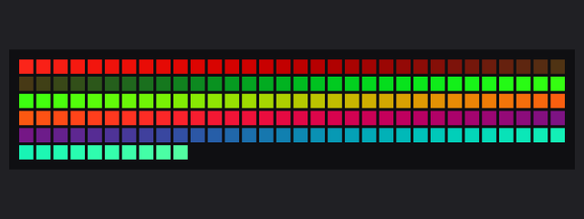
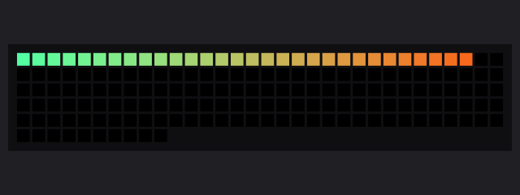

# Driving Lights: Art-Net and sACN

`afield.dmx` lets a box drive DMX lighting over a network, and lets Field act as a lighting node
itself. It speaks the two protocols nearly every LED controller, pixel driver and console accepts:
**Art-Net 4** (UDP 6454) and **sACN**, ANSI E1.31 (UDP 5568, usually multicast). On top of the wire
formats sits a small patch model: fixtures with channel layouts and addresses, strips that overflow
from one universe into the next, and mappers that colour fixtures from a function, a drawn line or
an image.

Nothing here needs hardware to try. Open `public/docs/assets/dmx_lighting_demo/` as a document: its
four boxes send over the network to this machine, receive the packets again and draw what arrived.



On the left, Field is an Art-Net node drawing the two universes it receives. In the middle is the
sender: 200 pixels on a curve, 170 in universe 1 and the remaining 30 in universe 2, which is why the
second grid on the left is mostly empty. On the right, a matrix of RGBW fixtures is sent as sACN and
received back in the same box.

## Five lines to a light

```diffstatic {data-lang=kotlin}
import afield.dmx.*

val out = artnetOut("192.168.1.50")      // a node's IP, or a broadcast address
out.universe(1)[1] = 255                 // channel 1 of universe 1, full
out.universe(1).setLevel(2, 0.5)         // channel 2, half
```

`artnetOut` returns a `DmxOutput` owned by the box. Its sender thread sends a universe when its
bytes change (at most 44 times a second, DMX512's full frame rate), repeats it twice more, and after
that re-sends it about once a second so receivers know the source is still there. Re-running the box
hands back the same output, so the socket and the lights carry on; stopping the box closes it.

`sacnOut()` is the same thing for E1.31. With no host it sends each universe to its multicast group,
`239.255.hi.lo`; with a host it sends unicast. Closing an sACN output sends the protocol's
Stream_Terminated packets, so receivers let go at once rather than holding the last look.

Channels are **1-based**, as on a console and in every fixture manual. Art-Net numbers universes
from 0 and sACN from 1; `afield.dmx` passes the number you give straight through, so universe 1 is
Art-Net port-address `0:0:1` and sACN universe 1.

## Fixtures and a patch

Addresses by hand get old quickly. A `Patch` holds fixtures, each a `FixtureProfile` (which channel
does what) at a universe and start address, placed at a position in the room:

```diffstatic {data-lang=kotlin}
import afield.dmx.*

val patch = Patch(startUniverse = 1)
val strip = patch.strip(200, vec(0.0, 0.0), vec(400.0, 0.0))            // 200 RGB pixels
val pars = patch.grid(4, 2, spacing = 100.0, profile = FixtureProfile.RGBWA)
patch.add(FixtureProfile.DIMMER16, universe = 5, address = 1, position = vec(0.0, 300.0))

val out = artnetOut("192.168.1.50")
strip.forEach { it.rgb(1.0, 0.3, 0.0) }
patch.render(out)
```

The run builders (`strip`, `grid`, `stripAlong`) allocate addresses one after another and move to
the next universe whenever a fixture would straddle slot 512. That is how pixel controllers expect
long runs: 170 RGB pixels to a universe (the last two slots unused), 128 RGBW. The 200-pixel strip
above takes all of universe 1 and 30 pixels of universe 2, and the pars start after it.

Profiles provided: `RGB`, `GRB` (the WS2812 order many pixel controllers expose), `RGBW`, `RGBWA`,
`DIMMER`, `DIMMER16`, `RGB16`, `DRGB` (master dimmer, then colour). Anything else is a list of
slots:

```diffstatic {data-lang=kotlin}
val myPar = FixtureProfile("my par", listOf(Slot.DIMMER, Slot.RED, Slot.GREEN, Slot.BLUE, Slot.ZERO, Slot.ZERO))
```

A fixture's colour is always set as RGB, 0..1. Profiles with a white channel take the common part of
red, green and blue out as white; an amber channel then takes what it can of the remaining red and
green. A 16-bit channel (`RED` followed by `RED_FINE`, `DIMMER` followed by `DIMMER_FINE`) gets
coarse then fine byte. `withGamma(2.2)` makes a ramp look even on LEDs, whose PWM is linear.

!!! note "White and amber are a default, not a calibration"
    The white and amber split assumes ideal emitters (amber as 1 : 0.5 red : green). A real
    fixture's primaries differ, and a rig that needs matched colour needs measured values.

## Mapping: colour from a function, a line, an image

Three mappers set the colour of every fixture (or of a list you pass as `only`):

```diffstatic {data-lang=kotlin}
patch.map { x, y, t -> vec(0.5 + 0.5 * sin(x * 0.03 - t * 2), 0.2, 0.5 + 0.5 * cos(y * 0.05)) }
patch.mapAlong { u, t -> vec(u, 1 - u, 0.0) }        // u runs 0..1 from the first fixture to the last
patch.mapImage(imgFromFile("sky.png"))               // the rig's bounding box stretched over the image
```

`map` hands the function each fixture's position, so the same function drives a strip, a grid or a
scattered rig. `mapImage` samples an `Img` bilinearly (it uses the imaging library's own
`sampleBilinear`), which turns a matrix of fixtures into a very low resolution screen.

For a white of a given warmth, `colorTemperature(3200.0)` returns the colour of a black body at that
temperature (a curve fit, fine for looks; not a fixture calibration):

```diffstatic {data-lang=kotlin}
patch.map { _, _, _ -> colorTemperature(3200.0) }   // tungsten; 5600.0 is daylight
```

`stripAlong` places a strip on a drawn curve instead of a straight line: LED tape stuck to a shape.

```diffstatic {data-lang=kotlin}
val tape = FLine().moveTo(0, 0).cubicTo(x0 = 150, y0 = -160, x1 = 250, y1 = 160, x = 400, y = 0)
patch.stripAlong(tape, 200)                          // evenly spaced by arc length, ends on the ends
```



## Animating

To animate, compute the next look on the output's own clock:

```diffstatic {data-lang=kotlin}
val out = artnetOut("127.0.0.1")
patch.animate(out) { t ->
    map(t) { x, y, time -> vec(0.5 + 0.5 * sin(x * 0.03 - time * 2.0), 0.3, 0.6) }
}
```

The block runs before every send tick on the sender thread, then the patch is rendered into the
output. The lights therefore keep time whether or not anything else in Field is ticking, which is
what an installation that runs without a window wants. There is one animation per output, so
re-running the box replaces it, and it ends when the box is stopped.

## Seeing the rig without the rig

`showPatch(patch)` draws the patched fixtures in their current colours into the box's output;
`patch.toFLines()` is the same drawing as `FLine`s for your own composition, and a `Patch` or a
`DmxUniverse` left as the last value of a box draws itself inline. `showUniverse(input, n)`
draws what a receiver has for universe `n`, decoded as the fixtures that drive it:

```diffstatic {data-lang=kotlin}
showPatch(patch, channel = "matrix")
showUniverse(node, 10, profile = FixtureProfile.RGBW, cols = 16)   // or profile = null for 512 gray slots
```

<div class="grid" markdown>





</div>

The right-hand picture is universe 10 as it came back over the network. Every other row runs
backwards, because the matrix was patched with `serpentine = true`, the way most LED matrices are
wired, and the receiver draws slots in wire order.

## Field as a node

`artnetIn()` and `sacnIn()` open a `DmxInput`: Field receives lighting data like any node would, and
other software (a console, a media server, another Field) can drive it.

```diffstatic {data-lang=kotlin}
val input = artnetIn()                  // UDP 6454; sacnIn(universes = listOf(1, 2)) joins multicast groups
input.channel(1, 1)                     // universe 1, channel 1, 0..255
input.universe(2)                       // all 512 slots, merged
input.version(1)                        // bumps when universe 1 may have changed; cheap to poll
```

Several sources on one universe are merged. sACN first keeps only the sources at the highest
priority (0..200, default 100), as E1.31 requires; then `MergeMode.HTP` (the default) takes the
highest value per slot and `MergeMode.LTP` the most recent packet. A source that goes silent is
dropped after sACN's 2.5 s data-loss timeout or Art-Net's 10 s merge timeout, and at once when an
sACN source sends Stream_Terminated.





An Art-Net input answers ArtPoll, so discovery tools list Field as a node. `artPoll(host)` is the
other side: it sends one ArtPoll and returns every `ArtPollReply` that comes back within a second.

```diffstatic {data-lang=kotlin}
artPoll("255.255.255.255").forEach { println(it) }   // every node on the network
```

## Synchronised output

A long strip spans universes, and universes are separate packets; without help, a fast animation can
tear where one universe ends. `artnetOut(host, sync = true)` follows every frame with an ArtSync, and
`sacnOut(sync = true)` sends E1.31 synchronization packets on universe 7962 and marks its data
packets to wait for them. Receivers that support sync (Field's `DmxInput` does, for sACN) apply the
frame's universes together.

## Without a box

`DmxOutput`, `DmxInput`, `Patch` and the packet codecs (`ArtNet.encodeDmx`, `Sacn.encodeData`, and
their decoders) work outside a box too. Then nothing closes the sockets for you: call `close()`.
`DmxSockets.closeAll()` closes everything the box helpers opened, for a panic button.

## What this does not do

RDM (remote device management), Art-Net's ArtAddress/ArtIpProg node programming, and sACN
per-channel priority (start code `0xDD`) are not implemented. `DmxInput` accepts ArtSync but does
not hold Art-Net frames for it.

??? aside "How this page's pictures were made"
    Every picture is real output from the code on this page, run by an agent through Field's backdoor
    on 2026-09-27, not a docs-runner capture. The first is a Playwright screenshot of the demo
    document, loaded from the committed bundle, with its three launched boxes running. The two
    Art-Net universes further down were drawn inside Field from what its `DmxInput` had received
    over UDP (`renderLinesPng(universeToFLines(...))`); the strip and matrix pictures are the SVG
    the demo boxes displayed, rasterised. They would ideally be
    capture fences, but a capture that needs two launched boxes exchanging packets is not something
    the runner does today. The protocol claims were checked against a decoder written separately
    from the encoder, in Python, and against the third-party `sacn` package; the record is
    `dev_docs/dmx_lighting.md`.
