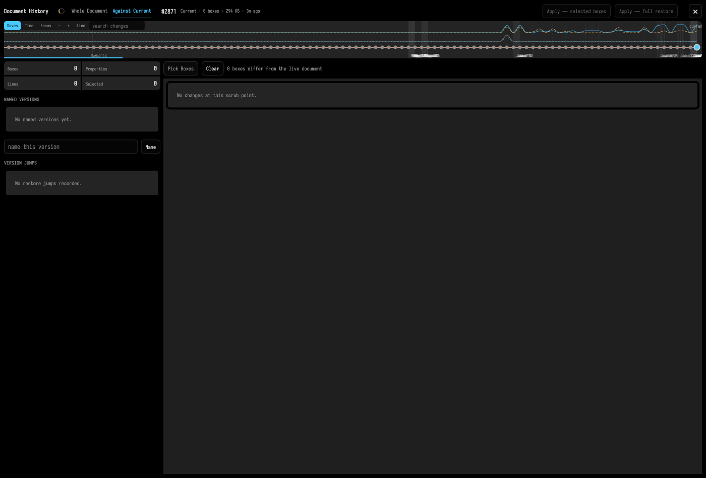

# Document History

Field keeps document backups as you work. The history view lets you inspect those saved versions, compare them, and restore an earlier state — either the whole document or just a few boxes.

This is for document-level recovery, not just stepping back one edit. For a lighter-weight, in-editor version of the same idea — scrubbing a single line back through time — see the [History Lens](history_lens.md).

## Open the history view

You can open history in two ways:

- run `Show Document History` from the command palette
- open `/history?file=<document-name>` directly on the Field server

There is no keyboard shortcut — it is command-palette (or URL) only. The history view opens in a dedicated iframe layered over the document, not inside a normal box.

## What the timeline shows

The page builds a vertical timeline of the current document and its backups. Each entry shows:

- a **version label** — `#0`, `#1`, … (and any name you have given it), with the live document marked as **Current**
- **box count** for that version
- the **size** of the saved metadata
- a **relative save time** ("3m", "2d")

The newest entry is the current `metadata.edn`; older entries are the backups Field has rotated to disk. Box counts and diffs for older versions stream in a moment after the list first appears, so an entry may briefly read `0 boxes` until the stats arrive.

The timeline can be viewed against a **Saves** axis (one slot per version) or a **Time** axis (spaced by real save time), and you can zoom and focus it. A **Whole Document / selected box** toggle narrows everything on the page to the box you have selected, and a diff-basis toggle switches between comparing each version **against the current** state and against its immediate predecessor.

## Restore an earlier version

The basic workflow:

1. Open the history view.
2. Click a version in the timeline.
3. Review the details in the side panel.
4. Choose **Apply — full restore**.
5. Confirm when prompted ("Restore the whole document to version #N?").

Saving the restored result rotates the previous on-disk `metadata.edn` into the backup set, so the
last saved state remains available in history. As with any recovery tool, unsaved in-memory edits
are not an additional durable checkpoint; let Field save (or make an explicit save) before a
high-stakes restore.

### Restore just a few boxes

You do not have to take a whole version. Select the boxes you care about and choose **Apply — selected boxes** to cherry-pick only those boxes out of the target version, leaving the rest of your document untouched. This is the right tool when one box has drifted but the rest of your work is good.

## What restore does

Restore is not a shallow file copy. It rebuilds document state from the target version.

Boxes that exist in the chosen version are restored with their saved properties. Boxes that do **not** exist in that older version are **tombstoned** rather than permanently deleted — that keeps the restore reversible and avoids throwing data away. Each restore also records the transition, so the jump you just made is itself part of the history.

## Digging deeper

The panel is richer than a plain timeline. Depending on what you select you can also:

- **Search changes** — filter versions to those that touched a given piece of text.
- **Blame a line** — see which version last changed a particular line.
- **Name a version** — give a meaningful label to a save point so you can find it again (named versions get their own list in the sidebar).
- **Review version jumps** — the sidebar lists the restore transitions you have made, so the act of moving through history is itself recoverable.
- **See per-version metrics** — boxes, properties and lines for the selected version.

## When to use history

History is the right tool when:

- you want to recover from a large experimental change
- a document has drifted and you want to return to a known earlier structure
- you need to inspect how the graph looked at an earlier save point
- you want a document-wide rollback (or a targeted cherry-pick) rather than a local code-edit undo

Use bookmarks for view-state jumps. Use history for content-state recovery.

## Where versions come from

History is built from the document backup files Field writes while saving. Each save, if the content actually changed, rotates the previous `metadata.edn` into a `backups/metadata_backup_*.edn` file (older backups are pruned to a limit). In practice this means:

- the history view becomes useful once the document has been saved a few times
- the backup list reflects real saved states, not transient editor changes
- the newest entry corresponds to the current `metadata.edn`

If a document has no backups yet, the history page will have little or nothing to show.

## Related features

- Use the [History Lens](history_lens.md) to scrub a single line through its versions without leaving the editor.
- Use [bookmarks.md](bookmarks.md) to return to a saved working view without changing content.
- Use [interactive_guides.md](interactive_guides.md) when you want to explain a document state instead of restoring one.
