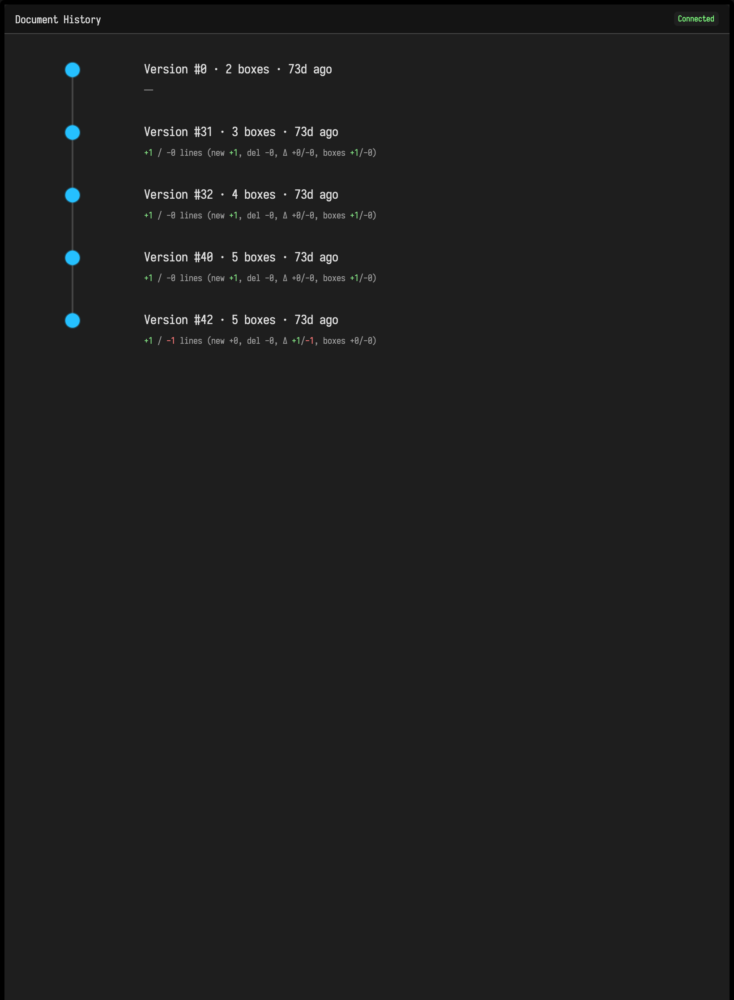

# Document History

Field keeps document backups as you work. The history view lets you inspect those saved versions and restore an earlier state.

This is for document-level recovery, not just stepping back one edit.

## Open the history view

You can open history in two ways:

- run `Show Document History` from the command palette
- open `/history?file=<document-name>` directly on the Field server

The history view opens in the documentation iframe area rather than inside a normal box.

## What the history view shows

The page builds a vertical timeline of the current document and its backups.

Each entry shows:

- version number
- save time
- box count
- backup filename

The current document state is highlighted separately from older versions so it is easy to see where you are now.

## Restore an earlier version

Use this workflow:

1. Open the history view.
2. Click a version in the timeline.
3. Review the details in the side panel.
4. Choose `Restore This Version`.
5. Refresh or return to the main document view.

Before restoration, Field creates a backup of the current state. Restoring an older version does not discard the state you are leaving behind.

## What restore does

Restore is not a shallow file copy. It rebuilds document state from the target version.

Boxes that exist in the chosen version are restored with their saved properties.

Boxes that do not exist in that older version are tombstoned instead of being permanently deleted. That keeps the restore operation reversible and avoids throwing data away unnecessarily.

## When to use history

History is the right tool when:

- you want to recover from a large experimental change
- a document has drifted and you want to return to a known earlier structure
- you need to inspect how the graph looked at an earlier save point
- you want a document-wide rollback rather than a local code edit undo

Use bookmarks for view-state jumps. Use history for content-state recovery.

## Where versions come from

History is built from the document backup files Field writes while saving.

In practice this means:

- the history view becomes useful once the document has been saved a few times
- the backup list reflects real saved states, not transient editor changes
- the newest entry corresponds to the current `metadata.edn`

If a document has no backups yet, the history page will have little or nothing to show.

## Related features

- Use [bookmarks.md](bookmarks.md) to return to a saved working view without changing content.
- Use [interactive_guides.md](interactive_guides.md) when you want to explain a document state instead of restoring one.
