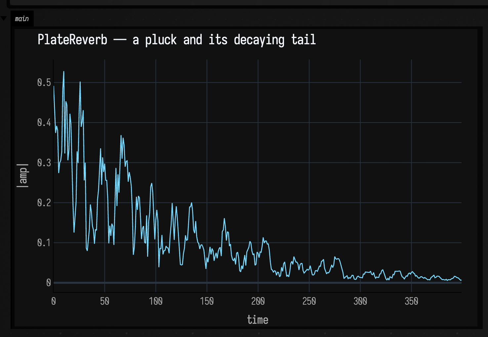
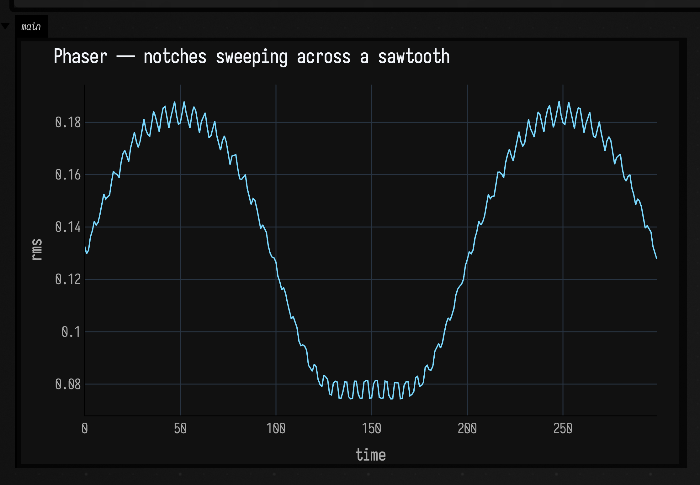
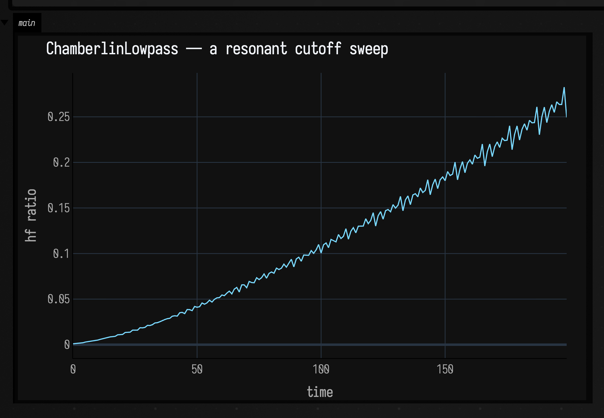
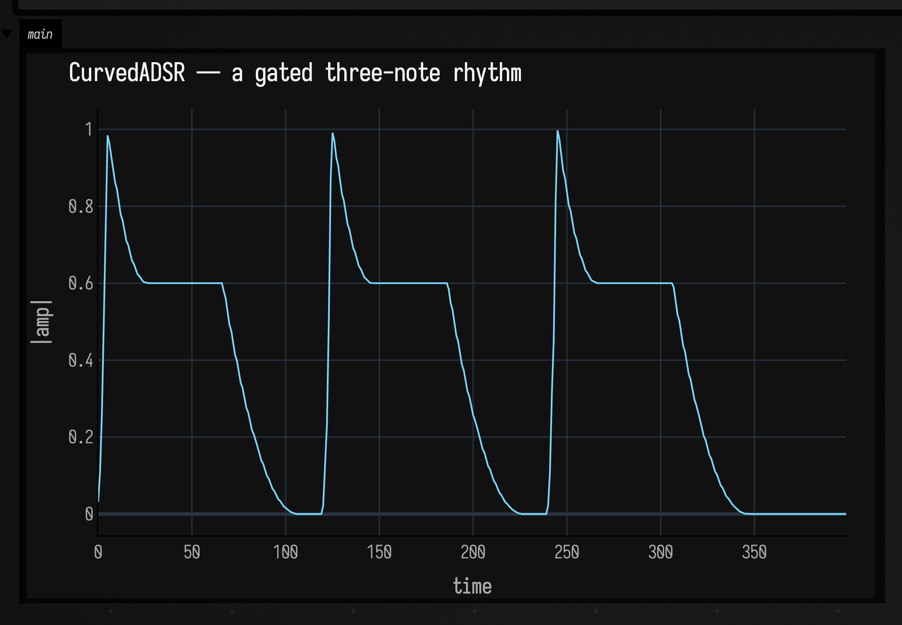
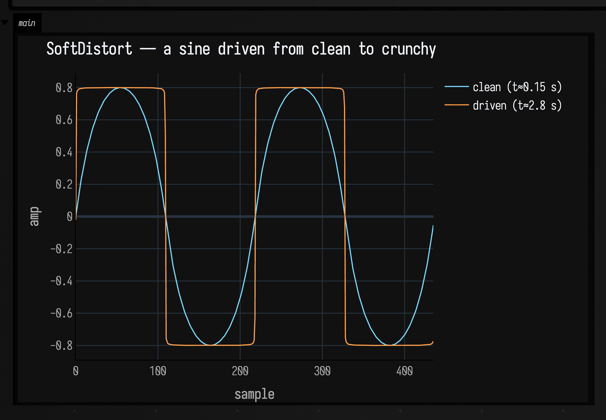
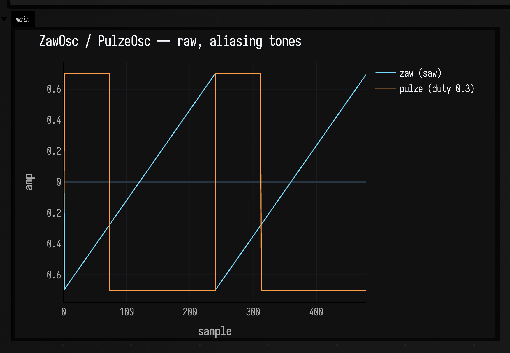

# DoughDSP: hear the primitives

The [`DoughDsp`](https://codeberg.org/uzu/dough) port gives Field a handful of low-level
DSP building blocks — a plate reverb, an LFO-swept phaser, a resonant lowpass, a click-free
envelope, a soft clipper, and two aliasing oscillators. A picture of a filter
curve only gets you so far; the way to know what one of these *does* is to run a real
signal through it and listen.

Every plot and every audio clip on this page is produced by actually running the primitive on
the CPU — no hand-drawn curves, no pre-baked recordings. The waveforms are block-rendered
offline (exactly like the audio engine renders them, minus the sound card) and written to a
16-bit PCM WAV at docs-build time by
`DoughDspSoundDocs` (`src/jvmMain/kotlin/afield/four/synth/DoughDspSoundDocs.kt`); the plots
are `showSignals` Plotly figures of the same run. Rebuild the page and the sound regenerates
from the code.

These six clips are the primitives themselves, driven by real signals — they are *not* the
`patVoice` drum stand-in used by the pattern pages, and `DoughDspSoundDocs` never calls it.
[Sound: the Pattern → Audio Path](sound.md) audits every audio clip in these docs and states
which of the three production paths made each one.

Each runner block below shows the *real* code that produces its plot: the interesting part —
constructing and driving the primitive — is in focus, and the render-and-plot boilerplate is
folded behind a `+ …` pill you can click to reveal. The offline `dough*` helpers it calls
(`doughRenderMono`, `doughRenderStereoMono`, `doughRenderGated`, `doughPluckEnv`, and the
plot-shaping `doughAbsEnvelope` / `doughShortTimeRms` / `doughShortTimeBrightness` /
`doughWaveWindow`) live in the same file and are auto-imported into every box.

---

## PlateReverb — a pluck and its tail

A single 120 ms pluck at 330 Hz is fed into the Dattorro plate (`decay = 0.85`, `mix = 0.5`)
and the stereo output is folded to mono. The dry note is gone almost immediately; what you hear
after it is entirely the plate ringing down. The envelope plot shows the same decay: a sharp
onset, then a long smooth tail.

```diffstatic_runner {data-lang=kotlin screenshot="assets/dough_dsp_sound/plate-reverb.png" wait="1.5" capture="box" open-outputs="true" name="dough-sound-plate"}
:::static
val pluck = SineOsc(Param(330f)) * doughPluckEnv(tau = 0.045f, holdSec = 0.12f)
val verb  = PlateReverb(source = pluck, decay = Param(0.85f), mix = Param(0.5f))
:::fold render 3 s offline and plot the |amplitude| envelope
val mono = doughRenderStereoMono(verb, seconds = 3f)
showSignals(
    "|amplitude| envelope" to doughAbsEnvelope(mono, buckets = 400),
    channel = "main", title = "PlateReverb — a pluck and its decaying tail",
    xTitle = "time", yTitle = "|amp|",
)
:::endfold
```



```diffstatic_runner {data-lang=kotlin audio="assets/dough_dsp_sound/plate-reverb.wav" audio-spec="plate-reverb" embed=true hidden=true name="dough-sound-plate-audio"}
// offline-rendered by DoughDspSoundDocs — listen below
```

---

## Phaser — notches sweeping across a sawtooth

A sustained 220 Hz sawtooth through the LFO-swept cascaded notches (`rate = 0.5 Hz`,
`depth = 0.7`). As the notches slide across the sawtooth's harmonics you get the classic hollow,
watery whoosh. The plot traces the short-time RMS: it breathes in time with the LFO.

```diffstatic_runner {data-lang=kotlin screenshot="assets/dough_dsp_sound/phaser.png" wait="1.5" capture="box" open-outputs="true" name="dough-sound-phaser"}
:::static
val saw = ZawOsc(Param(220f)) * 0.4f
val out = saw.through(Phaser(rate = Param(0.5f), depth = Param(0.7f), center = Param(700f), sweep = Param(1400f), mix = Param(1f)))
:::fold render 3 s offline and plot the short-time RMS (the LFO whoosh)
val audio = doughRenderMono(out, seconds = 3f)
showSignals(
    "short-time RMS" to doughShortTimeRms(audio, windowMs = 25.0, points = 300),
    channel = "main", title = "Phaser — notches sweeping across a sawtooth",
    xTitle = "time", yTitle = "rms",
)
:::endfold
```



```diffstatic_runner {data-lang=kotlin audio="assets/dough_dsp_sound/phaser.wav" audio-spec="phaser" embed=true hidden=true name="dough-sound-phaser-audio"}
// offline-rendered by DoughDspSoundDocs — listen below
```

---

## ChamberlinLowpass — a resonant cutoff sweep

A raw 110 Hz sawtooth through the superdough 2-pole lowpass with `resonance = 0.6`, while the
cutoff sweeps 150 Hz → 6 kHz. You hear the filter open up, the resonance whistling along the top
of the sweep. The plot tracks a cheap brightness proxy (high-frequency energy) climbing as the
cutoff rises.

```diffstatic_runner {data-lang=kotlin screenshot="assets/dough_dsp_sound/chamberlin-lowpass.png" wait="1.5" capture="box" open-outputs="true" name="dough-sound-chamberlin"}
:::static
val saw    = ZawOsc(Param(110f)) * 0.5f
val cutoff = Param(150f).also { it.supplier = { 150f + 5850f * (time / 3f).coerceIn(0f, 1f) } }
val out    = saw.through(ChamberlinLowpass(cutoff, Param(0.6f)))
:::fold render 3 s offline and plot the rising brightness
val audio = doughRenderMono(out, seconds = 3f)
showSignals(
    "brightness (HF energy)" to doughShortTimeBrightness(audio, windowMs = 40.0, points = 200),
    channel = "main", title = "ChamberlinLowpass — a resonant cutoff sweep",
    xTitle = "time", yTitle = "hf ratio",
)
:::endfold
```



```diffstatic_runner {data-lang=kotlin audio="assets/dough_dsp_sound/chamberlin-lowpass.wav" audio-spec="chamberlin-lowpass" embed=true hidden=true name="dough-sound-chamberlin-audio"}
// offline-rendered by DoughDspSoundDocs — listen below
```

---

## CurvedADSR — a gated three-note rhythm

A 220 Hz sine multiplied by the click-free curved envelope, gated on and off three times. Each
note swells in and fades out with real silence between — no clicks at the retrigger, which is the
whole point of the curved variant. The envelope plot shows three clean humps.

```diffstatic_runner {data-lang=kotlin screenshot="assets/dough_dsp_sound/curved-adsr.png" wait="1.5" capture="box" open-outputs="true" name="dough-sound-adsr"}
:::static
val gate   = Gate()
val voice  = SineOsc(Param(220f)) * CurvedADSR(gate, Param(0.02f), Param(0.08f), Param(0.6f), Param(0.15f))
// (open?, seconds): three notes with silent gaps
val rhythm = listOf(true to 0.25f, false to 0.20f, true to 0.25f, false to 0.20f, true to 0.25f, false to 0.35f)
:::fold render the gate schedule offline and plot the amplitude envelope
val audio = doughRenderGated(voice, gate, rhythm)
showSignals(
    "|amplitude| envelope" to doughAbsEnvelope(audio, buckets = 400),
    channel = "main", title = "CurvedADSR — a gated three-note rhythm",
    xTitle = "time", yTitle = "|amp|",
)
:::endfold
```



```diffstatic_runner {data-lang=kotlin audio="assets/dough_dsp_sound/curved-adsr.wav" audio-spec="curved-adsr" embed=true hidden=true name="dough-sound-adsr-audio"}
// offline-rendered by DoughDspSoundDocs — listen below
```

---

## SoftDistort — from clean to crunchy

A 220 Hz sine through dough's `expm1` soft clipper while the drive sweeps 0.2 → 7. It starts as
a pure tone and grows a buzzy edge as the drive climbs and the clipper starts folding the peaks.
The plot overlays two two-cycle windows: an early clean sine and a late, flat-topped, harmonically
rich one.

```diffstatic_runner {data-lang=kotlin screenshot="assets/dough_dsp_sound/soft-distort.png" wait="1.5" capture="box" open-outputs="true" name="dough-sound-distort"}
:::static
val drive = Param(0.2f).also { it.supplier = { 0.2f + 6.8f * (time / 3f).coerceIn(0f, 1f) } }
val out   = SineOsc(Param(220f)).through(SoftDistort(drive, Param(0.8f)))
:::fold render 3 s offline and overlay two 2-cycle windows (clean vs driven)
val audio = doughRenderMono(out, seconds = 3f)
showSignals(
    "clean (t≈0.15 s)" to doughWaveWindow(audio, atSeconds = 0.15f, cycles = 2, freqHz = 220f),
    "driven (t≈2.8 s)" to doughWaveWindow(audio, atSeconds = 2.8f, cycles = 2, freqHz = 220f),
    channel = "main", title = "SoftDistort — a sine driven from clean to crunchy",
    xTitle = "sample", yTitle = "amp",
)
:::endfold
```



```diffstatic_runner {data-lang=kotlin audio="assets/dough_dsp_sound/soft-distort.wav" audio-spec="soft-distort" embed=true hidden=true name="dough-sound-distort-audio"}
// offline-rendered by DoughDspSoundDocs — listen below
```

---

## ZawOsc / PulzeOsc — raw, aliasing tones

The two naive oscillators, un-bandlimited: one second of a 200 Hz sawtooth
(`ZawOsc`) then one second of a 200 Hz narrow pulse (`PulzeOsc`, duty 0.3). The raw ramps buzz
with aliasing — that grit is the character, not a bug. The plot shows two periods of each: a clean
rising ramp and a narrow rectangular pulse.

```diffstatic_runner {data-lang=kotlin screenshot="assets/dough_dsp_sound/zaw-pulze.png" wait="1.5" capture="box" open-outputs="true" name="dough-sound-oscillators"}
:::static
val saw   = ZawOsc(Param(200f)) * 0.7f
val pulse = PulzeOsc(Param(200f), Param(0.3f)) * 0.7f
:::fold render one second of each (saw then pulse) and plot two periods of each
val audio = doughRenderMono(saw, seconds = 1f) + doughRenderMono(pulse, seconds = 1f)
showSignals(
    "zaw (saw)" to doughWaveWindow(audio, atSeconds = 0.005f, cycles = 2, freqHz = 200f),
    "pulze (duty 0.3)" to doughWaveWindow(audio, atSeconds = 1.005f, cycles = 2, freqHz = 200f),
    channel = "main", title = "ZawOsc / PulzeOsc — raw, aliasing tones",
    xTitle = "sample", yTitle = "amp",
)
:::endfold
```



```diffstatic_runner {data-lang=kotlin audio="assets/dough_dsp_sound/zaw-pulze.wav" audio-spec="zaw-pulze" embed=true hidden=true name="dough-sound-oscillators-audio"}
// offline-rendered by DoughDspSoundDocs — listen below
```
