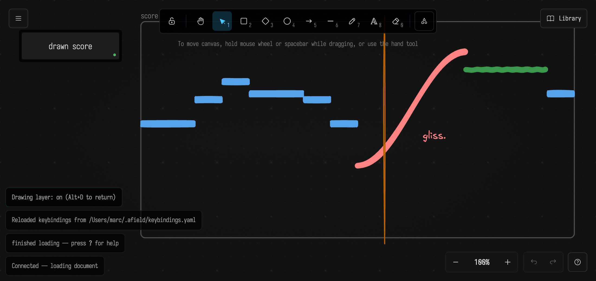

# Drawing and Notation

Press `alt-d` and the canvas becomes a drawing surface: pens, shapes, arrows and text, in Excalidraw's hand-made style, laid over your boxes. Press it again and you are back with the boxes. What you drew stays where you put it, pans and zooms with the canvas, and is saved with the document.

On its own that is a whiteboard. What makes it Field's is that your code can read the drawing and write to it. Every stroke is data a box can ask about, and every box can draw.



## A long tradition

Artists and composers spent much of the twentieth century pulling notation apart, and most of what they found is useful here.

Kandinsky's *Point and Line to Plane* (1926) treated the elements of a drawing as things with properties you could name and measure. In the 1950s composers took the hint. Morton Feldman's *Projection 1* (1950) gives the cellist boxes on a grid: time runs left to right, three rows say high, middle or low, and the pitches themselves are left open. Earle Brown's *December 1952* is a page of horizontal and vertical rectangles that can be read in any direction. Stockhausen's *Studie II* (1954) was published as a score of overlapping rectangles, each a band of frequencies over a stretch of time.

John Cage came closest to the idea behind this page. *Fontana Mix* (1958) is a kit of sheets with curved lines, transparencies of points, a grid and a straight line. The performer lays them over one another, draws a line from a point inside the grid to a point outside it, and measures where that line crosses the curves. The measurements become the piece. The score is read by intersection.

Others built machines to do the reading. Daphne Oram's Oramics drew sound on strips of 35mm film for photocells to follow, and Iannis Xenakis's UPIC (1977) turned drawings made on a tablet into sound. The traffic ran the other way too: Fluxus event scores and Sol LeWitt's wall drawings are instructions, text that makes the work when someone follows it.

Field sits in the middle of all this. A box can draw, which is LeWitt's direction, and a box can read what you drew, which is Cage's, in the same document while both are running.

## Drawing

`alt-d` switches the mouse and keyboard to the drawing; `alt-d` again gives them back to the boxes. While the drawing has them, Excalidraw's own keys work: `p` for the pen, `r` rectangle, `o` ellipse, `a` arrow, `l` line, `t` text, `e` eraser, and space-drag or two fingers to pan. Pinch to zoom, and the boxes zoom with you.

When the drawing is off it is still visible, but it lets clicks through to the boxes. Two things tie it to them:

 * An arrow you draw from one box to another sticks to both. Drag either box and the arrow follows.
 * **Anchor Drawing to Boxes** in the command palette makes the selected marks (or, with nothing selected, every mark sitting on a box) follow the box underneath.

## Drawing from code

`notation { }` draws. Everything a block makes belongs to the box that ran it, so running the box again replaces those marks rather than adding to them. Marks you drew by hand are never touched.

```diffstatic_runner {data-lang=kotlin screenshot="assets/drawing_and_notation/draw.png" capture="window" embed=true open-outputs="false" clip="0,0,1060,500" w="180" h="50" wait="3.0" timeout="90" name="notation-draw" alt="A box circled in blue, an arrow labelled 'points here' leading to a rectangle labelled 'a region', and a green wave, all drawn on the canvas by the box's code"}
notation {
    stroke = "#1971c2"
    ellipse(frame.x - 16, frame.y - 16, frame.w + 32, frame.h + 32)
    rect(560, 110, 260, 150, label = "a region")
    arrow(vec(frame.x + frame.w + 24, frame.y + 30), vec(550, 180), label = "points here")
    stroke((0..60).map { k -> vec(560 + k * 7.0, 400 + 50 * sin(k / 6.0)) }, stroke = "#2f9e44")
}
markdown("marks", "${notation.mine.size} marks drawn")
```

`rect`, `ellipse`, `diamond`, `text`, `line`, `arrow`, `stroke` (a freehand stroke, from points or an `FLine`) and `frame` are all there. `arrow(from = thisBox, to = otherBox)` puts the ends on the two boxes' edges, and they stay there when either box moves. Give a block a key, `notation("overlay") { … }`, to keep a second set of marks that is replaced on its own.

Any mark, hand-drawn or not, can be changed or removed:

```diffstatic {data-lang=kotlin}
val m = notation.named("tempo")!!          // a mark labelled "tempo"
notation.edit(m) { stroke = "#e03131"; text = "tempo 96" }
notation.anchor(m, thisBox)                // it now follows this box
notation.delete(m)
```

## Reading the drawing

`notation` is the whole drawing, seen from the box that asks:

```diffstatic {data-lang=kotlin}
for (m in notation.marks)
    println("${m.kind} ${m.label} at ${m.bounds}, over ${m.box?.name}")

notation.strokes                // just the pen strokes; also .arrows .lines .texts .shapes .frames
notation.over(thisBox)          // marks sitting on this box
notation.arrowsTo(thisBox)      // arrows that end on it
notation.selected               // what is selected in the drawing right now
```

Each mark knows its `kind`, `bounds`, `points` (in canvas coordinates, the same ones a box's `frame` uses), `stroke` and `fill` colours, and its `label`: its own text, the text written inside it, or a name given from code. `toFLine()` turns any mark into an `FLine`, and from there everything Field can do with geometry applies.

## Listening to the drawing

A box can react to what you draw:

```diffstatic {data-lang=kotlin}
notation.onStroke { s ->
    println("a stroke of ${s.points.size} points, over ${s.box?.name ?: "nothing"}")
}
notation.onText { t -> println("you wrote '${t.text}'") }
notation.onChange { edit -> println("${edit.added.size} added, ${edit.removed.size} removed") }
```

A handler runs once the stroke is finished, not while it is being drawn. Running the box again replaces its handlers, and stopping the box removes them. Changes a box makes itself do not call it back.

## Reading by intersection

Cutting a drawing with a line is a good way to read it. A vertical line through a score picks out an instant, and a horizontal one picks out a pitch. `notation.space` names a region and says what its axes mean. The region can be a frame, a box, or a rectangle:

```diffstatic {data-lang=kotlin}
val score = notation.space("score", x = 0.0..8.0, y = 84.0..48.0)   // eight beats; MIDI 84 at the top
score.vertical(2.0)       // everything at beat 2, as hits sorted by pitch
score.horizontal(66.0)    // every place something passes F#4, as beats
score.events              // every mark as an event: start, end, and the pitch it starts and ends on
```

A cut returns hits. A stroke crosses it at points, so a line that doubles back gives two hits, two voices at once. A shape or a text covers a stretch of it, a `span`, so a rectangle in a piano roll gives the pitches it covers. Each hit also says how far along its stroke it is (`along`), how fast the stroke is rising there in the space's units (`slope`, which for a score is semitones per beat), and, for a pen stroke, how hard the pen was pressing (`pressure`).

### Fontana Mix

Here is Cage's kit drawn by code: six curves, a grid, a point, and the straight line from the point inside the grid to one outside it. The box cuts the curves with the line and reports where the line meets each one:

```diffstatic_runner {data-lang=kotlin screenshot="assets/drawing_and_notation/fontana.png" capture="window" embed=true open-outputs="false" clip="0,0,1060,510" w="180" h="50" wait="3.0" timeout="90" name="notation-fontana" alt="Six coloured curves across a frame labelled 'fontana mix', a grey grid and point, a straight line from the point to the frame's corner, and the box's readout listing where the line crosses four of the curves"}
val colors = listOf("#e03131", "#1971c2", "#2f9e44", "#f08c00", "#9c36b5", "#0c8599")
notation {
    frame("fontana mix", 260, 30, 780, 460)
    for (i in 0 until 6) {
        val curve = (0..48).map { k -> vec(280 + k * 15.4, 80 + i * 66 + 45 * sin(k / 5.0 + i * 1.9)) }
        stroke(curve, name = "curve ${i + 1}", stroke = colors[i])
    }
    rect(520, 170, 200, 170, name = "grid", stroke = "#868e96")
    ellipse(580, 230, 10, 10, name = "point", fill = "#868e96")
    line(listOf(vec(585, 235), vec(1010, 470)), name = "the line", stroke = "#1e1e1e")
}
val line = notation.named("the line")!!
val crossings = notation.intersect(line.start!!, line.end!!).filter { it.mark.name!!.startsWith("curve") }
markdown("readings", crossings.joinToString("  \n") { "${it.mark.name}: %.2f along the line".format(it.value) })
```

In the starting point below, you draw that line yourself with `l`, and the box reads it each time you move it.

### Projection 1

Feldman's grid, read as events. Time runs across the frame and the three rows are high, middle and low. Each rectangle is a note, and the box reports when it starts, how long it lasts, and which row it is in:

```diffstatic_runner {data-lang=kotlin screenshot="assets/drawing_and_notation/projection.png" capture="window" embed=true open-outputs="false" clip="0,0,1080,300" w="180" h="50" wait="3.0" timeout="90" name="notation-projection" alt="A frame labelled 'projection' divided into three rows, with four blue rectangles in different rows, and the box's readout of each rectangle's beat, length and register"}
notation {
    stroke = "#868e96"
    frame("projection", 260, 30, 800, 240)
    for (row in 1..2) line(listOf(vec(260, 30 + row * 80), vec(1060, 30 + row * 80)))
    fill = "#1971c2"
    rect(300, 42, 120, 56)
    rect(500, 122, 200, 56)
    rect(740, 202, 80, 56)
    rect(900, 42, 120, 56)
}
val score = notation.space("projection", x = 0.0..10.0, y = 3.0..0.0)   // ten beats; three rows
fun register(v: Double) = when { v >= 2 -> "high"; v >= 1 -> "middle"; else -> "low" }
markdown("events", score.events.filter { it.mark.kind == MarkType.RECTANGLE }.joinToString("  \n") {
    "beat %.1f for %.1f, %s".format(it.start, it.duration, register(it.value))
})
```

### A crescendo

A hairpin is a good thing to cut. A vertical line crosses its two sides once each, and the gap between the crossings is how loud it is at that moment: nothing at the point, most at the mouth. It makes no difference whether the hairpin is one pen stroke drawn as a `<` or two separate lines, because the box reads the spread of everything the cut meets.

The hairpin below is drawn by code with a little wobble in it. In your own document you draw it with the pen:

```diffstatic_runner {data-lang=kotlin screenshot="assets/drawing_and_notation/crescendo.png" capture="window" embed=true open-outputs="false" clip="0,0,1080,330" w="180" h="50" wait="3.0" timeout="90" name="notation-crescendo" alt="A red hand-drawn crescendo hairpin opening to the right inside a frame labelled 'dynamics', and the box's readout of the hairpin's width at each beat as a dynamic marking from niente to ff"}
notation {
    frame("dynamics", 260, 30, 800, 200)
    val hand = { i: Int -> 2.5 * sin(i * 2.3) + 1.5 * sin(i * 0.7) }     // a hand is not a ruler
    val hairpin = (0..60).map { i ->
        val k = if (i <= 30) i else 60 - i                                // out along the top, back along the bottom
        val side = if (i <= 30) -1 else 1
        vec(1020 - k * 23.0, 130 + side * (75 - k * 2.5) + hand(i))
    }
    stroke(hairpin, name = "hairpin", stroke = "#e03131")
}
val dynamics = notation.space("dynamics", x = 0.0..8.0, y = 0.0..1.0)
val markings = listOf("niente", "pp", "p", "mp", "mf", "f", "ff")
markdown("dynamics", (0..7).joinToString("  \n") { beat ->
    val ys = dynamics.vertical(beat.toDouble()).filter { !it.isSpan }.map { it.value }
    val gap = if (ys.size >= 2) ys.max() - ys.min() else 0.0
    "beat $beat: %.2f %s".format(gap, markings[(gap / 0.75 * 6).roundToInt().coerceIn(0, 6)])
})
```

Draw two hairpins, or a diminuendo after the crescendo, and the same reading code reads them.

## The starting point

Open **drawing_notation** from the welcome screen's starting points. It has the ideas on this page as six boxes you run and then draw against: `draw`, `read`, `listen`, `projection 1`, `fontana mix` and `crescendo`. Or [browse it in the offline viewer](offline.html?file=assets/agent_transcripts/drawing_notation/metadata.edn).

## Reference

| | |
| --- | --- |
| `notation.marks` | every mark, back to front; also `.strokes` `.arrows` `.lines` `.texts` `.shapes` `.frames` `.mine` |
| `notation["id"]`, `notation.named("x")` | one mark, by id or by label |
| `notation.over(box)`, `.arrowsFrom(box)`, `.arrowsTo(box)` | marks in relation to a box |
| `notation.near(point, r)`, `.inside(rect)` | marks by position |
| `notation { … }`, `notation("key") { … }` | draw marks this box owns |
| `notation.edit(m) { … }`, `.delete(m)`, `.anchor(m, box)`, `.clear()` | change marks |
| `notation.onStroke`, `.onArrow`, `.onText`, `.onChange` | react to what people draw |
| `notation.vertical(x)`, `.horizontal(y)`, `.intersect(a, b)` | cut the canvas |
| `notation.space(region, x = …, y = …)` | a region with its own axes |
| `space.vertical(t)`, `.horizontal(v)`, `.events`, `.between(t0, t1)`, `.sounding(t)` | read it |
| `mark.kind`, `.bounds`, `.points`, `.label`, `.box`, `.fromBox`, `.toBox`, `.toFLine()`, `.yAt(x)`, `.xAt(y)` | one mark |

!!! note "Colours"
    Field shows the drawing in Excalidraw's dark theme, which draws every colour through an inversion. A colour given from code is shown transformed: pale yellow becomes dark brown. The strong colours of Excalidraw's own palette, the ones used on this page, come through well.

The drawing is one scene per document, kept in the document's root box. When code and a hand change it at the same moment, both changes are kept.
