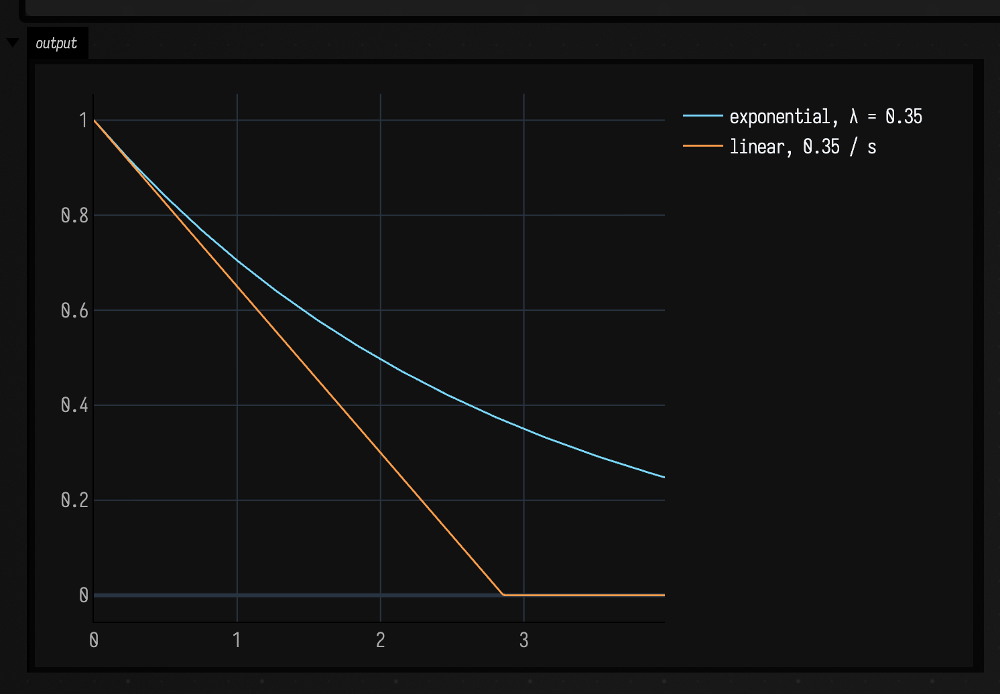
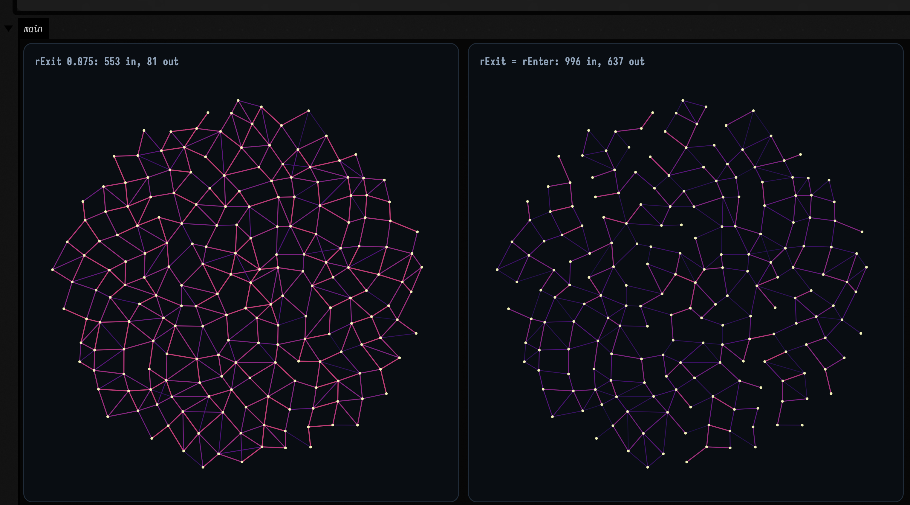

# Graphs that change while you watch

*Every public declaration used below is listed, with its KDoc, in the codebase reference:
[`dynamic_graph_systems.kt`](reference/data.md#dynamic-graph-systems-kt) and
[`dynamic_graph_field.kt`](reference/data.md#dynamic-graph-field-kt). Start from
[what's already in the box](reference/index.md).*

The graph in this family is a slowly-decaying memory of what has been near what, not a description of
where things are now. Points move every frame, and no edge arrives ready-made: edges are
**continually proposed, reinforced and forgotten**, so the structure that matters is whichever one
survives the forgetting.

That inverts three things a static graph lets you take for granted:

- **An edge is a weight with a lifetime.** [`DynamicEdgeList`](reference/data.md#dynamic-graph-systems-kt-dynamicedgelist)
  stores `weight`, `age`, `ttl` and `flags` per edge, and a
  [`DynamicGraphSystem`](reference/data.md#dynamic-graph-systems-kt-dynamicgraphsystem) only ever
  *adds*. Its `reinforce` saturates at a ceiling, and removal is a separate step: `decayLinear` or
  `decayExponential`, which bleed weight, count down ttl, and drop whatever reaches zero. A structure
  therefore persists exactly as long as something keeps proposing it.
- **The neighbour query is rebuilt every frame**, because the cloud has moved. That is what
  [`Vec3SpatialHash`](reference/data.md#dynamic-graph-systems-kt-vec3spatialhash) is for, and
  `stepDynamicGraph` and `DynamicProcessPipeline` rebuild it for you.
- **The population is a variable.** A [`DynamicPointProcess`](reference/data.md#dynamic-graph-systems-kt-dynamicpointprocess)
  moves points, spawns them and kills them, so the cloud's *size* is an output. Three of the ten
  shipped processes add points and two remove them.

## 1. Six ways to propose an edge

Six `DynamicGraphSystem`s ship, and they differ in what they think an edge *means*. Run all six over
the same 220-point disc, for the same 20 frames, with the same reinforcement and the same ceiling, and
every difference is topological — nothing about the cloud or the clock changes between panels.

```diffstatic_runner {data-lang=kotlin screenshot="assets/dynamic_graph_systems_examples/six_systems.png" wait="14.0" capture="box" open-outputs="true" padding="20"}
:::static
// Six DynamicGraphSystems, one cloud, one clock, one reinforcement budget. The only thing that
// differs between panels is what the system thinks an edge means.
val cloud = List(220) { i ->
    val a = i * 2.39996322972865332
    val r = 0.5 * Math.sqrt((i + 0.5) / 220.0)
    Vec3((r * Math.cos(a)).toFloat(), (r * Math.sin(a)).toFloat(), 0f)
}
val window = dynamicGraphWindow(cloud, padFraction = 0.06)
val ceiling = 4.0

fun build(system: DynamicGraphSystem): Pair<DynamicPointState, DynamicEdgeList> {
    val state = DynamicPointState(cloud.map { Vec3(it) }.toMutableList())
    val edges = DynamicEdgeList(state.pointCount)
    val hash = Vec3SpatialHash(0.06)
    repeat(20) { stepDynamicGraph(1f / 60f, state, edges, hash, system) }
    return state to edges
}

val systems = listOf<Pair<String, DynamicGraphSystem>>(
    "kNN k=5" to Vec3BreathingAnisotropicKnnSystem(
        k = 5, ttl = 10f, reinforce = 4.0, maxWeight = ceiling, mutualOnly = true, queryRadius = 0.12),
    "flowline" to Vec3FlowlineAdvectionGraphSystem(
        influenceRadius = 0.10, stepLength = 0.08, ttl = 10f, reinforce = 4.0, maxWeight = ceiling),
    "tangent fan" to Vec3LocalTangentTriangulationSystem(
        neighborhoodK = 6, ttl = 10f, reinforce = 4.0, maxWeight = ceiling, maxNeighborRadius = 0.10),
    "hysteresis" to Vec3PersistentProximityHysteresisSystem(
        rEnter = 0.055, rExit = 0.075, ttl = 10f, reinforce = 4.0, maxWeight = ceiling),
    "routing, 1 arc" to Vec3SignalRoutingGraphSystem(
        neighborhoodK = 6, ttl = 10f, reinforce = 1.0, maxWeight = ceiling, routeCount = 1, maxNeighborRadius = 0.10),
    "alpha-event" to Vec3AlphaEventHypergraphCollapseSystem(
        neighborhoodK = 6, alphaRadius = 0.075, ttl = 10f, reinforcePerUnitArea = 4.0, maxWeight = ceiling,
        maxNeighborRadius = 0.09, minArea = 1e-4)
)

// The claim each panel makes, as numbers rather than as an impression: how many edges, what fraction
// of them close a triangle, and -- because colour and thickness are on a FIXED scale -- how much of
// the shared ceiling the system's weights actually reached.
val panels = systems.map { (name, system) ->
    val (state, edges) = build(system)
    val adjacency = Array(state.pointCount) { HashSet<Int>() }
    for (e in edges.values()) { adjacency[e.i].add(e.j); adjacency[e.j].add(e.i) }
    val closed = edges.values().count { e -> adjacency[e.i].any { it != e.j && adjacency[e.j].contains(it) } }
    val fraction = if (edges.values().isEmpty()) 0.0 else closed.toDouble() / edges.values().size
    val wmax = edges.values().maxOfOrNull { it.weight } ?: 0.0
    println("%-16s %4d edges  %5.1f%% in a triangle  mean degree %.2f  wmax %.4f (%.1f%% of ceiling)".format(
        name, edges.values().size, 100.0 * fraction, 2.0 * edges.values().size / state.pointCount,
        wmax, 100.0 * wmax / ceiling))
    // dynamicGraphFLines, not dynamicGraphPanel: a still figure on this page is VECTOR -- one FLine
    // per edge through showPlaneGrid -> drawToSVG. The raster is for the clips further down, where
    // animateEvolution needs an Img. Weight drives colour AND stroke width, both against `ceiling`.
    "%s: %de %d%%tri".format(name, edges.values().size, Math.round(100.0 * fraction)) to
        dynamicGraphFLines(state.points, edges.values(), maxWeight = ceiling, colormap = "magma")
}

// One shared window for all six panels, so nothing but the topology differs between them.
showPlaneGrid(
    *panels.toTypedArray(),
    columns = 3, cellWidth = 400, cellHeight = 400,
    window = dynamicGraphPlaneWindow(window),
)
```


`dynamicGraphFLines` emits one `FLine` per edge and `showPlaneGrid` puts them through `drawToSVG`, so
the panels are vector: they scale, and each edge carries its own weight. That weight is read as
`weight / 4.0`, the ceiling all six were given, and it drives both the colour and the stroke width on
one **fixed** scale rather than a per-panel normalisation. A faint, thin panel is therefore a system
whose weights stayed low. The top-left and bottom-right panels are cream and heavy against thin and
purple over the same cloud and the same reinforcement budget, and the last column of this table is
why:

| system | edges | in a triangle | mean degree | max weight reached |
| --- | --- | --- | --- | --- |
| mutual kNN, `k = 5` | 534 | 88.4 % | 4.85 | 4.0000 — the ceiling |
| flowline advection | 158 | **0.0 %** | 1.44 | 2.5346 (63 %) |
| local tangent fan | 715 | **100.0 %** | 6.50 | 4.0000 — the ceiling |
| proximity hysteresis | 153 | 2.0 % | 1.39 | 0.6653 (17 %) |
| signal routing, 1 arc | 260 | 2.3 % | 2.36 | 1.0991 (27 %) |
| alpha-event triangles | 351 | **100.0 %** | 3.19 | **0.0137 (0.3 %)** |

The "in a triangle" column splits the six cleanly into two kinds. **Two systems reach 100 %**: the
local tangent fan, which fits a plane to each neighbourhood and joins consecutive neighbours by angle,
and alpha-event collapse, which reinforces all three sides of every small non-degenerate triple. Both
build *faces*. **Flowline advection reaches exactly 0 %**: it advects each point one step along a field
and joins it to whatever it lands nearest, so it is a functional map, one arc out of each point, and
the pinwheel in the top-middle panel is the phyllotaxis spiral of the cloud made visible. The mutual
kNN's 88.4 % sits between the two for no reason to do with its design; that is simply what a dense
mesh gives you at `k = 5`.

The alpha-event panel is faint for a different reason. Its parameter is `reinforcePerUnitArea`, not
`reinforce`: each increment is multiplied by `min(1, area)`, and a triangle in this disc has an area of
a few thousandths, so the same 4.0 reaches 0.3 % of the ceiling. Give it about a hundred times what
the others get to bring its edges level with theirs.

## 2. Reinforcement and forgetting

The decay laws are the whole reason this family is not just "rebuild a kNN graph every frame".
`decayExponential(dt, λ)` multiplies by `e^(−λ dt)`, so the weight after a given amount of *time* does
not depend on how many steps it took to get there. `decayLinear` describes a different curve entirely,
and the two are stepped side by side below, so that neither shape is a property of the harness.

```diffstatic_runner {data-lang=kotlin screenshot="assets/dynamic_graph_systems_examples/decay.png" wait="10.0" capture="box" open-outputs="true" padding="20"}
:::static
// Both decay laws against their closed forms, and against each other.
fun weightAfter(steps: Int, seconds: Float, exponential: Boolean): Double {
    val edges = DynamicEdgeList(2)
    edges.reinforce(0, 1, 1.0, ttl = 1000f, maxWeight = 1.0)
    val dt = seconds / steps
    repeat(steps) { if (exponential) edges.decayExponential(dt, 0.35) else edges.decayLinear(dt, 0.35) }
    return edges.get(0, 1)?.weight ?: 0.0
}

println("exponential, 2 s at lambda = 0.35 -- closed form e^-0.7 = %.9f".format(Math.exp(-0.7)))
for (n in listOf(1, 4, 120)) println("   in %3d steps: %.9f".format(n, weightAfter(n, 2f, true)))
println("linear, 2 s at 0.35/s -- closed form 1 - 0.7 = 0.300000000")
for (n in listOf(1, 4, 120)) println("   in %3d steps: %.9f".format(n, weightAfter(n, 2f, false)))

// The half-life, which is the number you actually reach for when choosing lambda.
val halfLife = Math.log(2.0) / 0.35
val e = DynamicEdgeList(2)
e.reinforce(0, 1, 1.0, ttl = 1000f, maxWeight = 1.0)
e.decayExponential(halfLife.toFloat(), 0.35)
println("ln2/lambda = %.4f s halves the weight: %.9f".format(halfLife, e.get(0, 1)!!.weight))

// ttl is the OTHER way an edge dies, and it is independent of weight: this edge is at the ceiling
// the whole time and still expires. Without it, an edge a saturating system keeps proposing would
// be immortal.
val heavy = DynamicEdgeList(2)
heavy.reinforce(0, 1, 8.0, ttl = 0.5f, maxWeight = 8.0)
repeat(4) { heavy.decayExponential(0.1f, 1e-9) }
println("ttl 0.5 s, at t = 0.4 s: ${heavy.values().size} edge of weight ${heavy.get(0, 1)?.weight}")
heavy.decayExponential(0.2f, 1e-9)
println("            at t = 0.6 s: ${heavy.values().size} edges -- expired while still at the ceiling")

:::fold draw the two curves, sampled from the real edge store rather than plotted from the formula
// Sampled by actually stepping an edge store, not by evaluating the formula -- otherwise the picture
// is a plot of the documentation rather than of the code.
val samples = 240
val expo = DoubleArray(samples)
val lin = DoubleArray(samples)
val a = DynamicEdgeList(2).also { it.reinforce(0, 1, 1.0, 1000f, 1.0) }
val b = DynamicEdgeList(2).also { it.reinforce(0, 1, 1.0, 1000f, 1.0) }
for (i in 0 until samples) {
    expo[i] = a.get(0, 1)?.weight ?: 0.0
    lin[i] = b.get(0, 1)?.weight ?: 0.0
    a.decayExponential(1f / 60f, 0.35)
    b.decayLinear(1f / 60f, 0.35)
}
showSignals(
    "exponential, λ = 0.35" to expo.toList(),
    "linear, 0.35 / s" to lin.toList(),
    x = (0 until samples).map { it / 60.0 }
)
:::endfold
```



Both laws agree with their closed forms to nine decimal places at one step, four steps and 120 steps
(`0.496585304` for the exponential and `0.300000000` for the linear), and `ln 2 / λ = 1.9804 s` halves
the weight exactly. The linear one **terminates**: it reaches zero at `1/0.35 ≈ 2.86 s` and the
edge is *removed* at that point, not merely faint. That is the practical
difference between the two: exponential decay gives a graph with a soft memory in which nothing is
ever quite gone, linear decay gives one with a hard horizon. `ttl` is orthogonal to both, and it is
what stops an edge that a saturating system keeps proposing from becoming immortal.

## 3. Hysteresis: the one system with a memory of its own

Five of the six systems are memoryless — they look at the cloud and propose.
`Vec3PersistentProximityHysteresisSystem` looks at the *edge store* too: a pair not yet joined must
come within `rEnter`, but a pair already joined only has to stay within `rExit`. So a structure formed
while things were close survives a separation that could never have created it, which is exactly what
you want when a cloud is jittering across a threshold and you do not want the graph to flicker.

The control below is the same run with `rExit == rEnter`: the same system with its memory switched
off, and nothing else changed.

```diffstatic_runner {data-lang=kotlin screenshot="assets/dynamic_graph_systems_examples/hysteresis.png" wait="10.0" capture="box" open-outputs="true" padding="20"}
:::static
// Two points, walked apart from 0.05 to 0.13 -- past rEnter (0.10), inside rExit (0.16).
// The only difference between the arms is rExit.
fun walk(rExit: Double): Pair<Boolean, Boolean> {
    val state = DynamicPointState(mutableListOf(Vec3(0f, 0f, 0f), Vec3(0.05f, 0f, 0f)))
    val edges = DynamicEdgeList(2)
    val hash = Vec3SpatialHash(0.2)
    val system = Vec3PersistentProximityHysteresisSystem(
        rEnter = 0.10, rExit = rExit, ttl = 0.2f, reinforce = 4.0, maxWeight = 8.0)
    repeat(30) { stepDynamicGraphWithExponentialDecay(1f / 60f, state, edges, hash, system, 0.2) }
    val formedWhileClose = edges.get(0, 1) != null
    state.points[1] = Vec3(0.13f, 0f, 0f)
    repeat(60) { stepDynamicGraphWithExponentialDecay(1f / 60f, state, edges, hash, system, 0.2) }
    return formedWhileClose to (edges.get(0, 1) != null)
}

println("rExit 0.16 (hysteresis):  formed at d=0.05 = %s, survives d=0.13 = %s".format(
    walk(0.16).first, walk(0.16).second))
println("rExit 0.10 (control arm): formed at d=0.05 = %s, survives d=0.13 = %s".format(
    walk(0.10).first, walk(0.10).second))

// What that buys on a real cloud: a 200-point disc, every point given a per-frame wobble of +-0.012
// -- a fifth of rEnter, enough to cross the threshold and not enough to rearrange the neighbourhood.
// Count how much WORK the graph does to stay where it is.
val n = 200
val base = List(n) { i ->
    val a = i * 2.39996322972865332
    val r = 0.45 * Math.sqrt((i + 0.5) / n)
    Vec3((r * Math.cos(a)).toFloat(), (r * Math.sin(a)).toFloat(), 0f)
}
// One window, computed once from the cloud at rest, shared by both panels -- otherwise the sparser
// arm is drawn at its own scale and the comparison says nothing.
val window = dynamicGraphWindow(base, padFraction = 0.06)

class Flicker(val appeared: Int, val vanished: Int, val standing: Int, val lines: List<FLine>)

fun flicker(rExit: Double): Flicker {
    val state = DynamicPointState(base.map { Vec3(it) }.toMutableList())
    val edges = DynamicEdgeList(n)
    val hash = Vec3SpatialHash(0.06)
    val system = Vec3PersistentProximityHysteresisSystem(
        rEnter = 0.055, rExit = rExit, ttl = 0.35f, reinforce = 3.0, maxWeight = 3.0)
    var appeared = 0
    var vanished = 0
    var present = HashSet<Pair<Int, Int>>()
    repeat(150) { frame ->
        for (i in 0 until n) {
            val phase = 0.31 * i + 0.16 * frame
            state.points[i] = Vec3(base[i]).add(
                vec(0.012 * Math.cos(phase), 0.012 * Math.sin(1.7 * phase), 0.0))
        }
        stepDynamicGraphWithExponentialDecay(1f / 60f, state, edges, hash, system, 0.9)
        val now = edges.values().map { it.i to it.j }.toHashSet()
        appeared += (now - present).size
        vanished += (present - now).size
        present = now
    }
    return Flicker(appeared, vanished, present.size,
        dynamicGraphFLines(state.points, edges.values(), maxWeight = 3.0, colormap = "magma"))
}

val on = flicker(rExit = 0.075)
val off = flicker(rExit = 0.055)
println("hysteresis on:  ${on.appeared} edges created, ${on.vanished} lost, ${on.standing} standing after 150 frames")
println("hysteresis off: ${off.appeared} edges created, ${off.vanished} lost, ${off.standing} standing after 150 frames")
println("...so the memoryless arm creates %.2fx as many edges and loses %.1fx as many".format(
    off.appeared.toDouble() / on.appeared, off.vanished.toDouble() / on.vanished))
// The figure is not allowed to crop its own subject silently.
println("points outside the shared window: ${dynamicGraphOutsideWindow(base, window)}")

showPlaneGrid(
    "rExit 0.075: ${on.appeared} in, ${on.vanished} out" to on.lines,
    "rExit = rEnter: ${off.appeared} in, ${off.vanished} out" to off.lines,
    columns = 2, cellWidth = 460, cellHeight = 460, window = dynamicGraphPlaneWindow(window),
)
```



On the two-point walk, the difference is categorical: with `rExit = 0.16` the edge forms at `d = 0.05`
and survives the move out to `d = 0.13`; with `rExit = rEnter` it forms and then dies. On the wobbling
cloud it is quantitative, and larger than the pictures suggest:

| Configuration | edges created | edges lost | standing at frame 150 |
| --- | --- | --- | --- |
| `rExit = 0.075` (hysteresis) | 553 | **81** | **472** |
| `rExit = 0.055` (control arm) | 996 | **637** | 359 |

The memoryless arm creates 1.80× as many edges and loses **7.9×** as many, and ends up holding 24 %
fewer. So hysteresis is not merely a smoothing: an edge set that has to be re-derived from scratch
every time a point wobbles across a threshold never accumulates weight, so it never gets to be a
*memory* of anything. This is the parameter that decides whether the rest of the family has something
to work with.

## 4. The graph rewiring while nothing moves

The purest demonstration of what "dynamic" means here needs a **stationary** cloud, because then every
change on screen is a change in the graph and not a change in the geometry.
`Vec3BreathingAnisotropicKnnSystem` warps its distance metric with the clock: an axis that rotates and
a stretch along that axis that breathes between 0.25 and 2.0. So "the five nearest points" becomes a
time-varying question asked of a cloud standing perfectly still.

```diffstatic_runner {data-lang=kotlin video="assets/dynamic_graph_systems_examples/breathing.mp4" capture="box" open-outputs="true" wait-output="true" wait-output-kind="display" execution="launch" duration="7" fps="20" timeout="300" w="1000" name="dgs-breathing-video" alt="a k-nearest-neighbour graph over a stationary point cloud rewiring itself as the distance metric stretches and rotates, beside the same cloud under a frozen metric whose edge count never changes"}
:::static
// The cloud NEVER MOVES in this clip. Every edge that appears or disappears is the anisotropic
// metric breathing -- an axis that rotates with the clock and a stretch along it between 0.25 and
// 2.0. The right-hand panel is the control: the same k, the same cloud, the same code path, with the
// clock HELD AT ZERO, so it is required to stand still.
val n = 260
val cloud = List(n) { i ->
    val a = i * 2.39996322972865332
    val r = 0.5 * Math.sqrt((i + 0.5) / n)
    Vec3((r * Math.cos(a)).toFloat(), (r * Math.sin(a)).toFloat(), 0f)
}
val window = dynamicGraphWindow(cloud, padFraction = 0.06)
val ceiling = 1.2

class Breath(
    val warped: DynamicPointState,
    val plain: DynamicPointState,
    val warpedEdges: DynamicEdgeList,
    val plainEdges: DynamicEdgeList,
    val hash: Vec3SpatialHash
)

val warpedSystem = Vec3BreathingAnisotropicKnnSystem(
    k = 5, ttl = 0.25f, reinforce = 6.0, maxWeight = ceiling, mutualOnly = true, queryRadius = 0.13)
val plainSystem = Vec3BreathingAnisotropicKnnSystem(
    k = 5, ttl = 0.25f, reinforce = 6.0, maxWeight = ceiling, mutualOnly = true, queryRadius = 0.13)

val seed = Breath(
    DynamicPointState(cloud.map { Vec3(it) }.toMutableList()),
    DynamicPointState(cloud.map { Vec3(it) }.toMutableList()),
    DynamicEdgeList(n), DynamicEdgeList(n), Vec3SpatialHash(0.065)
)

animateEvolution(
    seed,
    totalSteps = 420,
    seconds = 8.0,
    columns = 2,
    cellSide = 460,
    framesTarget = 160,
    step = { s ->
        stepDynamicGraphWithExponentialDecay(1f / 60f, s.warped, s.warpedEdges, s.hash, warpedSystem, 2.5)
        // The system advances state.time itself, so pinning it either side of the call is what
        // "the same code with the time-dependence removed" means.
        s.plain.time = 0f
        stepDynamicGraphWithExponentialDecay(1f / 60f, s.plain, s.plainEdges, s.hash, plainSystem, 2.5)
        s.plain.time = 0f
        s
    },
    panels = { s, step ->
        listOf(
            "breathing, t=%.2fs, %d edges".format(s.warped.time, s.warpedEdges.values().size) to
                dynamicGraphPanel(s.warped.points, s.warpedEdges.values(), window, 460, 460, ceiling, "magma"),
            "frozen, step %d, %d edges".format(step, s.plainEdges.values().size) to
                dynamicGraphPanel(s.plain.points, s.plainEdges.values(), window, 460, 460, ceiling, "magma")
        )
    }
)
```

<video controls muted loop playsinline preload="metadata" width="1000" aria-label="a k-nearest-neighbour graph over a stationary point cloud rewiring itself as the distance metric stretches and rotates, beside the same cloud under a frozen metric whose edge count never changes"><source src="assets/dynamic_graph_systems_examples/breathing.mp4" type="video/mp4"></video>

The captions carry the comparison. Sampling the recorded mp4 every 0.8 s (nine frames, whose
right-hand labels read steps 13, 64, 111, 161, 210, 261, 311, 360 and 406) the frozen panel reads
**590 edges every single time**. The breathing panel over the same nine frames reads 609, 616, 617,
654, 613, 611, 609, 608 and 601, and its triangulated patches visibly rake around as the stretch axis
turns. When the stretch is high, "near" means "near *along* the current axis", so long thin chains
form in that direction and the perpendicular links are dropped; as it relaxes toward 0.25 the graph
returns to something isotropic. Same cloud, same `k`, same budget, same code path.

Both panels use `ttl = 0.25 s` and an aggressive `λ = 2.5`, so the graph remembers about a quarter of a
second, and it has to be that short. With a long ttl the union of every metric the warp passes through
accumulates, and the picture saturates into a mesh that never changes again. The forgetting is what
makes the motion visible.

??? aside "Why the clips are rasters and the stills are not"
    `animateEvolution`'s `panels` lambda is typed `List<Pair<String, Img>>`, and the docs runner
    records a box's PNG output channel, so an animated figure is a raster by construction. That is
    what [`dynamicGraphPanel`](reference/data.md#dynamic-graph-field-kt-functions) is for; the stills
    go through `dynamicGraphFLines` into `showPlaneGrid` and stay vector. `rasterizeFLines` from the
    ALife family is not a substitute, because it plots a constant intensity: every edge would come out
    the same brightness and the weight would be gone from the picture.

## 5. Morphogenesis: when the population is an output

The other half of the family moves the points. Ten `DynamicPointProcess`es compose in a
`DynamicProcessPipeline`, and between them they push points along the graph, spawn new ones at
coherent tips, merge collided ones, diffuse a resource along the edges and climb its gradient, and
prune what has come loose. Graph and geometry are then coupled in both directions: the edges decide
where the points go and the points decide which edges get proposed.

Growth needs a population budget. Tip growth has no ceiling of its own, and on a 40-point ring with
nothing pruning it the population sits still for 109 frames and then grows about 5 % per frame, so the
clip below caps at 900 points with `maxPointCount`. It also needs a **geometric step schedule** (`ramp`), because the birth
phase is over inside the first seventh of the run and a linear schedule would spend the other six
sevenths on the aftermath.

```diffstatic_runner {data-lang=kotlin video="assets/dynamic_graph_systems_examples/morphogenesis.mp4" capture="box" open-outputs="true" wait-output="true" wait-output-kind="display" execution="launch" duration="13" fps="20" timeout="360" w="1060" name="dgs-morphogenesis-video" alt="a ring of points growing into a branching filamentous structure while its graph is continually rebuilt, beside a control arm with tip growth switched off in which the ring stays a ring"}
:::static
// The full pipeline: diffuse a resource along the edges and climb its gradient, relax the springs,
// grow tips where the incident edges pull coherently, merge what has collided, smooth, jitter.
// The right-hand panel is the same pipeline with ONE stage removed -- tip growth -- so the
// difference between the panels is that stage and nothing else.
val seedRing = List(64) { i ->
    val a = 2.0 * Math.PI * i / 64
    Vec3((0.42 * Math.cos(a)).toFloat(), (0.42 * Math.sin(a)).toFloat(), 0f)
}
// A window sized for where the structure ENDS UP, not for the seed. Fitting to the seed would put
// the whole clip against the frame edge; re-fitting per frame would make the growth invisible.
val window = doubleArrayOf(-0.95, -0.95, 0.95, 0.95)
val ceiling = 3.0

class Morph(
    val state: DynamicPointState,
    val kinetics: DynamicPointKinetics,
    val edges: DynamicEdgeList,
    val hash: Vec3SpatialHash,
    val pipeline: DynamicProcessPipeline,
    val system: DynamicGraphSystem
)

fun morph(grow: Boolean): Morph {
    val state = DynamicPointState(seedRing.map { Vec3(it) }.toMutableList())
    val kinetics = DynamicPointKinetics(mutableListOf(), mutableListOf(), mutableListOf())
    kinetics.ensureSize(state.pointCount)
    // Seed the resource on a quarter of the ring, so chemotaxis has a gradient to climb.
    for (i in 0 until 16) kinetics.resource[i] = 6.0
    val stages = mutableListOf<DynamicPointProcess>(
        SignalDiffusionAndChemotaxisProcess(diffusionRate = 0.5, chemoGain = 0.35, maxSpeed = 0.30),
        // rest = restLengthTimesWeight / weight: a rest length of 0.05 at a typical weight of 1.5
        // is 0.075.
        SpringMotionProcess(springK = 1.2, damping = 3.0, restLengthTimesWeight = 0.075, maxSpeed = 0.30)
    )
    if (grow) stages += DirectedTipGrowthProcess(
        coherenceThreshold = 1.6, spawnDistance = 0.035, localDensityRadius = 0.05,
        localDensityMax = 6, childEdgeWeight = 1.5, childEdgeTtl = 1.5f, maxWeight = ceiling,
        maxPointCount = 900)
    stages += MergeClosePointsProcess(mergeDistance = 0.012, minCombinedWeight = 2.0)
    stages += RelaxToMidpointProcess(gain = 1.5)
    stages += JitterProcess(amplitude = 0.04)
    return Morph(
        state, kinetics, DynamicEdgeList(state.pointCount), Vec3SpatialHash(0.05),
        DynamicProcessPipeline(stages),
        Vec3PersistentProximityHysteresisSystem(
            rEnter = 0.05, rExit = 0.07, ttl = 0.8f, reinforce = 3.0, maxWeight = ceiling)
    )
}

animateEvolution(
    morph(grow = true) to morph(grow = false),
    totalSteps = 560,
    seconds = 10.0,
    columns = 2,
    cellSide = 490,
    framesTarget = 200,
    // Geometric: the 900-point cap is reached around step 79, so a linear schedule would spend
    // seven eighths of the clip on the aftermath. ramp = 25 puts the clip's mid-point at step 93.
    ramp = 25.0,
    step = { (grown, flat) ->
        for (m in listOf(grown, flat)) {
            stepDynamicGraphWithExponentialDecay(1f / 60f, m.state, m.edges, m.hash, m.system, 0.6)
            m.pipeline.step(1f / 60f, m.state, m.kinetics, m.edges, m.hash)
        }
        grown to flat
    },
    panels = { (grown, flat), step ->
        listOf(
            "grow ON  s%d  %dpts %de".format(step, grown.state.pointCount, grown.edges.values().size) to
                dynamicGraphPanel(grown.state.points, grown.edges.values(), window, 490, 490, ceiling, "magma"),
            "grow OFF  s%d  %dpts %de".format(step, flat.state.pointCount, flat.edges.values().size) to
                dynamicGraphPanel(flat.state.points, flat.edges.values(), window, 490, 490, ceiling, "magma")
        )
    }
)
```

<video controls muted loop playsinline preload="metadata" width="1060" aria-label="a ring of points growing into a branching filamentous structure while its graph is continually rebuilt, beside a control arm with tip growth switched off in which the ring stays a ring"><source src="assets/dynamic_graph_systems_examples/morphogenesis.mp4" type="video/mp4"></video>

Both panels start as the same 64-point ring, are driven by the same proximity-hysteresis system, and
run the same stages in the same order, except that the right-hand pipeline is missing
`DirectedTipGrowthProcess`. Stepping both pipelines 560 times, with the counts read off at multiples of
80 (the clip's own schedule is geometric, so its frames land elsewhere):

| step | grow ON | grow OFF |
| --- | --- | --- |
| 80 | 900 pts, 9065 edges | 64 pts, 76 edges |
| 160 | 900 pts, 2673 edges | 64 pts, 55 edges |
| 240 | 900 pts, 1344 edges | 64 pts, 61 edges |
| 400 | 899 pts, 2376 edges | 62 pts, 94 edges |
| 560 | 899 pts, 2950 edges | 56 pts, 86 edges |

Two things in that table need reading slowly. The 900-point cap is reached at **step 79** of 560, so a
linear schedule would be done growing inside the first seventh of the clip; `ramp = 25` is what moves
the clip's mid-point back to step 93. And the control arm does *not* hold at 64 points: it drops to
56, because `MergeClosePointsProcess` is in both pipelines and the springs pull the ring's points
together until pairs collide. In the right-hand panel that shows up as the ring becoming slightly
ragged and slightly shorter.

The edge count in the growing panel peaks at 9065 and then falls to 1344 before recovering. That is
the springs winning: the initial birth burst piles 900 points into the ring's footprint, so almost
every pair is inside `rEnter`; as the springs push the structure apart into filaments, most of those
proximity edges are lost and what is left is the branching skeleton. The clip's last frame reads
**s560** in both panels, `899pts 2950e` beside `56pts 86e`, which is the table's last row digit for
digit.

A geometric ramp needs more recording slack than a linear one, because
[`animateEvolution`](reference/alife.md#alife-animate-kt) makes the *last* frames' step batches the
largest in the run, so the capture falls furthest behind exactly where it has least clock left to
recover. This clip is recorded at `duration = 13` against `seconds = 10` for that reason, and it needs
all of it: on the finished mp4 the picture is still changing at 11.90 s, leaving 1.1 s of hold on the
settled result. At `duration = 11` the recorder stopped mid-catch-up: two takes ended at `s528` and
`s513`.

## 6. Snapshots, and the `minWeight` cut

None of this is any use unless the graph can be handed to code that expects a graph. `toPointGraph`
and `dynamicGraphSnapshot` freeze the live store into the `PointGraph` that
[`graph_connectivity.kt`](graph_connectivity_examples.md) consumes, and they do it through a
`minWeight` cut. A static kNN graph has no equivalent, because it has no weight to cut on.

The setup below makes the cut's answer checkable. A **static background of 240 points** forms a
persistent mesh. Three **rigid clusters of 22** translate across it on straight lines.
Cluster-internal pairs are adjacent for the whole four seconds, so they accumulate weight;
cluster-to-background pairs are adjacent only in passing, so they earn a little and lose it. The right
threshold should therefore recover exactly the four co-moving groups.

```diffstatic_runner {data-lang=kotlin screenshot="assets/dynamic_graph_systems_examples/snapshot.png" wait="14.0" capture="box" open-outputs="true" padding="20"}
:::static
// A static background mesh with three rigid clusters crossing it. The minWeight cut has to separate
// "adjacent for four seconds" from "adjacent in passing" using nothing but accumulated weight.
fun disc(n: Int, r: Double) = List(n) { i ->
    val a = i * 2.39996322972865332
    val rad = r * Math.sqrt((i + 0.5) / n)
    Vec3((rad * Math.cos(a)).toFloat(), (rad * Math.sin(a)).toFloat(), 0f)
}

val nBg = 240
val perCluster = 22
val n = nBg + 3 * perCluster
val background = disc(nBg, 0.50)
val blobs = List(3) { disc(perCluster, 0.070) }
val starts = listOf(Vec3(-0.44f, -0.20f, 0f), Vec3(-0.30f, 0.40f, 0f), Vec3(0.34f, -0.44f, 0f))
val velocities = listOf(Vec3(0.20f, 0.07f, 0f), Vec3(0.16f, -0.19f, 0f), Vec3(-0.12f, 0.20f, 0f))
// group: -1 background, else which cluster. Used ONLY to check the answer, never to build the graph.
val group = IntArray(n) { if (it < nBg) -1 else (it - nBg) / perCluster }

val points = MutableList(n) { Vec3(0f, 0f, 0f) }
for (i in 0 until nBg) points[i] = Vec3(background[i])
val state = DynamicPointState(points)
val edges = DynamicEdgeList(n)
val hash = Vec3SpatialHash(0.055)
val ceiling = 3.0
val system = Vec3PersistentProximityHysteresisSystem(
    rEnter = 0.062, rExit = 0.075, ttl = 0.4f, reinforce = 2.5, maxWeight = ceiling)

repeat(240) { f ->
    val t = f / 60.0
    for (c in 0 until 3) {
        val centre = Vec3(starts[c]).add(Vec3(velocities[c]).mul(t.toFloat()))
        for (k in 0 until perCluster) {
            state.points[nBg + c * perCluster + k] = Vec3(blobs[c][k]).add(centre)
        }
    }
    stepDynamicGraphWithExponentialDecay(1f / 60f, state, edges, hash, system, 0.30)
}
println(dynamicGraphSummary(state, edges))

// Connected components of the snapshot, by union-find over the PointGraph the static library sees.
fun componentSizes(graph: PointGraph): List<Int> {
    val parent = IntArray(graph.pointCount) { it }
    fun find(a: Int): Int { var x = a; while (parent[x] != x) { parent[x] = parent[parent[x]]; x = parent[x] }; return x }
    for (e in graph.edges) { val ra = find(e.i); val rb = find(e.j); if (ra != rb) parent[ra] = rb }
    val sizes = HashMap<Int, Int>()
    for (v in 0 until graph.pointCount) sizes.merge(find(v), 1) { a, b -> a + b }
    return sizes.values.sortedDescending()
}

// Pinned rather than fitted, because the clusters are somewhere else at t = 0 and at t = 4 s: a
// window derived from the final frame would frame a different picture from the one the run made.
val window = doubleArrayOf(-0.60, -0.60, 0.60, 0.60)
println("points outside that window: ${dynamicGraphOutsideWindow(state.points, window)}")

// A force-directed layout of one snapshot: a spring along every edge it kept, repulsion between every
// pair of points, and a weak pull to the centre so separate components stay on the page. It starts
// from where the points physically are and sees nothing but the snapshot's edges, so whatever comes
// apart here came apart in the graph.
fun relaxed(graph: PointGraph, start: List<Vec3>, iterations: Int = 300): List<Vec3> {
    val n = graph.pointCount
    val x = DoubleArray(n) { start[it].x.toDouble() }
    val y = DoubleArray(n) { start[it].y.toDouble() }
    val k = 0.04
    var step = 0.02
    repeat(iterations) {
        val fx = DoubleArray(n)
        val fy = DoubleArray(n)
        for (i in 0 until n) for (j in i + 1 until n) {
            val ex = x[i] - x[j]
            val ey = y[i] - y[j]
            val f = k * k / maxOf(ex * ex + ey * ey, 1e-6)
            fx[i] += ex * f; fy[i] += ey * f; fx[j] -= ex * f; fy[j] -= ey * f
        }
        for (e in graph.edges) {
            val ex = x[e.i] - x[e.j]
            val ey = y[e.i] - y[e.j]
            val f = Math.sqrt(ex * ex + ey * ey) / k
            fx[e.i] -= ex * f; fy[e.i] -= ey * f; fx[e.j] += ex * f; fy[e.j] += ey * f
        }
        for (i in 0 until n) {
            fx[i] -= 0.6 * x[i]; fy[i] -= 0.6 * y[i]
            val len = Math.sqrt(fx[i] * fx[i] + fy[i] * fy[i])
            if (len > 0) { val s = minOf(len, step) / len; x[i] += fx[i] * s; y[i] += fy[i] * s }
        }
        step *= 0.99
    }
    // Fit to the same window the physical panels use.
    val cx = (x.max() + x.min()) / 2; val cy = (y.max() + y.min()) / 2
    val half = maxOf(x.max() - x.min(), y.max() - y.min()) / 2
    val s = 0.55 / half
    return List(n) { Vec3(((x[it] - cx) * s).toFloat(), ((y[it] - cy) * s).toFloat(), 0f) }
}

// Every threshold is measured; two of them are drawn, each as the run left it and relaxed.
val panels = listOf(0.0, 0.5, 1.2, 2.0).flatMap { cut ->
    val graph = edges.toPointGraph(minWeight = cut)
    val groups = componentSizes(graph).filter { it > 1 }
    val cross = graph.edges.count { group[it.i] != group[it.j] }
    println("minWeight %.1f -> %4d edges, %3d of them cross a group boundary, components > 1: %s".format(
        cut, graph.edges.size, cross, groups))
    if (cut != 0.0 && cut != 1.2) return@flatMap emptyList()
    val kept = edges.values().filter { it.weight > cut }
    listOf(
        "w>%.1f  as it ran".format(cut) to
            dynamicGraphFLines(state.points, kept, maxWeight = ceiling, colormap = "magma"),
        "w>%.1f  relaxed, %d groups".format(cut, groups.size) to
            dynamicGraphFLines(relaxed(graph, state.points), kept, maxWeight = ceiling, colormap = "magma"),
    )
}
showPlaneGrid(
    *panels.toTypedArray(),
    columns = 2, cellWidth = 430, cellHeight = 430, window = dynamicGraphPlaneWindow(window),
)
```


| minWeight | edges | crossing a group boundary | components with more than one point |
| --- | --- | --- | --- |
| 0.0 | 1313 | 450 | `[306]` — one blob |
| 0.5 | 1027 | 190 | `[306]` — still one blob |
| **1.2** | 791 | **0** | **`[240, 22, 22, 22]`** |
| 2.0 | 664 | 0 | `[240, 22, 22, 22]` |

At `minWeight = 1.2` the snapshot contains **zero** edges between groups, and its components are
exactly the background mesh and the three clusters, at exactly their true sizes. The `group` array in
the code above is used only to *check* that, never to build the graph, which sees nothing but
positions and a clock. The dim purple streamers in the top row are the entire population of
transient links, and they are what the threshold removes.

The left-hand panels draw each snapshot where the run left its points, so the clusters sit on top of
the mesh they have just separated from. The right-hand panels lay the same snapshot out again by
force: a spring along every kept edge, repulsion between all pairs, starting from those positions.
Below the threshold the streamers hold the clusters inside one net; above it nothing holds them, and
they come away from the mesh as three separate knots.

This is the reading a static graph cannot give you. A kNN graph of the final frame has no way to tell
a point that has been beside you for four seconds from one that arrived last frame; a weighted,
decaying graph has been recording the difference the whole time.

## Where to go next

- [Neighbours & graph connectivity](graph_connectivity_examples.md) — the static half: `PointGraph`,
  traversal, path covers, and the `FLine` bridges. Everything here snapshots into it.
- [Spatial artificial life](alife_examples.md) — the same "local rule, global structure" question on
  grids, fields and agent populations, with a measurement layer built for exactly this problem.
- [Voronoi, contours & clusters](spatial_geometry_examples.md) — when what you want from a moving cloud
  is a *partition* rather than a graph.
- [Meshes & 3D geometry](mesh_examples.md) — where a triangulated dynamic graph wants to end up.
