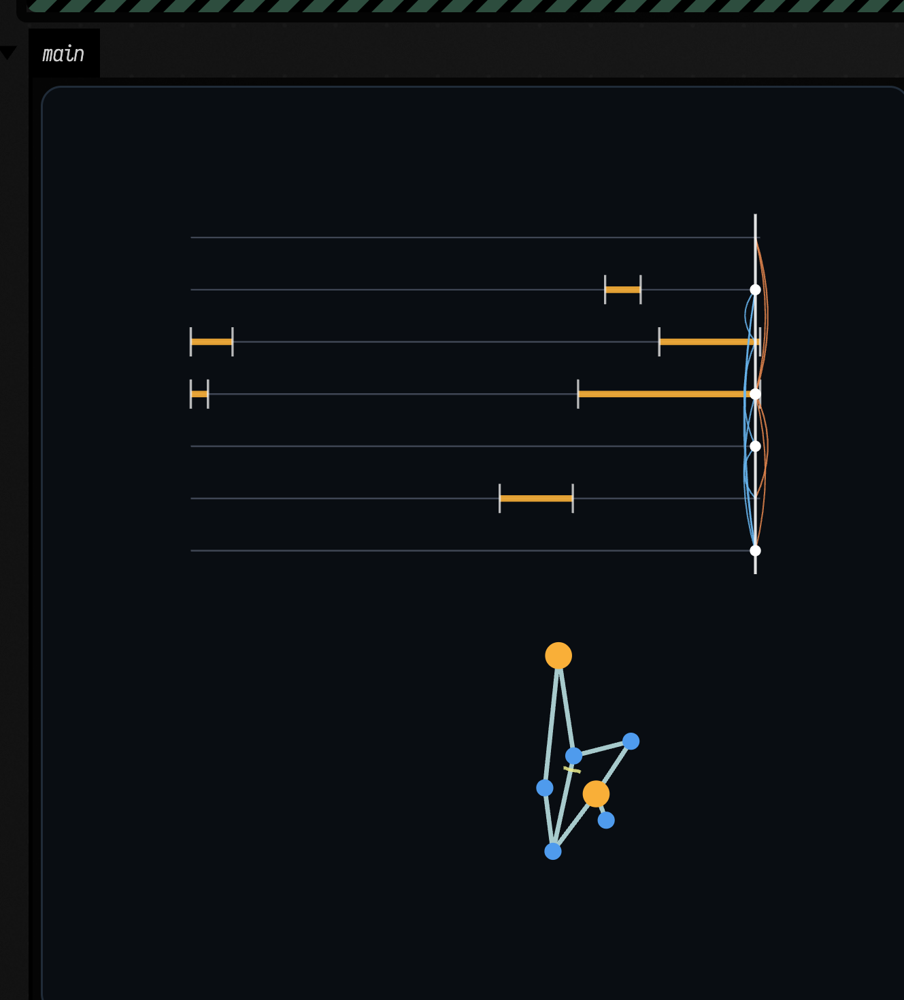

# Evolving Creatures

`afield.simulation.creatures` evolves small 2D creatures: bodies of points joined by springs, where
every point is a foot that steps on its own cycle and the joints between edges bend to cyclic target
curves. A genetic algorithm breeds the shape, the foot timing and the joint curves together.

You supply the world: write how a foot meets its surroundings in a `ContactModel`, and what counts
as doing well in a `fitness`. The same search can then evolve water bugs, floor crawlers or another
creature whose environment you can express as forces on its feet.

The [evolving_water_bugs](agent_transcripts.md#evolving_water_bugs) starting point is the live
version of this page: two boxes that evolve on their own thread and animate the current champion.



## A water surface

Seen from above, with no gravity, a water bug stands on the surface film. A foot that touches down
grips the film where it landed and is pulled back toward that spot. A foot that is up just drags
through the water. That rule is one class: `foot(index)` makes one `Foot` per point, so each foot can
remember where it planted, and `force` returns the force for this physics step.

`FootStep.contact` is how firmly the foot's program wants to be down right now, from 0 to 1. The
genome carries the evolved gains: `freeDrag`, `footDrag` and `footStickiness`.

```diffstatic_runner {data-lang=kotlin screenshot="assets/evolving_creatures/one_bug.png" wait="4.0" capture="box" open-outputs="true" w="900" h="460" padding="14" embed=true alt="a random creature of points and springs on the water, before any evolution"}
import afield.simulation.creatures.*
import kotlin.random.Random

class WaterSurface : ContactModel {
    override fun foot(index: Int) = object : ContactModel.Foot {
        var planted: Float2? = null
        override var grip = 0f
        override val anchor
            get() = planted

        override fun force(step: FootStep): Float2 {
            val g = step.genome
            grip = step.contact
            if (step.contact <= 0.02f) {
                planted = null
                return step.velocity * -g.freeDrag
            }
            val at = planted ?: step.position.also { planted = it }
            val drag = max(g.freeDrag, g.footDrag * step.contact)
            return (at - step.position) * (g.footStickiness * step.contact) - step.velocity * drag
        }
    }
}

val bug = CreatureEvolution.randomGenome(Random(4), minPoints = 6, maxPoints = 6)
val run = CreatureEvolution.simulate(bug, CreatureSimulationConfig(measuredCycles = 4, contact = WaterSurface()))

showPlaneGrid(
    "start" to run.frameLines(0),
    "half way" to run.frameLines(run.frames.size / 2),
    "end\nmoved ${run.netCentroidMotion.f2}" to run.frameLines(run.frames.lastIndex),
    columns = 3,
    cellWidth = 280,
    cellHeight = 300,
    yUp = true,
)
```

A random body gets almost nowhere. Its feet are blue while they are up and orange while they grip,
a cross marks where a gripping foot planted, and the yellow line is the path of the body's centre.

## Evolving one

`CreatureEvolution.evolve` runs a whole search and calls you back once per generation with the
generation's statistics and the champion so far. `EvolutionConfig` sets the population and the size
of the bodies; `alwaysUpFootFraction` and `cyclingFootFraction` say how many points are body and how
many must actually step. The fitness here rewards distance, and charges for stretching the springs
and for motor effort.

```diffstatic_runner {data-lang=kotlin screenshot="assets/evolving_creatures/evolved_bug.png" wait="40.0" timeout="120" capture="box" open-outputs="true" w="1000" h="520" padding="14" embed=true alt="fitness by generation, and the champion water bug after twenty-five generations"}
import afield.simulation.creatures.*

:::fold the WaterSurface contact model, as above
class WaterSurface : ContactModel {
    override fun foot(index: Int) = object : ContactModel.Foot {
        var planted: Float2? = null
        override var grip = 0f
        override val anchor
            get() = planted

        override fun force(step: FootStep): Float2 {
            val g = step.genome
            grip = step.contact
            if (step.contact <= 0.02f) {
                planted = null
                return step.velocity * -g.freeDrag
            }
            val at = planted ?: step.position.also { planted = it }
            val drag = max(g.freeDrag, g.footDrag * step.contact)
            return (at - step.position) * (g.footStickiness * step.contact) - step.velocity * drag
        }
    }
}

:::endfold

val config = EvolutionConfig(
    populationSize = 24,
    generations = 25,
    minPoints = 5,
    maxPoints = 8,
    targetEdgeCount = 8,
    alwaysUpFootFraction = 0.5f,
    cyclingFootFraction = 0.5f,
    simulation = CreatureSimulationConfig(
        measuredCycles = 6,
        contact = WaterSurface(),
        fitness = { e -> e.netCentroidMotion - 2f * e.meanStretchError - 0.05f * e.meanActuationEffort },
    ),
)

val best = mutableListOf<Double>()
val mean = mutableListOf<Double>()
val result =
    CreatureEvolution.evolve(config) { update ->
        best += update.champion.fitness.toDouble()
        mean += update.generation.meanFitness.coerceAtLeast(-2f).toDouble()
    }

val bug = result.best
showSignals("champion" to best, "population mean" to mean, title = "fitness by generation", xTitle = "generation")
showPlane(
    bug.frameLines(bug.frames.lastIndex, trailLength = bug.frames.size),
    channel = "swimmer",
    title = "the champion after ${config.generations} generations",
    caption = "moved ${bug.netCentroidMotion.f2} over ${config.simulation.measuredCycles} cycles",
    width = 480,
    height = 360,
    yUp = true,
)
```

`result.best` is a `CreatureEvaluation`: the genome that won, its fitness, the measurements the
fitness was computed from (`displacement`, `netCentroidMotion`, `meanStretchError`,
`meanActuationEffort` and others), and its recorded frames. Pass a seed in `EvolutionConfig(randomSeed = ...)`
to get a different lineage; the same seed always gives the same champion.

## Watching it move

`frameLines(i)` draws frame `i`, and `notationLines(i)` draws the creature's score: one row per point,
with a bar wherever that foot's program has it down, a playhead at the current phase, and bows
between rows for the joints that are pushing. To animate either, draw a frame per pass of a `loop`.
Evolution takes seconds, so `go` runs the search in a cancellable worker coroutine. An atomic
reference publishes the latest completed champion to the drawing loop. Stopping or relaunching the
box cancels its search; worker failures appear in the editor.

```diffstatic_runner {data-lang=kotlin screenshot="assets/evolving_creatures/watching.png" execution="launch" wait="30.0" timeout="120" capture="box" open-outputs="true" w="480" h="520" padding="14"}
import afield.simulation.creatures.*
import java.util.concurrent.atomic.AtomicReference
import kotlinx.coroutines.Dispatchers
import kotlinx.coroutines.withContext

:::fold the WaterSurface contact model, as above
class WaterSurface : ContactModel {
    override fun foot(index: Int) = object : ContactModel.Foot {
        var planted: Float2? = null
        override var grip = 0f
        override val anchor
            get() = planted

        override fun force(step: FootStep): Float2 {
            val g = step.genome
            grip = step.contact
            if (step.contact <= 0.02f) {
                planted = null
                return step.velocity * -g.freeDrag
            }
            val at = planted ?: step.position.also { planted = it }
            val drag = max(g.freeDrag, g.footDrag * step.contact)
            return (at - step.position) * (g.footStickiness * step.contact) - step.velocity * drag
        }
    }
}

:::endfold

:::fold the config from "Evolving one"
val config = EvolutionConfig(
    populationSize = 24,
    generations = 25,
    minPoints = 5,
    maxPoints = 8,
    targetEdgeCount = 8,
    alwaysUpFootFraction = 0.5f,
    cyclingFootFraction = 0.5f,
    simulation = CreatureSimulationConfig(
        measuredCycles = 6,
        contact = WaterSurface(),
        fitness = { e -> e.netCentroidMotion - 2f * e.meanStretchError - 0.05f * e.meanActuationEffort },
    ),
)
:::endfold

// The worker publishes complete evaluations; the drawing loop reads one snapshot per frame.
val champion = AtomicReference<CreatureEvaluation?>(null)
go {
    withContext(Dispatchers.Default) {
        CreatureEvolution.evolveSuspend(config) { champion.set(it.champion) }
    }
}

var i = 0
loop {
    val bug = champion.get() ?: return@loop
    val c = bug.frames[i % bug.frames.size].center
    showPlane(
        bug.frameLines(i) + bug.notationLines(i, origin = Float2(c.x - 3f, c.y + 6f)),
        window = Rect(c.x - 4.0, c.y - 1.5, 8.0, 8.5),
        width = 400,
        height = 425,
        yUp = true,
    )
    i++
}
```

## In 3D

`frameLines3d(i)` draws frame `i` in three dimensions. The water is the x–y plane: a planted foot
sits on it, with a ring where it is holding, and the rest of the body rides just above on arched
legs, with a line dropped from every point to its shadow. Show the lines with `three`, and give the
camera `upAxis = ThreeUpAxis.Z` so that the viewer's grid is the water. `follow = true` keeps the
camera with the creature while the grid stays put, so the grid going by is the creature's speed.
Drag to orbit while it plays.

First, before any evolution: the random bug from the top of the page, watched for 24 cycles.

```diffstatic_runner {data-lang=kotlin video="assets/evolving_creatures/random_3d.mp4" capture="box" open-outputs="true" wait-output="true" wait-output-kind="display" execution="launch" duration="14" fps="20" timeout="300" w="900" embed=true name="creature-3d-before" alt="a random water bug in a low 3D view, its feet planting and lifting while it stays more or less where it started"}
import afield.simulation.creatures.*
import kotlin.random.Random

:::fold the WaterSurface contact model, as above
class WaterSurface : ContactModel {
    override fun foot(index: Int) = object : ContactModel.Foot {
        var planted: Float2? = null
        override var grip = 0f
        override val anchor
            get() = planted

        override fun force(step: FootStep): Float2 {
            val g = step.genome
            grip = step.contact
            if (step.contact <= 0.02f) {
                planted = null
                return step.velocity * -g.freeDrag
            }
            val at = planted ?: step.position.also { planted = it }
            val drag = max(g.freeDrag, g.footDrag * step.contact)
            return (at - step.position) * (g.footStickiness * step.contact) - step.velocity * drag
        }
    }
}

:::endfold

val genome = CreatureEvolution.randomGenome(Random(4), minPoints = 6, maxPoints = 6)
val bug = CreatureEvolution.simulate(genome, CreatureSimulationConfig(measuredCycles = 24, contact = WaterSurface()))
val started = AnimationClock.nowSeconds()
var shown = -1

loop {
    // Sixty recorded frames a second; the last one holds for two seconds, then it starts over.
    val t = ((AnimationClock.nowSeconds() - started) * 60).toInt() % (bug.frames.size + 120)
    val i = t.coerceAtMost(bug.frames.lastIndex)
    if (i != shown) {
        three {
            lines(bug.frameLines3d(i))
            camera(yaw = 0.0, pitch = 10.0, padding = 1.5, upAxis = ThreeUpAxis.Z, follow = true)
        }
        shown = i
    }
}
```

Then after: forty bodies a generation for sixty generations, and the winner watched for four times
as long as it was judged, so that it has room to go somewhere.

```diffstatic_runner {data-lang=kotlin video="assets/evolving_creatures/champion_3d.mp4" capture="box" open-outputs="true" wait-output="true" wait-output-kind="display" execution="launch" duration="16" fps="20" timeout="300" w="900" embed=true name="creature-3d-after" alt="the evolved water bug in a low tracking shot, scooting along the water as the grid slides past beneath it"}
import afield.simulation.creatures.*

:::fold the WaterSurface contact model, as above
class WaterSurface : ContactModel {
    override fun foot(index: Int) = object : ContactModel.Foot {
        var planted: Float2? = null
        override var grip = 0f
        override val anchor
            get() = planted

        override fun force(step: FootStep): Float2 {
            val g = step.genome
            grip = step.contact
            if (step.contact <= 0.02f) {
                planted = null
                return step.velocity * -g.freeDrag
            }
            val at = planted ?: step.position.also { planted = it }
            val drag = max(g.freeDrag, g.footDrag * step.contact)
            return (at - step.position) * (g.footStickiness * step.contact) - step.velocity * drag
        }
    }
}

:::endfold

val config = EvolutionConfig(
    populationSize = 40,
    generations = 60,
    randomSeed = 3,
    minPoints = 5,
    maxPoints = 8,
    targetEdgeCount = 8,
    alwaysUpFootFraction = 0.5f,
    cyclingFootFraction = 0.5f,
    simulation = CreatureSimulationConfig(
        measuredCycles = 6,
        contact = WaterSurface(),
        fitness = { e -> e.netCentroidMotion - 2f * e.meanStretchError - 0.05f * e.meanActuationEffort },
    ),
)

val champion = CreatureEvolution.evolve(config).best
val bug = CreatureEvolution.simulate(champion.genome, config.simulation.copy(measuredCycles = 24))
val started = AnimationClock.nowSeconds()
var shown = -1

loop {
    // Sixty recorded frames a second; the last one holds for two seconds, then it starts over.
    val t = ((AnimationClock.nowSeconds() - started) * 60).toInt() % (bug.frames.size + 120)
    val i = t.coerceAtMost(bug.frames.lastIndex)
    if (i != shown) {
        three {
            lines(bug.frameLines3d(i))
            camera(yaw = 0.0, pitch = 10.0, padding = 1.5, upAxis = ThreeUpAxis.Z, follow = true)
        }
        shown = i
    }
}
```

Calling `three` again with the same camera keeps the view where you left it, and only a changed
camera moves it. The evolution takes about half a minute before the second video starts.

## A different world: a floor

Nothing above is specific to water except the contact model and the fitness. Seen side-on, under
gravity, a floor pushes back anything that sinks below `y = 0`. A foot grips only when its program
says so *and* it is on the floor; a point that is not gripping slides with a little `friction`.
`place` lifts the body onto the floor before the run starts.

Two things differ from the water. The fitness is `sustainedTravel`, the smaller of the distances
covered in the first and second halves of the measured run. A body that topples over once and then
lies still covers nothing in the second half, so it scores nothing, however far it fell. And the
motors get more strength (`maxActuationBudgetPerCycle`, `maxJointImpulsePerStep`): at the defaults,
tuned for water, a joint cannot lift a limb against gravity.

```diffstatic_runner {data-lang=kotlin screenshot="assets/evolving_creatures/crawler.png" wait="40.0" timeout="120" capture="box" open-outputs="true" w="900" h="420" padding="14" embed=true alt="the evolved crawler at the start of its run and at the end, with the trail of its centre along the floor"}
import afield.simulation.creatures.*

class Floor(val stiffness: Float = 900f, val damping: Float = 40f, val friction: Float = 1f) : ContactModel {
    override fun place(points: List<Float2>): List<Float2> {
        val lowest = points.minOf { it.y }
        return points.map { Float2(it.x, it.y - lowest) }
    }

    override fun foot(index: Int) = object : ContactModel.Foot {
        var planted: Float2? = null
        override var grip = 0f
        override val anchor
            get() = planted

        override fun force(step: FootStep): Float2 {
            val g = step.genome
            val p = step.position
            val v = step.velocity
            val onFloor = p.y <= 0.02f
            val up = if (p.y < 0f) -p.y * stiffness - min(v.y, 0f) * damping else 0f
            grip = if (onFloor) step.contact else 0f
            if (grip <= 0.02f) {
                planted = null
                val slide = if (onFloor) friction else g.freeDrag * 0.1f
                return Float2(-v.x * slide, up - v.y * g.freeDrag * 0.1f)
            }
            val at = planted ?: Float2(p.x, 0f).also { planted = it }
            return Float2((at.x - p.x) * g.footStickiness * grip - v.x * g.footDrag * grip, up)
        }
    }
}

val config = EvolutionConfig(
    populationSize = 40,
    generations = 60,
    minPoints = 5,
    maxPoints = 8,
    targetEdgeCount = 8,
    alwaysUpFootFraction = 0.5f,
    cyclingFootFraction = 0.5f,
    simulation = CreatureSimulationConfig(
        warmupCycles = 2,
        measuredCycles = 6,
        gravity = -9.8f,
        contact = Floor(),
        fitness = { e ->
            2f * max(e.sustainedTravel(Float2(1f, 0f)), e.sustainedTravel(Float2(-1f, 0f))) - e.meanStretchError
        },
        maxActuationBudgetPerCycle = 40f,
        maxJointImpulsePerStep = 0.2f,
        maxCenterSpeed = 4f,
    ),
)

val crawler = CreatureEvolution.evolve(config).best
val floor = fline {
    moveTo(-6f, 0f)
    lineTo(6f, 0f)
}
    .apply { color = vec(0.5, 0.45, 0.4, 1.0) }

showPlaneGrid(
    "start" to [floor] + crawler.frameLines(0, alignNetMotionToPositiveX = false),
    "end\nmoved ${crawler.displacement.x.f2} along the floor" to
        [floor] +
            crawler.frameLines(
                crawler.frames.lastIndex,
                trailLength = crawler.frames.size,
                alignNetMotionToPositiveX = false,
            ),
    columns = 2,
    cellWidth = 400,
    cellHeight = 280,
    yUp = true,
)
```

Judged over six cycles, the champion is then watched for twenty-four. Every forty recorded frames
leave a copy of its body on the floor, fainter the older it is.

```diffstatic_runner {data-lang=kotlin screenshot="assets/evolving_creatures/crawler_long_run.png" wait="40.0" timeout="120" capture="box" open-outputs="true" w="900" h="320" padding="14" embed=true alt="the evolved crawler over twenty-four cycles: faded copies of its body spaced evenly along the floor, fainter the older they are"}
import afield.simulation.creatures.*

:::fold the Floor contact model and the evolution, as above
class Floor(val stiffness: Float = 900f, val damping: Float = 40f, val friction: Float = 1f) : ContactModel {
    override fun place(points: List<Float2>): List<Float2> {
        val lowest = points.minOf { it.y }
        return points.map { Float2(it.x, it.y - lowest) }
    }

    override fun foot(index: Int) = object : ContactModel.Foot {
        var planted: Float2? = null
        override var grip = 0f
        override val anchor
            get() = planted

        override fun force(step: FootStep): Float2 {
            val g = step.genome
            val p = step.position
            val v = step.velocity
            val onFloor = p.y <= 0.02f
            val up = if (p.y < 0f) -p.y * stiffness - min(v.y, 0f) * damping else 0f
            grip = if (onFloor) step.contact else 0f
            if (grip <= 0.02f) {
                planted = null
                val slide = if (onFloor) friction else g.freeDrag * 0.1f
                return Float2(-v.x * slide, up - v.y * g.freeDrag * 0.1f)
            }
            val at = planted ?: Float2(p.x, 0f).also { planted = it }
            return Float2((at.x - p.x) * g.footStickiness * grip - v.x * g.footDrag * grip, up)
        }
    }
}

val config = EvolutionConfig(
    populationSize = 40,
    generations = 60,
    minPoints = 5,
    maxPoints = 8,
    targetEdgeCount = 8,
    alwaysUpFootFraction = 0.5f,
    cyclingFootFraction = 0.5f,
    simulation = CreatureSimulationConfig(
        warmupCycles = 2,
        measuredCycles = 6,
        gravity = -9.8f,
        contact = Floor(),
        fitness = { e ->
            2f * max(e.sustainedTravel(Float2(1f, 0f)), e.sustainedTravel(Float2(-1f, 0f))) - e.meanStretchError
        },
        maxActuationBudgetPerCycle = 40f,
        maxJointImpulsePerStep = 0.2f,
        maxCenterSpeed = 4f,
    ),
)
:::endfold

val champion = CreatureEvolution.evolve(config).best
val crawler = CreatureEvolution.simulate(champion.genome, config.simulation.copy(measuredCycles = 24))
val xs = crawler.frames.flatMap { f -> f.points.map { it.x } }
val floor = fline {
    moveTo(xs.min() - 1f, 0f)
    lineTo(xs.max() + 1f, 0f)
}
    .apply { color = vec(0.5, 0.45, 0.4, 1.0) }

val copies =
    (0..crawler.frames.lastIndex step 40).flatMap { i ->
        val fade = 0.15 + 0.85 * i / crawler.frames.lastIndex
        crawler.frameLines(i, trailLength = 1, alignNetMotionToPositiveX = false).onEach {
            it.color = vec(it.color.x, it.color.y, it.color.z, it.color.w * fade)
        }
    }

showPlane(
    [floor] +
        copies +
        crawler.frameLines(
            crawler.frames.lastIndex,
            trailLength = crawler.frames.size,
            alignNetMotionToPositiveX = false,
        ),
    title = "24 cycles: ${crawler.displacement.x.f1} along the floor",
    window = Rect(xs.min() - 1.0, -0.5, xs.max() - xs.min() + 2.0, 3.5),
    width = 860,
    height = 260,
    yUp = true,
)
```

The copies are evenly spaced from the first cycle to the last: the crawler keeps going rather than
falling once. It holds its body up as a triangle and shuffles on two feet (orange while gripping)
that plant and release in turn. It went left; the fitness counts either direction.

And moving, a cycle a second for all twenty-four cycles, with the view following it; the ticks on the floor are a unit apart:

```diffstatic_runner {data-lang=kotlin video="assets/evolving_creatures/crawler_walk.mp4" capture="box" open-outputs="true" wait-output="true" wait-output-kind="display" execution="launch" duration="24" fps="20" timeout="300" w="900" embed=true name="crawler-walk" alt="the evolved crawler shuffling along the floor in side view, two feet planting and releasing in turn while the view follows it"}
import afield.simulation.creatures.*

:::fold the Floor contact model and the evolution, as above
class Floor(val stiffness: Float = 900f, val damping: Float = 40f, val friction: Float = 1f) : ContactModel {
    override fun place(points: List<Float2>): List<Float2> {
        val lowest = points.minOf { it.y }
        return points.map { Float2(it.x, it.y - lowest) }
    }

    override fun foot(index: Int) = object : ContactModel.Foot {
        var planted: Float2? = null
        override var grip = 0f
        override val anchor
            get() = planted

        override fun force(step: FootStep): Float2 {
            val g = step.genome
            val p = step.position
            val v = step.velocity
            val onFloor = p.y <= 0.02f
            val up = if (p.y < 0f) -p.y * stiffness - min(v.y, 0f) * damping else 0f
            grip = if (onFloor) step.contact else 0f
            if (grip <= 0.02f) {
                planted = null
                val slide = if (onFloor) friction else g.freeDrag * 0.1f
                return Float2(-v.x * slide, up - v.y * g.freeDrag * 0.1f)
            }
            val at = planted ?: Float2(p.x, 0f).also { planted = it }
            return Float2((at.x - p.x) * g.footStickiness * grip - v.x * g.footDrag * grip, up)
        }
    }
}

val config = EvolutionConfig(
    populationSize = 40,
    generations = 60,
    minPoints = 5,
    maxPoints = 8,
    targetEdgeCount = 8,
    alwaysUpFootFraction = 0.5f,
    cyclingFootFraction = 0.5f,
    simulation = CreatureSimulationConfig(
        warmupCycles = 2,
        measuredCycles = 6,
        gravity = -9.8f,
        contact = Floor(),
        fitness = { e ->
            2f * max(e.sustainedTravel(Float2(1f, 0f)), e.sustainedTravel(Float2(-1f, 0f))) - e.meanStretchError
        },
        maxActuationBudgetPerCycle = 40f,
        maxJointImpulsePerStep = 0.2f,
        maxCenterSpeed = 4f,
    ),
)
:::endfold

val champion = CreatureEvolution.evolve(config).best
val crawler = CreatureEvolution.simulate(champion.genome, config.simulation.copy(measuredCycles = 24))
val started = AnimationClock.nowSeconds()
var shown = -1

loop {
    // A frame is recorded every 4 of the 120 steps in a cycle, so 30 a second is a cycle a second.
    val i = (((AnimationClock.nowSeconds() - started) * 30).toInt()).coerceAtMost(crawler.frames.lastIndex)
    if (i != shown) {
        val c = crawler.frames[i].center
        // A tick every unit, so the floor slides past as the view follows.
        val floor = fline {
            moveTo(c.x - 5f, 0f)
            lineTo(c.x + 5f, 0f)
            for (x in floor(c.x - 5f).toInt()..ceil(c.x + 5f).toInt()) {
                moveTo(x.toFloat(), 0f)
                lineTo(x.toFloat(), -0.15f)
            }
        }
            .apply { color = vec(0.5, 0.45, 0.4, 1.0) }
        showPlane(
            [floor] + crawler.frameLines(i, trailLength = crawler.frames.size, alignNetMotionToPositiveX = false),
            title =
                "cycle %d of 24: %.1f along the floor"
                    .format(i * 24 / crawler.frames.size + 1, c.x - crawler.frames[0].center.x),
            window = Rect(c.x - 4.0, -0.5, 8.0, 3.5),
            width = 860,
            height = 380,
            yUp = true,
        )
        shown = i
    }
}
```

## What you can change

| Where | What it does |
|---|---|
| `ContactModel.foot(index)` | The force a foot receives each step. The whole environment lives here. |
| `ContactModel.place(points)` | Where the body starts. Move it rigidly; rest lengths come from the genome. |
| `CreatureSimulationConfig.fitness` | The score. Exploded creatures score `explodedFitness` (default -1000) instead. |
| `CreatureSimulationConfig.gravity` | Added to every point as an acceleration (negative is down). |
| `measuredCycles`, `warmupCycles`, `stepsPerCycle` | How long each creature is watched, and how finely. |
| `maxCenterSpeed`, `maxMeanStretchError`, `maxPeakStretchError` | Stability limits; a creature past one counts as exploded. |
| `jointTargetAngleScale`, `jointMotorKp`, `jointMotorKd` | How far and how hard the joints bend. |
| `EvolutionConfig.populationSize`, `generations`, `randomSeed` | The size and the seed of the search. |
| `minPoints`, `maxPoints`, `targetEdgeCount`, `targetJointActivations` | The size of the bodies. |
| `alwaysUpFootFraction`, `cyclingFootFraction` | How many points are body only, and how many must step. |
