# Cameras and Lenses

<div data-field-transcript-gallery hidden></div>

<figure class="field-margin-figure" markdown>
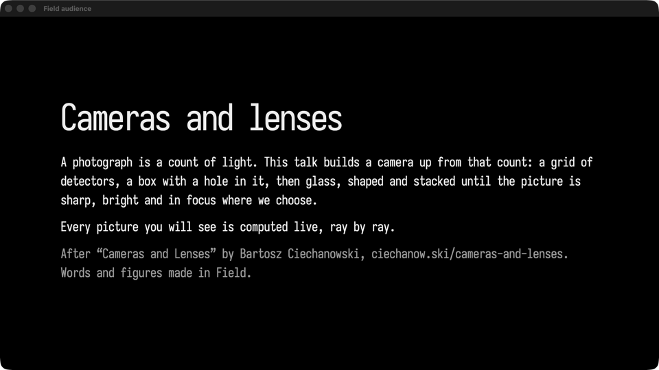
</figure>

A photograph is a count of light. This talk builds a camera up from that count: a grid of detectors,
a box with a hole in it, then glass, shaped and stacked until the picture is sharp, bright and in
focus where we choose.

Every picture you will see is computed live, ray by ray.

After “Cameras and Lenses” by Bartosz Ciechanowski,
[ciechanow.ski/cameras-and-lenses](https://ciechanow.ski/cameras-and-lenses/). Words and figures made in Field.

[Open →](offline.html?file=assets/agent_transcripts/explainer_cameras/metadata.edn)

Follow the talk figure by figure on this page. Each figure is a box in the document: you'll see
its code and what it draws, with the slide that uses it in the margin. **Open →** shows the whole
document beside the page; **Open in Field·4** imports an editable copy. To give the talk, run its
`deck` box in Field's desktop app. [Live figures beside prose](presentation_studio.md#live-figures-beside-prose)
shows how to build a deck like this one.

## Recording light

### Counting light

<figure class="field-margin-figure" markdown>
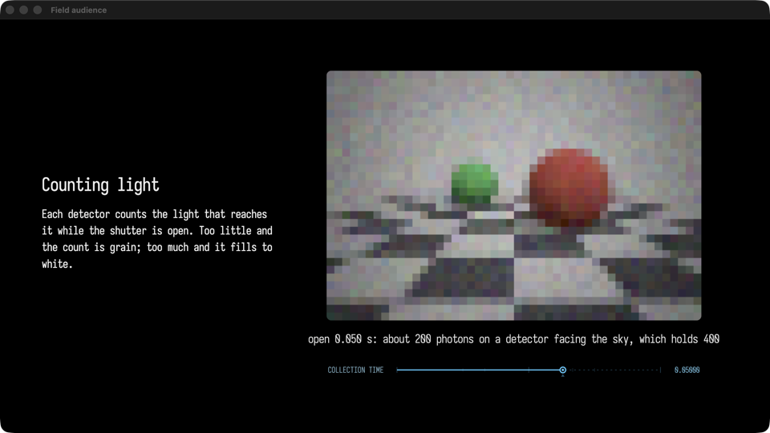
</figure>

Each detector counts the light that reaches it while the shutter is open. Too little and the count
is grain; too much and it fills to white.

```diffstatic_runner {data-lang=kotlin screenshot="assets/explainer_cameras/photon_grid.png" execution="launch" wait-output=true wait="2" timeout="240" embed=true name="explainer-cameras-photon_grid" alt="A grainy sensor picture of a red and a green sphere on a checkerboard, every pixel speckled by the photons it happened to count, a readout of about 200 photons on a detector facing the sky, and a collection time slider"}
:::fold imports
import afield.media.image.util.PngEncoder
import afield.simulation.optics.*
:::endfold

// A 48 × 32 sensor collecting photons from the test scene. Light arrives at random, so a short
// exposure is grainy; each detector holds at most 400, so a long one turns bright parts flat white.
val full = 400.0
val light =
    SensorCamera(z = -5.0, sensorDistance = 1.0, apertureDiameter = 0.03)
        .render(OpticsScene.testScene(), 48, 32, samples = 32)
val perSecond = 4000.0 / light.reference // photons per second from the bright sky at the middle

fun draw(time: Double) {
    val counts = light.photons(perSecond * time, seed = 3)
    display("sensor", PngEncoder.encode(counts.toArgb(exposure = 1 / full, scale = 10), 480, 320))
    val sky = 4000.0 * time
    markdown(
        "readout",
        "open ${time.f3} s: about ${sky.f0} photons on a detector facing the sky, which holds ${full.toInt()}",
    )
}

draw(0.05)
controlGroup {
    slider("collection time", 0.001, 0.5, step = 0.001, initialValue = 0.05, law = ControlLaw.LOGARITHMIC) { draw(it) }
}
```

### Colour from filters

<figure class="field-margin-figure" markdown>
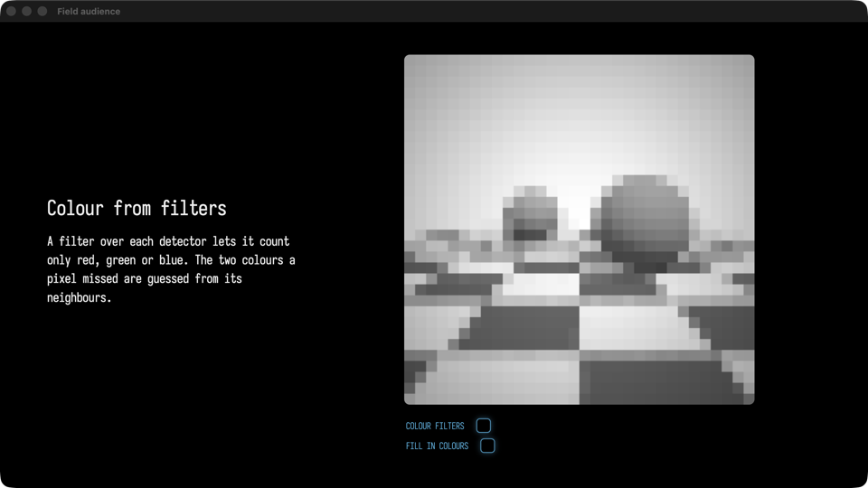
</figure>

A filter over each detector lets it count only red, green or blue. The two colours a pixel missed
are guessed from its neighbours.

```diffstatic_runner {data-lang=kotlin screenshot="assets/explainer_cameras/kilopixel.png" execution="launch" wait-output=true wait="2" timeout="240" embed=true name="explainer-cameras-kilopixel" alt="A blocky grey 32 by 32 pixel picture of the two spheres on the checkerboard, with colour filters and fill in colours checkboxes, both unticked"}
:::fold imports
import afield.media.image.util.PngEncoder
import afield.simulation.optics.*
:::endfold

// A sensor of 32 × 32 detectors, a kilopixel. Bare, each detector counts all light the same.
// With filters each counts only red, green or blue; filling in guesses the other two from neighbours.
val light =
    SensorCamera(z = -5.0, sensorWidth = 1.2, sensorHeight = 1.2, sensorDistance = 1.0, apertureDiameter = 0.03)
        .render(OpticsScene.testScene(), 32, 32, samples = 32)
var filters = false
var fillIn = false

fun draw() {
    val shown = when {
        !filters ->
            SensorImage(
                32,
                32,
                FloatArray(32 * 32 * 3) {
                    (light.rgb[it / 3 * 3] + light.rgb[it / 3 * 3 + 1] + light.rgb[it / 3 * 3 + 2]) / 3
                },
                light.reference,
            )
        !fillIn -> light.mosaic()
        else -> light.mosaic().demosaic()
    }
    display("sensor", PngEncoder.encode(shown.toArgb(exposure = 1 / light.reference, scale = 12), 384, 384))
}

draw()
controlGroup {
    checkbox("colour filters") {
        filters = it
        draw()
    }
    checkbox("fill in colours") {
        fillIn = it
        draw()
    }
}
```

### A scene to photograph

<figure class="field-margin-figure" markdown>
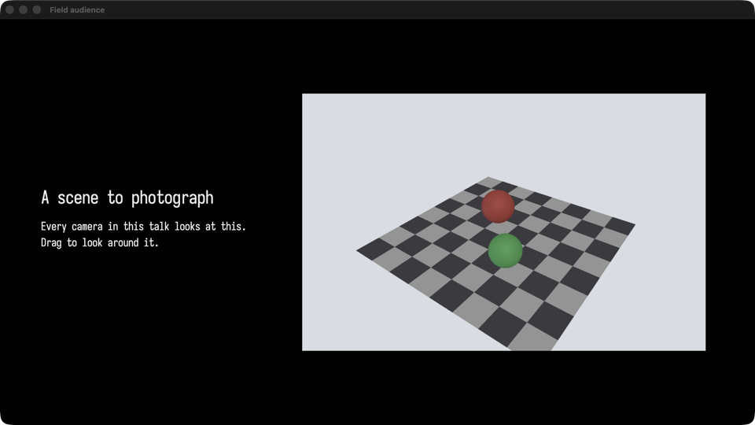
</figure>

Every camera in this talk looks at this. Drag to look around it.

```diffstatic_runner {data-lang=kotlin screenshot="assets/explainer_cameras/test_scene.png" execution="launch" wait-output=true wait="2" timeout="240" embed=true name="explainer-cameras-test_scene" alt="A three-dimensional view of the test scene: a red sphere and a green sphere on a grey and white checkerboard floor against a pale sky"}
:::fold imports
import afield.simulation.optics.*
:::endfold

// The scene every camera in the talk photographs. Drag to look around it.
three(channel = "scene", height = 400, width = 640) {
    mesh(OpticsScene.testScene().mesh(), wireframe = false)
    background("#d8dde3")
}
```

### A bare sensor

<figure class="field-margin-figure" markdown>
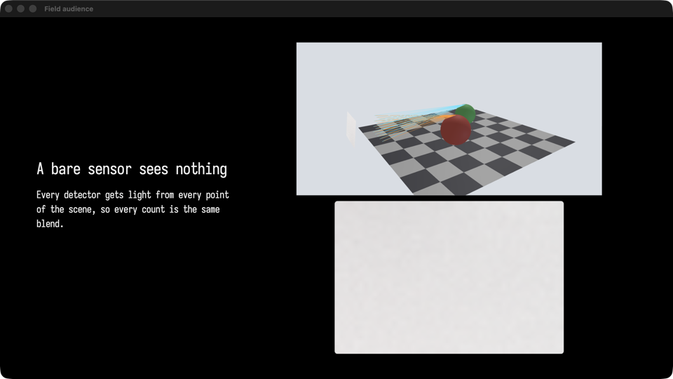
</figure>

Every detector gets light from every point of the scene, so every count is the same blend.

```diffstatic_runner {data-lang=kotlin screenshot="assets/explainer_cameras/bare_sensor.png" execution="launch" wait-output=true wait="2" timeout="240" embed=true name="explainer-cameras-bare_sensor" alt="The scene with a bare sensor beside it and a fan of rays reaching it, and under it the sensor's picture: an even, pale grey with nothing in it"}
:::fold imports
import afield.simulation.optics.*
:::endfold

// A sensor held up to the scene with nothing in front of it. One point on each ball sends light to
// every detector, and so does every other point: each detector gets the same blend.
val scene = OpticsScene.testScene()
val bare = SensorCamera(z = -4.0)
val image = bare.renderBare(scene, 48, 32, samples = 256)
val corners = 5 { i -> 4 { j -> bare.toWorld(-0.6 + 0.3 * i, -0.36 + 0.24 * j, 0.0) } }.flatten()
fun fan(x: Double, y: Double, z: Double, c: Vec4) = corners.map { p ->
    fline {
        moveTo(x, y, z)
        lineTo(p[0], p[1], p[2])
        color = c
        thickness = 1.0
    }
}

three(channel = "rays", height = 320, width = 640) {
    mesh(scene.mesh(), wireframe = false)
    mesh(bare.sensorMesh(image), wireframe = false, unlit = true, cullBackFaces = false)
    lines(fan(-0.9, 1.4, -0.8, vec(1.0, 0.6, 0.2, 1.0)) + fan(1.0, 1.2, 1.3, vec(0.4, 0.9, 1.0, 1.0)))
    camera(yaw = 235.0, pitch = 18.0, distance = 1.5)
    background("#d8dde3")
}
display("sensor", image.html(width = 480))
```

### A box with a hole

<figure class="field-margin-figure" markdown>
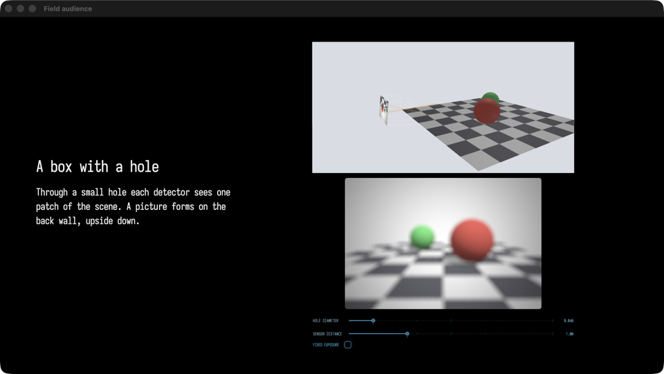
</figure>

Through a small hole each detector sees one patch of the scene. A picture forms on the back wall,
upside down.

```diffstatic_runner {data-lang=kotlin screenshot="assets/explainer_cameras/pinhole_box.png" execution="launch" wait-output=true wait="2" timeout="240" embed=true name="explainer-cameras-pinhole_box" alt="A three-dimensional view of a small box with a hole facing the spheres, orange rays crossing at the hole and landing on its back wall, and below it the picture on that wall: the two spheres on the checkerboard, slightly soft, with hole diameter and sensor distance sliders and a fixed exposure checkbox"}
:::fold imports
import afield.simulation.optics.*
:::endfold

// A closed box with a small hole, looking at the test scene. The picture forms on the back wall.
val scene = OpticsScene.testScene()
var hole = 0.04
var distance = 1.0
var fixedExposure = false

// Three points of the scene, each with its ray through the hole to the back wall.
val marked = [Triple(-0.9, 1.4, -0.8), Triple(1.0, 1.2, 1.3), Triple(0.3, 0.0, -2.0)]

fun draw() {
    val pinhole = SensorCamera(z = -5.0, sensorDistance = distance, apertureDiameter = hole)
    val image = pinhole.render(scene, 240, 160, samples = 48)
    // A coarser copy for the back wall of the 3D box, which needs a quad per pixel.
    val wall = pinhole.render(scene, 96, 64, samples = 24)
    // Fixed: right for a hole 0.08 wide at distance 1. Otherwise each picture is scaled to look right.
    val exposure = if (fixedExposure) 1.0 / (PI * 0.04 * 0.04) else 1.0 / image.reference
    // Each ray from 1.8 units in front of the hole, through it, to where it lands.
    val rays = marked.map { (x, y, z) ->
        val landing = pinhole.imageOf(x, y, z)
        val dx = x
        val dy = y - 1.2
        val dz = z + 5.0
        val k = 1.8 / sqrt(dx * dx + dy * dy + dz * dz)
        fline {
            moveTo(dx * k, 1.2 + dy * k, -5.0 + dz * k)
            lineTo(0.0, 1.2, -5.0)
            lineTo(landing[0], landing[1], landing[2])
            color = vec(1.0, 0.6, 0.2, 1.0)
            thickness = 1.5
        }
    }
    /*
    The box, the rays through it and the objects they come from: the view frames the box
    (at its longest, with the sensor 2.5 back) and the two spheres, and lets the floor run
    off the edges.
    */
    three(channel = "box", height = 320, width = 640) {
        mesh(scene.mesh(), wireframe = false)
        mesh(pinhole.sensorMesh(wall, exposure), wireframe = false, unlit = true, cullBackFaces = false)
        lines(pinhole.outline() + rays)
        fitTo(vec(-1.6, 0.0, -7.6), vec(1.6, 2.0, 1.6))
        camera(yaw = 240.0, pitch = 16.0)
        // The scene's bright sky, as in the pictures the camera takes.
        background("#d8dde3")
    }
    // Smoothed: these pixels stand for a picture, not for detectors.
    display("sensor", image.html(exposure, width = 480))
}

draw()
controlGroup {
    slider("hole diameter", 0.005, 0.3, step = 0.005, initialValue = 0.04) {
        hole = it
        draw()
    }
    slider("sensor distance", 0.4, 2.5, step = 0.05, initialValue = 1.0) {
        distance = it
        draw()
    }
    checkbox("fixed exposure") {
        fixedExposure = it
        draw()
    }
}
```

### How much it sees

<figure class="field-margin-figure" markdown>
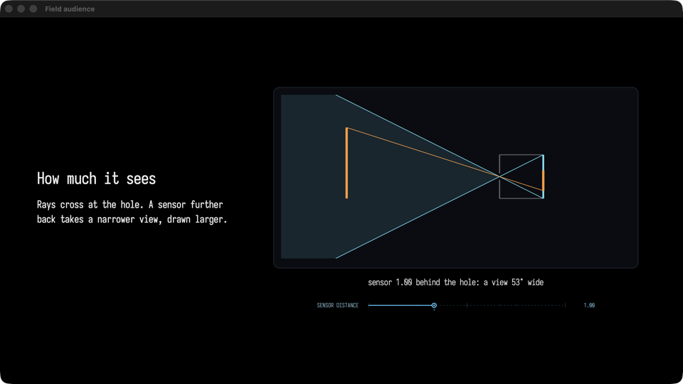
</figure>

Rays cross at the hole. A sensor further back takes a narrower view, drawn larger.

```diffstatic_runner {data-lang=kotlin screenshot="assets/explainer_cameras/field_of_view.png" execution="launch" wait-output=true wait="2" timeout="240" embed=true name="explainer-cameras-field_of_view" alt="A side view of a pinhole camera: two cyan rays from the edges of an orange object cross at the hole and reach the sensor, and a readout says a sensor 1.00 behind the hole has a view 53° wide, with a sensor distance slider"}
:::fold imports
import afield.simulation.optics.*
:::endfold

// A pinhole camera from the side. Rays cross at the hole, so the picture is upside down;
// the sensor's edges and its distance from the hole set how wide a view it takes.
val unit = 80.0
val holeX = 400.0
val axis = 150.0
val cyan = vec(0.4, 0.9, 1.0, 1.0)
val orange = vec(1.0, 0.6, 0.2, 1.0)
val guide = vec(1.0, 1.0, 1.0, 0.35)
var distance = 1.0

:::fold segment: a straight line segment as an FLine
fun segment(x0: Double, y0: Double, x1: Double, y1: Double, c: Vec4, width: Double = 1.5) = fline {
    moveTo(x0, y0)
    lineTo(x1, y1)
    color = c
    thickness = width
}
:::endfold

fun draw() {
    val sensorX = holeX + distance * unit
    val half = 0.5 * unit
    // The edge rays, from each end of the sensor out through the hole.
    // Where the edge rays leave the picture.
    val low = frameExit(holeX, axis, -distance * unit, half, 640.0, 300.0)
    val high = frameExit(holeX, axis, -distance * unit, -half, 640.0, 300.0)
    val view = fline {
        moveTo(holeX, axis)
        lineTo(low[0], low[1])
        if (low[1] >= 300.0 || high[1] <= 0.0) {
            lineTo(0.0, 300.0)
            lineTo(0.0, 0.0)
        }
        lineTo(high[0], high[1])
        close()
        filled = true
        stroked = false
        color = vec(0.4, 0.9, 1.0, 0.12)
    }
    val tipX = 120.0
    val tipY = axis - 90.0
    val imageY = axis + 90.0 * distance * unit / (holeX - tipX)
    val parts = [
        view,
        segment(sensorX, axis + half, holeX, axis + half, guide),
        segment(sensorX, axis - half, holeX, axis - half, guide),
        segment(holeX, axis - half, holeX, axis - 6, guide, 2.0),
        segment(holeX, axis + 6, holeX, axis + half, guide, 2.0),
        segment(sensorX, axis - half, sensorX, axis + half, cyan, 3.0),
        segment(sensorX, axis - half, low[0], low[1], cyan, 1.0),
        segment(sensorX, axis + half, high[0], high[1], cyan, 1.0),
        segment(tipX, axis + 40, tipX, tipY, orange, 4.0),
        segment(tipX, tipY, sensorX, imageY, orange, 1.0),
        segment(sensorX, axis - 40.0 * distance * unit / (holeX - tipX), sensorX, imageY, orange, 4.0),
    ]
    showPlane(
        parts,
        channel = "side",
        width = 600,
        height = 281,
        padding = 0.0,
        window = Rect(0.0, 0.0, 640.0, 300.0),
        interactive = false,
    )
    val degrees = 2 * atan(0.5 / distance) * 180 / PI
    markdown("readout", "sensor ${distance.f2} behind the hole: a view ${degrees.f0}° wide")
}

draw()
controlGroup {
    slider("sensor distance", 0.3, 2.4, step = 0.02, initialValue = 1.0) {
        distance = it
        draw()
    }
}
```

### Darker at the edges

<figure class="field-margin-figure" markdown>
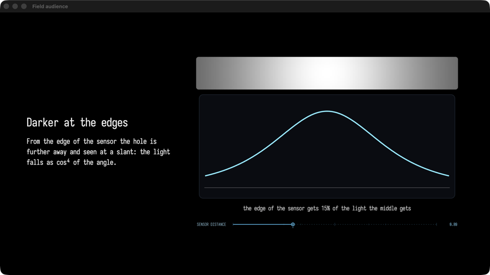
</figure>

From the edge of the sensor the hole is further away and seen at a slant: the light falls as cos⁴ of
the angle.

```diffstatic_runner {data-lang=kotlin screenshot="assets/explainer_cameras/off_axis.png" execution="launch" wait-output=true wait="2" timeout="240" embed=true name="explainer-cameras-off_axis" alt="A grey strip bright in the middle and dark at both ends, a bell-shaped cyan curve of brightness across the sensor, a readout that the edge gets 19% of the light the middle gets, and a sensor distance slider"}
:::fold imports
import afield.media.image.util.PngEncoder
import afield.simulation.optics.*
:::endfold

// A pinhole camera looking at an even sky. Its picture is darker towards the edges: the curve is
// the brightness across the sensor, the faint line cos⁴ of the angle each point looks out at.
val cyan = vec(0.4, 0.9, 1.0, 1.0)
val guide = vec(1.0, 1.0, 1.0, 0.35)
var distance = 0.8

fun draw() {
    val camera = SensorCamera(
        y = 0.0,
        z = 0.0,
        lookY = 0.0,
        lookZ = 1.0,
        sensorWidth = 2.0,
        sensorHeight = 0.25,
        sensorDistance = distance,
        apertureDiameter = 0.01,
    )
    val image = camera.render(OpticsScene.uniformSky(), 160, 20, samples = 8)
    display("sensor", PngEncoder.encode(image.toArgb(scale = 4), 640, 80))
    val measured = fline {
        for (i in 0 until 160) {
            val y = 230 - 200 * image[i, 10, 0] / image.reference
            if (i == 0) moveTo(4.0 * i + 2, y) else lineTo(4.0 * i + 2, y)
        }
        color = cyan
        thickness = 3.0
    }
    val predicted = fline {
        for (i in 0 until 160) {
            val sx = ((i + 0.5) / 160 - 0.5) * 2.0
            val y = 230 - 200 * cos(atan(sx / distance)).pow(4)
            if (i == 0) moveTo(4.0 * i + 2, y) else lineTo(4.0 * i + 2, y)
        }
        color = guide
        thickness = 1.0
    }
    showPlane(
        [
            fline {
                moveTo(0, 230)
                lineTo(640, 230)
                color = guide
                thickness = 1.0
            },
            measured,
            predicted,
        ],
        channel = "brightness",
        width = 600,
        height = 225,
        padding = 0.0,
        window = Rect(0.0, 0.0, 640.0, 240.0),
        interactive = false,
    )
    val edge = image[0, 10, 0] / image.reference
    markdown("readout", "the edge of the sensor gets ${(100 * edge).f0}% of the light the middle gets")
}

draw()
controlGroup {
    slider("sensor distance", 0.3, 2.0, step = 0.01, initialValue = 0.8) {
        distance = it
        draw()
    }
}
```

## Glass

### Glass moves things

<figure class="field-margin-figure" markdown>
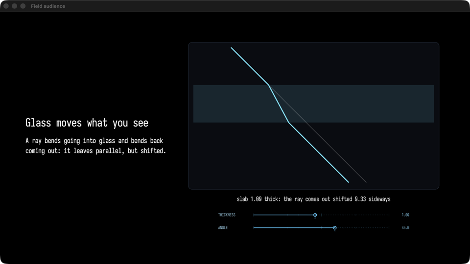
</figure>

A ray bends going into glass and bends back coming out: it leaves parallel, but shifted.

```diffstatic_runner {data-lang=kotlin screenshot="assets/explainer_cameras/slab_ray.png" execution="launch" wait-output=true wait="2" timeout="240" embed=true name="explainer-cameras-slab_ray" alt="A side view of a ray crossing a glass slab: it bends toward the vertical inside and leaves parallel to where it came in, shifted sideways from a faint straight continuation, with a readout of the shift and thickness and angle sliders"}
:::fold imports
import afield.simulation.optics.*
:::endfold

// One ray through a slab of glass. It bends going in and bends back coming out, so it leaves
// parallel to where it was going, but shifted. The faint line is the path it would have taken.
val glass = 1.5
val unit = 100.0
val top = 100.0
val cyan = vec(0.4, 0.9, 1.0, 1.0)
val guide = vec(1.0, 1.0, 1.0, 0.35)
var slab = 1.0
var angle = 45.0

fun draw() {
    val theta = angle * PI / 180
    val inside = Refraction.snellAngle(theta, 1.0, glass)
    val bottom = top + slab * unit
    val entryX = 200.0
    val exitX = entryX + slab * unit * tan(inside)
    val endY = 360.0
    val start = frameExit(entryX, top, -sin(theta), -cos(theta), 640.0, endY)
    val guideEnd = frameExit(entryX, top, sin(theta), cos(theta), 640.0, endY)
    val parts = [
        fline {
            rect(0, top, 640, slab * unit)
            filled = true
            stroked = false
            color = vec(0.4, 0.9, 1.0, 0.12)
        },
        fline {
            moveTo(entryX, top)
            lineTo(guideEnd[0], guideEnd[1])
            color = guide
            thickness = 1.0
        },
        fline {
            moveTo(start[0], start[1])
            lineTo(entryX, top)
            lineTo(exitX, bottom)
            frameExit(exitX, bottom, sin(theta), cos(theta), 640.0, endY).let { lineTo(it[0], it[1]) }
            color = cyan
            thickness = 2.5
        },
    ]
    showPlane(
        parts,
        channel = "side",
        width = 600,
        height = 338,
        padding = 0.0,
        window = Rect(0.0, 0.0, 640.0, endY),
        interactive = false,
    )
    // How far apart the two parallel paths are, measured square to them.
    val shift = slab * sin(theta - inside) / cos(inside)
    markdown("readout", "slab ${slab.f2} thick: the ray comes out shifted ${shift.f2} sideways")
}

draw()
controlGroup {
    slider("thickness", 0.0, 2.2, step = 0.02, initialValue = 1.0) {
        slab = it
        draw()
    }
    slider("angle", 0.0, 75.0, step = 0.5, initialValue = 45.0) {
        angle = it
        draw()
    }
}
```

## Waves

### Light is a wave

<figure class="field-margin-figure" markdown>
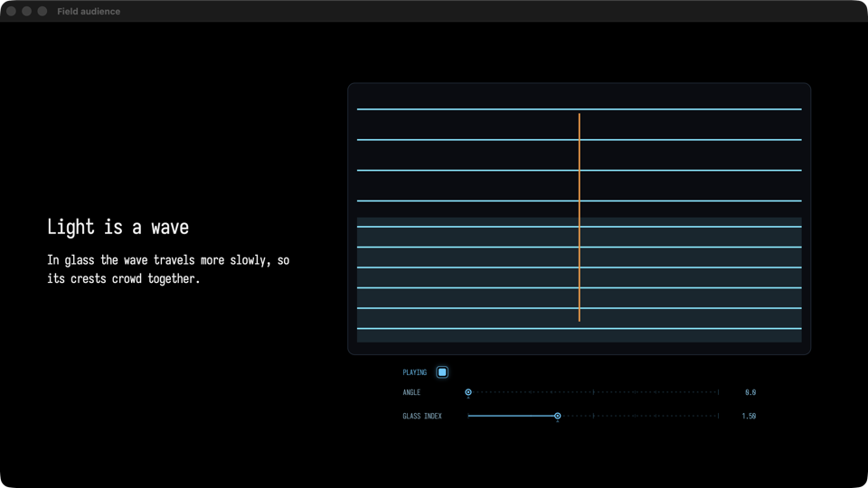
</figure>

In glass the wave travels more slowly, so its crests crowd together.

```diffstatic_runner {data-lang=kotlin screenshot="assets/explainer_cameras/into_glass.png" execution="launch" wait-output=true wait="2" timeout="240" embed=true name="explainer-cameras-into_glass" alt="Horizontal cyan wave crests over a darker band of glass, closer together inside the glass, with an orange ray line across them, a playing checkbox and angle and glass index sliders"}
:::fold imports
import afield.simulation.optics.*
:::endfold

// The crests of a light wave arriving at glass. In glass the wave is slower, so the crests bunch up;
// arriving at a slant, each crest bends where it crosses, and the wave turns.
val axis = 180.0
val wavelength = 44.0
val cyan = vec(0.4, 0.9, 1.0, 1.0)
val orange = vec(1.0, 0.6, 0.2, 1.0)
var angle = 0.0
var index = 1.5
var playing = true
var travelled = 0.0

fun draw() {
    val theta = angle * PI / 180
    val turned = Refraction.snellAngle(theta, 1.0, index)
    val parts = mutableListOf(
        fline {
            rect(0, axis, 640, 180)
            filled = true
            stroked = false
            color = vec(0.4, 0.9, 1.0, 0.12)
        },
    )
    for (crest in Refraction.crossingCrests(theta, index, wavelength, travelled, 640.0, 360.0, axis)) {
        for (segment in listOfNotNull(crest.air, crest.glass)) parts += fline {
            moveTo(segment[0], segment[1])
            lineTo(segment[2], segment[3])
            color = cyan
            thickness = 2.0
        }
    }
    // Which way the wave is going, in air and in glass.
    parts += fline {
        moveTo(320 - 150 * sin(theta), axis - 150 * cos(theta))
        lineTo(320.0, axis)
        lineTo(320 + 150 * sin(turned), axis + 150 * cos(turned))
        color = orange
        thickness = 2.0
    }
    showPlane(
        parts,
        channel = "wave",
        width = 600,
        height = 338,
        padding = 0.0,
        window = Rect(0.0, 0.0, 640.0, 360.0),
        interactive = false,
    )
}

draw()
controlGroup {
    checkbox("playing", initialValue = true) { playing = it }
    slider("angle", 0.0, 70.0, step = 0.5, initialValue = 0.0) {
        angle = it
        draw()
    }
    slider("glass index", 1.0, 2.4, step = 0.01, initialValue = 1.5) {
        index = it
        draw()
    }
}

// Paced by the clock, not by the loop, which runs far faster than the display: the wave moves
// 25 pixels a second, a wavelength in under two seconds, and is redrawn thirty times a second.
var last = AnimationClock.nowSeconds()
var drawnAt = 0.0
loop {
    val now = AnimationClock.nowSeconds()
    if (playing) travelled += 25.0 * (now - last)
    last = now
    if (now - drawnAt >= 1.0 / 30) {
        drawnAt = now
        draw()
    }
}
```

### Snell's law

<figure class="field-margin-figure" markdown>
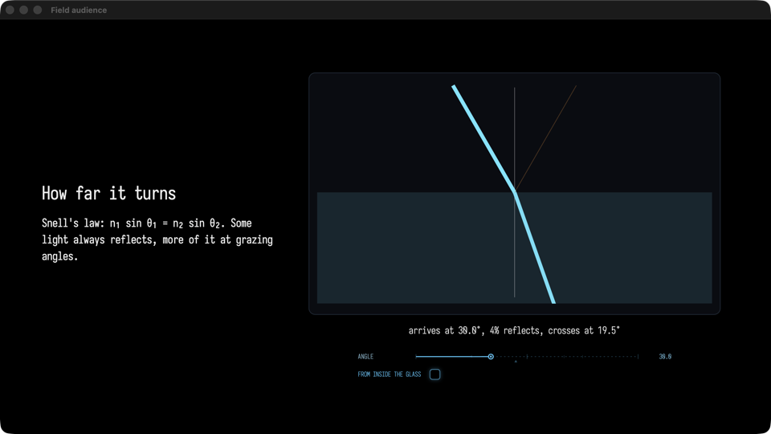
</figure>

Snell's law: n₁ sin θ₁ = n₂ sin θ₂. Some light always reflects, more of it at grazing angles.

```diffstatic_runner {data-lang=kotlin screenshot="assets/explainer_cameras/snell.png" execution="launch" wait-output=true wait="2" timeout="240" embed=true name="explainer-cameras-snell" alt="A thick cyan ray coming down at 40° to a glass surface and turning toward the vertical as it crosses, a thin orange reflected ray, and a readout that 5% reflects and the ray crosses at 25.4°, with an angle slider and a from inside the glass checkbox"}
:::fold imports
import afield.simulation.optics.*
:::endfold

// A ray meets glass (index 1.5). Part of it turns as it crosses, part reflects;
// the line widths show how the light divides.
val glass = 1.5
val cyan = vec(0.4, 0.9, 1.0, 1.0)
val orange = vec(1.0, 0.6, 0.2, 1.0)
var angle = 40.0
var inside = false

:::fold ray: one ray as an FLine whose width shows its share of the light
fun ray(x1: Double, y1: Double, share: Double, c: Vec4) = fline {
    moveTo(320.0, 180.0)
    lineTo(x1, y1)
    color = vec(c.x, c.y, c.z, 0.25 + 0.75 * share)
    thickness = 0.8 + 5.0 * share
}
:::endfold

fun draw() {
    val theta = angle * PI / 180
    val (n1, n2) = if (inside) glass to 1.0 else 1.0 to glass
    val side = if (inside) 1.0 else -1.0 // the incoming ray's side of the surface: -1 above, +1 below
    val turned = Refraction.snellAngle(theta, n1, n2)
    val reflected = Refraction.reflectance(theta, n1, n2)
    val parts = mutableListOf(
        fline {
            rect(0, 180, 640, 180)
            filled = true
            stroked = false
            color = vec(0.4, 0.9, 1.0, 0.12)
        },
        fline {
            moveTo(320, 10)
            lineTo(320, 350)
            color = vec(1.0, 1.0, 1.0, 0.35)
            thickness = 1.0
        },
        fline {
            moveTo(320 - 200 * sin(theta), 180 + side * 200 * cos(theta))
            lineTo(320, 180)
            color = cyan
            thickness = 5.8
        },
        ray(320 + 200 * sin(theta), 180 + side * 200 * cos(theta), reflected, orange),
    )
    if (!turned.isNaN()) parts += ray(320 + 200 * sin(turned), 180 - side * 200 * cos(turned), 1 - reflected, cyan)
    showPlane(
        parts,
        channel = "rays",
        width = 600,
        height = 338,
        padding = 0.0,
        window = Rect(0.0, 0.0, 640.0, 360.0),
        interactive = false,
    )
    val crossing =
        if (turned.isNaN()) "none crosses: total internal reflection" else "crosses at ${(turned * 180 / PI).f1}°"
    markdown("readout", "arrives at ${angle.f1}°, ${(100 * reflected).f0}% reflects, $crossing")
}

draw()
controlGroup {
    slider("angle", 0.0, 89.0, step = 0.5, initialValue = 40.0) {
        angle = it
        draw()
    }
    checkbox("from inside the glass") {
        inside = it
        draw()
    }
}
```

## Lenses

### Tilted faces

<figure class="field-margin-figure" markdown>
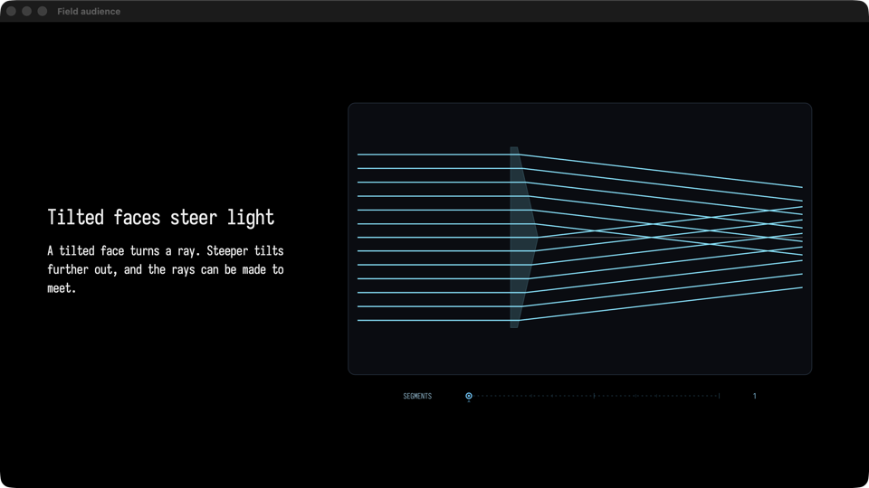
</figure>

A tilted face turns a ray. Steeper tilts further out, and the rays can be made to meet.

```diffstatic_runner {data-lang=kotlin screenshot="assets/explainer_cameras/prism_segments.png" execution="launch" wait-output=true wait="2" timeout="240" embed=true name="explainer-cameras-prism_segments" alt="Parallel cyan rays from the left meeting one flat-faced glass segment, all leaving at the same angle, with a segments slider at 1"}
:::fold imports
import afield.simulation.optics.*
:::endfold

// Parallel rays through glass whose back face is made of flat segments. One segment each side is a
// pair of prisms: the rays turn but stay parallel. More segments, closer to a curve, and they meet.
val glass = 1.5
val axis = 180.0
val flatX = 220.0
val radius = 300.0
val rim = 130.0
val cyan = vec(0.4, 0.9, 1.0, 1.0)
val guide = vec(1.0, 1.0, 1.0, 0.35)
var segments = 1

// The curved face these segments approximate, a circle that is `rim` above the axis at its edge.
fun surfaceX(h: Double) = flatX + 10.0 + sqrt(radius * radius - h * h) - sqrt(radius * radius - rim * rim)

fun draw() {
    val n = segments
    // The facets' corners from the rim at the top to the rim at the bottom.
    val corners =
        (0..2 * n).map { k ->
            val h = -rim + rim * k / n
            h to surfaceX(h)
        }
    val outline = fline {
        moveTo(flatX, axis - rim)
        for ((h, x) in corners) lineTo(x, axis + h)
        lineTo(flatX, axis + rim)
        close()
        filled = true
        color = vec(0.4, 0.9, 1.0, 0.18)
    }
    val parts = mutableListOf(
        outline,
        fline {
            moveTo(0, axis)
            lineTo(640, axis)
            color = guide
            thickness = 1.0
        },
    )
    for (k in -6..6) {
        val h = 20.0 * k + if (k == 0) 0.0 else -0.5 * sign(k.toDouble()) // keep rays off the facet corners
        val facet = ((h + rim) / rim * n).toInt().coerceIn(0, 2 * n - 1)
        val (h0, x0) = corners[facet]
        val (h1, x1) = corners[facet + 1]
        val x = x0 + (x1 - x0) * (h - h0) / (h1 - h0)
        // Outward normal of the facet, then Snell's law leaving the glass.
        val len = sqrt((x1 - x0).pow(2) + (h1 - h0).pow(2))
        val out = Refraction.refract(1.0, 0.0, (h1 - h0) / len, -(x1 - x0) / len, glass, 1.0) ?: continue
        val end = frameExit(x, axis + h, out[0], out[1], 640.0, 360.0)
        parts += fline {
            moveTo(0.0, axis + h)
            lineTo(x, axis + h)
            lineTo(end[0], end[1])
            color = cyan
            thickness = 1.5
        }
    }
    showPlane(
        parts,
        channel = "side",
        width = 600,
        height = 338,
        padding = 0.0,
        window = Rect(0.0, 0.0, 640.0, 360.0),
        interactive = false,
    )
}

draw()
controlGroup {
    slider("segments", 1.0, 24.0, step = 1.0, initialValue = 1.0) {
        segments = it.toInt()
        draw()
    }
}
```

### A thin lens

<figure class="field-margin-figure" markdown>
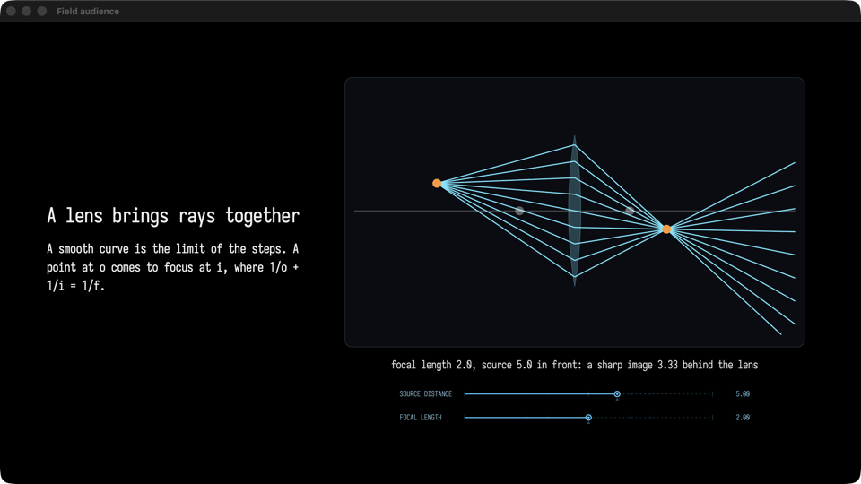
</figure>

A smooth curve is the limit of the steps. A point at o comes to focus at i, where 1/o + 1/i = 1/f.

```diffstatic_runner {data-lang=kotlin screenshot="assets/explainer_cameras/thin_lens.png" execution="launch" wait-output=true wait="2" timeout="240" embed=true name="explainer-cameras-thin_lens" alt="An orange source point on the left, cyan rays fanning out to a lens and meeting again at an orange image point behind it, and a readout that a focal length 2.0 lens with the source 5.0 in front makes a sharp image 3.33 behind it, with source distance and focal length sliders"}
:::fold imports
import afield.simulation.optics.*
:::endfold

// A thin lens bends each ray in proportion to how far from the middle it passes,
// so the rays from one point meet again on the other side.
val unit = 40.0
val axis = 180.0
val lensX = 320.0
val cyan = vec(0.4, 0.9, 1.0, 1.0)
val orange = vec(1.0, 0.6, 0.2, 1.0)
val guide = vec(1.0, 1.0, 1.0, 0.35)
var focal = 2.0
var source = 5.0

:::fold segment: a straight line segment as an FLine
fun segment(x0: Double, y0: Double, x1: Double, y1: Double, c: Vec4, width: Double = 1.5) = fline {
    moveTo(x0, y0)
    lineTo(x1, y1)
    color = c
    thickness = width
}
:::endfold

:::fold dot: draws a filled disc into the pixel array
fun dot(x: Double, y: Double, c: Vec4) = fline {
    moveTo(x, y)
    pointed = true
    pointSize = 2.0
    stroked = false
    color = c
}
:::endfold

fun draw() {
    val lens = fline {
        moveTo(lensX, axis - 110)
        for (k in 0..40) {
            val t = -1 + k / 20.0
            lineTo(lensX + 9 * (1 - t * t), axis + 110 * t)
        }
        for (k in 0..40) {
            val t = 1 - k / 20.0
            lineTo(lensX - 9 * (1 - t * t), axis + 110 * t)
        }
        filled = true
        color = vec(0.4, 0.9, 1.0, 0.25)
    }
    val sx = lensX - source * unit
    val sy = axis - 40.0
    val parts = mutableListOf(
        segment(0.0, axis, 640.0, axis, guide, 1.0),
        lens,
        dot(lensX - focal * unit, axis, guide),
        dot(lensX + focal * unit, axis, guide),
        dot(sx, sy, orange),
    )
    for (k in -4..4) {
        val h = 24.0 * k
        val slope = (axis + h - sy) / (lensX - sx) - h / (focal * unit)
        parts += segment(sx, sy, lensX, axis + h, cyan)
        val end = frameExit(lensX, axis + h, 1.0, slope, 640.0, 360.0)
        parts += segment(lensX, axis + h, end[0], end[1], cyan)
    }
    val image = ThinLens.imageDistance(focal, source)
    if (image > 0 && image * unit < 320) parts += dot(lensX + image * unit, axis + 40.0 * image / source, orange)
    showPlane(
        parts,
        channel = "rays",
        width = 600,
        height = 338,
        padding = 0.0,
        window = Rect(0.0, 0.0, 640.0, 360.0),
        interactive = false,
    )
    val where = if (image > 0) "a sharp image ${image.f2} behind the lens" else "no image: the rays spread apart"
    markdown("readout", "focal length ${focal.f1}, source ${source.f1} in front: $where")
}

draw()
controlGroup {
    slider("source distance", 1.0, 7.5, step = 0.05, initialValue = 5.0) {
        source = it
        draw()
    }
    slider("focal length", 1.0, 3.0, step = 0.05, initialValue = 2.0) {
        focal = it
        draw()
    }
}
```

### A camera with a lens

<figure class="field-margin-figure" markdown>
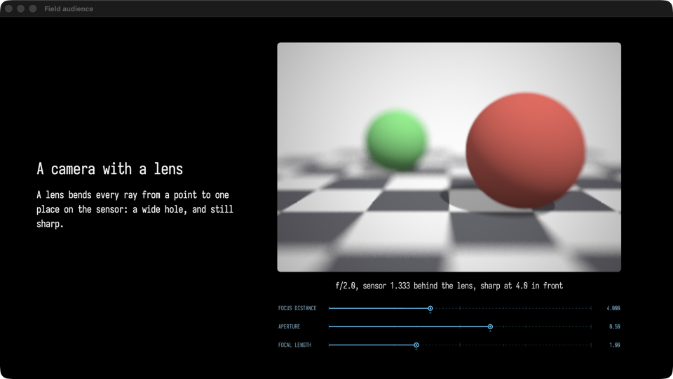
</figure>

A lens bends every ray from a point to one place on the sensor: a wide hole, and still sharp.

```diffstatic_runner {data-lang=kotlin screenshot="assets/explainer_cameras/lens_camera.png" execution="launch" wait-output=true wait="2" timeout="240" embed=true name="explainer-cameras-lens_camera" alt="A sensor picture through a lens: the red sphere sharp, the green sphere and the far checkerboard blurred, a readout of f/2.0 with the sensor 1.333 behind the lens, sharp at 4.0 in front, and focus distance, aperture and focal length sliders"}
:::fold imports
import afield.simulation.optics.*
:::endfold

// The test scene through a lens. Choose the distance to focus at and the lens puts its sensor
// where that distance comes out sharp; nearer and further things blur.
val scene = OpticsScene.testScene()
var focus = 4.0
var focal = 1.0
var aperture = 0.5

fun draw() {
    val sensor = ThinLens.imageDistance(focal, focus)
    val camera = SensorCamera(z = -4.5, sensorDistance = sensor, apertureDiameter = aperture, focalLength = focal)
    val image = camera.render(scene, 300, 200, samples = 64)
    // Smoothed when scaled: a picture, not a grid of detectors.
    display("sensor", image.html(width = 600))
    markdown(
        "readout",
        "f/${(focal / aperture).f1}, sensor ${sensor.f3} behind the lens, sharp at ${focus.f1} in front",
    )
}

draw()
controlGroup {
    slider("focus distance", 2.0, 12.0, step = 0.05, initialValue = 4.0, law = ControlLaw.LOGARITHMIC) {
        focus = it
        draw()
    }
    slider("aperture", 0.02, 0.8, step = 0.01, initialValue = 0.5) {
        aperture = it
        draw()
    }
    slider("focal length", 0.7, 1.6, step = 0.01, initialValue = 1.0) {
        focal = it
        draw()
    }
}
```

### The shape of blur

<figure class="field-margin-figure" markdown>
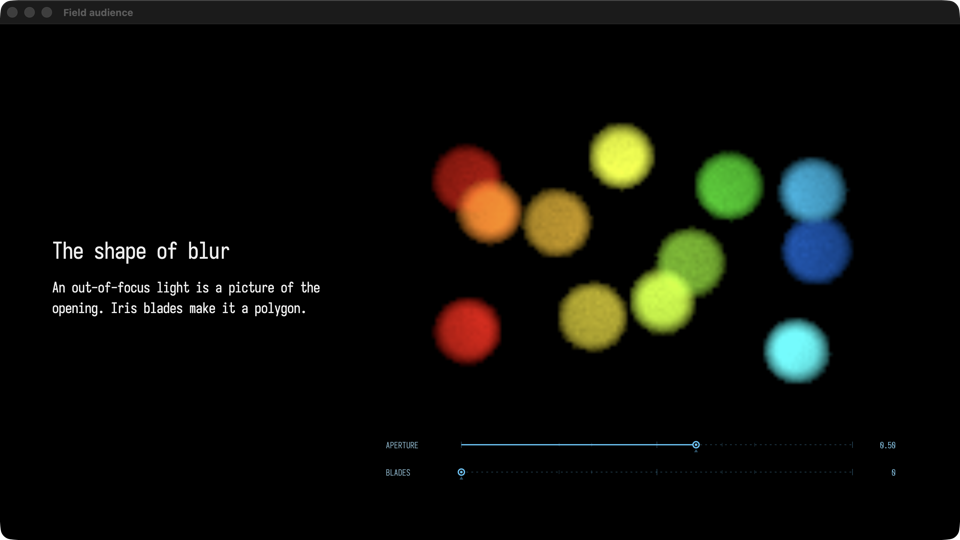
</figure>

An out-of-focus light is a picture of the opening. Iris blades make it a polygon.

```diffstatic_runner {data-lang=kotlin screenshot="assets/explainer_cameras/bokeh.png" execution="launch" wait-output=true wait="2" timeout="240" embed=true name="explainer-cameras-bokeh" alt="A dozen out-of-focus coloured lights on black, each a soft round disc, with aperture and blades sliders"}
:::fold imports
import afield.simulation.optics.*
:::endfold

// Small lights far behind the point the lens is focused on. Each one spreads into a copy of the
// opening: a disc for a round one, a polygon for an iris of blades.
val lights = OpticsScene(
    12 { k ->
        val hue = Refraction.wavelengthColor(450.0 + 20.0 * k)
        OpticsSphere(
            -3.6 + 0.65 * k,
            0.6 + 1.5 * sin(k * 2.4),
            7.0 + 1.5 * cos(k * 1.7),
            0.12,
            hue[0],
            hue[1],
            hue[2],
            emission = 12.0,
        )
    },
    floorY = null,
    sky = doubleArrayOf(0.0, 0.0, 0.0),
    sun = 0.0,
)
var aperture = 0.5
var blades = 0

fun draw() {
    val camera = SensorCamera(
        y = 0.6,
        z = -2.0,
        lookY = 0.6,
        lookZ = 6.0,
        sensorDistance = ThinLens.imageDistance(1.0, 3.0),
        apertureDiameter = aperture,
        focalLength = 1.0,
        blades = blades,
        bladeRotation = 0.3,
    )
    val image = camera.render(lights, 150, 100, samples = 400)
    // Low resolution keeps 400 rays a pixel quick; smoothed, the discs read as discs.
    display("sensor", image.html(exposure = 1.0 / camera.reference, width = 600))
}

draw()
controlGroup {
    slider("aperture", 0.05, 0.8, step = 0.01, initialValue = 0.5) {
        aperture = it
        draw()
    }
    slider("blades", 0.0, 9.0, step = 1.0, initialValue = 0.0) {
        blades = if (it < 3) 0 else it.toInt()
        draw()
    }
}
```

### How deep is sharp

<figure class="field-margin-figure" markdown>
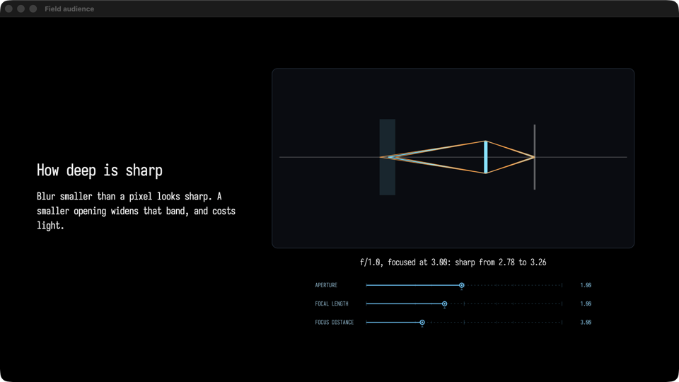
</figure>

Blur smaller than a pixel looks sharp. A smaller opening widens that band, and costs light.

```diffstatic_runner {data-lang=kotlin screenshot="assets/explainer_cameras/depth_of_field.png" execution="launch" wait-output=true wait="2" timeout="240" embed=true name="explainer-cameras-depth_of_field" alt="A side view of a lens with orange and cyan ray cones closing to a sensor line, a readout of f/1.0 focused at 3.00 and sharp from 2.78 to 3.26, and aperture, focal length and focus distance sliders"}
:::fold imports
import afield.simulation.optics.*
:::endfold

// A lens focused at one distance. Points between the near and far limits make blur circles
// smaller than a pixel (here 0.04), so everything in the shaded band looks sharp.
val unit = 60.0
val lensX = 380.0
val axis = 150.0
val pixel = 0.04
val cyan = vec(0.4, 0.9, 1.0, 1.0)
val orange = vec(1.0, 0.6, 0.2, 1.0)
val guide = vec(1.0, 1.0, 1.0, 0.35)
var aperture = 1.0
var focal = 1.0
var focus = 3.0

fun cone(objectDistance: Double, sensorX: Double, c: Vec4, width: Double) =
    listOf(-1.0, 1.0).map { side ->
        val image = ThinLens.imageDistance(focal, objectDistance)
        val edge = side * aperture / 2 * unit
        fline {
            moveTo(lensX - objectDistance * unit, axis)
            lineTo(lensX, axis + edge)
            // Towards the image point, stopping at the sensor.
            lineTo(sensorX, axis + edge * (1 - (sensorX - lensX) / (image * unit)))
            color = c
            thickness = width
        }
    }

fun draw() {
    val sensor = ThinLens.imageDistance(focal, focus)
    val sensorX = lensX + sensor * unit
    val (near, far) = ThinLens.depthOfField(focal, aperture, focus, pixel).let { it[0] to it[1] }
    val farX = if (far.isInfinite()) 0.0 else max(0.0, lensX - far * unit)
    val parts = mutableListOf(
        fline {
            rect(farX, axis - 70, lensX - near * unit - farX, 140)
            filled = true
            stroked = false
            color = vec(0.4, 0.9, 1.0, 0.12)
        },
        fline {
            moveTo(0, axis)
            lineTo(640, axis)
            color = guide
            thickness = 1.0
        },
        fline {
            moveTo(lensX, axis - aperture / 2 * unit)
            lineTo(lensX, axis + aperture / 2 * unit)
            color = cyan
            thickness = 6.0
        },
        fline {
            moveTo(sensorX, axis - 60)
            lineTo(sensorX, axis + 60)
            color = guide
            thickness = 3.0
        },
    )
    parts += cone(focus, sensorX, cyan, 1.5)
    parts += cone(near, sensorX, orange, 1.0)
    if (!far.isInfinite() && far * unit < lensX) parts += cone(far, sensorX, orange, 1.0)
    showPlane(
        parts,
        channel = "side",
        width = 600,
        height = 281,
        padding = 0.0,
        window = Rect(0.0, 0.0, 640.0, 300.0),
        interactive = false,
    )
    val farText = if (far.isInfinite()) "to infinity" else "to ${far.f2}"
    markdown("readout", "f/${(focal / aperture).f1}, focused at ${focus.f2}: sharp from ${near.f2} $farText")
}

draw()
controlGroup {
    slider("aperture", 0.05, 2.0, step = 0.01, initialValue = 1.0) {
        aperture = it
        draw()
    }
    slider("focal length", 0.6, 1.6, step = 0.01, initialValue = 1.0) {
        focal = it
        draw()
    }
    slider("focus distance", 1.8, 6.0, step = 0.01, initialValue = 3.0) {
        focus = it
        draw()
    }
}
```

### f-numbers

<figure class="field-margin-figure" markdown>
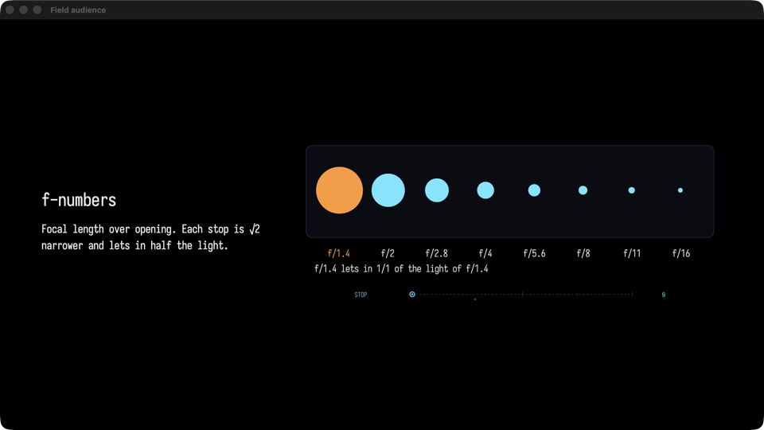
</figure>

Focal length over opening. Each stop is √2 narrower and lets in half the light.

```diffstatic_runner {data-lang=kotlin screenshot="assets/explainer_cameras/f_stops.png" execution="launch" wait-output=true wait="2" timeout="240" embed=true name="explainer-cameras-f_stops" alt="A row of circular openings shrinking from left to right, labelled f/1.4 to f/16 with f/2.8 picked out in orange, a readout that f/2.8 lets in a quarter of the light of f/1.4, and a stop slider"}
// The opening at each full f-stop for one lens, drawn to scale. Each is √2 narrower than the
// last, so it has half the area and lets in half the light.
val stops = ["1.4", "2", "2.8", "4", "5.6", "8", "11", "16"]
val cyan = vec(0.4, 0.9, 1.0, 1.0)
val orange = vec(1.0, 0.6, 0.2, 1.0)
var chosen = 2

fun draw() {
    val parts =
        stops.indices.map { k ->
            val r = 38.0 / sqrt(2.0).pow(k)
            fline {
                for (s in 0..48) {
                    val t = 2 * PI * s / 48
                    if (s == 0) moveTo(40 + 80 * k + r, 60 + 0.0) else lineTo(40 + 80 * k + r * cos(t), 60 + r * sin(t))
                }
                filled = true
                color = if (k == chosen) orange else cyan
            }
        }
    showPlane(
        parts,
        channel = "openings",
        width = 600,
        height = 112,
        padding = 0.0,
        window = Rect(0.0, 0.0, 640.0, 120.0),
        interactive = false,
    )
    val labels = stops.mapIndexed { k, s ->
        "<span style='display:inline-block;width:75px;text-align:center;${if (k == chosen) "color:#ff9933" else ""}'>f/$s</span>"
    }
    val share = "1/${1 shl chosen}"
    markdown(
        "readout",
        "<div style='width:600px'>${labels.joinToString("")}</div>\n\nf/${stops[chosen]} lets in $share of the light of f/1.4",
    )
}

draw()
controlGroup {
    slider("stop", 0.0, 7.0, step = 1.0, initialValue = 2.0) {
        chosen = it.toInt()
        draw()
    }
}
```

## Aberrations

### Spheres miss

<figure class="field-margin-figure" markdown>
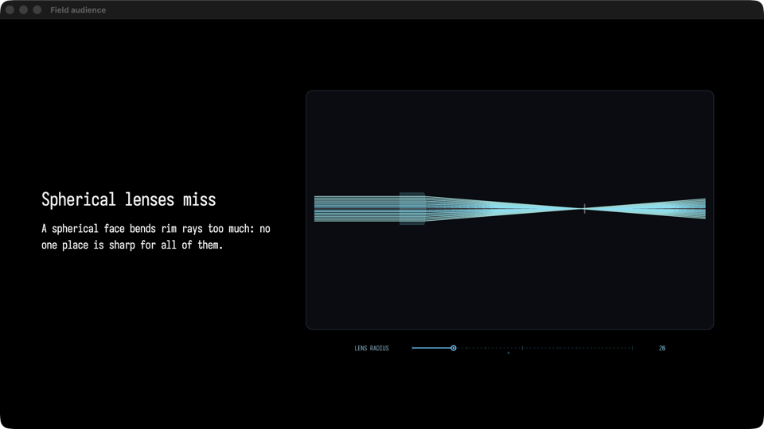
</figure>

A spherical face bends rim rays too much: no one place is sharp for all of them.

```diffstatic_runner {data-lang=kotlin screenshot="assets/explainer_cameras/spherical_aberration.png" execution="launch" wait-output=true wait="2" timeout="240" embed=true name="explainer-cameras-spherical_aberration" alt="Parallel rays through a spherical lens on the left converging to the right, the rim rays crossing the axis before the central ones so no single point is sharp, with a lens radius slider"}
:::fold imports
import afield.simulation.optics.*
:::endfold

// Parallel rays through a lens with a spherical back face, traced exactly with Snell's law.
// Rays near the rim (orange) cross the axis before those near the middle (cyan).
val glass = 1.5
val axis = 180.0
val flatX = 140.0
val radius = 130.0
val cyan = vec(0.4, 0.9, 1.0, 1.0)
val guide = vec(1.0, 1.0, 1.0, 0.35)
var opening = 40.0

fun draw() {
    val sag = radius - sqrt(radius * radius - 90.0 * 90.0)
    val centreX = flatX + sag + 6 - radius // centre of the spherical face
    val edge = opening + 6
    val outline = fline {
        moveTo(flatX, axis - edge)
        for (k in 0..60) {
            val h = -edge + 2 * edge * k / 60
            lineTo(centreX + sqrt(radius * radius - h * h), axis + h)
        }
        lineTo(flatX, axis + edge)
        close()
        filled = true
        color = vec(0.4, 0.9, 1.0, 0.18)
    }
    val paraxial = centreX + radius + radius / (glass - 1)
    val parts = mutableListOf(
        outline,
        fline {
            moveTo(0, axis)
            lineTo(640, axis)
            color = guide
            thickness = 1.0
        },
        fline {
            moveTo(paraxial, axis - 8)
            lineTo(paraxial, axis + 8)
            color = guide
            thickness = 2.0
        },
    )
    for (k in -8..8) {
        if (k == 0) continue
        val h = opening * k / 8
        val x = centreX + sqrt(radius * radius - h * h)
        val out = Refraction.refract(1.0, 0.0, (x - centreX) / radius, h / radius, glass, 1.0) ?: continue
        val t = abs(h) / 85.0
        val end = frameExit(x, axis + h, out[0], out[1], 640.0, 360.0)
        parts += fline {
            moveTo(0.0, axis + h)
            lineTo(x, axis + h)
            lineTo(end[0], end[1])
            color = vec(0.4 + 0.6 * t, 0.9 - 0.3 * t, 1.0 - 0.8 * t, 1.0)
            thickness = 1.3
        }
    }
    showPlane(
        parts,
        channel = "side",
        width = 600,
        height = 338,
        padding = 0.0,
        window = Rect(0.0, 0.0, 640.0, 360.0),
        interactive = false,
    )
}

draw()
controlGroup {
    slider("lens radius", 5.0, 85.0, step = 1.0, initialValue = 40.0) {
        opening = it
        draw()
    }
}
```

### Colours split

<figure class="field-margin-figure" markdown>
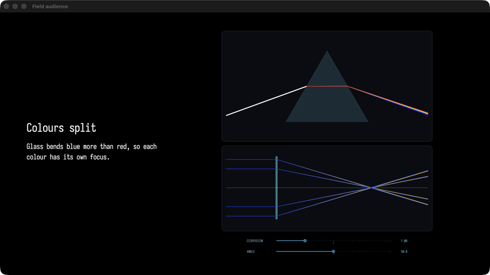
</figure>

Glass bends blue more than red, so each colour has its own focus.

```diffstatic_runner {data-lang=kotlin screenshot="assets/explainer_cameras/dispersion.png" execution="launch" wait-output=true wait="2" timeout="240" embed=true name="explainer-cameras-dispersion" alt="Above, a white ray entering a triangular prism and leaving as a fanned rainbow; below, parallel rays through a lens where each colour comes to focus at its own distance, with dispersion and angle sliders"}
:::fold imports
import afield.simulation.optics.*
:::endfold

// White light is every colour at once, and glass bends blue more than red. Through a prism the
// colours fan out; through a lens each colour comes to its own focus.
val cyan = vec(0.4, 0.9, 1.0, 1.0)
var spread = 2.0
var angle = 50.0
val waves = [410.0, 450.0, 490.0, 530.0, 570.0, 610.0, 650.0, 690.0]

fun index(nm: Double) = Refraction.cauchyIndex(nm, b = 4200.0 * spread)
fun colour(nm: Double) = Refraction.wavelengthColor(nm).let { vec(it[0], it[1], it[2], 0.9) }

// Distance along the ray (px, py) + t (dx, dy) to the segment a-b, or null.
fun hit(px: Double, py: Double, dx: Double, dy: Double, a: DoubleArray, b: DoubleArray): Double? {
    val ex = b[0] - a[0]
    val ey = b[1] - a[1]
    val det = dx * -ey + ex * dy
    if (abs(det) < 1e-12) return null
    val t = ((a[0] - px) * -ey + ex * (a[1] - py)) / det
    val u = (dx * (a[1] - py) - dy * (a[0] - px)) / det
    return if (t > 1e-6 && u in 0.0..1.0) t else null
}

fun prism() {
    val a = doubleArrayOf(320.0, 50.0)
    val b = doubleArrayOf(190.0, 275.0)
    val c = doubleArrayOf(450.0, 275.0)
    val parts = mutableListOf(
        fline {
            moveTo(a[0], a[1])
            lineTo(b[0], b[1])
            lineTo(c[0], c[1])
            close()
            filled = true
            color = vec(0.4, 0.9, 1.0, 0.15)
        },
    )
    val phi = (30.0 - angle) * PI / 180
    val dx = cos(phi)
    val dy = sin(phi)
    val px = (a[0] + b[0]) / 2
    val py = (a[1] + b[1]) / 2
    val from = frameExit(px, py, -dx, -dy, 640.0, 320.0)
    parts += fline {
        moveTo(from[0], from[1])
        lineTo(px, py)
        color = vec(1.0, 1.0, 1.0, 1.0)
        thickness = 3.0
    }
    for (nm in waves) {
        val n = index(nm)
        val inside = Refraction.refract(dx, dy, 0.866, 0.5, 1.0, n) ?: continue
        val faces = [a to c, b to c]
        val (t, face) =
            faces
                .mapNotNull { (p, q) -> hit(px, py, inside[0], inside[1], p, q)?.let { it to (p to q) } }
                .minByOrNull { it.first } ?: continue
        val qx = px + t * inside[0]
        val qy = py + t * inside[1]
        val ex = face.second[0] - face.first[0]
        val ey = face.second[1] - face.first[1]
        val len = sqrt(ex * ex + ey * ey)
        val out = Refraction.refract(inside[0], inside[1], ey / len, -ex / len, n, 1.0)
        parts += fline {
            moveTo(px, py)
            lineTo(qx, qy)
            if (out != null) frameExit(qx, qy, out[0], out[1], 640.0, 320.0).let { lineTo(it[0], it[1]) }
            color = colour(nm)
            thickness = 1.5
        }
    }
    showPlane(
        parts,
        channel = "prism",
        width = 600,
        height = 300,
        padding = 0.0,
        window = Rect(0.0, 0.0, 640.0, 320.0),
        interactive = false,
    )
}

fun lens() {
    val parts = mutableListOf(
        fline {
            moveTo(160, 20)
            lineTo(160, 220)
            color = vec(0.4, 0.9, 1.0, 0.5)
            thickness = 6.0
        },
        fline {
            moveTo(0, 120)
            lineTo(640, 120)
            color = vec(1.0, 1.0, 1.0, 0.35)
            thickness = 1.0
        },
    )
    val green = index(550.0)
    for (nm in [650.0, 550.0, 450.0]) {
        val focal = 300.0 * (green - 1) / (index(nm) - 1)
        for (h in [-90.0, -60.0, 60.0, 90.0]) parts += fline {
            moveTo(0.0, 120 + h)
            lineTo(160.0, 120 + h)
            frameExit(160.0, 120 + h, 1.0, -h / focal, 640.0, 240.0).let { lineTo(it[0], it[1]) }
            color = colour(nm)
            thickness = 1.3
        }
    }
    showPlane(
        parts,
        channel = "lens",
        width = 600,
        height = 225,
        padding = 0.0,
        window = Rect(0.0, 0.0, 640.0, 240.0),
        interactive = false,
    )
}

fun draw() {
    prism()
    lens()
}

draw()
controlGroup {
    slider("dispersion", 0.0, 4.0, step = 0.05, initialValue = 2.0) {
        spread = it
        draw()
    }
    slider("angle", 20.0, 80.0, step = 0.5, initialValue = 50.0) {
        angle = it
        draw()
    }
}
```

## Further reading

<figure class="field-margin-figure" markdown>
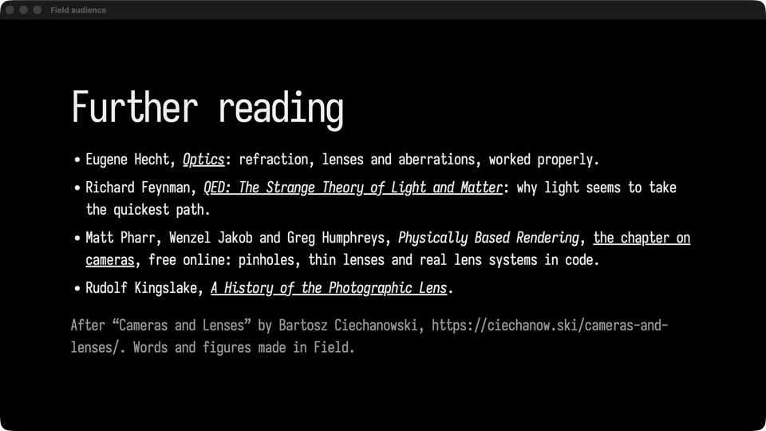
</figure>

- Eugene Hecht, [*Optics*](https://archive.org/details/optics0000hech_e5d5): refraction, lenses and aberrations, worked properly. The link is the Internet Archive's lending copy of the third edition.
- Richard Feynman, [*QED: The Strange Theory of Light and Matter*](https://archive.org/details/qedstrangetheory0000feyn_x8n8): why light seems to take the quickest path. The link is the Internet Archive's lending copy.
- Matt Pharr, Wenzel Jakob and Greg Humphreys, *Physically Based Rendering*, [the chapter on cameras and film](https://pbr-book.org/4ed/Cameras_and_Film), free online: pinholes, thin lenses and real lens systems in code.
- Rudolf Kingslake, [*A History of the Photographic Lens*](https://archive.org/details/historyofphotogr0000king) (1989). The link is the Internet Archive's lending copy.

The talk follows Bartosz Ciechanowski's [Cameras and Lenses](https://ciechanow.ski/cameras-and-lenses/), read for its order of ideas; every word and figure here was made in Field.

See also: [Sound](explainer_sound.md), [Lights and Shadows](explainer_lights.md), the other two talks in this series, and [Presenting with Field](presentation_studio.md).

## API reference

Implementation and parameter details for the helpers used above:

- [`SensorCamera`](reference/simulation.md#cameraoptics-kt-sensorcamera)
