# Teichmüller maps

<div data-field-transcript-gallery hidden></div>

How different are two leaves? One answer: bend one onto the other, and measure how much the bending
had to distort it. This talk builds that idea from nothing: maps that keep angles, maps that turn
small circles into ellipses, the map that distorts least, and the distance between shapes it gives.

The talk follows work by Gary P. T. Choi, L. Mahadevan, Lok Ming Lui and co-authors. Its words
and figures were made in Field.

[Open →](offline.html?file=assets/agent_transcripts/explainer_teichmuller/metadata.edn)

Follow the talk figure by figure on this page. Each figure is a box in the document: you'll see its
code and what it draws, with the slide that uses it in the margin. **Open →** shows the whole
document beside the page; **Open in Field·4** imports an editable copy. To give the talk, run its
`deck` box in Field's desktop app. [Live figures beside prose](presentation_studio.md#live-figures-beside-prose)
shows how to build a deck like this one. The [conformal geometry reference](reference/math.md#beltrami-kt) covers the
Beltrami coefficient of a map on a triangle mesh, the linear solver, the quasi-conformal
iteration, and maps onto rectangles.

## Maps that keep angles

<figure class="field-margin-figure" markdown>
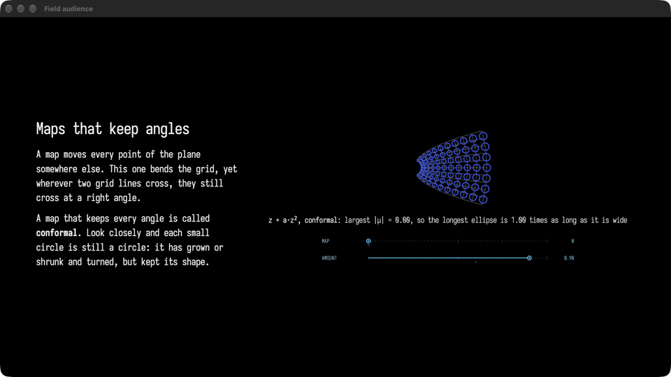
</figure>

A map moves every point of the plane somewhere else. The map z + a·z² bends the grid, yet wherever
two grid lines cross they still cross at a right angle, and each small circle comes out as a circle,
grown or shrunk and turned. A map that keeps every angle is **conformal**.

Push a grid of small circles through one of three maps. Each is coloured by how far it ends up
from a circle. Choose the map with **map**, and how strongly it acts with **amount**.

```diffstatic_runner {data-lang=kotlin screenshot="assets/explainer_teichmuller/circles.png" execution="launch" wait-output=true wait="2" timeout="300" embed=true name="explainer-teichmuller-circles" alt="A grid of small circles bent by the map z plus a times z squared: the grid lines curve but still cross at right angles, and every circle is still round and blue, with map and amount sliders"}
:::fold imports
import afield.geometry.conformal.*
:::endfold

// A grid of small circles pushed through a map. Each comes out as a small ellipse,
// coloured by |μ|: dark blue is still a circle, orange is a long ellipse.
var which = 0
var amount = 0.6
val names = ["z + a·z², conformal", "a stretch along x", "a twist near the middle"]

fun map(x: Double, y: Double): DoubleArray = when (which) {
    0 -> doubleArrayOf(x + 0.35 * amount * (x * x - y * y), y + 0.35 * amount * 2 * x * y)
    1 -> doubleArrayOf(x * (1 + amount), y)
    else -> {
        val turn = 1.8 * amount * exp(-1.5 * (x * x + y * y))
        doubleArrayOf(x * cos(turn) - y * sin(turn), x * sin(turn) + y * cos(turn))
    }
}

// |μ| = |f_z̄| / |f_z|, from the map's derivatives at (x, y).
fun distortion(x: Double, y: Double): Double {
    val h = 1e-5
    val a = map(x + h, y)
    val b = map(x - h, y)
    val c = map(x, y + h)
    val d = map(x, y - h)
    val ux = (a[0] - b[0]) / (2 * h)
    val vx = (a[1] - b[1]) / (2 * h)
    val uy = (c[0] - d[0]) / (2 * h)
    val vy = (c[1] - d[1]) / (2 * h)
    return hypot(ux - vy, vx + uy) / hypot(ux + vy, vx - uy)
}

fun colour(argb: Int) = vec(((argb shr 16) and 255) / 255.0, ((argb shr 8) and 255) / 255.0, (argb and 255) / 255.0, 1.0)
// World coordinates to the 640 × 360 picture, y up.
fun sx(x: Double) = 300 + 175 * x
fun sy(y: Double) = 180 - 175 * y

fun draw() {
    val drawn = mutableListOf<FLine>()
    // The square grid the circles sit on, carried by the map.
    for (k in -5..5) for (vertical in [true, false]) drawn += fline {
        for (s in 0..60) {
            val t = -1.0 + 2.0 * s / 60
            val p = if (vertical) map(0.2 * k, 0.7 * t) else map(t, 0.14 * k)
            if (s == 0) moveTo(sx(p[0]), sy(p[1])) else lineTo(sx(p[0]), sy(p[1]))
        }
        thickness = 1.0
        color = vec(1.0, 1.0, 1.0, 0.35)
    }
    var largest = 0.0
    for (i in -5..5) for (j in -3..3) {
        val cx = 0.2 * i
        val cy = 0.2 * j
        val k = distortion(cx, cy)
        largest = max(largest, k)
        drawn += fline {
            for (s in 0..32) {
                val p = map(cx + 0.07 * cos(2 * PI * s / 32), cy + 0.07 * sin(2 * PI * s / 32))
                if (s == 0) moveTo(sx(p[0]), sy(p[1])) else lineTo(sx(p[0]), sy(p[1]))
            }
            thickness = 2.0
            color = colour(MeshPicture.distortionColor(k, 0.6))
        }
    }
    lines(drawn, channel = "map", w = 640.0, h = 360.0, framing = LinesFraming.fixed(0.0, 0.0, 640.0, 360.0))
    markdown(
        "readout",
        "**${names[which]}**: largest |μ| = ${largest.f2}, so the longest ellipse is ${dilatation(min(largest, 0.99)).f2} times as long as it is wide",
    )
}

draw()
controlGroup {
    slider("map", 0.0, 2.0, step = 1.0, initialValue = 0.0) {
        which = it.toInt()
        draw()
    }
    slider("amount", 0.0, 1.0, initialValue = amount) {
        amount = it
        draw()
    }
}
```

## Circles become ellipses

<figure class="field-margin-figure" markdown>
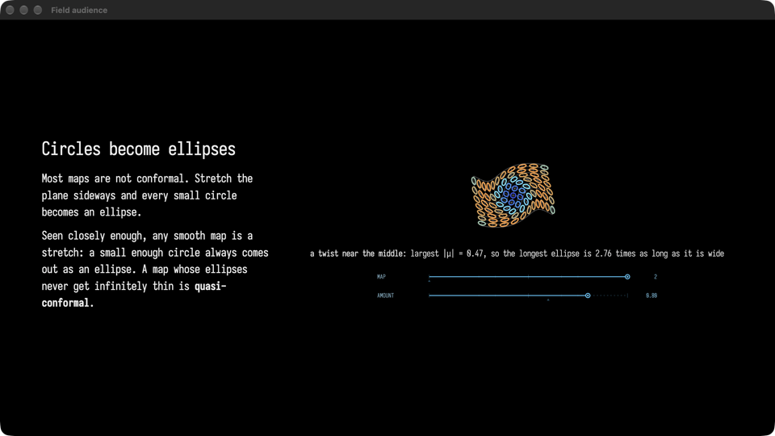
</figure>

Most maps are not conformal. Stretch the plane and every small circle becomes an ellipse. Seen
closely enough, any smooth map is a stretch: a small enough circle always comes out as an ellipse.
A map whose ellipses never get infinitely thin is **quasi-conformal**. On the slide, set **map** to
2 and the twist near the middle makes ellipses that change from place to place.

## The Beltrami coefficient

<figure class="field-margin-figure" markdown>
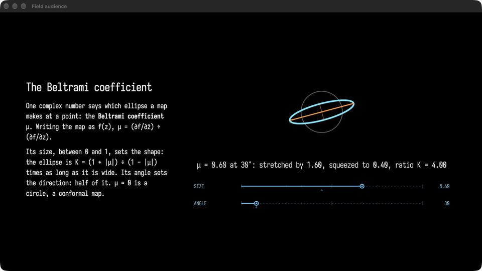
</figure>

One complex number says which ellipse a map makes at a point: the **Beltrami coefficient**
μ = (∂f/∂z̄) ÷ (∂f/∂z). Its size, between 0 and 1, sets the shape: the ellipse is
K = (1 + |μ|) ÷ (1 − |μ|) times as long as it is wide. Its angle sets the direction, at half the
angle of μ. μ = 0 is a circle: a conformal map.

The figure draws one circle under z ↦ z + μ·z̄, the simplest map with a given μ.

```diffstatic_runner {data-lang=kotlin screenshot="assets/explainer_teichmuller/ellipse.png" execution="launch" wait-output=true wait="2" timeout="300" embed=true name="explainer-teichmuller-ellipse" alt="A grey unit circle and the cyan ellipse it becomes under z plus mu times z-bar, long axis in orange tilted at fifteen degrees, with size and angle sliders and a readout of K"}
:::fold imports
import afield.geometry.conformal.*
:::endfold

// One small circle under the map z ↦ z + μ·z̄, the simplest map with a given μ.
// The size of μ sets how long the ellipse is; its angle sets which way it points.
var size = 0.4
var degrees = 30.0

fun draw() {
    val angle = degrees * PI / 180
    val mr = size * cos(angle)
    val mi = size * sin(angle)
    // z + μ z̄ for z = x + iy.
    fun map(x: Double, y: Double) = doubleArrayOf(x + mr * x + mi * y, y + mi * x - mr * y)
    fun sx(x: Double) = 320 + 110 * x
    fun sy(y: Double) = 180 - 110 * y
    fun curve(thick: Double, isGuide: Boolean, at: (Double) -> DoubleArray) = fline {
        for (s in 0..96) {
            val p = at(2 * PI * s / 96)
            if (s == 0) moveTo(sx(p[0]), sy(p[1])) else lineTo(sx(p[0]), sy(p[1]))
        }
        thickness = thick
        color = if (isGuide) vec(1.0, 1.0, 1.0, 0.35) else vec(0.4, 0.9, 1.0, 1.0)
    }
    val drawn = mutableListOf(
        curve(1.5, true) { doubleArrayOf(cos(it), sin(it)) },
        curve(3.0, false) { map(cos(it), sin(it)) },
    )
    // The direction stretched most, and the one squeezed most: half the angle of μ, and a right angle from it.
    val long = map(cos(angle / 2), sin(angle / 2))
    val short = map(-sin(angle / 2), cos(angle / 2))
    drawn += fline {
        moveTo(sx(-long[0]), sy(-long[1]))
        lineTo(sx(long[0]), sy(long[1]))
        thickness = 2.0
        color = vec(1.0, 0.6, 0.2, 1.0)
    }
    drawn += fline {
        moveTo(sx(-short[0]), sy(-short[1]))
        lineTo(sx(short[0]), sy(short[1]))
        thickness = 1.0
        color = vec(1.0, 0.6, 0.2, 0.6)
    }
    lines(drawn, channel = "circle", w = 640.0, h = 360.0, framing = LinesFraming.fixed(0.0, 0.0, 640.0, 360.0))
    markdown(
        "readout",
        "μ = ${size.f2} at ${degrees.f0}°: stretched by **${(1 + size).f2}**, squeezed to **${(1 - size).f2}**, ratio K = **${dilatation(size).f2}**",
    )
}

draw()
controlGroup {
    slider("size", 0.0, 0.9, initialValue = size) {
        size = it
        draw()
    }
    slider("angle", 0.0, 360.0, step = 1.0, initialValue = degrees) {
        degrees = it
        draw()
    }
}
```

## A μ at every point

<figure class="field-margin-figure" markdown>
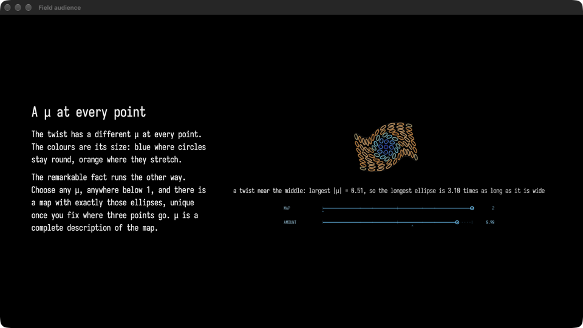
</figure>

The twist has a different μ at every point. The striking fact runs the other way: choose any μ,
anywhere below 1 in size, and there is a map with exactly those ellipses, unique once three points
are pinned. This is the measurable Riemann mapping theorem, and it makes μ a complete description of
the map.

## From μ back to a map

<figure class="field-margin-figure" markdown>
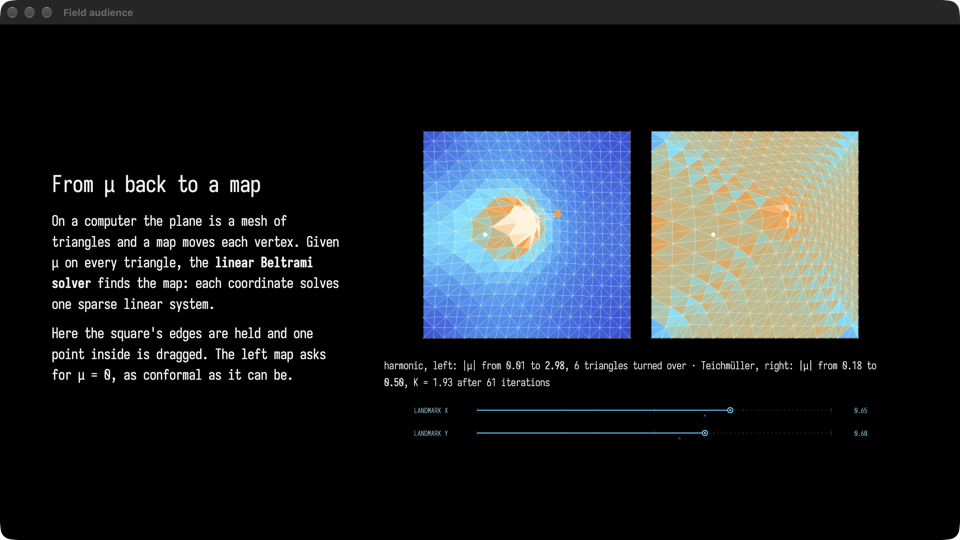
</figure>

On a computer the plane is a mesh of triangles and a map moves each vertex. Given μ on every
triangle, [`LinearBeltramiSolver.solve`](reference/math.md#beltrami-kt--linearbeltramisolver--solve) finds the map. Each coordinate solves one sparse linear system. In the figure the square's edges are held and one point inside, white, is dragged to the
orange dot. [`harmonicMap`](reference/math.md#beltrami-kt--harmonicmap) asks for μ = 0 on the left.
On the right, [`teichmullerMap`](reference/math.md#beltrami-kt--teichmullermap) iterates to spread the distortion evenly.

```diffstatic_runner {data-lang=kotlin screenshot="assets/explainer_teichmuller/landmark.png" execution="launch" wait-output=true wait="3" timeout="300" embed=true name="explainer-teichmuller-landmark" alt="Two squares of triangles: on the left the harmonic map, blue with an orange and white knot of folded triangles round the dragged point; on the right the Teichmüller map, one even orange, with landmark x and y sliders"}
:::fold imports
import afield.geometry.conformal.*
import afield.media.image.util.PngEncoder
:::endfold

// A square whose edges stay put while one point inside is dragged somewhere else.
// Left: the harmonic map (the solver with μ = 0). Right: the Teichmüller map, found by
// the quasi-conformal iteration. Colour is |μ| on each triangle.
val mesh = PlanarMesh.grid(20)
val solver = LinearBeltramiSolver(mesh)
val pinned = mesh.nearest(0.3, 0.5)
var toX = 0.6
var toY = 0.55

fun draw() {
    val fixed = mesh.boundaryIdentity() + (pinned to doubleArrayOf(toX, toY))
    val harmonic = harmonicMap(mesh, fixed, solver)
    val teich = teichmullerMap(mesh, fixed, iterations = 150, solver = solver)
    val picture = MeshPicture(640, 320, -0.05, -0.05, 2.15, 1.05)
    for ((offset, m) in [0.0 to harmonic, 1.1 to teich]) {
        val shifted = DoubleArray(mesh.vertexCount) { m.u[it] + offset }
        picture.mesh(mesh, shifted, m.v, IntArray(mesh.triangleCount) { MeshPicture.distortionColor(m.moduli[it], 0.5) })
        picture.dot(mesh.x[pinned] + offset, mesh.y[pinned], 3.0, 0xFFFFFFFF.toInt())
        picture.dot(toX + offset, toY, 5.0, 0xFFFF9933.toInt())
    }
    display("maps", PngEncoder.encode(picture.pixels, 640, 320))
    markdown(
        "readout",
        "harmonic, left: |μ| from ${harmonic.minModulus.f2} to **${harmonic.maxModulus.f2}**, ${harmonic.flipped} triangles turned over · " +
            "Teichmüller, right: |μ| from ${teich.minModulus.f2} to **${teich.maxModulus.f2}**, K = ${teich.dilatation.f2} after ${teich.iterations} iterations",
    )
}

draw()
controlGroup {
    slider("landmark x", 0.15, 0.85, initialValue = toX) {
        toX = it
        draw()
    }
    slider("landmark y", 0.15, 0.85, initialValue = toY) {
        toY = it
        draw()
    }
}
```


The solvers work on a [`PlanarMesh`](reference/math.md#beltrami-kt-planarmesh), and a flat
[`TriMesh`](reference/graphics.md#mesh-kt-trimesh) in the `xy` plane converts to one, as long as it is a disc with a single
boundary loop: [`toPlanarMesh()`](reference/math.md#beltrami-kt--toplanarmesh) orders that boundary for the solver,
and [`toTriMesh()`](reference/math.md#beltrami-kt--totrimesh) turns a `PlanarMesh` back into a mesh for the mesh tools. At μ = 0 the matrix
[`LinearBeltramiSolver`](reference/math.md#beltrami-kt-linearbeltramisolver) assembles is the same cotangent
Laplacian the mesh tools share ([One cotangent Laplacian](mesh_examples.md#one-cotangent-laplacian)).
Here a square from `planeMesh` is mapped harmonically onto the unit disc:

```diffstatic_runner {data-lang=kotlin screenshot="assets/explainer_teichmuller/flat_trimesh.png" wait="3" capture="box" open-outputs="true" padding="20" name="explainer-teichmuller-flat-trimesh" alt="Two flat meshes seen from above, coloured by the same checkerboard: a square grid, and the same grid mapped harmonically onto a disc, its checks squeezed where the square's corners were pulled in to the circle"}
:::fold imports
import afield.geometry.conformal.harmonicMap
import afield.geometry.conformal.toPlanarMesh
:::endfold

// A TriMesh square, handed to the conformal solver with its boundary sent to the unit circle.
val square = planeMesh(24, 24, 2.0, 2.0)
val planar = square.toPlanarMesh()
val disc =
    planar.boundary.associateWith { i ->
        val r = kotlin.math.hypot(planar.x[i], planar.y[i])
        doubleArrayOf(planar.x[i] / r, planar.y[i] / r)
    }
val map = harmonicMap(planar, disc)
markdown("readout", "${planar.vertexCount} vertices · mean |μ| of the harmonic map %.3f".format(map.meanModulus))

// The mapped vertices as a TriMesh again, coloured by a checkerboard on the square's coordinates.
val positions = FloatArray(square.vertexCount * 3)
for (i in 0 until square.vertexCount) {
    positions[3 * i] = map.u[i].toFloat()
    positions[3 * i + 1] = map.v[i].toFloat()
}
val mapped = TriMesh(positions, square.indices.copyOf())
val checker =
    DoubleArray(square.vertexCount) { i -> kotlin.math.sin(6.0 * square.x(i)) * kotlin.math.sin(6.0 * square.y(i)) }
val top = ThreeCameraSpec(yawDegrees = 0.0, pitchDegrees = 0.0)
three(height = 340) {
    columns(2)
    panel(title = "planeMesh(24, 24)", camera = top)
    mesh(square.colouredBy(checker, bands = 2), wireframe = false)
    panel(title = "harmonicMap onto the unit disc", camera = top)
    mesh(mapped.colouredBy(checker, bands = 2), wireframe = false)
}
```

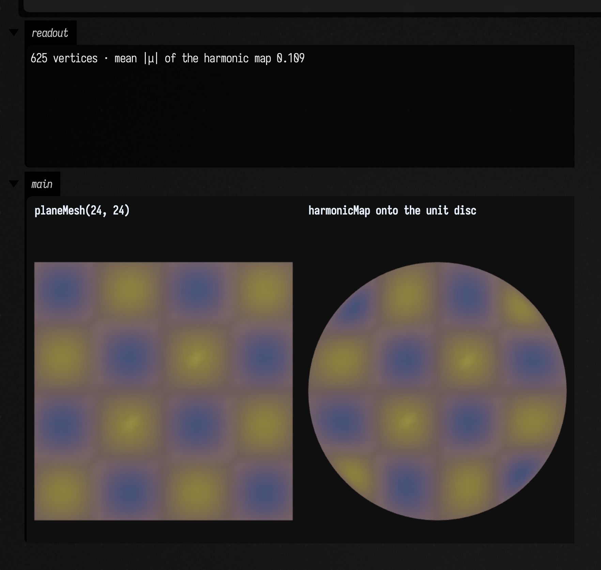

The square has 625 vertices. A square cannot go onto a disc conformally, because its corners have
to open out from 90° to 180°, so even the harmonic map has a mean |μ| of 0.109. The checks near the
corners are the most squeezed.

## No conformal map exists

<figure class="field-margin-figure" markdown>

</figure>

Fix the edges and move a point, and no map can keep every angle. The μ = 0 request gives the
harmonic map. Its distortion piles up around the dragged point, and where |μ| passes 1 triangles
turn over: the map folds. So ask a better question: of all maps that move the point there, which
has the smallest worst ellipse?

## Spread the distortion evenly

<figure class="field-margin-figure" markdown>
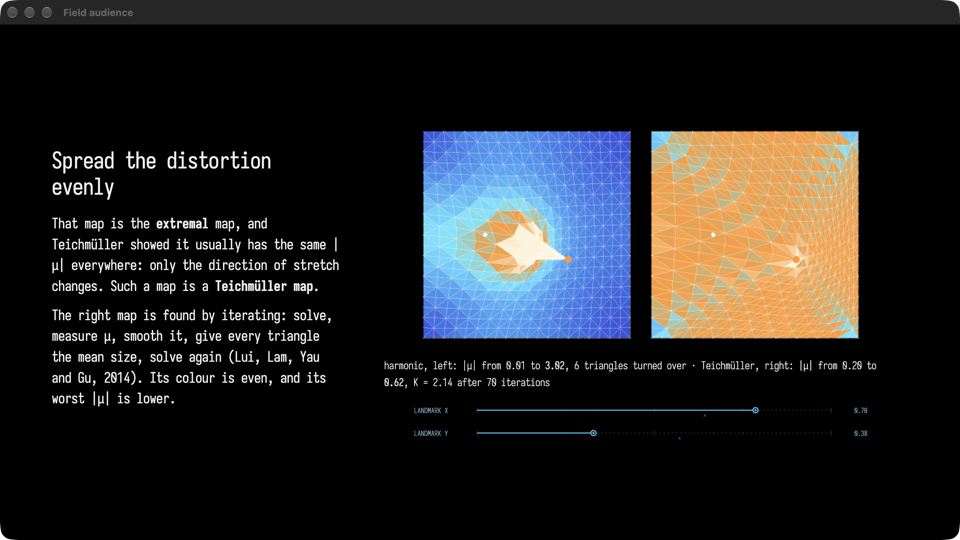
</figure>

That map is the **extremal** map, and Teichmüller showed it usually has the same |μ| everywhere:
only the direction of stretch changes. Such a map is a **Teichmüller map**. The right-hand map is
found by the quasi-conformal iteration of Lui, Lam, Yau and Gu: solve, measure μ, smooth it, give
every triangle the mean size, solve again. Its colour is even, and its worst |μ| is far lower than
the harmonic map's. The movie carries the point round a circle and solves both maps again on every
frame.

```diffstatic_runner {data-lang=kotlin video="assets/explainer_teichmuller/landmark_drag.mp4" capture="box" open-outputs="true" wait-output="true" wait-output-kind="display" execution="launch" duration="10" fps="15" timeout="300" w="700" embed=true name="explainer-teichmuller-landmark-drag-video" alt="Two squares of triangles side by side as the point in the middle is carried round a circle: on the left the harmonic map piles orange distortion round the point, on the right the Teichmüller map stays one even colour"}
:::fold imports
import afield.geometry.conformal.*
import afield.media.image.util.PngEncoder
:::endfold

// The middle of a square carried round a circle, its edges held. Every frame solves both maps
// again: the harmonic map on the left, the Teichmüller map on the right, coloured by |μ|.
val mesh = PlanarMesh.grid(16)
val solver = LinearBeltramiSolver(mesh)
val pinned = mesh.nearest(0.5, 0.5)

fun draw(seconds: Double) {
    val angle = 2 * PI * seconds / 8
    val toX = 0.5 + 0.22 * cos(angle)
    val toY = 0.5 + 0.22 * sin(angle)
    val fixed = mesh.boundaryIdentity() + (pinned to doubleArrayOf(toX, toY))
    val harmonic = harmonicMap(mesh, fixed, solver)
    val teich = teichmullerMap(mesh, fixed, iterations = 60, solver = solver)
    val picture = MeshPicture(640, 320, -0.05, -0.05, 2.15, 1.05)
    for ((offset, m) in [0.0 to harmonic, 1.1 to teich]) {
        val shifted = DoubleArray(mesh.vertexCount) { m.u[it] + offset }
        picture.mesh(mesh, shifted, m.v, IntArray(mesh.triangleCount) { MeshPicture.distortionColor(m.moduli[it], 0.5) })
        picture.dot(toX + offset, toY, 5.0, 0xFFFF9933.toInt())
    }
    display("maps", PngEncoder.encode(picture.pixels, 640, 320))
    markdown("readout", "harmonic: largest |μ| **${harmonic.maxModulus.f2}** · Teichmüller: |μ| from ${teich.minModulus.f2} to **${teich.maxModulus.f2}**")
}

val start = AnimationClock.nowSeconds()
loop { draw(AnimationClock.nowSeconds() - start) }
```

## A distance between shapes

<figure class="field-margin-figure" markdown>
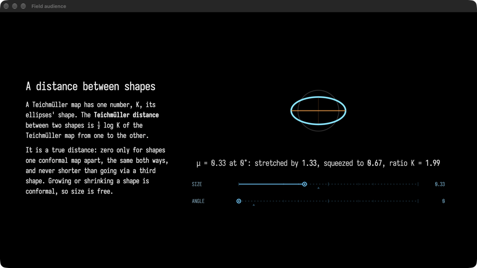
</figure>

A Teichmüller map has one number, K, its ellipses' shape. The **Teichmüller distance** between two
shapes is ½ log K of the Teichmüller map from one to the other. It is a true distance: zero only
for shapes one conformal map apart, the same both ways, and never longer than going via a third
shape. Growing or shrinking a shape is conformal, so size costs nothing.

## Two leaves

<figure class="field-margin-figure" markdown>
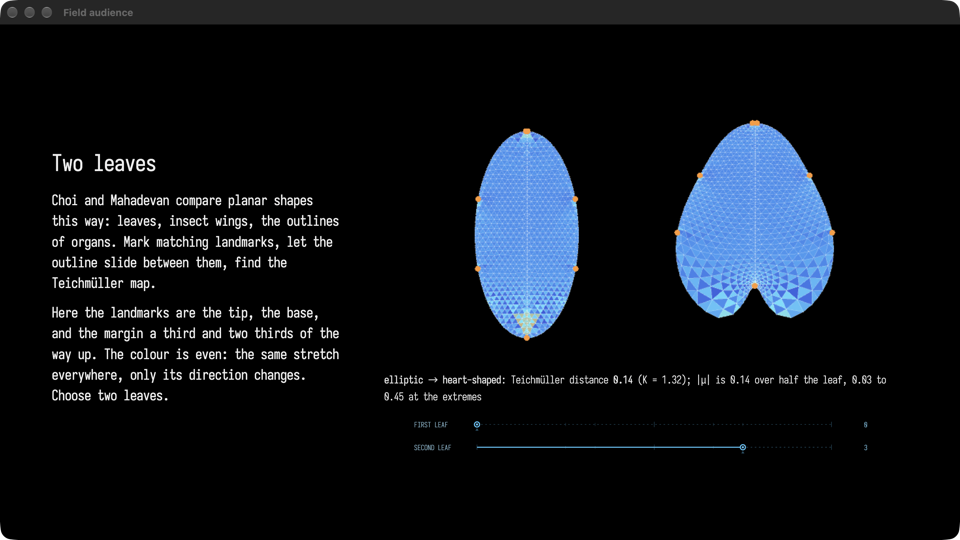
</figure>

Choi and Mahadevan compare planar shapes this way: leaves, insect wings, the outlines of organs.
Mark matching landmarks, let the outline slide between them, and find the Teichmüller map. Here the
landmarks are the tip, the base, and the margin a third and two thirds of the way up.

These leaves are mirror-symmetric, which lets us find the map exactly. The best map is symmetric too,
so it carries the midrib to the midrib, and each half-leaf, with its base, two margin landmarks and
tip, is a four-cornered region. Any such region maps conformally onto exactly one shape of
rectangle, and between two rectangles with their corners matched the least distorting map is a
plain stretch. So the Teichmüller map runs from one half-leaf onto its rectangle, stretches, and
comes back from the other rectangle; its |μ| is the same everywhere, and the distance is
½ |log(H₂ ÷ H₁)| of the two rectangles' heights.

```diffstatic_runner {data-lang=kotlin screenshot="assets/explainer_teichmuller/leaf_compare.png" execution="launch" wait-output=true wait="3" timeout="300" embed=true name="explainer-teichmuller-leaf-compare" alt="An elliptic leaf on the left and a heart-shaped leaf on the right, each meshed in triangles of one even blue, six orange landmarks on each, with a readout giving the Teichmüller distance 0.14"}
:::fold imports
import afield.geometry.conformal.*
import afield.media.image.util.PngEncoder
:::endfold

// Two leaf outlines and the Teichmüller map from the first to the second. Six landmarks
// match: tip, base, and the margin a third and two thirds of the way up on each side. The
// outline between landmarks is free to slide. Colour is |μ| of the map: the distortion field.
val names = ["elliptic", "lanceolate", "ovate", "heart-shaped", "round"]

// Each leaf as a distance from its middle in every direction; the tip points up.
fun oval(a: Double, b: Double, t: Double) = a * b / sqrt((b * cos(t)).pow(2) + (a * sin(t)).pow(2))
fun leaf(kind: Int): (Double) -> Double = { t ->
    when (kind) {
        0 -> oval(0.5, 1.0, t)
        1 -> oval(0.27, 1.0, t) * (1 + 0.15 * max(0.0, sin(t)).pow(6))
        2 -> oval(0.62 * (1 - 0.22 * sin(t)), 0.95, t)
        3 -> oval(0.75 * (1 - 0.15 * sin(t)), 0.9, t) * (1 + 0.2 * max(0.0, sin(t)).pow(8)) *
            (1 - 0.45 * exp(-(1 + sin(t)) / 0.024)) // the notch at the base, the same however t wraps
        else -> oval(0.85, 0.95, t)
    }
}

var first = 0
var second = 3

fun draw() {
    // The map is mirror-symmetric, so it is computed on the right halves and drawn twice.
    val c = MirrorShapeComparison(leaf(first), leaf(second))
    val mesh = c.half
    val picture = MeshPicture(640, 360, -2.2, -1.24, 2.2, 1.24)
    val colours = IntArray(mesh.triangleCount) { MeshPicture.distortionColor(c.map.moduli[it], 0.6) }
    for (side in [1.0, -1.0]) {
        picture.mesh(mesh, DoubleArray(mesh.vertexCount) { side * mesh.x[it] - 1.1 }, mesh.y, colours, edgeAlpha = 0.25)
        picture.mesh(mesh, DoubleArray(mesh.vertexCount) { side * c.map.u[it] + 1.1 }, c.map.v, colours, edgeAlpha = 0.25)
        for (k in 0 until 4) {
            picture.dot(side * mesh.x[c.landmarks[k]] - 1.1, mesh.y[c.landmarks[k]], 4.0, 0xFFFF9933.toInt())
            picture.dot(side * c.targetLandmarks[k][0] + 1.1, c.targetLandmarks[k][1], 4.0, 0xFFFF9933.toInt())
        }
    }
    display("leaves", PngEncoder.encode(picture.pixels, 640, 360))
    markdown(
        "readout",
        "**${names[first]} → ${names[second]}**: Teichmüller distance **${c.distance.f2}** (K = ${exp(2 * c.distance).f2}); " +
            "|μ| is ${c.map.medianModulus.f2} over half the leaf, ${c.map.minModulus.f2} to ${c.map.maxModulus.f2} at the extremes",
    )
}

draw()
controlGroup {
    slider("first leaf", 0.0, 4.0, step = 1.0, initialValue = 0.0) {
        first = it.toInt()
        draw()
    }
    slider("second leaf", 0.0, 4.0, step = 1.0, initialValue = 3.0) {
        second = it.toInt()
        draw()
    }
}
```

## A table of distances

<figure class="field-margin-figure" markdown>
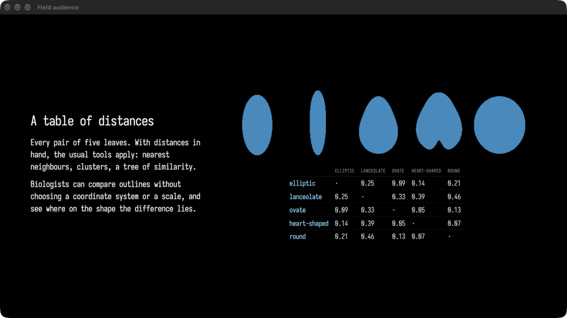
</figure>

With distances in hand the usual tools apply: nearest neighbours, clusters, a tree of similarity.
The figure compares every pair of five leaves. The distances obey the triangle inequality, and the
narrow lanceolate leaf is far from every broad one.

```diffstatic_runner {data-lang=kotlin screenshot="assets/explainer_teichmuller/leaf_distances.png" execution="launch" wait-output=true wait="5" timeout="300" embed=true name="explainer-teichmuller-leaf-distances" alt="Five blue leaf silhouettes in a row, elliptic, lanceolate, ovate, heart-shaped and round, above a table of the Teichmüller distance between each pair"}
:::fold imports
import afield.geometry.conformal.*
import afield.media.image.util.PngEncoder
:::endfold

// Every pair of five leaves, compared by Teichmüller distance with the same six landmarks.
// A shape scaled up is the same shape: scaling is conformal, so it costs nothing.
val names = ["elliptic", "lanceolate", "ovate", "heart-shaped", "round"]
fun oval(a: Double, b: Double, t: Double) = a * b / sqrt((b * cos(t)).pow(2) + (a * sin(t)).pow(2))
fun leaf(kind: Int): (Double) -> Double = { t ->
    when (kind) {
        0 -> oval(0.5, 1.0, t)
        1 -> oval(0.27, 1.0, t) * (1 + 0.15 * max(0.0, sin(t)).pow(6))
        2 -> oval(0.62 * (1 - 0.22 * sin(t)), 0.95, t)
        3 -> oval(0.75 * (1 - 0.15 * sin(t)), 0.9, t) * (1 + 0.2 * max(0.0, sin(t)).pow(8)) *
            (1 - 0.45 * exp(-(1 + sin(t)) / 0.024)) // the notch at the base, the same however t wraps
        else -> oval(0.85, 0.95, t)
    }
}

val d = Array(5) { DoubleArray(5) }
for (a in 0 until 5) for (b in a + 1 until 5) {
    d[a][b] = MirrorShapeComparison(leaf(a), leaf(b)).distance
    d[b][a] = d[a][b]
}

// The five leaves in a row, then the table of distances.
val picture = MeshPicture(640, 150, 0.0, -0.7, 6.0, 0.7)
for (k in 0 until 5) {
    val n = 200
    val r = leaf(k)
    val mesh = PlanarMesh.outline(
        DoubleArray(n) { 0.6 * r(2 * PI * it / n) * cos(2 * PI * it / n) + 0.6 + 1.2 * k },
        DoubleArray(n) { 0.6 * r(2 * PI * it / n) * sin(2 * PI * it / n) },
        0.04,
    )
    picture.mesh(mesh, colors = IntArray(mesh.triangleCount) { 0xFF2E8BBF.toInt() }, edgeAlpha = 0.0)
}
display("row", PngEncoder.encode(picture.pixels, 640, 150))
val table = StringBuilder("| | " + names.joinToString(" | ") + " |\n|---" + "|---".repeat(5) + "|\n")
for (a in 0 until 5) table.append("| **${names[a]}** | " + (0 until 5).joinToString(" | ") { if (it == a) "·" else d[a][it].f2 } + " |\n")
markdown("readout", table.toString())
```

## What this version leaves out

<figure class="field-margin-figure" markdown>
</figure>

- The exact construction needs mirror-symmetric shapes. Leaves that are not symmetric need the
  general sliding-boundary iteration, which this page does not have yet.
- With only four landmarks, tip, base and one pair, every symmetric leaf is at distance zero from
  every other: a symmetric four-cornered region always maps onto a square. The landmarks decide
  what the distance can see.
- Our outlines are formulas; real ones come from photographs.
- The same machinery works on point clouds without a mesh (Choi, Liu and Lui) and, with density in
  place of angle, gives density-equalizing maps (Choi and Rycroft).

## Further reading

<figure class="field-margin-figure" markdown>
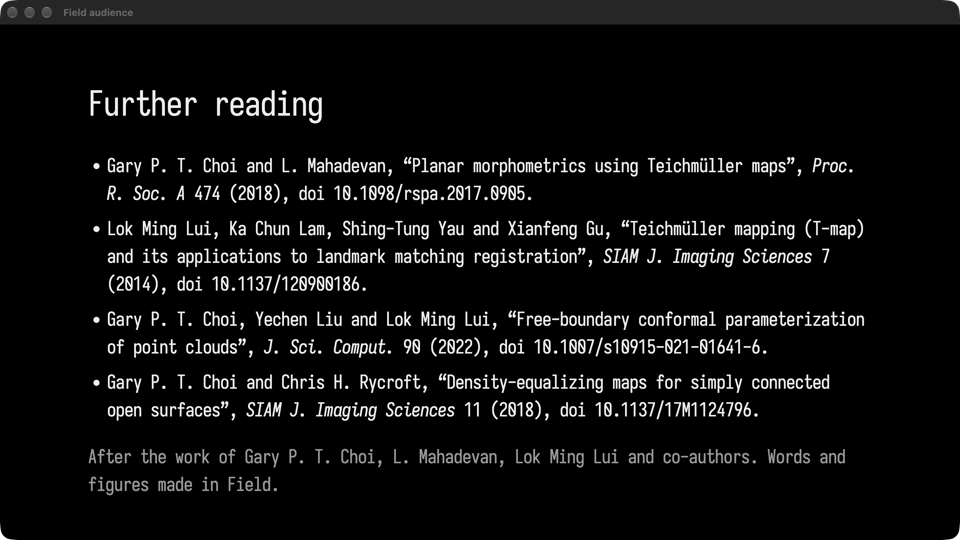
</figure>

- Gary P. T. Choi and L. Mahadevan, “Planar morphometrics using Teichmüller maps”, *Proc. R. Soc. A*
  474 (2018), [doi:10.1098/rspa.2017.0905](https://doi.org/10.1098/rspa.2017.0905).
- Lok Ming Lui, Ka Chun Lam, Shing-Tung Yau and Xianfeng Gu, “Teichmüller mapping (T-map) and its
  applications to landmark matching registration”, *SIAM J. Imaging Sciences* 7 (2014),
  [doi:10.1137/120900186](https://doi.org/10.1137/120900186).
- Gary P. T. Choi, Yechen Liu and Lok Ming Lui, “Free-boundary conformal parameterization of point
  clouds”, *J. Sci. Comput.* 90 (2022), [arXiv:2010.15399](https://arxiv.org/abs/2010.15399).
- Gary P. T. Choi and Chris H. Rycroft, “Density-equalizing maps for simply connected open surfaces”,
  *SIAM J. Imaging Sciences* 11 (2018), [doi:10.1137/17M1124796](https://doi.org/10.1137/17M1124796).

See also: [Sound](explainer_sound.md), [Cameras and Lenses](explainer_cameras.md) and
[Lights and Shadows](explainer_lights.md), the other talks in this series, and
[Presenting with Field](presentation_studio.md).

## Where to go next

- [Explainers](chains.md#explainers): all the talks.
- [Presenting with Field](presentation_studio.md): give this talk, or build your own.
- [Kirigami: cut patterns that open into a shape](kirigami.md): Choi's inverse kirigami design, the
  other half of `afield.geometry.conformal`, and [A Kirigami Sheet, Cut and Counted](chain_kirigami_solid.md),
  which turns its sheets into solids.
- [Spectral geometry](spectral_geometry.md): the cotangent Laplacian, which is the linear Beltrami
  solver's matrix when μ = 0.
