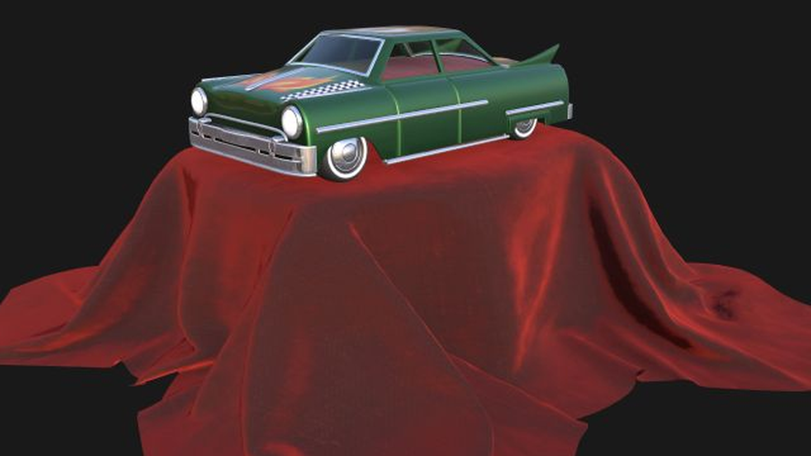
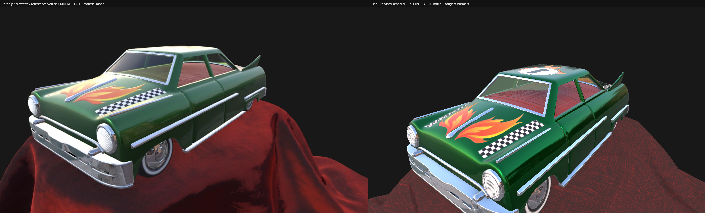

# Fabricate Renderer

[`StandardRenderer`](reference/renderers.md#standardrenderer-kt-standardrenderer) is the quick path into the fabricated renderer: a scene you have only registered geometry into comes back lit, shadowed and ambient-occluded by the stock setup, so the first picture you get is one you can judge. Metalness changes the material, shadows land where objects touch the ground, and ambient occlusion darkens contacts rather than adding noise. Tone mapping is the one thing you have to ask for — see [Tone Mapping and Bloom](#tone-mapping-and-bloom).

This page shows the renderer working. The [Renderers](reference/renderers.md) reference page is the other half of it: every public declaration in the fabricated package with the KDoc that sits beside it in the source, including the scene graph and pass machinery the examples below reach through, and the two renderers this page does not cover — the progressive path tracer and the Gaussian splat renderer.

Every example below is also a `FIELD_TEST`: if a picture here is wrong, the build says so.

The most demanding scene on the page is `assets/fabricate_demo/ToyCar.glb`, paired with the `venice_sunset_1k.exr` environment. ToyCar carries transmission, clearcoat, sheen, tangent-space normal maps, texture transforms, and multiple texture semantics — considerably more than a hand-built torus asks for. Venice Sunset drives the image-based-lighting path through `LoadedTexture.fromExrFile(...)`, which decodes EXR channels into RGBA32F, can build GGX-prefiltered radiance mips, and samples that mip chain by roughness.

??? aside "How the captures on this page are made"
    The docs runner drives `StandardRendererDocsHarness`: it builds `FabricateNode` and `FabricateMaterial`
    state, binds renderer meshes to node world transforms, asks `FabricateScenePlanner` for the draw and
    material queues, then attaches the `FabricateFrameGraph` for capture.

The common pattern is:

```diffstatic {data-lang=kotlin}
val bundle = StandardRenderer.build(renderer)

val material = FabricateMaterial(
    baseColor = Vector4f(0.83f, 0.58f, 0.28f, 1f),
    metallic = 0.18f,
    roughness = 0.36f
)

val node = bundle.sceneGraph.mesh(name = "torus", material = material) {
    transform.set(Matrix4f().translate(0f, -0.18f, 0f))
    renderable?.userData = "torus"
}

val mesh = bundle.registerTestTorus(name = "torus", slices = 64, stacks = 64, renderer = renderer)
mesh.bindNode(node)
mesh.applyFabricateMaterial(material)

val plan = bundle.applyScenePlan()
println(plan.opaque.map { it.node.name })
println(plan.materials.first())

bundle.attachTo(renderer)
bundle.present(renderer = renderer)
```

`StandardRenderer.Bundle` is the object to keep around. It owns the off-screen render targets, the modules that draw into them, the scene defaults, the scene graph, and the post stack. Most sketches should build one bundle, register geometry into it, attach its frame graph to a window, then present the post-stack output.

Use the high-level layer for:

- `bundle.sceneGraph`: hierarchy, transforms, animation samples, visibility, material intent, and glTF import.
- `bundle.registerCube(...)`, `registerSphere(...)`, `registerPullingMesh(...)`: geometry that should render through both the g-buffer and shadow pass.
- `bundle.registerTransparentPullingMesh(...)`: blended geometry that should draw after deferred lighting.
- `bundle.addLight(...)` + `bundle.syncLights()`: directional/point/spot lights; `bundle.showEnvironmentBackground()` draws the environment map as the backdrop.
- `bundle.postStack`, `bundle.addShaderEffect(...)`, `bundle.setToneMapping(...)`, `bundle.addBloom(...)`: fullscreen image effects, tone mapping, and bloom after opaque and transparent composition.

Drop down to raw `Module`, `Mesh`, `RenderToTexture`, or push constants when you need a shader or buffer layout that the bundle does not know about yet. The important part is to keep transform/material intent in the scene graph and let the planner classify it before the module maps are committed.

The current built-in frame graph is:

```diffstatic {data-lang=kotlin}
std-gbuffer
std-shadow
std-ao
std-lighting
std-transparency
std-motion-blur
std-aa
```

Inspect or edit that order before attaching it:

```diffstatic {data-lang=kotlin}
val graph = bundle.frameGraph()
println(graph.passNames())

// Insert custom utility passes around the named built-ins.
graph.insertBefore("my-pre-light-pass", FabricateFrameGraph.PASS_LIGHTING, myTarget)
graph.attachTo(renderer)
```

`bundle.attachTo(renderer)` is the convenience form for `bundle.frameGraph().attachTo(renderer)`. `bundle.present(...)` presents `bundle.postStack.output()`, so any effect you append after the stock stack becomes the final image automatically.

## Editing the Built-in Shaders

Fabricate's own passes are ordinary `Module`s carrying GLSL source, so they can be bound to boxes and edited/hot-reloaded exactly like a shader you write yourself. `bundle.bindShadersToBoxes()` creates one box per pass — g-buffer, shadow, AO, lighting, transparency, motion blur, FXAA, plus any post effects (tone map, bloom, your own) and textured g-buffer variants from glTF import. Each box shows the pass's `vertex`/`fragment` GLSL in editable tabs; `alt r` reloads it, `alt shift enter` does an ABI-preserving live pipeline swap.

```diffstatic {data-lang=kotlin}
val bundle = StandardRenderer.build(renderer)
bundle.setToneMapping(FabricateToneMap.ACES)
bundle.addBloom()

// Bind every built-in pass (and the post effects above) to editable boxes.
val boxes = bundle.bindShadersToBoxes()
println(boxes.keys) // std-gbuffer, std-shadow, std-ao, std-lighting, std-transparency, std-motion-blur, std-aa, std-post/bloom-composite, std-post/tonemap, ...

// Or hack on a single pass:
bundle.bindShaderToBox("std-lighting", bundle.lightingModule)
```

Reloads reuse the pass's existing `Parameters`, so the renderer's texture bindings, attachment formats, and push-constant seeding are preserved — only the GLSL changes. Edit the lighting fragment to try a different BRDF, or the FXAA pass to swap in a different AA, and the change is live on the next frame. `bundle.shaderModules()` returns the same `name → ModulePointer` map for programmatic access, and `bundle.shaderSources()` returns the raw `vertex`/`fragment` text for inspection without a session.

## Scene Graph and Transforms

Fabricate has a small scene layer on top of `afield.four`: nodes, local transforms, world transforms, render intent, animation samples, and draw-list ordering. The scene graph is pure Kotlin; renderer modules consume it through bound model matrices.

```diffstatic {data-lang=kotlin}
val bundle = StandardRenderer.build(renderer)
bundle.attachTo(renderer)

val parent = bundle.sceneGraph.node("pivot") {
    transform.position.set(0f, -0.2f, 0f)
}

val glass = bundle.sceneGraph.mesh(
    name = "glass",
    parent = parent,
    material = FabricateMaterial(Vector4f(0.45f, 0.70f, 1.0f, 0.35f)).transparent(0.35f)
) {
    transform.position.set(0.4f, 0f, -0.45f)
    transform.scale.set(0.7f, 0.7f, 0.7f)
}

bundle.sceneGraph.updateWorldTransforms()
val worldMatrix = Matrix4f(glass.worldMatrix)
```

Draw lists are computed from the same tree. Opaque items are sorted front-to-back, transparent items back-to-front, and shadow casters are separated:

```diffstatic {data-lang=kotlin}
val lists = bundle.sceneDrawLists()
println(lists.opaque.map { it.node.name })
println(lists.transparent.map { it.node.name })
println(lists.shadowCasters.map { it.node.name })
```

For moving transparent objects, call:

```diffstatic {data-lang=kotlin}
bundle.sceneGraph.advance(1f / 60f)
bundle.sortTransparentMeshes()
```

## Render Planning

The scene graph answers "what exists?" and the render plan answers "what order should it draw in?" `FabricateScenePlanner` walks the current scene, resolves material records into a compact table, and splits draw items into opaque, alpha-mask, transparent, and shadow-caster queues.

```diffstatic {data-lang=kotlin}
val planner = FabricateScenePlanner()
val plan = planner.plan(bundle.sceneGraph, cameraPosition = Vector3f(bundle.scene.camera.at))

println(plan.opaque.map { it.node.name })
println(plan.alphaMask.map { it.node.name })
println(plan.transparent.map { it.node.name }) // back-to-front
println(plan.materials.size)
```

The planner is pure Kotlin. It is useful in tests, docs harnesses, and future renderer adapters because it does not allocate Vulkan objects. A `FabricateRenderItem` carries the node, renderable, material id, queue, current world matrix, previous world matrix, and camera distance. A `FabricateMaterialRecord` is the CPU-side handoff shape for material buffers: base color, metalness, roughness, alpha mode, cutoff, double-sided state, and a texture mask placeholder.

Style rule: keep user intent on `FabricateMaterial` and `FabricateRenderable`; let the planner classify it. Prefer `FabricateAlphaMode.OPAQUE`, `.MASK`, and `.BLEND` over ad hoc booleans, and use `material.sortOrder` only when a stable override matters.

## Default Scene

The default scene is a plain one: three colored torii, the standard camera, and the stock lighting setup. If this image is wrong, the higher-level Fabricate examples are not worth trusting yet.

The scene is node/material creation plus mesh binding, and nothing else:

```diffstatic {data-lang=kotlin}
fun torusNode(name: String, x: Float, color: Vector4f) {
    val material = FabricateMaterial(baseColor = color)
    val node = bundle.sceneGraph.mesh(name = name, material = material) {
        transform.set(Matrix4f().translate(x, 0f, 0f))
        renderable?.userData = name
    }
    val mesh = bundle.registerTestTorus(name = name, slices = 48, stacks = 48, renderer = renderer)
    mesh.bindNode(node)
    mesh.applyFabricateMaterial(material)
}

torusNode("left", -0.95f, Vector4f(0.17f, 0.98f, 0.24f, 1f))
torusNode("middle", 0f, Vector4f(0.98f, 0.92f, 0.22f, 1f))
torusNode("right", 0.95f, Vector4f(0.98f, 0.30f, 0.32f, 1f))
```

<!--
FIELD_TEST
id: docs.fabricate.default-scene
runner: backdoor-box
graphicsContext: true
tags: [docs, fabricate, renderer, graphics, default]
timeoutSec: 120
execution: launch
waitSec: 15.0
expect:
  allowMissingOutput: true
  image:
    path: /tmp/docs-fabricate-default-native.png
    lumaComparisons:
      - darker: [0.02, 0.02, 0.12, 0.12]
        lighter: [0.28, 0.28, 0.44, 0.34]
        marginGt: 10
-->
```diffstatic_runner {data-lang=kotlin screenshot="assets/fabricate-default-scene.png" source-image="/tmp/docs-fabricate-default-native.png" wait="15.0" timeout="120" execution="launch" embed=true graphics-context=true name="fabricate-default-scene" hidden=true fabricate-scene="default-scene"}
```

## Shiny Torii on Checkerboard Planes

A compact "hero" scene: reflective torii over a checkerboard floor. This is a quick visual sanity check for specular highlights, floor contacts, and stable shading under denser geometry.

The checkerboard here is mesh-side: alternating tile geometry receives alternating `FabricateMaterial` values. The harness packs the two parities into pulling meshes for fewer draw items; conceptually, the scene logic is this:

```diffstatic {data-lang=kotlin}
bundle.scene.camera.at.set(0f, 0.78f, -3.75f)
bundle.scene.camera.target.set(0f, -0.25f, 0f)
bundle.scene.lightDirection.set(Vector3f(-0.55f, -1.0f, -0.20f).normalize())
bundle.scene.lightIntensity = 1.55f
bundle.scene.shadowStrength = 1f
bundle.scene.aoStrength = 1f

for (row in 0 until 10) {
    for (col in 0 until 10) {
        val light = (row + col) % 2 == 0
        val material = FabricateMaterial(
            baseColor = if (light) Vector4f(0.57f, 0.57f, 0.61f, 1f) else Vector4f(0.22f, 0.22f, 0.24f, 1f),
            roughness = 0.9f
        )
        val node = bundle.sceneGraph.mesh(name = "tile-$row-$col", material = material) {
            transform.set(
                Matrix4f()
                    .translate((col - 4.5f) * 0.52f, -1.0f, (row - 4.5f) * 0.52f)
                    .scale(0.26f, 0.02f, 0.26f)
            )
            renderable?.userData = "tile-$row-$col"
        }
        val tile = bundle.registerCube(name = "tile-$row-$col", size = 1f, renderer = renderer)
        tile.bindNode(node)
        tile.applyFabricateMaterial(material)
    }
}

val torusMaterial = FabricateMaterial(Vector4f(0.28f, 0.86f, 0.96f, 1f), metallic = 1.0f, roughness = 0.07f)
val torusNode = bundle.sceneGraph.mesh(name = "torus", material = torusMaterial) {
    transform.set(Matrix4f().translate(0f, -0.16f, 0f).rotateX(0.24f).rotateY(-0.25f))
    renderable?.userData = "torus"
}
val torus = bundle.registerTestTorus(name = "torus", slices = 72, stacks = 72, renderer = renderer)
torus.bindNode(torusNode)
torus.applyFabricateMaterial(torusMaterial)
```

<!--
FIELD_TEST
id: docs.fabricate.shiny-torii-checkerboard
runner: backdoor-box
graphicsContext: true
tags: [docs, fabricate, renderer, graphics, checkerboard, torus]
timeoutSec: 180
execution: launch
waitSec: 20.0
expect:
  allowMissingOutput: true
  image:
    path: /tmp/docs-fabricate-shiny-checkerboard-native.png
    lumaComparisons:
      - darker: [0.02, 0.72, 0.12, 0.10]
        lighter: [0.50, 0.30, 0.16, 0.16]
        marginGt: 8
-->
```diffstatic_runner {data-lang=kotlin screenshot="assets/fabricate-shiny-checkerboard.png" source-image="/tmp/docs-fabricate-shiny-checkerboard-native.png" wait="20.0" timeout="180" execution="launch" embed=true graphics-context=true name="fabricate-shiny-torii-checkerboard" hidden=true fabricate-scene="shiny-torii-checkerboard"}
```

## Two Camera Framings Over One Scene

This scene keeps geometry fixed and compares two camera framings over the same checkerboard setup to make near-versus-far depth layering obvious in a single capture.

Nothing changes between the two halves except `camera.at` and `camera.target`:

```diffstatic {data-lang=kotlin}
bundle.scene.camera.at.set(-1.55f, 0.72f, -1.75f)
bundle.scene.camera.target.set(-0.95f, -0.2f, 0.95f)
// capture the near framing

bundle.scene.camera.at.set(1.45f, 0.78f, -3.35f)
bundle.scene.camera.target.set(0.95f, -0.15f, -1.35f)
// capture the far framing
```

<!--
FIELD_TEST
id: docs.fabricate.camera-depth-study
runner: backdoor-box
graphicsContext: true
tags: [docs, fabricate, renderer, graphics, camera, depth]
timeoutSec: 180
execution: launch
waitSec: 25.0
expect:
  allowMissingOutput: true
  image:
    path: /tmp/docs-fabricate-camera-depth-study-native.png
    regionsDifferent:
      - a: [0.20, 0.28, 0.24, 0.40]
        b: [0.70, 0.28, 0.24, 0.40]
        meanAbsDiffGt: 8
-->
```diffstatic_runner {data-lang=kotlin screenshot="assets/fabricate-camera-depth-study.png" source-image="/tmp/docs-fabricate-camera-depth-study-native.png" wait="25.0" timeout="180" execution="launch" embed=true graphics-context=true name="fabricate-camera-depth-study" hidden=true fabricate-scene="camera-depth-study"}
```

## Shader-Generated Checkerboard

This variant keeps floor geometry to a single scaled cube and generates the checker tiles procedurally in the g-buffer fragment shader. It demonstrates a production-ready path where shader-side tiling replaces mesh-side tile splits.
Use shader-generated tiles when you want lower mesh/buffer overhead; use mesh-split tiles when you need per-tile transforms or per-tile material control.
The checker pattern is evaluated in world space, so model scaling directly affects tile density.

Limitations:
- No per-tile transforms or per-tile material edits (all tiles share one mesh/material state)
- World-space scale dependency for checker density
- Shader-only pattern can alias at grazing angles compared with textured/filtered approaches

The mesh is one scaled cube. Fabricate owns the transform/material intent; the checker controls are extra shader parameters on the g-buffer mesh:

```diffstatic {data-lang=kotlin}
val material = FabricateMaterial(
    baseColor = Vector4f(0.58f, 0.58f, 0.62f, 1f),
    roughness = 0.9f
)
val node = bundle.sceneGraph.mesh(name = "shader-floor", material = material) {
    transform.set(
        Matrix4f()
            .translate(0f, -1.0f, 0f)
            .scale(3.2f, 0.02f, 3.2f)
    )
    renderable?.userData = "shader-floor"
}
val floor = bundle.registerCube(name = "shader-floor", size = 1f, renderer = renderer)
floor.bindNode(node)
floor.applyFabricateMaterial(material)

floor.gBuffer.mesh.push["checkerScale"] = 3.0f
floor.gBuffer.mesh.push["checkerColor"] = Vector4f(0.20f, 0.20f, 0.22f, 1f)
floor.gBuffer.mesh.push["checkerMix"] = 1f

bundle.applyScenePlan()
```

<!--
FIELD_TEST
id: docs.fabricate.shader-generated-checkerboard
runner: backdoor-box
graphicsContext: true
tags: [docs, fabricate, renderer, graphics, checkerboard, shader]
timeoutSec: 180
execution: launch
waitSec: 20.0
expect:
  allowMissingOutput: true
  image:
    path: /tmp/docs-fabricate-shader-checkerboard-native.png
    regionsDifferent:
      - a: [0.54, 0.60, 0.025, 0.025]
        b: [0.60, 0.60, 0.025, 0.025]
        # These regions cover neighboring tiles. Which one is brighter can
        # change with checker phase and lighting, so assert contrast without
        # assigning a fixed light/dark direction.
        meanAbsDiffGt: 8
-->
```diffstatic_runner {data-lang=kotlin screenshot="assets/fabricate-shader-generated-checkerboard.png" source-image="/tmp/docs-fabricate-shader-checkerboard-native.png" wait="20.0" timeout="180" execution="launch" embed=true graphics-context=true name="fabricate-shader-generated-checkerboard" hidden=true fabricate-scene="shader-generated-checkerboard"}
```

## Blended Transparency

Transparent meshes render after the deferred lighting pass. Fabricate copies the lit opaque scene into `transparentComposite`, then draws transparent pulling meshes with alpha blending while sampling opaque g-buffer depth to discard hidden fragments.

The scene graph supplies the ordering; the transparency pass supplies the blending:

```diffstatic {data-lang=kotlin}
val node = bundle.sceneGraph.mesh(
    name = "near-glass",
    material = FabricateMaterial(Vector4f(1.0f, 0.78f, 0.38f, 0.38f)).transparent(0.38f)
) {
    transform.set(Matrix4f().translate(0.42f, -0.28f, -0.38f).scale(0.66f))
    renderable?.userData = "near-glass"
}

val glass = bundle.registerTransparentPullingMesh(
    name = "near-glass",
    maxVertices = 32 * 32 * 6,
    renderer = renderer
)

StandardShapes.sphere(
    positions = glass.position,
    normals = glass.normal,
    radius = 1f,
    slices = 32,
    stacks = 32,
    config = StandardShapes.WriteConfig(append = false)
).also { glass.setVertexCount(it.writtenVertices) }

glass.bindModel { Matrix4f(node.worldMatrix) }
glass.applyFabricateMaterial(node.renderable!!.material)

bundle.sceneGraph.updateWorldTransforms()
bundle.sortTransparentMeshes()
bundle.present(renderer = renderer)
```

<!--
FIELD_TEST
id: docs.fabricate.blended-transparency
runner: backdoor-box
graphicsContext: true
tags: [docs, fabricate, renderer, graphics, transparency]
timeoutSec: 180
execution: launch
waitSec: 25.0
expect:
  allowMissingOutput: true
  image:
    path: /tmp/docs-fabricate-blended-transparency-native.png
    regionsDifferent:
      - a: [0.26, 0.28, 0.22, 0.32]
        b: [0.58, 0.28, 0.22, 0.32]
        meanAbsDiffGt: 5
-->
```diffstatic_runner {data-lang=kotlin screenshot="assets/fabricate-blended-transparency.png" source-image="/tmp/docs-fabricate-blended-transparency-native.png" wait="25.0" timeout="180" execution="launch" embed=true graphics-context=true name="fabricate-blended-transparency" hidden=true fabricate-scene="blended-transparency"}
```

## Lights and Skybox

The scene graph carries a Three.js-style light list: one shadow-casting directional key light, plus point and spot lights up to `bundle.maxLights`, which is 64, all evaluated in the deferred lighting pass. It can also draw the loaded environment map as the scene background instead of a flat colour.

Lights are pure scene state; `bundle.syncLights()` uploads them to the lighting pass (call it after changing lights, or once per frame if they move — the same explicit-sync idiom as `sortTransparentMeshes()`). The first shadow-casting directional light becomes the key light that drives the shadow map, or the first directional light of any kind if none of them cast shadows; every other light is shaded without shadows, and `syncLights()` takes only the first `maxLights` of them. `bundle.showEnvironmentBackground()` turns the equirect environment into the backdrop.

```diffstatic {data-lang=kotlin}
val bundle = StandardRenderer.build(
    renderer,
    StandardRenderer.Config(environmentTexture = environment, environmentStrength = 0.85f)
)

// Environment as backdrop (Three.js scene.background = envMap).
bundle.showEnvironmentBackground(true)

// One shadowed key light + coloured point lights that pool on the floor.
bundle.addLight(FabricateLight.directional(Vector3f(-0.4f, -1f, -0.3f), intensity = 1.7f, castShadow = true))
bundle.addLight(FabricateLight.point(Vector3f(-1.7f, 0.15f, -1.2f), color = Vector3f(1f, 0.22f, 0.25f), intensity = 10f, range = 5.5f))
bundle.addLight(FabricateLight.point(Vector3f(1.7f, 0.1f, -1.0f), color = Vector3f(0.25f, 0.5f, 1f), intensity = 10f, range = 5.5f))
bundle.addLight(FabricateLight.spot(Vector3f(0f, 2f, 0f), Vector3f(0f, -1f, 0f), intensity = 12f, range = 8f))
bundle.syncLights()
```

Point lights use inverse-square falloff clamped by `range`; spot lights add an inner/outer cone. Metals show these as sharp coloured highlights (they have no diffuse term); dielectrics such as the checkerboard floor catch the coloured pools.

<!--
FIELD_TEST
id: docs.fabricate.multi-light-skybox
runner: backdoor-box
graphicsContext: true
tags: [docs, fabricate, renderer, graphics, lights, skybox]
timeoutSec: 240
execution: launch
waitSec: 30.0
expect:
  allowMissingOutput: true
  image:
    path: /tmp/docs-fabricate-multi-light-native.png
    regionsDifferent:
      - a: [0.14, 0.60, 0.20, 0.30]
        b: [0.66, 0.60, 0.20, 0.30]
        meanAbsDiffGt: 6
-->
```diffstatic_runner {data-lang=kotlin screenshot="assets/fabricate-multi-light-skybox.png" source-image="/tmp/docs-fabricate-multi-light-native.png" wait="30.0" timeout="240" execution="launch" embed=true graphics-context=true name="fabricate-multi-light-skybox" hidden=true fabricate-scene="multi-light-skybox"}
```

## Post Stack

The post stack is Fabricate's small EffectComposer equivalent. It starts with the transparent composite and, by default, runs motion blur then FXAA:

```diffstatic {data-lang=kotlin}
println(bundle.postStack.names()) // [motion-blur, aa]
println(bundle.postStack.output()) // the texture bundle.present(...) will use
```

Append a fullscreen shader effect with `addShaderEffect`. The fragment shader receives the previous stack output as `sourceTex`; the new pass becomes the stack output.

```diffstatic {data-lang=kotlin}
bundle.addShaderEffect("vignette-warmth", """
    #version 450
    layout(location = 0) in vec2 vUv;
    layout(set = 0, binding = 0) uniform sampler2D sourceTex;
    layout(location = 0) out vec4 outColor;

    void main() {
        vec4 c = texture(sourceTex, vUv);
        vec2 p = vUv * 2.0 - 1.0;
        float vignette = 1.0 - smoothstep(0.18, 1.05, dot(p, p));
        vec3 warm = c.rgb * vec3(1.18, 1.04, 0.84);
        vec3 lifted = pow(max(warm, vec3(0.0)), vec3(0.88));
        vec3 graded = mix(c.rgb, lifted, 0.72) * mix(0.38, 1.22, vignette);
        outColor = vec4(graded, c.a);
    }
""".trimIndent(), renderer = renderer)

bundle.present(renderer = renderer)
```

<!--
FIELD_TEST
id: docs.fabricate.post-stack-vignette
runner: backdoor-box
graphicsContext: true
tags: [docs, fabricate, renderer, graphics, post, effects]
timeoutSec: 180
execution: launch
waitSec: 25.0
expect:
  allowMissingOutput: true
  image:
    path: /tmp/docs-fabricate-post-stack-native.png
    lumaComparisons:
      - darker: [0.02, 0.02, 0.10, 0.10]
        lighter: [0.42, 0.28, 0.18, 0.18]
        marginGt: 6
-->
```diffstatic_runner {data-lang=kotlin screenshot="assets/fabricate-post-stack-vignette.png" source-image="/tmp/docs-fabricate-post-stack-native.png" wait="25.0" timeout="180" execution="launch" embed=true graphics-context=true name="fabricate-post-stack-vignette" hidden=true fabricate-scene="post-stack-vignette"}
```

## Tone Mapping and Bloom

Deferred lighting runs in HDR, so raw output clips bright highlights to white. Tone mapping maps HDR into a displayable range, and bloom bleeds the brightest regions into a soft glow — the two effects most responsible for a scene reading as "correct" rather than washed out.

`bundle.setToneMapping(...)` appends a tone-map pass that always runs last (options: `NONE`, `REINHARD`, `FILMIC`, `ACES`, `AGX`, plus an `exposure` multiplier). `bundle.addBloom(...)` inserts a bright-pass, separable blur, and additive composite ahead of the tone-map pass, so bloom accumulates on HDR values before they are compressed. Both modify the post stack, so re-attach the frame graph afterwards.

```diffstatic {data-lang=kotlin}
bundle.addBloom(threshold = 1.0f, intensity = 0.85f, radius = 3.2f)
bundle.setToneMapping(FabricateToneMap.ACES, exposure = 1.0f)
bundle.attachTo(renderer)
bundle.present(renderer = renderer)
```

The comparison below is the same strongly-lit scene captured twice: raw HDR on the left (highlights blow out to flat white), bloom + ACES on the right (highlights roll off and glow).

<!--
FIELD_TEST
id: docs.fabricate.tonemap-bloom
runner: backdoor-box
graphicsContext: true
tags: [docs, fabricate, renderer, graphics, post, tonemap, bloom]
timeoutSec: 240
execution: launch
waitSec: 30.0
expect:
  allowMissingOutput: true
  image:
    path: /tmp/docs-fabricate-tonemap-bloom-native.png
    regionsDifferent:
      - a: [0.05, 0.20, 0.40, 0.55]
        b: [0.55, 0.20, 0.40, 0.55]
        meanAbsDiffGt: 5
-->
```diffstatic_runner {data-lang=kotlin screenshot="assets/fabricate-tonemap-bloom.png" source-image="/tmp/docs-fabricate-tonemap-bloom-native.png" wait="30.0" timeout="240" execution="launch" embed=true graphics-context=true name="fabricate-tonemap-bloom" hidden=true fabricate-scene="tonemap-bloom"}
```

## GLTF Loading and Animation

The GLTF path uses the existing Assimp-backed loader, then imports mesh instances into the Fabricate scene graph. Opaque meshes go to the g-buffer/shadow pair. Alpha materials go to the blended transparency pass.

This page uses the Khronos ToyCar sample as the pressure test. The loader sees three mesh/material buckets, 77k vertices, 326k indices, and texture slots for base/diffuse, normal, emissive, packed occlusion/roughness/metalness, and clearcoat inputs. The current `StandardRenderer` material bridge consumes base-color textures, UVs, glTF tangent frames, alpha/transmission classification, metalness, roughness, tangent-space normal maps, packed metal/roughness maps, occlusion, emissive maps, clearcoat factors/maps, shadows, AO, and equirectangular image-based lighting from float EXR environments with GGX-prefiltered radiance mips. The headlamp lens ridges are a useful canary here: they disappear if the normal map is sampled without the model's tangent basis. Texture transforms, physical transmission/refraction, sheen, BRDF LUT integration, cubemap PMREM, and clearcoat roughness/normal texture variants are the remaining distance to a convincing three.js-style PBR scene.

The visual target is Don McCurdy's glTF Viewer with the same ToyCar model and Venice Sunset environment. Use it as the reference for exposure, contrast, fabric detail, and material readability. Its useful baseline settings are:

- Environment: Venice Sunset EXR
- Environment processing: Three.js `PMREMGenerator.fromEquirectangular(...)`
- Tone mapping: Linear
- Exposure: `0`
- Punctual lights: on
- Ambient intensity: `0.3`
- Direct intensity: `0.8 * PI`
- Background: `#191919`



The grime and surface variation are in the GLB's own texture maps; neither viewer adds procedural dirt. `StandardRendererDocsHarness` renders the ToyCar capture at the reference's 50-degree field of view, from the same flatter near-roofline vantage. Framing is therefore not one of the differences left to read between the captures.



```diffstatic {data-lang=kotlin}
// A repository-relative path, because this page's asset ships with the docs and the capture runs
// from the repository root. In a document of your own, name the asset and let Field resolve it:
//     val toyCarPath = "ToyCar.glb".absolutePath
// which looks inside the document folder first and the workspace project second. See
// "Where Field looks for a file" under Working in a Document.
val toyCarPath = File("public/docs/assets/fabricate_demo/ToyCar.glb").absolutePath
val loaded = bundle.registerGltf(
    path = toyCarPath,
    namePrefix = "robot",
    renderer = renderer
)

// The imported nodes carry bind-pose transforms and any sampled TRS animation.
bundle.sceneGraph.updateWorldTransforms(time = 0f)

// Advance sampled node animation and keep transparent draw order current.
loaded.animate(time = 1.25f)
bundle.sortTransparentMeshes()

println("opaque meshes: ${loaded.opaqueMeshes.size}")
println("transparent meshes: ${loaded.transparentMeshes.size}")
```

<!--
FIELD_TEST
id: docs.fabricate.toy-car-gltf
runner: backdoor-box
graphicsContext: true
tags: [docs, fabricate, renderer, graphics, gltf, pbr]
timeoutSec: 240
execution: launch
waitSec: 30.0
expect:
  allowMissingOutput: true
  image:
    path: /tmp/docs-fabricate-toy-car-native.png
    lumaComparisons:
      - darker: [0.03, 0.03, 0.12, 0.12]
        lighter: [0.36, 0.34, 0.28, 0.24]
        marginGt: 6
-->
```diffstatic_runner {data-lang=kotlin screenshot="assets/fabricate-toy-car-gltf.png" source-image="/tmp/docs-fabricate-toy-car-native.png" wait="30.0" timeout="240" execution="launch" embed=true graphics-context=true name="fabricate-toy-car-gltf" hidden=true fabricate-scene="toy-car-gltf"}
// Scene + camera live in StandardRendererDocsHarness.renderToyCarGltf.
// Camera lowered to a flatter, near-roofline vantage to match the three.js reference.
```

You can override material classification on import:

```diffstatic {data-lang=kotlin}
val model = GltfSupport.loadGltfBasic(toyCarPath)
bundle.sceneGraph.importGltf(model, namePrefix = "ghost") { mesh ->
    FabricateMaterial.fromGltf(mesh.material).transparent(0.42f)
}
```

For tooling that wants only the pure scene representation, `FabricateGltfBridge.fromModel(model)` returns a `FabricateScene` without registering renderer meshes. Use `bundle.registerGltf(...)` when you want GPU draw resources and `FabricateGltfBridge` when you want to inspect or plan imported nodes first.

The environment asset is already local. Load the EXR directly when the environment should participate in roughness-aware IBL. Ask the texture loader for prefiltered radiance mips so glossy materials can sample lower LODs as roughness rises. The PNG companion is a debug/preview fallback.

```diffstatic {data-lang=kotlin}
// Again a docs-repository path. In a document of your own, drop the EXR into the document folder
// and ask for it by name: "venice_sunset_1k.exr".absolutePath.
val veniceExr = File("public/docs/assets/fabricate_demo/venice_sunset_1k.exr").absolutePath

val environment = LoadedTexture.fromExrFile(
    veniceExr,
    renderer,
    requestedMipLevels = 0,
    prefilterEnvironment = true
).also {
    it.setDefaultSampler()
    it.transferNow()
}

val bundle = StandardRenderer.build(
    renderer,
    StandardRenderer.Config(
        environmentTexture = environment,
        environmentStrength = 1.35f,
        environmentRotation = 0.42f,
        // Linear renderer input for a #191919-style sRGB background.
        backgroundColor = Vector3f(0.0093f, 0.0093f, 0.0093f)
    )
)
```

## Metalness

The two torii use the same base color and roughness. The left one is dielectric; the right one is metallic. Keeping the geometry fixed makes the material response visible.

`baseColor` and `roughness` stay fixed; only `metallic` changes:

```diffstatic {data-lang=kotlin}
left.gBuffer.mesh.push["baseColor"] = Vector4f(0.78f, 0.80f, 0.84f, 1f)
left.gBuffer.mesh.push["metallic"] = 0.0f
left.gBuffer.mesh.push["roughness"] = 0.16f

right.gBuffer.mesh.push["baseColor"] = Vector4f(0.78f, 0.80f, 0.84f, 1f)
right.gBuffer.mesh.push["metallic"] = 1.0f
right.gBuffer.mesh.push["roughness"] = 0.16f
```

<!--
FIELD_TEST
id: docs.fabricate.metalness
runner: backdoor-box
graphicsContext: true
tags: [docs, fabricate, renderer, graphics, metalness]
timeoutSec: 120
execution: launch
waitSec: 15.0
expect:
  allowMissingOutput: true
  image:
    path: /tmp/docs-fabricate-metalness-native.png
    regionsDifferent:
      - a: [0.16, 0.22, 0.24, 0.46]
        b: [0.60, 0.22, 0.24, 0.46]
        meanAbsDiffGt: 10
-->
```diffstatic_runner {data-lang=kotlin screenshot="assets/fabricate-metalness.png" source-image="/tmp/docs-fabricate-metalness-native.png" wait="15.0" timeout="120" execution="launch" embed=true graphics-context=true name="fabricate-metalness" hidden=true fabricate-scene="metalness"}
```

## Shadows

The left side disables shadowing. The right side uses the default shadowed scene. Look for the contact shadow under the object, not for a dramatic lighting change.

The comparison is a single scene captured twice:

```diffstatic {data-lang=kotlin}
bundle.scene.aoStrength = 0f
bundle.scene.ambientColor.set(0.015f, 0.015f, 0.018f)
bundle.scene.lightIntensity = 1.35f

bundle.scene.shadowStrength = 0f
// capture the unshadowed scene

bundle.scene.shadowStrength = 1f
// capture the shadowed scene
```

<!--
FIELD_TEST
id: docs.fabricate.shadows
runner: backdoor-box
graphicsContext: true
tags: [docs, fabricate, renderer, graphics, shadows]
timeoutSec: 180
execution: launch
waitSec: 30.0
expect:
  allowMissingOutput: true
  image:
    path: /tmp/docs-fabricate-shadow-native.png
    lumaComparisons:
      - darker: [0.74, 0.48, 0.12, 0.12]
        lighter: [0.75, 0.63, 0.12, 0.10]
        marginGt: 18
-->
```diffstatic_runner {data-lang=kotlin screenshot="assets/fabricate-shadows.png" source-image="/tmp/docs-fabricate-shadow-native.png" wait="30.0" timeout="180" execution="launch" embed=true graphics-context=true name="fabricate-shadows" hidden=true fabricate-scene="shadows"}
```

## Ambient Occlusion

The left side disables ambient occlusion; the right side turns it on. Both show the same cluster of matte spheres resting together on the floor. AO only modulates the ambient term here (direct light is never occluded), so its effect is clearest in the contact valleys between touching spheres — where the surfaces are starved of direct light and lit mostly by ambient. Turning AO on drops those seams from a soft grey to a firm dark crease.

AO is also just a scene parameter in this harness:

```diffstatic {data-lang=kotlin}
val originalAoStrength = bundle.scene.aoStrength

bundle.scene.aoStrength = 0f
// capture the AO-off scene

bundle.scene.aoStrength = originalAoStrength
// capture the AO-on scene
```

<!--
FIELD_TEST
id: docs.fabricate.ambient-occlusion
runner: backdoor-box
graphicsContext: true
tags: [docs, fabricate, renderer, graphics, ao]
timeoutSec: 180
execution: launch
waitSec: 30.0
expect:
  allowMissingOutput: true
  image:
    path: /tmp/docs-fabricate-ao-native.png
    lumaComparisons:
      # Same contact valley between two front spheres, sampled in each half: the
      # right/AO-on copy (x=0.70) sits ~12 luma below the left/AO-off copy (x=0.20).
      - darker: [0.70, 0.62, 0.03, 0.05]
        lighter: [0.20, 0.62, 0.03, 0.05]
        marginGt: 7
-->
```diffstatic_runner {data-lang=kotlin screenshot="assets/fabricate-ao.png" source-image="/tmp/docs-fabricate-ao-native.png" wait="30.0" timeout="180" execution="launch" embed=true graphics-context=true name="fabricate-ao" hidden=true fabricate-scene="ambient-occlusion"}
```
