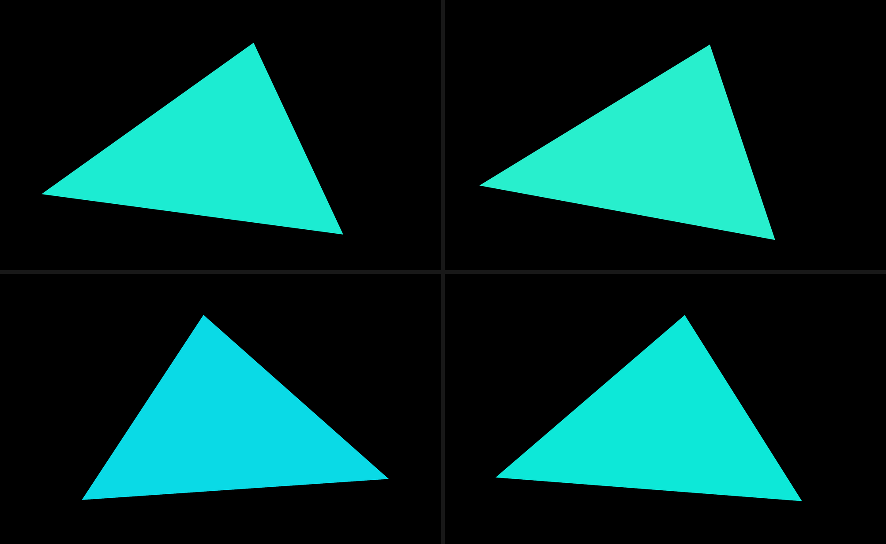
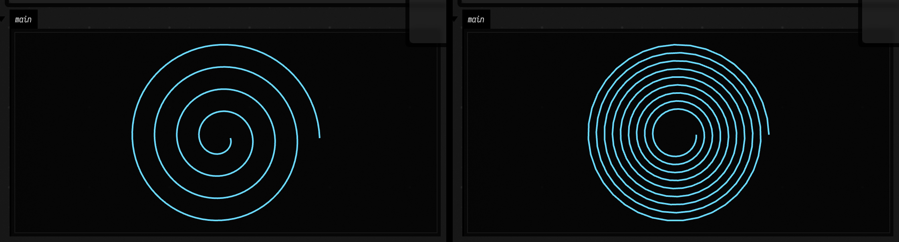
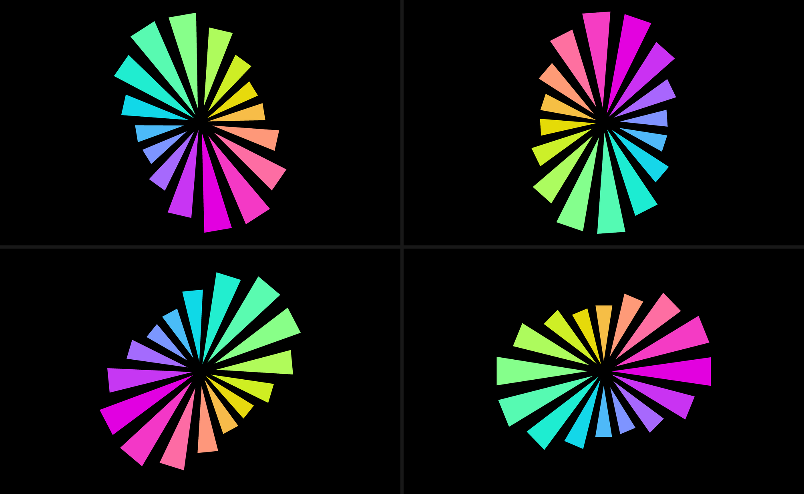

# FieldML's JVM bridge

FieldML is a small language with a large host. The prelude covers geometry — `fline`, `vec3`, `draw`, `animate` — but Field itself is thousands of Kotlin functions, and the bridge is how a FieldML box reaches them. This page is that bridge: what it can do, what it refuses, and where it stops short.

The short version: **a FieldML box can call a Kotlin method with any number of arguments, positionally or by name, pass a FieldML function where Kotlin wants a lambda — including a `suspend` one — get a real type back on both sides of that lambda, and reach Field's box-code *macros*: `prop`, `moduleHere`, `println` and the rest, which are rewrites over Kotlin source.** The measurement in `FieldMLHostSurfaceCoverageTest` puts the first part at 344 of the 362 public methods of `FLine`, `Img`, the three linalg vectors and Field's two imaging extension files — 95%. The second part is 21 of the 23 callback argument slots across the same types — 91.3%: a lambda handed to a JVM method has its parameters typed from that method's signature, and the two that stay untyped are one erased generic and one nullable Kotlin parameter, both of which would be lies.

## One box, end to end

This box never leaves FieldML, and everything it draws comes out of Kotlin. A FieldML function of `(x, y)` is handed to `Img.generate`, which rasterises it; the result goes through Field's `colormap` extension and out through `showImg`. Between them those three steps use most of the bridge: three arguments, a Kotlin lambda parameter, a static member off a class handle, and an extension function called with the piped value as its receiver.

```diffstatic_runner {data-lang=fieldml screenshot="assets/fieldml_host_bridge/generated_field.png" wait="2.0" wait-output=true wait-output-kind=display wait-output-channel="main" capture="box" embed=true name="fieldml-host-bridge-field" w="760" h="560" alt="a 240 by 240 raster in the viridis colourmap: concentric rings around a bright yellow centre, the rings shading out through green to deep indigo and back to teal, each ring pinched into lobes above and below the centre"}
let Img = hostClass "afield.stdlib.Img"
let Imaging = hostClass "afield.stdlib.Imaging_fieldKt"

// The whole picture is this function. x and y are Ints; the result is one
// sample. Kotlin calls it once per pixel.
let sample x y =
  let u = (toFloat x - 120.0) / 120.0 in
  let v = (toFloat y - 120.0) / 120.0 in
  let r = sqrt (u * u + v * v) in
  sin (r * 11.0) * cos (u * 5.0) * exp (0.0 - r * 1.1) * 0.5 + 0.5

let picture =
  Img
    |> hostGet "Companion"
    |> hostCall "generate" (240, 240, sample)
    |> hostExt Imaging "colormap" ("viridis", hostNull, hostNull)

hostStaticCall "showImg" (thisBox, picture, "main", 480, "Img.generate, driven by a FieldML function") Imaging
```

Change `11.0` in `sin (r * 11.0)` and the ring spacing changes; change `"viridis"` to `"magma"` or `"coolwarm"` and the palette does. Both are ordinary edits to a FieldML box that re-run the Kotlin rasteriser.

The last two steps show the two shapes a Kotlin extension function can be called in. `colormap` is an extension on `Img`, so the piped picture is its receiver and `hostExt` reads well. `showImg` is an extension on `Box`, so its receiver is `thisBox` and the picture is an ordinary argument — which is `hostStaticCall`, with every parameter written out in order.

## Calling a method

`hostCall name arguments target` — the target last, so it sits at the end of a pipe.

```diffstatic {data-lang=fieldml}
let Img = hostClass "afield.stdlib.Img"
let img = hostNew (4, 4, 1, [0.0, 0.1, 0.2, 0.3, 0.4, 0.5, 0.6, 0.7, 0.8, 0.9, 1.0, 0.9, 0.8, 0.7, 0.6, 0.5]) Img

img |> hostCall "index" (1, 0, 0)
```

The arguments are a tuple, and a tuple is spread — so `(1, 0, 0)` is three arguments. A list written in place is spread the same way, `()` is no arguments at all, and anything else is one argument. That last rule is the only place to be careful: to pass a single *list* as one argument, use `hostCall1`, which never spreads.

| Form | Arguments |
| --- | --- |
| `hostCall "m" () t` | none |
| `hostCall0 "m" t` | none |
| `hostCall1 "m" x t` | exactly one, whatever `x` is |
| `hostCall "m" (a, b, c) t` | three |
| `hostCall "m" [a, b, c] t` | three |
| `hostCall1 "m" [a, b, c] t` | one, a list |

`hostNew arguments class` and `hostNew0 class` are the same for constructors. `hostStaticCall name arguments class` is the same for statics, and `hostExt class name arguments` is a static called with the piped value in front of the written arguments — which is what a Kotlin extension function compiles to, and most of Field's API is extension functions.

Overloads are resolved against the real reflected candidate set, scored per argument, so `hostStaticCall "max" (3, 7)` reaches `Math.max(int, int)` and `(3.5, 7.25)` reaches `Math.max(double, double)`. FieldML has one integer type and one float type, so a conversion happens on nearly every call: `Int` reaches `long`/`short`/`Number`, `Float` reaches `float` and `Double`, a FieldML list reaches a JVM array or a `vararg`, and `hostNull` reaches anything nullable — which is how an optional Kotlin parameter gets filled, since a reflective call cannot use Kotlin's defaults.

## Passing a function

A FieldML function handed to a parameter whose type is a functional interface becomes one. That covers a Kotlin lambda parameter (`(Int, Int) -> Float`), a receiver lambda (`Box.() -> Unit`, whose receiver arrives as the first argument), and the Java classics — `Runnable`, `Supplier`, `Comparator`.

```diffstatic {data-lang=fieldml}
fline
  |> moveTo 0.0 0.0
  |> lineTo 100.0 0.0
  |> lineTo 100.0 60.0
  |> hostCall1 "transform" (fun p ->
       vec3 (p.x) (p.y + 20.0 * sin (p.x / 25.0)) (p.z)
     )
```

**`p` is a `Vec3`, and nothing above says so.** `FLine.transform` takes a Kotlin `(Vec3) -> Vec3`, the type checker reads that signature off the receiver, and the lambda's parameters are bound to what the JVM is going to hand them — so `.x`, `.y` and `.z` are ordinary checked vector components, `p.xx` is an error before the box runs, and completion works inside the body. Six parameters get typed in `Img.generate(w, h) { x, y -> … }` plus `Img.mapIndexed { x, y, c, v -> … }`; `x` and `y` really are `Int`s, so `x + y` is integer arithmetic. A Kotlin *receiver* lambda (`BufferParameters.() -> Unit`) gets its receiver typed the same way, because the receiver is simply argument zero.

Two cases keep the old behaviour:

- **An erased generic.** `Collections.max(collection, Comparator<? super T>)` has no `T` at the use site, so `fun a b -> b - a` keeps ordinary inferred parameters. That is better than a type: `Host` would refuse the subtraction.
- **A nullable Kotlin parameter.** `FLine.byFiltering((Vec3?, Node) -> Boolean)` really is handed a null for the first node's predecessor, so that parameter stays open while the second — not nullable — is typed `Node`.

And one case where you still need `hostAs`: the receiver has to be known *where the call is written*. Inside `let warp line = line |> hostCall1 "transform" (fun p -> …)` there is no class to read, because `line` is just a function parameter. Written as part of a pipeline, it is typed.

A function taking no arguments (`Runnable`) is written `fun ignored -> …`.

## Types

This is the half that is easy to miss. Host values carry their real JVM class, and the type checker reflects on it *while it checks*:

```diffstatic {data-lang=fieldml}
let Img = hostClass "afield.stdlib.Img"
let img = hostNew (8, 4, 1, tabulate (fun i -> toFloat i / 32.0) 32) Img

// Int, inferred from Img.getWidth() — not Host, and no cast anywhere.
img.width * img.height + img.channels
```

So:

- `thisBox` is a `Box`, `fline` is an `FLine`, `hostClass "afield.stdlib.Img"` is a `Class`, and `hostGet "Companion"` on it is an `Img.Companion`;
- dot access on a host value reads a JVM member, so `img.width` is an `Int`;
- a member or an overload that does not exist is a **type error**, reported where the name was written, rather than a crash on the first run — misspell `hostGet "widht"` and the box says `Box has no member 'widht'` before it runs;
- completion offers the members of a typed receiver: inside `img |> hostGet "wi` the list is `width`, and it says `Int`.

### `Host` is the dynamic type, and it has a boundary

Reflection cannot always say. A generic erased to `Object`, an array, a `Map`, a nullable Kotlin return that may arrive as nothing at all — for all of these the answer stays the opaque `Host`, because naming a class the program can violate on its first run would be worse than saying nothing.

`Host` therefore unifies with other types, and satisfies the numeric, vector and equality constraints, so an erased result is usable without a cast. But it is bounded, and the bound is one sentence: **`Host` stands in for a value of unknown *class*, not of unknown *shape*.**

An `Object`-erased JVM value may well turn out to be a number, a string, a boolean, nothing at all, or another object — so `Host` unifies with all of those. It is never a FieldML *function* and never a FieldML *structure*, because the host-to-FieldML conversion cannot produce one. So these are type errors, and they say what to do instead:

```diffstatic {data-lang=text}
(hostInput |> hostGet "whatever") 42
  A Host cannot be used as (Int -> 'a): reflection could not type this
  value, so call it with hostCall1 "invoke" instead

hostInput |> hostGet "whatever" |> head
  A Host cannot be used as ['a]: reflection could not type this value,
  so convert it with hostAsList
```

Two host types whose classes are both *known* and unrelated do not unify either — `if true then img else fline` is `Img is not FLine (afield.stdlib.Img and afield.graphics.FLine are unrelated)`. Two where one is assignable from the other do, which is what lets a `Vector2f` reach a parameter declared as its read-only `Vector2fc` interface.

`hostAsList` is the way from an opaque host value to a FieldML list — it converts a JVM `List`, `Set`, array or `Map`, which is also how `Box.parents` becomes something a FieldML box can walk. The rest of the `hostAs…` family is for when a value needs to become a scalar:

```diffstatic {data-lang=fieldml}
let Collections = hostClass "java.util.Collections"

// Collections.max returns T, which erases to Object, so it stays Host.
hostStaticCall "max" ([5, 1, 9, 3], fun a b -> b - a) Collections
  |> hostAsInt
```

`hostAsInt`, `hostAsFloat`, `hostAsBool` and `hostAsString` read a scalar out; `hostAs "SomeClass"` is a checked cast to a class, and doubles as the way FieldML names one.

## Whether it gets the right answer

Reachability is not correctness. A bridge that chose the wrong overload, put an argument in the wrong slot, or lost precision converting a result would still report a high "callable" number — so the coverage measurement calls every method **twice**: once through the bridge, once through plain `Method.invoke` with argument values of exactly the right JVM types, and compares the results.

```diffstatic {data-lang=text}
callable now:         344 / 362 (95.0%)
reachable before:     166 / 362 (45.9%)
calls run both ways:  341
comparable:           324
agreed:               324 / 324 (100.0%)
no way to compare:    17    (a returned class with no value equality)
input-independent:    2     (FLine.getUid/getRev read a global counter)
```

The check has teeth. `Vector2f` declares both `void set(int, float)` and `Vector2f set(float, float)`, and a FieldML `(3.0, 4.0)` fits both; on an equal score the winner is whatever the JVM happens to list first, which sets the wrong component and returns nothing. Overload scoring therefore prefers the parameter of the same *kind* (floating point for a FieldML `Float`, integral for an `Int`) and charges most for the lossy direction, and the type checker and the runtime share that scoring so they cannot disagree about which method a call means.

## Reaching `afield.four`

`afield.four` is Field's Vulkan layer and the reason this bridge exists — the live workspaces are hundreds of Kotlin boxes driving it. FieldML expresses most of it; the accounting is more use than the headline.

Taking `threebox-2`, the minimal complete `afield.four` scene (a window, a compute shader over 100 000 particles, a draw pass), **18 of its 19 statements are expressible in FieldML**. Six run headlessly and are checked against the same call in Kotlin — including `defaultBuffer { size = N.vec4s }`, whose argument is a Kotlin *receiver* lambda and whose `vec4s` is a member extension property that only exists inside it, and the per-frame builders, because `Frames` is a plain object with no Vulkan in it. Everything downstream of a Vulkan device is expressible but untested here, because a headless test JVM has no device.

The one that is not expressible is the `import`, and that is not a limitation: FieldML names every class in full and has nothing for an import to do. Five of the eighteen are source macros, which are the next section.

## Source macros

Some of Field's most useful box-code names are not functions at all. `prop<Double>(speed)`, `moduleHere { }`, `computeModuleHere { }`, `println(x)` — these are **macros**: registered rewrites over Kotlin *source*, applied before the Kotlin compiler runs. `prop` throws if it is ever really called. FieldML is an interpreter — lex, parse, infer, evaluate — with no Kotlin compile anywhere in its path, so a macro that hands back generated Kotlin has nothing to compile it.

None is needed. Every macro that rewrites a **call** rewrites it to an ordinary `Box` extension function: `moduleHere` becomes `_moduleHere`, `println` becomes `_printlnHere`. And a macro's real work happens while it *expands* — `moduleHere` seeds this box's `vertex` and `fragment` properties, preprocesses both shaders and compiles them; `fieldStatsHere` builds the whole statistics block. So reaching such a macro is two steps, and a compiler is neither of them: run the expansion, then call what it rewrote to.

```diffstatic {data-lang=fieldml}
// `prop<Double>(swirl)` in a Kotlin box declares an inheritable slot. FieldML has
// no declarations, and does not need one -- the slot is made by writing it, and
// reading it is the same breadth-first walk up `parents` the generated delegate does.
let _ = setProp "swirl" 0.85
let swirl = prop "swirl" |> hostAsFloat

// Field's own `println` macro, expanded and then called. The 7 is the line number
// the Kotlin pass would have supplied.
let _ = hostMacro "println" "(x)" (7, "from a FieldML box")

// And when there is nothing to call, the generated Kotlin comes back as text.
(hostMacroExpand "prop" ("<Double>", "(speed)")).declarations
```

That last line is `var Box.speed by Inheritance<Double>()` plus its `Once` twin — the exact text a Kotlin box would have had compiled into its preamble.

Two shapes, because the macros come in two kinds:

| Name | For |
| --- | --- |
| `hostMacroExpand "name" args` | any registered macro. Runs the expansion against this box, side effects and all, and hands the rewrite back as a record: `.call`, `.here`, `.declarations`, `.preamble` |
| `hostMacro "name" args values` | the macros that rewrite a call. Expands, then calls the `Box` extension it rewrote to, with `values` as the arguments |
| `prop` `propOr` `setProp` `rootProp` `setRootProp` `once` | the macros that generate a *declaration*. No expansion involved: these read and write the same box slot the generated delegate would have |

A macro's arguments are **source text**, because that is what a macro consumes — `hostMacroExpand "prop" ("<Double>", "(speed)")` is the `prop<Double>(speed)` call site, one string per piece. `hostMacro` takes those *and* the values for the rewritten call, because only the first can be text in an interpreter. Those values can be a record, which makes it a named call: `_fieldStatsHere` declares a default for every one of its seven parameters, so naming one is the difference between changing one number and writing all seven.

The `prop` family is the one that changes what a document can look like. **A Kotlin box's `speed` and a FieldML box's `prop "speed"` are one property**: the same slot read through the same code, over a shared inheritance walk, rather than two implementations that agree. So a FieldML box can hold a live parameter that a Kotlin box downstream consumes, or read one a Kotlin box exports, and the property inspector sees either.

Of the 19 macros Field registers, **15 are reachable**. The four that are not all generate Kotlin *declarations* and nothing else — `sourceBlock` (a lambda whose body is your Kotlin), `jsonParser` (a generated class), `graphLens` (a property reference synthesised from a path) and `ai`. `hostMacroExpand` still hands their generated source back as text, which is as far as an interpreter goes.

Two things to know before you reach for this:

- **You do not get the macro's generated accessors.** `moduleHere`'s expansion also returns a preamble of typed Kotlin — `val Mesh.pos by FromInput()`, a `Structure` accessor per push-constant member, the `triangles` constant. A FieldML box gets none of that, and does not need it: every host value is typed `Host`, which is dynamic, so the same members come through `hostGet` and `hostCall`. That is the trade.
- **A FieldML integer is a JVM `Long`.** Writing one into a slot a Kotlin box declared as `prop<Int>` would change what is *in* the slot even though the Kotlin read still works, so `setProp` keeps the width that is already there. Nothing protects you from a value too large for the declared type; that truncates silently, as it would in Kotlin.

## Every frame

Field animates by handing Kotlin a `suspend` lambda: `eachFrame { … }`, `loop { … }`, `forever { … }`, `animate { … }` — and, underneath all of them, `Box.launchFrames`. Every one of those has a parameter typed `suspend Frames.() -> Unit`, which is the shape a FieldML closure has to fill in order to change anything after the first frame. Write the lambda the way the *source* reads, one parameter:

```diffstatic {data-lang=fieldml}
let Phased = hostClass "afield.PhasedKt"

// `f` is a Frames, typed off the JVM signature -- so `f.frameNumber` is checked
// here, not on the first frame.
let animation =
  hostStaticCall "eachFrame" (fun f -> f |> hostGet "frameNumber") Phased

// ...and run it on Field's Runloop, with this box as the owner: Stop on this box
// stops the animation, and re-running the box replaces it rather than stacking a
// second one.
thisBox |> hostExt Phased "launchFrames" (animation, "spin", "frames", true)
```

The `Continuation` in the compiled signature is not something you write. A `suspend Frames.() -> Unit` is really a `Function2` whose second parameter is a continuation and whose return is erased, and the bridge reads that shape, drops the continuation, and coerces your result to the type declared *inside* it — which is what makes `forever`'s `Boolean` actually stop the loop.

One thing this does not buy: your FieldML body cannot itself suspend. `Frames.frame()` and `Frames.delay()` are `suspend` members and stay out of reach, so `frames { }` — whose contract is that the body drives `frame()` — is not the one to reach for. `eachFrame`, `loop` and `forever` all keep the suspension in Kotlin and hand you a plain per-frame body, which is what you want anyway.



Those are four frames of the demo below, on a live Vulkan device.

## By name

Two things plain reflection cannot do, which turn out to be one thing: leave a Kotlin **default** unwritten, and pass an argument **by name**. `Renderer(Window, List)` is all `Class.getConstructors` will tell you, with no hint that the second parameter is called `additionalWindows` or that it defaults to `emptyList()`. Kotlin's own reflection has both, and naming the arguments is what makes the defaults reachable: a positional call has no way to say which parameter it is skipping.

Write a **record** where a tuple would go.

```diffstatic {data-lang=fieldml}
let Img = hostClass "afield.stdlib.Img"
let img = hostNew {width = 2, height = 2, channels = 3, data = [0.0, 0.0, 0.0, 0.0, 0.0, 0.0, 0.0, 0.0, 0.0, 0.0, 0.0, 0.0]} Img

// Img.index(x, y, c = 0) -- `c` is left to Kotlin, which is something no
// positional call can express. Order is not position, either.
(img |> hostCall "index" {x = 1, y = 0}, img |> hostCall "index" {c = 2, y = 0, x = 1})
```

The rule is the same at every call shape — `hostCall`, `hostStaticCall`, `hostExt`, `hostNew` — and it is the rule those names already had: a tuple spreads positionally, a list spreads positionally, `Unit` is no arguments, and now a record spreads by name. `hostCall1`, which never spreads, is still how you pass one of something.

| Written | Means |
| --- | --- |
| `hostNew (w, []) Renderer` | positional, every parameter spelled |
| `hostNew {mainWindow = w} Renderer` | named; `additionalWindows` is Kotlin's default |
| `img \|> hostExt Imaging "colormap" {name = "magma"}` | `lo` and `hi` are computed from the image, as the Kotlin default says |
| `hostCall1 "m" {a = 1} t` | one argument, which happens to be a record |

A name reflection does not know is a compile error where it is written, and it says what you gave it. Two overloads that both accept the names you gave are refused rather than guessed, with the candidates listed and a `?` on each parameter that has a default.

One thing to keep in mind: a lambda written *inside* a record does not get its parameter types, because expected types are threaded into lambdas written as positional arguments. When a callback is involved, the positional form is still the better one.

## What it still will not do

- **A lambda inside a named record has untyped parameters.** Expected types are threaded into a lambda written as a *positional* argument; a record is one argument with a lambda inside it. So keep reaching for the positional form when a callback is involved — `hostStaticCall "defaultBuffer" (hostNull, "inData", fun p -> …)` types `p`, the named spelling does not.
- **A record you got from the host is the same shape as a record of argument names.** A JVM `Map` comes back as a FieldML record, so passing one to `hostCall` *as one argument* needs `hostCall1`, which never spreads. Same rule as lists, same escape.
- **A callback written inside a helper has untyped parameters.** The expected type comes from the receiver, so `line |> hostCall1 "transform" (fun p -> …)` in a pipeline is typed and the same call inside `let warp line = …` is not — `line` is a function parameter and there is no class to reflect on. `hostAs "Vec3"` is still the way through that one. The same is true of anything whose type reflection genuinely cannot read: an erased generic, a nullable Kotlin parameter.
- **A lambda's *result* is not checked** against what the JVM wants. The proxy coerces it, which is why `fun x y -> 0` satisfies a `Function2<…, Float>` — but a body that returns the wrong shape entirely still fails at run time.
- **A `suspend` *member* cannot be called.** Satisfying a suspend function *type* works — see "Every frame" below — but going the other way does not. `Renderer.run` is `suspend`, which on the JVM means `run(Continuation)`, and there is no continuation to pass and nowhere to resume one. So the box that owns your window and renderer is still Kotlin.
- **Two overloads that differ only in how many parameters their lambda takes will tie.** `start` is declared over both `suspend Frames.() -> Unit` and `suspend () -> Unit`; the call works either way, but the callback's parameter goes untyped because nothing can say which one you meant. `eachFrame`, `loop` and `forever` are each declared once, so prefer those.
- **`internal` Kotlin members are unreachable** under their source names, because the compiler mangles them.
- **Buffers, kernels and anchors** — anything FieldML has no way to construct and no constructor to call — are still out of reach. In the coverage measurement those are most of the remaining 5%.

## Open it

There are six Field documents for this page. **If you only open one, open the macro demo** — it needs no GPU and nothing wired up.

`public/docs/assets/fieldml_macro_demo/metadata.edn` has four boxes: a `prop` written in one and inherited by another that draws a spiral from it, Field's own `println` macro expanded and called, and the generated Kotlin of `prop` and `sourceBlock` as readable text. Run the parameter box, run the drawing box, then change `swirl` or `turns` in the first and run both again.

[Open ↗](/offline.html?file=/field4/assets/fieldml_macro_demo/metadata.edn) — or open `public/docs/assets/fieldml_macro_demo/metadata.edn` from a Field workspace.



| In | Change | What happens |
| --- | --- | --- |
| the parameter box | `setProp "turns" 4` → `setProp "turns" 9` | re-run both boxes: nine turns instead of four. The drawing box is unchanged — it inherits the value |
| the parameter box | `setProp "swirl" 0.85` → `0.35` | a tighter spiral; the `swirl` scales the radius |
| the parameter box | run it twice | `firstRunAt` does not move. That is `once`: computed on the first read and stored |
| the parameter box | `propOr "neverWritten" "not set"` → `prop "neverWritten"` | an error naming the slot, because nothing up the graph has it. `propOr` is the read that does not fail |
| the println box | `(4, "…")` → `(12, "…")` | the output claims to come from line 12, and the gutter marker moves |
| the println box | `{line = 5}` → `{line = 5, a = "named"}` | the vararg named rather than omitted |
| the expansion box | `"prop"` → `"rootProp"` | the call site becomes `root.speed` instead of `speed` |
| the expansion box | `"sourceBlock"` → `"jsonParser"` | ...and an error: `jsonParser` wants a type argument and a schema string |
| the drawing box | disconnect it from the FieldML root | it silently becomes a **Kotlin** box, and reports Kotlin errors. Only the *direct* children of a FieldML root are FieldML, which is why it has two parents |

The next has five boxes: the raster above, a line warped by a FieldML lambda through `FLine.transform`, a box whose host member types are all inferred, one that exercises overload resolution, varargs and `hostNull`, and one that calls Kotlin by name and leaves its defaults alone.

[Open ↗](/offline.html?file=/field4/assets/fieldml_host_bridge_demo/metadata.edn) — or open `public/docs/assets/fieldml_host_bridge_demo/metadata.edn` from a Field workspace.

Things to change, in the order they are most likely to teach you something:

| In | Change | What happens |
| --- | --- | --- |
| the raster box | `sin (r * 11.0)` → `sin (r * 5.0)` | fewer, wider rings |
| the raster box | `"viridis"` → `"magma"` | the palette; anything in Field's `Colormaps` works |
| the raster box | `(240, 240, sample)` → `(96, 96, sample)` | a coarser raster, rendered faster |
| the warp box | `24.0` → `60.0` | a taller wave |
| the types box | `img.width` → `img.widht` | a type error, before the box runs |
| the types box | put the caret inside `hostGet ""` | completion lists `Img`'s members with their types |
| the named box | `{x = 1, y = 0}` → `{x = 1, yy = 0}` | a type error listing the names you gave, before the box runs |
| the named box | `{name = "magma"}` → `{name = "magma", lo = 0.0, hi = 0.5}` | the two defaults stop being computed from the image |

And a third, for a machine with a GPU: **a whole `afield.four` scene described from FieldML**, with no `hostAs` in it. One box walks up to a live `Renderer`, builds a shader module out of two GLSL strings through `parameters(renderer) { vertex = …; fragment = … }` — the receiver lambda whose `p` is now a typed `Parameters` — attaches a three-vertex mesh, and registers it with the render target. It needs a running Vulkan device, so it does nothing in an ordinary box; connect it to whichever box owns your renderer.

[Open ↗](/offline.html?file=/field4/assets/fieldml_afield_four_demo/metadata.edn) — or open `public/docs/assets/fieldml_afield_four_demo/metadata.edn` from a Field workspace.

And a fourth, the same scene with a `Frames` loop on it — **the triangle from the captures above**. This one is self-contained: three boxes, and the first is a small Kotlin box that opens the window and owns the `Renderer`, so there is nothing to wire up. Open it, run `window and renderer`, then run the FieldML box.

[Open ↗](/offline.html?file=/field4/assets/fieldml_frames_demo/metadata.edn) — or open `public/docs/assets/fieldml_frames_demo/metadata.edn` from a Field workspace.

| In | Change | What happens |
| --- | --- | --- |
| the FieldML box | `* 0.04` → `* 0.2` | it spins five times faster, and the colour cycles with it |
| the FieldML box | `spin |> hostCall "set" (t, 0.0, 0.0, 1.0)` → `(0.0, 0.0, 0.0, 1.0)` | it stops dead: the loop still runs, it just writes the same value |
| the FieldML box | `"eachFrame"` → `"loop"` | no visible difference — `loop` advances a frame only when the body did not |
| the FieldML box | `f |> hostGet "frameNumber"` → `f |> hostGet "frameNumbr"` | a type error naming `Frames`, before the box runs: the callback parameter has a type |
| the fragment shader | `vec3(0.0, 2.1, 4.2)` → `vec3(0.0, 0.0, 0.0)` | it cycles through greys instead of hues |

And one where the **macro builds the scene**: instead of hand-writing `parameters(renderer) { vertex = …; fragment = … }` and `Module(params)`, the box calls Field's `moduleHere` — so its GLSL lives in the box's own `vertex` and `fragment` properties, exactly where a Kotlin graphics box keeps it. Self-contained: run the Kotlin `window and renderer` box, then the scene box.

Then run the fourth box while it is spinning. It writes `spinRate` with `setRootProp`, and the scene reads that slot on *every frame* — so the speed of a running Vulkan scene changes from a different box, with the scene box untouched.

[Open ↗](/offline.html?file=/field4/assets/fieldml_macro_module_demo/metadata.edn) — or open `public/docs/assets/fieldml_macro_module_demo/metadata.edn` from a Field workspace.

| In | Change | What happens |
| --- | --- | --- |
| the live box | `setRootProp "spinRate" 0.30` → `0.02` | the triangle slows, immediately, without the scene box being run |
| the live box | run it twice | `framesDrawn` grows — that is the per-frame body reporting from inside the render loop |
| the scene box | `propOr "spinRate" 0.04` inside `eachFrame` → move it above the lambda | it becomes a constant: changing the live box does nothing |
| the scene box | edit the `fragment` string's `vec3(0.0, 2.1, 4.2)` | different hues, because `moduleHere` recompiles from the box's properties |
| the scene box | break the GLSL | the shader error is reported onto *this box*, which is the thing `moduleHere` gives you over hand-built parameters |

There is no picture of this one. What it reports instead is `builtBy = "_moduleHere"`, a 16-byte push-constant block, and 2550 frames drawn between two reads of the shared slot.

And another, the wall past the moving one: **a vertex shader with real inputs**, whose data FieldML recomputes every frame. Two `layout(location = …) in` variables, both written through `Mesh.write` — one call positional, one named, and the named one is the shape that omits `Mesh.write`'s `inside` default. Self-contained the same way the frames demo is.

[Open ↗](/offline.html?file=/field4/assets/fieldml_mesh_demo/metadata.edn) — or open `public/docs/assets/fieldml_mesh_demo/metadata.edn` from a Field workspace.



One more is about the lambda parameters specifically — a warp with no `hostAs` in it, a raster whose two callbacks have six typed parameters between them, a box of inferred types, and a box that says where the inference still declines to say anything.

[Open ↗](/offline.html?file=/field4/assets/fieldml_lambda_demo/metadata.edn) — or open `public/docs/assets/fieldml_lambda_demo/metadata.edn` from a Field workspace.

| In | Change | What happens |
| --- | --- | --- |
| the warp box | `p.x` → `p.xx` | a type error naming `Vec3`'s components, before the box runs |
| the warp box | `26.0` → `60.0` | a taller wave |
| the warp box | put the caret after `p.` inside the lambda | completion lists `Vec3`'s components — the callback parameter has a type |
| the raster box | `13.0` → `5.0` | fewer, wider rings |
| the raster box | `"magma"` → `"viridis"` | the palette |
| the limits box | delete `hostAs "Vec3"` from `scale` | a type error — that is the one case still on its own |

## Where to look

The reflection lives in `afield.ml.core.FieldMLHostBridge` (candidates, scoring, coercion, SAM proxies) and `afield.ml.type.FieldMLHostTypes` (JVM types to FieldML types, member and overload resolution at type-check time). `Inferencer.refineHostIntrinsic` is where the two meet, and `Inferencer.preInferHostSpine` is what threads a JVM parameter type into a lambda's parameters. The macro layer is `afield.ml.FieldMLMacroLayer` — expansion, the callee extraction, and the ledger of which macro is reachable how. `afield.stdlib.inheritedPropertyRaw` is the walk `prop` and Kotlin's `Inheritance` delegate share. The design notes, including why a sibling Kotlin compile was refused, are in `dev_docs/FIELDML_HOST_BRIDGE.md`.

??? aside "Which test holds which claim"
    `FieldMLHostBridgeTest` has one test per capability. `FieldMLHostSurfaceCoverageTest` is the
    reachability-and-agreement measurement. `FieldMLHostAgreementTest` holds the semantically interesting
    calls beside the Kotlin they should equal. `FieldMLLambdaExpectedTypeTest` covers the typed callback
    parameters and the cases that stay untyped. `FieldMLSuspendCallbackTest` is the per-frame
    surface — every test in it asserts that the closure *ran*, not that a proxy exists.
    `FieldMLAfieldFourReachTest` is the `threebox-2` survey with its citations, and `FieldMLSourceMacroTest`
    holds the macro ledger to the live contents of `afield.macros.MacroRegistry` in both directions.
