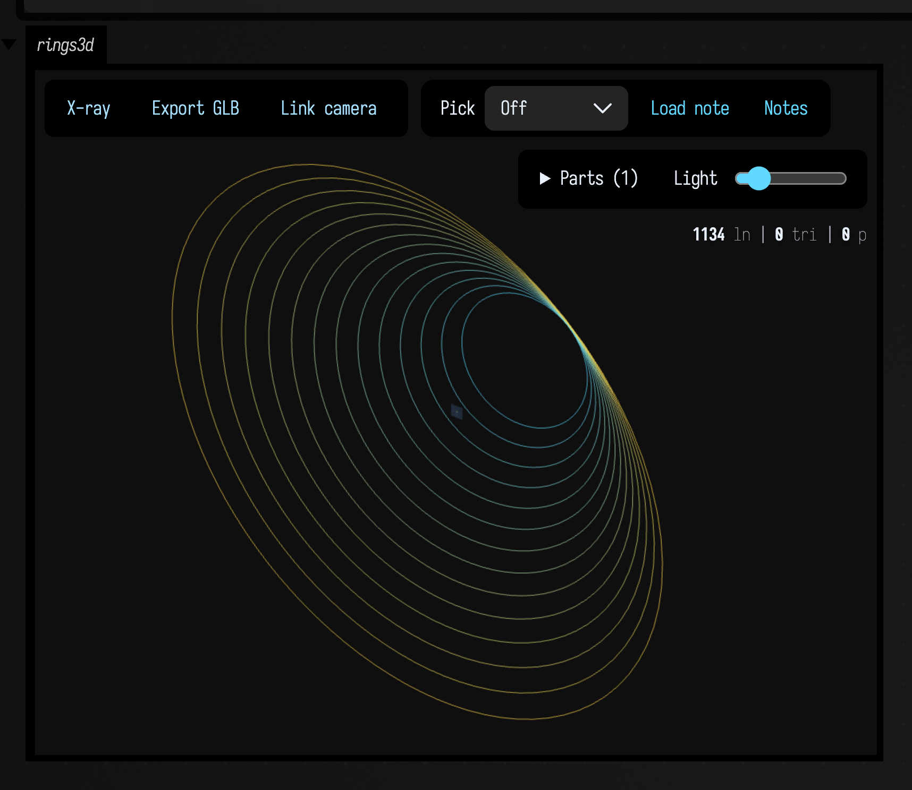
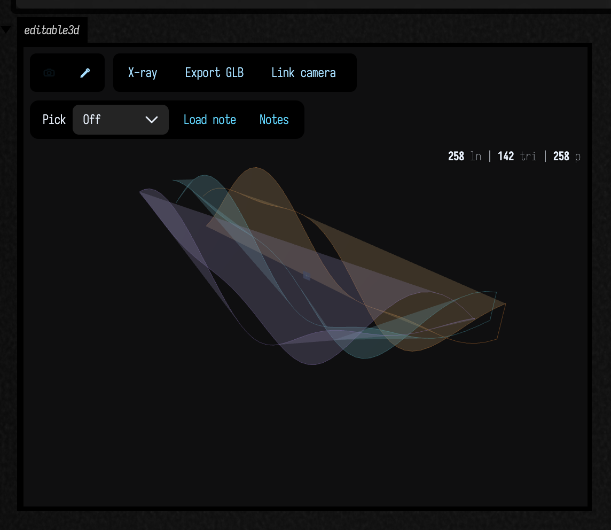
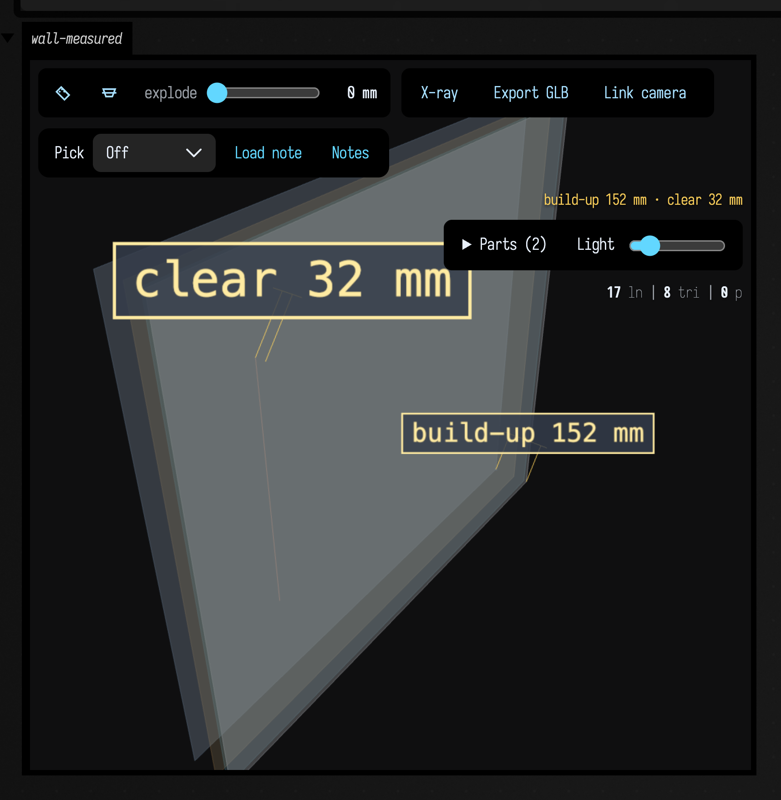
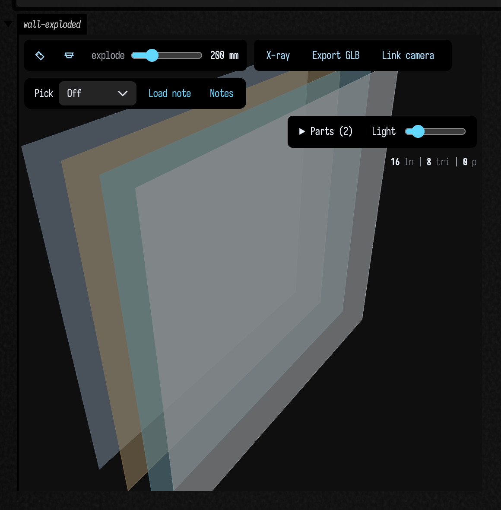
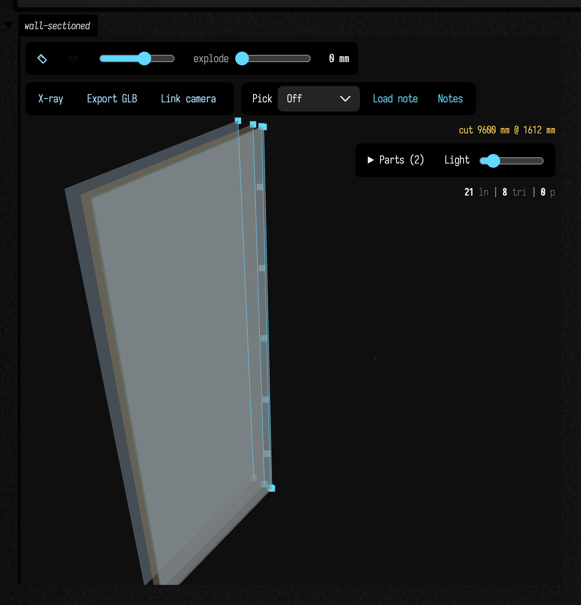
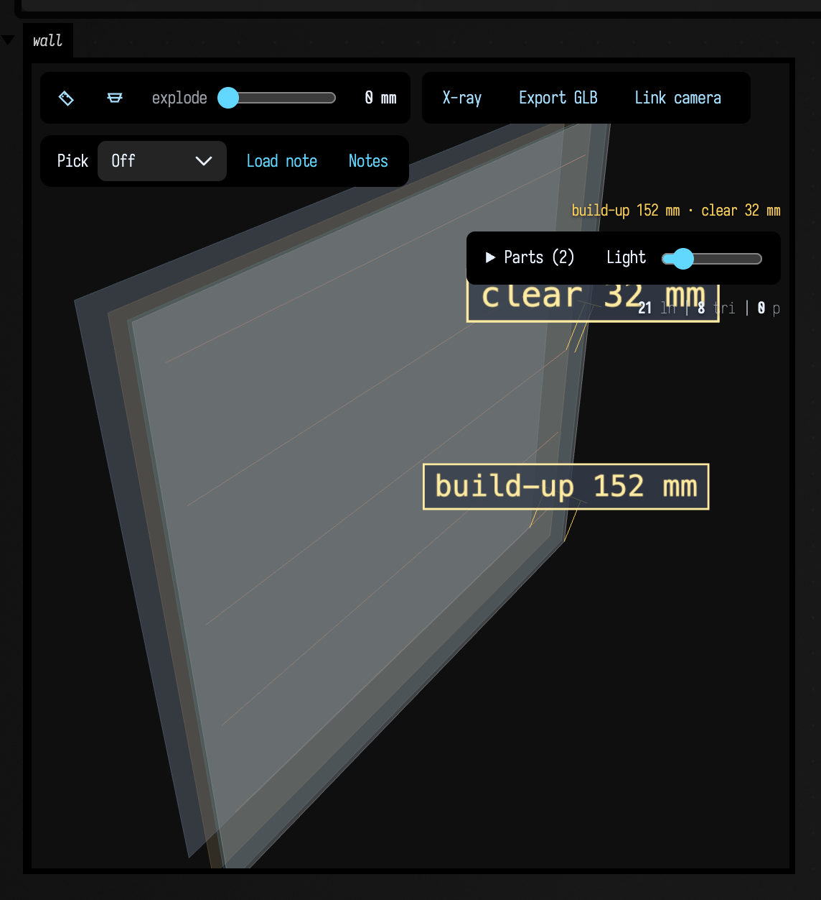

# FLine examples (Field graphics)

*Every public declaration used below is listed, with its KDoc, in the codebase reference: [`StandardDrawing.kt`](reference/graphics.md#standarddrawing-kt). Start from [what's already in the box](reference/index.md).*

`FLine` is Field’s core geometry container type: it’s basically an ordered list of drawing instructions (`moveTo`, `lineTo`, `cubicTo`, `close`) plus style properties (`color`, `thickness`, `filled`, `stroked`, `pointed`, and so on). This isn’t a new idea — it’s essentially a “path” like you’ll find in [SVG](https://en.wikipedia.org/wiki/Scalable_Vector_Graphics), [PDF](https://en.wikipedia.org/wiki/PDF), and [PostScript](https://en.wikipedia.org/wiki/PostScript). Unlike those formats, Field stores points in 3D when that makes sense.

All of the code below are meant to run inside a Box inside Field. Each snippet ends with a `lines(...)` so you can actually see what you've drawn.

If you want to run these examples, this embedded viewer's "Open in Field4" button will do just that, if you have Field already running.

<iframe
    src="/offline.html?file=/field4/assets/fline_examples/metadata.edn"
    title="FLine examples (offline viewer)"
    style="width:100%; height:720px; border:1px solid #444; border-radius:8px; background:#111;"
    loading="lazy"
    allowfullscreen>
</iframe>

## Some syntax, before we get started

In Field sketches you’ll often see `fline { ... }`. It’s a small helper around Kotlin’s `apply { ... }`: create an `FLine`, run setup code on it, and return the line. A comparison:

```diffstatic_runner {data-lang=kotlin screenshot="assets/some_syntax_before_we_get_started.png" embed=true}
:::static
// 1) Preferred in Field: build inside `fline { ... }`.
val f1 = fline {
    moveTo(20, 20)
    lineTo(120, 20)
    lineTo(120, 120)
    close()

    filled = true
    stroked = true
    thickness = 1.0
    color = vec(1.0, 1.0, 1.0, 0.25)
}

// 2) The explicit style: make a var and reuse it.
val f3 = FLine()
f3.moveTo(20, 20)
f3.lineTo(120, 20)
f3.lineTo(120, 120)
f3.close()
f3.filled = true
f3.stroked = true
f3.thickness = 1.0
f3.color = vec(1.0, 1.0, 1.0, 0.25)

// Show they really are the same geometry (offset so you can see them).
lines(listOf(f1 + vec(0, 0, 0), f3 + vec(180, 0, 0)), w = 320.0, h = 170.0, fitToSize = true)
```


## Seeing an `FLine`: static and editable viewers

There are now two main ways to inspect `FLine` geometry in Field:

- `lines(...)` renders an SVG-style 2D view in an output area.
- `threeLines(...)` renders the same geometry in the Three.js viewer.

Both now accept `editable = true`. With `editable = false` they are viewers. With `editable = true` they become lightweight editors for the underlying `FLine` data rather than just pictures of it.

### 2D output: `lines(...)`

```diffstatic {data-lang=kotlin}
:::static
fun Box.lines(
    vararg m: FLine,
    channel: String = "lines",
    w: Double = -1.0,
    h: Double = -1.0,
    fitToSize: Boolean = false,
    editable: Boolean = false
)
```

Use plain `lines(...)` when you want the usual fast 2D display. It is ideal for diagrams, plotted curves, path debugging, and anything that fundamentally lives in screen space.

```diffstatic_runner {data-lang=kotlin screenshot="assets/fline_examples/lines_static.png" embed=true}
:::static

val wave = fline {
    moveTo(40, 170)
    cubicTo(120, 40, 180, 40, 250, 170)
    cubicTo(320, 300, 380, 300, 460, 170)
    thickness = 2.0
    color = vec(0.98, 0.88, 0.28, 1.0)
}

val fill = fline {
    moveTo(40, 170)
    cubicTo(120, 40, 180, 40, 250, 170)
    cubicTo(320, 300, 380, 300, 460, 170)
    lineTo(460, 260)
    lineTo(40, 260)
    close()
    filled = true
    stroked = false
    color = vec(0.32, 0.82, 1.0, 0.18)
}

val nodes = wave.copy().apply {
    stroked = false
    pointed = true
    pointSize = 4.0
    color = vec(1.0, 0.5, 0.25, 1.0)
}

lines(listOf(fill, wave, nodes), w = 520.0, h = 320.0, fitToSize = true)
```

If you switch on `editable = true`, the same output becomes an editor. You can click points, edges, or filled regions, drag a selection, marquee-select, and press `e` to hide or reveal the edit UI.

```diffstatic_runner {data-lang=kotlin screenshot="assets/fline_examples/lines_editable.png" embed=true}
:::static

val petal = fline {
    moveTo(0, -120)
    cubicTo(90, -100, 140, -20, 0, 120)
    cubicTo(-140, -20, -90, -100, 0, -120)
    close()
    filled = true
    stroked = true
    thickness = 1.0
    color = vec(0.95, 0.42, 0.6, 0.34)
}

val stem = fline {
    moveTo(0, 120)
    cubicTo(10, 180, -20, 230, 0, 300)
    thickness = 1.0
    color = vec(0.45, 0.95, 0.62, 1.0)
}

lines(listOf(petal, stem), w = 420.0, h = 420.0, fitToSize = true, editable = true)
```

The important distinction is that this is not editing a copy of the SVG. It mutates the `FLine` you passed in, so it is useful as a geometry sketchpad, a control-shape editor, or a quick way to pull a hand-tuned curve back into your code.

### 3D output: `threeLines(...)`

```diffstatic {data-lang=kotlin}
:::static
fun Box.threeLines(
    lines: Collection<FLine>,
    channel: String = "debug",
    name: String = "threejs",
    height: Int = 420,
    samplesPerCubic: Int = 48,
    autoFrame: Boolean = true,
    editable: Boolean = false
): ThreeGeometryViewState
```

Use `threeLines(...)` when depth matters or when you want to orbit around the geometry instead of looking at a projected SVG. It is still very happy with ordinary 2D paths, but it also handles 3D points directly.

```diffstatic_runner {data-lang=kotlin screenshot="assets/fline_examples/three_lines_static.png" wait="1.0" capture="box" open-outputs="true" w="1200"}
:::static

val rings = (0 until 14).map { i ->
    val radius = 60.0 + i * 11.0
    val z = -90.0 + i * 14.0
    fline {
        val steps = 80
        for (s in 0..steps) {
            val t = s / steps.toDouble() * Math.PI * 2.0
            val p = vec(Math.cos(t) * radius, Math.sin(t) * radius, z)
            if (s == 0) moveTo(p) else lineTo(p)
        }
        close()
        color = vec(0.35 + i / 20.0, 0.85, 1.0 - i / 18.0, 0.7)
        thickness = 1.8
    }
}

threeLines(rings, channel = "rings3d", height = 430, editable = false)
```



If you pass `editable = true`, the Three.js viewer grows an edit mode alongside camera control. In camera mode you orbit as usual. In edit mode you can select and drag points, edges, and faces; press `e` to hide or reveal the edit chrome without leaving the view.

```diffstatic_runner {data-lang=kotlin screenshot="assets/fline_examples/three_lines_editable.png" wait="1.0" capture="box" open-outputs="true" w="1200"}
:::static

fun ribbon(z: Double, phase: Double, color: Vec4): FLine = fline {
    val steps = 42
    for (i in 0..steps) {
        val t = i / steps.toDouble()
        val x = -220.0 + t * 440.0
        val y = Math.sin(t * Math.PI * 2.0 + phase) * 70.0
        val edge = Math.cos(t * Math.PI * 4.0 + phase) * 24.0
        if (i == 0) moveTo(x, y - edge, z) else lineTo(x, y - edge, z)
    }
    for (i in steps downTo 0) {
        val t = i / steps.toDouble()
        val x = -220.0 + t * 440.0
        val y = Math.sin(t * Math.PI * 2.0 + phase) * 70.0
        val edge = Math.cos(t * Math.PI * 4.0 + phase) * 24.0
        lineTo(x, y + edge, z)
    }
    close()
    filled = true
    stroked = true
    thickness = 1.4
    this.color = color
}

val ribbons = listOf(
    ribbon(-50.0, 0.0, vec(1.0, 0.6, 0.24, 0.32)),
    ribbon(0.0, 0.8, vec(0.4, 0.92, 1.0, 0.28)),
    ribbon(55.0, 1.6, vec(0.72, 0.58, 1.0, 0.28))
)

threeLines(ribbons, channel = "editable3d", height = 430, editable = true)
```



That gives you a useful split of responsibilities:

- `lines(...)` for direct 2D inspection and editing.
- `threeLines(...)` for orbiting, spatial debugging, and editing geometry in depth.

The two viewers are deliberately close in spirit. If you learn one, the other should feel familiar rather than like a separate subsystem.

### The 3D output area as an instrument: `threeInspect(...)`

A 3D preview of something that gets *built* gets asked three questions that a picture cannot answer: **how far apart are these two things**, **what does this look like in section**, and **how does it come apart**. `threeInspect(...)` is `threeLines(...)` plus those three, and it returns a view you can keep driving rather than a viewer you have to re-run a box to change.

```diffstatic {data-lang=kotlin}
:::static
fun Box.threeInspect(
    lines: Collection<FLine>,
    channel: String = "debug",
    name: String = "inspector",
    height: Int = 520,
    samplesPerCubic: Int = 48,
    autoFrame: Boolean = true,
    groupBy: (FLine) -> String = { it.label ?: "" },
    explode: ThreeExplode = ThreeExplode(),
    section: ThreeSection = ThreeSection(),
    measurements: List<ThreeMeasurement> = emptyList(),
    units: String = "",
    decimals: Int = 2,
    pickToMeasure: Boolean = true
): ThreeInspectorView
```

`groupBy` decides what counts as one *part* of the assembly, and it defaults to the FLine's `label` — so a figure that already labels its pieces explodes sensibly with no extra work.

#### Measuring

A `ThreeMeasurement` is a dimension the figure carries from the moment it is drawn: two elements, and the **closest approach** between them — not centroid to centroid, which on a panel drawing is a different number and not the one you would take to a saw. The dimension is drawn in the scene with witness lines and a legible number, so it orbits with the figure.

You can also click the ruler in the viewer's toolbar and pick two elements yourself.

```diffstatic_runner {data-lang=kotlin screenshot="assets/fline_examples/three_inspect_measure.png" wait="3.0" capture="box" open-outputs="true" w="1200"}
:::static

// A wall detail in millimetres, plus a conduit run threaded through it.
fun skin(name: String, x: Double, c: Vec4) = fline {
    moveTo(x, 0.0, 0.0)
    lineTo(x, 1600.0, 0.0)
    lineTo(x, 1600.0, 1800.0)
    lineTo(x, 0.0, 1800.0)
    close()
    label = name
    filled = true
    stroked = true
    thickness = 1.4
    color = c
}

val wall = listOf(
    skin("sheathing", 0.0, vec(0.36, 0.46, 0.58, 0.5)),
    skin("studs", 90.0, vec(0.85, 0.62, 0.32, 0.28)),
    skin("services", 140.0, vec(0.35, 0.72, 0.86, 0.28)),
    skin("lining", 152.0, vec(0.90, 0.92, 0.96, 0.4))
)

val conduit = fline {
    moveTo(120.0, 1300.0, 1500.0)
    lineTo(120.0, 500.0, 1500.0)
    label = "conduit"
    stroked = true
    thickness = 5.0
    color = vec(1.0, 0.45, 0.30, 1.0)
}

threeInspect(
    wall + conduit,
    channel = "wall-measured",
    height = 520,
    units = "mm",
    measurements = listOf(
        // the build-up: sheathing face to lining face, which is 152 by construction
        ThreeMeasurement(
            ThreeMeasureElement.face(wall[0]),
            ThreeMeasureElement.face(wall[3]),
            "build-up "
        ),
        // and the clearance from the conduit to the inside face of the lining,
        // which is 152 - 120 = 32 and is nowhere written down in the figure
        ThreeMeasurement(
            ThreeMeasureElement.segment(120.0, 1300.0, 1500.0, 120.0, 500.0, 1500.0),
            ThreeMeasureElement.face(wall[3]),
            "clear "
        )
    )
)
```



A measurement is in **model space**: it reads the real distance between the two things, which is what you want on a drawing, and it is not moved by the explode slider. Scrub the explode back to zero to read a dimension against the geometry it dimensions.

#### Exploding

`ThreeExplode` has two modes because there are two questions. `radial` slides every group away from the figure's centre, which reads well on an irregular assembly like a routed conduit run. `axis` slides every group along one direction, spaced by its **rank** in that direction rather than by its distance — which is what a layered wall needs, because four skins 12 mm apart stay in a clump under a distance-proportional explode while the far one leaves the frame.

The ranks are centred, so the assembly stays put as the slider moves instead of walking out of view.

```diffstatic_runner {data-lang=kotlin screenshot="assets/fline_examples/three_inspect_explode.png" wait="3.0" capture="box" open-outputs="true" w="1200"}
:::static

fun skin(name: String, x: Double, c: Vec4) = fline {
    moveTo(x, 0.0, 0.0)
    lineTo(x, 2400.0, 0.0)
    lineTo(x, 2400.0, 2600.0)
    lineTo(x, 0.0, 2600.0)
    close()
    label = name
    filled = true
    stroked = true
    thickness = 1.4
    color = c
}

val wall = listOf(
    skin("sheathing", 0.0, vec(0.36, 0.46, 0.58, 0.75)),
    skin("studs", 90.0, vec(0.85, 0.62, 0.32, 0.6)),
    skin("services", 140.0, vec(0.35, 0.72, 0.86, 0.6)),
    skin("lining", 152.0, vec(0.90, 0.92, 0.96, 0.7))
)

val view = threeInspect(
    wall,
    channel = "wall-exploded",
    height = 520,
    units = "mm",
    explode = ThreeExplode(
        amount = 900.0,
        mode = "axis",
        axis = floatArrayOf(1f, 0f, 0f),
        sliderMax = 1800.0
    )
)

// `amount` is a parameter, not a literal you retype: the view can be driven again.
// view.explode(1800.0)
// view.explodeAlong(0.0, 0.0, 1.0, 600.0)
```



#### Sectioning

`ThreeSection` cuts the figure at a **fraction of its own bounds** measured along the section normal, so `0.42` means the same thing on a 3 m wall and a 30 mm bracket and the slider is meaningful without knowing the model's scale.

The part that makes it a section rather than a hidden half is the cut *outline*: the viewer computes where the plane crosses each triangle of the fill and each line segment, and draws those crossings brightly over the clipped figure. Hiding the front half shows you the inside of a shell; the outline shows you the cut, which on a fabrication drawing is the whole content of a section.

```diffstatic_runner {data-lang=kotlin screenshot="assets/fline_examples/three_inspect_section.png" wait="3.0" capture="box" open-outputs="true" w="1200"}
:::static

fun skin(name: String, x: Double, c: Vec4) = fline {
    moveTo(x, 0.0, 0.0)
    lineTo(x, 2400.0, 0.0)
    lineTo(x, 2400.0, 2600.0)
    lineTo(x, 0.0, 2600.0)
    close()
    label = name
    filled = true
    stroked = true
    thickness = 1.4
    color = c
}

val wall = listOf(
    skin("sheathing", 0.0, vec(0.36, 0.46, 0.58, 0.7)),
    skin("studs", 90.0, vec(0.85, 0.62, 0.32, 0.5)),
    skin("services", 140.0, vec(0.35, 0.72, 0.86, 0.5)),
    skin("lining", 152.0, vec(0.90, 0.92, 0.96, 0.6))
)

val conduit = (0 until 5).map { i ->
    fline {
        val y = 300.0 + i * 450.0
        moveTo(120.0, y, 0.0)
        lineTo(120.0, y, 2600.0)
        label = "conduit $i"
        stroked = true
        thickness = 4.0
        color = vec(1.0, 0.45, 0.30, 1.0)
    }
}

threeInspect(
    wall + conduit,
    channel = "wall-sectioned",
    height = 520,
    units = "mm",
    section = ThreeSection(
        enabled = true,
        normal = floatArrayOf(0f, 0f, 1f),
        fraction = 0.62
    )
)
```



The status line reports the total length of the cut and where the plane sits, both in the figure's own units — `cut 9600 mm` above is exactly four 2400-wide skins.

Everything clips: fills, strokes and point sprites. `MeshStandardMaterial` gets clipping from three.js for free, but the viewer draws strokes and points with custom `ShaderMaterial`s, which do not — so those carry three.js's own `clipping_planes_*` chunks explicitly. Without them a section clipped the fills and left the wireframe and the conduits hanging in the air past the cut, which reads as a rendering bug rather than as a drawing.

#### Open it and feel it

`public/docs/assets/three_inspector_demo/metadata.edn` is a loadable Field document with one Kotlin box: a wall detail with four skins and five conduit runs, two authored dimensions, and all three controls live. Open it in a fresh Field, run the box, and drag the explode slider.

The fence below runs that document's box **verbatim** — the build asserts the two are character-for-character identical, so the screenshot underneath is a picture of the demo you would open and not of a tidied-up cousin of it.

```diffstatic_runner {data-lang=kotlin screenshot="assets/three_inspector_demo/opened.png" wait="3.0" capture="box" open-outputs="true" w="1200"}
:::static
// The three.js output area as an INSTRUMENT.
//
// Run this box. A wall detail appears -- four skins and five conduit runs -- and
// the viewer's toolbar has three things a 3D preview never had before:
//
//   [ruler]    click it, then click two things in the scene. The CLOSEST APPROACH
//              between them is drawn as a dimension, in millimetres. Not centroid
//              to centroid: on a panel drawing those are different numbers, and
//              only one of them is the one you would take to a saw. Click a third
//              time to start over.
//
//   [section]  turn it on and a second slider appears. The fills clip -- and the
//              CUT is drawn over them in cyan, with a dot wherever a conduit
//              crosses the plane. The status line, top right, reports the total
//              length of the cut and where the plane sits. Hiding the front half
//              shows you the inside of a shell; the cut line is the section.
//
//   explode    drag it and the four skins come apart, spaced evenly by their
//              ORDER through the wall rather than by how far apart they actually
//              are -- 90, 50 and 12 mm, which under a distance-proportional
//              explode would leave three of them in a clump. Drag it back to 0
//              and the geometry is exactly what the server sent, bit for bit.
//
// The two dimensions below are authored from Kotlin, so the figure carries them
// from the moment it is drawn. `ThreeMeasureElement.face(line)` names a whole
// panel; `.segment(...)` and `.point(...)` name the other two shapes a hit can
// resolve to, which is not a coincidence -- a measurement you pick in the viewer
// produces exactly these.

fun skin(name: String, x: Double, c: Vec4) = fline {
    moveTo(x, 0.0, 0.0)
    lineTo(x, 1600.0, 0.0)
    lineTo(x, 1600.0, 1800.0)
    lineTo(x, 0.0, 1800.0)
    close()
    label = name
    filled = true
    stroked = true
    thickness = 1.4
    color = c
}

// x is the depth through the wall, in millimetres. 152 mm of build-up.
val wall = listOf(
    skin("sheathing", 0.0, vec(0.36, 0.46, 0.58, 0.5)),
    skin("studs", 90.0, vec(0.85, 0.62, 0.32, 0.28)),
    skin("services", 140.0, vec(0.35, 0.72, 0.86, 0.28)),
    skin("lining", 152.0, vec(0.90, 0.92, 0.96, 0.4))
)

val conduits = (0 until 5).map { i ->
    fline {
        val y = 200.0 + i * 320.0
        moveTo(120.0, y, 80.0)
        lineTo(120.0, y, 1720.0)
        label = "conduit $i"
        stroked = true
        thickness = 4.0
        color = vec(1.0, 0.45, 0.30, 1.0)
    }
}

// `groupBy` decides what counts as one PART of the assembly. It defaults to the
// FLine's label, which is why the five conduits fan out separately here; group
// them together with `groupBy = { if (it.label?.startsWith("conduit") == true) "conduits" else it.label ?: "" }`.
val view = threeInspect(
    wall + conduits,
    channel = "wall",
    height = 560,
    units = "mm",
    explode = ThreeExplode(mode = "axis", axis = floatArrayOf(1f, 0f, 0f), sliderMax = 1400.0),
    measurements = listOf(
        // the build-up: 152 by construction, and the figure now says so
        ThreeMeasurement(
            ThreeMeasureElement.face(wall[0]),
            ThreeMeasureElement.face(wall[3]),
            "build-up "
        ),
        // the clearance from a conduit to the inside of the lining: 152 - 120 = 32,
        // which is written down nowhere in the geometry
        ThreeMeasurement(
            ThreeMeasureElement.segment(120.0, 840.0, 80.0, 120.0, 840.0, 1720.0),
            ThreeMeasureElement.face(wall[3]),
            "clear "
        )
    )
)

// And because the explosion is a PARAMETER rather than a literal you retype, the
// box can drive it. Uncomment any of these and re-run -- no rebuild of the
// geometry, just a new question:
//
// view.explode(700.0)                                  // pull it apart
// view.explodeAlong(0.0, 0.0, 1.0, 500.0)              // ...along z instead
// view.section(0.0, 0.0, 1.0, fraction = 0.55)         // cut it
// view.clearSection()
// view.measureFaces(wall[1], wall[2], "cavity ")       // one more dimension
// view.clearMeasurements()

println("wall: ${view.inspector().groups.size} assembly groups, ${view.inspector().measurements.size} dimensions")
println("drag the explode slider; press the ruler and click two things")
```



### Callbacks: `onClick` and `hoverColor`

`FLine` can also be interactive without being editable. If you set `onClick`, Field registers a callback for that line. If you set `hoverColor`, the line brightens or changes color when the pointer moves over it.

```diffstatic {data-lang=kotlin}
:::static
enum class FLineHitKind { POINT, EDGE, FACE, UNKNOWN }

data class FLineIntersection(
    val closestVertexIndex: Int,
    val position: Vec3,
    val kind: FLineHitKind = FLineHitKind.UNKNOWN,
    val lineIndex: Int = -1,          // which line of the ones you drew
    val label: String? = null,        // that line's FLine.label
    val nodeIndex: Int = -1,          // the node that IS the element
    val subPathIndex: Int = -1,
    val elementIndex: Int = -1,       // edge 0, 1, 2... / face 0, 1...
    val u: Double = Double.NaN,       // along the edge, or across the face
    val v: Double = Double.NaN,       // up the face
    val onElement: Vec3? = null       // the point on the element, z included
)

enum class FLineFaceCoordinates { NONE, BILINEAR, BOUNDING_BOX }

var FLine.onClick: ((FLineIntersection) -> Unit)?
var FLine.hoverColor: Vec4?
var FLine.label: String?
```

This works in both the 2D `lines(...)` renderer and the Three.js `threeLines(...)` renderer.

**What the record tells you.** Both renderers fill all of it in: which element you hit (a node, one
segment, or the inside of a closed subpath), which line of the several you may have drawn, and *where*
on that element — `u` along a segment (the curve parameter, for a cubic), and `(u, v)` across a face,
which for a four-corner face are true bilinear coordinates, so they are a position **on a panel**.
`onElement` is the point on the element itself rather than where the pointer was, so its `z` is
interpolated along the element: a 3D line drawn into the flat 2D output still reports a depth. Every field
past `position` is defaulted, so a callback written against the original two still compiles.

Two things worth knowing before you read a number off it. `u` on a **cubic** is the Bézier parameter, not
arc length — on a curve whose controls crowd its start those differ enormously (measured: parameter 0.5 at
16.8% of the length). And `(u, v)` on a face means different things on different faces, so the record says
which: `faceCoordinates` is `BILINEAR` only for a four-corner face whose solve is checked and passes,
`BOUNDING_BOX` for anything else, and `NONE` — with `NaN` — for a face with no plane. The Three.js
renderer answers with the same record, working in each face's own plane; it has the easier job of the two,
because the raycast already knows whether it hit the strokes, the fill or the points.

`lineIndex` and `label` are what let **one** closure serve a whole figure instead of one closure per
part. `Box.inspect(lines)` is that pattern packaged: it renders exactly what `lines(...)` renders and
names whatever you click. See `dev_docs/fline_hit_records.md`, and
`public/docs/assets/fline_hit_records_demo/metadata.edn` for a document to click.

#### 2D callbacks

```diffstatic_runner {data-lang=kotlin screenshot="assets/fline_examples/callbacks_2d.png" wait="1.0" capture="box" open-outputs="true" w="1200" embed=true name="fline-callbacks-2d"}
:::static

val status: (String) -> Unit = { message ->
    markdown("callback-log", "2D callback: ${mdEscape(message)}")
}

status("click a shape")

val triangle = fline {
    moveTo(70, 250)
    lineTo(200, 40)
    lineTo(330, 250)
    close()
    filled = true
    stroked = true
    thickness = 1.5
    color = vec(1.0, 0.63, 0.24, 0.30)
    hoverColor = vec(1.0, 0.82, 0.42, 0.92)
    onClick = { hit -> status("triangle @ ${hit.closestVertexIndex}") }
}

val blob = fline {
    moveTo(420, 150)
    cubicTo(470, 30, 620, 40, 650, 150)
    cubicTo(620, 290, 470, 300, 420, 150)
    close()
    filled = true
    stroked = true
    thickness = 1.5
    color = vec(0.34, 0.88, 1.0, 0.24)
    hoverColor = vec(0.48, 1.0, 1.0, 0.92)
    onClick = { hit -> status("blob @ ${hit.closestVertexIndex}") }
}

lines(listOf(triangle, blob), channel = "callbacks2d", w = 760.0, h = 340.0, fitToSize = true)
```

In practice this is useful for picking diagram elements, selecting generated forms, or turning a sketch into a tiny control surface without writing separate HTML.

#### 3D callbacks

```diffstatic_runner {data-lang=kotlin screenshot="assets/fline_examples/callbacks_3d.png" wait="1.0" capture="box" open-outputs="true" w="1200" name="fline-callbacks-3d" embed=true}
:::static

val status: (String) -> Unit = { message ->
    markdown("callback-log-3d", "3D callback: ${mdEscape(message)}")
}

status("orbit, hover, then click")

fun ring(radius: Double, z: Double, color: Vec4, hover: Vec4, name: String): FLine = fline {
    val steps = 72
    for (i in 0..steps) {
        val t = i / steps.toDouble() * Math.PI * 2.0
        val p = vec(Math.cos(t) * radius, Math.sin(t) * radius, z)
        if (i == 0) moveTo(p) else lineTo(p)
    }
    close()
    thickness = 1.0
    this.color = color
    hoverColor = hover
    onClick = { hit -> status("$name @ ${hit.closestVertexIndex}") }
}

val stack = listOf(
    ring(90.0, -80.0, vec(1.0, 0.58, 0.22, 0.70), vec(1.0, 0.82, 0.42, 1.0), "front ring"),
    ring(130.0, 0.0, vec(0.42, 0.92, 1.0, 0.70), vec(0.72, 1.0, 1.0, 1.0), "middle ring"),
    ring(170.0, 90.0, vec(0.74, 0.60, 1.0, 0.70), vec(0.92, 0.82, 1.0, 1.0), "back ring")
)

threeLines(stack, channel = "callbacks3d", height = 430, editable = false)
```

The 3D version is the same idea, just with ray-picking instead of SVG hit testing. That makes it useful for picking generated layers, debugging spatial structures, or attaching lightweight behavior to procedural geometry.

## Styling: `color`, `stroked`, `filled`, `pointed`

`FLine` geometry (where the points are) is separate from `FLine` styling (how it’s drawn). You’ll use these properties constantly:

```diffstatic {data-lang=kotlin}
:::static
// from afield.stdlib.StandardDrawing
var FLine.color: Vec4
var FLine.thickness: Double
var FLine.filled: Boolean
var FLine.stroked: Boolean
var FLine.pointed: Boolean

var FLine.pointSize: Double
var FLine.Node.pointSize: Double
```

`color` is RGBA in [sRGB](https://en.wikipedia.org/wiki/SRGB) (`vec(r,g,b,a)` with numbers between 0 and 1). Setting `stroked` to true draws the outline (the default), `filled` fills closed shapes (not the default), and `pointed` draws a dot at every node (useful for debugging or particle systems).

```diffstatic_runner {data-lang=kotlin screenshot="assets/styling_color_stroked_filled_pointed.png" embed=true}
:::static

val shape = fline {
    moveTo(60, 60)
    cubicTo(120, 20, 300, 240, 360, 180)
    lineTo(360, 240)
    lineTo(60, 240)
    close()
}

val strokedOnly = shape.copy().apply {
    stroked = true
    filled = false
    thickness = 1.0
    color = vec(1.0, 1.0, 1.0, 1.0)
}

val filledOnly = shape.copy().apply {
    stroked = false
    filled = true
    color = vec(0.4, 1.0, 0.6, 0.25)
}

val debugPoints = shape.copy().apply {
    stroked = false
    filled = false
    pointed = true
    pointSize = 3.0
    color = vec(1.0, 0.5, 0.2, 1.0)
}

lines(listOf(filledOnly, strokedOnly, debugPoints), w = 420.0, h = 320.0, fitToSize = true)
```

## Building paths: `moveTo`, `lineTo`, `cubicTo`, `close`

This is the “core vocabulary” of `FLine`: you `moveTo` to place the pen, then add segments (`lineTo` / `cubicTo`), and optionally `close()` to seal a shape. Most other helpers ultimately build on these four calls.

### `moveTo(...)` overloads

```diffstatic {data-lang=kotlin}
:::static
fun FLine.moveTo(x: Number, y: Number, z: Number = 0): FLine.Node
fun FLine.moveTo(v: Vec3): FLine.Node
fun FLine.moveTo(v: Vec2): FLine.Node
```

Moves the “pen” without drawing; starts a new subpath when followed by segments.

```diffstatic_runner {data-lang=kotlin screenshot="assets/moveto_overloads.png" embed=true}
:::static

val a = vec(50, 50)
val b = vec(350, 200)

val f = fline {
    moveTo(a)          // Vec2
    lineTo(b.x, b.y)   // Numbers

    thickness = 1.0
    color = vec(0.9, 0.9, 1.0, 1.0)
}

lines(f, w = 400.0, h = 250.0, fitToSize = true)
```

### `lineTo(...)` overloads

```diffstatic {data-lang=kotlin}
:::static
fun FLine.lineTo(x: Number, y: Number, z: Number = 0): FLine.Node
fun FLine.lineTo(v: Vec3): FLine.Node
fun FLine.lineTo(v: Vec2): FLine.Node
```

Adds a straight segment from the current point to the new point. Equivalent to `.moveTo( ... )` if there isn't a current point.

```diffstatic_runner {data-lang=kotlin screenshot="assets/lineto_overloads.png" embed=true}
:::static

val poly = fline {
    moveTo(50, 50)
    lineTo(350, 50)
    lineTo(350, 200)
    lineTo(50, 200)
    close()

    stroked = true
    filled = true
    thickness = 3.0
    color = vec(0.2, 0.9, 0.6, 0.35)
}

lines(poly, w = 420.0, h = 260.0, fitToSize = true)
```

### `cubicTo(...)` (Bézier curves)

```diffstatic {data-lang=kotlin}
:::static
fun FLine.cubicTo(
    x0: Number, y0: Number, z0: Number = 0,
    x1: Number, y1: Number, z1: Number = 0,
    x: Number,  y: Number,  z: Number = 0
): FLine.Node

fun FLine.cubicTo(x0: Number, y0: Number, x1: Number, y1: Number, x: Number, y: Number): FLine.Node
fun FLine.cubicTo(v0: Vec3, v1: Vec3, v: Vec3): FLine.Node
```

Adds a cubic [Bézier curve](https://en.wikipedia.org/wiki/B%C3%A9zier_curve) segment (two control points plus an end point). Cubics are the workhorse for smooth vector shapes.

```diffstatic_runner {data-lang=kotlin screenshot="assets/cubicto_bezier_curves.png" embed=true}
:::static

// We'll draw the curve AND its control handles.
val p0 = vec(50, 160)
val c1 = vec(150, 20)
val c2 = vec(250, 300)
val p3 = vec(350, 160)

val curve = fline {
    moveTo(p0)
    cubicTo(c1.v3, c2.v3, p3.v3)
    thickness = 5.0
    color = vec(1.0, 0.8, 0.2, 1.0)
}

// The "handle lines" show how tangents are determined.
val handles = listOf(
    seg(p0, c1, pointed = false, color = vec(1.0, 1.0, 1.0, 0.35)).apply { thickness = 2.0 },
    seg(p3, c2, pointed = false, color = vec(1.0, 1.0, 1.0, 0.35)).apply { thickness = 2.0 },
)

// Dots for endpoints and control points.
fun dot(p: Vec2, color: Vec4) = fline {
    moveTo(p.x, p.y)
    lineTo(p.x + 0.001, p.y + 0.001)
    pointed = true
    pointSize = 4.5
    stroked = false
    filled = true
    this.color = color
}

val pts = listOf(
    dot(p0, vec(1.0, 1.0, 1.0, 1.0)),
    dot(p3, vec(1.0, 1.0, 1.0, 1.0)),
    dot(c1, vec(0.4, 1.0, 0.6, 1.0)),
    dot(c2, vec(0.4, 1.0, 0.6, 1.0)),
)

lines(handles + listOf(curve) + pts, w = 420.0, h = 320.0, fitToSize = true)
```

### `close()`

```diffstatic {data-lang=kotlin}
:::static
fun FLine.close(): FLine.Node
```

Closes the current subpath by drawing a segment back to the last `moveTo`.

```diffstatic_runner {data-lang=kotlin screenshot="assets/close.png" embed=true}
:::static

val tri = fline {
    moveTo(200, 40)
    lineTo(360, 240)
    lineTo(40, 240)
    close()

    filled = true
    stroked = true
    thickness = 2.0
    color = vec(0.9, 0.4, 0.9, 0.35)
}

lines(tri, w = 420.0, h = 300.0, fitToSize = true)
```

## Terser construction: pen operators, literals, and the `data` mini-language

The four calls above are the foundation, but for quick sketches there’s a shorter vocabulary layered on top. None of it replaces `moveTo`/`lineTo`/`cubicTo` — it just desugars to them — so you can mix and match freely.

```diffstatic {data-lang=kotlin}
:::static
// 1) Collection literals — a `[ ... ]` in a typed context builds a polyline
//    (first point -> moveTo, the rest -> lineTo). Elements may be a mix of
//    Number runs, Vec2 and Vec3.
val poly:   FLine = [vec(0, 0), vec(1, 0), vec(1, 1)]
val square: FLine = [0, 0, 1, 0, 1, 1, 0, 1]

// 2) Pen operators — MEMBERS of FLine, so they only light up when an FLine is the
//    receiver, i.e. inside `fline { }`, `copy { }`. `-v` draws, `+v` lifts the pen.
operator fun Vec3.unaryMinus(): FLine   // -v : lineTo (a dash looks like a segment); moveTo if the line is empty
operator fun Vec2.unaryMinus(): FLine
operator fun Vec3.unaryPlus(): FLine    // +v : moveTo — pen up, start a new subpath
operator fun Vec2.unaryPlus(): FLine

// 3) A segment as a range, plus point/line appends
operator fun Vec3.rangeTo(other: Vec3): FLine   // vec(a)..vec(b)  == a two-point line
operator fun Vec2.rangeTo(other: Vec2): FLine
operator fun FLine.plusAssign(p: Vec3)          // f += vec(...)   appends a lineTo
operator fun FLine.plusAssign(p: Vec2)          // (FLine += FLine still concatenates paths)

// 4) Node-scoped styling — style the node you just added, inline
fun FLine.moveTo(v: Vec3, style: FLine.Node.() -> Unit): FLine
fun FLine.lineTo(v: Vec3, style: FLine.Node.() -> Unit): FLine
fun FLine.cubicTo(c1: Vec3, c2: Vec3, to: Vec3, style: FLine.Node.() -> Unit): FLine

// 5) The `data` string mini-language (now variadic — no hand-rolled list)
fun FLine.data(format: String, vararg parameters: Any): FLine
```

The `data` format is a tiny path grammar: `m` moveTo, `l` lineTo, `c` cubicTo (3 points), `s` smoothTo, `z` close, `( )` groups, and a trailing `+` that greedily repeats a group over the remaining points. Parameters are packed into points (a run of numbers becomes `x,y[,z]`; `Vec2`/`Vec3` pass through). So `data("m l+", 0,0, 1,0, 1,1)` is “move to the first point, then line to every point after it”.

```diffstatic_runner {data-lang=kotlin screenshot="assets/fline_examples/terser_construction.png" embed=true}
:::static

// Pen operators inside fline { }: `-` draws, `+` lifts the pen to a new subpath.
val zig = fline {
    -vec(40, 40)     // first point -> promoted to moveTo
    -vec(140, 40)    // lineTo
    -vec(140, 140)
    +vec(200, 40)    // pen up: a second subpath starts here
    -vec(300, 140)
    thickness = 3.0
    color = vec(0.98, 0.88, 0.28, 1.0)
}

// Collection literal: first point is a moveTo, the rest lineTo.
val tri: FLine = [vec(60, 220), vec(180, 300), vec(300, 220)]
tri.apply { close(); thickness = 2.0; color = vec(0.4, 1.0, 0.6, 1.0) }

// `..` makes a segment; `+=` extends it with another point.
val seg = (vec(340, 40)..vec(460, 40)).apply {
    thickness = 2.0
    color = vec(1.0, 0.5, 0.25, 1.0)
}
seg += vec(460, 160)

// The `data` mini-language, driven variadically, with per-node styling on the box.
val box = FLine().data("m l l l z", 340, 200, 460, 200, 460, 300, 340, 300).apply {
    stroked = true
    color = vec(0.34, 0.82, 1.0, 1.0)
}

lines(listOf(zig, tri, seg, box), w = 520.0, h = 340.0, fitToSize = true)
```

Node-scoped styling is handy when a single node needs to stand out — for example a colored, larger point at the end of a stroke:

```diffstatic {data-lang=kotlin}
:::static
fline {
    moveTo(vec(0, 0, 0))
    lineTo(vec(100, 0, 0)) { color = vec(1, 0.5, 0.2, 1); pointSize = 6.0 }
    pointed = true
}
```

A note on scope: the `+`/`-` pen operators and the `style`-lambda overloads only resolve when an `FLine` is the receiver, which in practice means inside `fline { }` (or `copy { }`). Collection literals, `..`, and `+=` work anywhere. And because collection literals resolve against the *expected* type, they only fire where that type is known — an assignment, argument, or return — never a bare `[ ... ]`.

## Multiple subpaths: `breakNext()` and `pieces()`

One `FLine` can contain multiple disjoint strokes (multiple `moveTo`-initiated subpaths). This section shows how to force a new subpath while building (`breakNext`) and how to split an existing line into separate pieces (`pieces`).

### `breakNext()`

```diffstatic {data-lang=kotlin}
:::static
fun FLine.breakNext()
```

Forces the next segment call (`lineTo`, `cubicTo`) to start a new subpath (internally inserts a `moveTo`). Useful for “multi-stroke” FLines.

```diffstatic_runner {data-lang=kotlin screenshot="assets/breaknext.png" embed=true}
:::static

val f = fline {
    moveTo(50, 50)
    lineTo(350, 50)

    breakNext()
    lineTo(50, 200)    // starts a new subpath
    lineTo(350, 200)

    thickness = 1.0
    color = vec(1.0, 1.0, 1.0, 1.0)
}

lines(f, w = 420.0, h = 260.0, fitToSize = true)
```

### `pieces()`

```diffstatic {data-lang=kotlin}
:::static
fun FLine.pieces(): List<FLine>
```

Splits an `FLine` into separate `FLine`s at each `moveTo`.

```diffstatic_runner {data-lang=kotlin screenshot="assets/pieces.png" embed=true}
:::static

val f = fline {
    moveTo(50, 50)
    lineTo(350, 50)

    moveTo(50, 200)
    lineTo(350, 200)

    thickness = 5.0
    color = vec(0.7, 0.9, 1.0, 1.0)
}

val ps = f.pieces()
lines(ps, w = 420.0, h = 260.0, fitToSize = true)
```

## Copying and transforms

These are the everyday tools for reusing a shape without rebuilding it: `copy()` duplicates geometry, `transform {}` maps every node through a function, and the operator overloads (`+`, `*`, etc.) make common transforms concise.

### `copy()` and `transform(...)`

```diffstatic {data-lang=kotlin}
:::static
fun FLine.copy(): FLine
fun FLine.transform(by: (Vec3) -> Vec3): FLine
```

`copy()` duplicates the geometry. `transform` maps every control point through a function (translate, scale, warp, …).

```diffstatic_runner {data-lang=kotlin screenshot="assets/copy_and_transform.png" embed=true}
:::static

val base = fline {
    moveTo(60, 60)
    cubicTo(120, 20, 240, 200, 320, 140)
    thickness = 4.0
    color = vec(1.0, 1.0, 1.0, 1.0)
}

val wobble = base.transform { p ->
    val dx = 10f * kotlin.math.sin(p.y * 0.05f)
    vec(p.x + dx, p.y, p.z)
}.apply {
    color = vec(1.0, 0.4, 0.4, 1.0)
}

lines(listOf(base, wobble), w = 420.0, h = 260.0, fitToSize = true)
```

### Operator transforms: `+`, `-`, `*`

```diffstatic {data-lang=kotlin}
:::static
operator fun FLine.plus(n: Vec3): FLine
operator fun FLine.minus(n: Vec3): FLine
operator fun FLine.times(n: Vec3): FLine
operator fun FLine.times(n: Quat): FLine
operator fun FLine.times(n: Number): FLine

operator fun List<FLine>.plus(offset: Vec3): List<FLine>
operator fun List<FLine>.times(scale: Number): List<FLine>
```

These are convenience transforms: translate (`+`/`-`), scale (`*` with a `Number` or `Vec3`), and rotate (`*` with a `Quat`).

```diffstatic_runner {data-lang=kotlin screenshot="assets/operator_transforms.png" embed=true}
:::static

val square = fline {
    moveTo(0, 0); lineTo(100, 0); lineTo(100, 100); lineTo(0, 100); close()
    thickness = 3.0
    filled = true
    color = vec(0.3, 0.8, 1.0, 0.35)
}

val a = (square * 1.0) + vec(60, 60, 0)
val b = (square * 1.4) + vec(200, 80, 0)
val c = (square * 0.7) + vec(320, 140, 0)

lines(listOf(a, b, c), w = 420.0, h = 260.0, fitToSize = true)
```

## Quick path construction helpers

When you already have points (samples, mouse input, a polyline) or you want a specific primitive (like an arc), these helpers get you to an `FLine` quickly and readably.

### Polylines: `polylineFrom(...)` and `byAppendingPolyline(...)`

```diffstatic {data-lang=kotlin}
:::static
fun polylineFrom(points: List<Vec3>, closed: Boolean = false): FLine
fun polylineFrom(points: List<Vec2>, z: Number = 0, closed: Boolean = false): FLine

fun FLine.byAppendingPolyline(points: Iterable<Vec3>, closed: Boolean = false): FLine
fun FLine.byAppendingPolyline(points: Iterable<Vec2>, z: Number = 0, closed: Boolean = false): FLine
```

Builds a line strip from points. Great for samples, plots, and quick geometry.

```diffstatic_runner {data-lang=kotlin screenshot="assets/polylines_polylinefrom_and_byappendingpolyline.png" embed=true}
:::static

val pts = (0..80).map { i ->
    val x = 20 + i * 5
    val y = 120 + 60 * kotlin.math.sin(i * 0.2)
    vec(x, y)
}

val wave = polylineFrom(pts, closed = false).apply {
    thickness = 3.0
    color = vec(1.0, 1.0, 1.0, 1.0)
}

lines(wave, w = 420.0, h = 260.0, fitToSize = true)
```

### Arrows: `arrow(...)`

```diffstatic {data-lang=kotlin}
:::static
fun arrow(
    x0: Double,
    y0: Double,
    x1: Double,
    y1: Double,
    color: Vec4 = vec(1.0, 1.0, 1.0, 1.0),
    thickness: Double = 2.0,
    headLength: Double = Double.NaN,
    headWidth: Double = Double.NaN,
    startHead: Boolean = false,
    endHead: Boolean = true
): FLine

fun arrow(
    from: Vec2,
    to: Vec2,
    color: Vec4 = vec(1.0, 1.0, 1.0, 1.0),
    thickness: Double = 2.0,
    headLength: Double = Double.NaN,
    headWidth: Double = Double.NaN,
    startHead: Boolean = false,
    endHead: Boolean = true
): FLine
```

`arrow(...)` builds a real shaft plus one or two arrowheads, so it reads better in diagrams and annotations than faking direction with a fat point at the end of a line.

```diffstatic_runner {data-lang=kotlin screenshot="assets/arrows_arrow.png" embed=true}
:::static

fun card(x: Double, y: Double, tint: Vec4) = fline {
    rect(x, y, 72, 54)
    filled = true
    stroked = true
    thickness = 2.0
    color = tint
}

val left = card(24.0, 102.0, vec(0.32, 0.84, 1.0, 0.18))
val top = card(174.0, 42.0, vec(1.0, 0.72, 0.24, 0.18))
val right = card(324.0, 152.0, vec(0.48, 1.0, 0.66, 0.18))

val flow = arrow(
    96.0, 129.0,
    174.0, 69.0,
    color = vec(0.92, 0.96, 1.0, 0.95),
    thickness = 3.0
)

val feedback = arrow(
    vec(246.0, 69.0),
    vec(324.0, 179.0),
    color = vec(1.0, 0.72, 0.24, 0.95),
    thickness = 4.0,
    headLength = 22.0,
    headWidth = 16.0
)

val sync = arrow(
    vec(324.0, 194.0),
    vec(96.0, 144.0),
    color = vec(0.46, 1.0, 0.72, 0.92),
    thickness = 2.6,
    headLength = 16.0,
    headWidth = 12.0,
    startHead = true,
    endHead = true
)

lines(listOf(left, top, right, flow, feedback, sync), w = 420.0, h = 260.0, fitToSize = true)
```

### Smooth polylines: cubic splines

```diffstatic {data-lang=kotlin}
:::static
fun cubicSplineFrom(points: List<Vec3>, closed: Boolean = false, tension: Float = 1f): FLine
fun cubicSplineFrom(points: List<Vec2>, z: Number = 0, closed: Boolean = false, tension: Float = 1f): FLine
```

This turns a list of points into a smooth cubic spline ([Catmull–Rom spline](https://en.wikipedia.org/wiki/Centripetal_Catmull%E2%80%93Rom_spline)-ish under the hood). It’s a great default if you have gesture data and want a pleasing curve.

```diffstatic_runner {data-lang=kotlin screenshot="assets/smooth_polylines_cubic_splines.png" embed=true}
:::static

val pts2 = (0..10).map { i ->
    val x = 40 + i * 34
    val y = 130 + 70 * kotlin.math.sin(i * 0.8)
    vec(x, y)
}

val poly2 = polylineFrom(pts2, closed = false).apply {
    thickness = 2.0
    color = vec(1.0, 1.0, 1.0, 0.25)
    pointed = true
    pointSize = 3.0
}

val spline = cubicSplineFrom(pts2, closed = false, tension = 1f).apply {
    thickness = 5.0
    color = vec(0.7, 0.9, 1.0, 1.0)
}

lines(listOf(poly2, spline), w = 420.0, h = 260.0, fitToSize = true)
```

### Incremental smoothing: `smoothTo(...)` and `tcbTo(...)`

```diffstatic {data-lang=kotlin}
:::static
fun FLine.smoothTo(endPoint: Vec3, smoothness: Float = 1f): FLine.Node
fun FLine.smoothTo(x: Number, y: Number, z: Number = 0, smoothness: Float = 1f): FLine.Node
fun FLine.smoothTo(v: Vec2, smoothness: Float = 1f): FLine.Node

fun FLine.tcbTo(endPoint: Vec3, tension: Float = 0f, continuity: Float = 0f, bias: Float = 0f): FLine.Node
fun FLine.tcbTo(x: Number, y: Number, z: Number = 0, tension: Float = 0f, continuity: Float = 0f, bias: Float = 0f): FLine.Node
fun FLine.tcbTo(v: Vec2, tension: Float = 0f, continuity: Float = 0f, bias: Float = 0f): FLine.Node
```

These are “streaming” builders: you call them point-by-point (like `lineTo`), but they try to maintain smooth tangents. `tcbTo` gives you explicit control over the feel of the spline via [Kochanek–Bartels (TCB) spline](https://en.wikipedia.org/wiki/Kochanek%E2%80%93Bartels_spline) parameters.

```diffstatic_runner {data-lang=kotlin screenshot="assets/incremental_smoothing_smoothto_and_tcbto.png" embed=true}
:::static

val s1 = fline {
    moveTo(60, 200)
    smoothTo(120, 60)
    smoothTo(220, 240)
    smoothTo(360, 120)
    thickness = 5.0
    color = vec(1.0, 0.7, 0.2, 0.9)
}

val s2 = fline {
    moveTo(60, 200)
    tcbTo(vec(120, 60), tension = 0.2f, continuity = -0.2f, bias = 0.0f)
    tcbTo(vec(220, 240), tension = 0.2f, continuity = -0.2f, bias = 0.0f)
    tcbTo(vec(360, 120), tension = 0.2f, continuity = -0.2f, bias = 0.0f)
    thickness = 5.0
    color = vec(0.4, 1.0, 0.6, 0.9)
}

lines(listOf(s1, s2), w = 420.0, h = 260.0, fitToSize = true)
```

### Biarcs: `biarcTo(...)` and `biarcBetween(...)`

```diffstatic {data-lang=kotlin}
:::static
fun FLine.biarcTo(
    endPoint: Vec3,
    startTangent: Vec3? = null,
    endTangent: Vec3? = null,
    join: Float = 0.5f,
    joinTangentMix: Float = 0.5f,
    bulge: Float = 0f,
    segments: Int = 32,
    planeNormal: Vec3? = null,
    joinTangent: Vec3? = null
): FLine.Node

fun FLine.biarcTo(
    endPoint: Vec2,
    startHeading: Float? = null,
    endHeading: Float? = null,
    join: Float = 0.5f,
    joinTangentMix: Float = 0.5f,
    bulge: Float = 0f,
    segments: Int = 32
): FLine.Node

fun biarcBetween(
    start: Vec3,
    end: Vec3,
    startTangent: Vec3,
    endTangent: Vec3,
    join: Float = 0.5f,
    joinTangentMix: Float = 0.5f,
    bulge: Float = 0f,
    segments: Int = 32,
    planeNormal: Vec3? = null,
    joinTangent: Vec3? = null
): FLine
```

A biarc is two circular arcs joined together. It’s a nice option when you want “arc-like” smoothness without going full cubic Bézier.

```diffstatic_runner {data-lang=kotlin screenshot="assets/biarcs_biarcto_and_biarcbetween.png" embed=true}
:::static

val a = vec(70, 190)
val b = vec(350, 90)

val f1 = fline {
    moveTo(a)
    // Headings are in radians in the current drawing plane
    biarcTo(b, startHeading = 0.0f, endHeading = (-1.2f), join = 0.55f, bulge = 0.08f, segments = 40)
    thickness = 1.0
    color = vec(1.0, 0.7, 0.2, 0.9)
}

val f2 = fline {
    moveTo(a.x, a.y - 60)
    biarcTo(vec(b.x, b.y - 60), startHeading = 0.2f, endHeading = (-1.0f), join = 0.35f, bulge = -0.10f, segments = 40)
    thickness = 1.0
    color = vec(0.4, 1.0, 0.6, 0.9)
}

// Endpoints as dots
fun dot(p: Vec2, c: Vec4) = fline {
    moveTo(p)
    lineTo(p.x + 0.001, p.y + 0.001)
    pointed = true
    pointSize = 4.0
    stroked = false
    filled = true
    color = c
}

lines(listOf(f1, f2, dot(a, vec(1, 1, 1, 1)), dot(b, vec(1, 1, 1, 1))), w = 420.0, h = 260.0, fitToSize = true)
```

### Arcs: `arcTo(...)`

```diffstatic {data-lang=kotlin}
:::static
fun FLine.arcTo(p1: Vec3, p2: Vec3, radius: Float, segments: Int = 32): FLine.Node
fun FLine.arcTo(p1: Vec2, p2: Vec2, radius: Number, segments: Int = 32): FLine.Node
fun FLine.arcTo(p1x: Number, p1y: Number, p2x: Number, p2y: Number, radius: Number, segments: Int = 32): FLine.Node
```

Creates a circular arc that smoothly rounds the corner between the current point → `p1` → `p2` with a given radius.

```diffstatic_runner {data-lang=kotlin screenshot="assets/arcs_arcto.png" embed=true}
:::static

val rounded = fline {
    moveTo(60, 200)
    lineTo(60, 60)
    arcTo(vec(60, 60), vec(360, 60), radius = 40, segments = 32)
    lineTo(360, 200)

    thickness = 1.0
    color = vec(1.0, 0.9, 0.5, 1.0)
}

lines(rounded, w = 420.0, h = 260.0, fitToSize = true)
```

### Circular arc through a point: `circleThroughTo(...)`

```diffstatic {data-lang=kotlin}
:::static
fun FLine.circleThroughTo(through: Vec3, end: Vec3, segments: Int = 32): FLine.Node
fun FLine.circleThroughTo(through: Vec2, end: Vec2, segments: Int = 32): FLine.Node
fun FLine.circleThroughTo(throughX: Number, throughY: Number, endX: Number, endY: Number, segments: Int = 32): FLine.Node
```

Creates an arc that passes through a “through” point and ends at `end`.

```diffstatic_runner {data-lang=kotlin screenshot="assets/circular_arc_through_a_point_circlethroughto.png" embed=true}
:::static

val f = fline {
    moveTo(60, 200)
    circleThroughTo(through = vec(220, 40), end = vec(360, 200), segments = 48)

    thickness = 5.0
    color = vec(0.6, 0.9, 1.0, 1.0)
}

lines(f, w = 420.0, h = 260.0, fitToSize = true)
```

## 2D transformations (geometry-aware)

These are convenience transforms specialized for “2D shapes living in the XY plane” (rotate around a center, reflect across a line, shear, etc.). They’re often nicer than writing a custom `transform { p -> ... }` when you’re doing design-y operations.

### Rotate / scale / reflect / shear

```diffstatic {data-lang=kotlin}
:::static
fun FLine.byRotating2D(angle: Float, center: Vec2 = vec(0f, 0f)): FLine
fun FLine.byScaling2D(scale: Float, center: Vec2 = vec(0f, 0f)): FLine
fun FLine.byScaling2D(scaleX: Float, scaleY: Float, center: Vec2 = vec(0f, 0f)): FLine
fun FLine.byReflecting2D(linePoint1: Vec2, linePoint2: Vec2): FLine
fun FLine.byShearing2D(shearX: Float, shearY: Float): FLine
```

These are “2D-plane” transforms (as opposed to the generic point-wise `transform`). They’re convenient for design-y operations.

```diffstatic_runner {data-lang=kotlin screenshot="assets/rotate_scale_reflect_shear.png" embed=true}
:::static

val base = fline {
    moveTo(80, 60)
    lineTo(320, 60)
    lineTo(320, 200)
    lineTo(80, 200)
    close()

    thickness = 3.0
    stroked = true
    filled = true
    color = vec(1.0, 1.0, 1.0, 0.15)
}

val rot = base.byRotating2D(angle = 0.4f, center = vec(200f, 130f)).apply {
    color = vec(1.0, 0.5, 0.2, 0.25)
}

val shear = base.byShearing2D(shearX = 0.35f, shearY = 0.0f).apply {
    color = vec(0.4, 1.0, 0.6, 0.25)
}

lines(listOf(base, rot, shear), w = 420.0, h = 260.0, fitToSize = true)
```

### 3D transforms and projections

```diffstatic {data-lang=kotlin}
:::static
fun FLine.byRotating3D(angle: Float, axis: Vec3, center: Vec3 = vec(0f, 0f, 0f)): FLine

fun FLine.byPerspectiveProjecting(
    cameraPos: Vec3,
    planePoint: Vec3 = vec(0f, 0f, 0f),
    planeNormal: Vec3 = vec(0f, 0f, 1f)
): FLine

fun FLine.byOrthographicProjecting(
    planePoint: Vec3 = vec(0f, 0f, 0f),
    planeNormal: Vec3 = vec(0f, 0f, 1f)
): FLine
```

Field’s `FLine` nodes are 3D, so you can do “real” 3D transforms and then project down into 2D for drawing.

```diffstatic_runner {data-lang=kotlin screenshot="assets/3d_transforms_and_projections.png" embed=true}
:::static

// A little 3D helix, projected onto the Z=0 plane.
val helix = fline {
    moveTo(60, 120, -80)
    for (i in 1..160) {
        val t = i / 160.0
        val a = t * kotlin.math.PI * 6.0
        val r = 120.0
        val x = 210 + r * kotlin.math.cos(a)
        val y = 130 + r * kotlin.math.sin(a)
        val z = -80 + 160 * t
        lineTo(x, y, z)
    }
}

val rotated = helix.byRotating3D(angle = 0.7f, axis = vec(0f, 1f, 0f), center = vec(210f, 130f, 0f))

val ortho = rotated.byOrthographicProjecting(planePoint = vec(0f, 0f, 0f), planeNormal = vec(0f, 0f, 1f)).apply {
    thickness = 3.0
    color = vec(1.0, 1.0, 1.0, 0.45)
}

val persp = rotated.byPerspectiveProjecting(cameraPos = vec(210f, 130f, -320f)).apply {
    thickness = 4.5
    color = vec(1.0, 0.7, 0.2, 0.9)
}

lines(listOf(ortho, persp), w = 420.0, h = 260.0, fitToSize = true)
```

## Sampling and traversal

Sampling turns a path into a list of points, which is the bridge to lots of procedural tricks: animation along a curve, particle emission, spacing markers by distance, and measurement. `Cursor` is the lower-level primitive; `sampleBy...` are the friendly wrappers.

### Cursor: continuous traversal over segments

```diffstatic {data-lang=kotlin}
:::static
fun FLine.cursor(tol: Float = 0.01f): field.graphics.FLinesAndJavaShapes.Cursor
fun FLine.cursor(closestTo: Vec3): field.graphics.FLinesAndJavaShapes.Cursor
```

A `Cursor` walks along an `FLine` by node index (`t`) or arc-length distance (`d`). It’s the basis for “sample at fixed distance” and many geometry ops.

In practice, you’ll reach for `Cursor` when you need **even spacing by distance** (`setD`) or when you want access to **differentials** (tangent / normal / curvature-ish things) while walking along a curve.

```diffstatic {data-lang=kotlin}
:::static
// In field.graphics.FLinesAndJavaShapes.Cursor
class Cursor {
    fun reset()
    fun hasNext(): Boolean

    // Parameterization
    val t: Float
    fun setT(q: Float): Cursor

    val d: Float
    fun setD(d: Float): Cursor

    fun lengthT(): Int
    fun lengthD(): Float

    // Geometry at current position
    fun position(): Vec3
    fun tangent(): Vec3?
    fun acceleration(): Vec3?
    fun normal(): Vec3?
    fun normal2(): Vec2?
    fun radiusOfCurvature(): Vec3?

    // Analysis helpers (mostly for cubics)
    fun extremalInnerPoints(): List<Float>
    fun tangentBreaks(): List<Float>
    fun inflectionPointsXY(): List<Float>

    // Editing / splitting
    fun split(): Pair<FLine?, FLine?>
    fun splitD(d: List<Float>): List<FLine>
    fun splitT(t: List<Float>): List<FLine>
    fun segment(): FLine.Node?
}
```

Here’s a “Cursor-driven sampler” that spaces dots by distance, and also draws short tangent tick-marks so you can see direction:

```diffstatic_runner {data-lang=kotlin screenshot="assets/cursor_continuous_traversal_over_segments.png" embed=true}
:::static

val f = fline {
    moveTo(50, 180)
    cubicTo(120, 20, 300, 280, 350, 120)
    thickness = 4.0
    color = vec(1.0, 1.0, 1.0, 1.0)
}

val c = f.cursor(tol = 0.01f)
val total = c.lengthD()

val dots = mutableListOf<FLine>()
val ticks = mutableListOf<FLine>()

fun dot(p: Vec3, color: Vec4) = fline {
    moveTo(p.x, p.y)
    lineTo(p.x + 0.001, p.y + 0.001)
    pointed = true
    pointSize = 2.75
    stroked = false
    filled = true
    this.color = color
}

val step = 18f
var d = 0f
while (d <= total) {
    c.setD(d)
    val p = c.position()
    dots.add(dot(p, vec(1.0, 0.4, 0.3, 1.0)))

    val t = c.tangent()
    if (t != null && t.lengthSquared() > 1e-9) {
        val dir = Vec3(t).normalize()
        val a = Vec3(p).sub(Vec3(dir).mul(8f))
        val b = Vec3(p).add(Vec3(dir).mul(8f))
        ticks.add(fline {
            moveTo(a)
            lineTo(b)
            thickness = 1.5
            color = vec(1.0, 1.0, 1.0, 0.25)
        })
    }

    d += step
}

lines(listOf(f) + ticks + dots, w = 420.0, h = 260.0, fitToSize = true)
```

### `sampleByNumber(...)` and `sampleByDistance(...)`

```diffstatic {data-lang=kotlin}
:::static
fun FLine.sampleByNumber(steps: Int): List<Vec3>
fun FLine.sampleByDistance(distance: Float): List<Vec3>
```

Samples points along the path either by count (`steps`) or by approximate arc-length spacing (`distance`).

```diffstatic_runner {data-lang=kotlin screenshot="assets/samplebynumber_and_samplebydistance.png" embed=true}
:::static

val f = fline {
    moveTo(60, 150)
    cubicTo(120, 20, 300, 260, 360, 120)
    thickness = 3.0
    color = vec(0.9, 0.9, 1.0, 1.0)
}

val dots = polylineFrom(f.sampleByNumber(40).map { it.v2 }).apply {
    pointed = true
    pointSize = 2.5
    stroked = false
    filled = true
    color = vec(1.0, 0.5, 0.2, 1.0)
}

lines(listOf(f, dots), w = 420.0, h = 260.0, fitToSize = true)
```

## Geometry operations (simple → complex)

These functions take an existing `FLine` and return new geometry: smoothing/simplifying (cleanup), offsetting (stroke outlines), and dashing (segmenting). They’re great for turning raw input into clean, stylized shapes. For all of the gesture-style filters (EMA / One Euro / alpha-beta / One-Dollar) and Gaussian-process interpolation, see [Filtering + interpolation](#filters-and-gp).

### Simplify and smooth

```diffstatic {data-lang=kotlin}
:::static
fun FLine.byGaussianSmoothing(sigma: Float, samples: Int = 100): FLine
fun FLine.bySimplifying(epsilon: Float): FLine
```

Smoothing reduces jitter; simplifying removes points while keeping the shape within a tolerance. Together they’re great for turning noisy polylines into clean strokes.

```diffstatic_runner {data-lang=kotlin screenshot="assets/simplify_and_smooth.png" embed=true}
:::static

val noisy = fline {
    moveTo(20, 130)
    for (i in 0..90) {
        val x = 20 + i * 4
        val y = 130 + 50 * kotlin.math.sin(i * 0.2) + 12 * kotlin.math.sin(i * 1.7)
        lineTo(x, y)
    }
    thickness = 2.0
    color = vec(1.0, 1.0, 1.0, 0.25)
}

val smooth = noisy.byGaussianSmoothing(sigma = 2.0f, samples = 120).apply {
    thickness = 4.0
    color = vec(0.4, 1.0, 0.6, 1.0)
}

val simple = smooth.bySimplifying(epsilon = 2.0f).apply {
    thickness = 1.0
    color = vec(1.0, 0.4, 0.4, 0.75)
}

lines(listOf(noisy, smooth, simple), w = 420.0, h = 260.0, fitToSize = true)
```

### Cleanup and resampling

```diffstatic {data-lang=kotlin}
:::static
fun FLine.bySimplifying(epsilon: Float): FLine
fun FLine.byArcLengthParameterizing(spacing: Float): FLine
fun FLine.sampleByNumber(steps: Int): List<Vec3>
fun FLine.sampleByDistance(distance: Float): List<Vec3>
```

These are the current “make it usable” tools for raw input: simplify away redundant detail, then rebuild the line with evenly spaced samples along arc length. If you need the raw samples themselves, `sampleByNumber(...)` and `sampleByDistance(...)` expose them directly.

```diffstatic_runner {data-lang=kotlin screenshot="assets/cleanup_and_resampling.png" embed=true}
:::static

val raw = fline {
    moveTo(40, 140)
    for (i in 1..240) {
        val t = i / 240.0
        val x = 40 + t * 340
        val y = 140 + 55 * kotlin.math.sin(t * 7.0 * kotlin.math.PI) + 8 * kotlin.math.sin(t * 60.0)
        lineTo(x, y)
    }
    thickness = 2.0
    color = vec(1.0, 1.0, 1.0, 0.25)
}

val simplified = raw.bySimplifying(epsilon = 1.5f).apply {
    thickness = 3.0
    color = vec(0.7, 0.9, 1.0, 0.75)
}

val resampled = simplified.byArcLengthParameterizing(spacing = 12f).apply {
    thickness = 4.5
    color = vec(1.0, 0.6, 0.2, 0.95)
    pointed = true
    pointSize = 2.5
    stroked = true
    filled = false
}

lines(listOf(raw, simplified, resampled), w = 420.0, h = 260.0, fitToSize = true)
```

### Noise utilities (make it organic)

```diffstatic {data-lang=kotlin}
:::static
fun FLine.byGaussianNoising(amplitude: Float, seed: Long = System.currentTimeMillis(), samples: Int = 100): FLine
fun FLine.byOrientedGaussianNoising(normalAmplitude: Float, tangentAmplitude: Float = 0f, seed: Long = System.currentTimeMillis(), samples: Int = 100): FLine
fun FLine.byPerlinNoising(amplitude: Float, frequency: Float = 1f, octaves: Int = 4, seed: Long = System.currentTimeMillis(), samples: Int = 100): FLine
```

These reconstruct a new polyline by sampling your curve, perturbing the samples, and stitching them back together. `byOrientedGaussianNoising` and `byPerlinNoising` try to push mostly along the curve’s normal, which often looks more “hand-drawn”.

```diffstatic_runner {data-lang=kotlin screenshot="assets/noise_utilities_make_it_organic.png" embed=true}
:::static

val base = fline {
    moveTo(60, 180)
    cubicTo(120, 20, 260, 280, 360, 120)
}

val clean = base.copy().apply {
    thickness = 4.0
    color = vec(1.0, 1.0, 1.0, 0.30)
}

val gauss = base.byGaussianNoising(amplitude = 6f, seed = 1L, samples = 140).apply {
    thickness = 3.0
    color = vec(1.0, 0.6, 0.2, 0.85)
}

val oriented = base.byOrientedGaussianNoising(normalAmplitude = 10f, tangentAmplitude = 1.5f, seed = 2L, samples = 140).apply {
    thickness = 4.5
    color = vec(0.4, 1.0, 0.6, 0.85)
}

val perlin = base.byPerlinNoising(amplitude = 12f, frequency = 0.02f, octaves = 4, seed = 3L, samples = 140).apply {
    thickness = 3.5
    color = vec(0.7, 0.9, 1.0, 0.85)
}

lines(listOf(clean, gauss, oriented, perlin), w = 420.0, h = 260.0, fitToSize = true)
```

### Filtering + interpolation (Gaussian process / EMA / One Euro / alpha-beta / driver pursuit) {#filters-and-gp}

```diffstatic {data-lang=kotlin}
:::static
fun FLine.byGaussianProcessInterpolating(
    trainingSamples: Int = 48,
    samples: Int = 200,
    lengthScale: Float = 0.15f,
    variance: Float = 1f,
    noise: Float = 1e-3f,
    dryWet: Float = 1f,
    wetModulator: ParameterFunction? = null,
    drawSamples: Boolean = false,
    seed: Long? = null
): FLine

fun FLine.byEmaFiltering(
    alpha: Float = 0.18f,
    samples: Int = 200,
    dryWet: Float = 1f,
    wetModulator: ParameterFunction? = null
): FLine

fun FLine.byOneEuroFiltering(
    minCutoffHz: Float = 1.5f,
    beta: Float = 0.03f,
    dCutoffHz: Float = 1f,
    fpsHint: Float = 60f,
    samples: Int = 200,
    dryWet: Float = 1f,
    wetModulator: ParameterFunction? = null
): FLine

fun FLine.byAlphaBetaFiltering(
    alpha: Float = 0.25f,
    beta: Float = 0.08f,
    fpsHint: Float = 90f,
    samples: Int = 200,
    dryWet: Float = 1f,
    wetModulator: ParameterFunction? = null
): FLine

enum class FLineDriverTargetUpdateMode {
    FORWARD_ONLY,
    WINDOWED_NEAREST,
    STICKY_WINDOWED_NEAREST
}

data class FLineDriverSmoothingConfig(
    maxAngularVelocity: Float = 0.3f,
    maxAngularAcceleration: Float = 0.06f,
    lookaheadSamples: Int = 4,
    forwardSearchSamples: Int = 18,
    backwardSearchSamples: Int = 6,
    backwardRetargetHysteresis: Float = 0.15f,
    linearStepScale: Float = 1f,
    targetUpdateMode: FLineDriverTargetUpdateMode = FLineDriverTargetUpdateMode.STICKY_WINDOWED_NEAREST
)

fun FLine.byDriverSmoothing(
    config: FLineDriverSmoothingConfig = FLineDriverSmoothingConfig(),
    samples: Int = 200,
    dryWet: Float = 1f,
    wetModulator: ParameterFunction? = null
): FLine

fun FLine.byOneDollarFiltering(
    targetSamples: Int = 64,
    targetSize: Float = 200f,
    rotateToZero: Boolean = true,
    dryWet: Float = 1f,
    wetModulator: ParameterFunction? = null
): FLine
```

These all take a sampled version of your path and return a “regularized” polyline:

- `byEmaFiltering` is a simple [exponential moving average](https://en.wikipedia.org/wiki/Exponential_smoothing) (cheap, effective, but it lags).
- `byOneEuroFiltering` adapts smoothing based on speed (good for interactive cursors/gestures; see the [1€ filter](https://cristal.univ-lille.fr/~casiez/1euro/)).
- `byAlphaBetaFiltering` is a light constant-velocity tracker (good for jitter + latency tradeoffs; [alpha-beta filter](https://en.wikipedia.org/wiki/Alpha_beta_filter)).
- `byDriverSmoothing` is a pursuit-style smoother: it samples the source, looks ahead on that sampled path, and steers a driver toward the target with bounded angular acceleration and bounded angular velocity. The search policy controls whether the driver can revisit earlier samples when they become closer.
- `byGaussianProcessInterpolating` does a smooth GP fit along arc length ([Gaussian process regression](https://en.wikipedia.org/wiki/Gaussian_process_regression); book: [GPML](http://www.gaussianprocess.org/gpml/)) and can generate *variations* with `drawSamples=true`.
- `byOneDollarFiltering` normalizes a gesture (rotate + scale + resample; the [$1 Recognizer](https://depts.washington.edu/madlab/proj/dollar/)) so noisy input becomes more comparable.

```diffstatic_runner {data-lang=kotlin screenshot="assets/filtering_interpolation_gaussian_process_ema_one_euro_alpha_beta_filters_and_gp.png" embed=true}
:::static

val raw = fline {
    moveTo(40, 140)
    for (i in 1..240) {
        val t = i / 240.0
        val x = 40 + t * 340
        val y = 140 + 55 * kotlin.math.sin(t * 7.0 * kotlin.math.PI) + 11 * kotlin.math.sin(t * 70.0)
        lineTo(x, y)
    }
}

val showRaw = raw.copy().apply {
    thickness = 2.0
    color = vec(1.0, 1.0, 1.0, 0.20)
}

val ema = raw.byEmaFiltering(alpha = 0.10f, samples = 220).apply {
    thickness = 3.0
    color = vec(0.7, 0.9, 1.0, 0.85)
}

val oneEuro = raw.byOneEuroFiltering(minCutoffHz = 1.0f, beta = 0.05f, dCutoffHz = 1.0f, fpsHint = 60f, samples = 220).apply {
    thickness = 4.0
    color = vec(0.4, 1.0, 0.6, 0.85)
}

val ab = raw.byAlphaBetaFiltering(alpha = 0.25f, beta = 0.08f, fpsHint = 60f, samples = 220).apply {
    thickness = 3.5
    color = vec(1.0, 0.6, 0.2, 0.85)
}

val gpMean = raw.byGaussianProcessInterpolating(
    trainingSamples = 44,
    samples = 220,
    lengthScale = 0.11f,
    variance = 1f,
    noise = 0.02f,
    drawSamples = false
).apply {
    thickness = 5.0
    color = vec(1.0, 0.4, 0.4, 0.70)
}

// One-Dollar outputs a normalized gesture around the origin; shift it back into view.
val oneDollar = (raw.byOneDollarFiltering(targetSamples = 64, targetSize = 220f, rotateToZero = true)).apply {
    thickness = 4.0
    color = vec(0.8, 0.6, 1.0, 0.85)
}
val oneDollarPlaced = oneDollar + vec(210, 140, 0)

lines(listOf(showRaw, ema, oneEuro, ab, gpMean, oneDollarPlaced), w = 420.0, h = 260.0, fitToSize = true)
```

#### Driver smoothing in 2D

```diffstatic_runner {data-lang=kotlin screenshot="assets/driver_smoothing_2d.png" embed=true}
:::static
import afield.graphics.*

val f = fline {
    moveTo(0, 0)
    cubicTo(10, 20, 30, 20, 20, 40)
    cubicTo(60, 20, 30, 20, 40, 20)
} * 3

val sweep = 10.alphas { t ->
    f.byDriverSmoothing(
        config = FLineDriverSmoothingConfig(
            maxAngularVelocity = 1f / (1f + t.f * 20f),
            maxAngularAcceleration = 0.10f,
            targetUpdateMode = FLineDriverTargetUpdateMode.FORWARD_ONLY,
            forwardSearchSamples = 20
        ),
        samples = 180
    ).apply {
        filled = false
        stroked = true
        thickness = 3.0
        color = vec(
            0.28 + t * 0.58,
            0.94 - t * 0.24,
            1.0 - t * 0.36,
            0.90
        )
    } + vec(t * 300.0, 0.0)
}

lines(sweep, w = 720.0, h = 220.0, fitToSize = true)
```

This is the “same path, different steering envelope” view. On the left the driver can turn quickly, so it hugs the source. As `maxAngularVelocity` drops, the chased line has to commit earlier and sweep wider.

#### Driver smoothing in 3D

```diffstatic_runner {data-lang=kotlin screenshot="assets/driver_smoothing_3d.png" embed=true wait="1.0" capture="box" open-outputs="true" w="1200"}
:::static
import afield.graphics.*

val f = fline {
    moveTo(0, 0, 0)
    cubicTo(30, 10, 20, 2, 30, 20, 20, 40)
    cubicTo(20, 60, 20, 2, 30, -50, 40, 20)
} * 3

val sweep3d = 10.alphas { t ->
    f.byDriverSmoothing(
        config = FLineDriverSmoothingConfig(
            maxAngularVelocity = 1f / (1f + t.f * 20f),
            maxAngularAcceleration = 0.10f,
            targetUpdateMode = FLineDriverTargetUpdateMode.FORWARD_ONLY,
            forwardSearchSamples = 20
        ),
        samples = 180
    ).apply {
        filled = false
        stroked = true
        thickness = 3.0
        color = vec(
            0.32 + t * 0.54,
            0.86 - t * 0.22,
            1.0 - t * 0.26,
            0.88
        )
    } + vec(t * 300.0, 0.0, 0.0)
}

threeLines(sweep3d, channel = "driver3d", height = 430, editable = false)
```

This is the same sweep idea as the 2D version, but the source curve itself bends through depth and the smoothed family stays genuinely 3D. The steering is quaternion-based internally, so the driver turns toward the lookahead target with bounded angular acceleration and bounded angular velocity in space rather than flattening down to XY first.

### Offsetting / parallel curves

```diffstatic {data-lang=kotlin}
:::static
fun FLine.byOffsetting(distance: Float, samples: Int = 50): FLine
fun FLine.byCreatingParallelCurves(distance: Float, samples: Int = 50): Pair<FLine, FLine>
```

Offsetting creates a curve “parallel” to the original at a given distance. This is useful for stroke outlines and “tubing”.

```diffstatic_runner {data-lang=kotlin screenshot="assets/offsetting_parallel_curves.png" embed=true}
:::static

val base = fline {
    moveTo(60, 180)
    cubicTo(120, 20, 260, 280, 360, 120)
    thickness = 3.0
    color = vec(1.0, 1.0, 1.0, 1.0)
}

val (l, r) = base.byCreatingParallelCurves(distance = 12f, samples = 80)

val left = l.apply { color = vec(0.4, 1.0, 0.6, 1.0); thickness = 3.0 }
val right = r.apply { color = vec(1.0, 0.4, 0.4, 1.0); thickness = 3.0 }

lines(listOf(base, left, right), w = 420.0, h = 260.0, fitToSize = true)
```

### Dashing

```diffstatic {data-lang=kotlin}
:::static
fun FLine.byDashing(dashLength: Float, gapLength: Float, resolution: Float = 2f): List<FLine>
```

Breaks a path into multiple `FLine`s representing dash segments. Both lengths are measured *along
the curve*, and each dash follows the curve rather than cutting across it — `resolution` is the
longest straight piece used to do that, so lower it if a dash around a tight bend still looks
faceted.

```diffstatic_runner {data-lang=kotlin screenshot="assets/dashing.png" embed=true}
:::static

val f = fline {
    moveTo(50, 180)
    cubicTo(120, 20, 300, 280, 350, 120)
    thickness = 1.0
    color = vec(1.0, 1.0, 1.0, 1.0)
}

val dashes = f.byDashing(dashLength = 18f, gapLength = 10f).mapIndexed { i, seg ->
    seg.apply {
        thickness = 1.0
        color = if (i % 2 == 0) vec(1.0, 0.7, 0.2, 1.0) else vec(0.4, 1.0, 0.6, 1.0)
    }
}

lines(dashes, w = 420.0, h = 260.0, fitToSize = true)
```

### Intersections

```diffstatic {data-lang=kotlin}
:::static
fun FLine.findIntersectionsWith(other: FLine, tolerance: Float = 1f): List<Vec3>
fun FLine.findSelfIntersections(tolerance: Float = 1f): List<Vec3>
```

For “where do these two curves cross?”, use `findIntersectionsWith`. `findSelfIntersections` is handy for detecting loops and crossings inside a single stroke.

```diffstatic_runner {data-lang=kotlin screenshot="assets/intersections.png" embed=true}
:::static

val a = fline {
    moveTo(60, 60)
    cubicTo(140, 10, 220, 260, 360, 180)
    thickness = 4.0
    color = vec(1.0, 1.0, 1.0, 1.0)
}

val b = fline {
    moveTo(60, 200)
    cubicTo(120, 260, 260, 10, 360, 80)
    thickness = 4.0
    color = vec(0.7, 0.9, 1.0, 0.9)
}

val hits = a.findIntersectionsWith(b, tolerance = 1f)
val hitDots = polylineFrom(hits.map { it.v2 }).apply {
    pointed = true
    pointSize = 5.0
    stroked = false
    filled = true
    color = vec(1.0, 0.5, 0.2, 1.0)
}

lines(listOf(a, b, hitDots), w = 420.0, h = 260.0, fitToSize = true)
```

### Curvature + tangents/normals

```diffstatic {data-lang=kotlin}
:::static
fun FLine.curvatureAnalysis(samples: Int = 100): List<Pair<Vec3, Float>>
fun FLine.findHighCurvaturePoints(threshold: Float = 0.1f, samples: Int = 100): List<Vec3>
fun FLine.byCurvatureAdaptiveSampling(minSamples: Int = 20, maxSamples: Int = 200): FLine

fun FLine.byCreatingTangentLines(samples: Int = 20, length: Float = 10f): List<FLine>
fun FLine.byCreatingNormalLines(samples: Int = 20, length: Float = 10f): List<FLine>
```

Curvature is “how fast the direction is turning”. These helpers are great for debugging, stylization, and for finding corners/interesting points.

```diffstatic_runner {data-lang=kotlin screenshot="assets/curvature_tangents_normals.png" embed=true}
:::static

val f = fline {
    moveTo(60, 190)
    cubicTo(120, 20, 260, 280, 360, 120)
    thickness = 4.0
    color = vec(1.0, 1.0, 1.0, 1.0)
}

val tangents = f.byCreatingTangentLines(samples = 18, length = 22f).onEach {
    it.thickness = 1.5
    it.color = vec(1.0, 1.0, 1.0, 0.20)
}

val normals = f.byCreatingNormalLines(samples = 18, length = 18f).onEach {
    it.thickness = 1.5
    it.color = vec(0.4, 1.0, 0.6, 0.22)
}

val highCurvature = f.findHighCurvaturePoints(threshold = 0.02f, samples = 120)
val corners = if (highCurvature.isEmpty()) emptyList() else listOf(
    polylineFrom(highCurvature.map { it.v2 }).apply {
        pointed = true
        pointSize = 3.5
        stroked = false
        filled = true
        color = vec(1.0, 0.5, 0.2, 1.0)
    }
)

lines(listOf(f) + tangents + normals + corners, w = 420.0, h = 260.0, fitToSize = true)
```

### Convex hull + inflections

```diffstatic {data-lang=kotlin}
:::static
fun FLine.byConvexHull2D(): FLine
fun FLine.bySplittingAtInflections(): List<FLine>
```

`byConvexHull2D()` wraps a stroke’s points with a tight convex polygon (useful for quick “envelopes” and coarse collision). Splitting at inflections is a good way to break a cubic-heavy curve into “monotone-ish” pieces.

```diffstatic_runner {data-lang=kotlin screenshot="assets/convex_hull_inflections.png" embed=true}
:::static

val scribble = fline {
    moveTo(60, 160)
    cubicTo(120, 10, 160, 280, 220, 120)
    cubicTo(280, -10, 320, 280, 360, 140)
    thickness = 3.0
    color = vec(1.0, 1.0, 1.0, 0.6)
}

val hull = scribble.byConvexHull2D().apply {
    filled = true
    stroked = true
    thickness = 2.0
    color = vec(0.4, 1.0, 0.6, 0.20)
}

val pieces = scribble.bySplittingAtInflections().mapIndexed { i, p ->
    p.apply {
        thickness = 4.0
        color = if (i % 2 == 0) vec(1.0, 0.5, 0.2, 0.65) else vec(0.7, 0.9, 1.0, 0.65)
    }
}

lines(listOf(hull, scribble) + pieces, w = 420.0, h = 260.0, fitToSize = true)
```

## Parameterized operations (vary along the curve)

Sometimes you want an effect that changes along the path: offset more near one end, add noise only in the middle, or scale based on curvature. `ParameterFunction` lets you define “a number as a function of position along the curve”.

```diffstatic {data-lang=kotlin}
:::static
interface ParameterFunction {
    fun evaluate(t: Float, position: Vec3): Float
}

class ConstantParameter(val value: Float) : ParameterFunction
class LinearParameter(val start: Float, val end: Float) : ParameterFunction
class SineParameter(val amplitude: Float, val frequency: Float, val phase: Float = 0f, val offset: Float = 0f) : ParameterFunction
class DistanceParameter(val point: Vec3, val minValue: Float, val maxValue: Float, val maxDistance: Float) : ParameterFunction
class CurvatureParameter(val line: FLine, val minValue: Float, val maxValue: Float, val maxCurvature: Float = 1f) : ParameterFunction

fun parameterFromLambda(func: (t: Float, pos: Vec3) -> Float): ParameterFunction

fun FLine.byOffsettingParameterized(distanceFunc: ParameterFunction, samples: Int = 100): FLine
fun FLine.byNoisingParameterized(amplitudeFunc: ParameterFunction, seed: Long = System.currentTimeMillis(), samples: Int = 100): FLine
fun FLine.byScalingParameterized(scaleFunc: ParameterFunction, center: Vec2 = vec(0f, 0f), samples: Int = 100): FLine
```

This example varies a *scale factor* along the same base curve, about a fixed centre. A `SineParameter` makes the curve breathe in and out as you travel it, and a `DistanceParameter` makes it swell the farther a point sits from a chosen “quiet point”. (`byOffsettingParameterized` and `byNoisingParameterized` vary an offset or a jitter along the curve normal the same way; scaling is shown here because it reads cleanly in a single still.)

```diffstatic_runner {data-lang=kotlin screenshot="assets/parameterized_operations_vary_along_the_curve.png" wait="1.0" capture="box" open-outputs="true" embed=true name="fline-parameterized"}
:::static
import afield.graphics.SineParameter
import afield.graphics.DistanceParameter
import afield.graphics.byScalingParameterized

// A multi-segment base curve. byScalingParameterized samples along the whole
// path and scales each sample about a fixed centre by a per-position factor.
val base = fline {
    moveTo(60, 300)
    cubicTo(180, 40, 300, 40, 420, 300)
    cubicTo(520, 470, 660, 470, 760, 220)
}
val centre = vec(410f, 260f)

val clean = base.copy().apply {
    thickness = 4.0
    color = vec(1.0, 1.0, 1.0, 0.35)
}

// Scale oscillates along the path (0.72 .. 1.28): the curve breathes in and out.
val breathing = base.byScalingParameterized(
    scaleFunc = SineParameter(amplitude = 0.28f, frequency = 3.0f, phase = 0f, offset = 1.0f),
    center = centre,
    samples = 220
).apply {
    thickness = 3.0
    color = vec(0.7, 0.9, 1.0, 0.9)
}

// Scale grows with distance from a quiet point (0.9 near it .. 1.5 far away):
// the curve hugs the base near the point and swells away from it.
val quietPoint = vec(120, 120, 0)
val swell = DistanceParameter(point = quietPoint, minValue = 0.9f, maxValue = 1.5f, maxDistance = 620f)
val flared = base.byScalingParameterized(scaleFunc = swell, center = centre, samples = 220).apply {
    thickness = 4.5
    color = vec(1.0, 0.6, 0.2, 0.9)
}

val qp = fline {
    moveTo(quietPoint.x, quietPoint.y)
    lineTo(quietPoint.x + 0.001, quietPoint.y + 0.001)
    pointed = true
    pointSize = 6.0
    stroked = false
    filled = true
    color = vec(0.4, 1.0, 0.6, 1.0)
}

lines(listOf(clean, breathing, flared, qp), w = 900.0, h = 520.0, fitToSize = true)
```

### Curve combination utilities

```diffstatic {data-lang=kotlin}
:::static
fun FLine.byAddingWith(other: FLine, samples: Int = 100): FLine
fun FLine.bySubtractingWith(other: FLine, samples: Int = 100): FLine
fun FLine.byMultiplyingWith(other: FLine, samples: Int = 100): FLine

fun FLine.byProjectingOnto(other: FLine, samples: Int = 100): FLine
fun FLine.byInverting(center: Vec2 = vec(0f, 0f), radius: Float = 100f, samples: Int = 100): FLine
```

These are “curve algebra” helpers: sample two curves and combine their points, or map one curve onto another using closest-point projection.

`byInverting` is [geometric inversion](https://en.wikipedia.org/wiki/Inversion_%28geometry%29); if you want the bigger picture, see [inversive geometry](https://en.wikipedia.org/wiki/Inversive_geometry).

```diffstatic_runner {data-lang=kotlin screenshot="assets/curve_combination_utilities.png" embed=true}
:::static

// A smooth target curve (a circle-ish polyline)
val center = vec(210.0, 130.0)
val radius = 95.0

val circle = fline {
    for (i in 0..140) {
        val a = (i / 140.0) * kotlin.math.PI * 2.0
        val p = vec(center.x + radius * kotlin.math.cos(a), center.y + radius * kotlin.math.sin(a))
        if (i == 0) moveTo(p) else lineTo(p)
    }
    thickness = 3.0
    color = vec(1.0, 1.0, 1.0, 0.35)
}

// A “messy” version of it
val messy = circle.byPerlinNoising(amplitude = 26f, frequency = 0.03f, octaves = 4, seed = 10L, samples = 180).apply {
    thickness = 2.5
    color = vec(1.0, 0.6, 0.2, 0.65)
}

// Project the messy samples back onto the circle
val projected = messy.byProjectingOnto(circle, samples = 180).apply {
    thickness = 4.0
    color = vec(0.4, 1.0, 0.6, 0.85)
}

lines(listOf(circle, messy, projected), w = 420.0, h = 260.0, fitToSize = true)
```

## Path operations and fitting

These are higher-level operations that treat an `FLine` as something you can edit, split, reverse, or fit/smooth into a new representation.

### Reverse / blend / extract

```diffstatic {data-lang=kotlin}
:::static
fun FLine.byReversing(): FLine
fun FLine.byBlendingWith(other: FLine, t: Float): FLine
fun FLine.byExtracting(tStart: Float, tEnd: Float): FLine
```

```diffstatic_runner {data-lang=kotlin screenshot="assets/reverse_blend_extract.png" embed=true}
:::static

val a = fline {
    moveTo(60, 190)
    cubicTo(120, 20, 260, 280, 360, 120)
    thickness = 2.0
    color = vec(1.0, 1.0, 1.0, 1.0)
}

val b = a.byReversing().apply { color = vec(1.0, 0.4, 0.4, 0.65) }

val mid = a.byBlendingWith(b, t = 0.5f).apply {
    thickness = 1.0
    color = vec(0.4, 1.0, 0.6, 0.7)
}

val snippet = a.byExtracting(tStart = 0.8f, tEnd = 1.9f).apply {
    thickness = 2.0
    color = vec(1.0, 0.7, 0.2, 0.8)
}

lines(listOf(a, b, mid, snippet), w = 420.0, h = 260.0, fitToSize = true)
```

### Contour-aware morphing: `FLineInterpolator`

```diffstatic {data-lang=kotlin}
:::static
import afield.graphics.*

class FLineInterpolator(
    from: FLine,
    to: FLine,
    config: FLineInterpolationConfig = FLineInterpolationConfig()
)

fun FLine.interpolatorTo(
    other: FLine,
    config: FLineInterpolationConfig = FLineInterpolationConfig()
): FLineInterpolator

fun FLine.byInterpolatingTo(
    other: FLine,
    t: Float,
    config: FLineInterpolationConfig = FLineInterpolationConfig(),
    motion: FLineInterpolationMotion = config.motion
): FLine

fun FLineInterpolator.lineAt(
    t: Float,
    motion: FLineInterpolationMotion = config.motion
): FLine
```

If `byBlendingWith(...)` is the “same control structure, just lerp it” tool, `FLineInterpolator` is the more serious morphing tool. It resamples, matches, and re-parameterizes one contour against another, so it copes much better when the two shapes have different point counts or different seams. Right now the reliable path is a single contour only: one `moveTo(...)`, with open contours as the safest default.

#### Vanilla: one interpolator, several frames

```diffstatic_runner {data-lang=kotlin screenshot="assets/flineinterpolator_vanilla.png" embed=true}
:::static
import afield.graphics.*

val f = fline {
    moveTo(0, 0)
    cubicTo(10, 20, 30, 20, 20, 40)
    cubicTo(60, 20, 30, 20, 40, 20)
} * 3

val f2 = fline {
    moveTo(10, 60)
    cubicTo(10, 20, 30, 20, 90, 40)
    cubicTo(60, 20, 30, 20, 20, 20)
    cubicTo(10, 200, 30, 20, 30, 20)
} * 3 + vec(300, 0)

val ii = FLineInterpolator(f, f2)

fun ink(line: FLine, tint: Vec4, thick: Double) = line.apply {
    filled = false
    stroked = true
    thickness = thick
    color = tint
}

val ghosts = listOf(
    ink(f.copy(), vec(0.78, 0.9, 1.0, 0.20), 1.8),
    ink(f2.copy(), vec(1.0, 0.76, 0.52, 0.20), 1.8)
)

val frames = (0 until 10).map { i ->
    val t = i / 9f
    ink(
        ii.lineAt(t),
        vec(
            0.28 + i * 0.06,
            0.94 - i * 0.05,
            1.0 - i * 0.08,
            0.88
        ),
        3.0
    )
}

lines(ghosts + frames, w = 560.0, h = 360.0, fitToSize = true)
```

This is the basic pattern: two contours in, one reusable interpolator out, then sample `lineAt(t)` as many times as you want.

#### Spicy 1: rotation-aware matching

```diffstatic_runner {data-lang=kotlin screenshot="assets/flineinterpolator_rotation_matching.png" embed=true}
:::static
import afield.graphics.*

fun asymmetricStroke() = polylineFrom(
    listOf(
        vec(-150, 20),
        vec(-80, -110),
        vec(-10, -30),
        vec(35, 120),
        vec(90, 40),
        vec(150, -60)
    )
).apply {
    filled = false
    stroked = true
    thickness = 2.0
}

val start = asymmetricStroke()
val end = asymmetricStroke()
    .byRotating2D(1.7f, center = vec(0f, 0f))
    .byScaling2D(0.78f, 1.24f, center = vec(0f, 0f))
    .byShearing2D(0.18f, -0.08f)

val vanillaMid = start.interpolatorTo(end).lineAt(0.5f).apply {
    filled = false
    stroked = true
    thickness = 3.0
    color = vec(1.0, 0.58, 0.22, 0.8)
}

val alignedMid = start.interpolatorTo(
    end,
    config = FLineInterpolationConfig(
        alignment = FLineInterpolationAlignment(
            rotationMode = FLineInterpolationRotationMode.FIT_LINE_2D,
            scaleMode = FLineInterpolationScaleMode.BOUNDS_DIAGONAL
        )
    )
).lineAt(0.5f).apply {
    filled = false
    stroked = true
    thickness = 3.0
    color = vec(0.42, 1.0, 0.68, 0.8)
}

fun ghost(line: FLine, tint: Vec4) = line.copy().apply {
    filled = false
    stroked = true
    thickness = 1.8
    color = tint
}

val leftShift = vec(-190, 0, 0)
val rightShift = vec(190, 0, 0)

val panels = listOf(
    fline {
        rect(-330, -160, 300, 320)
        filled = true
        stroked = false
        color = vec(0.12, 0.15, 0.19, 0.28)
    },
    fline {
        rect(30, -160, 300, 320)
        filled = true
        stroked = false
        color = vec(0.15, 0.12, 0.09, 0.28)
    }
)

val comparison = panels +
    listOf(
        ghost(start, vec(0.76, 0.9, 1.0, 0.20)) + leftShift,
        ghost(end, vec(1.0, 0.8, 0.5, 0.20)) + leftShift,
        vanillaMid + leftShift,
        ghost(start, vec(0.76, 0.9, 1.0, 0.20)) + rightShift,
        ghost(end, vec(1.0, 0.8, 0.5, 0.20)) + rightShift,
        alignedMid + rightShift
    )

lines(comparison, w = 720.0, h = 360.0, fitToSize = true)
```

Left is the default midpoint. Right pre-aligns the shapes before correspondence using `FIT_LINE_2D`, which is much better once the target has been rotated and rescaled.

#### Spicy 2: extra motion at evaluation time

```diffstatic_runner {data-lang=kotlin screenshot="assets/flineinterpolator_motion_spins.png" embed=true}
:::static
import afield.graphics.*

val f = fline {
    moveTo(0, 0)
    cubicTo(10, 20, 30, 20, 20, 40)
    cubicTo(60, 20, 30, 20, 40, 20)
} * 3

val f2 = fline {
    moveTo(10, 60)
    cubicTo(10, 20, 30, 20, 90, 40)
    cubicTo(60, 20, 30, 20, 20, 20)
    cubicTo(10, 200, 30, 20, 30, 20)
} * 3 + vec(300, 0)

val ii = FLineInterpolator(
    f,
    f2,
    FLineInterpolationConfig(
        motion = FLineInterpolationMotion(
            spatialSpinAngle = 1f,
            spatialSpinAxis = vec(0f, 1f, 0.25f),
            spatialSpinMode = FLineInterpolationSpinMode.MIDPOINT_RETURN
        )
    )
)

val shift = vec(28, 8, 0)

fun ink(line: FLine, tint: Vec4, thick: Double) = line.apply {
    filled = false
    stroked = true
    thickness = thick
    color = tint
}

val frames = (0 until 10).map { i ->
    val t = i / 9f
    ink(
        ii.lineAt(t)
            .byPerspectiveProjecting(cameraPos = vec(180f, 90f, -620f)) + shift,
        vec(
            0.24 + i * 0.07,
            0.92 - i * 0.05,
            1.0 - i * 0.08,
            0.9
        ),
        3.0
    )
}

val ghosts = listOf(
    ink(f.copy().byPerspectiveProjecting(cameraPos = vec(180f, 90f, -620f)) + shift, vec(0.78, 0.9, 1.0, 0.18), 1.8),
    ink(f2.copy().byPerspectiveProjecting(cameraPos = vec(180f, 90f, -620f)) + shift, vec(1.0, 0.76, 0.52, 0.18), 1.8)
)

lines(ghosts + frames, w = 460.0, h = 240.0, fitToSize = true)
```

This is the same base demo, but with `spatialSpinAngle = 1f` in the interpolator config and a perspective projection on the evaluated lines. The source and target still land in the same places; the extra depth only appears in the middle of the morph.

### Circle fitting + subdivision

```diffstatic {data-lang=kotlin}
:::static
fun FLine.fitCircle(samples: Int = 20): Triple<Vec2, Float, Float>
fun FLine.bySubdividing(levels: Int = 1): FLine
```

`fitCircle` gives you an approximate circle for a curve segment (center/radius + an error estimate). `bySubdividing` increases resolution (more control points) for a smoother-looking polyline approximation.

## Advanced / experimental curves (FLineGeometry)

These are more specialized tools that are still extremely useful when you need them.

### Euler spiral in 3D (clothoid-ish connection)

```diffstatic {data-lang=kotlin}
:::static
fun eulerSpiralBetween3D(
    start: Vec3,
    startDirection: Vec3,
    end: Vec3,
    endDirection: Vec3,
    samples: Int = 200,
    iterations: Int = 6,
    lengthScale: Float = 1f,
    headingScale: Float = 1f,
    turn: Float = 0f
): FLine

fun FLine.byEulerSpiralTo(
    endPoint: Vec3,
    startDirection: Vec3? = null,
    endDirection: Vec3? = null,
    samples: Int = 200,
    iterations: Int = 6,
    lengthScale: Float = 1f,
    headingScale: Float = 1f,
    turn: Float = 0f
): FLine

fun FLine.eulerSpiralTo(
    endPoint: Vec3,
    startDirection: Vec3? = null,
    endDirection: Vec3? = null,
    samples: Int = 200,
    iterations: Int = 6,
    lengthScale: Float = 1f,
    headingScale: Float = 1f,
    turn: Float = 0f
): FLine.Node
```

This builds a smooth-ish curve between two points with start/end direction constraints in 3D. It’s great for “motion paths” and connecting strokes while controlling how the heading evolves.

This is essentially an [Euler spiral](https://en.wikipedia.org/wiki/Euler_spiral) / [clothoid](https://en.wikipedia.org/wiki/Clothoid).

```diffstatic_runner {data-lang=kotlin screenshot="assets/euler_spiral_in_3d_clothoid_ish_connection.png" embed=true}
:::static

val start = vec(60, 180, 0)
val end = vec(360, 120, 0)

val f = fline {
    moveTo(start)
    // Start direction points right; end direction points up-left.
    eulerSpiralTo(
        endPoint = end,
        startDirection = vec(1f, 0f, 0f),
        endDirection = vec(-0.2f, -1f, 0f),
        samples = 160,
        iterations = 6
    )
    thickness = 2.0
    color = vec(1.0, 0.7, 0.2, 1.0)
}

val endDirs = listOf(
    seg(start.v2, (start + vec(60, 0, 0)).v2, pointed = false, color = vec(1.0, 1.0, 1.0, 0.25)).apply { thickness = 2.0 },
    seg(end.v2, (end + vec(-15, -60, 0)).v2, pointed = false, color = vec(1.0, 1.0, 1.0, 0.25)).apply { thickness = 2.0 },
)

lines(endDirs + listOf(f), w = 420.0, h = 260.0, fitToSize = true)
```


### Hyperbezier (curvature-controlled stand-in for a cubic)

```diffstatic {data-lang=kotlin}
:::static
fun FLine.hyperbezierTo(
    control1: Vec3,
    control2: Vec3,
    endPoint: Vec3,
    tolerance: Number = 1e-4,
    maxSegments: Int = 16,
    cornerBias: Number = 1.0,
    armResponse: Number = 2.0
): FLine

fun FLine.byHyperbezierTo(control1: Vec3, control2: Vec3, endPoint: Vec3, ...): FLine

fun hyperbezierBetween(p0: Vec3, control1: Vec3, control2: Vec3, p3: Vec3, ...): FLine

fun hyperbezierThrough(
    points: List<Vec3>,
    tension: Number = 1.0,
    closed: Boolean = false,
    ...
): FLine

fun fitHyperbezierCubics(p0: Vec3, control1: Vec3, control2: Vec3, p3: Vec3, ...): HyperbezierFit

fun circleArm(angle: Double): Double
```

`hyperbezierTo` takes exactly the four points `cubicTo` takes — a start, two control points, an end — and draws a *different* curve through that polygon: a [hyperbezier](https://linebender.org/blog/hyperbezier/), whose curvature is a rational function of arc length rather than whatever a cubic's polynomial happens to give you. So it is a drop-in swap: change the call, keep the handles.

It hands back several ordinary `CubicTo` nodes fitted to that curve, which means nothing downstream has to know about any of it — renderers, boolean ops, offsetting and hit-testing all keep working. The joins are G1 by construction, because every one of them uses the hyperbezier's own tangent.

What makes the family worth having is how it behaves as the arms grow. `circleArm(theta)` is the arm length at which the curve is an *exact* circular arc — and an exact Euler spiral when the two tangent angles disagree. Push the arms out past that and a hyperbezier tightens towards a corner, where a cubic merely bulges.

```diffstatic_runner {data-lang=kotlin screenshot="assets/hyperbezier_arm_length_progression.png" embed=true}
:::static

// Six panels, reading left to right then top to bottom. The chord and the +/-45 degree
// end tangents are held fixed; only the arm length changes, as a multiple of circleArm.
val chord = 200.0
val theta = Math.PI / 4
val multiples = listOf(0.4, 0.7, 1.0, 1.4, 1.9, 2.4)

val out = mutableListOf<FLine>()
multiples.forEachIndexed { i, multiple ->
    val arm = multiple * circleArm(theta)
    val ox = (i % 3) * (chord + 55.0)
    val oy = (i / 3) * 195.0
    val p0 = vec(ox, oy, 0)
    val p3 = vec(ox + chord, oy, 0)
    // y grows downwards in the 2D outputs, so the arms lift by going negative.
    val c1 = vec(ox + arm * chord * Math.cos(theta), oy - arm * chord * Math.sin(theta), 0)
    val c2 = vec(ox + chord - arm * chord * Math.cos(theta), oy - arm * chord * Math.sin(theta), 0)

    // the control polygon both curves are reading
    out += fline {
        moveTo(p0); lineTo(c1); lineTo(c2); lineTo(p3)
        thickness = 1.0
        color = vec(1.0, 1.0, 1.0, 0.18)
    }
    // the ordinary cubic through it
    out += fline {
        moveTo(p0); cubicTo(c1, c2, p3)
        thickness = 6.0
        color = vec(1.0, 1.0, 1.0, 0.22)
    }
    // the hyperbezier, as fitted cubics
    out += fline {
        moveTo(p0); hyperbezierTo(c1, c2, p3)
        thickness = 2.0
        color = vec(0.35, 0.66, 1.0, 1.0)
    }
}

lines(out, w = 700.0, h = 320.0, fitToSize = true)
```

The thick pale line is the plain cubic, the blue one is the hyperbezier, and the faint outline is the control polygon they are both reading. The first two panels have short arms and the curves are nearly flat and nearly identical. The third is `circleArm` exactly: here the hyperbezier is a true circular arc, and the cubic — which is only ever an approximation to one — is close enough to hide underneath it. The bottom row is where they part company. At 1.4x, 1.9x and 2.4x the circle arm the cubic keeps ballooning out towards the control points, while the hyperbezier pulls into a corner.

The one thing the family cannot do is a cubic's *second* inflection, so a polygon that crosses itself in an S-of-an-S is not representable. Everything else about the shape is fair game.

Use `fitHyperbezierCubics` directly when you want the numbers rather than the line:

```diffstatic {data-lang=kotlin}
:::static
val fit = fitHyperbezierCubics(p0, c1, c2, p3, tolerance = 1e-4)
fit.segmentCount   // how many cubics it took
fit.maxError       // worst distance from the true curve, in world units
fit.toleranceMet   // false if maxSegments ran out first
fit.solved         // false if the solver stalled; cubics is then your input, unchanged
fit.cubics         // the (control1, control2, end) triples
```

`tolerance` is a fraction of the chord length, so a fit does not change character with scale, and `maxSegments` is spent on whichever piece is currently worst — which matters for short-armed shapes, where all the error lives in a tight hook at each end and none of it in the middle.

`hyperbezierThrough` runs the same machinery over a whole point list, estimating tangents Catmull-Rom style and fitting each span:

```diffstatic_runner {data-lang=kotlin screenshot="assets/hyperbezier_spline_through_points.png" embed=true}
:::static

val pts = listOf(
    vec(40, 70, 0), vec(150, 200, 0), vec(260, 80, 0), vec(370, 210, 0), vec(470, 60, 0)
)

val loose = hyperbezierThrough(pts, tension = 1.0).apply {
    thickness = 2.5
    color = vec(0.35, 0.66, 1.0, 1.0)
}
val tight = hyperbezierThrough(pts, tension = 0.45).apply {
    thickness = 2.0
    color = vec(1.0, 0.62, 0.25, 0.9)
}

val dots = pts.map { p ->
    rect(p.x - 3.0, p.y - 3.0, 6.0, 6.0)
        .toFLine(color = vec(1.0, 1.0, 1.0, 0.75), filled = true, stroked = false)
}

lines(dots + listOf(loose, tight), w = 520.0, h = 260.0, fitToSize = true)
```

Blue is the default `tension = 1.0`; orange is `tension = 0.45`, which shortens the estimated arms and pulls the curve tighter to the polyline. Raising tension past `circleArm` territory is what turns the corners sharp rather than round — the same dial as the panels above, applied to every span at once.

## Boolean ops (2D)

```diffstatic {data-lang=kotlin}
:::static
fun FLine.byUnionWith(other: FLine): FLine
fun FLine.byDifferenceWith(other: FLine): FLine
fun FLine.byIntersectionWith(other: FLine): FLine
fun FLine.byExclusiveOrWith(other: FLine): FLine
```

These use Java2D `Area` under the hood (via `FLinesAndJavaShapes`) to do 2D polygon boolean operations. Best results when your shapes are closed and reasonably well-behaved.

```diffstatic_runner {data-lang=kotlin screenshot="assets/boolean_ops_2d.png" embed=true}
:::static

val a = fline {
    moveTo(80, 80); lineTo(260, 80); lineTo(260, 220); lineTo(80, 220); close()
    filled = true
    stroked = true
    thickness = 2.0
    color = vec(1.0, 1.0, 1.0, 0.20)
}

val b = fline {
    moveTo(170, 40); lineTo(340, 140); lineTo(170, 240); lineTo(40, 140); close()
    filled = true
    stroked = true
    thickness = 2.0
    color = vec(1.0, 1.0, 1.0, 0.20)
}

val u = a.byUnionWith(b).apply { color = vec(0.4, 1.0, 0.6, 0.40); filled = true; stroked = true; thickness = 3.0 }
val i = a.byIntersectionWith(b).apply { color = vec(1.0, 0.5, 0.2, 0.55); filled = true; stroked = true; thickness = 3.0 }

lines(listOf(a, b, u, i), w = 420.0, h = 260.0, fitToSize = true)
```

## Queries and analysis

These don’t change geometry — they help you *measure* it. Use them for picking (closest point), hit-testing (`contains`), and computing basic shape properties like area and centroid.

### Closest point

```diffstatic {data-lang=kotlin}
:::static
fun FLine.closestPoint(point: Vec3): Pair<Vec3, Float>
```

Finds the closest point on the curve to a query position. Returns `(closestPoint, t)` where `t` is in the cursor’s parameterization.

```diffstatic_runner {data-lang=kotlin screenshot="assets/closest_point.png" embed=true}
:::static

val curve = fline {
    moveTo(50, 180)
    cubicTo(120, 20, 300, 280, 350, 120)
    thickness = 2.0
    color = vec(1.0, 1.0, 1.0, 1.0)
}

val query = vec(260, 60, 0)
val closest = curve.closestPoint(query).first

val marker = polylineFrom(listOf(query.v2, closest.v2)).apply {
    thickness = 2.0
    color = vec(1.0, 0.4, 0.4, 1.0)
    pointed = true
    pointSize = 3.0
}

lines(listOf(curve, marker), w = 420.0, h = 260.0, fitToSize = true)
```

### Containment and area

```diffstatic {data-lang=kotlin}
:::static
fun FLine.contains(point: Vec2): Boolean
fun FLine.signedArea2D(): Float
fun FLine.centroid2D(): Vec2
```

These treat the path as a 2D polygon (winding-based). `signedArea2D` is positive/negative depending on orientation.

```diffstatic_runner {data-lang=kotlin screenshot="assets/containment_and_area.png" embed=true}
:::static

val poly = fline {
    moveTo(60, 60)
    lineTo(360, 80)
    lineTo(320, 220)
    lineTo(80, 200)
    close()

    filled = true
    stroked = true
    thickness = 3.0
    color = vec(0.7, 0.9, 1.0, 0.25)
}

val c = poly.centroid2D()
val center = fline {
    moveTo(c.x, c.y)
    lineTo(c.x + 0.001, c.y + 0.001) // tiny segment so it shows
    pointed = true
    pointSize = 5.0
    stroked = false
    filled = true
    color = vec(1.0, 0.5, 0.2, 1.0)
}

lines(listOf(poly, center), w = 420.0, h = 260.0, fitToSize = true)
```

## Java2D bridge (advanced but incredibly useful)

```diffstatic {data-lang=kotlin}
:::static
// In field.graphics.FLinesAndJavaShapes.Companion
fun flineToJavaShape(f: FLine): java.awt.Shape
fun flineToJavaShape(f: Collection<FLine>): java.awt.Shape
fun javaShapeToFLine(f: java.awt.Shape): FLine

fun closestT(to: FLine, point: Vec3): Float
fun intersect(a: FLine, b: FLine): List<Vec3>
```

These let you round-trip between `FLine` and Java2D shapes (and pick up a ton of 2D computational geometry “for free”). You’ll see them used internally for booleans, insetting/outsetting, and intersections.

```diffstatic_runner {data-lang=kotlin screenshot="assets/java2d_bridge_advanced_but_incredibly_useful.png" embed=true}
:::static
import field.graphics.FLinesAndJavaShapes
import java.awt.geom.Ellipse2D

val circleShape = Ellipse2D.Double(80.0, 60.0, 220.0, 220.0)
val circle = FLinesAndJavaShapes.javaShapeToFLine(circleShape).apply {
    thickness = 5.0
    color = vec(1.0, 1.0, 1.0, 1.0)
}

val diag = fline {
    moveTo(40, 260)
    lineTo(380, 40)
    thickness = 3.0
    color = vec(1.0, 0.4, 0.4, 1.0)
}

val hits = FLinesAndJavaShapes.intersect(circle, diag)
val hitPts = polylineFrom(hits.map { it.v2 }).apply {
    pointed = true
    pointSize = 4.0
    stroked = false
    filled = true
    color = vec(0.4, 1.0, 0.6, 1.0)
}

lines(listOf(circle, diag, hitPts), w = 420.0, h = 320.0, fitToSize = true)
```

## Bonus: the tiny path mini-language `data(format, parameters)`

```diffstatic {data-lang=kotlin}
:::static
fun FLine.data(format: String, parameters: List<Any>): FLine
```

This is a compact way to “stamp” an FLine using a simple format string (commands like `m`, `l`, `c`, `z`, with a postfix `+` repetition operator). It’s great for procedural patterns.

```diffstatic_runner {data-lang=kotlin screenshot="assets/bonus_the_tiny_path_mini_language_data_format_parameters.png" embed=true}
:::static

// A little "flower" made from repeated cubic petals.
val f = fline {
    data(
        format = "m c+ z",
        parameters = listOf(
            vec(200, 130, 0),

            // Each repetition of `c` consumes 3 points: c1, c2, end.
            vec(260, 40, 0), vec(340, 80, 0), vec(300, 130, 0),
            vec(340, 180, 0), vec(260, 220, 0), vec(200, 190, 0),
            vec(140, 220, 0), vec(60, 180, 0), vec(100, 130, 0),
            vec(60, 80, 0),  vec(140, 40, 0),  vec(200, 130, 0),
        )
    )

    filled = true
    stroked = true
    thickness = 3.0
    color = vec(1.0, 0.7, 0.2, 0.35)
}

lines(f, w = 420.0, h = 260.0, fitToSize = true)
```
