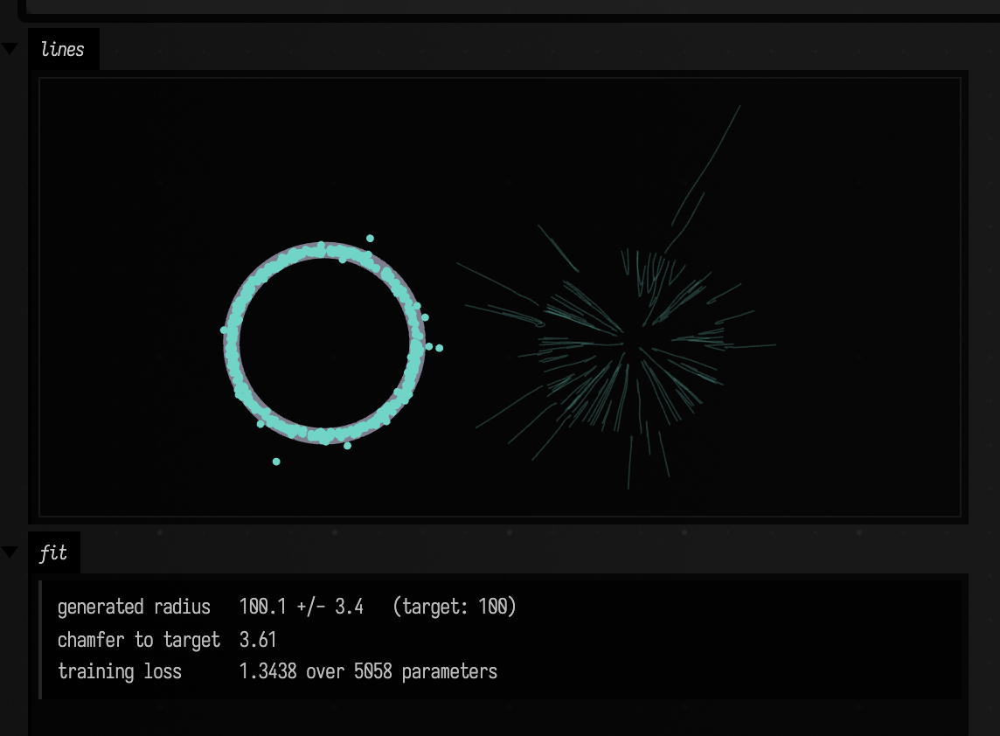
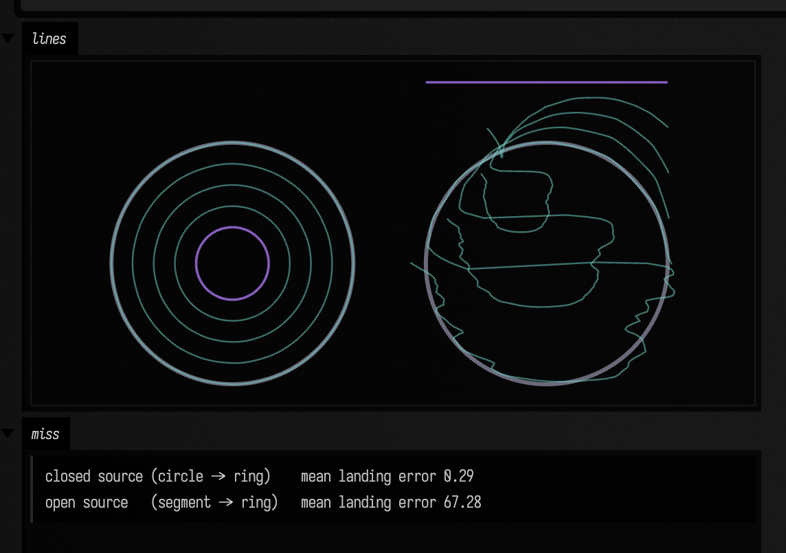
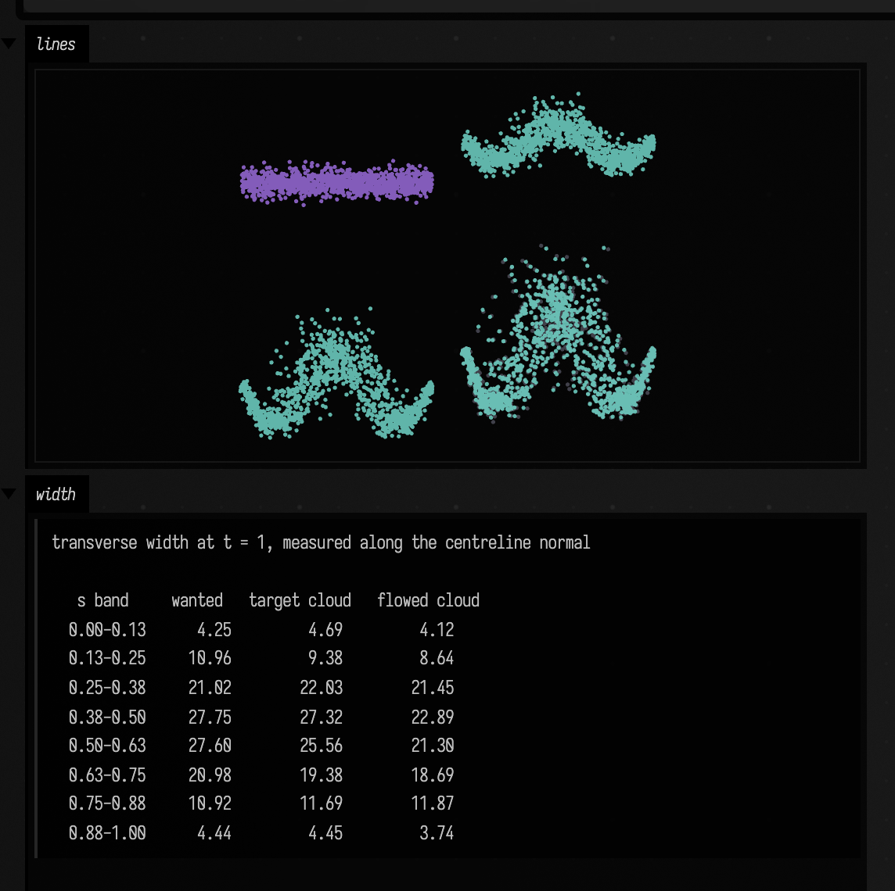
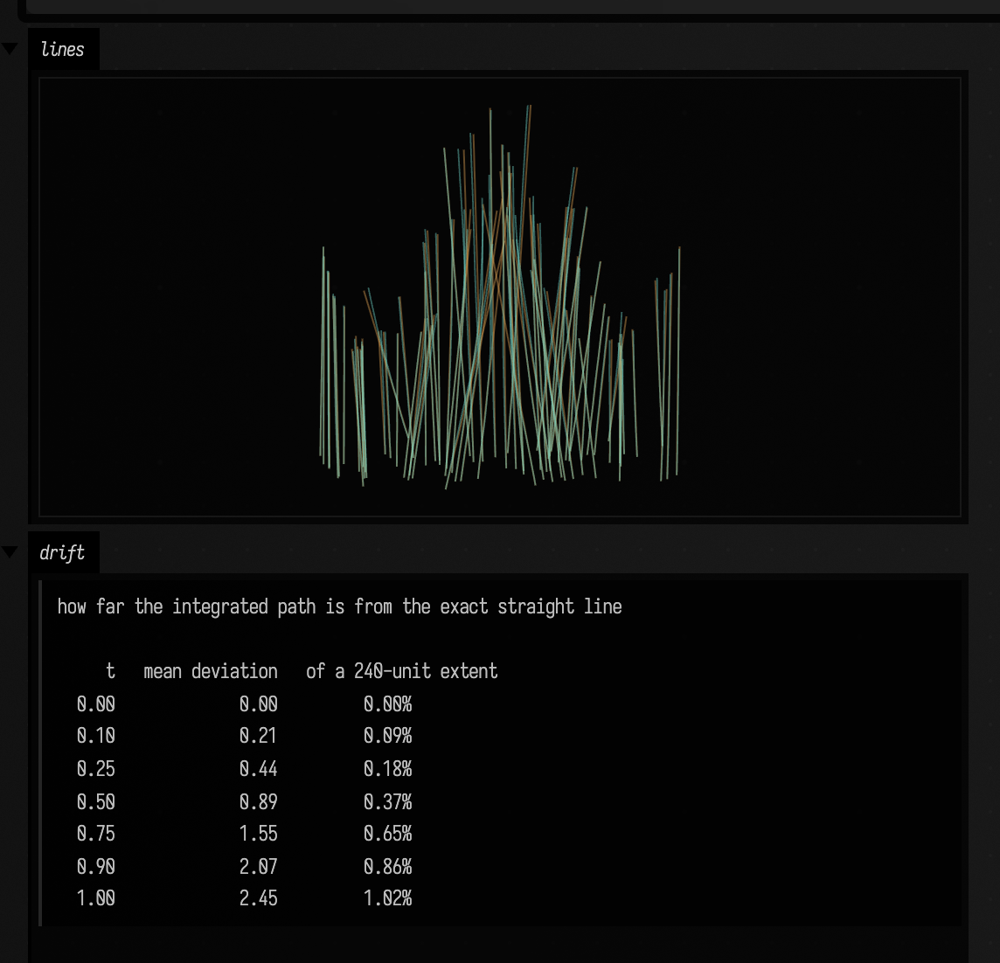
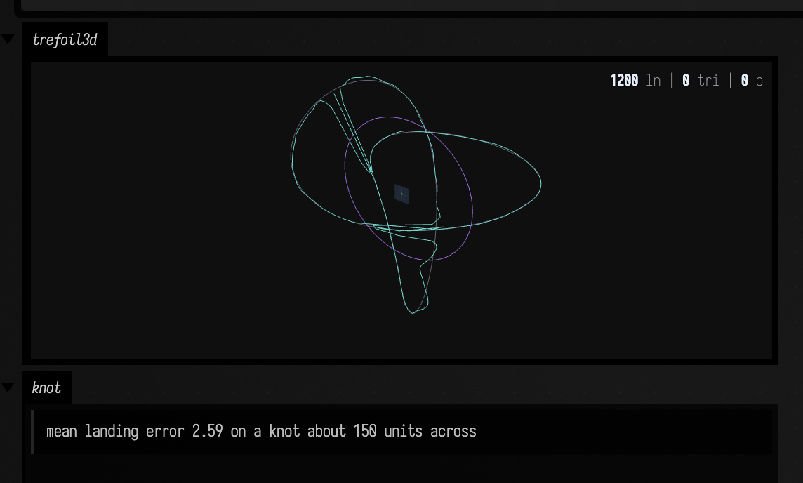
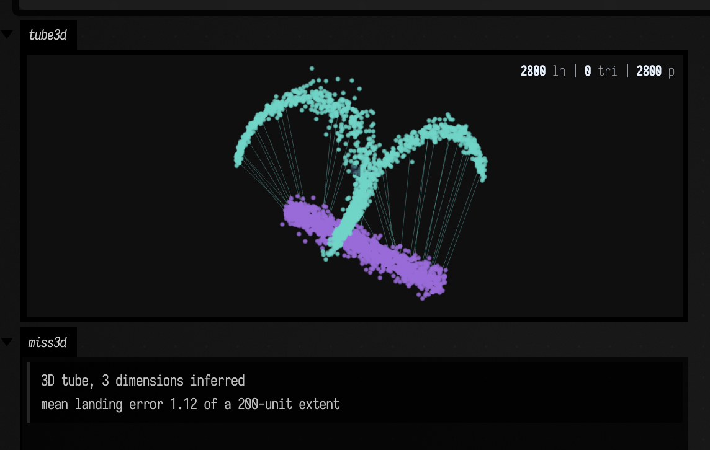

# Flow Matching

`flowMatch` fits a velocity field that carries one cloud of points onto another. Integrating that
field from `t = 0` to `t = 1` moves the first distribution onto the second, and stopping part-way
gives every stage in between. The input is a few hundred to a few thousand points in two or three
dimensions — a sampled `FLine` with noise around it is the usual case — and training takes about a
second.

The method is short enough to state completely. Pick a point `x0` from where you are starting and a
point `x1` from where you want to end up, and declare that the straight line between them is the
path a particle should take: at time `t` it sits at `xt = (1-t)·x0 + t·x1` travelling at `x1 - x0`.
Then fit a network `v(x, t)` to that velocity by least squares over many random `(x0, x1, t)`
triples. No two straight lines agree where they cross, so the fit cannot reproduce any one of them;
it converges to the average velocity through each point at each time, and integrating that average
transports the whole starting distribution onto the whole target one. The loss is a regression mean
squared error, so there is no adversary and nothing to diverge.

```diffstatic {data-lang=kotlin}
:::static
val field = flowMatch(myCloud)                 // from a Gaussian: a generator
val fresh = field.sample(500)                  // new points shaped like myCloud
val threads = field.paths(80)                  // the trajectories, as FLines

val morph = flowMatch(to = cloudB, from = cloudA)
val halfway = morph.transport(cloudA, to = 0.5) // a real intermediate distribution
```

Everything below is executed when this page is built.

## Learning a shape, and sampling from it

With no `from` cloud the particles start from a standard Gaussian, which makes the result a
generator: `sample` draws points that were not in the training data but are shaped like it.

The panels are the target cloud with the generated one on top of it, then the trajectories that
produced it. Each trajectory starts somewhere in the Gaussian blur at the centre and ends on the
ring.

```diffstatic_runner {data-lang=kotlin screenshot="assets/flow_matching/ring.png" wait="2.5" capture="box" open-outputs="true" w="1000" h="480" padding="16"}
:::static
fun cloud(points: List<Vec3>, size: Double, c: Vec4, shift: Vec3 = vec(0, 0, 0)): FLine {
    val f = FLine()
    points.forEach { f.moveTo(it + shift) }
    f.pointed = true
    f.pointSize = size
    f.color = c
    return f
}

val target = (0 until 500).map {
    val a = random() * 2 * PI
    vec(100 * cos(a), 100 * sin(a), 0.0)
}

val field = flowMatch(target, options = FlowMatchOptions(steps = 6000, seed = 11))
val samples = field.sample(500, seed = 12)

// The ring's radius is a single number, so the fit can be stated rather than eyeballed.
val radii = samples.map { hypot(it.x.toDouble(), it.y.toDouble()) }
val mean = radii.average()
val sd = sqrt(radii.sumOf { (it - mean) * (it - mean) } / radii.size)

val threads = field.paths(80, steps = 48, seed = 13).map {
    it.color = vec(0.44, 0.83, 0.78, 0.55)
    it.thickness = 0.8
    it
} + vec(330, 0, 0)
:::fold draw both panels and report the radius
lines(
    listOf(
        // Target underneath at a larger point size, so it shows as a halo where the two agree.
        cloud(target, 3.0, vec(0.55, 0.55, 0.62, 0.9)),
        cloud(samples, 1.4, vec(0.44, 0.83, 0.78, 1.0)),
    ) + threads,
    w = 1000.0, h = 460.0, fitToSize = true,
)
markdown("fit", """
    ~~~
generated radius   ${"%.1f".format(mean)} +/- ${"%.1f".format(sd)}   (target: 100)
chamfer to target  ${"%.2f".format(chamferDistance(samples, target))}
training loss      ${"%.4f".format(field.loss(200))} over ${field.parameterCount} parameters
    ~~~
""")
:::endfold
```



The training loss settles near 1.3 and stays there, because most of it is irreducible. Where paths
cross, the field can only predict their average, and that residual is a property of the problem
rather than of the fit. Loss is therefore not a quality measure here; compare samples instead, with
`chamferDistance` or by looking.

Two conventions are worth knowing. Training happens in a centred, isotropically scaled frame, since
a Gaussian source has to be commensurate with the data and `FLine` coordinates are usually in the
hundreds; the scaling is one factor rather than one per axis, so a shape keeps its aspect ratio, and
everything you pass in and get back is in your own coordinates. And 2D against 3D is decided by the
data rather than by an argument: a cloud whose `z` never varies trains as a two-dimensional problem
and its samples come back on that same plane. `FlowMatchOptions.dimension` overrides that.

## Two clouds, and a source topology that has to match

Given a `from` cloud the field becomes a map between two shapes, and `transport` is the interesting
call, because it can stop at any `t`. `transport(cloudA, to = 0.5)` is a genuine intermediate
distribution rather than a vertex-wise average of two point lists.

When something upstream already knows which point goes where — a shared arc coordinate along two
curves, say — `FlowCoupling.PAIRED` uses that correspondence instead of guessing one. The target
velocity then becomes a function of `(x, t)` rather than an average over crossing paths, the loss
floor drops from the data's variance to near zero, and the result can be graded point by point: this
point was supposed to land there, and it landed here.

Doing that exposes a limit that matters when choosing the source shape. Integrating a velocity field
is a continuous invertible map, so it can deform a curve but cannot tear a loop open or join two
strands. Asking a straight segment to become a closed ring pulls the segment's two ends to the same
target point, and their paths have to cross. The left panel gives the closed target a closed source;
the right panel gives it a segment, at identical settings.

```diffstatic_runner {data-lang=kotlin screenshot="assets/flow_matching/topology.png" wait="2.5" capture="box" open-outputs="true" w="1000" h="520" padding="16"}
:::static
val n = 300

// Both curves are sampled in order of their own arc coordinate, so point i at one end is the same
// material point as point i at the other. That is what PAIRED needs.
fun closed(radius: Double): List<Vec3> = (0 until n).map {
    val s = it / (n - 1.0)
    vec(radius * cos(2 * PI * s), radius * sin(2 * PI * s), 0.0)
}

val target = closed(100.0)
val circleSource = closed(30.0)
val segmentSource = (0 until n).map { vec(200 * (it / (n - 1.0) - 0.5), -150.0, 0.0) }

val options = FlowMatchOptions(steps = 6000, seed = 11, coupling = FlowCoupling.PAIRED)
val fromCircle = flowMatch(target, circleSource, options = options)
val fromSegment = flowMatch(target, segmentSource, options = options)

fun miss(field: FlowMatchField, source: List<Vec3>): Double {
    val landed = field.transport(source, steps = 64)
    return landed.indices.sumOf { (landed[it] - target[it]).length().toDouble() } / n
}
:::fold draw the two morphs side by side and report where each point landed
fun asClosed(points: List<Vec3>, c: Vec4, t: Double): FLine = fline {
    points.forEachIndexed { i, p -> if (i == 0) moveTo(p) else lineTo(p) }
    color = c
    thickness = t
}

// Grey is the target, purple the source at t = 0, cyan the flow between them -- the same three
// roles, in the same three colours, as every other figure on this page. The target is drawn even
// though the t = 1 stage lands on top of it, because otherwise there is nothing to judge against.
fun stages(field: FlowMatchField, source: List<Vec3>): List<FLine> =
    listOf(
        asClosed(target, vec(0.45, 0.45, 0.52, 0.9), 3.0),
        asClosed(source, vec(0.6, 0.42, 0.85, 1.0), 1.8),
    ) + listOf(0.25, 0.5, 0.75, 1.0).map {
        asClosed(field.transport(source, to = it, steps = 48), vec(0.44, 0.83, 0.78, 0.9), 1.2)
    }

lines(
    stages(fromCircle, circleSource) + (stages(fromSegment, segmentSource) + vec(260, 0, 0)),
    w = 1000.0, h = 500.0, fitToSize = true,
)
markdown("miss", """
    ~~~
closed source (circle -> ring)    mean landing error ${"%.2f".format(miss(fromCircle, circleSource))}
open source   (segment -> ring)   mean landing error ${"%.2f".format(miss(fromSegment, segmentSource))}
    ~~~
""")
:::endfold
```



The numbers under the figure are roughly 0.3 units against 67 on a radius-100 ring. The topology
mismatch costs more than every other setting on this page combined, and no amount of extra training
reduces it — a longer run fits the crossing-averaged velocity more precisely, which is the wrong
target. Give a closed target a closed source, an open target an open one.

`FlowCoupling` has a third option, `MINIBATCH_OT`, which pairs points within each batch by solving
the assignment that minimises total squared travel. It cuts the training loss by about ten times
because it removes most of the crossing. It does not follow that the samples improve: on the ring
above it is slightly worse than independent pairing, since it only ever sees one batch of the cloud
at a time. `INDEPENDENT` is the default.

## Width along the curve

A centreline discards what the cloud says about its own spread. If the source strand is given a
constant transverse thickness and the target tube's thickness varies along its length, the field
learns both the bend and the change in width.

Here the source is a straight strand of constant width 9, and the target is a wiggling curve whose
width swells from 3 at the ends to 29 in the middle. The four panels are the source and three stages
of the flow.

```diffstatic_runner {data-lang=kotlin screenshot="assets/flow_matching/tube.png" wait="3.0" capture="box" open-outputs="true" w="1000" h="560" padding="16"}
:::static
val n = 1200

// Each sample is (s along the curve, r across it), so source and target share a point identity.
val draws: List<Pair<Double, Double>> = (0 until n).map { Pair(random(), randomGaussian()) }

fun width(s: Double): Double = 3.0 + 26.0 * sin(PI * s) * sin(PI * s)
fun centre(s: Double): Vec3 = vec(240 * (s - 0.5), 70 * sin(3 * PI * s), 0.0)

// Unit normal of the centreline: the direction the width is measured along.
fun normal(s: Double): Vec3 {
    val dy = 70.0 * 3 * PI * cos(3 * PI * s)
    val len = hypot(240.0, dy)
    return vec(-dy / len, 240.0 / len, 0.0)
}

val source = draws.map { vec(240 * (it.first - 0.5), 150 + 9 * it.second, 0.0) }
val target = draws.map { (s, r) -> centre(s) + normal(s) * (width(s) * r) }

val field = flowMatch(
    target, source,
    options = FlowMatchOptions(steps = 8000, seed = 11, coupling = FlowCoupling.PAIRED),
)

// Transverse spread measured along the centreline normal, so it reports width rather than a blob
// radius that would also contain the travel along the curve.
fun transverseSd(points: List<Vec3>, from: Double, to: Double): Double {
    val picked = draws.indices.filter { draws[it].first >= from && draws[it].first < to }
    val offsets = picked.map {
        val s = draws[it].first
        val d = points[it] - centre(s)
        (d.x * normal(s).x + d.y * normal(s).y).toDouble()
    }
    return sqrt(offsets.sumOf { it * it } / offsets.size)
}
:::fold draw four stages and measure the width profile against the target
fun cloud(points: List<Vec3>, c: Vec4, shift: Vec3): FLine {
    val f = FLine()
    points.forEach { f.moveTo(it + shift) }
    f.pointed = true
    f.pointSize = 1.0
    f.color = c
    return f
}

val flowed = field.transport(source, steps = 64)
lines(
    listOf(
        cloud(source, vec(0.6, 0.42, 0.85, 0.85), vec(0, 0, 0)),
        cloud(field.transport(source, to = 0.35, steps = 48), vec(0.44, 0.83, 0.78, 0.85), vec(280, 0, 0)),
        cloud(field.transport(source, to = 0.7, steps = 48), vec(0.44, 0.83, 0.78, 0.85), vec(0, 360, 0)),
        cloud(target, vec(0.35, 0.35, 0.4, 0.7), vec(280, 360, 0)),
        cloud(flowed, vec(0.44, 0.83, 0.78, 0.85), vec(280, 360, 0)),
    ),
    w = 1000.0, h = 540.0, fitToSize = true,
)

val rows = (0 until 8).map { bin ->
    val lo = bin / 8.0
    val hi = (bin + 1) / 8.0
    val wanted = draws.indices.filter { draws[it].first >= lo && draws[it].first < hi }
        .map { width(draws[it].first) }.average()
    "  %.2f-%.2f   %7.2f   %10.2f   %10.2f".format(
        lo, hi, wanted, transverseSd(target, lo, hi), transverseSd(flowed, lo, hi)
    )
}
markdown("width", """
    ~~~
transverse width at t = 1, measured along the centreline normal

   s band     wanted   target cloud   flowed cloud
${rows.joinToString("\n")}
    ~~~
""")
:::endfold
```



The table compares the width the target was built with, the width its own finite sample actually has,
and the width the flow produced. The two agree to a few percent over most of the curve. The widest
two bands come out roughly 10–17% narrow, which is where the source's constant width has to expand
most.

Because the correspondence is explicit, the exact answer is known at every `t`, not only at the end:
particle `i` should be at `(1-t)·x0ᵢ + t·x1ᵢ`. Comparing the integrated path against that straight
line measures the field directly.

```diffstatic_runner {data-lang=kotlin screenshot="assets/flow_matching/tube_paths.png" wait="3.0" capture="box" open-outputs="true" w="1000" h="420" padding="16"}
:::static
val n = 1200
val draws: List<Pair<Double, Double>> = (0 until n).map { Pair(random(), randomGaussian()) }

fun width(s: Double): Double = 3.0 + 26.0 * sin(PI * s) * sin(PI * s)
fun centre(s: Double): Vec3 = vec(240 * (s - 0.5), 70 * sin(3 * PI * s), 0.0)

// Unit normal of the centreline: the direction the width is measured along.
fun normal(s: Double): Vec3 {
    val dy = 70.0 * 3 * PI * cos(3 * PI * s)
    val len = hypot(240.0, dy)
    return vec(-dy / len, 240.0 / len, 0.0)
}

val source = draws.map { vec(240 * (it.first - 0.5), 150 + 9 * it.second, 0.0) }
val target = draws.map { (s, r) -> centre(s) + normal(s) * (width(s) * r) }

val field = flowMatch(
    target, source,
    options = FlowMatchOptions(steps = 8000, seed = 11, coupling = FlowCoupling.PAIRED),
)

val drift = listOf(0.0, 0.1, 0.25, 0.5, 0.75, 0.9, 1.0).map { t ->
    val flowed = field.transport(source, to = t, steps = 64)
    val away = (0 until n).sumOf {
        val exact = source[it] * (1 - t) + target[it] * t
        hypot((flowed[it].x - exact.x).toDouble(), (flowed[it].y - exact.y).toDouble())
    } / n
    "  %.2f   %14.2f   %10.2f%%".format(t, away, 100 * away / 240.0)
}
:::fold draw the paths over the exact straight lines
val every = source.indices.filter { it % 16 == 0 }
val exact = every.map { i ->
    fline {
        moveTo(source[i]); lineTo(target[i])
        color = vec(0.88, 0.64, 0.33, 0.7); thickness = 1.0
    }
}
val flown = field.pathsFrom(every.map { source[it] }, steps = 48).map {
    it.color = vec(0.44, 0.83, 0.78, 0.8)
    it.thickness = 0.9
    it
}

lines(exact + flown, w = 1000.0, h = 400.0, fitToSize = true)
markdown("drift", """
    ~~~
how far the integrated path is from the exact straight line

     t   mean deviation   of a 240-unit extent
${drift.joinToString("\n")}
    ~~~
""")
:::endfold
```



The deviation grows smoothly from zero and reaches about 1.2% of the shape's extent at `t = 1`. The
cyan curves sit on the orange lines, which is what a paired flow looks like when the paths do not
fight each other. An intermediate stage rendered on its own is correspondingly tight; several stages
drawn on top of one another look much noisier than any one of them is.

## Three dimensions

Nothing above is specific to the plane. A flat circle can become a trefoil knot, which is a good
test because the source has no `z` at all and every part of the knot's depth has to be produced by
the flow. Orbit the view to see it.

```diffstatic_runner {data-lang=kotlin screenshot="assets/flow_matching/trefoil.png" wait="2.5" capture="box" open-outputs="true" w="1200"}
:::static
val n = 400

val knot = (0 until n).map {
    val u = 2 * PI * (it / (n - 1.0))
    vec(26 * (sin(u) + 2 * sin(2 * u)), 26 * (cos(u) - 2 * cos(2 * u)), -26 * sin(3 * u))
}
// A closed source for a closed target, and flat: z is entirely the field's work.
val circle = (0 until n).map {
    val u = 2 * PI * (it / (n - 1.0))
    vec(45 * cos(u), 45 * sin(u), 0.0)
}

val field = flowMatch(
    knot, circle,
    options = FlowMatchOptions(steps = 12000, seed = 11, coupling = FlowCoupling.PAIRED),
)
val landed = field.transport(circle, steps = 96)
val miss = circle.indices.sumOf { (landed[it] - knot[it]).length().toDouble() } / n
:::fold draw the source, the knot, and where the flow landed
fun asLine(points: List<Vec3>, c: Vec4, t: Double): FLine = fline {
    points.forEachIndexed { i, p -> if (i == 0) moveTo(p) else lineTo(p) }
    close()
    color = c
    thickness = t
}

// Three curves only. Intermediate stages of a self-intersecting knot, overlaid in one static
// projection, cannot be told apart; they are worth orbiting through live but not worth printing.
// Grey target, purple source, cyan where the flow landed.
threeLines(
    listOf(
        asLine(knot, vec(0.42, 0.42, 0.5, 0.9), 4.0),
        asLine(circle, vec(0.6, 0.42, 0.85, 1.0), 2.0),
        asLine(landed, vec(0.44, 0.83, 0.78, 1.0), 1.6),
    ),
    channel = "trefoil3d", height = 460, editable = false,
)
markdown("knot", """
    ~~~
mean landing error ${"%.2f".format(miss)} on a knot about 150 units across
    ~~~
""")
:::endfold
```



The same applies to width in three dimensions. A round canonical tube can become a helix whose
cross-section both swells along its length and turns elliptical, which is the three-dimensional form
of the width layer above.

```diffstatic_runner {data-lang=kotlin screenshot="assets/flow_matching/tube3d.png" wait="3.0" capture="box" open-outputs="true" w="1200"}
:::static
val n = 1400
val picks: List<Triple<Double, Double, Double>> =
    (0 until n).map { Triple(random(), randomGaussian(), randomGaussian()) }

val source = picks.map { (s, a, b) -> vec(200 * (s - 0.5), -90 + 7 * a, 7 * b) }
val target = picks.map { (s, a, b) ->
    val u = 3 * PI * s
    val swell = 2.0 + 18.0 * sin(PI * s) * sin(PI * s)
    vec(200 * (s - 0.5) + swell * a * 0.45, 55 * sin(u) + swell * a, 55 * cos(u) + swell * 0.35 * b)
}

val field = flowMatch(
    target, source,
    options = FlowMatchOptions(steps = 12000, seed = 11, coupling = FlowCoupling.PAIRED),
)
val landed = field.transport(source, steps = 96)
:::fold draw the trajectories in depth
fun cloud(points: List<Vec3>, c: Vec4, size: Double): FLine {
    val f = FLine()
    points.forEach { f.moveTo(it) }
    f.pointed = true
    f.pointSize = size
    f.color = c
    return f
}

// A thinned set of threads over the two clouds, so the tube itself is visible and not only the
// travel: the round source below, the swollen helical target where the threads land.
val threads = field.pathsFrom(
    source.indices.filter { it % 28 == 0 }.map { source[it] },
    steps = 56,
).map {
    it.color = vec(0.44, 0.83, 0.78, 0.35)
    it.thickness = 0.8
    it
}

threeLines(
    listOf(
        cloud(source, vec(0.6, 0.42, 0.85, 0.9), 1.6),
        cloud(landed, vec(0.44, 0.83, 0.78, 0.9), 1.6),
    ) + threads,
    channel = "tube3d", height = 460, editable = false,
)
markdown("miss3d", """
    ~~~
3D tube, ${field.dimension} dimensions inferred
mean landing error ${"%.2f".format(
    landed.indices.sumOf {
        (landed[it] - target[it]).length().toDouble()
    } / n
)} of a 200-unit extent
    ~~~
""")
:::endfold
```



## Settings that change the result

Four of `FlowMatchOptions`'s fields account for most of the variation, and two of them have defaults
that are not the obvious choice.

`activation` defaults to `leaky` rather than `tanh`. A velocity field has to keep growing away from
the data — near `t = 0` the right answer is roughly `-x`, without bound — and a saturating unit
cannot, so it bends the far field back on itself. Measured on the ring above, `tanh` gives about four
times the radial spread of `leaky` or `relu` at equal cost. This is the largest single lever here.

`finalLearningRate` decays the rate linearly across the run, and defaults to doing so. RMSProp
rescales the gradient to roughly unit length, so a constant rate keeps taking same-sized steps
however close to the answer it already is, and the fit settles at a floor set by the rate. With a
constant rate, more steps made the paired tube land *further* from its target; with the decay, more
steps help. It took the ring's radial spread from 9.2 to 3.6.

`steps` is then the quality knob worth reaching for first, and the dominant cost: roughly 0.08 ms
per step at the default batch, so 6000 steps is about half a second. `hidden` defaults to two layers
of 64 units, and widening it helps much less than training longer.

`momentum` should stay at zero unless `rho` is also zero. Smile applies momentum on top of the
RMSProp-normalised gradient without the `(1 - β)` factor Adam uses, so enabling both multiplies the
effective step by about ten and the run diverges.

`FlowMatchField.losses` records every step, so a loss still falling at the end means the run was cut
short.

## What this does not do

The field is a deformation, so it cannot change topology: no tearing a loop, no joining two strands,
no branching. Multiple curves can be carried by one field as long as each has its own source strand
of the same kind, and they will approach each other without crossing.

`sample` returns an unordered cloud. Recovering an `FLine` from one is a separate problem, which
`transport` sidesteps by moving points you already have and keeping their order.

There is no conditioning input: one field carries one distribution onto one other. And this is a
small model by design — two layers of 64 units suits a few thousand points in two or three
dimensions and would not suit an image.

The API is in [Machine learning](reference/machine-learning.md); `VectorMLP` there is the
multi-output regression head that `flowMatch` trains, which is usable on its own.
