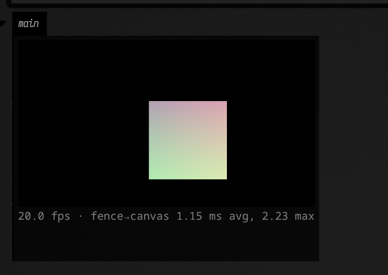

# Graphics in an Output Area

A Field 4 render target can draw straight into a box's output area, next to its code,
instead of into a separate render window. Frames go from the GPU to the panel without being
copied back to the CPU or encoded, so a 640×360 view keeps up with the renderer, which is
85 to 120 frames a second on an Apple silicon Mac.

!!! note "Field desktop app required"
    The view works in Field's Electron app on macOS and on Linux using native Wayland.
    A web browser, including Field's HTTP mirror, shows a message instead of frames.
    Windows is not implemented.

## A view in a box

This box draws a moving, colour-shifting square into a 640×360 view and shows it in the box's
`main` output. It sits under a renderer box, like any other Field 4 box, and its `vertex` and
`fragment` properties hold the two shaders.

```diffstatic_runner {data-lang=kotlin screenshot="assets/four_in_output_areas/rtt-view.png" alt="a box's main output panel holding a black 640 by 360 view with a square a little left of centre, shaded from soft green at its lower left to rose at its upper right, and under the view a line of small grey text giving the frame rate, about 85 frames a second, and the time from the GPU finishing a frame to the panel showing it, under 3 milliseconds on average" capture="box" capture-profile="macos-electron" graphics-context=true wait="3" timeout="60" embed=true name="four-rtt-view" source-box="assets/four_in_output_areas/rtt-view" source-box-properties="vertex,fragment" source-box-wait="0.1"}
import afield.media.stream.ElectronRTTView

val view = ElectronRTTView(640, 360)

val module = moduleHere { view.rtt.apply() }
val m = Mesh()
module += "mainMesh" to m
view.rtt += "content" to module
view.rtt.parameters.clearFirst = true

val camera = Camera()
m.p = camera.p
m.m = camera.m
m.finalColor = {
    val t = System.nanoTime() / 1e9
    vec(3 * Math.sin(t), 2 * Math.cos(1.3 * t), Math.sin(4 * t), 1.0)
}

val sc = 4.0
m.set(4, 2) {
    pos.add(-sc, -sc, 0)
    pos.add(sc, -sc, 0)
    pos.add(sc, sc, 0)
    pos.add(-sc, sc, 0)
    tri.add(0, 1, 2)
    tri.add(0, 2, 3)
}

display("main", view.html())
```

`view.rtt` is an ordinary `RenderToTexture`, so anything that renders into one renders into the
view: attach modules to it with `+=` exactly as you would for a texture you meant to sample.
`view.html()` is the panel itself, a canvas plus a line of live timings, and `display` puts it in
whichever output you name.

## Re-running, stopping, and sharing the view

A box has one view. Running the box again replaces its previous view with the new one, so you can
edit the size or the content and re-run without views piling up. Stopping the box leaves the view
drawing, the same as anything else a box has launched; deleting the box, or closing the document,
releases it.

Another box that wants the same view can take it the usual ways: mark it `@exported val view` and
read it as `_view` in a child box, or declare it with `prop<ElectronRTTView>(view)`.

## How fast it is

The line under the canvas reports two numbers, averaged over each second: frames shown per second,
and the time from the GPU finishing a frame to the panel showing it. At 640×360 on an Apple
silicon Mac the view runs at the renderer's own rate, and that time is 1 to 3 ms on average, with
occasional frames taking up to about 15 ms. The view holds three frames in flight, so a slow panel makes it
skip frames instead of slowing the renderer down.

## On Linux

Use the app in a native Wayland session. Under Xorg or XWayland the canvas stays blank, and the view
reports an error instead. No ANGLE/Vulkan switch is needed for this view; forcing that backend can
stop the Wayland app window from appearing.

The Linux view also passes frames through a shared GPU image ring, with no CPU readback or video
encoding. On an NVIDIA RTX 4090 (driver 610.43.02, Electron 44.5.1) the 640×360 view showed about
20 frames a second, with roughly 0.8 ms from the frame's GPU fence to the canvas draw. The same
moving square, in the Linux app:



| Session on that machine | Vulkan texture shown in the canvas |
| --- | --- |
| Native Wayland | Yes; all source pixels matched |
| Xorg | Blank with both default GL and ANGLE/Vulkan |
| XWayland | Blank with both default GL and ANGLE/Vulkan |

The [verification record](assets/four_in_output_areas/linux-verification.json) has the source and
canvas pixel counts, the exact switches, and the checks after re-running and deleting the box.

See also: [Field 4 Graphics](afield_four_graphics.md) for meshes, modules and
render-to-texture.

??? aside "Agents: how the figure is captured"
    The docs runner's capture browser is a plain Chromium, which cannot show these frames, so this
    page's figure is captured from the Field Electron app itself: the fence's
    `capture-profile="macos-electron"` makes the runner start this checkout's Electron with remote
    debugging on and capture through it (`playwright-open --electron` on the backdoor,
    `afield.tools.docs.ElectronCaptureBrowser`). Like the Linux GPU captures, it is regenerated only on a
    host that asks for it (`FIELD_DOCS_CAPTURE_PROFILES=macos-electron` on macOS), and kept
    everywhere else. The mechanism behind the view is in `dev_docs/ELECTRON_RTT_VIEW.md`.
