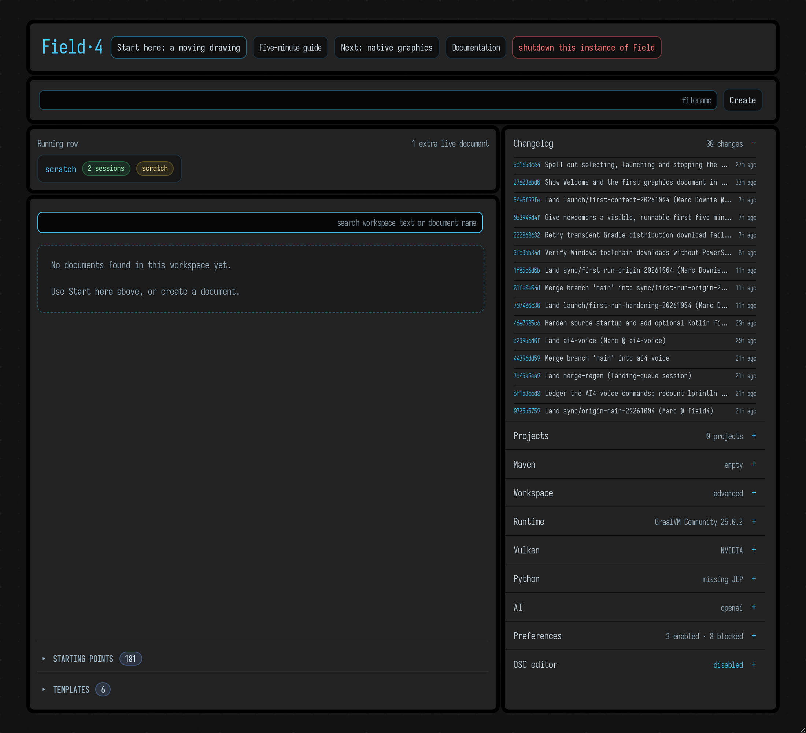
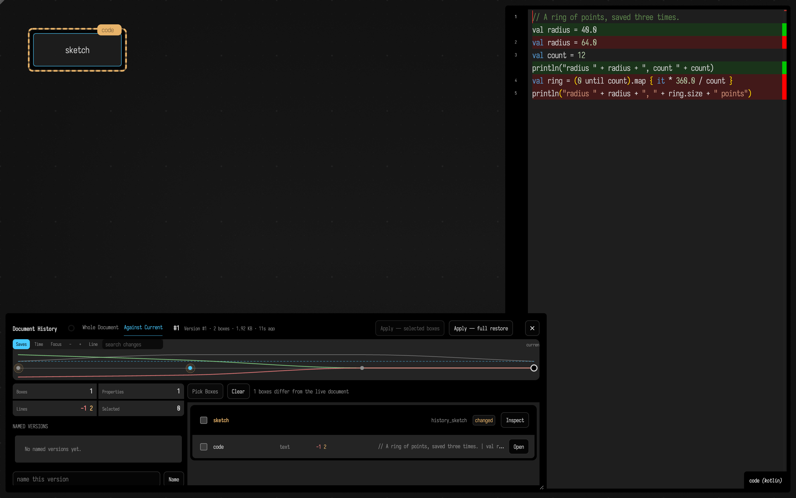
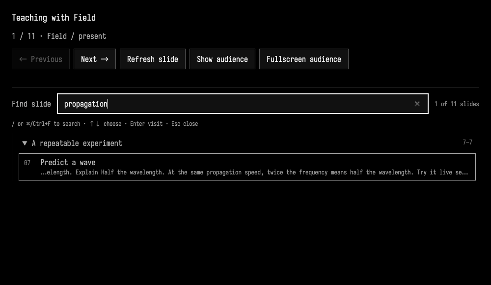
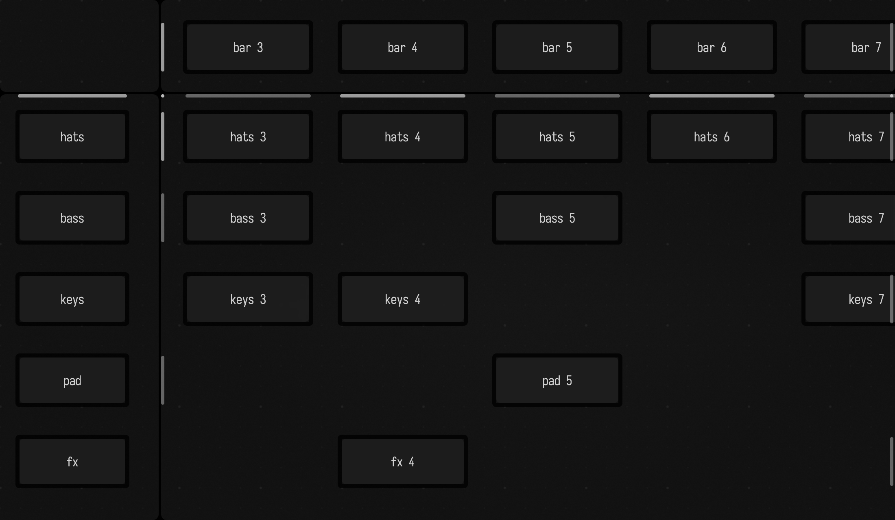

# A Tour

Field aims to be full of unexpectedly fun features that help you interact with code. This page is going to be a long list of things that delight, things that you didn't think you'd need, and things that help when you are puzzled.

You don't have to read it straight through. Start with running and displaying things, or jump to
[AI support](#ai-support), [drawing on the canvas](#drawing-on-the-canvas), or
[making bigger things](#making-bigger-things). If you want something to run before you look
around, [Your First Five Minutes](first_steps.md) begins with a moving drawing.
The next stop on the Tour is [Frames and the Animation Loop](animation_time_model.md), where a box
keeps drawing as time passes.

## The Welcome page

The first page of Field is the Welcome page: the first tab in our desktop app, and at `https://localhost:9092/welcome` in any web browser:



On the left you can make new documents or find that document you just _know_ you edited last week; below the list are **Starting points** and **Templates**, curated scenes and scaffolds that open as an editable copy in your workspace. **Kits** adds [reusable packages and their starting points](kits.md#add-a-self-contained-kit-in-welcome) in another disclosure. On the right is a stack of collapsible panels for the rest of Field: the changelog, projects, Maven dependencies, the workspace, the runtime, Vulkan and Python status, AI settings, preferences, and the OSC editor. The search box does full-text search over the whole workspace:

<video controls autoplay loop muted playsinline style="width: min(100%, 660px);">
	<source src="assets/welcoming.mp4" type="video/mp4">
</video>

To help you find that snippet of code.

## Running things

A Field document is a canvas of *boxes*. Each box holds a piece of code (and, often, its output); you edit one box at a time in the editor. You can run that code in the following ways (from the commonplace to the rare):

 * `alt/option-enter` — runs the line or block that the cursor is in.
 * Or, `alt/option-enter` — runs the currently selected code.
 * `alt/option-up arrow` — *launches* the currently edited box. `alt/option-down arrow` stops.
 * `alt/option-click` on a box — *launches* it for as long as you hold the mouse button down, and stops it when you let go. To keep it running after you let go, drag upwards before releasing. To stop it later, `alt/option-click` it again and drag downwards. For example:

<video controls autoplay loop muted playsinline style="width: min(100%, 660px);">
	<source src="assets/launching.mp4" type="video/mp4">
</video>

 * `alt/option-0` — runs everything in a box (but doesn't *launch* it)

What's the difference between 'running' and 'launching'? Running executes the code once. A box can end with an object that keeps going by itself, such as a `loop { }`; launching the box hands that object to Field's _animation loop_, which calls it once every frame until you stop it. When several boxes are launched, they are called in the same order every frame. The idea of installing code into, and removing it from, the animation cycle is fundamental to making sound, image and data visualizations, so this idea is right at the heart of Field.

That's everything you _need_ to know — with these shortcuts you can have a fun time in Field. Go! Write and run some code against your favourite libraries, in [Kotlin](kotlin_overview.md) (on the JVM), [Python](python.md), [Clojure](clojure.md), even [Lua](lua.md).

_But..._ since running code is very important, we actually have quite a few more ways of doing this. Sometimes just for convenience's sake, sometimes because of subtle differences in what you actually mean by 'run' and 'code'.

For completeness, we'll list them here:

 * `alt/option-shift-up arrow` — immediately launches the box **without recompiling** if that's possible. Handy if your box has some long, complicated startup and then an animation or something at the end that you are playing with.
 * `ctrl/command-alt/option-k` or `ctrl/command-alt/option-j` **increments** or **decrements** the number under the cursor and then acts like you pressed alt/option-enter.
 * `alt/option-double-click` in the editor. Doing this to `true`, `false`, `disable { ... }` or `enable { ... }` in the editor flips that word to the opposite and then `alt/option-enter`s the block. Think of this as a toggle, but hanging out in your source code.
 *  `alt/option-double-click` on the name of a function in scope with the signature `foo()` just runs the function. Buttons everywhere!
 *  `alt/option-1` — relaunches **just the selection**, or the line or enclosing block under the cursor (i.e. the same code `alt/option-enter` would run), without running other parts of the box again. See [Running code in a box](running_code.md#running-code-around-the-cursor). You get a handsome stripe in the margin that shows the launched code that's ongoing.
 *  Writing code that launches other boxes. For example `root.named("progress").begin()` launches a box called "progress".

Some of these effects are language-dependent. For example, if you are editing a GLSL shader property, alt/option-enter recompiles and reloads the shader instead.

## Printing things

Often your code does something — draws a line, loads a model, makes a sound. But when you are puzzled as to *what* is actually running, and where, and when you are confused about how your variables are varying, nothing beats a good old `print` statement. Like its facilities for running code, Field has a few different ways of doing this.

### `print(...)` — 'print here':

`print` (and `println`) always prints next to, or underneath, the line containing the `print`. If what you print fits on a single line, it sits beside that line; if it doesn't, you get a little block under the line instead:

```diffstatic_runner {data-lang=kotlin screenshot="assets/funFeatures-print-here.png" capture="editor" outputs="inline" wait="2" padding="10" timeout="90" embed=true name="funfeatures-print-here" w="900" h="300" alt="Field's editor holding the snippet. Beside the print(x+y) line sits 30; under the last println is a black block of six lines, row 1: 1 down to row 6: 36."}
var x = 10
var y = 20
print(x + y)
var z = 30
println((1..6).joinToString("\n") { "row $it: ${it * it}" })
```

You can close blocks with the 'x' symbol in the margin, or by `double-tap Esc`, which you'll likely be pressing a lot. `triple-tap Esc` will get rid of all the outputs inside the current editor. You'll be doing that a lot.

`print` isn't an ordinary function: it's a macro (see [below](#kotlin-with-macros)) that knows which line it was written on.

This can be handy in longer, more interesting code, for example:

<video controls autoplay loop muted playsinline style="width: min(100%, 660px);">
	<source src="assets/screen-recording-2026-03-21.mp4" type="video/mp4">
</video>

And it is quite performant, so you can just use these prints as output:

<video controls autoplay loop muted playsinline style="width: min(100%, 660px);">
	<source src="assets/lotsOfPrinting.mp4" type="video/mp4">
</video>


There's a little bit of design here — if they're `print`ing but not changing, they turn white; otherwise, the thought is that the text changing is enough for you to draw your attention to the line.

So, if you don't know what that variable is, drop in a `print()` and find out.

## Printing, but try harder

Appending `.h` or even `.h2` to the thing that you are printing will cause Field to work much harder to make the thing that you are printing a pretty piece of HTML. Here a map holding a list goes to an output area with `.h`:

```diffstatic_runner {data-lang=kotlin screenshot="assets/funfeatures/h-map.png" capture="box" open-outputs="true" wait="3" padding="16" timeout="120" embed=true name="funfeatures-h-map" w="700" h="200" alt="An output panel titled m under a Field box, holding one line: { a → b, c → [1, 2, 3, 4, 8, 7.2] (6) } with the keys in green, the numbers in blue and a small sparkline of the list beside it."}
val l = [1.0, 2.0, 3.0, 4.0, 8.0, 7.2]
val m = mapOf("a" to "b", "c" to l)
display("m", m.h)
```

`.h2` is particularly suited to lists and maps with _lots_ of data in them — Field intelligently pages in and out just the parts of the data that you are actually looking at, so you can explore gigantic FloatBuffers, for example:

```diffstatic_runner {data-lang=kotlin screenshot="assets/funfeatures/h2-buffer.png" capture="box" open-outputs="true" wait="4" padding="16" timeout="120" embed=true name="funfeatures-h2-buffer" w="800" h="300" alt="An output panel titled buffer holding a paged view of a FloatBuffer of 100000 floats: a header with its position, limit and capacity and outliner and columns links, then a table with a stride box set to 4, columns c0 to c3 and rows 0 to 7 of rising values."}
val buffer = java.nio.FloatBuffer.allocate(100_000)
for (i in 0 until buffer.capacity()) buffer.put(i, (Math.sin(i * 0.01) * 10.0 + Math.random()).toFloat())
display("buffer", buffer.h2)
```

[Visualizers](visualizers.md) covers `.h`, `.h2` and the rest.

## `display`ing things — print where everyone can see it

We can also 'print' to the canvas using `display`. For example:

```diffstatic_runner {data-lang=kotlin screenshot="assets/funfeatures/display-map.png" capture="box" open-outputs="true" wait="3" padding="16" timeout="120" embed=true name="funfeatures-display-map" w="700" h="200" alt="An output panel titled m is equal to, holding the map on one line: { a → b, c → [1, 2, 3, 4, 8, 7.2] (6) } with a sparkline of the list."}
val l = [1.0, 2.0, 3.0, 4.0, 8.0, 7.2]
val m = mapOf("a" to "b", "c" to l)
display("m is equal to ", m.h)
```

puts an output panel, named by the first argument, underneath the box we're writing code in.

Subsequent calls to `display` overwrite the previous one, giving you a way of 'animating' the output on the canvas.

While the `.h` and `.h2` visualizers try hard to make things pretty, all they are really doing is making some complex HTML in response to what they are trying to visualize. You can make your own as well:

```diffstatic_runner {data-lang=kotlin screenshot="assets/funfeatures/display-html.png" capture="box" open-outputs="true" wait="3" padding="16" timeout="120" embed=true name="funfeatures-display-html" w="700" h="220" trim=true alt="Two output panels under a Field box: m is equal to, holding the map on one line with its sparkline, and just some html, holding the word foo! in heavy bold type."}
val l = [1.0, 2.0, 3.0, 4.0, 8.0, 7.2]
val m = mapOf("a" to "b", "c" to l)

display("m is equal to ", m.h)

display("just some html", "<div style='font-weight:900'>foo!</div>")
```

## Browsing things — print where I can interact with it

There are a few more elaborate visualizers for more tangled structures. The "column" visualizer is loosely modelled after Smalltalk's browser:

```diffstatic_runner {data-lang=kotlin screenshot="assets/funfeatures/column.png" capture="box" open-outputs="true" wait="4" padding="16" timeout="120" embed=true name="funfeatures-column" w="900" h="300" alt="A column browser in an output panel titled m, headed LinkedHashMap 3 entries, listing a String \"b\", c ArrayList 6 items and m LinkedHashMap 2 entries; a is selected."}
val l = [1.0, 2.0, 3.0, 4.0, 8.0, 7.2]
val m2 = mapOf("foo" to "bar", "gux" to l)
val m = mapOf("a" to "b", "c" to l, "m" to m2)

column("m", m)
```

This structure updates live if `m` changes. Similarly, there is `tree`, which shows the same values as an outline:

```diffstatic_runner {data-lang=kotlin screenshot="assets/funfeatures/tree.png" capture="box" open-outputs="true" wait="4" padding="16" timeout="120" embed=true name="funfeatures-tree" w="900" h="300" alt="A tree browser in an output panel titled m, headed LinkedHashMap 3 entries with a filter box: row a String \"b\" selected with path and copy buttons, and folded rows c ArrayList 6 items and m LinkedHashMap."}
val l = [1.0, 2.0, 3.0, 4.0, 8.0, 7.2]
val m2 = mapOf("foo" to "bar", "gux" to l)
val m = mapOf("a" to "b", "c" to l, "m" to m2)

tree("m", m)
```

and a viewer for Field's own log, `logs()`, which shows what the server is logging as it happens:

```diffstatic_runner {data-lang=kotlin screenshot="assets/funfeatures/logs.png" capture="box" open-outputs="true" wait="4" padding="16" timeout="120" embed=true name="funfeatures-logs" w="900" h="300" alt="A log viewer in an output panel titled internal logging, with a find box and a clear button over timestamped entries tagged info,logstream and debug,logstream: the viewer's own subscribe and ready messages."}
logs()
```

[Visualizers](visualizers.md#trees-and-columns) has more on `tree` and `column`.

## 'printing' (editable) geometry

Field has _extensive_ support for generating 2D and 3D geometry and adding this to the canvas, essentially by `display`ing bundles of `FLine` objects. You can see [fline_examples](fline_examples.md) for a lot more information. But here's a taste:

```diffstatic_runner {data-lang=kotlin screenshot="assets/fline_examples/lines_editable2.png" embed=true}
:::static
val petal = fline {
    moveTo(0, -120)
    cubicTo(90, -100, 140, -20, 0, 120)
    cubicTo(-140, -20, -90, -100, 0, -120)
    close()
    filled = true
    stroked = true
    thickness = 2.5
    color = vec(0.95, 0.42, 0.6, 0.34)
}

val stem = fline {
    moveTo(0, 120)
    cubicTo(10, 180, -20, 230, 0, 300)
    thickness = 5.0
    color = vec(0.45, 0.95, 0.62, 1.0)
}

lines([petal, stem], w = 420.0, h = 420.0, fitToSize = true, editable = true)
```

It's important to note that you're not just editing a *copy* of the FLine. This editor mutates the actual `FLine` object that you passed in — so this is a way of interacting with code, not just witnessing its effects.

3D (and indeed 3D *editing*) works as well:

<video controls autoplay loop muted playsinline style="width: min(100%, 660px);">
	<source src="assets/3dlines.mp4" type="video/mp4">
</video>

See [fline_examples](fline_examples.md) for much more.

## "Printing" chunks of UI

Sliders, checkboxes, colour pickers and other input controls can be 'printed' into a box's output area too; [Visualizers](visualizers.md) shows how.

## Hints as you type

As the cursor moves around the editor, Field shows a hint built from types and current values: what you might type next, the parameters of the function you are in, and the value a variable has right now:

<video controls autoplay loop muted playsinline style="width: min(100%, 660px);">
	<source src="assets/autoauto.mp4" type="video/mp4">
</video>


## Decorating the editor

Box code can also extend and decorate the text editor itself. In the video below, a musical pattern written in the editor is drawn over as it plays, much as in [Strudel](https://strudel.cc/), though the language is different:

<video controls autoplay loop muted playsinline style="width: min(100%, 660px);">
	<source src="assets/pat.mp4" type="video/mp4">
</video>


## Other output-area-related things

You can remove output areas you no longer want to see by `alt/option-click`ing their disclosure triangles; while `alt/option` is held over one, the triangle turns into a red ✕.


Programmatic control over output areas is through these functions (see
[Box Output](box_output.md) for what each one does, and for the other mouse gestures):

```diffstatic {data-lang=kotlin}
displayOpen("foo")
displayClose("foo")
displayClear("foo")
displayClearAll()
```

And output areas without content are handy — progress bars are useful for showing you how a box is getting through its processing:

```diffstatic {data-lang=kotlin}
var z = 0
loop {
    z += 1
    progressBar("progress", (z % 10000) / 10000.0)
}
```

This yields (when launched):

<video controls autoplay loop muted playsinline style="width: min(100%, 660px);">
	<source src="assets/Screen-Recording-2026-03-21-at-13.48.57.mp4" type="video/mp4">
</video>

`progressBar` is the low-level primitive — you drive it and you clear it. For the common cases, there are friendlier helpers that manage the bar for you and clean up after themselves:

```diffstatic {data-lang=kotlin}
// Wrap any iterable / range / count — the bar tracks the loop and removes itself at the end:
for (i in tqdm(0 until 10000)) {
    // ...heavy work...
}

// For routines: report a fraction (with a tqdm-style rate + ETA)...
withProgress("solving") { p ->
    repeat(steps) { i -> /* ...work... */
        p.update(i + 1L, steps.toLong())
    }
}

// ...or .pulse() when there's no known total (an indeterminate "still working" bar):
val p = progressReporter("reducing")
while (notDone()) {
    stepOnce()
    p.pulse()
}
p.finish()
```

A bar appears only for work that takes longer than about two seconds, and removes itself shortly after the work finishes. Some long-running library routines show one without you asking.

Turn them all off with `ProgressBars.enabled = false`, or tune `ProgressBars.showDelayMillis` (the grace period) and `ProgressBars.lingerMillis` (how long a completed bar sticks around).

# AI support

Obviously, it's 2026, so it gets its [own page](aiFeatures.md).

Simply put, we no longer expect to sit and write code without AI assistance, and the amount of fun that we can have is partly gated by the number of ways we can interact alongside AI and our code. Field has lots of ways of doing this. We can include agents inside our documents, we can build tools for them, they can inspect, write, compile, execute, screenshot, traverse data structures, fork, rewind, launch, harvest and ask for help. We've launched weeks-long Field processes that build, monitor and reap results from 200 other Field documents.

In Field you can *talk* code and data structures into existence. Below, a polytope's vertex and fragment shaders each have a small StackSL program in them; six turns of chat made the faces burst outward in a wave and burn out to ragged glowing frames, and in its last reply the model is checking nine real frames of the window before saying yes. That whole conversation, step by step, is [Talking to the StackSL in your shader](stackauto_conversation.md). The same thing works for [a function](function_conversation.md), [a shader in a window of its own](stacksl_conversation.md) and [an animated RectSL scene](rectsl_conversation.md).


??? aside "How this documentation is made"
    This documentation is part of the agents' search context and Field's test system, and is mostly AI-generated. Almost every screenshot under a piece of code is produced by running that code, and reproduced when the codebase changes. Agents extend and revise the prose nightly; see [How Field is built](how_field_is_built.md).

# Multi-language, multi-paradigm

Field's primary language for live coding is Kotlin, which we've found to be expressive and fun (but by no means flawless). We've added a compile-time macro system to it for extra flexibility and joy, and the graphics system does some GLSL-driven code generation. All in all, it's working quite well. Being on the JVM also gives us access to some other options.

## Kotlin, with macros

To cure some of the challenges of deploying Kotlin in a live-coding context we've gently extended the language with a macro system. A handful of things that look like function calls in a Kotlin box are really *macros*, rewritten before the compiler sees them. You have met one already: `print` knows the line it sits on. `prop` and the graphics system's `moduleHere { }` are macros too; [Running code in a box](running_code.md) goes through them in detail.

This isn't just internal gymnastics: you can write your own macros. A `rewrite { }` block in a box is a rule over the *shape* of your source:

```diffstatic {data-lang=kotlin}
rewrite { x: Expr ->
    from { neg(x) }
    to { -x }
}

neg(10) // →  -10
```

Rules can have guards, bind runs of arguments, run Kotlin at expansion time, and are inherited by child boxes; [Rewriting your own syntax](pattern_rewrite.md) is the whole story.

## Python

Via the JEP project, Python works splendidly in Field — who among us doesn't need some PyTorch in-process every so often? [Python in a box](python.md) is the full account. Autocompletion is driven by Jedi, and Field's central concept of launching (and stopping) boxes is supported by a custom async runner.

<video controls autoplay loop muted playsinline style="width: min(100%, 660px);">
	<source src="assets/tinypython.mp4" type="video/mp4">
</video>

This means, in effect, that you can live code things like OpenCV and Torch with Jupyter-level autocomplete and Field-level AI support. We'd like Field to be good enough to end some people's use of Jupyter. Thanks to JEP, interoperation between NumPy and Field's memory buffers is perfectly reasonable. And code like this:

```diffstatic {data-lang=python}
:::static
from afield.lang.python import PythonInterface

box = PythonInterface.thisBox
box.setName("property access from boxes")

box.setPropertyRaw("foo", 10, False)
```

This works as you'd expect. We remain ever-so-slightly sketched out by Python's threading model's interaction with ours, in particular its obvious incompatibilities with Kotlin's coroutines — so there may still be bugs here.

### Notebook interop (`.ipynb`)

Because we'd like Field to be an alternative to Jupyter, the notebook loop goes both ways. **Drag a `.ipynb` onto the canvas** and choose *Import as Python cells*: a fresh "python root" box is created, each code cell becomes a Python cell wired under it, and each Markdown/raw cell becomes a `notes` box indented alongside the code so the prose reads inline. **To go the other way**, select the Python-root box and run *Export notebook (.ipynb)* from the command palette (or send the `export-ipynb` RPC with the box's uid): Field walks the column top-to-bottom and writes a valid nbformat-4 notebook — Python cells back out as `code` cells, `notes` boxes back out as `markdown` cells. Round-tripping (import → edit → export → re-import) preserves cell count, types, and source text.

## Clojure

Clojure is another wonderful JVM language that we have a lot of respect for:

```diffstatic_runner {data-lang=clojure screenshot="assets/funfeatures/clojure-output.png" capture="editor" outputs="inline" wait="4" padding="10" timeout="240" embed=true name="funfeatures-clojure-output" w="900" h="360" alt="A Clojure box in Field's editor. Beside the first println a chip reads clojure 1.11.3, and beside the last line a chip reads 4 edges. The parentheses are coloured by nesting depth."}
:::static
;; Each line of output lands beside the form that made it.
(println "clojure" (clojure-version))

(def modules {:app [:ui :store], :ui [:util], :store [:util]})

(println (count (mapcat val modules)) "edges")
```

Same idea as Python, one runtime further in: Clojure 1.11 *is* a JVM language, so a Clojure box and
a Kotlin box are two objects in one process with nothing between them. `(.getChildren (box))` walks
the document, an `FLine` you build in Clojure is the same `FLine` Field's renderer draws, and
returning an animation launches it by the same rule a Kotlin box follows. Printed output lands
beside the form that printed it, and so does the exception when a form throws.

And yes, we have rainbow parens. [Clojure in a box](clojure.md) is the whole story.

## Lua

Lua, the scripting language inside norns, Renoise, Reaper and LÖVE, runs in a box through LuaJIT, loaded into Field's own process. A Lua box prints, draws lines, reads and writes box properties, makes sliders, and, launched, gets an `update(dt)` every frame. [Lua in a Box](lua.md) is the full account.

## RemoteJS

A JavaScript box runs in a browser tab that Field keeps connected, which can sit right on the canvas
beside your code. `print` and `console.log` land beside their lines, errors are marked where they
happened, `launch` loops stop when you press Stop, and `display`, `slider` and `checkbox` fill the
box's outputs the way they do in Kotlin. The tab is a Three.js scene, so an `FLine` assigned into
`stage` is drawn there. [JavaScript in a browser tab](remotejs.md) is the whole story, and the same
head on a phone or headset is [RemoteJS and WebXR](ar_reference.md).

## ForthField & a-Nano

Primarily for teaching purposes, a bizarrely useful live-coding dialect of Forth: stack words, dictionary inspection, recursion, return-stack tricks, helpful diagnostics, Field-native visualization, and full JVM interop:

<video controls autoplay loop muted playsinline style="width: min(100%, 660px);">
	<source src="assets/someForth.mp4" type="video/mp4">
</video>

a-Nano is a little teaching assembly language with completely over-the-top integrated visualizers. We're using (a GPU-accelerated) version of this language for a little ALife research — small enough to run Core Wars-style simulations on GPUs.

<video controls autoplay loop muted playsinline style="width: min(100%, 660px);">
	<source src="assets/somenano.mp4" type="video/mp4">
</video>

## Spreadsheets!

The most successful and important programming paradigm of all time — the spreadsheet — has deep integration into Field.

<video controls autoplay loop muted playsinline style="width: min(100%, 660px);">
	<source src="assets/somesheet.mp4" type="video/mp4">
</video>

Supported features include integration with other boxes' variables — changing a dependent variable inside a box magically causes an auto-update sweep of the spreadsheet (next animation frame). And a complete, understanding type system: while the expression language for the spreadsheet is Kotlin, there's a very carefully wrapped pseudo-numeric type that auto-promotes gleefully, understanding scalars, scalars with physical units, Field's linear algebra types, and even Field's FLine. If you ever wanted a spreadsheet that could do formulae with drawings, this is it.

[Spreadsheets in a Box](spreadsheets.md) shows how to make one, what formulas can do, and the editing keys.

## Actors / Message-passing

We can think about 'the box' as taking on the role of "an actor". This marries very well with animation in general (the choreography of things over time) and Kotlin's flexible coroutine system. Given two boxes:

```diffstatic {data-lang=kotlin}
:::static
onMessage<Vec2> {
    reply(payload.lengthSquared())
}
```

```diffstatic {data-lang=kotlin}
:::static
onMessage<Vec3> {
    100.alphas {
        /// animate from payload up to something sle
        frame()
    }
    reply(payload.lengthSquared() + 10) // reply
}
```

We can start sending messages around. Messages propagate upward until they find a box that has an `onMessage<T>` of the correct type.

<video controls autoplay loop muted playsinline style="width: min(100%, 660px);">
	<source src="assets/messagePassing.mp4" type="video/mp4">
</video>

# Where am I? How did I get here?

Field keeps document backups as you work. The history view lets you inspect those saved versions and restore an earlier state.

You can open history in two ways:

- run `Show Document History` from the command palette
- or open `/history?file=<document-name>` directly on the Field server



Along the top is a timeline of every saved version, which you can scrub and view by save or by real time. You can compare each version against the current document or against the one before it, narrow everything to the selected box, search for the versions that touched a piece of text, blame a line, and name a version so you can find it again. Restoring can take the whole document back or cherry-pick just the boxes you select, and every restore is itself recorded, so it can be undone. [Document History](document_history.md) walks through all of it, and [Code History](history_lens.md) scrubs a single line back through its versions without leaving the editor.

## Documentation browser

In some weird inception move, Field has a documentation browser (`Browse Documentation` or `ctrl/command-/`):


Press that cyan arrow to get back to the text editor.


Beside the page is a **DOC NOTES** panel. Select a sentence, press `Ctrl+Shift+A` and say what's wrong with it; your note joins a queue that agents, one per page, work through: they revise the Markdown behind the note and leave a record of what they did, or a question for you. [Notes on the Documentation](docs_notes.md) explains the loop.

## Presenting with Field

Your talk can be a Field document too. Put Markdown, images, real webpages, YouTube and live Field documents on a separate audience display, with crossfades between slides and simple fade-in builds. When it's time to demonstrate something, run a saved macro or an interactive guide in the document on screen, and edit the code while the audience watches. Slides, CSS themes and shared media stay in ordinary files you can keep in Git.

Long talks get a collapsible outline and incremental search over slide titles **and their text**, including reveals. Type a phrase, choose a match with the arrow keys, and press Enter to jump there; searching leaves the audience on the current slide until you're ready.



Start with the **Presentations** kit on Welcome. [Presenting with Field](presentation_studio.md#start-a-presentation) walks through making a talk, styling it and teaching from the live material.

## Navigating

A few keyboard shortcuts for getting around Field.

`ctrl/command-shift-P` — pressed in the editor, this brings up the command palette for that box; press it _again_ and you get the command palette for the document as a whole:

```diffstatic_runner {data-lang=kotlin capture="ui" region="window" viewport="900x560" clip="0,0,900,560" video="assets/funfeatures/command-palette.mp4" fps="10" transcript="assets/transcripts/funfeatures_tour_setup.yaml" padding="0" wait="0" timeout="180" embed=true hidden=true name="funfeatures-command-palette" alt="In a small Field window with two boxes, sketch's editor is open. Cmd/Ctrl-Shift-P opens the Command Palette for the box, with editor commands in it, and typing fold all narrows it to the folding commands; pressing the shortcut again turns it into Document Commands, and typing document history narrows that to the document history commands. Escape closes it."}
// The setup transcript makes two boxes, sketch and helper. Lay the editor pane out for this
// window, as a user's browser would: screenshot prep pins it to a size meant for a larger page.
fun boxAt(name: String): List<Double> =
    ui.eval(
            """
    const b = [...document.querySelectorAll(".box")].find(b => (b.name || "") === "$name" || (b.textContent || "").trim() === "$name")
    if (!b) return null
    const r = b.getBoundingClientRect()
    return [r.left + r.width / 2, r.top + r.height / 2, b.uid || ""].join(",")
"""
                .trimIndent(),
        )
        .toString()
        .trim('"')
        .split(",")
        .let { [it[0].toDouble(), it[1].toDouble()] }
fun boxUid(name: String): String =
    ui.eval(
            """
    const b = [...document.querySelectorAll(".box")].find(b => (b.name || "") === "$name" || (b.textContent || "").trim() === "$name")
    return b ? b.uid : null
"""
                .trimIndent(),
        )
        .toString()
        .trim('"')
fun freeEditorLayout() {
    ui.eval(
        """
        const c = document.querySelector(".monaco-editor-container")
        if (c) for (const k of ["width", "height", "top", "right", "left", "bottom", "transform"]) c.style[k] = ""
        if (window.globalEditor && window.globalEditor.layout) window.globalEditor.layout()
        return true
        """
            .trimIndent(),
    )
}
// The page-load toasts (keybindings reloaded, finished loading) are hidden the way screenshot prep
// hides them; toasts the drive's own actions raise still show.
ui.eval(
    "document.querySelectorAll('.bubble').forEach(b => { b.style.visibility = 'hidden'; b.style.opacity = '0' }); return true",
)
freeEditorLayout()
ui.openEditor(boxUid("sketch"))
ui.waitForSelector(".monaco-editor", 15000.0)
freeEditorLayout()
ui.pause(600)
ui.clickSelector(".monaco-editor")
ui.pause(700)
// Cmd/Ctrl-Shift-P in the editor: the palette for this box, editor commands included.
ui.press("ControlOrMeta+Shift+P")
ui.waitForSelector(".afield-palette-shell", 8000.0)
ui.pause(800)
ui.typeSlowly("fold all", 110)
ui.pause(800)
// Again: the palette for the document as a whole.
ui.press("ControlOrMeta+Shift+P")
ui.pause(600)
val title = ui.eval("return document.querySelector('.afield-palette-shell')?.innerText?.slice(0, 200) || ''").toString()
check("document commands" in title.lowercase()) { "the second press did not open the document palette: " + title }
ui.pause(600)
ui.typeSlowly("document history", 110)
ui.pause(900)
ui.press("Escape")
ui.pause(600)
```

`Double-tap command/control` (command on Mac, control on Windows/Linux) in the editor gives you an affordance that lets you use the cursor keys to switch boxes:

<video controls autoplay loop muted playsinline style="width: min(100%, 660px);">
	<source src="assets/Screen-Recording-2026-03-21-at-14.12.21.mp4" type="video/mp4">
</video>

`Double-tap shift` opens the 'open anything' search box:

<video controls autoplay loop muted playsinline style="width: min(100%, 660px);">
	<source src="assets/Screen-Recording-2026-03-21-at-14.14.34.mp4" type="video/mp4">
</video>

Drag the little grip in the top-left corner of the canvas to split it into panes, like a spreadsheet's split. Panes in a row scroll up and down together and panes in a column scroll side to side together, so a row of headings or a column of labels stays lined up with the boxes it belongs to while you move around the rest. Drag a divider to move it; drag it to the edge to get rid of it. [Moving around the canvas](moving_around_the_canvas.md#splitting-the-canvas) has the details.



`ctrl/command-f` does the _Find_ you'd expect inside the editor; but with the keyboard focused on the whole document, finds over the contents of all of the boxes:

<video controls autoplay loop muted playsinline style="width: min(100%, 660px);">
	<source src="assets/Screen-Recording-2026-03-21-at-14.16.23.mp4" type="video/mp4">
</video>

### Layers

Field boxes exist in layers, and boxes' visibilities and positions are _per layer_. Inside a box,
you assign it to layers with `layers`:

```diffstatic {data-lang=kotlin}
layers = "default,secondLayer"
```

A box that names no layer is on `default`. `alt/option-L` (**Show Layers Panel** in the command palette)
opens the layers panel, which lists every layer some box is on:

```diffstatic_runner {data-lang=kotlin capture="ui" region="window" clip-selector="#layers-panel" screenshot="assets/layers-panel-floating.png" transcript="assets/transcripts/layers_setup.yaml" padding="8" wait="0" timeout="120" embed=true hidden=true name="layers-panel-floating" alt="The layers panel: four rows, default, overlay, render and sketch, each with an eye button, a radio button, the layer name, its box count and a Solo button, all in aligned columns. overlay is hidden: its eye is dimmed and so is its row. default is the active layer: its radio is checked and its name is in the accent colour. Below the rows are Show all and Move selection to active layer buttons."}
ui.eval("if (document.activeElement) document.activeElement.blur(); return 'blurred'")
ui.down("Alt")
ui.press("KeyL")
ui.up("Alt")
ui.waitForSelector("#layers-panel.is-visible", 8000.0)
/*
In a fresh document only `default` is shown. Show every layer, make `default` active, then hide
`overlay`, all through the panel's own buttons. `default` rather than another layer: the active
layer outlives this figure on the capture page, and the next figure's box is on `default`.
*/
ui.eval(
    """
  const all = Array.from(document.querySelectorAll("#layers-panel button")).find(b => b.textContent === "Show all");
  all.click();
  return "showed all";
""",
)
ui.pause(700)
ui.eval(
    """
  const rows = Array.from(document.querySelectorAll("#layers-panel .layer-row"));
  const row = name => rows.find(r => r.querySelector(".layer-name").textContent === name);
  const target = row("default"), overlay = row("overlay");
  if (!target || !overlay) return "rows: " + rows.map(r => r.querySelector(".layer-name").textContent).join(",");
  target.querySelector(".layer-active").click();
  return "activated";
""",
)
ui.pause(700)
ui.eval(
    """
  const rows = Array.from(document.querySelectorAll("#layers-panel .layer-row"));
  const overlay = rows.find(r => r.querySelector(".layer-name").textContent === "overlay");
  overlay.querySelector(".layer-eye").click();
  return "hid overlay";
""",
)
ui.pause(900)
```

Each row has:

- an eye, which toggles whether the layer's boxes are on the canvas. Shift-click it to show that
  layer alone. The last visible layer cannot be hidden.
- a radio button for the active layer. The active layer decides which set of frames you are moving
  when you drag boxes about. Making a layer active also shows it.
- the number of boxes on the layer
- **Solo**, which shows only this layer and makes it active

Once the [drawing](#drawing-on-the-canvas) has anything on it, it gets a row too, called
`drawing`, with an eye to show or hide it and a count of its marks. It has no radio button or
**Solo**, since boxes can't go on it. **Show all** brings it back with the rest.

**Show all** brings every layer back, and **Move selection to active layer** puts the selected boxes
on the active layer, and only on it. `alt-]` solos the next layer and `alt-[` the previous one; the
command palette labels include the target layer names. **Show All Layers** in the command palette
shows every layer and opens the panel.

The panel floats over the canvas, so hiding a layer never hides it. [Layers](layers.md) has the
whole story, including a different layout on each layer. `showLayers()` in a box puts the
same controls in that box's output area instead:

```diffstatic_runner {data-lang=kotlin capture="ui" region="window" clip-selector=".layers-palette" screenshot="assets/layers-panel.png" transcript="assets/transcripts/layers_setup.yaml" padding="18" wait="0" timeout="90" embed=true hidden=true name="layers-panel"}
// The floating layers panel from the figure above is still open on this page; close it first.
ui.eval("if (document.activeElement) document.activeElement.blur(); return 'blurred'")
if ((ui.eval("return !!document.querySelector('#layers-panel.is-visible')") ?: "").toString() == "true") {
    ui.down("Alt")
    ui.press("KeyL")
    ui.up("Alt")
}
ui.openEditor("layerdemo")
ui.waitForSelector(".layers-palette", 8000.0)
ui.pause(700)
```

## Drawing on the canvas

`alt/option-d` turns the canvas into a drawing surface: pens, shapes, arrows and text, in Excalidraw's hand-drawn style, right over your boxes. `alt/option-d` again and you're back with the boxes, and the drawing stays put, panning and zooming along with everything else. Pinch to zoom, by the way; that works everywhere now.


The fun part is that boxes can read the drawing and draw on it. `notation { arrow(from = thisBox, to = other) }` draws an arrow that follows both boxes around; `notation.onStroke { }` hears every stroke you make; and `notation.space(...)` lets you read a region like a score, cutting it at an instant and asking what's there. Here's Cage's _Fontana Mix_, read by a box:


There's a whole page on it: [Drawing and Notation](drawing_and_notation.md).

# Keyframes and timelines

One of the reasons that Field even has a 2D infinite canvas for code is so that the space of the boxes can become meaningful. Traditionally, in 'time-goes-from-left-to-right' apps (Premieree, After Effects, DaVinci Resolve, Motion, etc.), there's usually a way to edit a function over time with the mouse. Field has a really _very_ fully featured keyframe editor available for boxes to use:

```diffstatic {data-lang=kotlin}
keyframes(channel = "k", name = "keyframe", defaults = [vec(0.2, 0.5), vec(0.5, 2.0)])
```

gets you started. Run it, and that puts a keyframe editor in the box's output area holding the two default keys.

```diffstatic_runner {data-lang=kotlin screenshot="assets/funfeatures/keyframes.png" capture="box" open-outputs="true" wait="4" padding="16" timeout="120" embed=true name="funfeatures-keyframes" w="800" h="300" alt="A keyframe editor in an output panel titled k/keyframe: a grid with values 0 to 2 up the side and a blue line between two keys, one at time 0.2 and value 0.5, one at time 0.5 and value 2, and a small orange playhead marker at time 0."}
keyframes(channel = "k", name = "keyframe", defaults = [vec(0.2, 0.5), vec(0.5, 2.0)])
```

Scroll with `scroll` gestures, zoom with `ctrl-scroll`, `double-click` to add a keyframe, right-click to change the keyframe type.

These boxes are both _input_ and _output_, so this code, which converts a keyframe set into a Field `Fn` (see [Functions](functions_examples.md)), is:

```diffstatic {data-lang=kotlin}
val k = keyframes(channel = "k", name = "bob", [0.0, 1.0])
val k2 = keyframes(channel = "k", name = "bob2", [0.0, 1.0])

k.onChange = {
    with(Functions) {
        val f = fromKeyframeEditor(it)
        val f2 = gaussianSmooth(f, sigma = 0.1)
        f2
    }
}
```

This gets you a smoothed curve that's still editable, by editing the underlying keyframes that make it.

<video controls autoplay loop muted playsinline style="width: min(100%, 660px);">
	<source src="assets/keyframing.mp4" type="video/mp4">
</video>

Once you have a keyframe, you can do a few things with it:

```diffstatic {data-lang=kotlin}
val k = keyframes(channel = "k", name = "bob", [0.0, 1.0])

k.setTime(0.5) // move the orange playhead
val v: Double = k.evaluateValueAt(0.5)
val dv: Double = k.evaluateDerivativeAt(0.5)
```

Edited keyframes are stored inside the box — the `defaults` argument is just there in case the box is new. [The keyframe editor](keyframe_editor.md) has the rest: every gesture, the five key types, overlays, and a starting point to open.

## Time sliders & Custom UI

Inserting a `field.timeSlider` template from the `f1` menu gets you a box that a) draws itself as a vertical line and b) launches and stops boxes it passes over:

<video controls autoplay loop muted playsinline style="width: min(100%, 660px);">
	<source src="assets/ts.mp4" type="video/mp4">
</video>

For the extra curious, this slider is just a regular box with some customizations to its on-canvas appearance and behavior:

```diffstatic {data-lang=kotlin}
// export this box so that any box can now write 'execution' to talk about this box
rootProp<Box>(execution) = thisBox

fun launchFrom(was: Double, now: Double) {

    val all = root.children - thisBox // candidates for execution
    val a = all.filter { it.frame.intersects(was) }
    val b = all.filter { it.frame.intersects(was, now) }
    val c = all.filter { it.frame.intersects(now) }

    val incoming = c - a
    val outgoing = a - c
    val onlyOnce = b - (a + c) // starting and stopping

    incoming.forEach(Box::begin)
    outgoing.forEach(Box::end)

    onlyOnce.forEach {
        inMain {
            it.begin()
            yield()
            it.end()
        }
    }
}

// whenever the viewport changes run this to keep the line covering the view
onViewportChange +=
    "lock_x" to
        { inside, a, b ->
            frame = frame.copy(y = -b.y - 100, h = b.h * 2 - 50, w = 40.0)
        }

// whenever the frame of the box changes run this
onFrameChange +=
    "lock_x" to
        { inside, a, b ->
            launchFrom(a.x, b.x)
            b.copy(y = -inside.viewport.y - 100, w = 40.0)
        }

// just set the width to be 40.0
frame = frame.copy(w = 40.0)

// set a custom border, and lock the height
customization =
    """
    this.style.border = "0px solid transparent"
    this.style.borderLeft = "3px solid red"
    this.style.background = "transparent"
    this.style.marginTop = "0px"
    this.style.paddingTop = "0px"
    this.style.setProperty("--box-border", "0")
    this.style.fontStyle = "italic"
    this.style.color = "white"
    this.lock_w = true
    this.lock_h = true
"""

name = "t"

autorun = true
```

## Custom Marking Menus

There are lots of other ways of customizing Field's front end from within Field. One, higher level, is to introduce a custom marking menu:

```diffstatic {data-lang=kotlin}
customMarking["N" to "bob"] = { print("North!") }
customMarking["SE" to "something"] = { print("se!") }
customMarking["W2" to "the end"] = {
    print("W!")
} // outer ring
```

You can open and swipe around these callbacks with `alt/option-shift-click`:

<video controls autoplay loop muted playsinline style="width: min(100%, 660px);">
	<source src="assets/customMarking.mp4" type="video/mp4">
</video>

This is nothing more (but also nothing less) than Field speaking to the long tradition of code-writing tools being able to extend and write themselves.

## Snapping

When `caps-lock` is lit, boxes snap to other boxes when you move them around or resize them — good for aligning things when we're in timeline mode.

<video controls autoplay loop muted playsinline style="width: min(100%, 660px);">
	<source src="assets/snapping.mp4" type="video/mp4">
</video>

You'll also find a couple of different 'align' and 'organize' commands in the document-level command palette for tidying up after yourself.

# Making bigger things

By default, every box of code is pretty isolated from all of the other boxes. This is often what you want — otherwise, you are constantly wondering if something you write in one box will break another piece of code somewhere else. But sometimes you want boxes to communicate. Field does this in a couple of ways.

### Shared properties

We can connect boxes together using the `connect` command, or by selecting the parent and then the child and pressing `g`:

<video controls autoplay loop muted playsinline style="width: min(100%, 660px);">
	<source src="assets/connecting.mp4" type="video/mp4">
</video>

(To disconnect, select and then press 'u'.) Now that these two boxes are connected, they can opt into sharing certain things.

In the `Parent`:

```diffstatic {data-lang=kotlin}
prop<Double>(foo) = 10.0
```

This means that in the children:

```diffstatic {data-lang=kotlin}
print(foo)
```

This prints `10.0`. You can think about this mechanism as 'exporting' particular variables (with types) to child boxes. `prop` here is a _macro_ that expands and runs some set of glue code that makes a real Kotlin property backed by the right kind of storage. This glue code is stored in the `preamble` property. This code accumulates but it's essentially a layer of inherited auto-regeneratable glue code between boxes and their children.

Anything that has an exportable type in Kotlin can travel — this includes Kotlin lambdas, `Vec3` etc. But alas, not types defined inside boxes.

Properties also support lazy initialization:

```diffstatic {data-lang=kotlin}
prop<Vec2>(myVec)

once.myVec {
    // `myVec` will stay the same for this whole session
    vec(1, 2).noise(10.0)
}
```

`once.myVec { ... }` computes when the property is `null` and caches a non-null result on the box.
(`null` itself is not cached.) This is useful in the graphics system because a box often wants to
create one window and Vulkan renderer, then publish those resources to descendants through `prop`.
When the value depends on something — a view made for a particular renderer — use
`cached<View>(renderer) { View() }` instead, which makes a new one (and closes the old) when the key
changes; see [`cached`](running_code.md#cached-one-value-per-set-of-keys).

This can end up as a kind of reactive variable system for Kotlin. For the mechanism behind all of this — how `prop`/`once` expand, how properties propagate up the box graph, the `@exported` annotation, the typed accessors `moduleHere { }` generates, and the `//%-` fragment break — see [Running code in a box](running_code.md).

## Nesting

Boxes can be nested inside other boxes: select them, open the command palette (`ctrl/command-shift-P`) and pick "Nest ...":

```diffstatic_runner {data-lang=kotlin capture="ui" region="window" viewport="900x560" clip="0,0,900,560" video="assets/funfeatures/nesting.mp4" fps="10" transcript="assets/transcripts/funfeatures_tour_setup.yaml" padding="0" wait="0" timeout="180" embed=true hidden=true name="funfeatures-nesting" alt="Two boxes, sketch and helper. A click selects sketch and shift-click adds helper; F1 opens the palette over the canvas, typing nest narrows it to Nest 'helper' into 'sketch', and Enter runs it: helper disappears into sketch's nest."}
// The setup transcript makes two boxes, sketch and helper. Lay the editor pane out for this
// window, as a user's browser would: screenshot prep pins it to a size meant for a larger page.
fun boxAt(name: String): List<Double> =
    ui.eval(
            """
    const b = [...document.querySelectorAll(".box")].find(b => (b.name || "") === "$name" || (b.textContent || "").trim() === "$name")
    if (!b) return null
    const r = b.getBoundingClientRect()
    return [r.left + r.width / 2, r.top + r.height / 2, b.uid || ""].join(",")
"""
                .trimIndent(),
        )
        .toString()
        .trim('"')
        .split(",")
        .let { [it[0].toDouble(), it[1].toDouble()] }
fun boxUid(name: String): String =
    ui.eval(
            """
    const b = [...document.querySelectorAll(".box")].find(b => (b.name || "") === "$name" || (b.textContent || "").trim() === "$name")
    return b ? b.uid : null
"""
                .trimIndent(),
        )
        .toString()
        .trim('"')
fun freeEditorLayout() {
    ui.eval(
        """
        const c = document.querySelector(".monaco-editor-container")
        if (c) for (const k of ["width", "height", "top", "right", "left", "bottom", "transform"]) c.style[k] = ""
        if (window.globalEditor && window.globalEditor.layout) window.globalEditor.layout()
        return true
        """
            .trimIndent(),
    )
}
// The page-load toasts (keybindings reloaded, finished loading) are hidden the way screenshot prep
// hides them; toasts the drive's own actions raise still show.
ui.eval(
    "document.querySelectorAll('.bubble').forEach(b => { b.style.visibility = 'hidden'; b.style.opacity = '0' }); return true",
)
freeEditorLayout()
val sketch = boxAt("sketch")
val helper = boxAt("helper")
ui.pause(600)
// Select sketch, then shift-click helper: the first selected box is the one nested into.
ui.moveMouse(sketch[0], sketch[1], 10)
ui.clickAt(sketch[0], sketch[1])
ui.pause(700)
freeEditorLayout()
ui.pause(500)
ui.moveMouse(helper[0], helper[1], 10)
ui.clickAt(helper[0], helper[1], "Shift")
ui.pause(600)
ui.press("F1")
ui.waitForSelector(".afield-palette-shell", 8000.0)
ui.pause(600)
ui.typeSlowly("nest", 120)
ui.pause(800)
ui.press("Enter")
ui.pause(1250)
val nested =
    ui.eval(
            """
            const h = [...document.querySelectorAll(".box")].find(b => (b.name || "") === "helper")
            return h ? getComputedStyle(h).display + "/" + getComputedStyle(h).visibility : "gone"
            """
                .trimIndent(),
        )
        .toString()
check(!nested.contains("block/visible")) { "helper is still on the canvas after Nest: " + nested }
ui.pause(750)
```

This allows you to encapsulate boxes inside other boxes to work together toward a common aim.

Nested parents can be referenced inside nesting children with `nestedIn` (`Box?`) and nesting parents can get a `Set<Box>` of their nest children with `nested`. If there are non-visible nesting children that are acting as children or parents to boxes that _are_ visible, that is indicated in the connections: the connection is drawn to the nesting parent instead, ending in a short bar with a label.


## Referencing

Finally, `named("foo")` returns a `Box?` called "foo", searching from the current box 'downwards' through the hierarchy if it exists. Similarly `root.named("foo")` searches starting at the root of the document — a virtual parent to all boxes.

## Collaborating

Field's back-end just serves pages to any browser that contacts it; it's just usually the case that Field is running on the machine that you are using to look at its interface. But if you can conspire to open a webpage on that server, you can do so from anywhere on earth (OpenEndedGroup particularly likes [Tailscale](https://tailscale.com/) for this, but there are other options).

<video controls autoplay loop muted playsinline style="width: min(100%, 660px);">
	<source src="assets/collab.mp4" type="video/mp4">
</video>

Multiple browser clients receive the same server-side box and property updates. Field attempts to
preserve non-overlapping editor changes, but simultaneous edits to the same text are not a promised
conflict-free collaboration protocol.

## Multiple editors

The document-level command "Add Editor to Output Area" pins a particular property of a box to that box's output area:

```diffstatic_runner {data-lang=kotlin capture="ui" region="window" viewport="900x560" clip="0,0,900,560" video="assets/funfeatures/multi-editor.mp4" fps="10" transcript="assets/transcripts/funfeatures_tour_setup.yaml" padding="0" wait="0" timeout="180" embed=true hidden=true name="funfeatures-multi-editor" alt="A click selects the box named helper and opens its editor. F1, then typing add editor to output, finds Add Editor to Output Area; Enter, then code, picks the property, and a second, embedded editor holding helper's code opens in the box's output area under it."}
// The setup transcript makes two boxes, sketch and helper. Lay the editor pane out for this
// window, as a user's browser would: screenshot prep pins it to a size meant for a larger page.
fun boxAt(name: String): List<Double> =
    ui.eval(
            """
    const b = [...document.querySelectorAll(".box")].find(b => (b.name || "") === "$name" || (b.textContent || "").trim() === "$name")
    if (!b) return null
    const r = b.getBoundingClientRect()
    return [r.left + r.width / 2, r.top + r.height / 2, b.uid || ""].join(",")
"""
                .trimIndent(),
        )
        .toString()
        .trim('"')
        .split(",")
        .let { [it[0].toDouble(), it[1].toDouble()] }
fun boxUid(name: String): String =
    ui.eval(
            """
    const b = [...document.querySelectorAll(".box")].find(b => (b.name || "") === "$name" || (b.textContent || "").trim() === "$name")
    return b ? b.uid : null
"""
                .trimIndent(),
        )
        .toString()
        .trim('"')
fun freeEditorLayout() {
    ui.eval(
        """
        const c = document.querySelector(".monaco-editor-container")
        if (c) for (const k of ["width", "height", "top", "right", "left", "bottom", "transform"]) c.style[k] = ""
        if (window.globalEditor && window.globalEditor.layout) window.globalEditor.layout()
        return true
        """
            .trimIndent(),
    )
}
// The page-load toasts (keybindings reloaded, finished loading) are hidden the way screenshot prep
// hides them; toasts the drive's own actions raise still show.
ui.eval(
    "document.querySelectorAll('.bubble').forEach(b => { b.style.visibility = 'hidden'; b.style.opacity = '0' }); return true",
)
freeEditorLayout()
val helper = boxAt("helper")
ui.pause(600)
ui.moveMouse(helper[0], helper[1], 10)
ui.clickAt(helper[0], helper[1])
ui.pause(600)
freeEditorLayout()
ui.pause(600)
ui.press("F1")
ui.waitForSelector(".afield-palette-shell", 8000.0)
ui.pause(600)
ui.typeSlowly("add editor to output", 110)
ui.pause(700)
ui.press("Enter")
ui.pause(600)
ui.typeSlowly("code", 140)
ui.pause(600)
ui.press("Enter")
ui.pause(900)
val open =
    ui.eval("return !!(window.embeddedEditors && window.embeddedEditors.getFor('" + boxUid("helper") + "', 'code'))")
        .toString()
check(open.contains("true")) { "no embedded code editor opened in helper's output area" }
ui.pause(900)
```

These additional, fully functional editors give you a place to keep code (or outputs embedded in code!) that you keep coming back to.

## Extra screen time

The other browser worth pointing at Field is the one in your pocket. Field serves a page at
`/controllers` that is built for a phone rather than shrunk down to fit one: a large touch pad that
sends X, Y or both into the selected box, the sliders and colour wells that box publishes, its
output areas reformatted into a single narrow column, the real AI4 conversation for it, `Open
Anything`, and a full Monaco editor on whatever is selected. There is one selection state behind all of
it, shared with the desktop — the phone follows Field's, and a pick made on the phone becomes
Field's — so a piece can be running on a projector while you hold its controls and walk around in
front of it. On the left is a box in the desktop app, its code open in the editor; on the right is the same box on the phone, the Group tab at iPhone size showing the step sequencer it published with `controlGroup(...)`: you sweep the bars and paint the grid with a finger, and the playhead the box drives moves across both. See [Sequencer controls](visualizers.md#sequencer-controls-multisliders-grids-ranges-and-menus) for the code:

{ height="420" } { height="420" }

[Field from your phone](mobile_controllers.md) has the URL, what each of the six tabs does, and the
warning that goes with any of this: the page can run boxes, edit code and call AI4 tools, so it
belongs on a network you trust and never on the open internet.
