# A Tour

Field aims to be full of unexpectedly fun features that help you interact with code. This page is going to be a long list of things that delight, things that you didn't think you'd need, and things that help when you are puzzled.

## AI support

This is such a big and important topic, it gets its [own page](aiFeatures.md).

## Running things

You can run code in Field the following ways (from the commonplace to the rare)

 * `alt-enter` — runs the line/block that the cursor is on/in.
 * Or, `alt-enter` — runs the currently selected code
 * `alt-up arrow` — launches the currently edited box. `alt-down arrow` stops.
 * `alt-click` — launches the clicked-on box while the mouse is down. Swipe up to let go and keep launched; `alt-click / swipe down` stops. e.g.:

<video controls autoplay loop muted playsinline style="width: min(100%, 660px);">
	<source src="assets/launching.mp4" type="video/mp4">
</video>

 * `alt-0` — runs everything in a box (but doesn't launch it)

That's everything you _need_ to know — with these shortcuts you can have a fun time in Field. Since running code is very important, we actually have a few more ways of doing this. For completeness, we'll list them here:

 * `alt-shift-up arrow` — immediately launches the box without recompiling if it that's possible.
 * `Command/ctrl-alt-k` and `Command/ctrl-alt-j` increments and decrements the number under the cursor and then acts like you pressed alt-enter.
 * `alt-double-clicking` `true` or `false` or `disable`(`d`) or `enable`(`d`) in the editor flips it to the opposite and then `alt-enter`s
 *  `alt-double-clicking` the name of a function in scope that has signature `foo()` just runs the function.
 *  `alt-1` — launches just the current block that the cursor is in.
 *  Writing code that launches other boxes. For example `root.named("progress").begin()` launches a box called "progress". 

What's the difference between 'running' and 'launching'? Boxes have the opportunity to end with an object that could 'keep on going by itself'. These objects, on launching, get threaded into the animation loop. Every launched box gets one 'go' at computing per animation cycle in a consistent order.  

Some of these effects are language dependent. For example, if you are editing a GLSL shader property, alt-enter recompiles and reloads the shader instead.

## Printing things

Often your code does something — draws a line, loads a model, makes a sound. But when you are puzzled as to actually *what* is running, and where, and when you are confused as to how your variables are varying, nothing beats a good old `print` statement. Like its facilities for running code, Field has a few different ways of doing this.

### `print(...)` — obviously:

```diffstatic {data-lang=kotlin}
print("hello world")
```

That just prints things at the end of the code you executed, taking up a single line at the end:
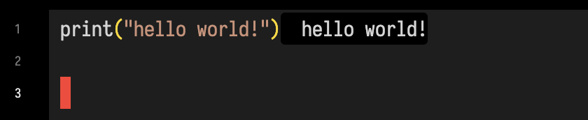

Or, if it doesn't fit on a single line, a little block:
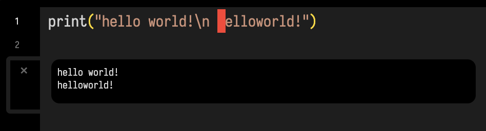

You can close blocks with the 'x' symbol in the margin, or by `double-tap Esc`, which you'll likely be pressing a lot. `triple-tap Esc` will get rid of all the outputs inside the current editor. You'll be doing that a lot.

### `_print(...)` — 'print here':

`_print` is just like `print` except it always prints next to, or underneath the line that `_print` is on. So:

```diffstatic {data-lang=kotlin}
var x = 10
var y = 20
_print(x+y)
var z = 30
```

Gives us something like this:

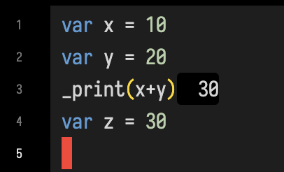

This can be handy in longer, more interesting code, for example:

<video controls autoplay loop muted playsinline style="width: min(100%, 660px);">
	<source src="assets/screen-recording-2026-03-21.mp4" type="video/mp4">
</video>

And is quite performant, so you can just use them as output:

<video controls autoplay loop muted playsinline style="width: min(100%, 660px);">
	<source src="assets/lotsOfPrinting.mp4" type="video/mp4">
</video>


There's a little bit of design here — if they are `_print`'ing but not changing they turn white, otherwise, the thought is that the text changing is enough for you to direct your attention to the line. 

So, if you don't know what that variable is, drop in a `_print()` and find out.

## Printing complex things

Appending `.h` or even `.h2` to the thing that you are printing will cause Field to work much harder to make the thing that you are printing a pretty piece of `h`tml.

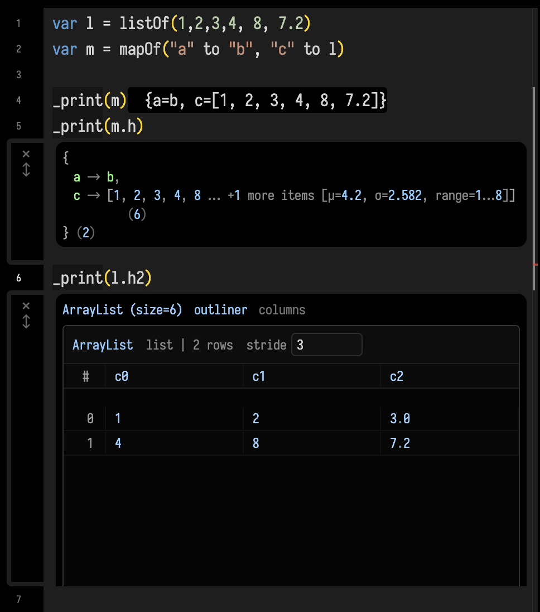

`.h2` is particularly suited to lists and maps with _lots_ of data in them, — Field, intelligently pages in and out just the parts of the data that you are actually looking at, so you can explore gigantic FloatBuffers for example.

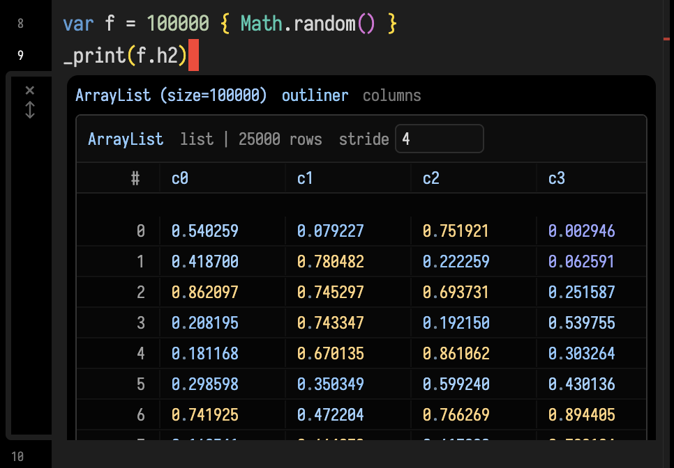

The highlighted colors are showing you the 'unusually' low and high values at a glance — great for scrolling through something long to find the interesting values.

## `display`ing things

We can also 'print' to the canvas using `display`. For example:

```diffstatic {data-lang=kotlin}
var l = listOf(1,2,3,4, 8, 7.2)
var m = mapOf("a" to "b", "c" to l)
display("m is equal to ", m.h)
```

Puts an annotation underneath the box we're writing code in

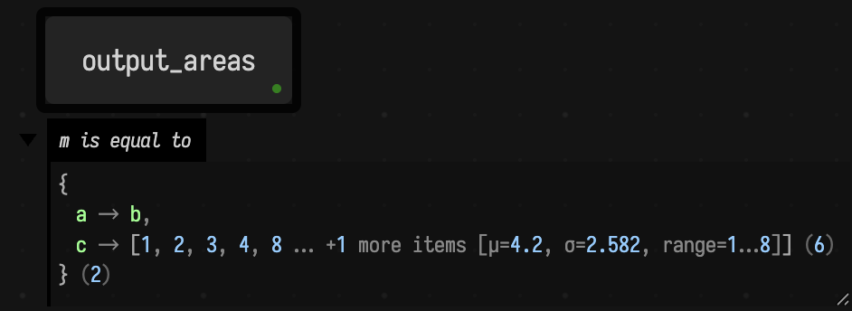

Subsequent calls to `display` overwrites the previous one, giving you a way of 'animating' the output on the canvas. 

While the `.h` and `.h2` visualizers try hard to make things pretty, all they are really doing is making some complex HTML in response to what they are trying to visualize. You can make your own as well:

```diffstatic {data-lang=kotlin}
var l = listOf(1,2,3,4, 8, 7.2)
var m = mapOf("a" to "b", "c" to l)

display("m is equal to ", m.h)

display("just some html", "<div style='font-weight:900'>foo!</div>")
```

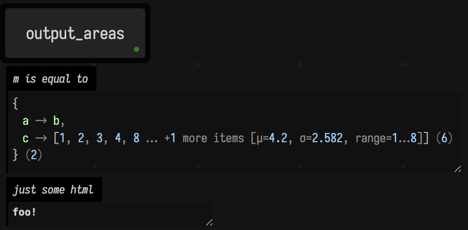

## Browsing things

There are a few more elaborate visualizers for more tangled structures. The "column" visualizer is loosely modelled after Smalltalk's browser:

```diffstatic {data-lang=kotlin}
var l = listOf(1,2,3,4, 8, 7.2)
var m2 = mapOf("foo" to "bar", "gux" to l)
var m = mapOf("a" to "b", "c" to l, "m" to m2)

column("m", m)
```

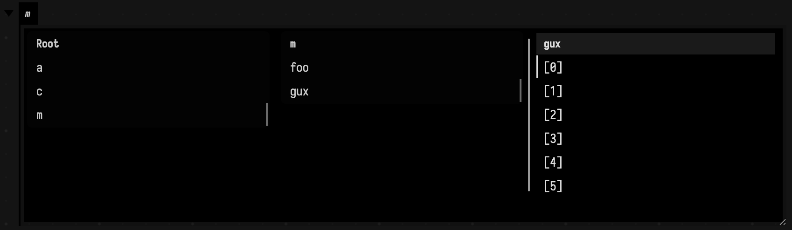

This structure actually live updates if `m` changes.

Similarly there is also `tree` :

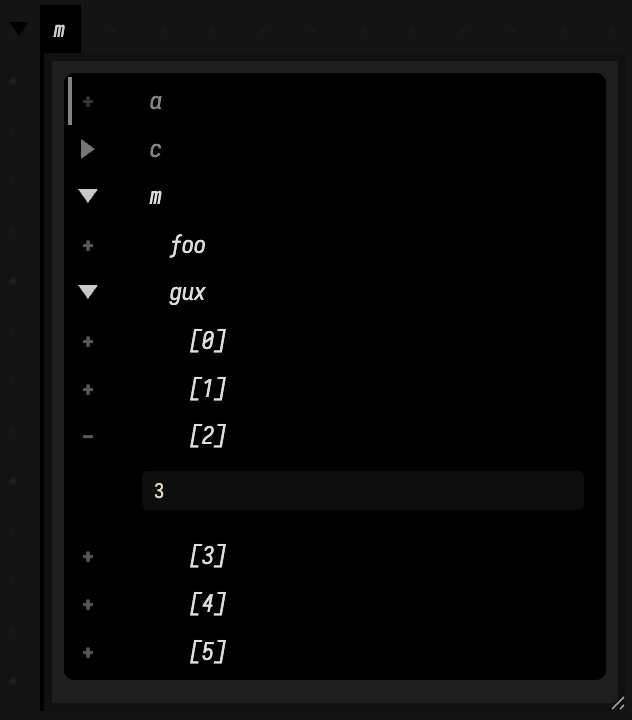

Internally we also have a log viewer (`logs('log')`)

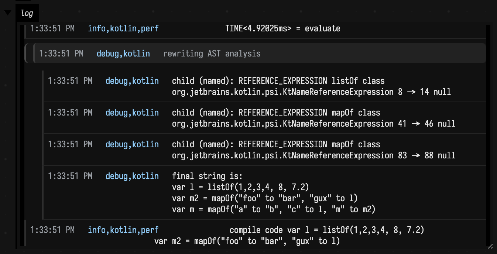

Some systems, like the Vulkan graphics system, expose interface that make them particularly clear when presented with these viewers — to help answer the question, just what exactly am I drawing here and in what order and why is my frame-rate so bad?

## 'printing' (editable) geometry

Field has _extensive_ support for generating 2d and 3d geometry and adding this to the canvas, essentially by `display`ing bundles of `FLine` objects. You can see [fline_examples](fline_examples.md) for a lot more information. But here's a taste:

```diffstatic_runner {data-lang=kotlin screenshot="assets/fline_examples/lines_editable2.png" embed=true}
:::static

val petal = fline {
    moveTo(0, -120)
    cubicTo(90, -100, 140, -20, 0, 120)
    cubicTo(-140, -20, -90, -100, 0, -120)
    close()
    filled = true
    stroked = true
    thickness = 2.5
    color = vec(0.95, 0.42, 0.6, 0.34)
}

val stem = fline {
    moveTo(0, 120)
    cubicTo(10, 180, -20, 230, 0, 300)
    thickness = 5.0
    color = vec(0.45, 0.95, 0.62, 1.0)
}

lines(listOf(petal, stem), w = 420.0, h = 420.0, fitToSize = true, editable = true)
```

It's important to note that you're not just editing a *copy* of the FLine. This editor mutates the actual `FLine` object that you passed in — so this is a way of interacting with code, not just witnessing its effects.

3d (and indeed 3d *editing*) work as well:

<video controls autoplay loop muted playsinline style="width: min(100%, 660px);">
	<source src="assets/3dlines.mp4" type="video/mp4">
</video>

See [fline_examples](fline_examples.md) for more.

## "Printing" UI and data visualization

Take a look at [visualizers](visualizers.md) if you want more help either visualizing values inside your code, or printing user interface components to provide input to your code. Field is set up to run a type and current-value driven 'autocomplete' as the cursor moves around the editor. Just to give you an active hint about what you might type (and what those parameters are in the function you are changing), and what value that variable currently has:

<video controls autoplay loop muted playsinline style="width: min(100%, 660px);">
	<source src="assets/autoauto.mp4" type="video/mp4">
</video>


Additionally, we can write code that extends and decorates our text editor in a variety of ways. Docs are limited, but this gives us a [Strudel](https://strudel.cc/) feel (in a very different language) without too much work at all:

<video controls autoplay loop muted playsinline style="width: min(100%, 660px);">
	<source src="assets/pat.mp4" type="video/mp4">
</video>


## Other output area related things

You can remove output areas you no longer want to see by `option-click`ing their disclosure triangles:

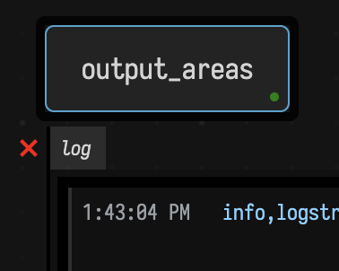

Programmatic control over output areas is through these functions:

```diffstatic {data-lang=kotlin}
displayOpen("foo")
displayClose("foo")
displayClear("foo")
displayClearAll()
```

Progress bars are useful for showing you how a box is getting through its processing:

```diffstatic {data-lang=kotlin}
var z = 0
loop {
    z += 1
    progressBar("progress", (z%10000)/10000.0)
}
```

Yields (when launched):

<video controls autoplay loop muted playsinline style="width: min(100%, 660px);">
	<source src="assets/Screen-Recording-2026-03-21-at-13.48.57.mp4" type="video/mp4">
</video>

`progressBar` is the low-level primitive — you drive it and you clear it. For the common cases there are friendlier helpers that manage the bar for you and clean up after themselves:

```diffstatic {data-lang=kotlin}
// Wrap any iterable / range / count — the bar tracks the loop and removes itself at the end:
for (i in tqdm(0 until 10000)) {
    // ...heavy work...
}

// For routines: report a fraction (with a tqdm-style rate + ETA)...
withProgress("solving") { p ->
    repeat(steps) { i -> /* ...work... */; p.update(i + 1L, steps.toLong()) }
}

// ...or .pulse() when there's no known total (an indeterminate "still working" bar):
val p = progressReporter("reducing")
while (notDone()) { stepOnce(); p.pulse() }
p.finish()
```

These are polite by default: nothing is sent to the front end unless the work runs longer than ~2s, a finished bar lingers for a beat and then removes itself, and the whole thing is a complete no-op when the code isn't running inside a box. Because they hang off the box context, long-running library routines can offer a bar without you asking — `evolveVariety`, sorting-network `anneal`, wave-function-collapse `run`, interaction-net `reduce`, and friends already do.

Turn them all off with `ProgressBars.enabled = false`, or tune `ProgressBars.showDelayMillis` (the grace period) and `ProgressBars.lingerMillis` (how long a completed bar sticks around).

# Multi-language, multi-paradigm

Field's primary language for live coding is Kotlin, which we've found to be expressive and fun (but by no means flawless). We've added a compile-time macro system to it for extra flexibility and joy and the graphics system does some GLSL-driven code-generation. All in all it's working for it quite well. However, being on the JVM does give us access to some other options.

## Python

Via the JEP project, Python works splendidly in Field and we are incentivized to keep going in this direction. [Python in a box](python.md) is the full account: the box topology, the one shared interpreter, and where output lands. Autocompletion is driven by Jedi, and Field's central concept of launching (and stopping) boxes is supported by a custom async runner.

<video controls autoplay loop muted playsinline style="width: min(100%, 660px);">
	<source src="assets/tinypython.mp4" type="video/mp4">
</video>

This means, in effect, that you can live code things like OpenCV and Torch with Jupyter-level autocomplete and Field-level AI support. We'd like Field to be an alternative to Jupyter. Thanks to JEP, interoperation between NumPy and Field's memory buffers is perfectly reasonable. And code like this:

```diffstatic {data-lang=python}
:::static
from afield.python import PythonInterface

box = PythonInterface.thisBox
box.setName("property access from boxes")

box.setPropertyRaw("foo", 10, False)
```

Works as you'd expect. We remain ever-so-slightly sketched out by Python's threading model's interaction with ours, in particular its obvious incompatibilities with Kotlin's coroutines - so there may still be bugs here.

### Notebook interop (`.ipynb`)

Because we'd like Field to be an alternative to Jupyter, the notebook loop goes both ways. **Drag a `.ipynb` onto the canvas** and choose *Import as Python cells*: a fresh "python root" box is created, each code cell becomes a Python cell wired under it, and each markdown/raw cell becomes a `notes` box indented alongside the code so the prose reads inline. **To go the other way**, select the python-root box and run *Export notebook (.ipynb)* from the command palette (or send the `export-ipynb` RPC with the box's uid): Field walks the column top-to-bottom and writes a valid nbformat-4 notebook — Python cells back out as `code` cells, `notes` boxes back out as `markdown` cells. Round-tripping (import → edit → export → re-import) preserves cell count, types, and source text.

## Clojure

Clojure is another wonderful JVM language that we have a lot of respect for:

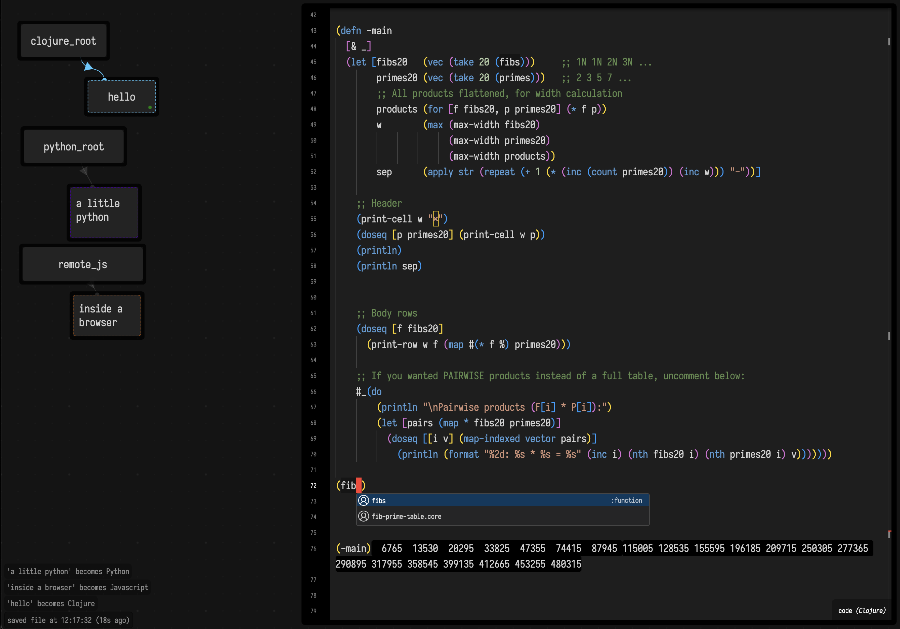

Same idea as Python, one runtime further in: Clojure 1.11 *is* a JVM language, so a Clojure box and
a Kotlin box are two objects in one process with nothing between them. `(.getChildren (box))` walks
the document, an `FLine` you build in Clojure is the same `FLine` Field's renderer draws, and
returning an animation launches it by the same rule a Kotlin box follows. Printed output lands
beside the form that printed it, and so does the exception when a form throws.

And, yes: we have rainbow parens. [Clojure in a box](clojure.md) is the whole story.

## ForthField

Primarily for teaching purposes, a bizarrely useful live-coding dialect of Forth: stack words, dictionary inspection, recursion, return-stack tricks, helpful diagnostics, Field-native visualization, and full JVM interop:

<video controls autoplay loop muted playsinline style="width: min(100%, 660px);">
	<source src="assets/someForth.mp4" type="video/mp4">
</video>

## a-Nano

Nano is a little teaching assembly language with completely over the top integrated visualizers. We're using (a GPU accelerated) version of this language for a little ALife research.

<video controls autoplay loop muted playsinline style="width: min(100%, 660px);">
	<source src="assets/somenano.mp4" type="video/mp4">
</video>

## Spreadsheets!

The most successful and most important programming paradigm of all time — the spreadsheet — has deep integration into Field.

<video controls autoplay loop muted playsinline style="width: min(100%, 660px);">
	<source src="assets/somesheet.mp4" type="video/mp4">
</video>

Supported features include integration with other boxes' variables — changing a dependant variable inside a box magically causes an auto-update sweep of the spreadsheet (next animation frame). And a very deep and understanding type system: while the expression language for the spreadsheet is Kotlin, there's a very carefully wrapped pseudo-numeric type that auto-promotes gleefully, understanding scalars, scalars with physical units, Field's linear algebra types, and even Field's FLine. If you ever wanted a spreadsheet that could do formulae with drawings, this is it. 

## Actors / Message-passing

We can think about 'the box' as taking on the role of "an actor". This marries very well with animation in general (the choreography of things over time) and Kotlin's flexible coroutine system. Given two boxes:

```diffstatic {data-lang=python}
:::static
onMessage<Vec2> {  
    reply(payload.lengthSquared())
}
```

```diffstatic {data-lang=python}
:::static
onMessage<Vec3> {  
    100.alphas {
        /// animate from payload up to something sle
        frame()
    }
    reply(payload.lengthSquared() + 10) // reply
}
```

We can start sending messages around. Messages propagate upwards until they find a box that has an `onMessage<T>` of the correct type.

<video controls autoplay loop muted playsinline style="width: min(100%, 660px);">
	<source src="assets/messagePassing.mp4" type="video/mp4">
</video>


## Document History

Field keeps document backups as you work. The history view lets you inspect those saved versions and restore an earlier state.

You can open history in two ways:

- run `Show Document History` from the command palette
- or open `/history?file=<document-name>` directly on the Field server

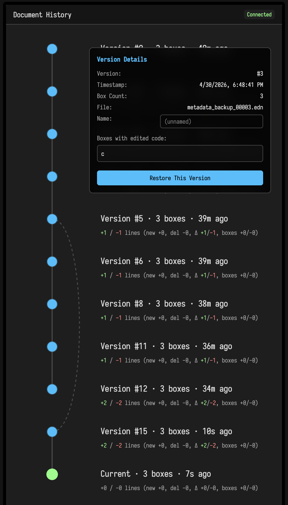

The UI for history here is very dense. In addition to affordences for scrubbing and visualizing edit and execution history both with respect to the current document and adjecent versions, you'll find options for filtering based on content and cherry picking rollbacks (and roll-forwards) to individual and groups of boxes. Once history is open you'll also be able to filter based on editor cursor position (a kind of more deeply penetrating git blame).

## Documentation browser

In some weird inception move, Field has a documentation browser (`Browse Documentation` or `command/ctrl-/`):

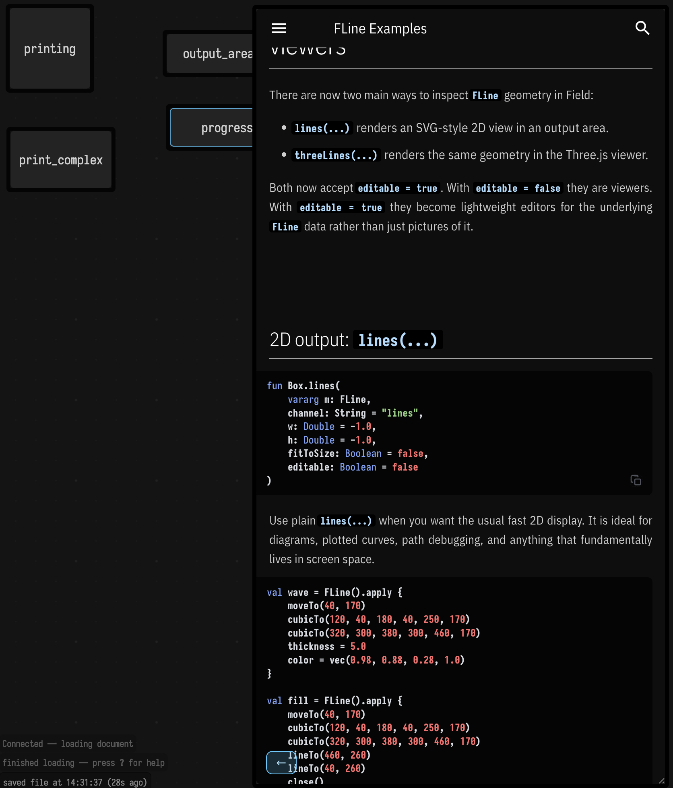

Press that cyan arrow to get back to the text editor.

## Navigating

A few keyboard shortcuts for getting around Field.

`f1` — pressing `f1` when you are in the editor brings up the command palette for that box; pressing it _again_ (`f1-f1`) brings up the command palette for Field as a whole:

<video controls autoplay loop muted playsinline style="width: min(100%, 660px);">
	<source src="assets/Screen-Recording-2026-03-21-at-4.03.42.mp4" type="video/mp4">
</video>

`Double tap-command/control` (command on Mac, control on Windows/Linux) in the editor gives you an affordance that lets you use the cursor keys to switch box:


<video controls autoplay loop muted playsinline style="width: min(100%, 660px);">
	<source src="assets/Screen-Recording-2026-03-21-at-14.12.21.mp4" type="video/mp4">
</video>

`Double tap-shift` opens the 'open anything' search box:

<video controls autoplay loop muted playsinline style="width: min(100%, 660px);">
	<source src="assets/Screen-Recording-2026-03-21-at-14.14.34.mp4" type="video/mp4">
</video>

`command/ctrl-f` does the _Find_ you'd expect inside the editor; but with the keyboard focused on the whole document, finds over the contents of all of the boxes:

<video controls autoplay loop muted playsinline style="width: min(100%, 660px);">
	<source src="assets/Screen-Recording-2026-03-21-at-14.16.23.mp4" type="video/mp4">
</video>

### Layers 

Field boxes exist in layers, and boxes visibilities and positions are _per layer_. `showLayers()` in a box gives you some UI:

```diffstatic_runner {data-lang=kotlin capture="ui" region="window" clip-selector=".layers-palette" screenshot="assets/layers-panel.png" transcript="assets/transcripts/layers_setup.yaml" padding="18" wait="0" timeout="90" embed=true hidden=true name="layers-panel"}
ui.openEditor("layerdemo")
ui.waitForSelector(".layers-palette", 8000.0)
ui.pause(700)
```

Inside individual boxes, you can assign layers with `layers`:

```diffstatic {data-lang=kotlin}
layers = "default,secondLayer"
```

The layers palette shows any layer that's mentioned by any box; the currently selected 'active' layer determines which set of frames you are currently manipulating. If you hide the box that's got the layers panel in it, f1-`show all layers` will get you back. `alt-]` solos the next layer, and `alt-[` solos the previous layer; the command palette labels include the target layer names.

## Drawing on the canvas

`alt-d` turns the canvas into a drawing surface: pens, shapes, arrows and text, in Excalidraw's hand-drawn style, right over your boxes. `alt-d` again and you're back with the boxes, and the drawing stays put, panning and zooming along with everything else. Pinch to zoom, by the way; that works everywhere now.

The fun part is that boxes can read the drawing and draw on it. `notation { arrow(from = thisBox, to = other) }` draws an arrow that follows both boxes around; `notation.onStroke { }` hears every stroke you make; and `notation.space(...)` lets you read a region like a score, cutting it at an instant and asking what's there. Here's Cage's _Fontana Mix_, read by a box:

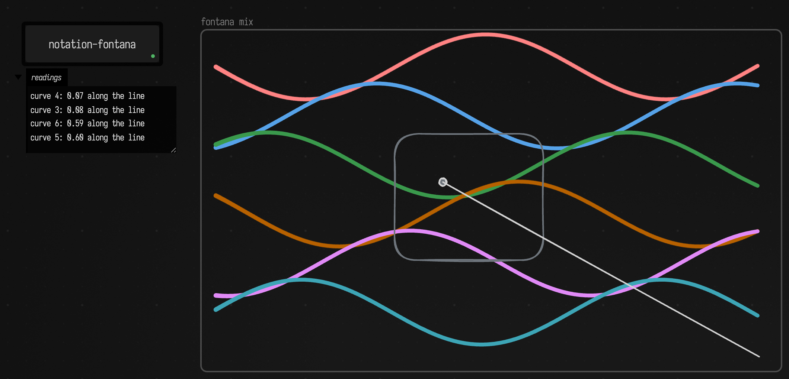

There's a whole page on it: [Drawing and Notation](drawing_and_notation.md).

## The Welcome page

The first page of the bundled version of Field is accessible from any web-browser via `https://localhost:9092/welcome.html`:

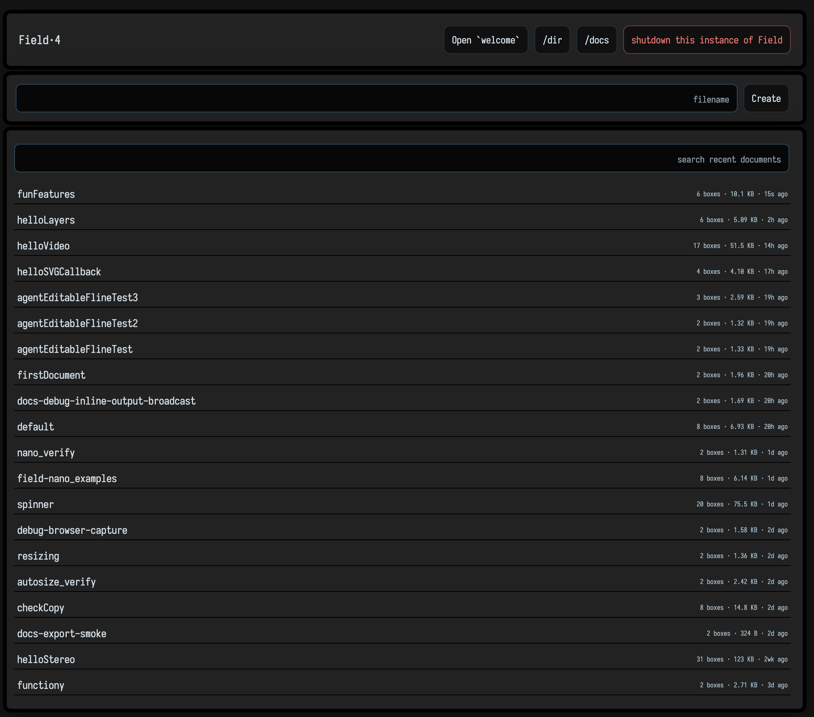

There you can make new documents or find that document you just _know_ you edited last week. It also has full text search over the whole workspace:

<video controls autoplay loop muted playsinline style="width: min(100%, 660px);">
	<source src="assets/welcoming.mp4" type="video/mp4">
</video>

To help you find that snippet of code.

# Keyframes and timelines

One of the reason that Field even has a 2D infinite canvas for code is so that the space of the boxes can become meaningful. Traditionally, in 'time-goes-from-left-to-right' apps (Premier, AfterEffects, Davinci, Motion, etc) somewhere there's an idea of directly editing a function over time with the mouse. Field has a really _very_ fully featured keyframe editor available for boxes to use:

```diffstatic {data-lang=kotlin}
keyframes(channel="k", name="keyframe", defaults=listOf(vec(0.2, 0.5), vec(0.5, 2.0)))
```

Gets you started. With some mouse clicks you can get to here:

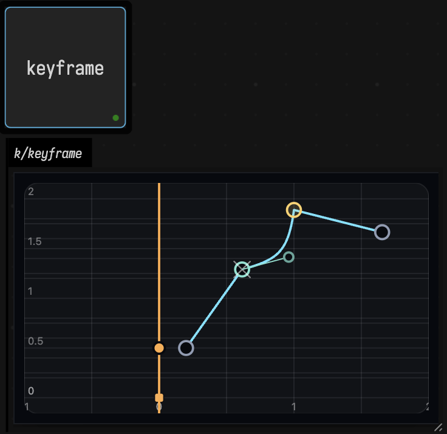

Scroll with `scroll` gestures, zoom with `ctrl-scroll`, `double click` to add a keyframe, right click to change the keyframe type.

These boxes are _input_ and _output_, so this code here, which converts a keyframe set into a Field `Fn` (see [functions_examples]) is:

```diffstatic {data-lang=kotlin}
import afield.stdlib.Functions

val k = keyframes(channel = "k", name = "bob", listOf(0.0, 1.0))
val k2 = keyframes(channel = "k", name = "bob2", listOf(0.0, 1.0))

k.onChange = {
    with(Functions) {
        val f = fromKeyframeEditor(it)
        val f2 = gaussianSmooth(f, sigma = 0.1)       
        f2
    }
}
```

Gets you a smoothed curve that's still editable, by editing the underlying keyframes that make it.

<video controls autoplay loop muted playsinline style="width: min(100%, 660px);">
	<source src="assets/keyframing.mp4" type="video/mp4">
</video>

Once you have a keyframe, you can do a few things with it:

```diffstatic {data-lang=kotlin}
val k = keyframes(channel = "k", name = "bob", listOf(0.0, 1.0))

k.setTime(0.5) // just set the position of the yellow line 
val v : Double = k.evaluateValueAt(0.5)  
val dv : Double = k.evaluateDerivativeAt(0.5)
```

Edited keyframes are stored inside the box — the `defaults` is just there in case the box is new.

## Time sliders & Custom UI

Inserting a `field.timeSlider` template from the `f1` menu gets you a box that a) draws itself as a vertical line and b) launches and stops boxes it passes over:

<video controls autoplay loop muted playsinline style="width: min(100%, 660px);">
	<source src="assets/ts.mp4" type="video/mp4">
</video>

For the extra curious, this slider is just a regular box with some customizations to its on-canvas appearance and behavior:

```diffstatic {data-lang=kotlin}
// export this box so that any box can now write 'execution' to talk about this box
rootProp<Box>(execution) = thisBox

fun launchFrom(was : Double, now : Double) {
 
    val all = root.children - thisBox // candidates for execution
    val a = all.filter { it.frame.intersects(was) }
    val b = all.filter { it.frame.intersects(was, now) }
    val c = all.filter { it.frame.intersects(now) }

    val incoming = c-a 
    val outgoing = a-c 
    val onlyOnce = b-(a+c) // starting and stopping

    incoming.forEach(Box::begin) 
    outgoing.forEach(Box::end)

    onlyOnce.forEach {
        inMain {
            it.begin()
            yield()
            it.end()
        }
    }
}

// whenever the viewport changes run this to keep the line covering the view
onViewportChange += "lock_x" to { inside, a, b -> 
    frame = frame.copy(y = -b.y-100, h = b.h*2-50, w = 40.0)
}

// whenever the frame of the box changes run this
onFrameChange += "lock_x" to { inside, a, b -> 
    launchFrom(a.x, b.x)
    b.copy(y = -inside.viewport.y-100, w = 40.0)
}

// just set the width to be 40.0
frame = frame.copy(w=40.0)

// set a custom border, and lock the height
customization = """
    this.style.border = "0px solid transparent"
    this.style.borderLeft = "3px solid red"
    this.style.background = "transparent"
    this.style.marginTop = "0px"
    this.style.paddingTop = "0px"
    this.style.setProperty("--box-border", "0")
    this.style.fontStyle = "italic"
    this.style.color = "white"
    this.lock_w = true
    this.lock_h = true
"""

name = "t"

autorun = true
```

## Custom Marking Menus

There are lots of other ways of customizing Field's front end from within Field. One, higher level, is to introduce a custom Marking Menu:

```diffstatic {data-lang=kotlin}
customMarking["N" to "bob"] = { _print("North!") }
customMarking["SE" to "something"] = { _print("se!") }
customMarking["W2" to "the end"] = { _print("W!")}  // outer ring
```

You can open and swipe around these callbacks with `alt-shift-click`:

<video controls autoplay loop muted playsinline style="width: min(100%, 660px);">
	<source src="assets/customMarking.mp4" type="video/mp4">
</video>


## Snapping

When `caps-lock` is lit boxes snap to other boxes when you move them around or resize them — good for aligning things when we're in timeline mode.

<video controls autoplay loop muted playsinline style="width: min(100%, 660px);">
	<source src="assets/snapping.mp4" type="video/mp4">
</video>

You'll also find a couple of different 'align' and 'organize' commands in the document level command palette for tidying up after yourself.

# Making bigger things

By default every box of code is pretty isolated from all of the other boxes. This is often what you want — otherwise you are constantly wondering if something you write in one box will break another piece of code somewhere else. But sometimes you want boxes to communicate. Field does this in a couple of ways.

### Shared properties

We can connect boxes together using the `connect` command, selecting the parent and then the child and pressing `g`:

<video controls autoplay loop muted playsinline style="width: min(100%, 660px);">
	<source src="assets/connecting.mp4" type="video/mp4">
</video>

(Disconnect, is select then 'u'). Now these two boxes are connected they can opt into sharing certain things.

In the `Parent`:

```diffstatic {data-lang=kotlin}
prop<Double>(foo) = 10.0
```

Means that in the children:

```diffstatic {data-lang=kotlin}
_print(foo)
```

Prints `10.0`. You can think about this mechanism as 'exporting' particular variables (with types) to child boxes. `prop` here is a _macro_ that expands and runs some set of glue code that makes a real Kotlin property backed by the right kind of storage. This glue code is stored in the `preamble` property. This code accumulates but it's essentially a layer of inherited auto-regeneratable glue code between boxes and their children.  

Anything that has an exportable type in Kotlin can travel — this includes Kotlin lambdas, `Vec3` etc. But, alas, not types defined inside boxes.

Properties also support lazy initialization:

```diffstatic {data-lang=kotlin}
prop<Vec2>(myVec)

once.myVec {
    // `myVec` will stay the same for this whole session
    vec(1,2).noise(10.0) 
}
```

`once.myVec { ... }` computes when the property is `null` and caches a non-null result on the box.
(`null` itself is not cached.) This is useful in the graphics system because a box often wants to
create one window and Vulkan renderer, then publish those resources to descendants through `prop`.

For the mechanism behind all of this — how `prop`/`once` expand, how properties propagate up the box graph, the `@exported` annotation, the typed accessors `moduleHere { }` generates, and the `//%-` fragment break — see [Running code in a box](running_code.md).

## Nesting

Boxes can be nested inside other boxes (`f1` "nest ...")

<video controls autoplay loop muted playsinline style="width: min(100%, 660px);">
	<source src="assets/nesting.mp4" type="video/mp4">
</video>

This allows you to encapsulate boxes inside other boxes to work together to achieve a common aim. 

Nested parents can be referenced inside nesting children with `nestedIn` (`Box?`) and nesting parents can get a `Set<Box>` of their nest children with `nested`. If there are non-visible nesting children that are acting as children or parents to boxes that _are_ visible that is notated in the connections:

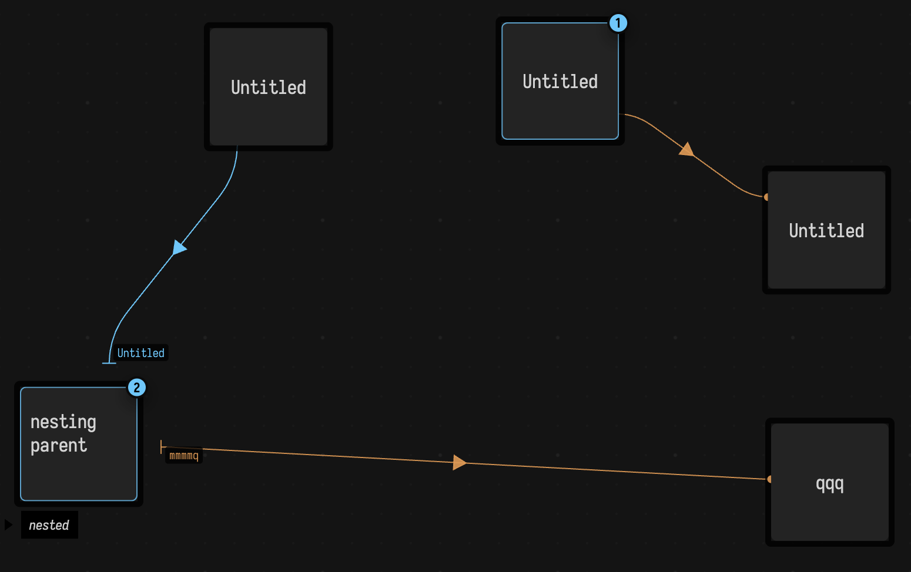

## Referencing

Finally, `named("foo")` returns a `Box?` called "foo" searching from the current box 'downwards' through the hierarchy if it exists. Similarly `root.named("foo")` searches starting at the root of the document — a virtual parent to all boxes.

# Collaborating

Field's back-end just serves pages to any browser that contacts it; it's just usual that Field is running on the machine that you are using to look at its interface. But if you can conspire to open a webpage up on that server you can do so from anywhere on earth (OpenEndedGroup particularly likes [TailScale](https://tailscale.com/) for this, but there are other options). 

<video controls autoplay loop muted playsinline style="width: min(100%, 660px);">
	<source src="assets/collab.mp4" type="video/mp4">
</video>

Multiple browser clients receive the same server-side box and property updates. Field attempts to
preserve non-overlapping editor changes, but simultaneous edits to the same text are not a promised
conflict-free collaboration protocol.

## Multiple editors

The document-level command 'Add Editor to Output Area` will allow you to pin a particular property of a box to a boxes output zone:

<video controls autoplay loop muted playsinline style="width: min(100%, 660px);">
	<source src="assets/multieditor.mp4" type="video/mp4">
</video>

These additional, fully functional editors, give you a place to keep code (or outputs embedded in code!) that you keep coming back to.

## From your phone

The other browser worth pointing at Field is the one in your pocket. Field serves a page at
`/controllers` that is built for a phone rather than shrunk down to one: a large touch pad that
sends X, Y or both into the selected box, the sliders and colour wells that box publishes, its
output areas reformatted into a single narrow column, the real AI4 conversation for it, Open
Anything, and a full Monaco editor on whatever is selected. There is one selection behind all of
it, shared with the desktop — the phone follows Field's, and a pick made on the phone becomes
Field's — so a piece can be running on a projector while you hold its controls and walk around in
front of it.

[Field from your phone](mobile_controllers.md) has the URL, what each of the six tabs does, and the
warning that goes with any of this: the page can run boxes, edit code and call AI4 tools, so it
belongs on a network you trust and never on the open internet.
