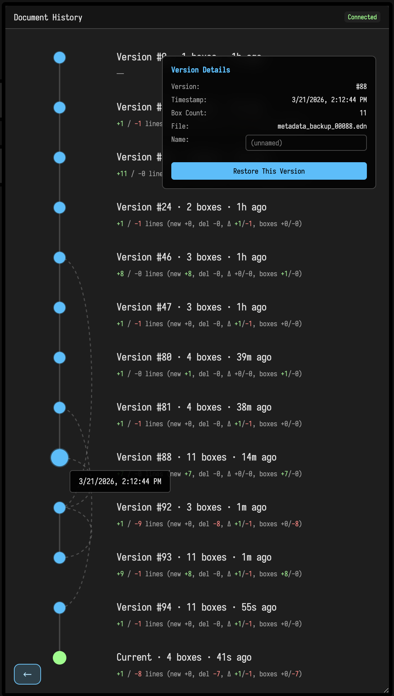

# A Tour

Field aims to be full of unexpectedly fun features that help you interact with code. This page is going to be a long list of things that delight, things that you didn't think you'd need, and things that help when you are puzzled.

## Running things

You can run code in Field the following ways (from the commonplace to the rare)

 * `alt-enter` — runs the line/block that the cursor is in.
 * `alt-enter` — runs the currently selected lines
 * `alt-up arrow` — launches the currently edited box. `alt-down arrow` stops.
 * `alt-click` — launches the clicked-on box while the mouse is down. Swipe up to let go and keep launched; `alt-click / swipe down` stops. e.g.:

<video controls autoplay loop muted playsinline style="width: min(50%, 560px);">
	<source src="../assets/launching.mp4" type="video/mp4">
</video>

 * `alt-0` — runs everything in a box (but doesn't launch it)
 * `Command/ctrl-alt-k` and `Command/ctrl-alt-j` increments and decrements the number under the cursor and then acts like you pressed alt-enter.
 * `alt-double-clicking` `true` or `false` in the editor flips it to the opposite and then `alt-enter`s
 *  `alt-double-clicking` the name of a function in scope that has signature `foo()` just runs the function.
 *  `alt-1` — launches the current block that the cursor is in.
 *  Writing code that launches other boxes. For example `root.named("progress").begin()` launches a box called "progress". 

What's the difference between 'running' and 'launching'? Boxes have the opportunity to end with an object that could 'keep on going by itself'. These objects, on launching, get threaded into the animation loop. Every launched box gets one 'go' at computing per animation cycle in a consistent order.  

Some of these effects are language dependant. For example, if you are editing a GLSL shader property, alt-enter recompiles and reloads the shader instead.

## Printing things

Often your code does something — draws a line, loads a model, makes a sound. But when you are puzzled as to what is running, and where, and when you are confused as to how your variables are varying, nothing beats a good old print statement. Field has a few different ways of doing this.

### `print(...)` — The first is easy:

```diffstatic {data-lang=kotlin}
print("hello world")
```

That just prints things at the end of the code you executed, taking up a single line at the end:


Or, if it doesn't fit on a single line, a little block:


You can close blocks with the 'x' symbol in the margin, or by `double-tap Esc`.

### `_print(...)` — 'print here':

`_print` is just like `print` except it always prints next to, or underneath the line that `_print` is on. So:

```diffstatic {data-lang=kotlin}
var x = 10
var y = 20
_print(x+y)
var z = 30
```

Gives us something like this:


This can be handy in longer, more interesting code, for example:

<video controls autoplay loop muted playsinline style="width: min(50%, 560px);">
	<source src="../assets/screen-recording-2026-03-21.mp4" type="video/mp4">
</video>

And is quite performance, so you can just use them as output:

<video controls autoplay loop muted playsinline style="width: min(100%, 560px);">
	<source src="../assets/lotsOfPrinting.mp4" type="video/mp4">
</video>


So, if you don't know what that variable is, drop in a `_print()` and find out.

## Printing complex things

Appending `.h` or `.h2` will cause Field to work much harder to make the thing that you are printing pretty.


`.h2` is particularly suited to lists and maps with _lots_ of data in them, indeed, intelligently paging in and out just the parts of the data that you are actually looking at.


The highlighted colors are showing you the 'unusually' low and high values at a glance — great for scrolling through something long to find the interesting values.

## `display`ing things

We can also 'print' to the canvas. For example:

```diffstatic {data-lang=kotlin}
var l = listOf(1,2,3,4, 8, 7.2)
var m = mapOf("a" to "b", "c" to l)
display("m is equal to ", m.h)
```

Puts an annotation underneath the box we're writing code in


Subsequent calls to `display` overwrites the previous one, giving you a way of 'animating' the output on the canvas. 

While the `.h` and `.h2` visualizers try hard to make things pretty, all they are really doing is making some complex HTML in response to what they are trying to visualize. You can make your own as well:

```diffstatic {data-lang=kotlin}
var l = listOf(1,2,3,4, 8, 7.2)
var m = mapOf("a" to "b", "c" to l)

display("m is equal to ", m.h)

display("just some html", "<div style='font-weight:900'>foo!</div>")
```


## Browsing things

There are a few more elaborate visualizers for more tangled structures. The "column" visualizer is loosely modelled after Smalltalk's browser:

```diffstatic {data-lang=kotlin}
var l = listOf(1,2,3,4, 8, 7.2)
var m2 = mapOf("foo" to "bar", "gux" to l)
var m = mapOf("a" to "b", "c" to l, "m" to m2)

column("m", m)
```


This structure actually live updates if `m` changes.

Similarly there is also `tree` :


Internally we also have a log viewer (`logs('log')`)


## 'printing' (editable) geometry

Field has extensive support for adding 2d and 3d geometry to the canvas, essentially by `display`ing bundles of `FLine` objects. You can see [fline_examples](../fline_examples) for more information. But here's a taste:

```diffstatic_runner {data-lang=kotlin screenshot="assets/fline_examples/lines_editable2.png" embed=true}
:::static

val petal = FLine().apply {
    moveTo(0, -120)
    cubicTo(90, -100, 140, -20, 0, 120)
    cubicTo(-140, -20, -90, -100, 0, -120)
    close()
    filled = true
    stroked = true
    thickness = 2.5
    color = vec(0.95, 0.42, 0.6, 0.34)
}

val stem = FLine().apply {
    moveTo(0, 120)
    cubicTo(10, 180, -20, 230, 0, 300)
    thickness = 5.0
    color = vec(0.45, 0.95, 0.62, 1.0)
}

lines(listOf(petal, stem), w = 420.0, h = 420.0, fitToSize = true, editable = true)
```

Its important to note that not just editing a copy of the FLine. It mutates the actual `FLine` object that you passed in — so this is a way of interacting with code, note just witnessing it's effects.

3d (and indeed 3d editing) work as well:

<video controls autoplay loop muted playsinline style="width: min(100%, 560px);">
	<source src="../assets/3dlines.mp4" type="video/mp4">
</video>

See [fline_examples](../fline_examples) for more.

## "Printing" UI and data visualization

Take a look at [visualizers](../visualizers) if you want more help either visualizing values inside your code, or printing user interface components to provide input to your code.

Additionally, we can write code that extends and decorates our text editor in a variety of ways. Docs are limited, but this gives us a [Strudel](https://strudel.cc/) feel (in a very different language) without too much work at all:

<video controls autoplay loop muted playsinline style="width: min(100%, 560px);">
	<source src="../assets/pat.mp4" type="video/mp4">
</video>


## Other output area related things

You can remove output areas you no longer want to see by option clicking their disclosure triangles:


Programmatic control over output areas is though these functions:

```diffstatic {data-lang=kotlin}
displayOpen("foo")
displayClose("foo")
displayClear("foo")
displayClearAll()
```

Progress bars are useful for showing you how a box is getting through it's processing:

```diffstatic {data-lang=kotlin}
var z = 0
loop {
    z += 1
    progressBar("progress", (z%10000)/10000.0)
}
```

Yields (when launched):

<video controls autoplay loop muted playsinline style="width: min(50%, 560px);">
	<source src="../assets/Screen-Recording-2026-03-21-at-13.48.57.mp4" type="video/mp4">
</video>

## Document History

Field keeps document backups as you work. The history view lets you inspect those saved versions and restore an earlier state.


You can open history in two ways:

- run `Show Document History` from the command palette
- or open `/history?file=<document-name>` directly on the Field server

The history view opens in the documentation iframe area rather than inside a normal box. You'll get a visualization of what's changed and when in your code, and the ability to roll back (and forward!). Don't be afraid to change your mind. 

## Documentation browser

In some weird inception move, Field has a documentation browser (`Browse Documentation` or `command/ctrl-/`):


Press that cyan arrow to get back to the text editor.

## Navigating

A few keyboard shortcuts for getting around Field.

`f1` — pressing `f1` when you are in the editor brings up the command palette for that box; pressing it _again_ brings up the command palette for Field as a whole:

<video controls autoplay loop muted playsinline style="width: min(50%, 560px);">
	<source src="../assets/Screen-Recording-2026-03-21-at-4.03.42.mp4" type="video/mp4">
</video>

`Double tap-command/control` (command on Mac, control on Windows/Linux) in the editor gives you an affordance that let's you use the cursor keys to switch box:


<video controls autoplay loop muted playsinline style="width: min(100%, 560px);">
	<source src="../assets/Screen-Recording-2026-03-21-at-14.12.21.mp4" type="video/mp4">
</video>

`Double tap-shift` opens the 'open anything' search box:

<video controls autoplay loop muted playsinline style="width: min(100%, 560px);">
	<source src="../assets/Screen-Recording-2026-03-21-at-14.14.34.mp4" type="video/mp4">
</video>

`command/ctrl-f` does the Find you'd expect inside the editor; but with the keyboard focused on the whole document, finds over the contents of all of the boxes:

<video controls autoplay loop muted playsinline style="width: min(100%, 560px);">
	<source src="../assets/Screen-Recording-2026-03-21-at-14.16.23.mp4" type="video/mp4">
</video>

## The Welcome page

The first page of the bundled version of Field is accessible from any web-browser via `https://localhost:9092/welcome.html`:


There you can make new documents or find that document you just _know_ you edited last week. It also has full text search over the whole workspace:

<video controls autoplay loop muted playsinline style="width: min(100%, 560px);">
	<source src="../assets/welcoming.mp4" type="video/mp4">
</video>

To help you find that snippet of code.

# Keyframes and timelines

One of the reason that Field even has a 2D infinite canvas for code is so that the space of the boxes can become meaningful. Traditionally, in 'time-goes-from-left-to-right' apps (Premier, AfterEffects, Davinci, Motion, etc) somewhere there's an idea of directly editing a function over time with the mouse. Field has a really _very_ fully featured keyframe edtior available for boxes to use:

```diffstatic {data-lang=kotlin}
keyframes(channel="k", name="keyframe", defaults=listOf(vec(0.2, 0.5), vec(0.5, 2.0)))
```

Gets you started. With some mouse clicks you can get to here:


Scroll with `scroll` gestures, zoom with `ctrl-scroll`, `double click` to add a keyframe, right click to change the keyframe type.

These boxes are _input_ and _output_, so this code here, which converts a keyframe set into a Field `Fn` (see [functions_examples]) is:

```diffstatic {data-lang=kotlin}
import afield.stdlib.Functions

val k = keyframes(channel = "k", name = "bob", listOf(0.0, 1.0))
val k2 = keyframes(channel = "k", name = "bob2", listOf(0.0, 1.0))

k.onChange = {
    with(Functions) {
        val f = fromKeyframeEditor(it)
        val f2 = gaussianSmooth(f, sigma = 0.1)       
        f2
    }
}
```

Gets you a smoothed curve that's still editable, by editing the underlying keyframes that make it.

<video controls autoplay loop muted playsinline style="width: min(100%, 560px);">
	<source src="../assets/keyframing.mp4" type="video/mp4">
</video>

Once you have a keyframe, you can do a few things with it:

```diffstatic {data-lang=kotlin}
val k = keyframes(channel = "k", name = "bob", listOf(0.0, 1.0))

k.setTime(0.5) // just set the position of the yellow line 
val v : Double = k.evaluateValueAt(0.5)  
val dv : Double = k.evaluateDerivativeAt(0.5)
```

Edited keyframes are stored inside the box — the `defaults` is just there in case the box is new.

## Time sliders

Inserting a `field.timeSlider` template from the `f1` menu gets you a box that a) draws itself as a vertical line and b) launches and stops boxes it passes over:

<video controls autoplay loop muted playsinline style="width: min(100%, 560px);">
	<source src="../assets/ts.mp4" type="video/mp4">
</video>

For the extra curious, this slider is just a regular box with some customizations to its on-canvas appearance and behavior:

```diffstatic {data-lang=kotlin}
// export this box so that any box can now write 'execution' to talk about this box
rootProp<Box>(execution) = thisBox

fun launchFrom(was : Double, now : Double) {
 
    val all = root.children - thisBox // candidates for execution
    val a = all.filter { it.frame.intersects(was) }
    val b = all.filter { it.frame.intersects(was, now) }
    val c = all.filter { it.frame.intersects(now) }

    val incoming = c-a 
    val outgoing = a-c 
    val onlyOnce = b-(a+c) // starting and stopping

    incoming.forEach(Box::begin) 
    outgoing.forEach(Box::end)

    onlyOnce.forEach {
        inMain {
            it.begin()
            yield()
            it.end()
        }
    }
}

// whenever the viewport changes run this to keep the line covering the view
onViewportChange += "lock_x" to { inside, a, b -> 
    frame = frame.copy(y = -b.y-100, h = b.h*2-50, w = 40.0)
}

// whenever the frame of the box changes run this
onFrameChange += "lock_x" to { inside, a, b -> 
    launchFrom(a.x, b.x)
    b.copy(y = -inside.viewport.y-100, w = 40.0)
}

// just set the width to be 40.0
frame = frame.copy(w=40.0)

// set a custom border, and lock the height
customization = """
    this.style.border = "0px solid transparent"
    this.style.borderLeft = "3px solid red"
    this.style.background = "transparent"
    this.style.marginTop = "0px"
    this.style.paddingTop = "0px"
    this.style.setProperty("--box-border", "0")
    this.style.fontStyle = "italic"
    this.style.color = "white"
    this.lock_w = true
    this.lock_h = true
"""

name = "t"

autorun = true
```

## Snapping

When `caps-lock` is lit boxes snap to other boxes when you move them around or resize them — good for aligning things when we're in timeline mode.

<video controls autoplay loop muted playsinline style="width: min(100%, 560px);">
	<source src="../assets/snapping.mp4" type="video/mp4">
</video>

You'll also find a couple of different 'align' and 'organize' commands in the document level command palette for tidying up after yourself.

# Making bigger things

By default every box of code is pretty isolated from all of the other boxes. This is often what you want — otherwise you are constantly wondering if something you write in one box will break another piece of code somewhere else. But sometimes you want boxes to communicate. Field does this in a couple of ways.

### Shared properties

We can connect boxes together using the `connect` command, selecting the parent and then the child and pressing `g`:

<video controls autoplay loop muted playsinline style="width: min(100%, 560px);">
	<source src="../assets/connecting.mp4" type="video/mp4">
</video>

(Disconnect, is select then 'u'). Now these two boxes are connected they can opt into sharing certain things.

In the `Parent`:

```diffstatic {data-lang=kotlin}
prop<Double>(foo) = 10.0
```

Means that in the children:

```diffstatic {data-lang=kotlin}
_print(foo)
```

Prints `10.0`. You can think about this mechanism as 'exporting' particular variables (with types) to child boxes. `prop` here is a _macro_ that expands and runs some set of glue code that makes a real Kotlin property backed by the right kind of storage. This glue code is stored in the `preamble` property. 

Anything that has an exportable type in Kotlin can travel — this includes Kotlin lambdas, `Vec3` etc. But, alas, not types defined inside boxes.

Properties also have a few other uses. One is to conspire to run code exactly once:

```diffstatic {data-lang=kotlin}
prop<Vec2>(myVec)

once.myVec {
    // will stay the same for this whole session
    vec(1,2).noise(10.0) 
}
```

This is useful in the graphics system because you often only want to open exactly one window and Vulkan Renderer. This pairs well with the exporting behavior of `prop` since these resources often want to be shared everywhere. For example, resources from the current box and all parent boxes are often automatically found by parts of the graphics system. 

## Nesting

Boxes can be nested inside other boxes (`f1` "nest ...")

<video controls autoplay loop muted playsinline style="width: min(100%, 560px);">
	<source src="../assets/nesting.mp4" type="video/mp4">
</video>

This allows you to encapsulate boxes inside other boxes to work together to achieve a common aim. 

Nested parents can be referenced inside nesting children with `nestedIn` (`Box?`) and nesting parents can get a `Set<Box>` of their nest children with `nested`. If there are non-visible nesting children that are acting as children or parents to boxes that _are_ visible that is notated in the connections:


## Referencing

Finally, `named("foo")` returns a `Box?` called "foo" searching from the current box 'downwards' through the hierarchy if it exists. Similarly `root.named("foo")` searches starting at the root of the document — a virtual parent to all boxes.

# Collaborating

Field's back-end just serves pages to any browser that contacts it; it's just usual that Field is running on the machine that you are using to look at it's interface. But if you can conspire to open a webpage up on that server you can do so from anywhere on earth (OpenEndedGroup particularly likes [TailScale](https://tailscale.com/) for this, but there are other options). Additionally, if more than one person has the webpage open at the same time, everything should just work — people will see each other's boxes, and non-overlapping edits to code should merge correctly if possible.

