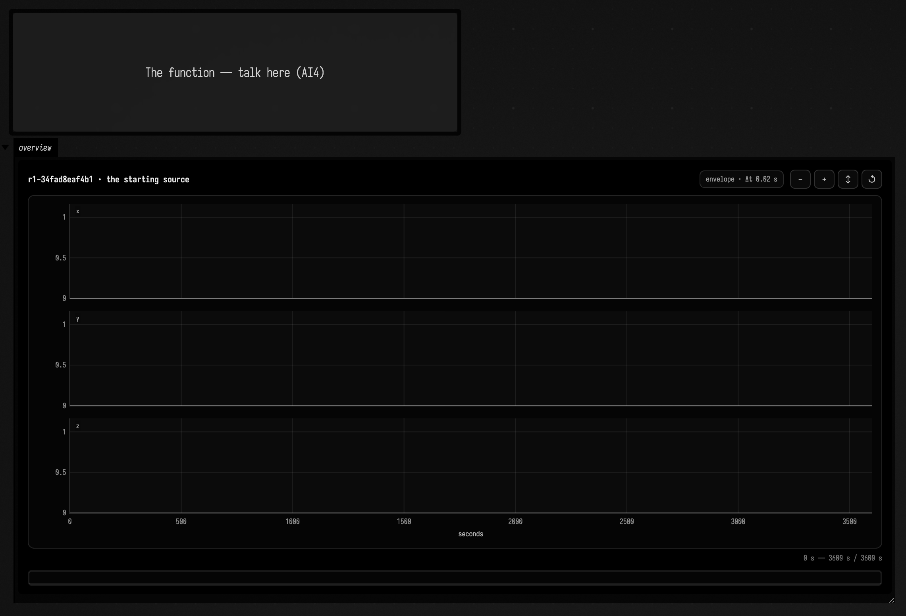
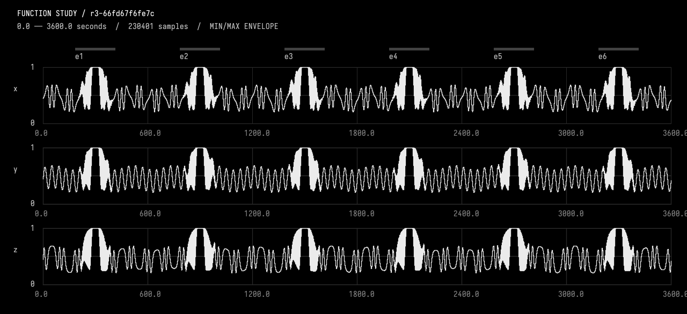
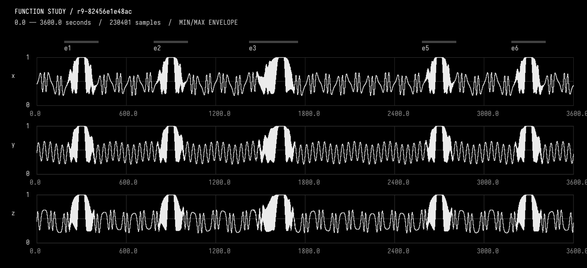

# Talking a function into existence

Start with three flat lines. Describe how they should move. Look at the result,
zoom into a passage, and ask for a change. Each accepted change becomes ordinary
Kotlin in a Field box, with a saved revision you can inspect or return to.

This example uses AI4 chat to build a one-hour, three-channel signal. The box
that holds the function is a *function study*: its AI4 chat has tools to edit
the Kotlin, plot it, and check what changed, and its output shows the signal
viewer. The tools ship with Field, and a document can add its own from a box —
the working document can extend the environment you are working in, and teach
the assistant a new way to observe and act, with no Field rebuild.

[Talking a shader into existence](stacksl_conversation.md) does the same for a
StackSL program drawn live in a window.

## Start from a blank document

[Download the blank starter](assets/function_conversation/function_conversation.zip).
Unzip it into your Field workspace, keeping the `function_conversation` folder
intact, then open that document. Configure an AI provider through Field's welcome
page if you have not already; see [AI features](aiFeatures.md).

The starter has one box, **The function — talk here (AI4)**. Opening the
document checks its source in as the first revision and draws it in the box's
viewer. Select the box and press **command/ctrl-4** to open AI4 chat.



The source initially returns three zero-valued channels, named x, y and z, over
3,600 seconds. There are no crescendos, previous conversations, or inherited
revisions; the first checked revision belongs to your own session. Each study
keeps its history under `studies/<box id>/` in its document, so the starter and
the worked example below can be open at once.

Any box whose Kotlin returns a `StudyComposition` can be a function study: select
it and choose **Make a Function Study** from the command palette. An empty box
is given this starter's source.

### The starting Kotlin

This is the complete code in the downloadable starter's **function_source** box.
Each `fn` receives a time in seconds and currently returns `0.0`; `StudyComposition`
collects the three channels. The conversation replaces and extends this same code.

<!-- function-study-source:starter -->
```diffstatic {data-lang=kotlin}
import afield.stdlib.Functions
import afield.stdlib.StudyComposition
import afield.stdlib.StudyChoice

// Three empty channels. Describe the function you want in this box's AI4 chat.
with(Functions) {
    StudyComposition(
        channels = listOf("x", "y", "z").map { name ->
            fn(0.0..3600.0, name) { 0.0 }
        },
        choices = listOf(
            StudyChoice("One hour, three zero-valued channels: a starting point to replace", "starter assumption")
        )
    )
}
```
<!-- /function-study-source:starter -->

You can [jump to the finished source](#the-finished-kotlin) to compare the two.
Try this in the source box's chat:

> Let's start with a 3d channel function, lasting an hour — sine waves from 0 to 1
> at around 0.2 Hz, drifting slowly in and out of phase.

Here **3d means three values at each time**, rather than a drawing in space.
The model will need to choose or discuss the rate and shape of the phase drift.
The document asks it to record those choices separately from your requirements.
This prompt is a starting suggestion; the worked conversation below uses a
different, more developed brief.

Keep the source editor open. When an edit succeeds, you should see both the new
Kotlin and an updated **overview**. A plot without a source update is not a
completed edit. AI4 also receives a local plot and numerical checks before it
explains the result.

## Zooming the viewer

An hour of a 0.2 Hz signal contains about 720 cycles. At that scale the viewer
shows a band of sampled minima and maxima. Zoom into roughly 25 seconds to see
about five cycles and judge their relative phase.

The signal viewer shares one time axis across all channels. Wheel or pinch to
zoom, drag to pan, and use **all** to return to the whole duration. Hover to read
sampled values. Your time window survives accepted edits, and a previous revision
can appear in dashed grey.

Zooming requests finer samples from the functions themselves. A wide envelope shows
the range within each bin; it does not preserve the order of the oscillations
inside that bin, and a feature narrower than a bin can fall between samples
entirely. Zoom in before you judge a detail.

## A worked conversation

[Download the developed example](assets/function_conversation/function_conversation_example.zip)
to open **function_conversation_example**. It contains the finished source, all
nine saved revisions, and the recorded conversations and plots. Opening it restores
the checked composition and draws the viewer. Then select **The function — talk
here (AI4)** and press **command/ctrl-4**.
The seven recorded turns are already in that box's chat, with their original
prompts, replies, tool traces and plot images. Scroll back to watch the function
grow, or send a new message to continue from the finished example. Simply opening
the saved chat and viewer does not make a model call.


This is Field's chat panel, restored from the recorded run. Here the chat is
scrolled back to the move-and-stretch exchange; the viewer shows the final saved
revision. The starter is still blank; the developed example carries this history.
The older turns predate model badges, so they show **Model not recorded**; the
archive names the run's provider and model.

### From constants to a composition

The recorded run began with this earlier version of the blank box. Its channels
returned `0.5`, rather than the current starter's `0.0`. Revisions r1 and r2 contain
this same source; the first saved conversation grows r2 into r3.

<!-- function-study-source:recorded-start -->
```diffstatic {data-lang=kotlin}
import afield.stdlib.Functions
import afield.stdlib.StudyComposition
import afield.stdlib.StudyChoice

// A blank musical page: three constant channels. Ask AI4 to grow this Kotlin.
// The final expression returns a candidate; the tools box compiles and checks it.
with(Functions) {
    StudyComposition(
        channels = listOf("x", "y", "z").map { name -> fn(0.0..3600.0, name) { 0.5 } },
        choices = listOf(StudyChoice("Initial constant background is a disposable starting point", "agent assumption"))
    )
}
```
<!-- /function-study-source:recorded-start -->

The original request was for smooth channels drifting in and out of phase, with
six evenly spaced pulse crescendos and decrescendos. Each event should reach
exactly `(1, 1, 1)` for 30 seconds, then return to the continuing background.
The model chose a 40-second carrier and a 100-second phase-drift period, and
recorded those as assumptions.



The bright blocks locate the six events. This whole-hour picture is useful for
placement; the saved local plots reveal the individual pulses and their joins.

Here is the new background evaluator in **r3**. Its phase depends on the channel,
so x, y and z drift apart and return together. The named constants set the chosen
40-second carrier, 100-second phase drift and gentler 230-second sway.
These are excerpts from the saved source, inside its `with(Functions)` block.

<!-- function-study-source:background -->
```diffstatic {data-lang=kotlin}
fun background(seconds: Double, channel: Int): Double {
    val drift = phaseExcursionRadians * kotlin.math.sin(2.0 * PI * seconds / relativePhasePeriodSeconds)
    val phase = 2.0 * PI * seconds / carrierPeriodSeconds + (channel - 1) * drift
    return backgroundCenter + backgroundAmplitude * kotlin.math.sin(phase) +
        slowAmplitude * kotlin.math.sin(2.0 * PI * seconds / slowPeriodSeconds)
}
```
<!-- /function-study-source:background -->

The channels still use the starter's `fn(domain, name)` form. What has grown is
its body: it evaluates the continuing background, finds any active event, and
chooses between its rise, exact hold and fall. The `shoulder` helper blends the
background into a pulse train and then into the hold.

<!-- function-study-source:channels -->
```diffstatic {data-lang=kotlin}
val channels = listOf("x", "y", "z").mapIndexed { index, name ->
    fn(0.0..durationSeconds, name) { seconds ->
        // The background always uses absolute time; events never restart it.
        val base = background(seconds, index)
        val event = events.firstOrNull { seconds >= it.start && seconds <= it.end }
        when {
            event == null -> base
            seconds < event.plateauStart -> shoulder(base, seconds - event.start, event.rise)
            seconds <= event.plateauEnd -> 1.0 // exact closed constant hold
            else -> shoulder(base, event.end - seconds, event.fall)
        }
    }
}
```
<!-- /function-study-source:channels -->

### Move one event, then change its rise

> Move the third crescendo 40 seconds later. Preserve its identity and all its
> internal timing; keep every other event and the continuing background unchanged.

The third event became the selected event **e3**. Its start moved from 1,385 to
1,425 seconds. Its 100-second rise, 30-second hold and 100-second fall stayed
the same. A sampled comparison outside the union of its old and new positions
found zero difference in all three channels.

The next request doubled its rise. Pinning the start at 1,425 seconds moved the
hold to 1,625–1,655 seconds and the end to 1,755 seconds. The other events did not
move. These are separate decisions: “make the rise longer” need not mean “move
the start earlier,” or “shift every later event.”

The timing declarations show how those two requests become local parameters.
Play the edit below to move from **r3**, before the move, to **r5**, after the move
and longer rise. Only e3's `StudyEvent` uses `e3OffsetSeconds` and `e3RiseSeconds`;
the other events continue to use the shared timing values.

<!-- function-study-source:timing -->
```diff {data-lang=kotlin}
:::before
val firstStartSeconds = 185.0
val eventSpacingSeconds = 600.0
val riseSeconds = 100.0
val holdSeconds = 30.0
val fallSeconds = 100.0
:::after
val firstStartSeconds = 185.0
val eventSpacingSeconds = 600.0
val e3OffsetSeconds = 40.0
val riseSeconds = 100.0
val e3RiseSeconds = 200.0
val holdSeconds = 30.0
val fallSeconds = 100.0
```
<!-- /function-study-source:timing -->

### Let one channel fall behind and catch up

The next edit made only **y** lag during e3's rise, then recover before the shared
hold. The model used a smooth local time map with a six-second peak delay.
The continuing background kept its original clock.


The checks compared x and z over the entire hour, and y outside the selected
event. All had zero sampled difference. The lag recovered 20 seconds before the
hold, and the local clock remained increasing: the signal slowed and caught up
without running backward.

The **r6** edit adds a local clock inside the rise branch. Its condition names
both the event and channel: `e3` and `y`. Subtracting `lag` changes the age passed
to `shoulder`; `base` is still the background evaluated at absolute time. The
other channels and the later hold branch keep their existing paths.

<!-- function-study-source:lag -->
```diffstatic {data-lang=kotlin}
val lag = if (event.id == "e3" && name == "y" && age < e3YLagSpanSeconds) {
    val u = age / e3YLagSpanSeconds
    val v = 1.0 - u
    e3YPeakLagSeconds * 64.0 * u * u * u * v * v * v
} else 0.0
// Clock rate is in [0.885514, 1.114487], so time never reverses.
val localAge = age - lag
// Bind local function result: avoids Wither's brace-tail callableId pitfall.
val result = shoulder(base, localAge, event.rise)
result
```
<!-- /function-study-source:lag -->

### Delete, experiment, and restore selectively

Deleting **e4** exposed the background that had continued beneath it. The remaining
events kept their IDs; e5 did not silently become e4. Next, a background-only
passage was slowed and recovered with its endpoints pinned. Finally, the user
asked to restore the original background while keeping the other event edits.

That restoration created a new revision. It retained e3's move, longer rise and
y lag, and retained the deletion of e4. The temporary background warp remains in
history for comparison.



## The finished Kotlin

The flat `fn` bodies have become a background evaluator, a pulse-envelope helper,
a list of named events, and a channel-specific local clock. Deleting e4 removes
its entry from `events`; restoring the background removes the temporary time map.
The same `StudyComposition` still returns ordinary
[`Functions.Fn`](functions_examples.md) values for the tools to sample and check.

The complete **r9-82456e1e48ac** source is below, exactly as saved in the developed
example. The `choices` at the end retain the requirements and assumptions as they
accumulated, including later decisions that supersede earlier ones. You can fold
the listing away, copy it from the code block, or [download the Kotlin file](assets/function_conversation/final.kt).

<!-- function-study-source:final -->
???+ example "Complete final source · r9-82456e1e48ac"

    ```diffstatic {data-lang=kotlin}
    import afield.stdlib.Functions
    import afield.stdlib.StudyComposition
    import afield.stdlib.StudyEvent
    import afield.stdlib.StudyChoice
    import kotlin.math.PI

    with(Functions) {
        val durationSeconds = 3600.0
        val carrierPeriodSeconds = 40.0
        val relativePhasePeriodSeconds = 100.0
        val phaseExcursionRadians = 2.0 * PI / 3.0
        val backgroundCenter = 0.45
        val backgroundAmplitude = 0.20
        val slowAmplitude = 0.04
        val slowPeriodSeconds = 230.0

        val firstStartSeconds = 185.0
        val eventSpacingSeconds = 600.0
        val e3OffsetSeconds = 40.0
        val riseSeconds = 100.0
        val e3RiseSeconds = 200.0
        val holdSeconds = 30.0
        val fallSeconds = 100.0
        val lowPulseHz = 0.06
        val highPulseHz = 0.80
        val pulseFloor = 0.25
        val mergeFraction = 0.20
        val e3YPeakLagSeconds = 6.0
        val e3YLagSpanSeconds = 180.0

        // Starts are independent of rise durations: changing a rise pins its start.
        // Stable IDs survive moves and chronological reordering.
        val events = listOf(
            StudyEvent("e1", firstStartSeconds, riseSeconds, holdSeconds, fallSeconds),
            StudyEvent("e2", firstStartSeconds + eventSpacingSeconds, riseSeconds, holdSeconds, fallSeconds),
            StudyEvent("e3", firstStartSeconds + 2.0 * eventSpacingSeconds + e3OffsetSeconds, e3RiseSeconds, holdSeconds, fallSeconds),
            StudyEvent("e5", firstStartSeconds + 4.0 * eventSpacingSeconds, riseSeconds, holdSeconds, fallSeconds),
            StudyEvent("e6", firstStartSeconds + 5.0 * eventSpacingSeconds, riseSeconds, holdSeconds, fallSeconds)
        )

        fun smooth01(value: Double): Double {
            val u = value.coerceIn(0.0, 1.0)
            return u * u * u * (10.0 + u * (-15.0 + 6.0 * u))
        }

        fun background(seconds: Double, channel: Int): Double {
            val drift = phaseExcursionRadians * kotlin.math.sin(2.0 * PI * seconds / relativePhasePeriodSeconds)
            val phase = 2.0 * PI * seconds / carrierPeriodSeconds + (channel - 1) * drift
            return backgroundCenter + backgroundAmplitude * kotlin.math.sin(phase) +
                slowAmplitude * kotlin.math.sin(2.0 * PI * seconds / slowPeriodSeconds)
        }

        // age runs from the background edge toward the plateau on either side.
        // Integral of f(age) = lowPulseHz + (highPulseHz-lowPulseHz)*age/span.
        // Reversing age on the fall gives a decelerating, shrinking pulse train.
        fun shoulder(base: Double, age: Double, span: Double): Double {
            val u = (age / span).coerceIn(0.0, 1.0)
            val cycles = lowPulseHz * age +
                0.5 * (highPulseHz - lowPulseHz) * age * age / span
            val pulse = 0.5 - 0.5 * kotlin.math.cos(2.0 * PI * cycles)
            val strength = smooth01(u)
            val pulseTarget = pulseFloor + (1.0 - pulseFloor) * pulse
            val pulsed = (1.0 - strength) * base + strength * pulseTarget
            // Fill the troughs during the last 20% rather than abruptly cut pulses.
            val merge = smooth01((u - (1.0 - mergeFraction)) / mergeFraction)
            return (1.0 - merge) * pulsed + merge
        }

        val channels = listOf("x", "y", "z").mapIndexed { index, name ->
            fn(0.0..durationSeconds, name) { seconds ->
                // The background always uses absolute time; events never restart it.
                val base = background(seconds, index)
                val event = events.firstOrNull { seconds >= it.start && seconds <= it.end }
                when {
                    event == null -> base
                    seconds < event.plateauStart -> {
                        val age = seconds - event.start
                        // Instance-specific shoulder clock only; never warp the background.
                        // 64*u^3*(1-u)^3 has peak 1 and zero first/second endpoint derivatives.
                        val lag = if (event.id == "e3" && name == "y" && age < e3YLagSpanSeconds) {
                            val u = age / e3YLagSpanSeconds
                            val v = 1.0 - u
                            e3YPeakLagSeconds * 64.0 * u * u * u * v * v * v
                        } else 0.0
                        // Clock rate is in [0.885514, 1.114487], so time never reverses.
                        val localAge = age - lag
                        // Bind local function result: avoids Wither's brace-tail callableId pitfall.
                        val result = shoulder(base, localAge, event.rise)
                        result
                    }
                    seconds <= event.plateauEnd -> 1.0 // exact closed constant hold
                    else -> shoulder(base, event.end - seconds, event.fall)
                }
            }
        }

        StudyComposition(
            channels = channels,
            events = events,
            duration = durationSeconds,
            maxFrequencyHz = 2.0,
            choices = listOf(
                StudyChoice("Three time-dependent channels over one hour, with smooth relative phase motion on an approximately 100-second scale", "user requirement"),
                StudyChoice("Six evenly spaced pulse crescendos/decrescendos, each reaching an exact 30-second all-ones hold; background continues and returns, with events away from boundaries", "user requirement"),
                StudyChoice("Integrated instantaneous pulse frequency, smooth joins, and stable event IDs e1 through e6", "user requirement"),
                StudyChoice("Background: 40-second carrier, sinusoidal relative-phase drift with 100-second period and +/-2pi/3 excursion, plus a gentle 230-second common sway", "agent assumption"),
                StudyChoice("Starts at 185+600*n seconds; 100-second rises and falls put plateau centers at 300+600*n seconds and leave 185-second boundary margins", "agent assumption"),
                StudyChoice("Synchronized pulse targets sweep from 0.06 to 0.80 Hz; quintic crossfade grows pulse depth toward a 0.25-to-1 target, then fills troughs in the final 20% to merge into the hold. Falls reverse this gesture", "agent assumption"),
                StudyChoice("All channels stay in [0,1]; quintic envelopes give value, velocity and acceleration continuity at event boundaries and plateaus", "agent assumption"),
                StudyChoice("Rise edits pin the event start, retain the 30-second hold, and move that event's later joins only; other event starts do not ripple", "agent assumption"),
                StudyChoice("Move the third event, resolved and selected as e3, 40 seconds later: start 1425, plateau 1525..1555, end 1655 seconds. Preserve its identity and internal timing, every other event, and the continuing background. This supersedes the original even-spacing requirement and nominal timing assumption for e3 only", "user requirement"),
                StudyChoice("Double selected e3's rise from 100 to 200 seconds, pinning its start at 1425. Its hold remains 30 seconds at 1625..1655, followed by the unchanged 100-second fall ending at 1755. The integrated rise frequency ramp now spans 200 seconds with unchanged 0.06/0.80 Hz endpoints. This supersedes e3's prior rise and later join times only; preserve every other event and the absolute-time background without ripple", "user requirement"),
                StudyChoice("During e3 only, let y lag and catch up smoothly on a strictly monotonic local rise clock; preserve x/z, everything outside e3, and the shared 30-second all-ones hold", "user requirement"),
                StudyChoice("e3 y shoulder age is a minus 6*64*u^3*(1-u)^3 seconds for a in [0,180], u=a/180; identity thereafter. Peak lag 6 seconds at 1515; recovered at 1605, 20 seconds before the unchanged 1625..1655 hold. Clock rate stays positive (approximately 0.8855..1.1145), with unit endpoint slopes and zero endpoint curvature. Warp pulse phase and shoulder envelopes together, retaining the absolute-time background. This overrides pulse synchronization only for this instance and channel", "agent assumption"),
                StudyChoice("Delete the fourth interruption, resolved from the current inventory as e4, formerly 1985..2215 seconds. Reveal the continuing absolute-time background there; preserve e1/e2/e3/e5/e6 without renumbering or ripple, including e3 timing and y lag. This supersedes the original six-event requirement only by removing e4. Retain the pre-deletion revision r6-deb1b1738cb0 in history", "user requirement"),
                StudyChoice("Select background-only interval 1100..1250 seconds; slow its first half and catch up in its second with a strictly monotonic time map pinned in value and slope 1 at both ends. Preserve all other times, current event instances, metadata, and held plateaus", "user requirement"),
                StudyChoice("Within the selected interval evaluate all background channels at T(t)=t-A*64*u^3*(1-u)^3, u=(t-1100)/150, A=6 seconds; identity elsewhere. Peak delay 6 seconds at 1175; derivative 1-(A/150)*192*u^2*(1-u)^2*(1-2u) lies in approximately 0.8626..1.1374. Endpoint second derivatives also vanish. Strength zero restores the unwarped background; the strictly increasing map is invertible. This supersedes absolute-time background only inside the selected event-free passage; event clocks and e3 y lag are untouched", "agent assumption"),
                StudyChoice("Restore the unwarped absolute-time background using historical r7-ebc54198e3ae as reference, in a new checked child of r8 rather than discarding history. Remove the background time-map implementation only; preserve all current event timings, e3 y lag and e4 deletion. This supersedes the preceding 1100..1250 background-warp requirement and map assumption; retain that experiment in revision history", "user requirement")
            )
        )
    }
    ```
<!-- /function-study-source:final -->

## The saved conversations

Each request above has its transcript, with the tool results and the failed
attempts still in it. The archive carries the complete JSON records, images and
revision sources; the readable versions are here:

| Request | Result |
| --- | --- |
| [Create the composition](assets/function_conversation/01-create.html) | Six events over a continuing background. |
| [Move e3](assets/function_conversation/02-move.html) | Only its location changes. |
| [Double its rise](assets/function_conversation/03-stretch.html) | Start pinned; hold duration retained. |
| [Lag y](assets/function_conversation/04-lag.html) | Channel-specific delay and recovery. |
| [Delete e4](assets/function_conversation/05-delete.html) | Background revealed; stable IDs retained. |
| [Warp a background passage](assets/function_conversation/06-warp.html) | A reversible local time experiment. |
| [Restore the background](assets/function_conversation/07-restore-background.html) | Other event edits survive. |

??? aside "How the saved sources were rechecked"

    An [independent replay](assets/function_conversation/independent-verification.json)
    recompiled every saved source and compared them on a grid no coarser than 11 ms,
    covering preserved regions, hold values, random-access evaluation order, failed
    compilation, and protection against stale edits. It found no differences. That
    covers these nine revisions on that grid; it is not a proof about arbitrary Kotlin.

## The tools, and adding your own

AI4 offers the study tools to any conversation opened on a function study's
Kotlin, and each works on that box's study. They are library code,
[`FunctionStudyTools.kt`](assets/function_conversation/FunctionStudyTools.kt),
registered through [AI4's tool interface](aiFeatures.md#give-the-ai-a-tool-of-your-own).
For example, these are the request and handler for sampling specific times:

```diffstatic {data-lang=kotlin}
data class SampleFunctionStudy(val revision: String, val timesSeconds: List<Double>)

r.register(SampleFunctionStudy::class.java, onAFunctionStudy, LIBRARY) { ctx, q ->
    FunctionStudies.ready(studyBox(ctx)).sample(q.revision, q.timesSeconds)
}
```

The request class supplies the tool's input schema; the gate offers it when the
conversation's focus is a function study, and the handler works on that box.
A document can register tools of its own the same way from one of its boxes —
a measurement, a plot, another request class — scoped to itself, then run the box
and keep chatting; [Talking a shader into existence](stacksl_conversation.md#adding-a-tool-of-your-own)
has a worked example. The observation tools return both measurements and rendered
plot images to AI4, so the assistant can inspect what its Kotlin does before making
the next edit.

| Tool | Purpose |
| --- | --- |
| `FunctionStudyGuide` | How to work on a study: the Kotlin contract, the edit and export loop, and the limits of the evidence. |
| `InspectFunctionStudy` | Read live source, checked revision, history and any manual edits. |
| `SelectFunctionStudy` | Resolve an event or passage before editing it. |
| `EditFunctionStudy` | Compile and check a complete candidate before publishing it. |
| `PatchFunctionStudy` | Apply small, exact source replacements through the same checks. |
| `ObserveFunctionStudy` | Give the model actual plot pixels and measurements for a time interval. |
| `CompareFunctionStudy` | Check that samples outside the intended change stayed the same. |
| `SampleFunctionStudy` | Read channel values at explicitly chosen times. |
| `ExportFunctionStudy` | Export checked channels into the document's files directory. |

Edits carry both a revision and a source hash. If you type in the editor while
the model is preparing an edit, the stale candidate cannot overwrite your work.
Failed compilation keeps the last checked function active. A successful edit
returns its validation and a before/after preview, avoiding another model round
just to compile or request the same plot again.

For export, try asking for **a, b and c at 100 Hz, values multiplied by 100, no
header**. These are literal filenames, resolved in the same document directory
as Field's `"a".file`; no `.csv` suffix is added. The export includes the exact
endpoint and verifies the written rows. A 3,600-second composition produces
360,001 rows per channel with those settings.

The current study checks three pure, deterministic channels against `[0, 1]`.
It is suited to functions you can sample in any order. Kotlin runs in Field's
existing JVM, so use fast evaluators; this is not a way to sample a stateful audio
graph or isolate arbitrary blocking code. The tools and checks are visible on
purpose, so you can adapt the experiment to another kind of function.

??? aside "Why the recorded turns are slow"

    The seven recorded turns ran on an earlier, more repetitive edit loop, so
    their wall-clock times are not what the current one does; a later
    [saved edit-and-export replay](assets/function_conversation/08-loop-improvements.html)
    uses Inspect → Patch → Export instead. Both runs' timings, and why they are
    not a controlled comparison, are in
    `dev_docs/FUNCTION_CONVERSATION_EXPERIMENT.md`. Those runs record
    gpt-6-astra / OpenAI; your provider configuration determines new
    conversations, and the chat records the identity reported for each response.
