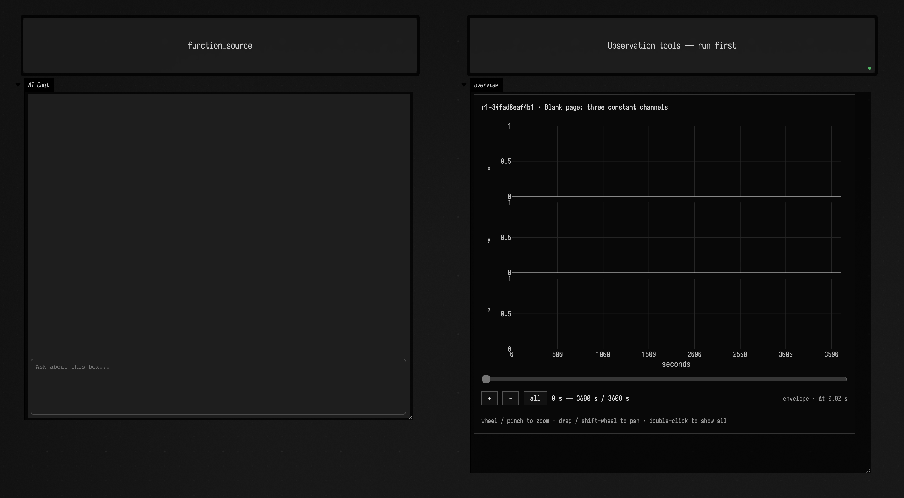
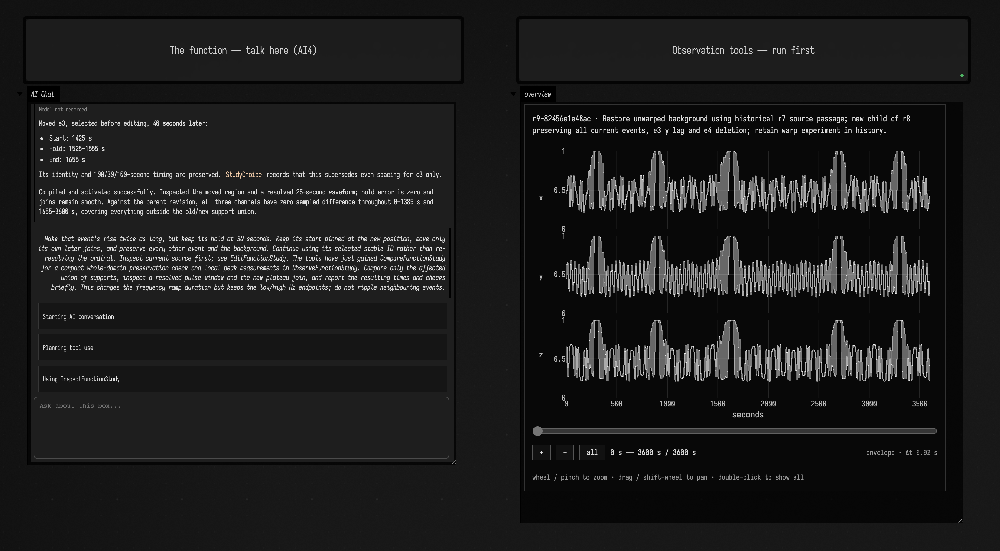
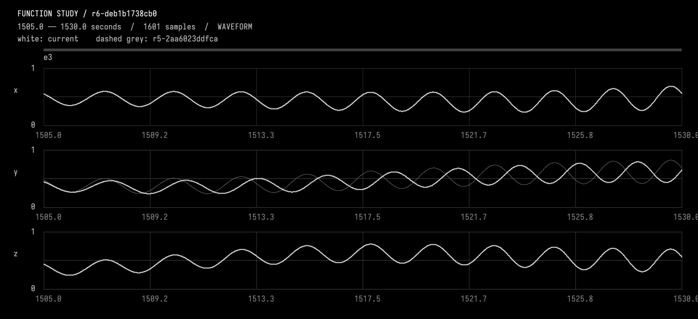

# Talking a function into existence

Start with three flat lines. Describe how they should move. Look at the result,
zoom into a passage, and ask for a change. Each accepted change becomes ordinary
Kotlin in a Field box, with a saved revision you can inspect or return to.

This example uses AI4 chat to build a one-hour, three-channel signal. It also
shows how to **extend AI4 from inside Field**. One box holds the function. The
other defines the tools AI4 uses to edit it, plot it, and check what changed.
Those tools are ordinary Kotlin in the document: edit a handler, rerun its box,
and the next tool call uses the new implementation. There is no Field rebuild.

There is something Emacs-like about this: the working document can extend the
environment you are working in. Here it can also teach the assistant a new way
to observe and act. The conversation, editable function, and observation tools
stay together.

## Start from a blank document

[Download the blank starter](assets/function_conversation/function_conversation.zip).
Unzip it into your Field workspace, keeping the `function_conversation` folder
intact, then open that document. Configure an AI provider through Field's welcome
page if you have not already; see [AI features](aiFeatures.md).

The starter has two boxes:

| Box | What to do |
| --- | --- |
| **Observation tools — run first** | Run it to register the tools and open the signal viewer. |
| **function_source** | Select it and press **command/ctrl-4** to open AI4 chat. |



The left box is the thing you are making; the right box teaches AI4 how to work
on it. Running the right box installs the document's tools into AI4's live tool
registry. Opening chat in the left box then gives the model those capabilities.

If you switch between the starter and the worked example in the same Field
session, rerun the tools box in the document you want to chat with. This selects
that document's tool handlers.

The source initially returns three zero-valued channels, named x, y and z, over
3,600 seconds. There are no crescendos, previous conversations, or inherited
revisions. Running the tools checks this initial source; the first checked
revision therefore belongs to your own session.

Try this in the source box's chat:

> Let's start with a 3d channel function, lasting an hour — sine waves from 0 to 1
> at around 0.2 Hz, drifting slowly in and out of phase.

Here **3d means three values at each time**, rather than a drawing in space.
The model will need to choose or discuss the rate and shape of the phase drift.
The document asks it to record those choices separately from your requirements.
This prompt is a starting suggestion; the worked conversation below uses a
different, more developed brief.

Keep the source editor open. When an edit succeeds, you should see both the new
Kotlin and an updated **overview**. A plot without a source update is not a
completed edit. AI4 also receives a local plot and numerical checks before it
explains the result.

## Zooming the viewer

An hour of a 0.2 Hz signal contains about 720 cycles. At that scale the viewer
shows a band of sampled minima and maxima. Zoom into roughly 25 seconds to see
about five cycles and judge their relative phase.

The signal viewer shares one time axis across all channels. Wheel or pinch to
zoom, drag to pan, and use **all** to return to the whole duration. Hover to read
sampled values. Your time window survives accepted edits, and a previous revision
can appear in dashed grey.

Zooming requests finer samples from the actual functions. A wide envelope shows
the range within each bin; it does not preserve the order of the oscillations
inside that bin, and a feature narrower than a bin can fall between samples
entirely. Zoom in before you judge a detail.

## A worked conversation

[Download the developed example](assets/function_conversation/function_conversation_example.zip)
to open **function_conversation_example**. It contains the finished source, the
same tools, all nine saved revisions, and the actual conversations and plots.
Run its tools box to restore the checked composition and explore the viewer.
Then select **The function — talk here (AI4)** and press **command/ctrl-4**.
The seven recorded turns are already in that box's chat, with their original
prompts, replies, tool traces and plot images. Scroll back to watch the function
grow, or send a new message to continue from the finished example. Simply opening
the saved chat and viewer does not make a model call.



This is Field's chat panel, restored from the recorded run. Here the chat is
scrolled back to the move-and-stretch exchange; the viewer shows the final saved
revision. The starter is still blank; the developed example carries this history. The older turns predate model
badges, so their UI correctly says **Model not recorded**; the run's provider and
model are documented in the accompanying archive.

The original request was for smooth channels drifting in and out of phase, with
six evenly spaced pulse crescendos and decrescendos. Each event should reach
exactly `(1, 1, 1)` for 30 seconds, then return to the continuing background.
The model chose a 40-second carrier and a 100-second phase-drift period, and
recorded those as assumptions.


The bright blocks locate the six events. This whole-hour picture is useful for
placement; the saved local plots reveal the individual pulses and their joins.

### Move one event, then change its rise

> Move the third crescendo 40 seconds later. Preserve its identity and all its
> internal timing; keep every other event and the continuing background unchanged.

The third event became the selected event **e3**. Its start moved from 1,385 to
1,425 seconds. Its 100-second rise, 30-second hold and 100-second fall stayed
the same. A sampled comparison outside the union of its old and new positions
found zero difference in all three channels.

The next request doubled its rise. Pinning the start at 1,425 seconds moved the
hold to 1,625–1,655 seconds and the end to 1,755 seconds. The other events did not
move. These are separate decisions: “make the rise longer” need not mean “move
the start earlier,” or “shift every later event.”

### Let one channel fall behind and catch up

The next edit made only **y** lag during e3's rise, then recover before the shared
hold. The model used a smooth local time map with a six-second peak delay.
The continuing background kept its original clock.



The checks compared x and z over the entire hour, and y outside the selected
event. All had zero sampled difference. The lag recovered 20 seconds before the
hold, and the local clock remained increasing: the signal slowed and caught up
without running backward.

### Delete, experiment, and restore selectively

Deleting **e4** exposed the background that had continued beneath it. The remaining
events kept their IDs; e5 did not silently become e4. Next, a background-only
passage was slowed and recovered with its endpoints pinned. Finally, the user
asked to restore the original background while keeping the other event edits.

That restoration created a new revision. It retained e3's move, longer rise and
y lag, and retained the deletion of e4. The temporary background warp remains in
history for comparison.


The finished [Kotlin source](assets/function_conversation/final.kt) is readable,
named-parameter code built from ordinary [`Functions.Fn`](functions_examples.md)
values. The channels are collected into a `StudyComposition`; event metadata
describes the evaluator's timings so the tools know where to inspect.

## The saved conversations

Each request above has its transcript, with the tool results and the failed
attempts still in it. The archive carries the complete JSON records, images and
revision sources; the readable versions are here:

| Request | Result |
| --- | --- |
| [Create the composition](assets/function_conversation/01-create.txt) | Six events over a continuing background. |
| [Move e3](assets/function_conversation/02-move.txt) | Only its location changes. |
| [Double its rise](assets/function_conversation/03-stretch.txt) | Start pinned; hold duration retained. |
| [Lag y](assets/function_conversation/04-lag.txt) | Channel-specific delay and recovery. |
| [Delete e4](assets/function_conversation/05-delete.txt) | Background revealed; stable IDs retained. |
| [Warp a background passage](assets/function_conversation/06-warp.txt) | A reversible local time experiment. |
| [Restore the background](assets/function_conversation/07-restore-background.txt) | Other event edits survive. |

An [independent replay](assets/function_conversation/independent-verification.json)
recompiled the saved sources and compared them on a grid no coarser than 11 ms.
It checked preserved regions, hold values, random-access evaluation order, failed
compilation, and protection against stale edits. Its zero differences are sampled
evidence; they are not a proof about every possible input to arbitrary Kotlin.

## The tools are part of the document

The [tools box source](assets/function_conversation/function_tools.kt) registers
eight tools through [AI4's tool interface](aiFeatures.md#give-the-ai-a-tool-of-your-own).
Rerun the box after changing a handler. For example, these are the request and
handler for sampling specific times, taken from the tools box:

```diffstatic {data-lang=kotlin}
data class SampleFunctionStudy(val revision: String, val timesSeconds: List<Double>)

AgentToolExtensions.register(SampleFunctionStudy::class.java, available) { _, request ->
    studio.sample(request.revision, request.timesSeconds)
}
```

The request class supplies the tool's input schema; the handler runs against the
study held by that box. `available` scopes the tool to this document. You can
change a measurement, add a plot, or register another request class here, then
rerun the box and keep chatting. The observation tools return both numerical
evidence and actual image inputs to AI4, so the assistant can inspect what its
Kotlin does before making the next edit.

| Tool | Purpose |
| --- | --- |
| `InspectFunctionStudy` | Read live source, checked revision, history and any manual edits. |
| `SelectFunctionStudy` | Resolve an event or passage before editing it. |
| `EditFunctionStudy` | Compile and check a complete candidate before publishing it. |
| `PatchFunctionStudy` | Apply small, exact source replacements through the same checks. |
| `ObserveFunctionStudy` | Give the model actual plot pixels and measurements for a time interval. |
| `CompareFunctionStudy` | Check that samples outside the intended change stayed the same. |
| `SampleFunctionStudy` | Read channel values at explicitly chosen times. |
| `ExportFunctionStudy` | Export checked channels into the document's files directory. |

Edits carry both a revision and a source hash. If you type in the editor while
the model is preparing an edit, the stale candidate cannot overwrite your work.
Failed compilation keeps the last checked function active. A successful edit
returns its validation and a before/after preview, avoiding another model round
just to compile or request the same plot again.

For export, try asking for **a, b and c at 100 Hz, values multiplied by 100, no
header**. These are literal filenames, resolved in the same document directory
as Field's `"a".file`; no `.csv` suffix is added. The export includes the exact
endpoint and verifies the written rows. A 3,600-second composition produces
360,001 rows per channel with those settings.

The current study checks three pure, deterministic channels against `[0, 1]`.
It is suited to functions you can sample in any order. Kotlin runs in Field's
existing JVM, so use fast evaluators; this is not a way to sample a stateful audio
graph or isolate arbitrary blocking code. The tools and checks are visible on
purpose, so you can adapt the experiment to another kind of function.

??? aside "What the recorded run tells us about speed"

    The first seven turns used an earlier, more repetitive edit loop and took
    roughly 52–286 seconds each, including provider backoff. A later
    [saved edit-and-export replay](assets/function_conversation/08-loop-improvements.txt)
    used Inspect → Patch → Export on a separate 60-second fixture: 15.506 seconds,
    of which 13.402 seconds was model requests and 1.541 seconds was tools.
    That is evidence for a smaller interaction loop, not a general speed guarantee.
    The historical runs record gpt-6-astra / OpenAI; your provider configuration
    determines new conversations, and the chat records the identity reported for
    each response.
