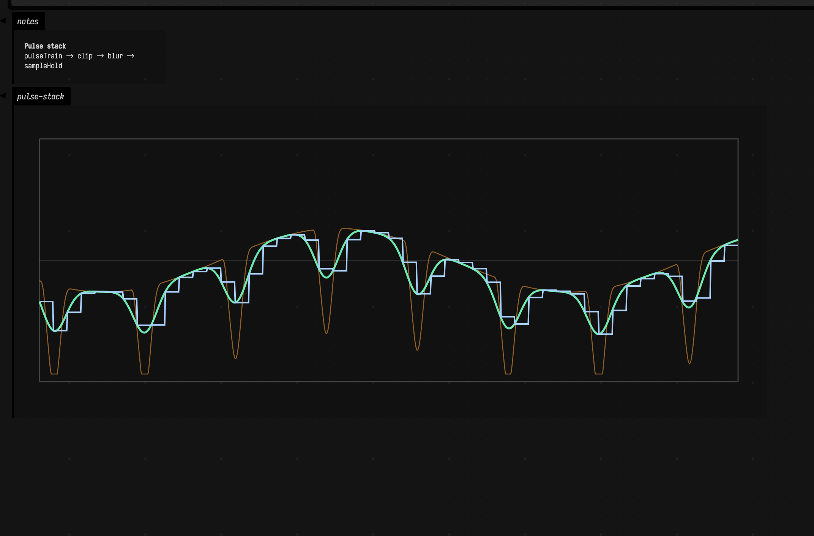

# Functions to FLine examples (Field graphics)

This page shows practical ways to turn Functions stacks into drawable FLines, both as classic one-dimensional graphs and as two-dimensional parametric curves.

Why bother? Because a function stack is often much easier to design by eye than by algebra alone. In creative coding it gives you a quick route from signal to ornament; in data work it gives you a concrete picture of transforms and envelopes; in music it turns oscillation, modulation, and shaping into something you can literally draw.

## 1D stack: harmonic blend to graph FLine

Start with the most ordinary case: one signal, one graph. Why? Because once you can see how a stack becomes a curve, all of the more elaborate uses feel much less magical. This is the sort of thing you need for envelopes, modulation shapes, control signals, and any "what does this waveform actually look like?" moment.

```diffstatic_runner {data-lang=kotlin screenshot="assets/functions_examples/harmonic_stack_box.png" wait="1.0" capture="box" w="1200"}
:::static
import afield.graphics.FLine
import afield.stdlib.Functions

with(Functions) {
    val d = Functions.Domain.of(0.0, 1.0)
    val x0 = 40.0
    val x1 = 940.0
    val y0 = 50.0
    val y1 = 390.0

    val base = sin(frequency = c(2.0), amplitude = c(0.72), roi = d, domain = d)
    val overtone = sin(frequency = c(5.0), phase = c(0.35), amplitude = c(0.24), roi = d, domain = d)
    val detail = valueNoise(seed = 41L, frequency = c(22.0), amplitude = c(0.07), roi = d, domain = d)

    val shaped = ((base + overtone + detail) * hannWindow(d)).softClip(c(1.25))

    fun hLine(y: Double, color: Vec4, thickness: Double): FLine = FLine().apply {
        moveTo(x0, y)
        lineTo(x1, y)
        this.color = color
        this.thickness = thickness
    }

    fun frame(color: Vec4 = vec(1.0, 1.0, 1.0, 0.28), thickness: Double = 1.6): FLine = FLine().apply {
        moveTo(x0, y0)
        lineTo(x1, y0)
        lineTo(x1, y1)
        lineTo(x0, y1)
        lineTo(x0, y0)
        this.color = color
        this.thickness = thickness
    }

    val waveform = shaped.toFLine(
        domain = d,
        samples = 900,
        xScale = 900.0,
        yScale = 170.0,
        xOffset = 40.0,
        yOffset = 220.0
    ).apply {
        color = vec(0.95, 0.92, 0.35, 1.0)
        thickness = 3.2
        stroked = true
        filled = false
    }

    val guides = listOf(
        frame(),
        hLine(220.0, vec(1.0, 1.0, 1.0, 0.35), 1.6),
        hLine(220.0 - 85.0, vec(1.0, 1.0, 1.0, 0.18), 1.0),
        hLine(220.0 + 85.0, vec(1.0, 1.0, 1.0, 0.18), 1.0),
        FLine().apply {
            moveTo((x0 + x1) * 0.5, y0)
            lineTo((x0 + x1) * 0.5, y1)
            color = vec(1.0, 1.0, 1.0, 0.12)
            this.thickness = 1.0
        }
    )

    lines(guides + waveform, channel = "harmonic-graph", w = 980.0, h = 430.0, fitToSize = false)
    display("notes", "<div style='padding:10px'><b>1D stack</b><br/>sin + overtone + value noise, windowed and soft-clipped.</div>")
}
```

So the ingredients stay humble: one base sinusoid, one overtone, a little value noise, then a window and a soft clip to stop the whole thing from becoming ugly. The important move is the final one: `toFLine(...)` samples the stack into drawing space instead of leaving it as a purely conceptual function.


The result still reads as one waveform, but now you can see exactly what each ingredient contributed. That is a solid starting point for envelopes, gesture traces, and "design me a shape" problems of all kinds. For more direct geometry operations after the conversion step, continue with [FLine examples](fline_examples.md).

## 1D stack: pulse design, smoothing, and hold

Smooth oscillation is only one side of the story. Often you want edges, gates, bursts, latches, and sample-and-hold behavior: things that feel more like rhythm, switching, or digital control than like a pure tone. That is where pulse-oriented stacks start becoming interesting.

```diffstatic_runner {data-lang=kotlin screenshot="assets/functions_examples/pulse_processing_window.png" wait="1.0" capture="box" open-outputs="true" w="1200"}
:::static
import afield.graphics.FLine
import afield.stdlib.Functions

with(Functions) {
    val d = Functions.Domain.of(0.0, 1.0)
    val x0 = 30.0
    val x1 = 950.0
    val y0 = 40.0
    val y1 = 360.0

    val pulses = pulseTrain(
        period = c(0.13),
        duty = c(0.36),
        rise = c(0.01),
        fall = c(0.03),
        edge = Functions.PulseEdge.SMOOTH,
        profile = Functions.PulseProfile.HANN,
        amplitude = c(1.0),
        roi = d,
        domain = d
    )

    val mod = sin(frequency = c(1.5), phase = c(0.7), amplitude = c(0.28), roi = d, domain = d)
    val textured = (pulses + mod).clip(c(1.0))
    val blurred = textured.blur(sigma = c(0.015), samples = 48)
    val held = blurred.sampleHold(step = c(0.02))

    fun asLine(fn: Functions.Fn, color: Vec4, thickness: Double): FLine = fn.toFLine(
        domain = d,
        samples = 950,
        xScale = 920.0,
        yScale = 150.0,
        xOffset = 30.0,
        yOffset = 200.0
    ).apply {
        this.color = color
        this.thickness = thickness
    }

    val a = asLine(textured, vec(0.98, 0.63, 0.22, 0.55), 1.3)
    val b = asLine(blurred, vec(0.45, 0.95, 0.72, 0.95), 2.6)
    val c = asLine(held, vec(0.66, 0.82, 1.0, 1.0), 2.0)

    val frame = FLine().apply {
        moveTo(x0, y0)
        lineTo(x1, y0)
        lineTo(x1, y1)
        lineTo(x0, y1)
        lineTo(x0, y0)
        color = vec(1.0, 1.0, 1.0, 0.22)
        thickness = 1.4
    }

    val center = FLine().apply {
        moveTo(x0, 200.0)
        lineTo(x1, 200.0)
        color = vec(1.0, 1.0, 1.0, 0.14)
        thickness = 1.0
    }

    lines(listOf(frame, center, a, b, c), channel = "pulse-stack", w = 980.0, h = 400.0, fitToSize = false)
    display("notes", "<div style='padding:10px'><b>Pulse stack</b><br/>pulseTrain → clip → blur → sampleHold</div>")
}
```

Here the pulse train is the raw material. A slower sine bends it, a blur softens it, and `sampleHold(...)` turns the result into something more stepped and clocked. Putting the three curves on the same axes makes the transformation feel causal rather than mysterious.



And now the personalities separate cleanly: one jagged, one softened, one quantized into holds. That is exactly the sort of side-by-side picture that helps when shaping sequencer data, stepped motion, triggers, or control-rate material. For statistical views of similar time-varying data, see [Timeseries examples](timeseries_examples.md) and [Stats examples](stats_examples.md).

## 2D stack: separate x(t) and y(t) Functions

Once you stop assuming that a function stack must be "height over x", a much larger door opens. What if one stack controls horizontal position and another controls vertical position? Suddenly you are no longer graphing a signal, you are steering a path through space.

```diffstatic_runner {data-lang=kotlin screenshot="assets/functions_examples/parametric_lissajous_box.png" wait="1.0" capture="box" open-outputs="true" w="1200"}
:::static
import afield.graphics.FLine
import afield.stdlib.Functions

with(Functions) {
    val tDomain = Functions.Domain.of(0.0, 1.0)
    val cx = 500.0
    val cy = 250.0

    val xFn = (sin(frequency = c(3.0), phase = c(0.2), amplitude = c(1.0), roi = tDomain, domain = tDomain)
            + sin(frequency = c(9.0), phase = c(1.1), amplitude = c(0.18), roi = tDomain, domain = tDomain))
        .softClip(c(1.15))

    val yFn = (sin(frequency = c(4.0), phase = c(1.2), amplitude = c(1.0), roi = tDomain, domain = tDomain)
            + valueNoise(seed = 88L, frequency = c(16.0), amplitude = c(0.1), roi = tDomain, domain = tDomain))
        .softClip(c(1.2))

    fun parametric(xf: Functions.Fn, yf: Functions.Fn, samples: Int = 1400): FLine {
        val f = FLine()
        for (i in 0 until samples) {
            val t = tDomain.lerp(i.toDouble() / (samples - 1).coerceAtLeast(1).toDouble())
            val x = cx + xf.eval(t) * 290.0
            val y = cy + yf.eval(t) * 190.0
            if (i == 0) f.moveTo(x, y) else f.lineTo(x, y)
        }
        return f
    }

    val frame = FLine().apply {
        moveTo(120.0, 60.0)
        lineTo(880.0, 60.0)
        lineTo(880.0, 440.0)
        lineTo(120.0, 440.0)
        lineTo(120.0, 60.0)
        color = vec(1.0, 1.0, 1.0, 0.24)
        thickness = 1.4
    }

    val cross = listOf(
        FLine().apply {
            moveTo(120.0, cy)
            lineTo(880.0, cy)
            color = vec(1.0, 1.0, 1.0, 0.12)
            thickness = 1.0
        },
        FLine().apply {
            moveTo(cx, 60.0)
            lineTo(cx, 440.0)
            color = vec(1.0, 1.0, 1.0, 0.12)
            thickness = 1.0
        }
    )

    val curve = parametric(xFn, yFn).apply {
        color = vec(0.98, 0.9, 0.32, 0.95)
        thickness = 2.3
    }

    lines(listOf(frame) + cross + curve, channel = "xy-parametric", w = 1000.0, h = 500.0, fitToSize = false)
    display("notes", "<div style='padding:10px'><b>2D parametric</b><br/>x(t) and y(t) are independent Functions stacks.</div>")
}
```

That is the only real trick here: keep `xFn` and `yFn` independent until the moment of sampling, then evaluate them together inside `parametric(...)`. The path emerges from their relationship, not from either stack on its own.


The payoff is a curve with different tempos on its two axes, which is why it immediately starts to feel like an orbit, a trajectory, or a piece of ornament rather than a plain graph. That pattern is a workhorse for parametric drawing. For lower-level path editing once you have the curve, see [FLine examples](fline_examples.md).

## 2D stack: noisy rosette with windowed arc energy

Sometimes the right question is not "what are x and y doing?" but "how far from the center am I, and at what angle?" That shift is useful for rosettes, emblems, radial plots, circular choreography, and any drawing that wants to grow outwards rather than march left-to-right.

```diffstatic_runner {data-lang=kotlin screenshot="assets/functions_examples/parametric_rosette_window.png" wait="1.0" capture="box" open-outputs="true" w="1200"}
:::static
import afield.graphics.FLine
import afield.stdlib.Functions

with(Functions) {
    val tDomain = Functions.Domain.of(0.0, 1.0)
    val cx = 500.0
    val cy = 250.0

    val radial = (
        one(tDomain, tDomain) * 0.62
            + pulseTrain(period = c(0.25), duty = c(0.5), profile = Functions.PulseProfile.TRIANGLE, amplitude = c(0.22), roi = tDomain, domain = tDomain)
            + valueNoise(seed = 5L, frequency = c(14.0), amplitude = c(0.05), roi = tDomain, domain = tDomain)
        )
        .clamp(c(0.12), c(1.0))

    val theta = ramp(start = c(0.0), end = c(1.0), roi = tDomain, domain = tDomain) * c(Math.PI * 2.0 * 6.0)

    val xFn = (radial * cos(frequency = c(0.0), phase = c(0.0), amplitude = c(1.0), offset = c(0.0), roi = tDomain, domain = tDomain))
        .mapY { _ -> 0.0 }

    // Explicit x/y from radial + theta, sampled directly for clarity.
    val line = FLine()
    val samples = 1800
    for (i in 0 until samples) {
        val t = tDomain.lerp(i.toDouble() / (samples - 1).coerceAtLeast(1).toDouble())
        val r = radial.eval(t)
        val ang = theta.eval(t)
        val x = cx + kotlin.math.cos(ang) * r * 280.0
        val y = cy + kotlin.math.sin(ang) * r * 210.0
        if (i == 0) line.moveTo(x, y) else line.lineTo(x, y)
    }

    line.color = vec(0.62, 0.95, 1.0, 0.95)
    line.thickness = 2.0

    val frame = FLine().apply {
        moveTo(120.0, 60.0)
        lineTo(880.0, 60.0)
        lineTo(880.0, 440.0)
        lineTo(120.0, 440.0)
        lineTo(120.0, 60.0)
        color = vec(1.0, 1.0, 1.0, 0.22)
        thickness = 1.4
    }

    val ringGuide = FLine().apply {
        val n = 220
        for (i in 0..n) {
            val a = i.toDouble() / n.toDouble() * Math.PI * 2.0
            val x = cx + kotlin.math.cos(a) * 210.0
            val y = cy + kotlin.math.sin(a) * 210.0
            if (i == 0) moveTo(x, y) else lineTo(x, y)
        }
        color = vec(1.0, 1.0, 1.0, 0.1)
        thickness = 1.0
    }

    lines(listOf(frame, ringGuide, line), channel = "xy-rosette", w = 1000.0, h = 500.0, fitToSize = false)
    display("notes", "<div style='padding:10px'><b>2D rosette</b><br/>radial(t) + angle(t) stack mapped into x/y.</div>")
}
```

So the code builds the motion in polar terms first: radius from `pulseTrain(...)` and `valueNoise(...)`, angle from a ramp. Only afterwards do we cash that out into cartesian coordinates. The explicit sampling loop keeps that conversion plain.


That is why the image feels more designed than merely oscillatory. The radius creates petals and breaths; the angle decides how those breaths are laid around the circle. It is a strong pattern for radial ornaments, animated emblems, and circular plotting systems. For color strategies that pair well with this kind of geometry, see [Colors examples](colors_examples.md).

## Diff runner: edit a stack and capture the new look

One of the pleasures of working with Functions is that a tiny edit can materially change the drawing. That is useful when you are iterating on a look, a gesture model, or a piece of generative structure and want to understand what each new ingredient bought you.

```diff_runner {data-lang=kotlin screenshot="assets/functions_examples/diff_runner_after.png" wait="1.0" capture="box" open-outputs="true" w="1200"}
:::before
import afield.graphics.FLine
import afield.stdlib.Functions

with(Functions) {
    val d = Functions.Domain.of(0.0, 1.0)
    val a = sin(frequency = c(2.0), amplitude = c(0.7), roi = d, domain = d)
    val b = pulseTrain(period = c(0.2), duty = c(0.35), amplitude = c(0.35), roi = d, domain = d)
    val f = (a + b).softClip(c(1.0))

    val line = f.toFLine(domain = d, samples = 900, xScale = 900.0, yScale = 160.0, xOffset = 40.0, yOffset = 220.0).apply {
        color = vec(1.0, 0.75, 0.4, 1.0)
        thickness = 2.0
    }

    val frame = FLine().apply {
        moveTo(40.0, 50.0)
        lineTo(940.0, 50.0)
        lineTo(940.0, 390.0)
        lineTo(40.0, 390.0)
        lineTo(40.0, 50.0)
        color = vec(1.0, 1.0, 1.0, 0.22)
        thickness = 1.3
    }

    lines(listOf(frame, line), channel = "edited-stack", w = 980.0, h = 420.0, fitToSize = false)
    display("notes", "<div style='padding:10px'><b>Before</b>: simple sin + pulse stack.</div>")
}
:::after
import afield.graphics.FLine
import afield.stdlib.Functions

with(Functions) {
    val d = Functions.Domain.of(0.0, 1.0)
    val a = sin(frequency = c(2.0), amplitude = c(0.7), roi = d, domain = d)
    val b = pulseTrain(
        period = c(0.2),
        duty = c(0.35),
        rise = c(0.01),
        fall = c(0.025),
        profile = Functions.PulseProfile.HANN,
        amplitude = c(0.35),
        roi = d,
        domain = d
    )
    val detail = fbm(seed = 77L, frequency = c(4.0), amplitude = c(0.12), octaves = 4, roi = d, domain = d)
    val f = (a + b + detail).softClip(c(1.22))

    val line = f.toFLine(domain = d, samples = 900, xScale = 900.0, yScale = 160.0, xOffset = 40.0, yOffset = 220.0).apply {
        color = vec(0.58, 0.93, 1.0, 1.0)
        thickness = 2.6
    }

    val frame = FLine().apply {
        moveTo(40.0, 50.0)
        lineTo(940.0, 50.0)
        lineTo(940.0, 390.0)
        lineTo(40.0, 390.0)
        lineTo(40.0, 50.0)
        color = vec(1.0, 1.0, 1.0, 0.24)
        thickness = 1.4
    }

    val center = FLine().apply {
        moveTo(40.0, 220.0)
        lineTo(940.0, 220.0)
        color = vec(1.0, 1.0, 1.0, 0.12)
        thickness = 1.0
    }

    lines(listOf(frame, center, line), channel = "edited-stack", w = 980.0, h = 420.0, fitToSize = false)
    display("notes", "<div style='padding:10px'><b>After</b>: shaped pulse + fbm detail + stronger soft clip.</div>")
}
```

The diff keeps the frame and scale fixed and spends all its energy on the stack itself: a more shaped pulse, a little `fbm(...)` detail, and a firmer soft clip. That way the edit reads as an edit, not as a new scene.


The broad contour survives, but the surface becomes more interesting and more intentional. That is exactly the kind of change you want when iterating: continuity of idea, improvement of character. The expanded reference below is the place to keep browsing the API once these examples have made the main patterns familiar.

## Expanded reference: simple + creative patterns

All snippets below assume:

```kotlin
import afield.stdlib.Functions
with(Functions) {
    val d = Functions.Domain.of(0.0, 1.0)
    // examples here
}
```

### Core constructors and base shapes

| Function | Simple | Creative |
|---|---|---|
| fn | `val f = fn(roi = d, domain = d) { x -> x * x }` | `val f = fn(roi = d, domain = d) { x -> sin(20.0 * x) * exp(-3.0 * x) }` |
| c / constant | `val f = c(0.5, d, d)` | `val f = (constant(0.6, d, d) + valueNoise(5, c(12.0), c(0.05), d, d)).clamp(c(0.0), c(1.0))` |
| zero / one | `val gate = one(d, d)` | `val gate = (one(d, d) - pulseTrain(period = c(0.2), duty = c(0.8), roi = d, domain = d)).clip(c(1.0))` |
| identity | `val x = identity(d, d)` | `val spiralT = identity(d, d).pow(c(1.7)).withEdge(Functions.EdgeMode.CLAMP)` |
| ramp | `val r = ramp(c(0.0), c(1.0), d, d)` | `val env = ramp(c(0.1), c(0.9), d, d).crossfade(ramp(c(0.9), c(0.1), d, d), center = c(0.5), width = c(0.25))` |
| step | `val s = step(c(0.5), d, d)` | `val trem = step(sin(c(2.0), amplitude = c(0.15), offset = c(0.5), roi = d, domain = d), d, d)` |
| smoothStep | `val s = smoothStep(c(0.2), c(0.8), d, d)` | `val mask = smoothStep(valueNoise(2, c(3.0), c(0.2), d, d), c(0.9), d, d)` |

### Oscillators and pulse family

| Function | Simple | Creative |
|---|---|---|
| sin | `val f = sin(frequency = c(3.0), amplitude = c(0.8), roi = d, domain = d)` | `val f = sin(c(2.0), phase = valueNoise(7, c(5.0), c(0.3), d, d), amplitude = c(0.7), roi = d, domain = d)` |
| cos | `val f = cos(frequency = c(2.0), amplitude = c(1.0), roi = d, domain = d)` | `val f = cos(c(5.0), phase = ramp(c(0.0), c(Math.PI), d, d), amplitude = c(0.5), roi = d, domain = d)` |
| saw | `val f = saw(period = c(0.25), amplitude = c(1.0), roi = d, domain = d)` | `val f = saw(period = c(0.14), amplitude = c(0.7), roi = d, domain = d).softClip(c(1.6))` |
| triangle | `val f = triangle(period = c(0.2), amplitude = c(0.9), roi = d, domain = d)` | `val f = triangle(c(0.2), amplitude = fbm(9, c(1.0), c(0.6), roi = d, domain = d), roi = d, domain = d)` |
| square | `val f = square(period = c(0.25), duty = c(0.5), amplitude = c(1.0), roi = d, domain = d)` | `val f = square(c(0.125), duty = sin(c(1.0), amplitude = c(0.2), offset = c(0.5), roi = d, domain = d), amplitude = c(0.8), roi = d, domain = d)` |
| pulseTrain | `val f = pulseTrain(period = c(0.2), duty = c(0.35), roi = d, domain = d)` | `val f = pulseTrain(period = c(0.15), duty = c(0.4), rise = c(0.01), fall = c(0.02), profile = Functions.PulseProfile.HANN, jitter = c(0.08), seed = 42, roi = d, domain = d)` |
| pulseTrainWidth | `val f = pulseTrainWidth(period = c(0.2), width = c(0.08), roi = d, domain = d)` | `val f = pulseTrainWidth(period = c(0.18), width = sin(c(0.5), amplitude = c(0.05), offset = c(0.08), roi = d, domain = d), profile = Functions.PulseProfile.GAUSSIAN, roi = d, domain = d)` |
| pulseTrainHz | `val f = pulseTrainHz(frequency = c(8.0), duty = c(0.3), roi = d, domain = d)` | `val f = pulseTrainHz(frequency = ramp(c(4.0), c(16.0), d, d), duty = c(0.22), edge = Functions.PulseEdge.SINE, roi = d, domain = d)` |
| pulseTrainPattern | `val f = pulseTrainPattern(doubleArrayOf(1.0, 0.5, 1.0, 0.2), period = c(0.2), roi = d, domain = d)` | `val f = pulseTrainPattern(doubleArrayOf(1.0, 0.0, 0.8, 0.3, 1.2), period = c(0.11), jitter = c(0.1), profile = Functions.PulseProfile.TRIANGLE, roi = d, domain = d)` |
| impulseTrain | `val f = impulseTrain(period = c(0.1), width = c(0.01), roi = d, domain = d)` | `val f = impulseTrain(period = c(0.12), width = c(0.02), sigma = c(0.09), jitter = c(0.2), seed = 9, roi = d, domain = d)` |
| pulseBurst | `val f = pulseBurst(count = 5, period = c(0.1), start = c(0.2), roi = d, domain = d)` | `val f = pulseBurst(9, period = c(0.07), start = c(0.12), edge = Functions.PulseEdge.EXP, curve = c(3.0), profile = Functions.PulseProfile.HANN, roi = d, domain = d)` |
| gaussian | `val f = gaussian(mean = c(0.5), sigma = c(0.1), amplitude = c(1.0), roi = d, domain = d)` | `val f = gaussian(mean = sin(c(0.5), amplitude = c(0.15), offset = c(0.5), roi = d, domain = d), sigma = c(0.08), amplitude = c(0.9), roi = d, domain = d)` |

### Algebra and mapping

| Function | Simple | Creative |
|---|---|---|
| `+ - * /` | `val f = sin(c(2.0), roi = d, domain = d) + saw(c(0.2), roi = d, domain = d)` | `val f = (sin(c(3.0), roi = d, domain = d) * pulseTrain(c(0.18), roi = d, domain = d)) / (one(d, d) + c(0.2, d, d))` |
| mapY | `val f = sin(c(2.0), roi = d, domain = d).mapY { it * 0.5 }` | `val f = valueNoise(3, c(14.0), c(1.0), d, d).mapY { v -> kotlin.math.sign(v) * kotlin.math.sqrt(kotlin.math.abs(v)) }` |
| mapX | `val f = sin(c(2.0), roi = d, domain = d).mapX { x -> x * 0.5 }` | `val f = sin(c(4.0), roi = d, domain = d).mapX(newRoi = d) { x -> x + 0.08 * kotlin.math.sin(16.0 * x) }` |
| shift / delay | `val f = sin(c(2.0), roi = d, domain = d).shift(c(0.1))` | `val f = valueNoise(7, c(10.0), c(0.7), d, d).delay(sin(c(0.5), amplitude = c(0.03), roi = d, domain = d))` |
| scaleX | `val f = saw(c(0.2), roi = d, domain = d).scaleX(c(2.0))` | `val f = sin(c(3.0), roi = d, domain = d).scaleX(scale = ramp(c(0.8), c(1.6), d, d), about = c(0.5))` |
| scaleY / offsetY | `val f = sin(c(2.0), roi = d, domain = d).scaleY(c(0.5)).offsetY(c(0.2))` | `val f = fbm(1, c(2.0), c(1.0), roi = d, domain = d).scaleY(smoothStep(c(0.0), c(1.0), d, d)).offsetY(valueNoise(2, c(3.0), c(0.1), d, d))` |
| reverse / flip | `val f = ramp(c(0.0), c(1.0), d, d).reverse()` | `val f = (sin(c(2.0), roi = d, domain = d).reverse(c(0.5)) + triangle(c(0.12), roi = d, domain = d)).flip()` |
| abs / sign / rectify | `val f = sin(c(3.0), roi = d, domain = d).abs()` | `val f = fbmPerlin(7, c(2.5), c(1.0), roi = d, domain = d).sign().rectify()` |
| pow / exp / log | `val f = ramp(c(0.0), c(1.0), d, d).pow(c(2.0))` | `val f = (gaussian(c(0.5), c(0.12), c(1.0), d, d) + c(1.2, d, d)).log(c(Math.E)).exp()` |
| clamp / clip / softClip / fold / wrapY | `val f = sin(c(2.0), roi = d, domain = d).clip(c(0.7))` | `val f = (saw(c(0.11), roi = d, domain = d) * c(2.5, d, d)).fold(c(0.8)).softClip(c(1.4)).wrapY(c(-0.7), c(0.7))` |
| withEdge | `val f = sin(c(3.0), roi = d, domain = d).withEdge(Functions.EdgeMode.CLAMP)` | `val f = gaussian(c(0.5), c(0.08), c(1.0), d, d).withEdge(Functions.EdgeMode.MIRROR, outside = valueNoise(8, c(4.0), c(0.05), d, d))` |
| quantize / bitCrush | `val f = sin(c(2.0), roi = d, domain = d).quantize(8)` | `val f = (fbm(4, c(3.0), c(1.0), roi = d, domain = d).bitCrush(5)).mix(sin(c(1.0), roi = d, domain = d), c(0.2, d, d))` |
| mix / crossfade | `val f = sin(c(2.0), roi = d, domain = d).mix(saw(c(0.2), roi = d, domain = d), c(0.5))` | `val f = triangle(c(0.12), roi = d, domain = d).crossfade(fbmPerlin(11, c(2.0), c(1.0), roi = d, domain = d), center = c(0.55), width = c(0.35))` |
| cut / trim / slice / replace | `val f = sin(c(2.0), roi = d, domain = d).cut(Functions.Domain.of(0.2, 0.8))` | `val f = saw(c(0.18), roi = d, domain = d).replace(Functions.Domain.of(0.35, 0.6), pulseTrain(c(0.08), duty = c(0.4), roi = d, domain = d))` |
| window / amplitudeMod / ringMod / warp | `val f = sin(c(2.0), roi = d, domain = d).window(hannWindow(d))` | `val f = sin(c(4.0), roi = d, domain = d).amplitudeMod(fbm(2, c(6.0), c(0.7), roi = d, domain = d), depth = c(0.8)).ringMod(cos(c(9.0), roi = d, domain = d), c(0.5)).warp(valueNoise(2, c(5.0), c(1.0), d, d), c(0.05))` |
| quantizeX / sampleHold | `val f = sin(c(2.0), roi = d, domain = d).sampleHold(c(0.05))` | `val f = valueNoise(9, c(16.0), c(0.8), d, d).quantizeX(step = ramp(c(0.02), c(0.09), d, d)).sampleHold(step = c(0.03), offset = c(0.01))` |
| phaseMod / frequencyMod | `val f = sin(c(2.0), roi = d, domain = d).phaseMod(sin(c(8.0), roi = d, domain = d), c(0.02))` | `val f = triangle(c(0.2), roi = d, domain = d).frequencyMod(fbmPerlin(5, c(4.0), c(1.0), roi = d, domain = d), depth = c(0.04))` |
| saturate / jitterX | `val f = sin(c(2.0), roi = d, domain = d).saturate(c(1.0))` | `val f = pulseTrain(c(0.15), duty = c(0.3), roi = d, domain = d).jitterX(c(0.03), seed = 7).saturate(c(1.8))` |
| repeat / mirrorRepeat / tile / pad / echo | `val f = sin(c(2.0), roi = d, domain = d).repeat(c(0.25), c(0.0))` | `val f = saw(c(0.2), roi = d, domain = d).mirrorRepeat(c(0.17)).tile(6, c(0.12)).pad(c(0.05), c(0.08), c(0.0)).echo(c(0.03), c(0.45), repeats = 6)` |
| derivative / integral | `val slope = sin(c(2.0), roi = d, domain = d).derivative()` | `val area = (pulseTrain(c(0.2), roi = d, domain = d) * hannWindow(d)).integral(step = 1e-3, origin = 0.0)` |
| convolve / correlate / movingAverage / blur | `val sm = valueNoise(3, c(14.0), c(1.0), d, d).movingAverage(c(0.08), samples = 64)` | `val f = fbm(9, c(2.0), c(1.0), roi = d, domain = d).convolve(gaussianWindow(Functions.Domain.of(-0.06, 0.06), sigma = c(0.3)), samples = 41, kernelDomain = Functions.Domain.of(-0.06, 0.06), normalize = true).blur(c(0.01), samples = 31)` |

### Arrays, sampling, streams, and output conversion

| Function | Simple | Creative |
|---|---|---|
| DoubleArray.toFn / List.toFn | `val f = doubleArrayOf(0.0, 1.0, 0.4, -0.2).toFn(domain = d)` | `val f = listOf(0.0, 0.4, 1.0, 0.2, -0.4).toFn(domain = d, interpolation = Functions.Interpolation.CUBIC).softClip(c(1.5))` |
| sampleAt / samplesAt | `val ys = sin(c(2.0), roi = d, domain = d).sampleAt(doubleArrayOf(0.0, 0.25, 0.5))` | `val pts = fbmPerlin(8, c(2.0), c(1.0), roi = d, domain = d).samplesAt(DoubleArray(12) { it / 11.0 })` |
| toDoubleArray / toVec2List | `val ys = sin(c(3.0), roi = d, domain = d).toDoubleArray(128, d)` | `val pts = pulseTrain(c(0.13), duty = c(0.32), roi = d, domain = d).toVec2List(256, d).map { vec(it.x.toDouble() * 700 + 80, it.y.toDouble() * 140 + 220) }` |
| cursor | `val c0 = sin(c(2.0), roi = d, domain = d).cursor(start = 0.0, step = 0.01)` | `val scratch = fbm(6, c(3.0), c(0.8), roi = d, domain = d).cursor(0.0, 0.002).next(1024).toFn(Functions.Domain.of(0.0, 1.0))` |
| stream / streamWithX | `val first = sin(c(2.0), roi = d, domain = d).stream(start = 0.0, step = 0.01).take(8).toList()` | `val pairs = pulseTrain(c(0.15), roi = d, domain = d).streamWithX(0.0, 0.005).take(200).map { Sample(it.first, it.second) }` |
| toFLine | `val line = sin(c(2.0), roi = d, domain = d).toFLine(domain = d, samples = 600)` | `val line = (sin(c(2.0), roi = d, domain = d) + fbm(5, c(6.0), c(0.2), roi = d, domain = d)).toFLine(domain = d, samples = 1400, xScale = 980.0, yScale = 170.0, xOffset = 30.0, yOffset = 220.0)` |

### Windows, noise, normalization, and sampling sets

| Function | Simple | Creative |
|---|---|---|
| hannWindow / hammingWindow / blackmanWindow / gaussianWindow | `val w = hannWindow(d)` | `val w = gaussianWindow(d, sigma = c(0.25)).mix(blackmanWindow(d), c(0.4, d, d))` |
| whiteNoise / valueNoise / perlinNoise | `val n = valueNoise(seed = 1, frequency = c(12.0), amplitude = c(0.5), roi = d, domain = d)` | `val n = whiteNoise(4, c(24.0), c(0.3), d, d).mix(perlinNoise(5, c(3.0), c(0.7), d, d), c(0.65, d, d))` |
| fbm / fbmPerlin / randomWalk | `val n = fbm(seed = 2, frequency = c(2.0), amplitude = c(1.0), octaves = 5, roi = d, domain = d)` | `val n = fbmPerlin(4, c(1.8), c(1.0), octaves = 6, roi = d, domain = d).mix(randomWalk(8, step = c(0.03), amplitude = c(0.02), roi = d, domain = d), c(0.3, d, d))` |
| autoScale / zNormalize / whitenCdf | `val f = fbm(4, c(2.0), c(1.0), roi = d, domain = d).autoScale(d)` | `val f = valueNoise(12, c(18.0), c(1.0), d, d).zNormalize(d).whitenCdf(d, bins = 128, targetMin = -1.0, targetMax = 1.0)` |
| sampleUniform / sampleJittered / sampleRandom | `val s = sin(c(2.0), roi = d, domain = d).sampleUniform(32, d)` | `val s = fbm(2, c(3.0), c(1.0), roi = d, domain = d).sampleJittered(128, d, jitter = 0.4, seed = 9)` |
| sampleByDensity / sampleZeroCrossings / samplePeaks | `val zc = sin(c(6.0), roi = d, domain = d).sampleZeroCrossings(d)` | `val peaks = (sin(c(3.0), roi = d, domain = d) + fbm(1, c(7.0), c(0.25), roi = d, domain = d)).samplePeaks(20, d)` |

### Piecewise, interpolation, RBF, and resampling

| Function | Simple | Creative |
|---|---|---|
| points | `val pts = points(0.0 to 0.0, 0.4 to 1.0, 1.0 to 0.2)` | `val pts = points(0.0 to 0.0, 0.12 to 0.9, 0.32 to -0.4, 0.75 to 0.7, 1.0 to 0.0)` |
| piecewise | `val f = piecewise(zero(d, d), Functions.Domain.of(0.0, 0.5) to one(d, d), Functions.Domain.of(0.5, 1.0) to zero(d, d))` | `val f = piecewise(default = valueNoise(3, c(8.0), c(0.1), d, d), Functions.Domain.of(0.0, 0.33) to sin(c(3.0), roi = d, domain = d), Functions.Domain.of(0.33, 0.66) to saw(c(0.2), roi = d, domain = d), Functions.Domain.of(0.66, 1.0) to pulseTrain(c(0.1), roi = d, domain = d))` |
| piecewiseLinear / catmullRomSpline / monotoneCubic | `val f = piecewiseLinear(listOf(Keyframe(0.0, 0.0, "linear"), Keyframe(1.0, 1.0, "linear")))` | `val f = catmullRomSpline(listOf(Keyframe(0.0, 0.0, "linear"), Keyframe(0.2, 0.9, "linear"), Keyframe(0.6, -0.4, "linear"), Keyframe(1.0, 0.2, "linear")), alpha = 0.5).mix(monotoneCubic(listOf(Keyframe(0.0, 0.1, "linear"), Keyframe(0.4, 0.8, "linear"), Keyframe(1.0, 0.0, "linear"))), c(0.35, d, d))` |
| hermiteFromHandles / bSplineQuadratic | `val f = bSplineQuadratic(listOf(Keyframe(0.0, 0.0, "linear"), Keyframe(0.4, 1.0, "linear"), Keyframe(1.0, 0.2, "linear")))` | `val f = hermiteFromHandles(listOf(Keyframe(0.0, 0.0, "linear"), Keyframe(0.3, 0.8, "linear"), Keyframe(0.75, -0.2, "linear"), Keyframe(1.0, 0.1, "linear"))).softClip(c(1.2, d, d))` |
| stepHold / nearestValue / cosineInterp / smoothStepInterp / smootherStepInterp | `val f = stepHold(listOf(Keyframe(0.0, 0.0, "linear"), Keyframe(0.5, 1.0, "linear"), Keyframe(1.0, 0.5, "linear")))` | `val f = cosineInterp(listOf(Keyframe(0.0, 0.2, "linear"), Keyframe(0.3, 0.9, "linear"), Keyframe(0.8, -0.4, "linear"), Keyframe(1.0, 0.1, "linear"))).mix(smootherStepInterp(listOf(Keyframe(0.0, 0.2, "linear"), Keyframe(0.3, 0.9, "linear"), Keyframe(0.8, -0.4, "linear"), Keyframe(1.0, 0.1, "linear"))), c(0.5, d, d))` |
| gaussianSmooth / differentiate / fromKeyframeEditor / resample | `val f = differentiate(sin(c(2.0), roi = d, domain = d))` | `val f = gaussianSmooth(fromKeyframeEditor(listOf(Keyframe(0.0, 0.0, "linear"), Keyframe(0.4, 1.0, "bezier"), Keyframe(1.0, 0.1, "linear"))), sigma = 0.03, taps = 41).let { resample(it, sampleCount = 512, interpolation = Functions.Interpolation.CUBIC) }` |
| rbf / rbfQuadratic / rbfCubic / rbfThinPlate and Fn.* variants | `val f = rbfThinPlate(points(0.0 to 0.0, 0.4 to 1.0, 1.0 to 0.2))` | `val f = sin(c(2.0), roi = d, domain = d).rbf(points(0.1 to 0.6, 0.52 to -0.3, 0.9 to 0.7), kernel = Functions.RbfKernels.gaussian(2.5), smoothing = 1e-4)` |

### Timeline, granular, and stream filters

| Function | Simple | Creative |
|---|---|---|
| spliceWindow | `val w = spliceWindow(fadeIn = 0.1, fadeOut = 0.1, domain = d)` | `val w = spliceWindow(0.2, 0.35, d).pow(c(0.7, d, d))` |
| timelineGraph / timeline | `val t = timeline { sin(c(2.0), roi = d, domain = d).place() }` | `val t = timeline(name = "scene") { mark("start"); pulseTrain(c(0.12), roi = d, domain = d).place(duration = 0.7, mapMode = Functions.ChunkMapMode.WRAP); fbm(4, c(3.0), c(0.35), roi = d, domain = d).overlap(amount = 0.15, duration = 0.8, blend = Functions.ChunkBlend.ADD); moveToMark("start", 0.35); saw(c(0.2), roi = d, domain = d).splice(lookBack = 0.2, duration = 0.5) }` |
| repeatToFit / stretchToFit / snapshot / lookBack | `val g = timelineGraph { repeatToFit(sin(c(2.0), roi = d, domain = d), duration = 2.0) }` | `val g = timelineGraph { stretchToFit(fbmPerlin(2, c(2.0), c(1.0), roi = d, domain = d), duration = 3.0); val ghost = snapshot(offset = 0.12); ghost.place(duration = 1.5, blend = Functions.ChunkBlend.ADD, gain = c(0.4)) }` |
| granular | `val f = sin(c(3.0), roi = d, domain = d).granular(grainSize = c(0.05), spacing = c(0.04))` | `val f = fbmPerlin(1, c(3.0), c(0.8), roi = d, domain = d).granular(grainSize = c(0.04), spacing = c(0.027), jitter = c(0.35), overlap = 2, seed = 3, window = gaussianWindow(Functions.Domain.of(0.0, 1.0), c(0.3)))` |
| lowpassStream / highpassStream | `val s = sin(c(2.0), roi = d, domain = d).lowpassStream(alpha = 0.2).take(64).toList()` | `val s = (pulseTrain(c(0.12), roi = d, domain = d) + valueNoise(5, c(22.0), c(0.2), d, d)).highpassStream(alpha = 0.88, step = 0.004).take(256).toList()` |
| demo | `val result = demo(sampleCount = 256, domain = d)` | `val result = demo(sampleCount = 1024, seed = 77, domain = Functions.Domain.of(-0.25, 1.25), printSummary = false)` |

### Complete API addendum: utility classes and methods

The tables above cover the primary signal-shaping API. This addendum closes the remaining symbol gaps with simple and creative variants.

#### Domain methods

| Method | Simple | Creative |
|---|---|---|
| Functions.Domain.of / point / centered | `val a = Functions.Domain.of(0.0, 1.0)` | `val a = Functions.Domain.centered(0.5, 0.42).intersect(Functions.Domain.of(0.0, 1.0))` |
| containsInclusive / contains | `val inside = d.containsInclusive(0.2)` | `val mask = if (d.contains(0.77)) one(d, d) else zero(d, d)` |
| expand / shrink | `val wide = d.expand(0.1)` | `val band = d.expand(0.2).shrink(0.05)` |
| shift / scale | `val moved = d.shift(0.15)` | `val zoom = d.scale(0.5, about = d.center).shift(0.1)` |
| lerp / alphaOf | `val x = d.lerp(0.25)` | `val warpedAlpha = smoothStep(c(0.0), c(1.0), d, d).eval(d.alphaOf(0.42))` |
| clamp / wrap / reflect | `val x = d.clamp(1.2)` | `val pingPong = d.reflect(2.7)` |
| intersect / union | `val i = d.intersect(Functions.Domain.of(0.2, 0.7))` | `val merged = d.union(Functions.Domain.of(-0.3, 0.3)).intersect(Functions.Domain.of(-0.1, 0.9))` |

#### Fn lifecycle and safety

| Method | Simple | Creative |
|---|---|---|
| eval / invoke | `val y = sin(c(2.0), roi = d, domain = d).eval(0.5)` | `val y = (fbm(3, c(4.0), c(0.6), roi = d, domain = d))(0.37)` |
| evalSafe | `val y = sin(c(2.0), roi = d, domain = d).evalSafe(2.0, outside = 0.0)` | `val y = saw(c(0.1), roi = d, domain = d).evalSafe(-0.3, edge = Functions.EdgeMode.MIRROR)` |
| withRoi / withDomain / withName | `val f = sin(c(2.0), roi = d, domain = d).withName("lead")` | `val f = valueNoise(4, c(12.0), c(0.5), d, d).withRoi(Functions.Domain.of(0.1, 0.9)).withDomain(Functions.Domain.ALL).withName("noise-bed")` |

#### FunctionCursor methods

| Method | Simple | Creative |
|---|---|---|
| next() | `val cur = sin(c(2.0), roi = d, domain = d).cursor(0.0, 0.01); val y = cur.next()` | `val cur = fbm(5, c(3.0), c(0.7), roi = d, domain = d).cursor(0.0, 0.002); repeat(32) { cur.next() }` |
| next(count) | `val ys = sin(c(2.0), roi = d, domain = d).cursor().next(16)` | `val ys = pulseTrain(c(0.15), roi = d, domain = d).cursor(start = 0.25, step = 0.003).next(1024)` |

#### Functions.TimelineChunk and TimelineGraph

| API | Simple | Creative |
|---|---|---|
| Functions.TimelineChunk.contains / sampleAt | `val ch = Functions.TimelineChunk(sin(c(2.0), roi = d, domain = d), targetDomain = d); val s = ch.sampleAt(0.3)` | `val ch = Functions.TimelineChunk(fbm(2, c(2.0), c(0.5), roi = d, domain = d), sourceDomain = d, targetDomain = Functions.Domain.of(1.0, 2.0), mapMode = Functions.ChunkMapMode.WRAP, window = hannWindow(Functions.Domain.of(0.0, 1.0))); val on = ch.contains(1.35)` |
| Functions.TimelineChunk.weightAt | `val w = Functions.TimelineChunk(sin(c(2.0), roi = d, domain = d), targetDomain = d).weightAt(0.5)` | `val w = Functions.TimelineChunk(saw(c(0.2), roi = d, domain = d), targetDomain = d, window = spliceWindow(0.2, 0.2, Functions.Domain.of(0.0, 1.0)), gain = valueNoise(1, c(4.0), c(0.2), d, d)).weightAt(0.6)` |
| TimelineGraph.eval / invoke | `val g = timelineGraph { sin(c(2.0), roi = d, domain = d).place() }; val y = g.eval(0.4)` | `val g = timelineGraph { pulseTrain(c(0.11), roi = d, domain = d).place(duration = 0.7); fbm(8, c(3.0), c(0.4), roi = d, domain = d).overlap(0.2, blend = Functions.ChunkBlend.ADD) }; val y = g(0.9)` |
| TimelineGraph.asFn / tap | `val f = timelineGraph { sin(c(2.0), roi = d, domain = d).place() }.asFn("main")` | `val delayed = timelineGraph { saw(c(0.2), roi = d, domain = d).place() }.tap(offset = 0.12, name = "echoTap")` |

#### Functions.TimelineBuilder helpers

| Method | Simple | Creative |
|---|---|---|
| mark / marker | `val t = timeline { mark("A") }` | `val t = timeline { mark("intro", 0.5); moveToMark("intro", 0.2); sin(c(2.0), roi = d, domain = d).place() }` |
| moveTo / moveToMark / advance / rewind | `val t = timeline { moveTo(0.3); advance(0.2); rewind(0.1) }` | `val t = timeline { mark("drop"); advance(0.4); moveToMark("drop", 0.15); pulseTrain(c(0.12), roi = d, domain = d).place() }` |
| repeatToFit / stretchToFit | `val t = timeline { repeatToFit(sin(c(2.0), roi = d, domain = d), duration = 2.0) }` | `val t = timeline { stretchToFit(fbmPerlin(9, c(2.0), c(0.6), roi = d, domain = d), duration = 3.5, blend = Functions.ChunkBlend.ADD, gain = c(0.45)) }` |
| Fn.place / overlap / splice | `val t = timeline { sin(c(2.0), roi = d, domain = d).place() }` | `val t = timeline { saw(c(0.18), roi = d, domain = d).place(duration = 1.1); pulseTrain(c(0.1), roi = d, domain = d).overlap(0.2, blend = Functions.ChunkBlend.ADD); fbm(4, c(2.0), c(0.2), roi = d, domain = d).splice(lookBack = 0.15, duration = 0.6) }` |
| chunks / buildGraph / build | `val g = timelineGraph { one(d, d).place() }; val cs = timeline(start = 0.0) { }.withName("empty")` | `val f = Functions.TimelineBuilder(start = 0.0).apply { sin(c(2.0), roi = d, domain = d).place(); fbm(3, c(4.0), c(0.3), roi = d, domain = d).overlap(0.1, blend = Functions.ChunkBlend.ADD) }.build(name = "stacked")` |

#### RBF kernels and interpolator

| API | Simple | Creative |
|---|---|---|
| Functions.RbfKernels.linear / quadratic / cubic / thinPlate | `val f = rbf(points(0.0 to 0.0, 1.0 to 1.0), kernel = Functions.RbfKernels.linear)` | `val f = rbf(points(0.0 to 0.0, 0.3 to 1.0, 0.8 to -0.5, 1.0 to 0.2), kernel = Functions.RbfKernels.thinPlate, smoothing = 1e-3)` |
| Functions.RbfKernels.gaussian / multiquadric / inverse* | `val f = rbf(points(0.0 to 0.0, 1.0 to 0.4), kernel = Functions.RbfKernels.gaussian(2.0))` | `val f = rbf(points(0.0 to 0.2, 0.4 to 0.9, 1.0 to -0.1), kernel = Functions.RbfKernels.inverseQuadratic(0.5), base = sin(c(2.0), roi = d, domain = d))` |
| Functions.RbfInterpolator.eval | `val i = Functions.RbfInterpolator(points(0.0 to 0.0, 1.0 to 1.0), Functions.RbfKernels.cubic); val y = i.eval(0.5)` | `val i = Functions.RbfInterpolator(points(0.0 to 0.0, 0.2 to 0.9, 0.9 to -0.2), Functions.RbfKernels.gaussian(3.0), smoothing = 1e-4, base = sin(c(1.0), roi = d, domain = d)); val y = i.eval(0.63)` |

## Notes

- 1D use-case: build one Fn stack and call toFLine.
- 2D use-case: build x(t) and y(t) stacks, then sample into a path FLine.
- Start with the simplest constructor that expresses the shape you want, then add modulation, windowing, and clipping only as needed.
- When a stack starts to feel hard to read, draw intermediate stages side by side instead of hiding everything inside the final curve.
