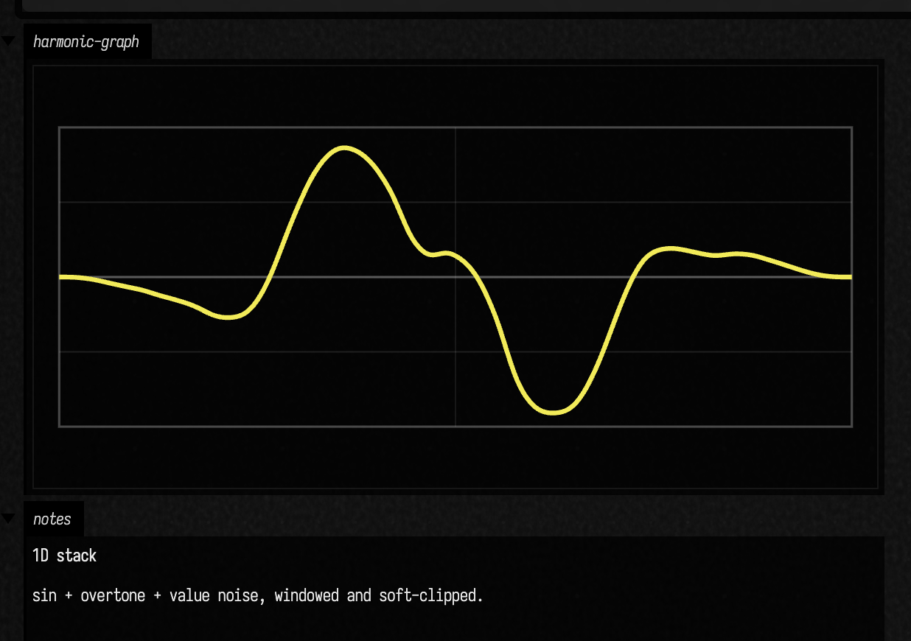
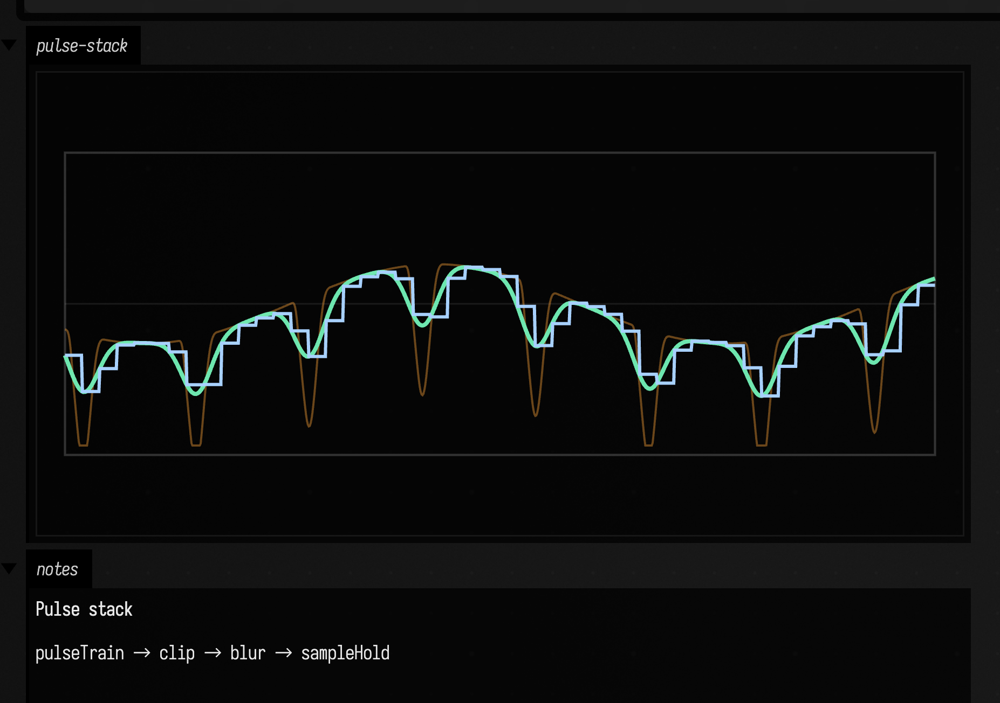
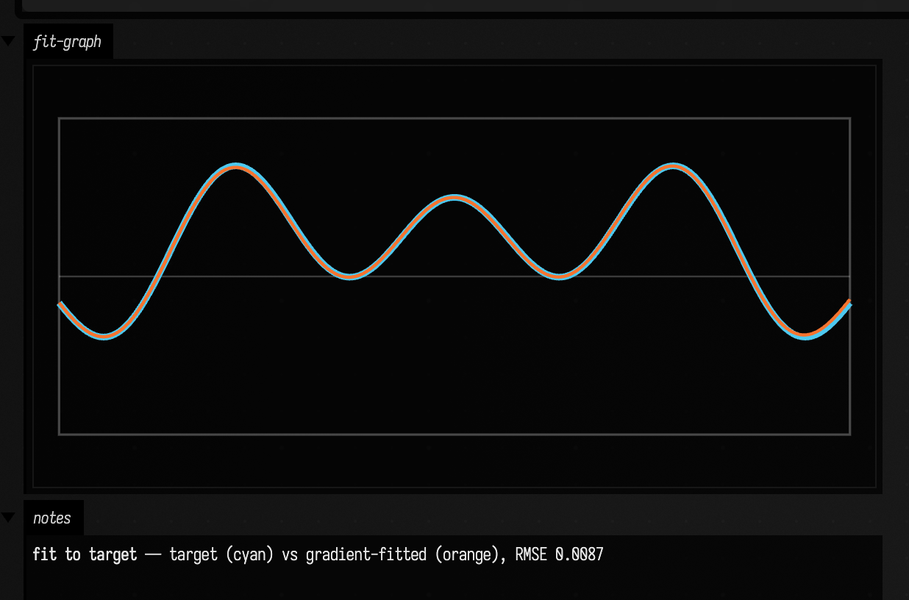
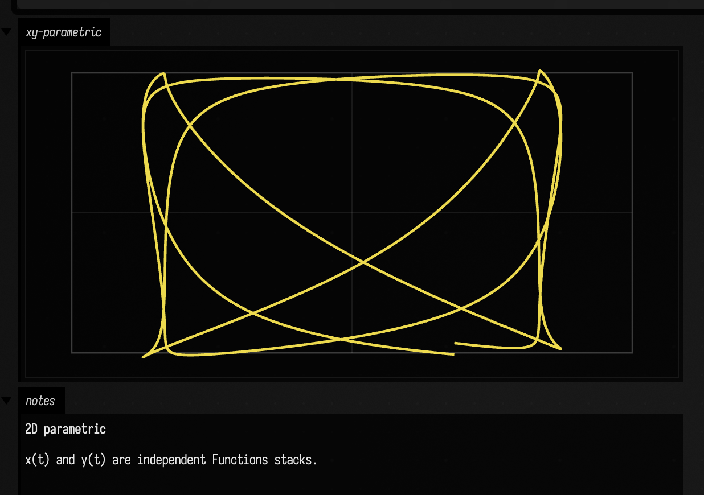
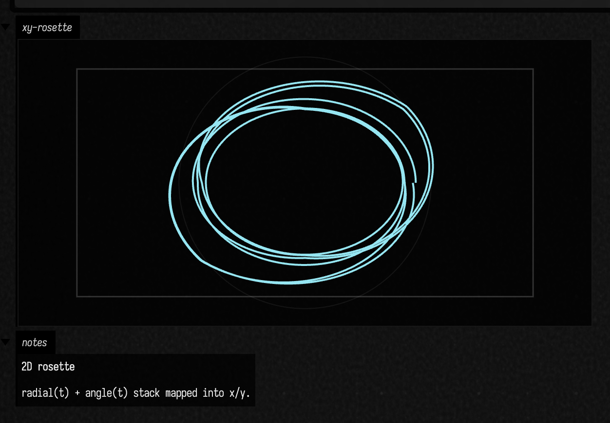
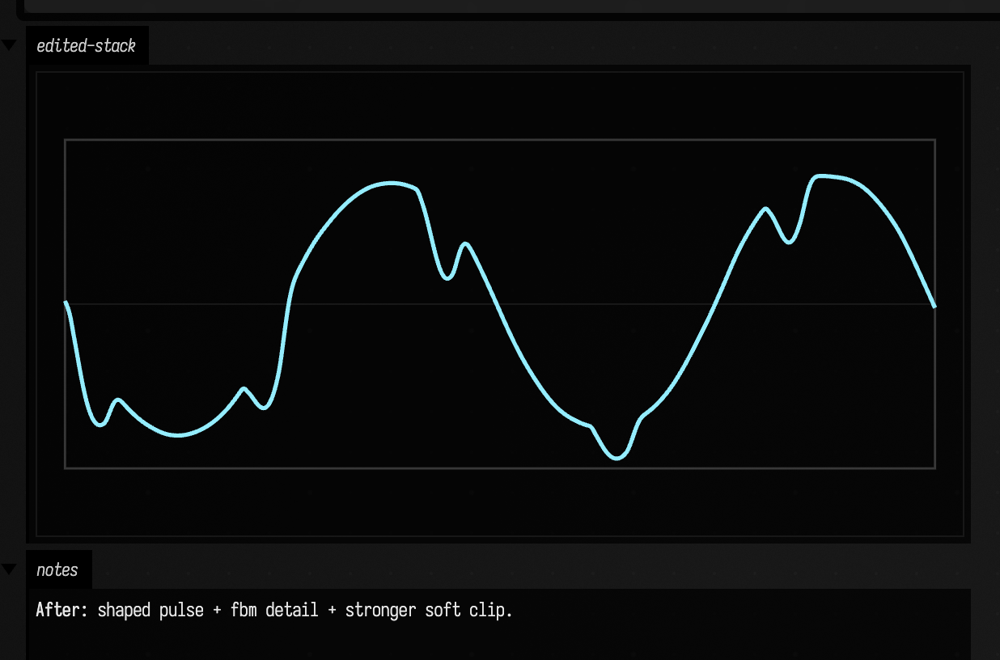
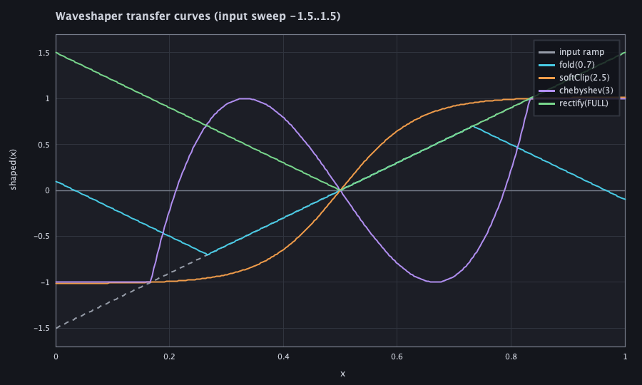
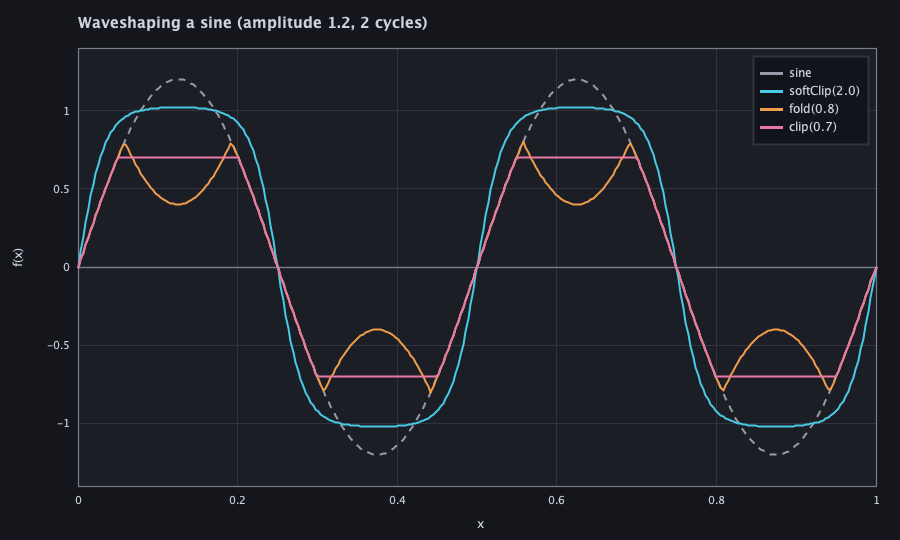
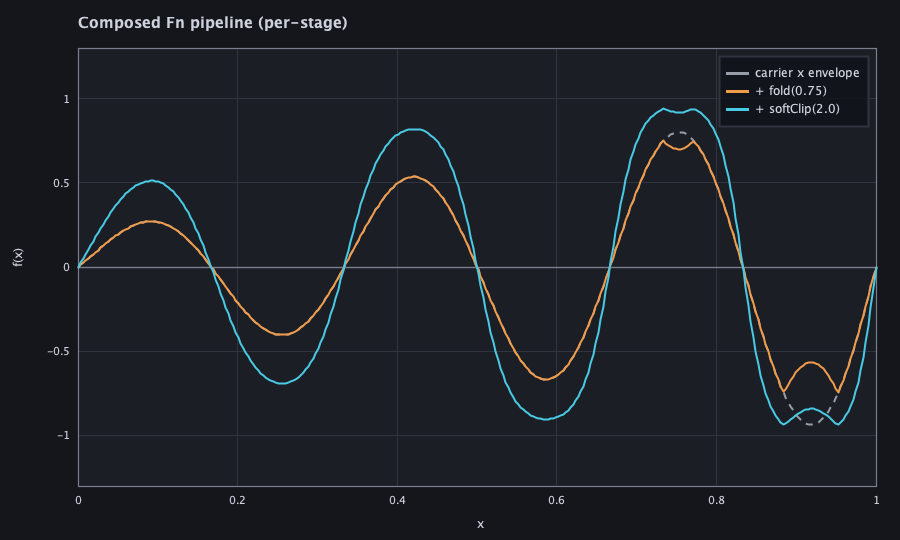

# Functions to FLine examples (Field graphics)

*Every public declaration used below is listed, with its KDoc, in the codebase reference: [`Functions.kt`](reference/math.md#functions-kt). Start from [what's already in the box](reference/index.md).*

The examples here turn `Functions` stacks into drawable FLines. One-dimensional graphs come first, since a single stack sampled along x is the plainest case; the two-dimensional parametric curves are then a pair of those graphs read as x and y.

A function stack is often easier to design by eye than by algebra alone. In creative coding it gives you a quick route from signal to ornament. In data work it makes transforms and envelopes visible. In music it turns oscillation, modulation, and shaping into something you can draw.

## 1D stack: harmonic blend to graph FLine

Start with the ordinary case: one signal, one graph. Once a stack can become a curve, the more elaborate uses are easier to read. This pattern is useful for envelopes, modulation shapes, control signals, and any moment where you need to see a waveform rather than imagine it.

```diffstatic_runner {data-lang=kotlin screenshot="assets/functions_examples/harmonic_stack_box.png" wait="1.0" capture="box" w="1200"}
:::static
import afield.graphics.FLine
import afield.stdlib.Functions

with(Functions) {
    val x0 = 40.0
    val x1 = 940.0
    val y0 = 50.0
    val y1 = 390.0

    val base = sin(frequency = 2.0, amplitude = 0.72)
    val overtone = sin(frequency = 5.0, phase = 0.35, amplitude = 0.24)
    val detail = valueNoise(seed = 41L, frequency = 22.0, amplitude = 0.07)

    val shaped = ((base + overtone + detail) * hannWindow()).softClip(1.25)

    fun hLine(y: Double, color: Vec4, thickness: Double): FLine = fline {
        moveTo(x0, y)
        lineTo(x1, y)
        this.color = color
        this.thickness = thickness
    }

    fun frame(color: Vec4 = vec(1.0, 1.0, 1.0, 0.28), thickness: Double = 1.6): FLine = fline {
        moveTo(x0, y0)
        lineTo(x1, y0)
        lineTo(x1, y1)
        lineTo(x0, y1)
        lineTo(x0, y0)
        this.color = color
        this.thickness = thickness
    }

    val waveform = shaped.toFLine(samples = 900, xScale = 900.0, yScale = 170.0, xOffset = 40.0, yOffset = 220.0).apply {
        color = vec(0.95, 0.92, 0.35, 1.0)
        thickness = 3.2
        stroked = true
        filled = false
    }

    val guides = listOf(
        frame(),
        hLine(220.0, vec(1.0, 1.0, 1.0, 0.35), 1.6),
        hLine(220.0 - 85.0, vec(1.0, 1.0, 1.0, 0.18), 1.0),
        hLine(220.0 + 85.0, vec(1.0, 1.0, 1.0, 0.18), 1.0),
        fline {
            moveTo((x0 + x1) * 0.5, y0)
            lineTo((x0 + x1) * 0.5, y1)
            color = vec(1.0, 1.0, 1.0, 0.12)
            this.thickness = 1.0
        }
    )

    lines(guides + waveform, channel = "harmonic-graph", w = 980.0, h = 430.0, fitToSize = false)
    markdown("notes", "**1D stack**\n\nsin + overtone + value noise, windowed and soft-clipped.")
}
```

The ingredients are humble: one base sinusoid, one overtone, a little value noise, then a window and a soft clip to keep the range under control. `toFLine(...)` does the rest, sampling the stack into drawing space.



The result still reads as one waveform, but the contribution of each ingredient is visible. This is a useful starting point for envelopes, gesture traces, and "design me a shape" problems. For direct geometry operations after conversion, continue with [FLine examples](fline_examples.md).

## 1D stack: pulse design, smoothing, and hold

Smooth oscillation is only one side of the system. Edges, gates, bursts, latches, and sample-and-hold behavior matter too. These are the parts that feel like rhythm, switching, or digital control rather than pure tone.

```diffstatic_runner {data-lang=kotlin screenshot="assets/functions_examples/pulse_stack_window.png" wait="1.0" capture="box" open-outputs="true" w="1200"}
:::static
import afield.graphics.FLine
import afield.stdlib.Functions

with(Functions) {
    val x0 = 30.0
    val x1 = 950.0
    val y0 = 40.0
    val y1 = 360.0

    val pulses = pulseTrain(period = 0.13, duty = 0.36, rise = 0.01, fall = 0.03, edge = SMOOTH, profile = HANN, amplitude = 1.0)

    val mod = sin(frequency = 1.5, phase = 0.7, amplitude = 0.28)
    val textured = (pulses + mod).clip(1.0)
    val blurred = textured.blur(sigma = 0.015, samples = 48)
    val held = blurred.sampleHold(step = 0.02)

    fun asLine(fn: Functions.Fn, color: Vec4, thickness: Double): FLine = fn.toFLine(samples = 950, xScale = 920.0, yScale = 150.0, xOffset = 30.0, yOffset = 200.0).apply {
        this.color = color
        this.thickness = thickness
    }

    val a = asLine(textured, vec(0.98, 0.63, 0.22, 0.55), 1.3)
    val b = asLine(blurred, vec(0.45, 0.95, 0.72, 0.95), 2.6)
    val c = asLine(held, vec(0.66, 0.82, 1.0, 1.0), 2.0)

    val frame = fline {
        moveTo(x0, y0)
        lineTo(x1, y0)
        lineTo(x1, y1)
        lineTo(x0, y1)
        lineTo(x0, y0)
        color = vec(1.0, 1.0, 1.0, 0.22)
        thickness = 1.4
    }

    val center = fline {
        moveTo(x0, 200.0)
        lineTo(x1, 200.0)
        color = vec(1.0, 1.0, 1.0, 0.14)
        thickness = 1.0
    }

    lines(listOf(frame, center, a, b, c), channel = "pulse-stack", w = 980.0, h = 400.0, fitToSize = false)
    markdown("notes", "**Pulse stack**\n\npulseTrain → clip → blur → sampleHold")
}
```

Here the pulse train is the raw material. A slower sine bends it, a blur softens it, and `sampleHold(...)` turns the result into something more stepped and clocked. Putting the three curves on the same axes makes the transformation easy to compare.



The three traces separate cleanly: one jagged, one softened, one quantized into holds. That side-by-side picture helps when shaping sequencer data, stepped motion, triggers, or control-rate material. For statistical views of similar time-varying data, see [Timeseries examples](timeseries_examples.md).

## 1D stack: fit a graph to a target (differentiable)

So far we have *built* stacks by hand. You can also let Field *fit* one for you. A `Functions.Fn` is not only a function but an inspectable graph, and its numeric leaves (frequencies, amplitudes, offsets) are tunable "genes". `fitBest(target, seed, ...)` — the differentiable cousin of the genetic `evolve(...)` — tunes those numbers by gradient descent (Adam) so the seed's curve slides onto a target signal.

Amplitude and offset are easy to fit. **Oscillator frequency is not.** The error surface in frequency is bumpy, full of local minima, so a single descent from a wrong frequency gets stuck. `fitBest` handles that by running several jittered restarts and keeping the best, which reliably escapes into the true basin. Here the target is a *product* of two oscillators and the seed starts with badly wrong frequencies:

```diffstatic_runner {data-lang=kotlin screenshot="assets/functions_examples/fit_to_target_box.png" wait="1.5" capture="box" w="1200"}
:::static
import afield.graphics.FLine
import afield.stdlib.Functions
import afield.stdlib.fitBest

with(Functions) {
    val x0 = 40.0; val x1 = 940.0
    val y0 = 40.0; val y1 = 400.0
    val midY = 220.0; val amp = 150.0

    // A target that is awkward to hand-tune: two oscillators multiplied together.
    val target = cos(2) * sin(1.5, amplitude = 0.8, offset = 0.2)
    // Same *shape*, wrong *numbers* — both frequencies far off, which is the point.
    val seed = cos(3.4) * sin(1.0, amplitude = 2.0)

    // Gradient descent with jittered restarts. A single fitGradient would stall in a
    // frequency local-minimum (~0.19); fitBest escapes it. This target is unbounded,
    // so fitBest falls back to the finite 0..1 sampling domain.
    val run = fitBest(target, seed, restarts = 16)   // RMSE ~0.72 -> ~0.006

    fun asLine(fn: Functions.Fn, color: Vec4, thickness: Double): FLine =
        fn.toFLine(0.0 .. 1.0, samples = 900, xScale = x1 - x0, yScale = amp, xOffset = x0, yOffset = midY).apply {
            this.color = color; this.thickness = thickness
        }
    fun hLine(y: Double, color: Vec4, thickness: Double): FLine = fline {
        moveTo(x0, y); lineTo(x1, y); this.color = color; this.thickness = thickness
    }
    val frame = fline {
        moveTo(x0, y0); lineTo(x1, y0); lineTo(x1, y1); lineTo(x0, y1); lineTo(x0, y0)
        color = vec(1.0, 1.0, 1.0, 0.28); thickness = 1.6
    }

    val guides = listOf(frame, hLine(midY, vec(1.0, 1.0, 1.0, 0.30), 1.2))
    val targetLine = asLine(target, vec(0.30, 0.79, 0.94, 1.0), 4.5)      // cyan, thick
    val fittedLine = asLine(run.fitted, vec(0.97, 0.45, 0.18, 1.0), 2.2)  // orange, thin, on top

    lines(guides + targetLine + fittedLine, channel = "fit-graph", w = 980.0, h = 440.0, fitToSize = false)
    markdown("notes", "**fit to target** — target (cyan) vs gradient-fitted (orange), RMSE ${"%.4f".format(run.finalError)}")
    run
}
```



The thin orange (fitted) curve lands right on top of the thick cyan (target): the restarts found the true frequencies, and `run` reports the RMSE collapsing from ~0.72 to ~0.006. Returning `run` in the box prints a compact summary with a loss-trajectory sparkline. Reach for `fitBest` when you have a shape in mind and just need the numbers dialed in; reach for `evolve(...)` / `fitHybrid(...)` when the *structure* itself (which operators) is still unknown.

### Watching the descent

The capture above is the *endpoint*. The plainer case (a single `fitGradient` with no restarts, on a
target whose amplitude and offset are wrong but whose frequency is right) shows all three curves at
once: the target, the seed it started from, and where it ended up.


And the descent itself, one frame every 8 iterations from 0 to 320. Each frame is its own
`fitGradient` run, truncated at that iteration count, so the error in its title belongs to that run:

<video src="assets/functions_gallery/functions-fit-convergence.mp4"
       controls autoplay loop muted playsinline preload="metadata"
       aria-label="a cyan curve starting far below a thick orange target sine, growing in amplitude and sliding into place over successive iterations until it lies exactly on the target, the title counting the iteration and the falling error"
       style="width:100%;max-width:640px;border-radius:8px;">
</video>

Watch *which* parameter moves first; the error number alone hides it.
Amplitude is essentially found by iteration 8 (the peaks already match) and the error is still
0.1030, because what is left is the vertical offset (the troughs sit shallow) and a small phase lead.
Those take the remaining three hundred iterations to close: 0.0248 by iteration 48, 0.0044 at 320.
A single error figure would have read as "nearly converged" three hundred iterations early.

## 2D stack: separate x(t) and y(t) Functions

A function stack does not have to mean "height over x". Two of them can steer a path instead: one controls horizontal position, the other vertical.

```diffstatic_runner {data-lang=kotlin screenshot="assets/functions_examples/parametric_lissajous_box.png" wait="1.0" capture="box" open-outputs="true" w="1200"}
:::static
import afield.graphics.FLine
import afield.stdlib.Functions

with(Functions) {
    val tDomain = 0.0..1.0
    val cx = 500.0
    val cy = 250.0

    val xFn = (sin(frequency = 3.0, phase = 0.2, amplitude = 1.0, domain = tDomain)
            + sin(frequency = 9.0, phase = 1.1, amplitude = 0.18, domain = tDomain))
        .softClip(1.15)

    val yFn = (sin(frequency = 4.0, phase = 1.2, amplitude = 1.0, domain = tDomain)
            + valueNoise(seed = 88L, frequency = 16.0, amplitude = 0.1, domain = tDomain))
        .softClip(1.2)

    fun parametric(xf: Functions.Fn, yf: Functions.Fn, samples: Int = 1400): FLine {
        val f = FLine()
        for (i in 0 until samples) {
            val t = tDomain.lerp(i.toDouble() / (samples - 1).coerceAtLeast(1).toDouble())
            val x = cx + xf.eval(t) * 290.0
            val y = cy + yf.eval(t) * 190.0
            if (i == 0) f.moveTo(x, y) else f.lineTo(x, y)
        }
        return f
    }

    val frame = fline {
        moveTo(120.0, 60.0)
        lineTo(880.0, 60.0)
        lineTo(880.0, 440.0)
        lineTo(120.0, 440.0)
        lineTo(120.0, 60.0)
        color = vec(1.0, 1.0, 1.0, 0.24)
        thickness = 1.4
    }

    val cross = listOf(
        fline {
            moveTo(120.0, cy)
            lineTo(880.0, cy)
            color = vec(1.0, 1.0, 1.0, 0.12)
            thickness = 1.0
        },
        fline {
            moveTo(cx, 60.0)
            lineTo(cx, 440.0)
            color = vec(1.0, 1.0, 1.0, 0.12)
            thickness = 1.0
        }
    )

    val curve = parametric(xFn, yFn).apply {
        color = vec(0.98, 0.9, 0.32, 0.95)
        thickness = 2.3
    }

    lines(listOf(frame) + cross + curve, channel = "xy-parametric", w = 1000.0, h = 500.0, fitToSize = false)
    markdown("notes", "**2D parametric**\n\nx(t) and y(t) are independent Functions stacks.")
}
```

`xFn` and `yFn` stay independent until the moment of sampling, where `parametric(...)` evaluates them together. The path emerges from their relationship, not from either stack on its own.



The curve has different tempos on its two axes, so it reads as an orbit, a trajectory, or ornament rather than a graph. This is a workhorse pattern for parametric drawing. For lower-level path editing once you have the curve, see [FLine examples](fline_examples.md).

## 2D stack: noisy rosette with windowed arc energy

Sometimes the useful coordinates are radius and angle, not x and y. That shift suits rosettes, emblems, radial plots, circular choreography, and drawings that grow outward rather than march left to right.

```diffstatic_runner {data-lang=kotlin screenshot="assets/functions_examples/parametric_rosette_window.png" wait="1.0" capture="box" open-outputs="true" w="1200"}
:::static
import afield.graphics.FLine
import afield.stdlib.Functions

with(Functions) {
    val tDomain = 0.0..1.0
    val cx = 500.0
    val cy = 250.0

    val radial = (
        one(tDomain) * 0.62
            + pulseTrain(period = 0.25, duty = 0.5, profile = TRIANGLE, amplitude = 0.22, domain = tDomain)
            + valueNoise(seed = 5L, frequency = 14.0, amplitude = 0.05, domain = tDomain)
        )
        .clamp(0.12, 1.0)

    val theta = ramp(start = 0.0, end = 1.0, domain = tDomain) * Math.PI * 2.0 * 6.0

    val xFn = (radial * cos(frequency = 0.0, phase = 0.0, amplitude = 1.0, offset = 0.0, domain = tDomain))
        .mapY { _ -> 0.0 }

    // Explicit x/y from radial + theta, sampled directly for clarity.
    val line = FLine()
    val samples = 1800
    for (i in 0 until samples) {
        val t = tDomain.lerp(i.toDouble() / (samples - 1).coerceAtLeast(1).toDouble())
        val r = radial.eval(t)
        val ang = theta.eval(t)
        val x = cx + kotlin.math.cos(ang) * r * 280.0
        val y = cy + kotlin.math.sin(ang) * r * 210.0
        if (i == 0) line.moveTo(x, y) else line.lineTo(x, y)
    }

    line.color = vec(0.62, 0.95, 1.0, 0.95)
    line.thickness = 2.0

    val frame = fline {
        moveTo(120.0, 60.0)
        lineTo(880.0, 60.0)
        lineTo(880.0, 440.0)
        lineTo(120.0, 440.0)
        lineTo(120.0, 60.0)
        color = vec(1.0, 1.0, 1.0, 0.22)
        thickness = 1.4
    }

    val ringGuide = fline {
        val n = 220
        for (i in 0..n) {
            val a = i.toDouble() / n.toDouble() * Math.PI * 2.0
            val x = cx + kotlin.math.cos(a) * 210.0
            val y = cy + kotlin.math.sin(a) * 210.0
            if (i == 0) moveTo(x, y) else lineTo(x, y)
        }
        color = vec(1.0, 1.0, 1.0, 0.1)
        thickness = 1.0
    }

    lines(listOf(frame, ringGuide, line), channel = "xy-rosette", w = 1000.0, h = 500.0, fitToSize = false)
    markdown("notes", "**2D rosette**\n\nradial(t) + angle(t) stack mapped into x/y.")
}
```

The code builds the motion in polar terms first: radius from `pulseTrain(...)` and `valueNoise(...)`, angle from a ramp. Only after that does it convert to cartesian coordinates. The explicit sampling loop keeps the conversion visible.



The radius creates petals and breaths; the angle decides how they are laid around the circle. This is a strong pattern for radial ornaments, animated emblems, and circular plotting systems. For color strategies that pair well with this kind of geometry, see [Colors examples](colors_examples.md).

## Diff runner: edit a stack and capture the new look

With `Functions`, a small edit can materially change the drawing. That makes diff examples useful: you can see what a new ingredient actually changed.

```diff_runner {data-lang=kotlin screenshot="assets/functions_examples/diff_runner_after.png" wait="1.0" capture="box" open-outputs="true" w="1200"}
:::before
import afield.graphics.FLine
import afield.stdlib.Functions

with(Functions) {
    val a = sin(frequency = 2.0, amplitude = 0.7)
    val b = pulseTrain(period = 0.2, duty = 0.35, amplitude = 0.35)
    val f = (a + b).softClip(1.0)

    val line = f.toFLine(samples = 900, xScale = 900.0, yScale = 160.0, xOffset = 40.0, yOffset = 220.0).apply {
        color = vec(1.0, 0.75, 0.4, 1.0)
        thickness = 2.0
    }

    val frame = fline {
        moveTo(40.0, 50.0)
        lineTo(940.0, 50.0)
        lineTo(940.0, 390.0)
        lineTo(40.0, 390.0)
        lineTo(40.0, 50.0)
        color = vec(1.0, 1.0, 1.0, 0.22)
        thickness = 1.3
    }

    lines(listOf(frame, line), channel = "edited-stack", w = 980.0, h = 420.0, fitToSize = false)
    markdown("notes", "**Before**: simple sin + pulse stack.")
}
:::after
import afield.graphics.FLine
import afield.stdlib.Functions

with(Functions) {
    val a = sin(frequency = 2.0, amplitude = 0.7)
    val b = pulseTrain(period = 0.2, duty = 0.35, rise = 0.01, fall = 0.025, profile = HANN, amplitude = 0.35)
    val detail = fbm(seed = 77L, frequency = 4.0, amplitude = 0.12, octaves = 4)
    val f = (a + b + detail).softClip(1.22)

    val line = f.toFLine(samples = 900, xScale = 900.0, yScale = 160.0, xOffset = 40.0, yOffset = 220.0).apply {
        color = vec(0.58, 0.93, 1.0, 1.0)
        thickness = 2.6
    }

    val frame = fline {
        moveTo(40.0, 50.0)
        lineTo(940.0, 50.0)
        lineTo(940.0, 390.0)
        lineTo(40.0, 390.0)
        lineTo(40.0, 50.0)
        color = vec(1.0, 1.0, 1.0, 0.24)
        thickness = 1.4
    }

    val center = fline {
        moveTo(40.0, 220.0)
        lineTo(940.0, 220.0)
        color = vec(1.0, 1.0, 1.0, 0.12)
        thickness = 1.0
    }

    lines(listOf(frame, center, line), channel = "edited-stack", w = 980.0, h = 420.0, fitToSize = false)
    markdown("notes", "**After**: shaped pulse + fbm detail + stronger soft clip.")
}
```

The diff keeps the frame and scale fixed and changes only the stack: a more shaped pulse, a little `fbm(...)` detail, and a firmer soft clip. The edit reads as an edit, not as a new scene.



The broad contour survives, while the surface gains character. The expanded reference below is the place to browse the API once the main patterns are familiar.

## Domains and timeline composition

`Fn` has one public interval: `domain`. Arithmetic intersects domains, replacement and piecewise tools expand domains when they truly need to, and timeline chunks keep their source interval separate from the interval where they are placed. [Domains](functions_domains.md) works through that model on its own; this section is about the composition helpers built over it.

Unless a constructor says otherwise, a fresh `Fn` starts with `Domain.DEFAULT`, which is `0.0..1.0`. Oscillators are the exception: the periodic constructors (`sin`, `cos`, `saw`, `triangle`, `square`) and the `pulseTrain`/`impulseTrain`/`pulseBurst` family default to `Domain.ALL`, because a periodic signal is genuinely defined on all of R. Use `domain = ...` to change the construction interval, use `over (...)` to relabel or place an existing function, and use `/ all` when any other unbounded function is genuinely meant. Enumerating an unbounded function (`toDoubleArray`, `sampleUniform`, `plot`, `stream`, and the rest of the sampling surface) with no explicit interval is safe: it previews over a finite window (`0.0..1.0`) rather than trying to walk the whole real line.

The declarative timeline layer is thin Kotlin over those same pieces. `over` sets the resulting function domain, `stretch` remaps the left-hand domain into a new one, `then` concatenates two functions, `overlapping` creates an overlapped pair, and `/` pipes a function through reusable transforms. `through` and `pipe` are the readable aliases; `/` is the compact style that matches the audio section. The transform `all` is the terse form of "set the domain to `Domain.ALL`", so `sin(0.5) / all` is the compact unbounded signal spelling. Because `over` and `stretch` are infix calls, keep the target range in parentheses; for longer arithmetic stacks, wrap the left side too.

Numeric parameters on these helpers accept Kotlin `Number`s and can also be `Fn`s. Literals like `overlap = 1`, `overlap = 0.1`, or `slower(2)` are just the constant-function case; an `Fn` parameter is sampled near where it applies, such as the midpoint of a join's overlap, or the current slot/grain for random-repeat style transforms. The terse `0.25` form is a parameter signal, so it does not narrow the domain of the function it configures.

### `domain = ...` vs `over ...`

For a periodic function like `pulseTrain`, these two forms usually produce the same sampled values:

```diffstatic {data-lang=kotlin}
val a = pulseTrain(period = 0.08, duty = 0.35, domain = 0.0..0.8)
val b = pulseTrain(period = 0.08, duty = 0.35) over (0.0..0.8)
```

The first form builds the pulse train with `0.0..0.8` as its construction-time domain. The second form builds the pulse train with its default `0.0..1.0` domain, then replaces the public `Fn.domain` with `0.0..0.8`. Because `pulseTrain` computes phase from `x`, period, duty, and phase rather than from domain-normalized position, the two functions are effectively equivalent here.

```diffstatic_runner {data-lang=kotlin screenshot="assets/functions_examples/domain-over-pulsetrain-difference.png" wait="1.0" wait-output="true" capture="box" embed="true" open-outputs="true" w="1200" timeout="120" name="functions-domain-over-pulsetrain-difference"}
:::static
import afield.stdlib.Functions

with(Functions) {
    val a = pulseTrain(period = 0.08, duty = 0.35, domain = 0.0..0.8)
    val b = pulseTrain(period = 0.08, duty = 0.35) over (0.0..0.8)

    (a - b).plot(
        "plot",
        domain(0.0..0.8),
        title = "pulseTrain: construction domain - over domain",
        yDomain = domain((-0.1)..0.1)
    )
}
```

The difference matters for functions where the domain is part of the math. Windows and ramps care about their construction domain because they normalize `x` across that interval:

```diffstatic {data-lang=kotlin}
val shaped = hannWindow(0.0..0.8)
val relabeled = hannWindow() over (0.0..0.8)
```

`hannWindow(0.0..0.8)` means "shape the whole Hann curve across `0.0..0.8`". `hannWindow() over (0.0..0.8)` means "make a Hann curve over its default `0.0..1.0` construction domain, then relabel its valid interval".

```diffstatic_runner {data-lang=kotlin screenshot="assets/functions_examples/domain-over-hannwindow-difference.png" wait="1.0" wait-output="true" capture="box" embed="true" open-outputs="true" w="1200" timeout="120" name="functions-domain-over-hannwindow-difference"}
:::static
import afield.stdlib.Functions

with(Functions) {
    val shaped = hannWindow(0.0..0.8)
    val relabeled = hannWindow() over (0.0..0.8)

    (shaped - relabeled).plot(
        "plot",
        domain(0.0..0.8),
        title = "hannWindow: construction domain - over domain",
        yDomain = domain((-1.0)..1.0)
    )
}
```

The short rule is: use `domain = ...` when the construction interval should affect internals, and use `over ...` when you want post-hoc timeline placement, trimming, or extent declaration. For pure periodic signals those often coincide. For domain-normalized shapes, they do not.

### `over ...` vs `stretch ...`

`over` changes only the public domain. `stretch` changes the x-coordinate lookup, so the whole source domain is replayed across the target domain:

```diffstatic {data-lang=kotlin}
val relabeled = sin(5.0) over (0.0..10.0)
val stretched = sin(5.0) stretch (0.0..10.0)
val alsoStretched = sin(5.0) / stretch(0.0..10.0)
```

Stretching needs finite source and target domains. If the source is unbounded, give it a finite source interval first:

```diffstatic {data-lang=kotlin}
val fromSlice = (sin(0.5) / all).stretchFrom(from = 0.0..1.0, to = 0.0..12.0)
```

The default stretch is linear in normalized time. `stretchSmooth(...)`, `stretchSmoother(...)`, and `stretchBy(..., warp = someFn)` warp that normalized time before sampling the source:

```diffstatic {data-lang=kotlin}
val linear = pulseTrain(0.1) stretch (0.0..4.0)
val eased = pulseTrain(0.1).stretchSmooth(0.0..4.0)
val softer = pulseTrain(0.1) / stretchSmoother(0.0..4.0)
val custom = pulseTrain(0.1).stretchBy(0.0..4.0, warp = smoothStep(0.0, 1.0))
```

```diffstatic {data-lang=kotlin}
import afield.stdlib.Functions

with(Functions) {
    val tone = ((sin(5) * 1.4) / delay(0.4) / slower(2)) over (0.0..10.0)
    val forever = sin(0.25) / all
    val stretchedTone = sin(5.0) stretch (0.0..10.0)
    val easedTone = sin(5.0) / stretchSmoother(0.0..10.0)

    val a = sin(2.0) over (0.0..1.0)
    val b = pulseTrain(period = 0.12, duty = 0.35, domain = 0.0..1.0)
    val phrase = a then ((b / softClipBy(1.5)) over (0.0..1.0))

    val pad = (a overlapping 0.5) with (sin(7.0) / gain(0.35))
    val alsoPad = a.overlapping(0.5, sin(7.0) / gain(0.35))

    val palette = [
        sin(2.0) over (0.0..1.0),
        saw(0.12) over (0.0..0.6),
        pulseTrain(period = 0.08, duty = 0.35, domain = 0.0..0.8)
    ]

    val movingOverlap = ramp(0.02, 0.18, 0.0..10.0)
    val melody = palette.sequence(overlap = movingOverlap)
    val endless = (palette.randomSequence(seed = 4, overlap = 0.05, slot = ramp(0.18, 0.42, 0.0..10.0)) / all) over (0.0..10.0)
    val shuffled = palette.shuffleLoop(seed = 9, overlap = 0.12) over (0.0..12.0)
    val morph = palette.morph(ramp(0.0, 2.0, 0.0..1.0))

    val tornTape =
        (sin(5.0) / slower(ramp(0.8, 1.6, 0.0..4.0)) / turbulence(amount = 0.035, frequency = 11.0) / randomCopyPaste(grain = ramp(0.08, 0.2, 0.0..4.0), seed = 5)) over (0.0..4.0)
}
```

## Shaping signals: the Functions transform pipeline

The reference below lists every constructor and combiner in isolation. This section is the
opposite view: how the small handful of infix operators fit together into a *pipeline*, so
a stack like `pulseBurst(10) through gain(0.6) over (0.0..4.0)` reads on sight and you can
write your own without hunting through the catalogue.

### The mental model

A pipeline has two kinds of thing in it:

- a **source** `Fn` — a signal you can sample at any `x` (`ramp`, `cos`, `pulseBurst`, …);
- a **`FnTransform`** — a *reusable edit*, a packaged `(Fn) -> Fn`, produced by a builder
  like `gain(0.6)`, `delay(0.1)`, `lowPass(0.08)`, or `softClipBy(1.2)`.

You *shape* a source by sending it `through` a transform. The result is another `Fn`, so you
can send that through the next transform, and so on. Nothing here is a second interpreter:
the declarative layer is thin Kotlin that only rearranges pure, freely-sampleable functions.
That is the same property that bounds what the [rewrite layer](#rewrite-limitations) can reach
into. A `FnTransform` holds no state and can be reused across as many sources as you like, so
build a shaping chain once, name it, and apply it everywhere.

### The operators

| Operator | Shape | Meaning |
| --- | --- | --- |
| `source through t` | `Fn through FnTransform → Fn` | Apply transform `t` to the source. |
| `source pipe t` | `Fn pipe FnTransform → Fn` | Readable alias for `through`. |
| `source / t` | `Fn / FnTransform → Fn` | Compact alias for `through` (matches the audio style). |
| `t1 then t2` | `FnTransform then FnTransform → FnTransform` | Compose two transforms into one (apply `t1`, then `t2`). |
| `t1 / t2` | `FnTransform / FnTransform → FnTransform` | Compact alias for composing transforms. |
| `source over (a..b)` | `Fn over ClosedRange → Fn` | Relabel the public domain to `a..b` (placement, no resampling). |
| `source stretch (a..b)` | `Fn stretch ClosedRange → Fn` | Remap the source's domain across `a..b` (replays the whole source over the new interval). |
| `a then b` | `Fn then Fn → Fn` | Concatenate two functions end-to-end on a timeline. |
| `a overlapping n with b` | `Fn overlapping Number with Fn → Fn` | Join `a` and `b` with an `n`-wide crossfade. |

Two overloads share a name. `then` composes *transforms* when both sides are `FnTransform`
(`gain(0.6) then lowPass(0.08)`), and *concatenates functions* when both sides are `Fn`
(`intro then verse`). The compiler picks by operand type; the editor's completion leans on the
same distinction (below). For the `over` / `stretch` distinction (relabelling versus
remapping), see [`over ... vs stretch ...`](#over-vs-stretch) above; here we only use them to
place a finished pipeline on a timeline.

### What the shapers actually do

A waveshaper reads most easily from its **transfer curve**: push a rising ramp through it, and the
plotted result is the shape it imposes on whatever you send it. Four of them, over an input sweep
of `-1.5..1.5`, against the ramp itself as a dashed reference:

```diffstatic {data-lang=kotlin}
val sweep = ramp(-1.5, 1.5) over Functions.Domain.of(0.0, 1.0)

sweep.fold(0.7)                            // reflects back at the threshold
sweep.softClip(2.5)                        // a bounded S, smooth everywhere
sweep.chebyshev(3)                         // the 3rd Chebyshev polynomial
sweep.rectify(Functions.RectifyMode.FULL)  // absolute value, folded about zero
```



`fold` reflects rather than flattens, so it keeps adding harmonics where a clipper stops; `softClip`
is bounded and smooth everywhere, so it has no corner to alias off; `chebyshev(3)` is a polynomial,
so it maps a unit cosine to a *pure* third harmonic rather than a smear.

Now on real signal rather than on a ramp: a 1.2-amplitude sine, so each shaper has something to
bite on. `clip` appears here and not above, because it is the only member of the family with
corners in it:



### Building up a pipeline

Start with a source and send it `through` a single transform. `gain` scales the signal:

```diffstatic {data-lang=kotlin}
val burst = pulseBurst(10) through gain(0.6)
burst.plot("source")
```

Chain transforms with `then`. Because `then` on two `FnTransform`s composes them, you can
name a shaping chain and reuse it. Here the source is smoothed, then softly clipped:

```diffstatic {data-lang=kotlin}
val soften = lowPass(0.08) then softClipBy(1.2)
val shaped = cos(3.0) through soften
shaped.plot("shaped")
```

`through` returns an `Fn`, so pipeline steps and plain arithmetic mix freely. The `/` alias
keeps long stacks compact: `source / a / b` is `source through a through b`.

```diffstatic {data-lang=kotlin}
val gesture = (pulseBurst(8) / gain(0.8) / delay(0.05) / hold(0.02)) + cos(2.0) * 0.1
gesture.plot("gesture")
```

Once a gesture is shaped, place it in time with `over`, which relabels its domain. That is what
you want when the pipeline result feeds a longer timeline:

```diffstatic {data-lang=kotlin}
val placed = (ramp(0.0, 1.0) through bias(-0.5) through gain(2.0)) over (0.0..4.0)
placed.plot("placed")
```

A fuller gesture layers the vocabulary. Here a tone's time-base slows across the interval, and
turbulence roughens it before a mirror about its centre:

```diffstatic {data-lang=kotlin}
val tornTape = (cos(5.0)
    / slower(2.0)
    / turbulence(amount = 0.04, frequency = 11.0)
    / mirror()) over (0.0..4.0)
tornTape.plot("tornTape")
```

Every builder used above (`gain`, `bias`, `delay`, `hold`, `lowPass`, `softClipBy`, `slower`,
`turbulence`, `mirror`, `stretch`, …) returns a `FnTransform`, so any of them slots into a
`through` / `/` / `then` chain interchangeably. The full set lives in the
[reference below](#algebra-and-mapping) and under [`FnTransform`](#fntransform).

Because every stage returns an `Fn`, you can plot the pipeline **at each stage** rather than only at
the end, which is how you find out which stage did the thing you did not want. A carrier times an
envelope, then folded, then soft-clipped:



### The editor helps you discover operators

You rarely need to memorise which builders exist. Type an infix operator and a space
(`pulseBurst(10) through `) and the editor's **type-aware infix completion** boosts the
operands that fit. Because `through` (like `pipe` and `/`) declares its operand as
`FnTransform`, every `FnTransform`-returning builder (`gain`, `delay`, `lowPass`, `mirror`, …)
floats to the top of the completion list instead of being buried in the alphabetical tail of
everything in scope.

This is generic, not a hard-coded list: the completion engine discovers the operator's
declared parameter type by completing the operator token itself (an infix `foo` surfaces as
`foo(ParamType)`), then rewards candidates whose return type matches. So the same help
appears after `then ` (want another `FnTransform`), and the mechanism keeps working as new
transform builders are added. Implementation: `InfixCompletion` in
`src/jvmMain/kotlin/afield/execution.kt`.

Once you can build one gesture this way, you can evolve a whole *family* of them: the
[variety-generation section](#variety-generation-novelty-search-for-a-set-of-gestures)
grows a set of behaviourally distinct shapes from a seed using the same pure-`Fn` machinery.

## Expanded reference: simple + creative patterns

All snippets below assume:

```diffstatic {data-lang=kotlin}
import afield.stdlib.Functions
with(Functions) {
    // examples here
}
```

Unless a snippet says otherwise, functions carry the default domain `0.0..1.0`. The periodic family is the exception: `sin`, `cos`, `saw`, `triangle`, `square`, `pulseTrain`, `impulseTrain` and `pulseBurst` are built on `Domain.ALL`, and only narrow an expression when you give them a finite interval.

Most numeric parameters accept plain numbers directly; the DSL lifts them into parameter functions where needed.

### Core constructors and base shapes

#### fn

Use `fn` when the shape is easiest to write directly as `x -> y` code over a domain.

**Simple**

This should produce a quadratic curve over the default domain, where each output is `x * x`.

```diffstatic {data-lang=kotlin}
val f = fn { x -> x * x }
```

**Creative**

```diffstatic_runner {data-lang=kotlin screenshot="assets/functions_examples/reference/fn.png" wait="1.0" wait-output="true" capture="box" embed="true" open-outputs="true" w="1200" name="functions-ref-fn"}
:::static
import afield.Keyframe
import afield.stdlib.Functions

with(Functions) {
    val f = fn { x -> kotlin.math.sin(20.0 * x) * kotlin.math.exp(-3.0 * x) }
    f.plot()
}
```

#### c / constant

Use constants when a scalar needs to participate in `Fn` arithmetic or carry a domain.

**Simple**

This should produce a flat function that evaluates to `0.5` everywhere in the default domain.

```diffstatic {data-lang=kotlin}
val f = constant(0.5)
```

**Creative**

```diffstatic_runner {data-lang=kotlin screenshot="assets/functions_examples/reference/c-constant.png" wait="1.0" wait-output="true" capture="box" embed="true" open-outputs="true" w="1200" name="functions-ref-c-constant"}
:::static
import afield.Keyframe
import afield.stdlib.Functions

with(Functions) {
    val f = (constant(0.6) + valueNoise(5, 12.0, 0.05)).clamp(0.0, 1.0)
    f.plot()
}
```

#### zero / one

`zero` and `one` make domain-aware baseline, mask, and gate functions.

**Simple**

This should produce a gate that stays at `1.0` across the whole domain.

```diffstatic {data-lang=kotlin}
val gate = one()
```

**Creative**

```diffstatic_runner {data-lang=kotlin screenshot="assets/functions_examples/reference/zero-one.png" wait="1.0" wait-output="true" capture="box" embed="true" open-outputs="true" w="1200" name="functions-ref-zero-one"}
:::static
import afield.Keyframe
import afield.stdlib.Functions

with(Functions) {
    val gate = (one() - pulseTrain(period = 0.2, duty = 0.8)).clip(1.0)
    gate.plot()
}
```

#### identity

`identity` returns the input coordinate, useful as a raw time or normalized-position signal.

**Simple**

This should produce the raw input coordinate as the output value.

```diffstatic {data-lang=kotlin}
val x = identity()
```

**Creative**

```diffstatic_runner {data-lang=kotlin screenshot="assets/functions_examples/reference/identity.png" wait="1.0" wait-output="true" capture="box" embed="true" open-outputs="true" w="1200" name="functions-ref-identity"}
:::static
import afield.Keyframe
import afield.stdlib.Functions

with(Functions) {
    val spiralT = identity().pow(1.7).withEdge(Functions.EdgeMode.CLAMP)
    spiralT.plot()
}
```

#### ramp

`ramp(start, end)` is a **value line**: its value travels linearly from `start` to `end` as x sweeps the domain, so `ramp(1.0, 6.0) over (0.0..1.0)` is 1 at x=0 and 6 at x=1, and `ramp(0.0, 1.0)` is the identity 0-to-1 over the default domain. It is the linear sibling of `tween`, and the go-to for envelopes, selectors, and swept parameters. (To go the other way and *normalize* an x-window down to 0..1, use `remap(from, to)`, which reads out the position of x within `[from, to]`.)

**Simple**

This should produce a linear 0-to-1 ramp across the default domain.

```diffstatic {data-lang=kotlin}
val r = ramp(0.0, 1.0)
```

**Creative**

```diffstatic_runner {data-lang=kotlin screenshot="assets/functions_examples/reference/ramp.png" wait="1.0" wait-output="true" capture="box" embed="true" open-outputs="true" w="1200" name="functions-ref-ramp"}
:::static
import afield.Keyframe
import afield.stdlib.Functions

with(Functions) {
    val env = ramp(0.1, 0.9).crossfade(ramp(0.9, 0.1), center = 0.5, width = 0.25)
    env.plot()
}
```

#### step

`step` turns a threshold into a binary gate.

**Simple**

This should produce a hard binary switch at `x = 0.5`.

```diffstatic {data-lang=kotlin}
val s = step(0.5)
```

**Creative**

```diffstatic_runner {data-lang=kotlin screenshot="assets/functions_examples/reference/step.png" wait="1.0" wait-output="true" capture="box" embed="true" open-outputs="true" w="1200" name="functions-ref-step"}
:::static
import afield.Keyframe
import afield.stdlib.Functions

with(Functions) {
    val trem = step(sin(2.0, amplitude = 0.15, offset = 0.5))
    trem.plot()
}
```

#### smoothStep

`smoothStep` turns two edges into a soft 0-to-1 mask.

**Simple**

This should produce a softened 0-to-1 transition between `0.2` and `0.8`.

```diffstatic {data-lang=kotlin}
val s = smoothStep(0.2, 0.8)
```

**Creative**

```diffstatic_runner {data-lang=kotlin screenshot="assets/functions_examples/reference/smoothstep.png" wait="1.0" wait-output="true" capture="box" embed="true" open-outputs="true" w="1200" name="functions-ref-smoothstep"}
:::static
import afield.Keyframe
import afield.stdlib.Functions

with(Functions) {
    val mask = smoothStep(valueNoise(2, 3.0, 0.2), 0.9)
    mask.plot()
}
```

#### tween / ease

`tween` is the direct procedural-animation constructor: it moves between two values (or two `Fn` signals) across a domain with a named easing curve. `Fn.ease(...)` shapes an existing normalized signal. Both remain visible and rebuildable in the function graph.

```diffstatic {data-lang=kotlin}
val fade = tween(0.0, 1.0, 2.0..4.0, Functions.Easing.SINE_IN_OUT)
val shapedNoise = valueNoise(3, 4.0, 1.0).ease(Functions.Easing.SMOOTHSTEP)
```

`Easing` covers the conventional Penner family, so motion reads the same here as in
other animation toolkits. The polynomial ramps (`QUAD`, `CUBIC`, `QUART`, `QUINT`),
`SINE`, `EXPO`, and `CIRC` come in `_IN`, `_OUT`, and `_IN_OUT` variants; `BACK`,
`ELASTIC`, and `BOUNCE` add anticipation, spring, and settle; `LINEAR`,
`SMOOTHSTEP`, and `SMOOTHERSTEP` round out the set. A tween clamps normalized time
to its endpoints. `ease(..., clampInput = false)` is useful when a polynomial shape
should continue beyond `0..1`.

**Creative**

```diffstatic_runner {data-lang=kotlin screenshot="assets/functions_examples/reference/tween-ease.png" wait="1.0" wait-output="true" capture="box" embed="true" open-outputs="true" w="1200" name="functions-ref-tween-ease"}
:::static
import afield.Keyframe
import afield.stdlib.Functions

with(Functions) {
    // A settling spring, textured with a windowed tremor — the headline motion gesture.
    val motion = tween(-1.0, 1.0, 0.0..1.0, Functions.Easing.BACK_OUT)
    val tremor = valueNoise(17, 10.0, 0.08) * hannWindow()
    val texturedMotion = (motion + tremor).withName("settling motion")
    texturedMotion.plot(0.0..1.0)
}
```


### Oscillators and pulse family

#### sin

`sin` builds a periodic oscillator from frequency, phase, amplitude, and offset controls.

**Simple**

This should produce a sine wave with three cycles over the unit domain and peak amplitude `0.8`.

```diffstatic {data-lang=kotlin}
val f = sin(frequency = 3.0, amplitude = 0.8)
```

**Creative**

```diffstatic_runner {data-lang=kotlin screenshot="assets/functions_examples/reference/sin.png" wait="1.0" wait-output="true" capture="box" embed="true" open-outputs="true" w="1200" name="functions-ref-sin"}
:::static
import afield.Keyframe
import afield.stdlib.Functions

with(Functions) {
    val f = sin(2.0, phase = valueNoise(7, 5.0, 0.3), amplitude = 0.7)
    f.plot()
}
```

#### cos

`cos` is the phase-shifted companion to `sin`, useful for quadrature and circular motion.

**Simple**

This should produce a cosine wave with two cycles and full-scale amplitude.

```diffstatic {data-lang=kotlin}
val f = cos(frequency = 2.0, amplitude = 1.0)
```

**Creative**

```diffstatic_runner {data-lang=kotlin screenshot="assets/functions_examples/reference/cos.png" wait="1.0" wait-output="true" capture="box" embed="true" open-outputs="true" w="1200" name="functions-ref-cos"}
:::static
import afield.Keyframe
import afield.stdlib.Functions

with(Functions) {
    val f = cos(5.0, phase = ramp(0.0, Math.PI), amplitude = 0.5)
    f.plot()
}
```

#### saw

`saw` creates a repeating ramp with sharp wraparound edges.

**Simple**

This should produce a sawtooth wave that repeats every quarter of the domain.

```diffstatic {data-lang=kotlin}
val f = saw(period = 0.25, amplitude = 1.0)
```

**Creative**

```diffstatic_runner {data-lang=kotlin screenshot="assets/functions_examples/reference/saw.png" wait="1.0" wait-output="true" capture="box" embed="true" open-outputs="true" w="1200" name="functions-ref-saw"}
:::static
import afield.Keyframe
import afield.stdlib.Functions

with(Functions) {
    val f = saw(period = 0.14, amplitude = 0.7).softClip(1.6)
    f.plot()
}
```

#### triangle

`triangle` creates a bipolar linear up/down oscillator.

**Simple**

This should produce a triangle wave with a `0.2` period and `0.9` amplitude.

```diffstatic {data-lang=kotlin}
val f = triangle(period = 0.2, amplitude = 0.9)
```

**Creative**

```diffstatic_runner {data-lang=kotlin screenshot="assets/functions_examples/reference/triangle.png" wait="1.0" wait-output="true" capture="box" embed="true" open-outputs="true" w="1200" name="functions-ref-triangle"}
:::static
import afield.Keyframe
import afield.stdlib.Functions

with(Functions) {
    val f = triangle(0.2, amplitude = fbm(9, 1.0, 0.6))
    f.plot()
}
```

#### square

`square` creates a duty-controlled high/low oscillator.

**Simple**

This should produce an even-duty square wave that flips every half-period.

```diffstatic {data-lang=kotlin}
val f = square(period = 0.25, duty = 0.5, amplitude = 1.0)
```

**Creative**

```diffstatic_runner {data-lang=kotlin screenshot="assets/functions_examples/reference/square.png" wait="1.0" wait-output="true" capture="box" embed="true" open-outputs="true" w="1200" name="functions-ref-square"}
:::static
import afield.Keyframe
import afield.stdlib.Functions

with(Functions) {
    val f = square(0.125, duty = sin(1.0, amplitude = 0.2, offset = 0.5), amplitude = 0.8)
    f.plot()
}
```

#### pulseTrain

`pulseTrain` creates shaped repeating pulses with optional edge, jitter, and profile controls.

**Simple**

This should produce repeating pulses that are high for 35% of each `0.2` period.

```diffstatic {data-lang=kotlin}
val f = pulseTrain(period = 0.2, duty = 0.35)
```

**Creative**

```diffstatic_runner {data-lang=kotlin screenshot="assets/functions_examples/reference/pulsetrain.png" wait="1.0" wait-output="true" capture="box" embed="true" open-outputs="true" w="1200" name="functions-ref-pulsetrain"}
:::static
import afield.Keyframe
import afield.stdlib.Functions

with(Functions) {
    val f = pulseTrain(period = 0.15, duty = 0.4, rise = 0.01, fall = 0.02, profile = HANN, jitter = 0.08, seed = 42)
    f.plot()
}
```

#### pulseTrainWidth

`pulseTrainWidth` specifies pulse duration directly instead of duty fraction.

**Simple**

This should produce repeating pulses whose high portion is `0.08` units wide.

```diffstatic {data-lang=kotlin}
val f = pulseTrainWidth(period = 0.2, width = 0.08)
```

**Creative**

```diffstatic_runner {data-lang=kotlin screenshot="assets/functions_examples/reference/pulsetrainwidth.png" wait="1.0" wait-output="true" capture="box" embed="true" open-outputs="true" w="1200" name="functions-ref-pulsetrainwidth"}
:::static
import afield.Keyframe
import afield.stdlib.Functions

with(Functions) {
    val f = pulseTrainWidth(period = 0.18, width = sin(0.5, amplitude = 0.05, offset = 0.08), profile = GAUSSIAN)
    f.plot()
}
```

#### pulseTrainHz

`pulseTrainHz` describes pulses by frequency instead of period.

**Simple**

This should produce eight pulses per unit, with each pulse high for 30% of its cycle.

```diffstatic {data-lang=kotlin}
val f = pulseTrainHz(frequency = 8.0, duty = 0.3)
```

**Creative**

```diffstatic_runner {data-lang=kotlin screenshot="assets/functions_examples/reference/pulsetrainhz.png" wait="1.0" wait-output="true" capture="box" embed="true" open-outputs="true" w="1200" name="functions-ref-pulsetrainhz"}
:::static
import afield.Keyframe
import afield.stdlib.Functions

with(Functions) {
    val f = pulseTrainHz(frequency = ramp(4.0, 16.0), duty = 0.22, edge = Functions.PulseEdge.SINE)
    f.plot()
}
```

#### pulseTrainPattern

`pulseTrainPattern` cycles through per-pulse amplitudes for rhythmic patterns.

**Simple**

This should produce a pulse train whose pulse heights cycle through the supplied pattern.

```diffstatic {data-lang=kotlin}
val f = pulseTrainPattern(doubleArrayOf(1.0, 0.5, 1.0, 0.2), period = 0.2)
```

**Creative**

```diffstatic_runner {data-lang=kotlin screenshot="assets/functions_examples/reference/pulsetrainpattern.png" wait="1.0" wait-output="true" capture="box" embed="true" open-outputs="true" w="1200" name="functions-ref-pulsetrainpattern"}
:::static
import afield.Keyframe
import afield.stdlib.Functions

with(Functions) {
    val f = pulseTrainPattern(doubleArrayOf(1.0, 0.0, 0.8, 0.3, 1.2), period = 0.11, jitter = 0.1, profile = TRIANGLE)
    f.plot()
}
```

#### impulseTrain

`impulseTrain` makes narrow Gaussian-style events at a repeating period.

**Simple**

This should produce narrow repeating impulses every `0.1` units.

```diffstatic {data-lang=kotlin}
val f = impulseTrain(period = 0.1, width = 0.01)
```

**Creative**

```diffstatic_runner {data-lang=kotlin screenshot="assets/functions_examples/reference/impulsetrain.png" wait="1.0" wait-output="true" capture="box" embed="true" open-outputs="true" w="1200" name="functions-ref-impulsetrain"}
:::static
import afield.Keyframe
import afield.stdlib.Functions

with(Functions) {
    val f = impulseTrain(period = 0.12, width = 0.02, sigma = 0.09, jitter = 0.2, seed = 9)
    f.plot()
}
```

#### pulseBurst

`pulseBurst` limits a pulse train to a finite count of events.

**Simple**

This should produce five short pulses starting at `0.2` and spaced by `0.1`.

```diffstatic {data-lang=kotlin}
val f = pulseBurst(count = 5, period = 0.1, start = 0.2)
```

**Creative**

```diffstatic_runner {data-lang=kotlin screenshot="assets/functions_examples/reference/pulseburst.png" wait="1.0" wait-output="true" capture="box" embed="true" open-outputs="true" w="1200" name="functions-ref-pulseburst"}
:::static
import afield.Keyframe
import afield.stdlib.Functions

with(Functions) {
    val f = pulseBurst(9, period = 0.07, start = 0.12, edge = EXP, curve = 3.0, profile = HANN)
    f.plot()
}
```

#### gaussian

`gaussian` makes a bell-shaped lobe that can be used as an envelope, bump, or mask.

**Simple**

This should produce a unit Gaussian bump centered at `0.5` with `0.1` spread.

```diffstatic {data-lang=kotlin}
val f = gaussian(mean = 0.5, sigma = 0.1, amplitude = 1.0)
```

**Creative**

```diffstatic_runner {data-lang=kotlin screenshot="assets/functions_examples/reference/gaussian.png" wait="1.0" wait-output="true" capture="box" embed="true" open-outputs="true" w="1200" name="functions-ref-gaussian"}
:::static
import afield.Keyframe
import afield.stdlib.Functions

with(Functions) {
    val f = gaussian(mean = sin(0.5, amplitude = 0.15, offset = 0.5), sigma = 0.08, amplitude = 0.9)
    f.plot()
}
```


### Algebra and mapping

#### `+ - * /`

Arithmetic combines functions pointwise, intersecting domains where both inputs are valid.

**Simple**

This should produce the pointwise sum of a sine wave and a sawtooth wave.

```diffstatic {data-lang=kotlin}
val f = sin(2.0) + saw(0.2)
```

**Creative**

```diffstatic_runner {data-lang=kotlin screenshot="assets/functions_examples/reference/plus-minus.png" wait="1.0" wait-output="true" capture="box" embed="true" open-outputs="true" w="1200" name="functions-ref-plus-minus"}
:::static
import afield.Keyframe
import afield.stdlib.Functions

with(Functions) {
    val f = (sin(3.0) * pulseTrain(0.18)) / (one() + constant(0.2))
    f.plot()
}
```

#### mapY

`mapY` reshapes output values while leaving time alone.

**Simple**

This should halve the sine wave's output values without changing its timing.

```diffstatic {data-lang=kotlin}
val f = sin(2.0).mapY { it * 0.5 }
```

**Creative**

```diffstatic_runner {data-lang=kotlin screenshot="assets/functions_examples/reference/mapy.png" wait="1.0" wait-output="true" capture="box" embed="true" open-outputs="true" w="1200" name="functions-ref-mapy"}
:::static
import afield.Keyframe
import afield.stdlib.Functions

with(Functions) {
    val f = valueNoise(3, 14.0, 1.0).mapY { v -> kotlin.math.sign(v) * kotlin.math.sqrt(kotlin.math.abs(v)) }
    f.plot()
}
```

#### mapX

`mapX` warps the input coordinate before sampling the source function.

**Simple**

This should compress the sine wave horizontally by sampling it at half the input coordinate.

```diffstatic {data-lang=kotlin}
val f = sin(2.0).mapX { x -> x * 0.5 }
```

**Creative**

```diffstatic_runner {data-lang=kotlin screenshot="assets/functions_examples/reference/mapx.png" wait="1.0" wait-output="true" capture="box" embed="true" open-outputs="true" w="1200" name="functions-ref-mapx"}
:::static
import afield.Keyframe
import afield.stdlib.Functions

with(Functions) {
    val f = sin(4.0).mapX { x -> x + 0.08 * kotlin.math.sin(16.0 * x) }
    f.plot()
}
```

#### shift / delay

`shift` and `delay` sample the source earlier or later in x.

**Simple**

This should move the sine wave forward in time by `0.1` units.

```diffstatic {data-lang=kotlin}
val f = sin(2.0).shift(0.1)
```

**Creative**

```diffstatic_runner {data-lang=kotlin screenshot="assets/functions_examples/reference/shift-delay.png" wait="1.0" wait-output="true" capture="box" embed="true" open-outputs="true" w="1200" name="functions-ref-shift-delay"}
:::static
import afield.Keyframe
import afield.stdlib.Functions

with(Functions) {
    val f = valueNoise(7, 10.0, 0.7).delay(sin(0.5, amplitude = 0.03))
    f.plot()
}
```

#### scaleX / faster / slower

Time-scaling changes how quickly the source is traversed.

**Simple**

This should stretch the saw wave's time axis by a factor of two.

```diffstatic {data-lang=kotlin}
val f = saw(0.2).scaleX(2.0)
```

**Creative**

```diffstatic_runner {data-lang=kotlin screenshot="assets/functions_examples/reference/scalex-faster-slower.png" wait="1.0" wait-output="true" capture="box" embed="true" open-outputs="true" w="1200" name="functions-ref-scalex-faster-slower"}
:::static
import afield.Keyframe
import afield.stdlib.Functions

with(Functions) {
    val f = (sin(3.0).faster(2.0) / slower(0.75)).scaleX(scale = ramp(0.8, 1.6), about = 0.5)
    f.plot()
}
```

#### scaleY / offsetY

Y-scaling and offsetting change the amplitude range without moving events in time.

**Simple**

This should halve the sine wave's amplitude and lift it upward by `0.2`.

```diffstatic {data-lang=kotlin}
val f = sin(2.0).scaleY(0.5).offsetY(0.2)
```

**Creative**

```diffstatic_runner {data-lang=kotlin screenshot="assets/functions_examples/reference/scaley-offsety.png" wait="1.0" wait-output="true" capture="box" embed="true" open-outputs="true" w="1200" name="functions-ref-scaley-offsety"}
:::static
import afield.Keyframe
import afield.stdlib.Functions

with(Functions) {
    val f = fbm(1, 2.0, 1.0).scaleY(smoothStep(0.0, 1.0)).offsetY(valueNoise(2, 3.0, 0.1))
    f.plot()
}
```

#### reverse / flip

Reverse mirrors time around a point, while flip negates the output.

**Simple**

This should reverse the ramp so it falls from one to zero across the domain.

```diffstatic {data-lang=kotlin}
val f = ramp(0.0, 1.0).reverse()
```

**Creative**

```diffstatic_runner {data-lang=kotlin screenshot="assets/functions_examples/reference/reverse-flip.png" wait="1.0" wait-output="true" capture="box" embed="true" open-outputs="true" w="1200" name="functions-ref-reverse-flip"}
:::static
import afield.Keyframe
import afield.stdlib.Functions

with(Functions) {
    val f = (sin(2.0).reverse(0.5) + triangle(0.12)).flip()
    f.plot()
}
```

#### abs / sign / rectify

These turn bipolar signals into magnitude, sign, or positive-only shapes.

**Simple**

This should fold negative sine values upward into positive values.

```diffstatic {data-lang=kotlin}
val f = sin(3.0).abs()
```

**Creative**

```diffstatic_runner {data-lang=kotlin screenshot="assets/functions_examples/reference/abs-sign-rectify.png" wait="1.0" wait-output="true" capture="box" embed="true" open-outputs="true" w="1200" name="functions-ref-abs-sign-rectify"}
:::static
import afield.Keyframe
import afield.stdlib.Functions

with(Functions) {
    val f = fbmPerlin(7, 2.5, 1.0).sign().rectify()
    f.plot()
}
```

#### pow / exp / log

Power and logarithmic transforms bend a signal curve nonlinearly.

**Simple**

This should square the linear ramp, bending it into an ease-in curve.

```diffstatic {data-lang=kotlin}
val f = ramp(0.0, 1.0).pow(2.0)
```

**Creative**

```diffstatic_runner {data-lang=kotlin screenshot="assets/functions_examples/reference/pow-exp-log.png" wait="1.0" wait-output="true" capture="box" embed="true" open-outputs="true" w="1200" name="functions-ref-pow-exp-log"}
:::static
import afield.Keyframe
import afield.stdlib.Functions

with(Functions) {
    val f = (gaussian(0.5, 0.12, 1.0) + constant(1.2)).log(kotlin.math.E).exp()
    f.plot()
}
```

#### clamp / clip / softClip / fold / wrapY

Limiters and wrappers keep outputs in a usable range, either gently or with hard edges.

**Simple**

This should limit the sine wave so values never exceed `0.7` in magnitude.

```diffstatic {data-lang=kotlin}
val f = sin(2.0).clip(0.7)
```

**Creative**

```diffstatic_runner {data-lang=kotlin screenshot="assets/functions_examples/reference/clamp-clip-softclip-fold-wrapy.png" wait="1.0" wait-output="true" capture="box" embed="true" open-outputs="true" w="1200" name="functions-ref-clamp-clip-softclip-fold-wrapy"}
:::static
import afield.Keyframe
import afield.stdlib.Functions

with(Functions) {
    val f = (saw(0.11) * constant(2.5)).fold(0.8).softClip(1.4).wrapY(-0.7, 0.7)
    f.plot()
}
```

#### withEdge

`withEdge` defines how a function behaves when sampled outside its domain.

**Simple**

This should make out-of-domain samples clamp to the nearest edge value.

```diffstatic {data-lang=kotlin}
val f = sin(3.0).withEdge(Functions.EdgeMode.CLAMP)
```

**Creative**

```diffstatic_runner {data-lang=kotlin screenshot="assets/functions_examples/reference/withedge.png" wait="1.0" wait-output="true" capture="box" embed="true" open-outputs="true" w="1200" name="functions-ref-withedge"}
:::static
import afield.Keyframe
import afield.stdlib.Functions

with(Functions) {
    val f = gaussian(0.5, 0.08, 1.0).withEdge(Functions.EdgeMode.MIRROR, outside = valueNoise(8, 4.0, 0.05))
    f.plot()
}
```

#### quantize / bitCrush

Quantizers reduce continuous values into stepped or bit-depth-like levels.

**Simple**

This should reduce the sine wave to eight discrete value levels.

```diffstatic {data-lang=kotlin}
val f = sin(2.0).quantize(8)
```

**Creative**

```diffstatic_runner {data-lang=kotlin screenshot="assets/functions_examples/reference/quantize-bitcrush.png" wait="1.0" wait-output="true" capture="box" embed="true" open-outputs="true" w="1200" name="functions-ref-quantize-bitcrush"}
:::static
import afield.Keyframe
import afield.stdlib.Functions

with(Functions) {
    val f = (fbm(4, 3.0, 1.0).bitCrush(5)).mix(sin(1.0), constant(0.2))
    f.plot()
}
```

#### mix / crossfade

Mixing blends between functions, either by a fixed amount or over a transition region.

**Simple**

This should blend halfway between the sine and saw waves.

```diffstatic {data-lang=kotlin}
val f = sin(2.0).mix(saw(0.2), 0.5)
```

**Creative**

```diffstatic_runner {data-lang=kotlin screenshot="assets/functions_examples/reference/mix-crossfade.png" wait="1.0" wait-output="true" capture="box" embed="true" open-outputs="true" w="1200" name="functions-ref-mix-crossfade"}
:::static
import afield.Keyframe
import afield.stdlib.Functions

with(Functions) {
    val f = triangle(0.12).crossfade(fbmPerlin(11, 2.0, 1.0), center = 0.55, width = 0.35)
    f.plot()
}
```

#### cut / trim / slice / replace

Interval edits keep or swap parts of a function over a target range.

**Simple**

This should keep only the `0.2..0.8` portion of the sine wave as the function's domain.

```diffstatic {data-lang=kotlin}
val f = sin(2.0).cut(0.2..0.8)
```

**Creative**

```diffstatic_runner {data-lang=kotlin screenshot="assets/functions_examples/reference/cut-trim-slice-replace.png" wait="1.0" wait-output="true" capture="box" embed="true" open-outputs="true" w="1200" name="functions-ref-cut-trim-slice-replace"}
:::static
import afield.Keyframe
import afield.stdlib.Functions

with(Functions) {
    val f = saw(0.18).replace(0.35..0.6, pulseTrain(0.08, duty = 0.4))
    f.plot()
}
```

#### window / amplitudeMod / ringMod / warp

Modulation tools multiply, ring, or time-warp one signal by another.

**Simple**

This should multiply the sine wave by a Hann envelope over the default domain.

```diffstatic {data-lang=kotlin}
val f = sin(2.0).window(hannWindow())
```

**Creative**

```diffstatic_runner {data-lang=kotlin screenshot="assets/functions_examples/reference/window-amplitudemod-ringmod-warp.png" wait="1.0" wait-output="true" capture="box" embed="true" open-outputs="true" w="1200" name="functions-ref-window-amplitudemod-ringmod-warp"}
:::static
import afield.Keyframe
import afield.stdlib.Functions

with(Functions) {
    val f = sin(4.0).amplitudeMod(fbm(2, 6.0, 0.7), depth = 0.8).ringMod(cos(9.0), 0.5).warp(valueNoise(2, 5.0, 1.0), 0.05)
    f.plot()
}
```

#### quantizeX / sampleHold

X-quantization and sample-hold create stepped time sampling.

**Simple**

This should hold the sine wave constant over `0.05`-wide sample steps.

```diffstatic {data-lang=kotlin}
val f = sin(2.0).sampleHold(0.05)
```

**Creative**

```diffstatic_runner {data-lang=kotlin screenshot="assets/functions_examples/reference/quantizex-samplehold.png" wait="1.0" wait-output="true" capture="box" embed="true" open-outputs="true" w="1200" name="functions-ref-quantizex-samplehold"}
:::static
import afield.Keyframe
import afield.stdlib.Functions

with(Functions) {
    val f = valueNoise(9, 16.0, 0.8).quantizeX(step = ramp(0.02, 0.09)).sampleHold(step = 0.03, offset = 0.01)
    f.plot()
}
```

#### phaseMod / frequencyMod

Phase and frequency modulation are aliases for controlled time warping.

**Simple**

This should modulate the sine wave's phase with a faster sine signal.

```diffstatic {data-lang=kotlin}
val f = sin(2.0).phaseMod(sin(8.0), 0.02)
```

**Creative**

```diffstatic_runner {data-lang=kotlin screenshot="assets/functions_examples/reference/phasemod-frequencymod.png" wait="1.0" wait-output="true" capture="box" embed="true" open-outputs="true" w="1200" name="functions-ref-phasemod-frequencymod"}
:::static
import afield.Keyframe
import afield.stdlib.Functions

with(Functions) {
    val f = triangle(0.2).frequencyMod(fbmPerlin(5, 4.0, 1.0), depth = 0.04)
    f.plot()
}
```

#### saturate / jitterX

Saturation compresses output values while jitter perturbs sampling positions.

**Simple**

This should push the sine through a saturation curve without changing its timing.

```diffstatic {data-lang=kotlin}
val f = sin(2.0).saturate(1.0)
```

**Creative**

```diffstatic_runner {data-lang=kotlin screenshot="assets/functions_examples/reference/saturate-jitterx.png" wait="1.0" wait-output="true" capture="box" embed="true" open-outputs="true" w="1200" name="functions-ref-saturate-jitterx"}
:::static
import afield.Keyframe
import afield.stdlib.Functions

with(Functions) {
    val f = pulseTrain(0.15, duty = 0.3).jitterX(0.03, seed = 7).saturate(1.8)
    f.plot()
}
```

#### repeat / mirrorRepeat / tile / pad / echo

Repetition tools loop, mirror, bound, extend, and echo a source function.

**Simple**

This should tile the sine wave into repeated `0.25`-wide copies.

```diffstatic {data-lang=kotlin}
val f = sin(2.0).repeat(0.25, 0.0)
```

**Creative**

```diffstatic_runner {data-lang=kotlin screenshot="assets/functions_examples/reference/repeat-mirrorrepeat-tile-pad-echo.png" wait="1.0" wait-output="true" capture="box" embed="true" open-outputs="true" w="1200" name="functions-ref-repeat-mirrorrepeat-tile-pad-echo"}
:::static
import afield.Keyframe
import afield.stdlib.Functions

with(Functions) {
    val f = saw(0.2).mirrorRepeat(0.17).tile(6, 0.12).pad(0.05, 0.08, 0.0).echo(0.03, 0.45, repeats = 6)
    f.plot()
}
```

#### derivative / integral

Calculus helpers estimate slope and accumulated area over a sampled function.

**Simple**

This should estimate the sine wave's slope as a new function.

```diffstatic {data-lang=kotlin}
val slope = sin(2.0).derivative()
```

**Creative**

```diffstatic_runner {data-lang=kotlin screenshot="assets/functions_examples/reference/derivative-integral.png" wait="1.0" wait-output="true" capture="box" embed="true" open-outputs="true" w="1200" name="functions-ref-derivative-integral"}
:::static
import afield.Keyframe
import afield.stdlib.Functions

with(Functions) {
    val area = (pulseTrain(0.2) * hannWindow()).integral(step = 1e-3, origin = 0.0)
    area.plot()
}
```

#### convolve / correlate / movingAverage / blur

Filtering helpers smooth or compare a function with a local kernel.

**Simple**

This should smooth the noise by averaging nearby samples over a short window.

```diffstatic {data-lang=kotlin}
val sm = valueNoise(3, 14.0, 1.0).movingAverage(0.08, samples = 64)
```

**Creative**

```diffstatic_runner {data-lang=kotlin screenshot="assets/functions_examples/reference/convolve-correlate-movingaverage-blur.png" wait="1.0" wait-output="true" capture="box" embed="true" open-outputs="true" w="1200" name="functions-ref-convolve-correlate-movingaverage-blur"}
:::static
import afield.Keyframe
import afield.stdlib.Functions

with(Functions) {
    val f = fbm(9, 2.0, 1.0).convolve(gaussianWindow(-0.06..0.06, sigma = 0.3), samples = 41, kernelDomain = -0.06..0.06, normalize = true).blur(0.01, samples = 31)
    f.plot()
}
```

#### over / stretch / `/` pipe

`over` relabels the resulting domain, `stretch` remaps the old domain into a new one, and `/` pipes a function through transforms.

**Simple**

This should show the difference between relabeling a domain and remapping a source into a target interval.

```diffstatic {data-lang=kotlin}
val relabeled = sin(5.0) over (0.0..10.0)
val stretched = sin(5.0) stretch (0.0..10.0)
val piped = sin(5.0) / stretch(0.0..10.0)
```

**Creative**

```diffstatic_runner {data-lang=kotlin screenshot="assets/functions_examples/reference/over-pipe.png" wait="1.0" wait-output="true" capture="box" embed="true" open-outputs="true" w="1200" name="functions-ref-over-pipe"}
:::static
import afield.Keyframe
import afield.stdlib.Functions

with(Functions) {
    val f = ((sin(5.0) * 1.4) / delay(0.4) / softClipBy(1.2)) over (0.0..10.0)
    f.plot()
}
```

#### FnTransform

`FnTransform` packages reusable function edits so they can be chained and piped.

**Simple**

This should pipe the sine wave through a transform that halves its amplitude.

```diffstatic {data-lang=kotlin}
val f = sin(3.0) / gain(0.5)
```

**Creative**

```diffstatic_runner {data-lang=kotlin screenshot="assets/functions_examples/reference/fntransform.png" wait="1.0" wait-output="true" capture="box" embed="true" open-outputs="true" w="1200" name="functions-ref-fntransform"}
:::static
import afield.Keyframe
import afield.stdlib.Functions

with(Functions) {
    val shape = delay(0.1) / gain(0.75) / hold(0.02)
    val f = pulseTrain(0.12) / shape
    f.plot()
}
```


### Arrays, sampling, streams, and output conversion

#### DoubleArray.toFn / List.toFn

Array conversion turns sampled numeric data into an interpolated `Fn`.

**Simple**

This should interpolate the four array values across `0.0..1.0` as a function.

```diffstatic {data-lang=kotlin}
val f = doubleArrayOf(0.0, 1.0, 0.4, -0.2).toFn(domain = 0.0..1.0)
```

**Creative**

```diffstatic_runner {data-lang=kotlin screenshot="assets/functions_examples/reference/doublearray-tofn-list-tofn.png" wait="1.0" wait-output="true" capture="box" embed="true" open-outputs="true" w="1200" name="functions-ref-doublearray-tofn-list-tofn"}
:::static
import afield.Keyframe
import afield.stdlib.Functions

with(Functions) {
    val f = [0.0, 0.4, 1.0, 0.2, -0.4].toFn(domain = 0.0..1.0, interpolation = CUBIC).softClip(1.5)
    f.plot()
}
```

#### sampleAt / samplesAt

Sampling helpers extract values or weighted sample records from chosen x positions.

**Simple**

This should sample the sine wave at three explicit x positions.

```diffstatic {data-lang=kotlin}
val ys = sin(2.0).sampleAt(doubleArrayOf(0.0, 0.25, 0.5))
```

**Creative**

```diffstatic_runner {data-lang=kotlin screenshot="assets/functions_examples/reference/sampleat-samplesat.png" wait="1.0" wait-output="true" capture="box" embed="true" open-outputs="true" w="1200" name="functions-ref-sampleat-samplesat"}
:::static
import afield.Keyframe
import afield.stdlib.Functions

with(Functions) {
    val f = fbmPerlin(8, 2.0, 1.0)
    val pts = f.samplesAt(DoubleArray(32) { it / 31.0 })
    f.withName("samplesAt source").plot()
}
```

#### toDoubleArray / toVec2List

Array exporters resample an `Fn` for analysis, drawing, or interop.

**Simple**

This should resample the sine wave into 128 numeric values.

```diffstatic {data-lang=kotlin}
val ys = sin(3.0).toDoubleArray(128)
```

**Creative**

```diffstatic_runner {data-lang=kotlin screenshot="assets/functions_examples/reference/todoublearray-tovec2list.png" wait="1.0" wait-output="true" capture="box" embed="true" open-outputs="true" w="1200" name="functions-ref-todoublearray-tovec2list"}
:::static
import afield.Keyframe
import afield.stdlib.Functions

with(Functions) {
    val pts = pulseTrain(0.13, duty = 0.32).toVec2List(256)
    val f = pts.map { it.y.toDouble() }.toFn(domain = 0.0..1.0, interpolation = NEAREST).withName("toVec2List")
    f.plot()
}
```

#### cursor

A cursor walks through a function at a fixed step and remembers its position.

**Simple**

This should create a reusable cursor that advances through the sine wave in `0.01` steps.

```diffstatic {data-lang=kotlin}
val c0 = sin(2.0).cursor(start = 0.0, step = 0.01)
```

**Creative**

```diffstatic_runner {data-lang=kotlin screenshot="assets/functions_examples/reference/cursor.png" wait="1.0" wait-output="true" capture="box" embed="true" open-outputs="true" w="1200" name="functions-ref-cursor"}
:::static
import afield.Keyframe
import afield.stdlib.Functions

with(Functions) {
    val scratch = fbm(6, 3.0, 0.8).cursor(0.0, 0.002).next(1024).toFn(0.0..1.0)
    scratch.plot()
}
```

#### stream / streamWithX

Streams expose lazy samples, with or without their x coordinate.

**Simple**

This should create a lazy stream of sine values and collect the first eight samples.

```diffstatic {data-lang=kotlin}
val first = sin(2.0).stream(start = 0.0, step = 0.01).take(8).toList()
```

**Creative**

```diffstatic_runner {data-lang=kotlin screenshot="assets/functions_examples/reference/stream-streamwithx.png" wait="1.0" wait-output="true" capture="box" embed="true" open-outputs="true" w="1200" name="functions-ref-stream-streamwithx"}
:::static
import afield.Keyframe
import afield.stdlib.Functions

with(Functions) {
    val pairs = pulseTrain(0.15).streamWithX(0.0, 0.005).take(200).toList()
    val f = pairs.map { it.second }.toFn(domain = 0.0..1.0, interpolation = NEAREST).withName("streamWithX")
    f.plot()
}
```

#### toFLine

`toFLine` turns a sampled function into drawable Field geometry.

**Simple**

This should convert the sine wave into drawable line geometry sampled across its domain.

```diffstatic {data-lang=kotlin}
val line = sin(2.0).toFLine(samples = 600)
```

**Creative**

```diffstatic_runner {data-lang=kotlin screenshot="assets/functions_examples/reference/tofline.png" wait="1.0" wait-output="true" capture="box" embed="true" open-outputs="true" w="1200" name="functions-ref-tofline"}
:::static
import afield.Keyframe
import afield.stdlib.Functions

with(Functions) {
    val f = sin(2.0) + fbm(5, 6.0, 0.2)
    val line = f.toFLine(samples = 1400, xScale = 980.0, yScale = 170.0, xOffset = 30.0, yOffset = 220.0)
    f.withName("toFLine source").plot()
}
```


### Windows, noise, normalization, and sampling sets

#### hannWindow / hammingWindow / blackmanWindow / gaussianWindow

Window functions create smooth masks for tapering, blending, and weighting.

**Simple**

This should produce a Hann window over the default domain, rising from zero and returning to zero.

```diffstatic {data-lang=kotlin}
val w = hannWindow()
```

**Creative**

```diffstatic_runner {data-lang=kotlin screenshot="assets/functions_examples/reference/hannwindow-hammingwindow-blackmanwindow-gaussianwindow.png" wait="1.0" wait-output="true" capture="box" embed="true" open-outputs="true" w="1200" name="functions-ref-hannwindow-hammingwindow-blackmanwindow-gaussianwindow"}
:::static
import afield.Keyframe
import afield.stdlib.Functions

with(Functions) {
    val w = gaussianWindow(sigma = 0.25).mix(blackmanWindow(), constant(0.4))
    w.plot()
}
```

#### whiteNoise / valueNoise / perlinNoise

Noise functions generate stochastic texture with different continuity properties.

**Simple**

This should produce seeded smooth value noise with repeatable random-looking variation.

```diffstatic {data-lang=kotlin}
val n = valueNoise(seed = 1, frequency = 12.0, amplitude = 0.5)
```

**Creative**

```diffstatic_runner {data-lang=kotlin screenshot="assets/functions_examples/reference/whitenoise-valuenoise-perlinnoise.png" wait="1.0" wait-output="true" capture="box" embed="true" open-outputs="true" w="1200" name="functions-ref-whitenoise-valuenoise-perlinnoise"}
:::static
import afield.Keyframe
import afield.stdlib.Functions

with(Functions) {
    val n = whiteNoise(4, 24.0, 0.3).mix(perlinNoise(5, 3.0, 0.7), constant(0.65))
    n.plot()
}
```

#### fbm / fbmPerlin / randomWalk

Fractal and walk generators layer randomness into rougher, multi-scale signals.

**Simple**

This should produce layered fractal noise by summing several octaves.

```diffstatic {data-lang=kotlin}
val n = fbm(seed = 2, frequency = 2.0, amplitude = 1.0, octaves = 5)
```

**Creative**

```diffstatic_runner {data-lang=kotlin screenshot="assets/functions_examples/reference/fbm-fbmperlin-randomwalk.png" wait="1.0" wait-output="true" capture="box" embed="true" open-outputs="true" w="1200" name="functions-ref-fbm-fbmperlin-randomwalk"}
:::static
import afield.Keyframe
import afield.stdlib.Functions

with(Functions) {
    val n = fbmPerlin(4, 1.8, 1.0, octaves = 6).mix(randomWalk(8, step = 0.03, amplitude = 0.02), constant(0.3))
    n.plot()
}
```

#### autoScale / zNormalize / whitenCdf

Normalization helpers reshape the distribution of a sampled function.

**Simple**

This should rescale the sampled noise so its values fit a normalized range.

```diffstatic {data-lang=kotlin}
val f = fbm(4, 2.0, 1.0).autoScale()
```

**Creative**

```diffstatic_runner {data-lang=kotlin screenshot="assets/functions_examples/reference/autoscale-znormalize-whitencdf.png" wait="1.0" wait-output="true" capture="box" embed="true" open-outputs="true" w="1200" name="functions-ref-autoscale-znormalize-whitencdf"}
:::static
import afield.Keyframe
import afield.stdlib.Functions

with(Functions) {
    val f = valueNoise(12, 18.0, 1.0).zNormalize().whitenCdf(bins = 128, targetMin = -1.0, targetMax = 1.0)
    f.plot()
}
```

#### sampleUniform / sampleJittered / sampleRandom

Sampling-set helpers choose x positions uniformly, randomly, or with jitter.

**Simple**

This should return 32 evenly spaced samples from the sine wave.

```diffstatic {data-lang=kotlin}
val s = sin(2.0).sampleUniform(32)
```

**Creative**

```diffstatic_runner {data-lang=kotlin screenshot="assets/functions_examples/reference/sampleuniform-samplejittered-samplerandom.png" wait="1.0" wait-output="true" capture="box" embed="true" open-outputs="true" w="1200" name="functions-ref-sampleuniform-samplejittered-samplerandom"}
:::static
import afield.Keyframe
import afield.stdlib.Functions

with(Functions) {
    val f = fbm(2, 3.0, 1.0)
    val s = f.sampleJittered(128, jitter = 0.4, seed = 9)
    f.withName("sampleJittered source").plot()
}
```

#### sampleByDensity / sampleZeroCrossings / samplePeaks

Feature samplers find points by density, zero crossings, or prominent peaks.

**Simple**

This should find x positions where the sine wave crosses zero.

```diffstatic {data-lang=kotlin}
val zc = sin(6.0).sampleZeroCrossings()
```

**Creative**

```diffstatic_runner {data-lang=kotlin screenshot="assets/functions_examples/reference/samplebydensity-samplezerocrossings-samplepeaks.png" wait="1.0" wait-output="true" capture="box" embed="true" open-outputs="true" w="1200" name="functions-ref-samplebydensity-samplezerocrossings-samplepeaks"}
:::static
import afield.Keyframe
import afield.stdlib.Functions

with(Functions) {
    val source = sin(3.0) + fbm(1, 7.0, 0.25)
    val peaks = source.samplePeaks(20)
    source.withName("samplePeaks source").plot()
}
```


### Piecewise, interpolation, RBF, and resampling

#### points

`points` creates weighted sample records for fitting and interpolation helpers.

**Simple**

This should make reusable point data from explicit coordinate pairs.

```diffstatic {data-lang=kotlin}
val pts = points(0.0 to 0.0, 0.4 to 1.0, 1.0 to 0.2)
```

**Creative**

```diffstatic_runner {data-lang=kotlin screenshot="assets/functions_examples/reference/points.png" wait="1.0" wait-output="true" capture="box" embed="true" open-outputs="true" w="1200" name="functions-ref-points"}
:::static
import afield.Keyframe
import afield.stdlib.Functions

with(Functions) {
    val pts = points(0.0 to 0.0, 0.12 to 0.9, 0.32 to -0.4, 0.75 to 0.7, 1.0 to 0.0)
    val f = rbf(pts, kernel = RbfKernels.gaussian(2.4), smoothing = 1e-3) over (0.0..1.0)
    f.plot()
}
```

#### piecewise

`piecewise` chooses different source functions over explicit subranges.

**Simple**

This should choose different source functions over the two specified intervals.

```diffstatic {data-lang=kotlin}
val f = piecewise(zero(), 0.0..0.5 to one(), 0.5..1.0 to zero())
```

**Creative**

```diffstatic_runner {data-lang=kotlin screenshot="assets/functions_examples/reference/piecewise.png" wait="1.0" wait-output="true" capture="box" embed="true" open-outputs="true" w="1200" name="functions-ref-piecewise"}
:::static
import afield.Keyframe
import afield.stdlib.Functions

with(Functions) {
    val f = piecewise(default = valueNoise(3, 8.0, 0.1), 0.0..0.33 to sin(3.0), 0.33..0.66 to saw(0.2), 0.66..1.0 to pulseTrain(0.1))
    f.plot()
}
```

#### piecewiseLinear / catmullRomSpline / monotoneCubic

Spline constructors turn keyframes into continuous curves with different interpolation behavior.

**Simple**

This should linearly interpolate between two keyframes.

```diffstatic {data-lang=kotlin}
val f = piecewiseLinear(listOf(Keyframe(0.0, 0.0, "linear"), Keyframe(1.0, 1.0, "linear")))
```

**Creative**

```diffstatic_runner {data-lang=kotlin screenshot="assets/functions_examples/reference/piecewiselinear-catmullromspline-monotonecubic.png" wait="1.0" wait-output="true" capture="box" embed="true" open-outputs="true" w="1200" name="functions-ref-piecewiselinear-catmullromspline-monotonecubic"}
:::static
import afield.Keyframe
import afield.stdlib.Functions

with(Functions) {
    val f = catmullRomSpline(listOf(Keyframe(0.0, 0.0, "linear"), Keyframe(0.2, 0.9, "linear"), Keyframe(0.6, -0.4, "linear"), Keyframe(1.0, 0.2, "linear")), alpha = 0.5).mix(monotoneCubic(listOf(Keyframe(0.0, 0.1, "linear"), Keyframe(0.4, 0.8, "linear"), Keyframe(1.0, 0.0, "linear"))), constant(0.35))
    f.plot()
}
```

#### hermiteFromHandles / bSplineQuadratic

Handle and B-spline helpers make smoother keyframe-derived curves.

**Simple**

This should build a smooth quadratic B-spline through the keyframe values.

```diffstatic {data-lang=kotlin}
val f = bSplineQuadratic(listOf(Keyframe(0.0, 0.0, "linear"), Keyframe(0.4, 1.0, "linear"), Keyframe(1.0, 0.2, "linear")))
```

**Creative**

```diffstatic_runner {data-lang=kotlin screenshot="assets/functions_examples/reference/hermitefromhandles-bsplinequadratic.png" wait="1.0" wait-output="true" capture="box" embed="true" open-outputs="true" w="1200" name="functions-ref-hermitefromhandles-bsplinequadratic"}
:::static
import afield.Keyframe
import afield.stdlib.Functions

with(Functions) {
    val f = hermiteFromHandles(listOf(Keyframe(0.0, 0.0, "linear"), Keyframe(0.3, 0.8, "linear"), Keyframe(0.75, -0.2, "linear"), Keyframe(1.0, 0.1, "linear"))).softClip(constant(1.2))
    f.plot()
}
```

#### stepHold / nearestValue / cosineInterp / smoothStepInterp / smootherStepInterp

Discrete and eased interpolators choose how keyframes are held or blended.

**Simple**

This should hold each keyframe value until the next keyframe is reached.

```diffstatic {data-lang=kotlin}
val f = stepHold(listOf(Keyframe(0.0, 0.0, "linear"), Keyframe(0.5, 1.0, "linear"), Keyframe(1.0, 0.5, "linear")))
```

**Creative**

```diffstatic_runner {data-lang=kotlin screenshot="assets/functions_examples/reference/stephold-nearestvalue-cosineinterp-smoothstepinterp-smootherstepinterp.png" wait="1.0" wait-output="true" capture="box" embed="true" open-outputs="true" w="1200" name="functions-ref-stephold-nearestvalue-cosineinterp-smoothstepinterp-smootherstepinterp"}
:::static
import afield.Keyframe
import afield.stdlib.Functions

with(Functions) {
    val f = cosineInterp(listOf(Keyframe(0.0, 0.2, "linear"), Keyframe(0.3, 0.9, "linear"), Keyframe(0.8, -0.4, "linear"), Keyframe(1.0, 0.1, "linear"))).mix(smootherStepInterp(listOf(Keyframe(0.0, 0.2, "linear"), Keyframe(0.3, 0.9, "linear"), Keyframe(0.8, -0.4, "linear"), Keyframe(1.0, 0.1, "linear"))), constant(0.5))
    f.plot()
}
```

#### gaussianSmooth / differentiate / fromKeyframeEditor / resample

Curve utilities smooth, differentiate, import, and resample keyframed functions.

**Simple**

This should approximate the derivative of the sine wave.

```diffstatic {data-lang=kotlin}
val f = differentiate(sin(2.0))
```

**Creative**

```diffstatic_runner {data-lang=kotlin screenshot="assets/functions_examples/reference/gaussiansmooth-differentiate-fromkeyframeeditor-resample.png" wait="1.0" wait-output="true" capture="box" embed="true" open-outputs="true" w="1200" name="functions-ref-gaussiansmooth-differentiate-fromkeyframeeditor-resample"}
:::static
import afield.Keyframe
import afield.stdlib.Functions

with(Functions) {
    val f = gaussianSmooth(fromKeyframeEditor(listOf(Keyframe(0.0, 0.0, "linear"), Keyframe(0.4, 1.0, "bezier"), Keyframe(1.0, 0.1, "linear"))), sigma = 0.03, taps = 41).let { resample(it, sampleCount = 512, interpolation = CUBIC) }
    f.plot()
}
```

#### rbf / rbfQuadratic / rbfCubic / rbfThinPlate and Fn.* variants

RBF helpers fit smooth curves through scattered samples, optionally blended with a base function.

**Simple**

This should interpolate the points with a thin-plate radial basis function.

```diffstatic {data-lang=kotlin}
val f = rbfThinPlate(points(0.0 to 0.0, 0.4 to 1.0, 1.0 to 0.2))
```

**Creative**

```diffstatic_runner {data-lang=kotlin screenshot="assets/functions_examples/reference/rbf-rbfquadratic-rbfcubic-rbfthinplate-and-fn-variants.png" wait="1.0" wait-output="true" capture="box" embed="true" open-outputs="true" w="1200" name="functions-ref-rbf-rbfquadratic-rbfcubic-rbfthinplate-and-fn-variants"}
:::static
import afield.Keyframe
import afield.stdlib.Functions

with(Functions) {
    val f = sin(2.0).rbf(points(0.1 to 0.6, 0.52 to -0.3, 0.9 to 0.7), kernel = RbfKernels.gaussian(2.5), smoothing = 1e-4)
    f.plot()
}
```


### Timeline, granular, and stream filters

#### spliceWindow

`spliceWindow` creates fade weights for joins and overlaps.

**Simple**

This should make a fade-in/fade-out window for splicing a chunk into a timeline.

```diffstatic {data-lang=kotlin}
val w = spliceWindow(fadeIn = 0.1, fadeOut = 0.1)
```

**Creative**

```diffstatic_runner {data-lang=kotlin screenshot="assets/functions_examples/reference/splicewindow.png" wait="1.0" wait-output="true" capture="box" embed="true" open-outputs="true" w="1200" name="functions-ref-splicewindow"}
:::static
import afield.Keyframe
import afield.stdlib.Functions

with(Functions) {
    val w = spliceWindow(0.2, 0.35).pow(constant(0.7))
    w.plot()
}
```

#### timelineGraph / timeline

Timeline builders place functions as chunks that can overlap, repeat, or be stretched.

**Simple**

This should build a one-chunk timeline graph from a placed sine function.

```diffstatic {data-lang=kotlin}
val t = timeline {
    sin(2.0).place()
}
```

**Creative**

```diffstatic_runner {data-lang=kotlin screenshot="assets/functions_examples/reference/timelinegraph-timeline.png" wait="1.0" wait-output="true" capture="box" embed="true" open-outputs="true" w="1200" name="functions-ref-timelinegraph-timeline"}
:::static
import afield.Keyframe
import afield.stdlib.Functions

with(Functions) {
    val t = timeline(name = "scene") { mark("start")
    pulseTrain(0.12).place(duration = 0.7, mapMode = Functions.ChunkMapMode.WRAP)
    fbm(4, 3.0, 0.35).overlap(amount = 0.15, duration = 0.8, blend = ADD)
    moveToMark("start", 0.35)
    saw(0.2).splice(lookBack = 0.2, duration = 0.5) }
    t.plot()
}
```

#### then / overlapping / overlapWith

Composition operators concatenate or crossfade functions along a timeline.

**Simple**

This should place the saw after the sine, producing a two-part phrase.

```diffstatic {data-lang=kotlin}
val phrase = (sin(2.0) over (0.0..1.0)) then (saw(0.15) over (0.0..1.0))
```

**Creative**

```diffstatic_runner {data-lang=kotlin screenshot="assets/functions_examples/reference/then-overlapping-overlapwith.png" wait="1.0" wait-output="true" capture="box" embed="true" open-outputs="true" w="1200" name="functions-ref-then-overlapping-overlapwith"}
:::static
import afield.Keyframe
import afield.stdlib.Functions

with(Functions) {
    val phrase = ((sin(2.0) over (0.0..1.0)) overlapping ramp(0.05, 0.25)) with (pulseTrain(0.1) / gain(0.4))
    val same = sin(2.0).overlapping(0.25, saw(0.15))
    phrase.plot()
}
```

#### List.sequence / palindrome / roundRobin

List combiners arrange multiple functions into ordered, mirrored, or cycling phrases.

**Simple**

This should concatenate the list of functions with a small overlap between neighbors.

```diffstatic {data-lang=kotlin}
val phrase = [sin(2.0), saw(0.12), square(0.18)].sequence(overlap = 0.05)
```

**Creative**

```diffstatic_runner {data-lang=kotlin screenshot="assets/functions_examples/reference/list-sequence-palindrome-roundrobin.png" wait="1.0" wait-output="true" capture="box" embed="true" open-outputs="true" w="1200" name="functions-ref-list-sequence-palindrome-roundrobin"}
:::static
import afield.Keyframe
import afield.stdlib.Functions

with(Functions) {
    val cycle = [sin(2.0), pulseTrain(0.09), fbm(3, 4.0, 0.4)].palindrome(overlap = ramp(0.02, 0.12)) / repeatEvery(2.0)
    cycle.plot()
}
```

#### List.sequenceLoop / shuffleLoop

Looping list combiners repeat a sequence, optionally shuffled by seed.

**Simple**

This should repeat the listed functions forever, then trim the result to `0.0..8.0`.

```diffstatic {data-lang=kotlin}
val f = [sin(2.0), saw(0.2)].sequenceLoop() over (0.0..8.0)
```

**Creative**

```diffstatic_runner {data-lang=kotlin screenshot="assets/functions_examples/reference/list-sequenceloop-shuffleloop.png" wait="1.0" wait-output="true" capture="box" embed="true" open-outputs="true" w="1200" name="functions-ref-list-sequenceloop-shuffleloop"}
:::static
import afield.Keyframe
import afield.stdlib.Functions

with(Functions) {
    val f = [sin(2.0), saw(0.13), pulseTrain(0.08)].shuffleLoop(seed = 12, overlap = 0.1) over (0.0..12.0)
    f.plot()
}
```

#### List.randomSequence / weightedSequence

Random sequence helpers choose chunks by seed, slot size, and optional weights.

**Simple**

This should choose random list entries in fixed-width slots, then trim to six seconds.

```diffstatic {data-lang=kotlin}
val f = [sin(2.0), saw(0.2)].randomSequence(seed = 3, slot = 0.4) over (0.0..6.0)
```

**Creative**

```diffstatic_runner {data-lang=kotlin screenshot="assets/functions_examples/reference/list-randomsequence-weightedsequence.png" wait="1.0" wait-output="true" capture="box" embed="true" open-outputs="true" w="1200" name="functions-ref-list-randomsequence-weightedsequence"}
:::static
import afield.Keyframe
import afield.stdlib.Functions

with(Functions) {
    val f = [sin(2.0), saw(0.12), pulseTrain(0.08)].weightedSequence([0.6, ramp(0.1, 0.35), 0.15], seed = 7, overlap = ramp(0.02, 0.08)) over (0.0..10.0)
    f.plot()
}
```

#### List.stack / average / select / morph

Stacking and selection helpers combine many functions at the same x position.

**Simple**

This should sum the list's functions into a single stacked result.

```diffstatic {data-lang=kotlin}
val f = [sin(2.0), saw(0.2) * 0.3].stack()
```

**Creative**

```diffstatic_runner {data-lang=kotlin screenshot="assets/functions_examples/reference/list-stack-average-select-morph.png" wait="1.0" wait-output="true" capture="box" embed="true" open-outputs="true" w="1200" name="functions-ref-list-stack-average-select-morph"}
:::static
import afield.Keyframe
import afield.stdlib.Functions

with(Functions) {
    val f = [sin(2.0), saw(0.14), fbm(3, 3.0, 0.6)].morph(ramp(0.0, 2.0))
    f.plot()
}
```

#### `/` transform palette

Transform-palette helpers make compact chains of common time and value edits.

**Simple**

This should stretch the sine across four units, then speed up, smooth, and scale it through a transform chain.

```diffstatic {data-lang=kotlin}
val f = sin(3.0) / stretch(0.0..4.0) / faster(2.0) / lowPass(0.04) / gain(0.8)
```

**Creative**

```diffstatic_runner {data-lang=kotlin screenshot="assets/functions_examples/reference/transform-palette.png" wait="1.0" wait-output="true" capture="box" embed="true" open-outputs="true" w="1200" name="functions-ref-transform-palette"}
:::static
import afield.Keyframe
import afield.stdlib.Functions

with(Functions) {
    val f = (fbm(4, 5.0, 1.0) / all / slower(ramp(0.8, 1.7)) / highPass(remap(0.02, 0.08)) / turbulence(0.02, ramp(8.0, 18.0)) / crush(5) / mirrorEvery(0.4)) over (0.0..4.0)
    f.plot()
}
```

#### fold / rectify / quantize / crush / chebyshev (waveshaping)

The waveshaping / distortion transforms are the value-domain (west-coast) counterparts to the time-domain `hold` / `stepHold` pair: they reshape a signal's *amplitude* rather than its clock. They are ordinary `FnTransform` factories, so they compose in `through` / `pipe` / `/` chains and surface in the type-aware infix completion like every other transform.

- `fold(threshold)` — a west-coast **wavefolder**. Within `[-threshold, threshold]` the signal passes through unchanged; each time it would cross the threshold it is reflected back into the band. The result is continuous, odd-symmetric, and always bounded to `[-threshold, threshold]` — unlike `clipAt`, folding turns overshoot into extra harmonics instead of a flat top.
- `rectify(mode)` — half- or full-wave **rectifier**. `RectifyMode.FULL` (the default) yields `|x|`; `RectifyMode.HALF` clamps the negative excursion to zero. The mode rides as a tag on the graph node, the way `withEdge` carries its `EdgeMode`.
- `quantize(levels)` — an amplitude **staircase** that snaps the value to exactly `levels` evenly-spaced steps across `[-1, 1]`: a bitcrush of the *value*, distinct from the time-domain `stepHold`. `levels` is a param child.
- `crush(bits)` — a **bit-crusher**, the value-domain sibling of `quantize`. It snaps to `2^bits − 1` steps across `[-1, 1]`, so lower bit-depths sound and look coarser. `bits` is a param child, and `op=bitcrush` is an accepted alias for `op=crush`.
- `chebyshev(order)` — the canonical harmonic-generating **waveshaper**. Pushing a unit-amplitude cosine through the order-*n* Chebyshev polynomial Tₙ produces the pure *n*-th harmonic, because Tₙ(cos θ) = cos(nθ). The input is clamped to `[-1, 1]` first (the standard shaper guard, as with `softClip`), and evaluated in that trig form, Tₙ(v) = cos(*n*·arccos *v*), which is exact for integer *n* and **continuous** in *n*. Since `order` is a param child and can itself be an `Fn`, a ramped order glides between harmonics.

Every member of the family (`fold`, `rectify`, `quantize`, `crush`, `chebyshev`, alongside `clip`/`softClip`/`clamp`/`wrapY`) is a rebuildable `node(...)` carrying an `OpSpec` in `OpRegistry`, rather than an opaque `mapY` lambda. So the graph-rewrite, evolve, and [transmutation](#actions) machinery can swap any of them in by name: `op=rectify`, `op=quantize`, `op=crush`, and the rest.

**Simple**

This should fold the ramp back on itself past `0.7`, so the rising line becomes a triangle bounded to `[-0.7, 0.7]`.

```diffstatic {data-lang=kotlin}
val f = (ramp(-2.0, 2.0) over (0.0..1.0)) / fold(0.7)
```

**Creative**

```diffstatic_runner {data-lang=kotlin screenshot="assets/functions_examples/reference/fold-rectify-quantize.png" wait="1.0" wait-output="true" capture="box" embed="true" open-outputs="true" w="1200" name="functions-ref-fold-rectify-quantize"}
:::static
import afield.Keyframe
import afield.stdlib.Functions

with(Functions) {
    // A loud sine, folded then rectified then staircased — a full distortion chain.
    val f = (sin(3.0) * 1.6 / fold(0.7) / rectify() / quantize(8)) over (0.0..2.0)
    f.plot("waveshaped")
    // Compare the raw transfer curves by sweeping a ramp through each shaper.
    val sweep = ((sin(0.5) * 2.0) over (0.0..2.0))
    (sweep / fold(0.6)).plot("fold(0.6)")
    (sweep / quantize(5)).plot("quantize(5)")
    // Chebyshev turns a clean sine into its pure n-th harmonic.
    ((sin(1.0) over (0.0..2.0)) / chebyshev(3)).plot("chebyshev(3) — 3rd harmonic")
}
```

**The transfer curves.** Sweeping a ramp `-2..2` through each shaper and plotting the result against `x` draws that shaper's *transfer curve* directly: the shape it imposes on its input. The montage below runs the whole waveshaper family (`fold` / `rectify` / `quantize` / `crush` / `chebyshev` / `clip` / `softClip` / `clamp` / `wrapY`) live in a Field box. Each is a pure value shaper, so the curves come out the same on every run.

```diffstatic_runner {data-lang=kotlin screenshot="assets/functions_examples/reference/waveshape-transfer-curves.png" wait="1.0" wait-output="true" capture="box" embed="true" open-outputs="true" w="1200" name="functions-ref-waveshape-transfer-curves"}
:::static
import afield.stdlib.Functions

with(Functions) {
    // A ramp sweeping -2..2 across the window: plotting a shaper of it against x draws
    // that shaper's transfer curve directly — the shape it imposes on its input.
    val sweep = ramp(-2.0, 2.0) over (0.0..1.0)
    sweep.withName("input sweep -2..2").plot(channel = "sweep", title = "input: ramp -2..2", heightPx = 150)
    (sweep / fold(0.7)).plot(channel = "fold", title = "fold(0.7) — wavefolder triangle", heightPx = 150)
    (sweep / rectify(Functions.RectifyMode.FULL)).plot(channel = "rectFull", title = "rectify(FULL) — |x|", heightPx = 150)
    (sweep / rectify(Functions.RectifyMode.HALF)).plot(channel = "rectHalf", title = "rectify(HALF) — max(0, x)", heightPx = 150)
    (sweep / quantize(6)).plot(channel = "quant", title = "quantize(6) — staircase", heightPx = 150)
    (sweep / crush(3)).plot(channel = "crush", title = "crush(3) — bit-depth steps", heightPx = 150)
    (sweep / chebyshev(3)).plot(channel = "cheb", title = "chebyshev(3) — T₃ (clamps to [-1, 1])", heightPx = 150)
    sweep.clip(0.8).plot(channel = "clip", title = "clip(0.8) — hard rails", heightPx = 150)
    sweep.softClip(3.0).plot(channel = "soft", title = "softClip(3.0) — tanh knee", heightPx = 150)
    sweep.clamp(-0.8, 0.8).plot(channel = "clamp", title = "clamp(-0.8, 0.8)", heightPx = 150)
    sweep.wrapY(-0.8, 0.8).plot(channel = "wrap", title = "wrapY(-0.8, 0.8) — sawtooth wrap", heightPx = 150)
}
```

**Replay it live.** A loadable operation transcript, [`assets/functions/waveshape-transforms.operations.yaml`](assets/functions/waveshape-transforms.operations.yaml), builds and plots the whole family in a fresh Field document. Replay it with `field_backdoor.py --scratch` (`macro write … && macro run …`) or hand the YAML to the `field_run_transcript` MCP tool. See [Automating Field](automating_field.md) for the transcript path. A companion transcript, [`assets/functions/chebyshev-waveshaper.operations.yaml`](assets/functions/chebyshev-waveshaper.operations.yaml), builds the two boxes captured below. A third, [`assets/functions/waveshaper-family-evolvable.operations.yaml`](assets/functions/waveshaper-family-evolvable.operations.yaml), plots `rectify`/`quantize`/`crush` and then transmutes a clipped sine into each of them by name through the rewrite DSL (`clip => op=rectify`, `op=quantize`, `op=crush`), which is the same op vocabulary the evolve loop mutates over. Without a Field at all, `WaveshapeWorkedExample` runs the same geometry on the CPU as a jvm-main smoke and a JUnit test.

**The harmonic ladder.** A single-cycle sine, then the same sine pushed through `chebyshev(2..5)`, where each output is the pure *n*-th harmonic since Tₙ(cos θ) = cos(nθ). Finally an `order = ramp(1.0, 6.0)` sweep glides continuously from the 1st up to the 6th harmonic across the window, order being a real number rather than a stepped integer.

```diffstatic_runner {data-lang=kotlin screenshot="assets/functions_examples/reference/chebyshev-harmonic-ladder.png" wait="1.0" wait-output="true" capture="box" embed="true" open-outputs="true" w="1200" name="functions-ref-chebyshev-harmonic-ladder"}
:::static
import afield.stdlib.Functions

with(Functions) {
    val fundamental = sin(1.0) over (0.0..1.0)
    fundamental.withName("fundamental (harmonic 1)").plot(channel = "fund", title = "input: sine, 1 cycle", heightPx = 150)
    (fundamental / chebyshev(2)).plot(channel = "h2", title = "chebyshev(2) — 2nd harmonic", heightPx = 150)
    (fundamental / chebyshev(3)).plot(channel = "h3", title = "chebyshev(3) — 3rd harmonic", heightPx = 150)
    (fundamental / chebyshev(4)).plot(channel = "h4", title = "chebyshev(4) — 4th harmonic", heightPx = 150)
    (fundamental / chebyshev(5)).plot(channel = "h5", title = "chebyshev(5) — 5th harmonic", heightPx = 150)
    // order is an Fn, so a value ramp 1..6 sweeps the harmonic across the window.
    fundamental.chebyshev(ramp(1.0, 6.0) over (0.0..1.0)).plot(channel = "sweep", title = "chebyshev(order = ramp 1..6) — harmonic sweep", heightPx = 160)
}
```

Because a waveshaper reshapes *amplitude*, `chebyshev` colours any bounded signal, not just a clean oscillator. The transcript's second box feeds band-limited Perlin noise through `chebyshev(2/3/5)`: T₂ folds the noise toward the rails, and higher orders multiply its zero-crossings.

```diffstatic_runner {data-lang=kotlin screenshot="assets/functions_examples/reference/chebyshev-perlin-waveshaping.png" wait="1.0" wait-output="true" capture="box" embed="true" open-outputs="true" w="1200" name="functions-ref-chebyshev-perlin-waveshaping"}
:::static
import afield.stdlib.Functions

with(Functions) {
    // Amplified toward [-1, 1] so the shaper has full range (chebyshev clamps internally).
    val noise = perlinNoise(seed = 7L, frequency = 6.0, amplitude = 1.6) over (0.0..1.0)
    noise.withName("perlin noise").plot(channel = "n", title = "input: perlin noise (freq 6)", heightPx = 150)
    (noise / chebyshev(2)).plot(channel = "n2", title = "perlin / chebyshev(2)", heightPx = 150)
    (noise / chebyshev(3)).plot(channel = "n3", title = "perlin / chebyshev(3)", heightPx = 150)
    (noise / chebyshev(5)).plot(channel = "n5", title = "perlin / chebyshev(5)", heightPx = 150)
}
```

#### copyPaste / randomRepeat / randomCopyPaste

Copy and repeat transforms reuse source fragments deterministically or randomly.

**Simple**

This should copy the `0.1..0.3` slice of the sine wave into `0.7..0.9`.

```diffstatic {data-lang=kotlin}
val f = sin(3.0) / copyPaste(0.1..0.3, 0.7..0.9)
```

**Creative**

```diffstatic_runner {data-lang=kotlin screenshot="assets/functions_examples/reference/copypaste-randomrepeat-randomcopypaste.png" wait="1.0" wait-output="true" capture="box" embed="true" open-outputs="true" w="1200" name="functions-ref-copypaste-randomrepeat-randomcopypaste"}
:::static
import afield.Keyframe
import afield.stdlib.Functions

with(Functions) {
    val f = (pulseTrain(0.08) / randomRepeat(period = ramp(0.12, 0.28), seed = 4) / randomCopyPaste(grain = ramp(0.04, 0.12), seed = 8, density = ramp(0.35, 0.85))) over (0.0..6.0)
    f.plot()
}
```

#### repeatToFit / stretchToFit / snapshot / lookBack

Timeline utilities fit sources to durations or reuse recently placed material.

**Simple**

This should fill a two-unit timeline span by repeating the source function.

```diffstatic {data-lang=kotlin}
val g = timelineGraph {
    repeatToFit(sin(2.0), duration = 2.0)
}
```

**Creative**

```diffstatic_runner {data-lang=kotlin screenshot="assets/functions_examples/reference/repeattofit-stretchtofit-snapshot-lookback.png" wait="1.0" wait-output="true" capture="box" embed="true" open-outputs="true" w="1200" name="functions-ref-repeattofit-stretchtofit-snapshot-lookback"}
:::static
import afield.Keyframe
import afield.stdlib.Functions

with(Functions) {
    val g = timelineGraph {
        stretchToFit(fbmPerlin(2, 2.0, 1.0), duration = 3.0)
        val ghost = snapshot(offset = 0.12)
        ghost.place(duration = 1.5, blend = ADD, gain = 0.4)
    }
    g.asFn("snapshot").plot()
}
```

#### granular

`granular` resynthesizes a function from small overlapping source grains.

**Simple**

This should rebuild the sine wave from overlapping short grains.

```diffstatic {data-lang=kotlin}
val f = sin(3.0).granular(grainSize = 0.05, spacing = 0.04)
```

**Creative**

```diffstatic_runner {data-lang=kotlin screenshot="assets/functions_examples/reference/granular.png" wait="1.0" wait-output="true" capture="box" embed="true" open-outputs="true" w="1200" name="functions-ref-granular"}
:::static
import afield.Keyframe
import afield.stdlib.Functions

with(Functions) {
    val f = fbmPerlin(1, 3.0, 0.8).granular(grainSize = 0.04, spacing = 0.027, jitter = 0.35, overlap = 2, seed = 3, window = gaussianWindow(0.0..1.0, 0.3))
    f.plot()
}
```

#### lowpassStream / highpassStream

Stream filters process sampled values lazily for lightweight smoothing or edge emphasis.

**Simple**

This should stream low-pass filtered sine samples into a list.

```diffstatic {data-lang=kotlin}
val s = sin(2.0).lowpassStream(alpha = 0.2).take(64).toList()
```

**Creative**

```diffstatic_runner {data-lang=kotlin screenshot="assets/functions_examples/reference/lowpassstream-highpassstream.png" wait="1.0" wait-output="true" capture="box" embed="true" open-outputs="true" w="1200" name="functions-ref-lowpassstream-highpassstream"}
:::static
import afield.Keyframe
import afield.stdlib.Functions

with(Functions) {
    val s = (pulseTrain(0.12) + valueNoise(5, 22.0, 0.2)).highpassStream(alpha = 0.88, step = 0.004).take(256).toList()
    val f = s.toFn(domain = 0.0..1.0).withName("highpassStream")
    f.plot()
}
```

#### demo

`demo` builds a compact bundle of representative series and statistics for quick validation.

**Simple**

This should run the built-in demo over the default domain and return sampled result data.

```diffstatic {data-lang=kotlin}
val result = demo(sampleCount = 256)
```

**Creative**

```diffstatic_runner {data-lang=kotlin screenshot="assets/functions_examples/reference/demo.png" wait="1.0" wait-output="true" capture="box" embed="true" open-outputs="true" w="1200" name="functions-ref-demo"}
:::static
import afield.Keyframe
import afield.stdlib.Functions

with(Functions) {
    val result = demo(sampleCount = 1024, seed = 77, domain = -0.25..1.25, printSummary = false)
    val series = result.series.first { it.name == "mixed" }
    val f = series.ys.toFn(domain = series.domain, interpolation = CUBIC).withName("demo mixed")
    f.plot()
}
```


### Complete API addendum: utility classes and methods

The sections above cover the primary signal-shaping API. This addendum closes the remaining symbol gaps with plain examples and more developed variants.

#### Domain methods

These entries cover interval operations used to build, trim, and remap `Fn` domains. In this subsection, `d` means `domain(0.0..1.0)`.

#### Range notation / point / centered

Domain helpers create and combine numeric intervals for construction and sampling.

**Simple**

This should create numeric domains with terse range notation and use them directly in functions.

```diffstatic {data-lang=kotlin}
val a = 0.0..1.0
val b = sin(5, domain = 0..1)
```

**Creative**

```diffstatic {data-lang=kotlin}
val a = Functions.Domain.centered(0.5, 0.42).intersect(domain(0.0..1.0))
// → Domain(0.08..0.92)
```

#### containsInclusive / contains

Containment checks ask whether an x value lies inside a domain.

**Simple**

This should report that `0.2` lies inside the domain.

```diffstatic {data-lang=kotlin}
val inside = d.containsInclusive(0.2)   // → true
```

**Creative**

```diffstatic {data-lang=kotlin}
val mask = if (d.contains(0.77)) one() else zero()   // 0.77 is inside → one()
```

#### expand / shrink

Expansion and shrinking grow or contract a domain around its endpoints.

**Simple**

This should widen the domain by `0.1` on both sides.

```diffstatic {data-lang=kotlin}
val wide = d.expand(0.1)          // → Domain(-0.1..1.1)
```

**Creative**

```diffstatic {data-lang=kotlin}
val band = d.expand(0.2).shrink(0.05)   // → Domain(-0.15..1.15)
```

#### shift / scale

Domain shifts and scales move or zoom intervals without sampling an `Fn`.

**Simple**

This should shift the whole domain forward by `0.15`.

```diffstatic {data-lang=kotlin}
val moved = d.shift(0.15)         // → Domain(0.15..1.15)
```

**Creative**

```diffstatic {data-lang=kotlin}
val zoom = d.scale(0.5, about = d.center).shift(0.1)   // → Domain(0.35..0.85)
```

#### lerp / alphaOf

Interpolation helpers convert between normalized alpha and concrete x positions.

**Simple**

This should return the point one-quarter of the way across the domain.

```diffstatic {data-lang=kotlin}
val x = d.lerp(0.25)              // → 0.25 (a quarter across 0..1)
```

**Creative**

```diffstatic {data-lang=kotlin}
// alphaOf(0.42) → 0.42; smoothStep eases that alpha before sampling
val warpedAlpha = smoothStep(0.0, 1.0).eval(domain(0.0..1.0).alphaOf(0.42))
```

#### clamp / wrap / reflect

Domain edge helpers keep x values inside an interval by clamping, wrapping, or reflecting.

**Simple**

This should clamp an outside value back to the domain's upper edge.

```diffstatic {data-lang=kotlin}
val x = d.clamp(1.2)              // → 1.0 (pulled back to the upper edge)
```

**Creative**

```diffstatic {data-lang=kotlin}
val pingPong = d.reflect(2.7)     // → 0.7 (folded back into 0..1)
```

#### intersect / union

Domain set operations find overlap or coverage across intervals.

**Simple**

This should compute the overlapping interval between `d` and `0.2..0.7`.

```diffstatic {data-lang=kotlin}
val i = d.intersect(domain(0.2..0.7))   // → Domain(0.2..0.7)
```

**Creative**

```diffstatic {data-lang=kotlin}
val merged = d.union(domain(-0.3..0.3)).intersect(domain(-0.1..0.9))   // → Domain(-0.1..0.9)
```


#### Fn lifecycle and safety

These entries cover direct sampling, safe edge behavior, and lightweight relabeling of existing functions.

#### eval / invoke

Evaluation samples a function at one x value, either explicitly or with call syntax.

**Simple**

This should evaluate the sine wave directly at `x = 0.5`.

```diffstatic {data-lang=kotlin}
val y = sin(2.0).eval(0.5)
```

**Creative**

```diffstatic {data-lang=kotlin}
val y = (fbm(3, 4.0, 0.6))(0.37)
```

#### evalSafe

`evalSafe` samples with an outside-domain policy instead of assuming x is valid.

**Simple**

This should safely return the outside value when sampling beyond the domain.

```diffstatic {data-lang=kotlin}
val y = sin(2.0).evalSafe(2.0, outside = 0.0)
```

**Creative**

```diffstatic {data-lang=kotlin}
val y = saw(0.1).evalSafe(-0.3, edge = Functions.EdgeMode.MIRROR)
```

#### over / withDomain / withName

Lifecycle helpers relabel a function with a new interval or display name. Prefer `over (...)` in user code; `withDomain(...)` is the lower-level method behind it.

**Simple**

This should rename the sine wave to `lead` while preserving its behavior.

```diffstatic {data-lang=kotlin}
val f = sin(2.0).withName("lead")
```

**Creative**

```diffstatic_runner {data-lang=kotlin screenshot="assets/functions_examples/reference/withdomain-withname.png" wait="1.0" wait-output="true" capture="box" embed="true" open-outputs="true" w="1200" name="functions-ref-withdomain-withname"}
:::static
import afield.Keyframe
import afield.stdlib.Functions

with(Functions) {
    val f = ((valueNoise(4, 12.0, 0.5) over (0.1..0.9)) / all).withName("noise-bed")
    f.plot()
}
```

#### FunctionCursor methods

Cursor entries show how to pull sequential samples from an `Fn` when array or stream helpers are too indirect.

#### next()

`next()` advances a cursor by one step and returns the sampled value.

**Simple**

This should advance the cursor once and return the first sampled value.

```diffstatic {data-lang=kotlin}
val cur = sin(2.0).cursor(0.0, 0.01)
val y = cur.next()
```

**Creative**

```diffstatic_runner {data-lang=kotlin screenshot="assets/functions_examples/reference/cursor-next.png" wait="1.0" wait-output="true" capture="box" embed="true" open-outputs="true" w="1200" name="functions-ref-cursor-next"}
:::static
import afield.Keyframe
import afield.stdlib.Functions

with(Functions) {
    val cur = fbm(5, 3.0, 0.7).cursor(0.0, 0.002)
    repeat(32) { cur.next() }
    val f = cur.next(512).toFn(domain = 0.0..1.0, interpolation = CUBIC).withName("cursor next")
    f.plot()
}
```

#### next(count)

`next(count)` pulls a fixed-size batch from a cursor.

**Simple**

This should return the next sixteen cursor samples as a batch.

```diffstatic {data-lang=kotlin}
val ys = sin(2.0).cursor().next(16)
```

**Creative**

```diffstatic_runner {data-lang=kotlin screenshot="assets/functions_examples/reference/cursor-next-count.png" wait="1.0" wait-output="true" capture="box" embed="true" open-outputs="true" w="1200" name="functions-ref-cursor-next-count"}
:::static
import afield.Keyframe
import afield.stdlib.Functions

with(Functions) {
    val ys = pulseTrain(0.15).cursor(start = 0.25, step = 0.003).next(1024)
    val f = ys.toFn(domain = 0.0..1.0, interpolation = NEAREST).withName("cursor batch")
    f.plot()
}
```

For hand-driven procedural loops, cursors also provide:

| Method | Meaning |
| --- | --- |
| `peek()` | sample at the current coordinate without advancing |
| `nextWithX()` | return the coordinate and value, then advance |
| `skip(count)` | move without evaluating |
| `seek(x)` | move to an absolute coordinate |
| `reset()` | return to the function domain start |
| `copy()` | branch cursor state while sharing the immutable `Fn` |

These operations make a cursor useful as a tiny transport without turning `Fn` itself stateful. The function remains a value; the cursor owns position.


#### Functions.TimelineChunk and TimelineGraph

These entries show the lower-level timeline objects beneath the infix composition helpers.

#### Functions.TimelineChunk.contains / sampleAt

Timeline chunks map a placed domain back into source time before sampling.

**Simple**

This should sample the timeline chunk at `x = 0.3`.

```diffstatic {data-lang=kotlin}
val ch = Functions.TimelineChunk(sin(2.0), domain = 0.0..1.0)
val s = ch.sampleAt(0.3)
```

**Creative**

```diffstatic_runner {data-lang=kotlin screenshot="assets/functions_examples/reference/timelinechunk-contains-sampleat.png" wait="1.0" wait-output="true" capture="box" embed="true" open-outputs="true" w="1200" name="functions-ref-timelinechunk-contains-sampleat"}
:::static
import afield.Keyframe
import afield.stdlib.Functions

with(Functions) {
    val ch = Functions.TimelineChunk(fbm(2, 2.0, 0.5), sourceDomain = 0.0..1.0, domain = 1.0..2.0, mapMode = Functions.ChunkMapMode.WRAP, window = hannWindow(0.0..1.0))
    val on = ch.contains(1.35)
    val f = fn(1.0..2.0, "chunk sample") { x -> ch.sampleAt(x) ?: 0.0 }
    f.plot()
}
```

#### Functions.TimelineChunk.weightAt

Chunk weights report the local fade, gain, and window contribution at a time.

**Simple**

This should return the chunk's blend weight at the midpoint of its domain.

```diffstatic {data-lang=kotlin}
val w = Functions.TimelineChunk(sin(2.0), domain = 0.0..1.0).weightAt(0.5)
```

**Creative**

```diffstatic_runner {data-lang=kotlin screenshot="assets/functions_examples/reference/timelinechunk-weightat.png" wait="1.0" wait-output="true" capture="box" embed="true" open-outputs="true" w="1200" name="functions-ref-timelinechunk-weightat"}
:::static
import afield.Keyframe
import afield.stdlib.Functions

with(Functions) {
    val ch = Functions.TimelineChunk(saw(0.2), domain = 0.0..1.0, window = spliceWindow(0.2, 0.2, 0.0..1.0), gain = valueNoise(1, 4.0, 0.2))
    val w = ch.weightAt(0.6)
    val f = fn(name = "chunk weight") { x -> ch.weightAt(x) }
    f.plot()
}
```

#### TimelineGraph.eval / invoke

Timeline graphs evaluate the active placed chunks at a given time.

**Simple**

This should evaluate the timeline graph at `x = 0.4`.

```diffstatic {data-lang=kotlin}
val g = timelineGraph {
    sin(2.0).place()
}
val y = g.eval(0.4)
```

**Creative**

```diffstatic_runner {data-lang=kotlin screenshot="assets/functions_examples/reference/timelinegraph-eval-invoke.png" wait="1.0" wait-output="true" capture="box" embed="true" open-outputs="true" w="1200" name="functions-ref-timelinegraph-eval-invoke"}
:::static
import afield.Keyframe
import afield.stdlib.Functions

with(Functions) {
    val g = timelineGraph {
        pulseTrain(0.11).place(duration = 0.7)
        fbm(8, 3.0, 0.4).overlap(0.2, blend = ADD)
    }
    val y = g(0.9)
    g.asFn("graph eval").plot()
}
```

#### TimelineGraph.asFn / tap

Timeline graphs can be exposed as ordinary functions or sampled as delayed taps.

**Simple**

This should expose the timeline graph as a named `Fn`.

```diffstatic {data-lang=kotlin}
val f = timelineGraph {
    sin(2.0).place()
}.asFn("main")
```

**Creative**

```diffstatic_runner {data-lang=kotlin screenshot="assets/functions_examples/reference/timelinegraph-asfn-tap.png" wait="1.0" wait-output="true" capture="box" embed="true" open-outputs="true" w="1200" name="functions-ref-timelinegraph-asfn-tap"}
:::static
import afield.Keyframe
import afield.stdlib.Functions

with(Functions) {
    val delayed = timelineGraph {
        saw(0.2).place()
    }.tap(offset = 0.12, name = "echoTap")
    delayed.plot()
}
```


#### Functions.TimelineBuilder helpers

Builder helpers are the imperative timeline controls used by `timeline { ... }` and `timelineGraph { ... }`.

#### mark / marker

Timeline markers name positions so later placements can jump back to them.

**Simple**

This should create a timeline builder and record a mark named `A` at the current time.

```diffstatic {data-lang=kotlin}
val t = timeline {
    mark("A")
}
```

**Creative**

```diffstatic_runner {data-lang=kotlin screenshot="assets/functions_examples/reference/mark-marker.png" wait="1.0" wait-output="true" capture="box" embed="true" open-outputs="true" w="1200" name="functions-ref-mark-marker"}
:::static
import afield.Keyframe
import afield.stdlib.Functions

with(Functions) {
    val t = timeline {
        mark("intro", 0.5)
        moveToMark("intro", 0.2)
        sin(2.0).place()
    }
    t.plot()
}
```

#### moveTo / moveToMark / advance / rewind

Timeline cursor controls place the next chunk at an absolute or relative time.

**Simple**

This should move the builder cursor to `0.3`, advance it, then rewind it slightly.

```diffstatic {data-lang=kotlin}
val t = timeline {
    moveTo(0.3)
    advance(0.2)
    rewind(0.1)
}
```

**Creative**

```diffstatic_runner {data-lang=kotlin screenshot="assets/functions_examples/reference/moveto-movetomark-advance-rewind.png" wait="1.0" wait-output="true" capture="box" embed="true" open-outputs="true" w="1200" name="functions-ref-moveto-movetomark-advance-rewind"}
:::static
import afield.Keyframe
import afield.stdlib.Functions

with(Functions) {
    val t = timeline {
        mark("drop")
        advance(0.4)
        moveToMark("drop", 0.15)
        pulseTrain(0.12).place()
    }
    t.plot()
}
```

#### repeatToFit / stretchToFit

Fit helpers fill a target duration by wrapping or stretching a source.

**Simple**

This should place repeated copies of the source function until two timeline units are filled.

```diffstatic {data-lang=kotlin}
val t = timeline {
    repeatToFit(sin(2.0), duration = 2.0)
}
```

**Creative**

```diffstatic_runner {data-lang=kotlin screenshot="assets/functions_examples/reference/repeattofit-stretchtofit.png" wait="1.0" wait-output="true" capture="box" embed="true" open-outputs="true" w="1200" name="functions-ref-repeattofit-stretchtofit"}
:::static
import afield.Keyframe
import afield.stdlib.Functions

with(Functions) {
    val t = timeline {
        stretchToFit(fbmPerlin(9, 2.0, 0.6), duration = 3.5, blend = ADD, gain = 0.45)
    }
    t.plot()
}
```

#### Fn.place / overlap / splice

Placement helpers add source functions to the active timeline with optional joins.

**Simple**

This should place the sine function at the builder's current time.

```diffstatic {data-lang=kotlin}
val t = timeline {
    sin(2.0).place()
}
```

**Creative**

```diffstatic_runner {data-lang=kotlin screenshot="assets/functions_examples/reference/fn-place-overlap-splice.png" wait="1.0" wait-output="true" capture="box" embed="true" open-outputs="true" w="1200" name="functions-ref-fn-place-overlap-splice"}
:::static
import afield.Keyframe
import afield.stdlib.Functions

with(Functions) {
    val t = timeline {
        saw(0.18).place(duration = 1.1)
        pulseTrain(0.1).overlap(0.2, blend = ADD)
        fbm(4, 2.0, 0.2).splice(lookBack = 0.15, duration = 0.6)
    }
    t.plot()
}
```

#### chunks / buildGraph / build

Builder outputs expose the placed chunks as graphs or ordinary functions.

**Simple**

This should build a graph from placed chunks and create an empty named timeline.

```diffstatic {data-lang=kotlin}
val g = timelineGraph {
    one().place()
}
val cs = timeline(start = 0.0) { }.withName("empty")
```

**Creative**

```diffstatic_runner {data-lang=kotlin screenshot="assets/functions_examples/reference/chunks-buildgraph-build.png" wait="1.0" wait-output="true" capture="box" embed="true" open-outputs="true" w="1200" name="functions-ref-chunks-buildgraph-build"}
:::static
import afield.Keyframe
import afield.stdlib.Functions

with(Functions) {
    val f = Functions.TimelineBuilder(start = 0.0).apply {
        sin(2.0).place()
        fbm(3, 4.0, 0.3).overlap(0.1, blend = ADD)
    }.build(name = "stacked")
    f.plot()
}
```


#### RBF kernels and interpolator

RBF entries cover the kernels and direct interpolator object behind the `rbf(...)` convenience functions.

#### RbfKernels.linear / quadratic / cubic / thinPlate

Built-in RBF kernels choose the shape used for radial fitting.

**Simple**

This should interpolate the two points with a linear radial basis kernel.

```diffstatic {data-lang=kotlin}
val f = rbf(points(0.0 to 0.0, 1.0 to 1.0), kernel = RbfKernels.linear)
```

**Creative**

```diffstatic_runner {data-lang=kotlin screenshot="assets/functions_examples/reference/functions-rbfkernels-linear-quadratic-cubic-thinplate.png" wait="1.0" wait-output="true" capture="box" embed="true" open-outputs="true" w="1200" name="functions-ref-functions-rbfkernels-linear-quadratic-cubic-thinplate"}
:::static
import afield.Keyframe
import afield.stdlib.Functions

with(Functions) {
    val f = rbf(points(0.0 to 0.0, 0.3 to 1.0, 0.8 to -0.5, 1.0 to 0.2), kernel = RbfKernels.thinPlate, smoothing = 1e-3)
    f.plot()
}
```

#### RbfKernels.gaussian / multiquadric / inverse*

Parameterized RBF kernels tune how strongly samples influence nearby x positions.

**Simple**

This should interpolate the points with a Gaussian radial basis kernel.

```diffstatic {data-lang=kotlin}
val f = rbf(points(0.0 to 0.0, 1.0 to 0.4), kernel = RbfKernels.gaussian(2.0))
```

**Creative**

```diffstatic_runner {data-lang=kotlin screenshot="assets/functions_examples/reference/functions-rbfkernels-gaussian-multiquadric-inverse.png" wait="1.0" wait-output="true" capture="box" embed="true" open-outputs="true" w="1200" name="functions-ref-functions-rbfkernels-gaussian-multiquadric-inverse"}
:::static
import afield.Keyframe
import afield.stdlib.Functions

with(Functions) {
    val f = rbf(points(0.0 to 0.2, 0.4 to 0.9, 1.0 to -0.1), kernel = RbfKernels.inverseQuadratic(0.5), base = sin(2.0))
    f.plot()
}
```

#### RbfInterpolator.eval

An RBF interpolator can be kept as an object and sampled directly.

**Simple**

This should evaluate the cubic radial basis interpolator halfway between its two points.

```diffstatic {data-lang=kotlin}
val i = RbfInterpolator(points(0.0 to 0.0, 1.0 to 1.0), RbfKernels.cubic)
val y = i.eval(0.5)
```

**Creative**

```diffstatic_runner {data-lang=kotlin screenshot="assets/functions_examples/reference/rbfinterpolator-eval.png" wait="1.0" wait-output="true" capture="box" embed="true" open-outputs="true" w="1200" name="functions-ref-rbfinterpolator-eval"}
:::static
import afield.Keyframe
import afield.stdlib.Functions

with(Functions) {
    val i = RbfInterpolator(points(0.0 to 0.0, 0.2 to 0.9, 0.9 to -0.2), RbfKernels.gaussian(3.0), smoothing = 1e-4, base = sin(1.0))
    val y = i.eval(0.63)
    val f = fn(name = "rbf interpolator") { x -> i.eval(x) }
    f.plot()
}
```

## Browsing a function through its component graph

The final plot answers “what shape did I make?” `browseGraph()` answers “how did each occurrence become part of that shape?” It keeps the root function’s x-axis fixed while you select nodes in the structural graph:

```diffstatic {data-lang=kotlin}
val gesture = (
    sin(2.0).shift(0.12) *
    tween(0.15, 1.0, 0.0..1.0, Functions.Easing.CUBIC_IN_OUT)
).softClip(0.8)

gesture.browseGraph(channel = "components")
```

The browser always leaves the final curve visible in gray. The selected cyan trace has five views:

- **local** samples the selected subgraph directly on the final x-axis;
- **effect** replaces that exact occurrence with a neutral signal, rebuilds the root, and plots `final - muted`;
- **muted final** shows the rebuilt root without that occurrence;
- **cascade** steps the selected component up its ancestor chain one transform at a time, so you watch a raw piece *become the final shape* — a slider walks leaf → root, every stage on the shared x-axis;
- **sensitivity** sweeps the selected numeric node across a range and overlays the resulting family of final curves, so you can see how much that one number moves the finished gesture.

Shift- or ⌘-click nodes in the sidebar to overlay several occurrences at once for side-by-side comparison.

Local and effect diverge in the cases you care about. A sine below `shift`, `warp`, `repeat`, multiplication, or a timeline may look ordinary locally while its effect shows where it actually lands in the finished gesture. Every graph occurrence has its own path, so a shared function used in two places can be inspected twice in context.

```diffstatic {data-lang=kotlin}
val trace = gesture.graphTrace(samples = 256)
val shiftedSine = trace.nodes.first { it.op == "sin" }

println(shiftedSine.path)
println(shiftedSine.local.take(4))
println(shiftedSine.effect.take(4))
```

`graphTrace(...)` is the non-HTML form for tests, analysis, and agents. It returns the shared x coordinates, final samples, and local/muted/effect arrays for each occurrence, plus the numeric-node value sweeps behind the sensitivity view (pass `sensitivitySteps` to control the sweep resolution). `maxDepth` and `maxNodes` bound the work for unusually large generated graphs.

Effect is called *contextual effect* rather than contribution. For addition it behaves like an additive decomposition; for clipping, division, modulation, and other nonlinear parents it answers a stricter counterfactual question: “what changes in the final output if this occurrence is neutralized?”

### Watching a rewrite happen

The occurrence browser answers "how did each piece become the final shape?"; `browseRewrite(...)` answers "what did each rewrite do to that shape?" It applies the rules one at a time and steps through the result on the same time-base, drawing *before* (dashed), *after* (cyan), and *delta* (orange) for each rule:

```diffstatic {data-lang=kotlin}
gesture.browseRewrite("""
#fnrewrite
saw => op=triangle
**/[role=amplitude] => *= 0.5
""", channel = "rewrite")
```

`graphRewriteTrace(...)` is the non-HTML form, and it also accepts a `List<FnGraphRule>`, so the same before/after lanes work for the pattern rules and programmatic rules described below, not just the string DSL. Together, the two browsers close the loop between structural editing and perceptual confirmation: rewrite the graph, then watch exactly which occurrence moved and by how much.

## Fn graph inspection and rewrite language

`Fn` values carry a best-effort structural graph alongside their evaluator. Ordinary sampling still uses the evaluator; the graph is there so a function can be inspected, deep-copied, visualized, and rewritten without reverse-engineering a Kotlin closure. Constructors and combiners in the standard family attach graph nodes with operation names, child edges, numeric metadata, and rebuild recipes. Opaque `fn { ... }` functions still evaluate normally, but rewrite passes cannot see inside their lambda bodies.

The rewrite language is a compact "selector `=>` action" layer over `Fn.rewriteGraph(...)`. It is closer to XPath/CSS/glob selectors than to JSON tools: the thing being matched is a labeled occurrence path through a function graph.

**Simple**

This should inspect the graph of a nested function, then rewrite the `saw` under a `sin` into a `triangle`.

```diffstatic {data-lang=kotlin}
val base = sin(sin(saw(0.25)))
val changed = base.rewriteKotlin("""
#fnrewrite
sin/*/saw => op=triangle
""")
```

**Creative**

```diffstatic_runner {data-lang=kotlin screenshot="assets/functions_examples/reference/fn-rewrite-graph-inspection.png" wait="1.0" wait-output="true" capture="box" embed="true" open-outputs="true" w="1200" name="functions-ref-fn-rewrite-graph-inspection"}
:::static
import afield.stdlib.Functions
import afield.stdlib.graphSvg
import afield.stdlib.rewriteKotlin

with(Functions) {
    val base = sin(sin(saw(0.25))).withName("nested carrier")
    val changed = base.rewriteKotlin("""
#fnrewrite
sin/*/saw => op=triangle
sin/**/[tag=number][value>0.2] => = 0.5
""")

    :::fold render the before/after graphs
    // The two graphs are stacked, not side by side — the original grid was a single column.
    markdown("graph", """
        #### before
        ${base.graphSvg(width = 1060, nodeWidth = 186.0, nodeHeight = 52.0, xGap = 200.0, yGap = 70.0, maxDepth = 5)}

        #### after
        ${changed.graphSvg(width = 1060, nodeWidth = 186.0, nodeHeight = 52.0, xGap = 200.0, yGap = 70.0, maxDepth = 5)}
    """, width = 1120)
    :::endfold
}
```

The first rule matches a `saw` occurrence whose parent is any node and whose grandparent is `sin`. The second rule finds numeric nodes anywhere under a `sin` and changes values greater than `0.2` to `0.5`. The graph view is a better first read than text here: the operation swap and constant rewrites become visible as topology and labels.

Each non-constant card also carries a **sparkline**: a faint teal waveform drawn behind the labels that samples the sub-expression rooted at that node (the operator together with all of its parameters) across its own domain, falling back to the unit interval when the domain is unbounded. A dashed baseline marks zero whenever the signal crosses it. Constants are left blank because a flat line has no shape to plot. So the topology tells you *what* changed, and the sparkline at each node shows *how the shape at that point changed* as a result. Pass `sparklines = false` to `graphSvg(...)` to suppress the waveforms and get bare cards.

### The interactive loop: compile, preview, commit

`rewrite(...)` is forgiving; a sketch or a performance needs it to be. For deliberate editing, especially from an agent, use the three-stage API:

```diffstatic {data-lang=kotlin}
val source = (saw(0.2) * 0.5).withName("gesture")
val spec = """
#fnrewrite
saw -> op=triangle                 # `->` reads naturally
**/[role=amplitude] → *= 0.75      # unicode arrows are welcome too
parent=notHere => drop             # useful experiment; currently unmatched
"""

val program = compileFnRewrite(spec)
println(program.diagnosticText())

val preview = source.previewRewrite(spec)
println(preview.summary())

val committed = source.rewriteChecked(spec)
```

`compileFnRewrite(...)` never needs a function graph. It checks the language, retains valid rules, and returns line-addressed errors and warnings. `previewRewrite(...)` applies those rules to an immutable copy and records every matched path, role, before/after operation, no-op, and unmatched rule. `rewriteChecked(...)` refuses a program with errors, where ordinary `rewrite(...)` presses on.

When the rules contain Kotlin `@{...}` expressions, use `previewRewriteKotlin(...)` and `rewriteKotlinChecked(...)`. They compile expressions in the current Field box just like `rewriteKotlin(...)`, so preview and commit see the same live variables, imports, and helper functions.

That gives humans a pleasant rhythm (write, inspect, listen or look, commit) and gives agents a bounded evidence loop:

1. Compile and fix every error.
2. Preview and read `summary()`.
3. Treat unmatched rules and matched/no-op applications as hypotheses to reconsider, not silent success.
4. Plot or sample the previewed function when structural success also needs perceptual confirmation.
5. Commit with `rewriteChecked(...)` once the report matches the intention.

The summary is compact and deterministic enough to paste into chat or a transcript. A typical report starts with `FnRewrite: 3 rule(s), 2 match(es), 2 change(s)`, then lists unmatched selectors, diagnostics, and paths such as `#1 path=/0 op=saw changed -> triangle`.

### Rewrite rule shape

A rewrite spec is a sequence of rules. Rules can be separated by newlines or semicolons. A rule has one selector on the left and one or more actions on the right:

```diffstatic {data-lang=fnrewrite}
selector => action
selector => action, action
selector => action | action
```

Commas and pipes on the RHS both mean "then". Actions are applied left-to-right to the copied node. This matters for numeric edits:

```diffstatic {data-lang=fnrewrite}
**/[value>0.2] => *= 2.0, += 1.0
```

That rule doubles the current numeric value, then adds one to the doubled value.

Lines starting with `#` or `//` are comments. The `#fnrewrite` header is optional for runtime parsing, but useful inside Kotlin triple-quoted strings because the Monaco language extension recognizes it:

```diffstatic {data-lang=kotlin}
val spec = """
#fnrewrite
sin/**/[tag=number] => *= @{1.0 + depth * 0.1}
"""
```

Inline comments are supported too, including after actions. The canonical arrow is `=>`; ASCII `->` and Unicode `→` are exact aliases. Monaco highlights, diagnoses, and completes both embedded `#fnrewrite` strings and standalone `fnrewrite` models.

### Selector basics

A selector is a set of terms. Whitespace and `&` both mean "and":

```diffstatic {data-lang=fnrewrite}
saw
role=frequency
parent=sin role=amplitude
parent=sin & role=amplitude
tag=number
```

The older terse selector style is still supported:

```diffstatic {data-lang=fnrewrite}
sin.frequency
```

That reads as "a node connected through the `frequency` role on or under a `sin`-ish occurrence". Prefer path selectors for new code when ancestry matters; they are more explicit.

Useful term forms:

| Term | Matches |
| --- | --- |
| `sin` | current node op, incoming role, or tag named `sin` |
| `number` | node tagged as numeric metadata |
| `const` / `param` / `opaque` | common node classes |
| `op=saw` | current node operation |
| `role=frequency` | incoming edge role |
| `edge=frequency` | alias for `role` |
| `param=frequency` | alias for `role` |
| `parameter=frequency` | alias for `role` |
| `parent=sin` | parent operation |
| `under=sin` | alias for `parent` |
| `name=lead` | public `Fn.name` |
| `tag=number` | graph tag |
| `depth=2` | depth from the graph root |

### Path selectors

Path selectors are slash-separated occurrence matches:

```diffstatic {data-lang=fnrewrite}
sin/saw
sin/*/saw
sin/**/saw
/multiply/**/[tag=number]
```

The matched node is always the current node being considered for rewrite. An unanchored path can match any suffix of the current root-to-node occurrence path. A leading `/` anchors the match at the graph root.

| Path piece | Meaning |
| --- | --- |
| `foo` | one node whose op, role, or tag matches `foo` |
| `*` | exactly one node |
| `**` | zero or more nodes |
| `/` prefix | anchor at the graph root |
| `[predicate]` | filter the current path segment |

Examples:

```diffstatic {data-lang=fnrewrite}
sin/*/saw
```

Matches `saw` nodes that are children of children of a `sin`.

```diffstatic {data-lang=fnrewrite}
sin/**/saw
```

Matches `saw` nodes at any depth below a `sin`, including direct children.

```diffstatic {data-lang=fnrewrite}
/multiply/**/[tag=number]
```

Matches numeric nodes anywhere under a root `multiply` graph.

Because graph nodes may be shared, the match is occurrence-based. The same `Fn` object can appear through multiple paths. Whether those paths collapse to one copied node depends on `preserveSharing`; by default `rewriteKotlin(...)` copies by occurrence so path-sensitive edits are unsurprising.

### Predicates

Predicates live inside path segments:

```diffstatic {data-lang=fnrewrite}
**/[op=const]
**/[role=frequency]
**/[tag=number][value>0.2]
**/[depth>=2][index=0]
```

Supported predicate keys:

| Key | Value source |
| --- | --- |
| `op` | graph operation name |
| `role`, `edge`, `param`, `parameter` | incoming edge role |
| `tag` | graph tag set |
| `name` | public function name |
| `depth` | path depth from root |
| `index` | child index within the parent |
| `value` | common numeric metadata value |
| other names | `numbers`, `strings`, `booleans`, or `longs` metadata on the graph node |

Supported comparisons are `=`, `!=`, `>`, `<`, `>=`, and `<=`. Numeric comparisons are used when both sides can be parsed as numbers; otherwise equality is case-insensitive string equality.

### Actions

Actions rebuild or relabel the matched copied node:

| Action | Effect |
| --- | --- |
| `drop`, `prune`, `zero` | replace with `zero(copy.domain)` |
| `op=sin` | rebuild this node as another known operation, if possible |
| `replace=triangle` | alias for `op=triangle` |
| `name=lead` | set the copied function name |
| `domain=all` | set `Domain.ALL` |
| `domain=default` | set `Domain.DEFAULT` |
| `domain=0.0..1.0` | set a concrete domain |
| `= 0.5` | replace a numeric node's `value` |
| `*= 2.0` | multiply a numeric node's `value` |
| `/= 2.0` | divide a numeric node's `value` |
| `+= 0.1` | add to a numeric node's `value` |
| `-= 0.1` | subtract from a numeric node's `value` |

Numeric actions apply only to nodes with a `numbers["value"]` metadata entry. That usually means constants and parameter nodes. If a numeric action lands on a non-numeric node, it is ignored rather than failing the whole rewrite.

`op=...` transmutes a node to another operation, reusing role-addressed children and scalar metadata. `OpRegistry` holds the whole vocabulary, and holds it once: the DSL validator and the Monaco editor consult the same object. Every target is one `OpSpec`, and they fall into three groups that rebuild differently:

- **Generators** — oscillators (`sin`, `cos`, `saw`, `triangle`, `square`), `pulseTrain`, noise (`whiteNoise`, `valueNoise`, `perlinNoise`, `fbm`, `fbmPerlin`, `randomWalk`), windows (`hannWindow`, `hammingWindow`, `blackmanWindow`, `gaussianWindow`), `gaussian`, `ramp`, `remap`, `step`, `smoothstep`, `tween`, `ease`. These rebuild from whatever roles the source carries and fall back to factory defaults for the rest. Role names bridge across families, so `sin => op=saw` carries `frequency` over as `period` (via reciprocal) rather than resetting it.
- **Algebra** — `add`, `subtract`, `multiply`, `divide`, rebuilt from the `left`/`right` children.
- **Value transforms** — `shift`, `scaleX`, `scaleY`, `offsetY`, `pow`, `exp`, `log`, `abs`, `sign`, `floor`, `flip`, `clamp`, `clip`, `softClip`, `fold`, `chebyshev`, `rectify`, `quantize`, `crush`, `wrapY`, and the trig group (`atan`, `atan2`, `hypot`). These need an existing `source` child, so `clamp => op=softClip` works while `sin => op=clamp` is reported as a no-op (nothing to wrap) rather than silently doing something else.

Transmutation reports impossibility rather than guessing at it: if a target cannot be built from the matched node it is left unchanged and reported as `matched/no-op` in `previewRewrite(...)`. Data-carrying ops such as `piecewise`, `timeline`, and `rbf` are *known* to selectors and validation but are not transmutation targets, because their identity lives in baked point/item data a foreign node cannot supply.

### Kotlin on the RHS

Use `@{ ... }` for Kotlin expressions in numeric actions. The code inside is compiled in the current live Field box context by `rewriteKotlin(...)`, and it receives a `FnRewriteNumberContext` as implicit receiver:

```diffstatic {data-lang=fnrewrite}
**/[tag=number] => *= @{1.0 + depth * 0.1}
**/[role=amplitude] => = @{if (parentOp == "sin") value * 0.5 else value}
```

Available names inside `@{...}`:

| Name | Meaning |
| --- | --- |
| `value` | current numeric value |
| `it` | alias for `value` |
| `op` | current node operation |
| `role` | incoming edge role |
| `parameter` | alias for `role` |
| `parentOp` | parent node operation, if any |
| `depth` | depth from root |
| `path` | list of child indices from root |
| `ancestors` | root-to-parent path elements |
| `occurrence` | root-to-current path elements |
| `name` | public function name, if any |
| `domain` | current function domain |
| `numbers` | numeric metadata map |
| `strings` | string metadata map |
| `booleans` | boolean metadata map |
| `longs` | long metadata map |

Kotlin RHS snippets can be multi-line. The last expression is returned:

```diffstatic {data-lang=fnrewrite}
**/[tag=number] => = @{
    val bias = if (role == "frequency") 1.25 else 1.0
    value * bias + depth * 0.05
}
```

The older `${...}` form is still accepted for compatibility, but `@{...}` is the intended syntax because it can be written directly inside Kotlin raw strings without escaping.

### rewrite versus rewriteKotlin

Use `rewriteKotlin(...)` in live Field code. It accepts all rewrite syntax, including `@{...}` RHS snippets:

```diffstatic {data-lang=kotlin}
val g = f.rewriteKotlin("""
#fnrewrite
sin/**/[tag=number] => *= @{1.1}
""")
```

The lower-level `rewrite(...)` function is useful when the RHS is plain numbers and actions, or when you are supplying your own evaluator through `FnRewriteOptions`. It does not depend on the live-code compiler at all.

### Programmatic rules, traces, and fixed points

The string language is the concise live-coding surface. The middle layer for larger experiments is `FnGraphRule`: a named predicate plus a replacement function. It uses the same bottom-up graph copier as `rewrite(...)`, but returns a trace rather than only a new function.

```diffstatic {data-lang=kotlin}
val eliminateAddZero = FnGraphRule(
    name = "x + 0 -> x",
    matches = { c ->
        c.op == "add" && c.node.child("right")?.graphNode()?.numbers?.get("value") == 0.0
    },
    replace = { _, copy -> copy.graphNode().child("left") ?: copy }
)

val run = ((sin(2.0) + 0.0) + 0.0).rewriteUntilStable(eliminateAddZero)
val optimized = run.function
println("${run.stop}: ${run.events.size} edits in ${run.passes} passes")
```

This API is small, but it establishes the pieces needed for a more ambitious optimizer or evolving-function system:

- `graphMatches { ... }` returns occurrence-sensitive matches with roles, ancestry, depth, and paths.
- `firstGraphMatch { ... }` is the short-circuit query form.
- `graphMetrics { node -> cost }` reports unique nodes, path occurrences, edges, depth, opacity, rebuildability, and a caller-defined cost.
- `graphSignature()` gives a deterministic structural signature without sampling or comparing evaluator closures.
- `rewriteWithRules(...)` performs one named, traced pass.
- `rewriteUntilStable(...)` performs bounded passes and stops with `STABLE`, `CYCLE`, or `MAX_PASSES`.

Rules default to `FIRST_MATCH` at each node, which makes priority explicit. Use `FnGraphRuleMode.ALL_MATCHES` when several rules should chain on the same copied node. A bounded run is important in live art code: an oscillating rewrite should report a cycle, not disappear into the animation loop.

`graphMetrics` separates shared DAG nodes from path occurrences. Count unique nodes and a repeated motif disappears into one entry; count occurrences and it shows up as many. That is also the hook a cost-guided search needs: execution cost might charge each unique node, while visual or semantic complexity might charge each occurrence.

### Pattern → template rewriting

The selector DSL edits one matched node in place. Its algebraic sibling is *pattern => template*, where both sides are graph shapes with metavariables. This is the term-rewriting surface a rewriting or evolving-function system reasons with. A metavariable `?x` binds a whole subtree (and, if repeated, must bind structurally equal subtrees); a bare number matches a numeric node; a bare op matches by op; `op(child, …)` also constrains the leading children.

```diffstatic {data-lang=kotlin}
val simplified = ((sin(2.0) + 0.0) + 0.0).rewritePatterns(
    "add(?x, 0) => ?x",       // additive identity, applied to a fixed point
    "multiply(?x, 1) => ?x"   // multiplicative identity
)
println(simplified.function.graphNode().op) // sin
```

`fnRule("lhs => rhs")` compiles a spec into an ordinary `FnGraphRule`, so pattern rules inherit the same traced, bounded, cycle-detecting runners (`rewriteWithRules`, `rewriteUntilStable`) as everything else. A bare op on the right transmutes the matched node through `OpRegistry` (`sin => cos`); the algebra ops build directly from child templates (`multiply(?a, ?b) => multiply(?b, ?a)`). For an RHS the string form cannot express, use the programmatic builder: the pattern captures structure, and the replacement is ordinary Kotlin over the whole stdlib.

```diffstatic {data-lang=kotlin}
val folded = (sin(1.0) + sin(1.0)).rewriteUntilStable(
    fnRule("fold ?x + ?x", "add(?x, ?x)") { m -> m.sub("x") * 2.0 }
)
```

### Evolving and optimizing functions

Occurrence matching, a cost from `graphMetrics`, and the seeded mutation operators in `FnMutations` (jitter/nudge numbers, substitute an op within its family, prune, duplicate, or graft a subtree) compose into `evolve(...)`: a bounded, fully deterministic (µ+λ) hill-climb over `Fn` graphs. Given the same seed and inputs it reproduces the same run. A gesture you liked at rehearsal is still there when you reopen the box.

```diffstatic {data-lang=kotlin}
val target = triangle(0.5).softClip(0.7)
val run = evolve(
    seed = saw(1.0),
    iterations = 80,
    rngSeed = 1L,
    fitness = matchFitness(target, samples = 128, complexityWeight = 0.02)
)
println("${run.bestScore} after ${run.steps.size} accepted mutations")
run.best.browseGraph(channel = "evolved")
```

`matchFitness(...)` scores a candidate by how closely it matches a target on a shared time-base, minus an optional `graphMetrics` complexity penalty (parsimony pressure). Supply any `(Fn) -> Double` for a different objective. Like `rewriteUntilStable`, the loop is bounded by `iterations` so a search can never disappear into the animation loop.

#### A worked run (CPU-only, reproducible)

Here is one run end to end. `afield.examples.functions.EvolveWorkedExample` performs this exact search on the CPU, with no GPU and no window; the figure below it plots the same run in a box.

The setup is adversarial in two independent ways at once. The **target** is a half-amplitude sine, `sin(frequency = 1.0, amplitude = 0.5)`. The **seed** is a full-amplitude *cosine*, `cos(frequency = 1.0, amplitude = 1.0)`: the wrong op *and* the wrong amplitude. To reach the target a run must both transmute the operator (via `substituteOp`, staying inside the oscillator family) and dial in the numeric leaves (via `jitter`/`nudge`), with `prune` trimming structure for parsimony. Everything runs under a fixed `rngSeed = 3`.

```diffstatic {data-lang=kotlin}
:::static
val target = sin(frequency = 1.0, amplitude = 0.5)
val seed = cos(frequency = 1.0, amplitude = 1.0)
val run = evolve(
    seed = seed,
    iterations = 120,
    lambda = 8,
    rngSeed = 3L,
    fitness = matchFitness(target, samples = 160, complexityWeight = 0.01)
)
```

The same run, plotted live in a box: target, seed, and `run.best` overlaid by converting each `Fn` to an `FLine` and drawing all three with `lines(...)`.

```diffstatic_runner {data-lang=kotlin screenshot="assets/functions_examples/reference/evolve-overlay.png" wait="2.0" wait-output="true" capture="box" embed="true" open-outputs="true" w="1200" name="functions-evolve-overlay"}
:::static
import afield.graphics.FLine
import afield.stdlib.Functions
import afield.stdlib.evolve
import afield.stdlib.matchFitness

with(Functions) {
    val x0 = 40.0; val x1 = 940.0
    val y0 = 40.0; val y1 = 400.0
    val midY = 220.0; val amp = 150.0

    // Adversarial setup: the target is a half-amplitude sine; the seed is a
    // full-amplitude COSINE — the wrong op AND the wrong amplitude. A good run must
    // both substitute the op and dial in the numeric leaves. Fixed rngSeed = 3L, so
    // the run — and this figure — reproduces exactly.
    val target = sin(frequency = 1.0, amplitude = 0.5)
    val seed = cos(frequency = 1.0, amplitude = 1.0)
    val run = evolve(
        seed = seed,
        iterations = 120,
        lambda = 8,
        rngSeed = 3L,
        fitness = matchFitness(target, samples = 160, complexityWeight = 0.01)
    )

    fun asLine(fn: Functions.Fn, color: Vec4, thickness: Double): FLine =
        fn.toFLine(0.0 .. 1.0, samples = 160, xScale = x1 - x0, yScale = -amp, xOffset = x0, yOffset = midY).apply {
            this.color = color; this.thickness = thickness
        }
    fun hLine(y: Double, color: Vec4, thickness: Double): FLine = fline {
        moveTo(x0, y); lineTo(x1, y); this.color = color; this.thickness = thickness
    }
    val frame = fline {
        moveTo(x0, y0); lineTo(x1, y0); lineTo(x1, y1); lineTo(x0, y1); lineTo(x0, y0)
        color = vec(1.0, 1.0, 1.0, 0.28); thickness = 1.6
    }

    val guides = listOf(frame, hLine(midY, vec(1.0, 1.0, 1.0, 0.30), 1.2))
    val seedLine   = asLine(seed,     vec(0.55, 0.55, 0.55, 0.9), 2.0)   // grey: where it started
    val targetLine = asLine(target,   vec(0.84, 0.15, 0.16, 1.0), 4.5)   // red: the target
    val bestLine   = asLine(run.best, vec(0.12, 0.47, 0.71, 1.0), 2.4)   // blue: evolved best, on top

    lines(guides + seedLine + targetLine + bestLine, channel = "evolve-overlay", w = 980.0, h = 440.0, fitToSize = false)
    markdown("notes", "**evolve** — seed cosine (grey) → target sine (red); the evolved best (blue) tracks the target. score ${"%.4f".format(run.initialScore)} → ${"%.4f".format(run.bestScore)}")
    run
}
```

The grey curve is the seed cosine; the red curve is the target; the blue curve is `run.best`. The blue tracks the red almost exactly: the fitness (negative RMSE minus a small complexity penalty) climbs from **−0.8421** at the seed to **−0.1568** at the best, an ~81% reduction in error. The accepted-mutation trace shows *how*:

| iteration | accepted mutation | score (−RMSE − penalty) |
| --- | --- | --- |
| 0 (seed) | — | -0.8421 |
| 1 | substituteOp | -0.4024 |
| 3 | jitter | -0.3572 |
| 4 | nudge | -0.3209 |
| 5 | nudge | -0.3148 |
| 7 | prune | -0.3048 |
| 8 | prune | -0.2948 |
| 13 | prune | -0.2844 |
| 16 | prune | -0.2744 |
| 17 | jitter | -0.2600 |
| 18 | nudge | -0.2252 |
| 19 | prune | -0.1718 |
| 23 | prune | -0.1568 |

The story reads top to bottom. Iteration 1 is the structural leap: `substituteOp` turns the cosine into a sine and more than halves the error in a single step. The middle rows are `jitter`/`nudge` walking the amplitude leaf down from 1.0 toward 0.5, interleaved with `prune` steps that shed now-redundant structure without hurting the fit (the small `complexityWeight` rewards the simpler graph). After 12 accepted improvements across 120 iterations (961 total evaluations) the search settles. Every draw goes through one seeded `Random`, so re-running reproduces this trace and a byte-identical SVG.

#### Variety generation: novelty search for a *set* of gestures

`matchFitness` pulls every candidate toward one target. Often you want the opposite: a *diverse family* of gestures rather than one best match. `evolveVariety(...)` grows a behaviourally distinct set by **novelty search**, reusing the same `evolve` machinery and the same seeded-`Random` determinism.

Novelty is measured on a *behavioural* coordinate: what a graph does, not how it is built. `Fn.behaviour(domain, samples)` samples `evalSafe` on an even grid into an `FnBehaviour` descriptor (with a `distanceTo`), the counterpart to the structural view from `graphMetrics`. `noveltyFitness(archive, ...)` then rewards a candidate for being far (mean of its k-nearest neighbours) from an archive of already-seen behaviours. It is a drop-in `(Fn) -> Double` you can hand to plain `evolve`. `evolveVariety` orchestrates it: each slot evolves against a growing archive, adopts the winner, and drifts the seed onto it so the next slot has rich material to mutate *away* from.

```diffstatic {data-lang=kotlin}
val variety = evolveVariety(
    seed = sin(2.0) * 0.5,
    count = 6,          // how many mutually-distant gestures to return
    iterations = 48,
    rngSeed = 7L,       // same seed + inputs -> identical set
    neighbours = 3,     // k-nearest novelty
    normalize = true    // measure distance in *shape*, not amplitude (see below)
)
println("spread = ${variety.meanPairwiseDistance}")
variety.results.forEachIndexed { i, fn -> fn.browseGraph(channel = "variety-$i") }
```

`FnVarietyRun` exposes the `results`, their `behaviours`, the underlying per-slot `runs`, and `meanPairwiseDistance` (the average behavioural distance across the set). Because novelty is scored purely from sampled behaviour, the returned graphs are spread out in *what they do*, not merely distinct in structure. The run is deterministic like any other: the same `rngSeed` and inputs reproduce the identical family, so an evolved *set* of gestures is as repeatable in live art as a single evolved one.

##### Shape vs amplitude: the `normalize` flag

The metric that measures the distance decides whether variety search gives you a family or a single runaway. By default `behaviour(...)` records the raw sampled signal, so `distanceTo` measures distance in *value space*. Under that metric the cheapest way for a candidate to look "novel" is simply to be **louder**: scale an amplitude and you are far from everything in the archive without changing the gesture at all. Left unchecked, a novelty run drifts toward ever-bigger magnitudes, one gesture that blows up and the rest collapsed against it.

Passing `normalize = true` z-scores each descriptor (subtract the mean, divide by the RMS) before measuring distance, so amplitude and offset fall out and novelty has to explore *shape* instead: sine versus saw versus pulse versus something pruned flat. That also tames the default mutation palette, because `duplicateSubtree` only rescales a copy and normalization ignores a rescaling. Read it as the counterpart of the structural cost from `graphMetrics`: one asks "how big is the graph", the other "how different is what it does".

`evolveVariety` with `normalize = true`, run live in a box. Each slot's stored z-scored `behaviour` is drawn as an `FLine` in its own cell of a 3×2 montage, so all six cells share one scale and read as pure shape:

```diffstatic_runner {data-lang=kotlin screenshot="assets/functions_examples/reference/evolve-variety.png" wait="2.5" wait-output="true" capture="box" embed="true" open-outputs="true" w="1200" name="functions-evolve-variety"}
:::static
import afield.graphics.FLine
import afield.stdlib.Functions
import afield.stdlib.evolveVariety

with(Functions) {
    // Same run as the harness: grow 6 behaviourally distinct gestures from one seed by
    // novelty search. normalize = true measures distance in *shape*, not amplitude, so
    // the set spreads across genuinely different waveforms. Fixed rngSeed = 7L.
    val variety = evolveVariety(
        seed = sin(2.0) * 0.5,
        count = 6,
        iterations = 48,
        rngSeed = 7L,
        samples = 120,
        neighbours = 3,
        normalize = true
    )

    val cols = 3
    val cellW = 300.0; val cellH = 180.0
    val gap = 20.0; val topPad = 44.0
    val out = mutableListOf<FLine>()

    // One mini-plot per result, laid out in a grid. Plot the stored *normalized*
    // behaviour (variety.behaviours[i].samples) so every cell shares one z-scored
    // scale and the montage reads as pure shape variety, not "the same wave rescaled".
    variety.behaviours.forEachIndexed { i, b ->
        val col = i % cols; val row = i / cols
        val cx0 = gap + col * (cellW + gap)
        val cy0 = topPad + row * (cellH + gap)
        val cyc = cy0 + cellH / 2
        val amp = (cellH / 2 - 12) / 2.6   // z-scored signal spans roughly +/-2.6

        out += fline {
            moveTo(cx0, cy0); lineTo(cx0 + cellW, cy0); lineTo(cx0 + cellW, cy0 + cellH)
            lineTo(cx0, cy0 + cellH); lineTo(cx0, cy0)
            color = vec(1.0, 1.0, 1.0, 0.22); thickness = 1.2
        }
        out += fline {
            moveTo(cx0, cyc); lineTo(cx0 + cellW, cyc)
            color = vec(1.0, 1.0, 1.0, 0.18); thickness = 1.0
        }
        val s = b.samples
        val curve = FLine()
        for (k in s.indices) {
            val px = cx0 + 8 + (cellW - 16) * k / (s.size - 1).toDouble()
            val py = cyc - amp * s[k]
            if (k == 0) curve.moveTo(px, py) else curve.lineTo(px, py)
        }
        curve.color = vec(0.12, 0.47, 0.71, 1.0); curve.thickness = 2.2
        out += curve
    }

    lines(out, channel = "evolve-variety", w = 980.0, h = 440.0, fitToSize = false)
    markdown("notes", "**evolveVariety** — ${variety.results.size} behaviourally distinct gestures from one seed, meanPairwiseDistance ${"%.3f".format(variety.meanPairwiseDistance)} (normalized shape)")
    variety
}
```

Six slots grown from a single `sin(2.0) * 0.5` seed, `meanPairwiseDistance = 1.51` across the set: every cell is a different shape, not the same wave rescaled. Try it without `normalize` and watch the spread balloon into the billions while the montage degenerates to one spike. That is the whole argument for the metric in two runs.

**Replay it live.** A loadable operation transcript, [`assets/evolve/variety-evolution.operations.yaml`](assets/evolve/variety-evolution.operations.yaml), builds and runs this in a fresh Field document: one box that grows the set and plots each gesture. Replay it with `field_backdoor.py --scratch` (`macro write … && macro run …`) or hand the YAML to the `field_run_transcript` MCP tool. See [Automating Field](automating_field.md) for the transcript path.

### Rewrite plot example

This example rewrites a nested graph in two ways: it changes a descendant `saw` into a `triangle`, then uses Kotlin RHS code to scale numeric values under `sin` by depth.

```diffstatic_runner {data-lang=kotlin screenshot="assets/functions_examples/reference/fn-rewrite-language-plot.png" wait="1.0" wait-output="true" capture="box" embed="true" open-outputs="true" w="1200" name="functions-ref-fn-rewrite-language-plot"}
:::static
import afield.stdlib.Functions
import afield.stdlib.rewriteKotlin

with(Functions) {
    val base = (sin(sin(saw(0.18))) * 0.45) over (0.0..3.0)
    val changed = base.rewriteKotlin("""
#fnrewrite
sin/*/saw => op=triangle
sin/**/[tag=number][value>0.15] => *= @{1.0 + depth * 0.08}
**/[role=amplitude] => *= @{if (parentOp == "sin") 0.75 else 1.0}
""")
    base.withName("before rewrite").plot(0.0..3.0, channel = "before", heightPx = 240, title = "before rewrite")
    changed.withName("after rewrite").plot(0.0..3.0, channel = "after", heightPx = 240, title = "after rewrite")
    (changed - base).withName("rewrite delta").plot(0.0..3.0, channel = "delta", heightPx = 220, title = "after - before")
}
```

The selectors talk about structure, not sample values. The rules do not ask "where is the waveform high?"; they ask "which function graph nodes sit under this ancestry, role, or metadata condition?" Plotting the source, result, and delta puts the structural edit on screen: the graph rewrite is not only metadata, it changes the sampled signal.

### Rewrite limitations

The graph is a recipe, not a decompiler. Standard `Functions` constructors and combiners participate because they attach graph metadata and rebuild functions. Raw `fn { ... }` lambdas are opaque: they can be copied as evaluators and shown as opaque nodes, but they cannot be structurally edited from the inside.

Path matching follows occurrence paths through the copied graph. This is what makes selectors like `sin/**/[role=frequency]` useful, but it also means shared subgraphs need a conscious choice. Leave `preserveSharing = false` for independent occurrence edits; pass `preserveSharing = true` when identity sharing matters more than path-specific mutation.

Finally, rewrite rules run during graph copy, bottom-up through children before parents. A rule can affect what later actions on the same node see, but it does not retroactively revisit children that have already been copied.

## Notes

- 1D use-case: build one Fn stack and call toFLine.
- 2D use-case: build x(t) and y(t) stacks, then sample into a path FLine.
- Start with the simplest constructor that expresses the shape you want, then add modulation, windowing, and clipping only as needed.
- When a stack starts to feel hard to read, draw intermediate stages side by side instead of hiding everything inside the final curve.

## Where the pictures come from

Two routes, and they cost different amounts:

| figure | how |
|---|---|
| `assets/functions_examples/*.png` | **executed by the docs build** — `diffstatic_runner` fences, so the image under each is that box's own output |
| `assets/functions_gallery/*` (four plots and the mp4) | **committed captures** from the `functions.plot-gallery` FIELD_TEST |

Regenerate the second set with:

```diffstatic {data-lang=bash}
FUNCTIONS_PLOT_DIR=/tmp/functions-plots python3 tools/run_field_tests.py --id functions.plot-gallery
```

Render to a temp directory and copy the files in, rather than writing into the working tree while the
runner's Field server is watching it.

Being a FIELD_TEST, the gallery asserts as well as draws: painted fraction, finite samples, that the
fit converges (`finalError < 0.25 × initialError`), and that the fitted curve tracks its target to
within 0.15. The mp4 is best-effort, skipped with a printed note when `ffmpeg` is not on the machine,
so a missing encoder cannot fail the build.
