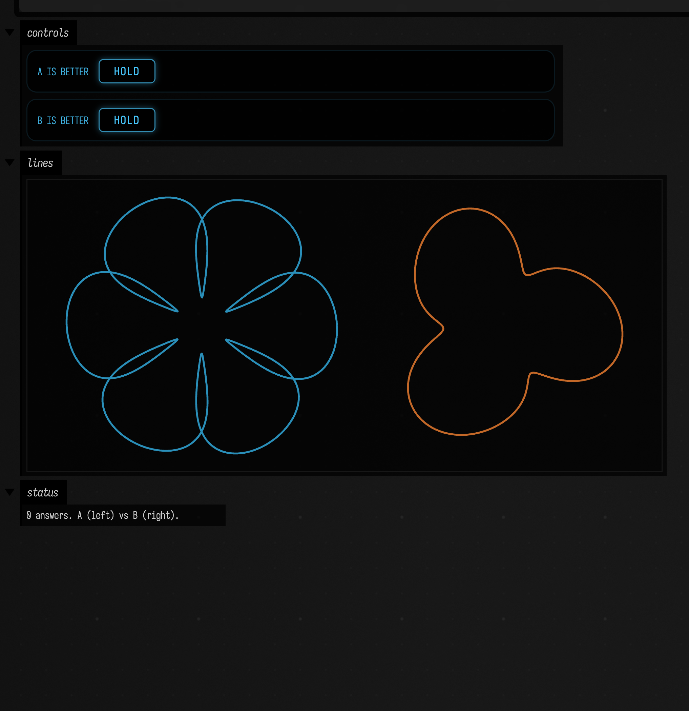

# Tuning by Gaussian process: optimisation and A/B preference

Some parameters are tuned by trying them: a drawing's three dials, a synth patch, a simulation's
constants. When each try is slow, or the judge is you, the number of tries is what matters.
The box below is one such search. The grey curve is a target, and three dials (how far the
curve wobbles, where the wobble starts, and how squashed it is) have to be set to match it. On
the left are the first five guesses, spread over the ranges; on the right is the best of thirty
tries. The chart shows how close the search had come after each try.

```diffstatic_runner {data-lang=kotlin screenshot="assets/gaussian_process_optimization/converging.png" wait="1.5" capture="box" open-outputs="true" padding="20"}
:::static
// A closed curve with three dials: how far it wobbles, where the wobble starts, and how much
// it is squashed sideways. One setting of the dials is the target; pretend we cannot see it.
fun curve(p: Map<String, Double>) =
    (0..300).map { i ->
        val t = 2 * PI * i / 300
        val r = 1 + p["wobble"]!! * cos(5 * t + p["phase"]!!)
        (p["squash"]!! * r * cos(t)) to (r * sin(t))
    }
val target = curve(mapOf("wobble" to 0.32, "phase" to 1.1, "squash" to 0.8))
fun misfit(p: Map<String, Double>) =
    curve(p).zip(target).sumOf { (a, b) ->
        (a.first - b.first).pow(2) + (a.second - b.second).pow(2)
    } / target.size

// Each step fits a Gaussian process to every try so far and evaluates where it expects
// the biggest improvement. Thirty tries, minimising.
val opt = GpOptimizer("wobble" to 0.0..0.6, "phase" to 0.0..2 * PI, "squash" to 0.4..1.4, minimize = true)
repeat(30) { opt.step { misfit(it) } }

fun draw(pts: List<Pair<Double, Double>>, dx: Double, colour: Vec4, width: Double) =
    FLine().also { f ->
        pts.forEachIndexed { i, (x, y) ->
            if (i == 0) f.moveTo(dx + 100 * x, -100 * y) else f.lineTo(dx + 100 * x, -100 * y)
        }
        f.color = colour
        f.thickness = width
    }
val grey = vec(0.6, 0.6, 0.6, 1.0)
lines(
    [draw(target, 0.0, grey, 6.0)] +
        opt.history.take(5).map { draw(curve(it.parameters), 0.0, vec(0.2, 0.4, 0.9, 0.35), 1.0) } +
        [draw(target, 320.0, grey, 6.0), draw(curve(opt.best!!.parameters), 320.0, vec(0.9, 0.2, 0.2, 1.0), 2.0)],
    w = 640.0,
    h = 300.0,
    fitToSize = true,
)
showChart(
    "best misfit so far" to opt.bestSoFar.map { log10(it) },
    channel = "convergence",
    title = "log10 misfit after each try",
    xLabel = "try",
    yLabel = "log10 misfit",
)

println(
    "best after 30 tries: misfit %.2e at %s"
        .format(
            opt.best!!.value,
            opt.best!!.parameters.mapValues { "%.3f".format(it.value) },
        ),
)
println("first five tries (blue, left): " + opt.history.take(5).joinToString { "%.3f".format(it.value) })
```


Field has two tools for this, both in `afield.math.gp` and so available in every box without an
import. Each one fits a [Gaussian process](gaussian_processes.md) to the tries so far and uses
it to choose the next one.

- `GpOptimizer` searches for the setting that maximises (or minimises) a number you can compute.
- `GpPreference` searches for the setting you like best, from nothing more than your answers to
  "A or B?".

## Optimising a number

Name each parameter with its range, then call `step` with the thing to score. Here the score is
how far a three-dial curve is from a target curve:

```diffstatic {data-lang=kotlin}
val opt = GpOptimizer("wobble" to 0.0..0.6, "phase" to 0.0..2 * PI, "squash" to 0.4..1.4, minimize = true)
repeat(30) { opt.step { p -> misfit(p) } }

println(opt.best) // GpTrial(parameters={wobble=…, phase=…, squash=…}, value=…)
println(opt.bestSoFar) // the best value after each try
```

`p` is a `Map<String, Double>` of the parameter values to try. The first few tries (four, or the
number of parameters plus two) are spread over the ranges. After that, every `step` fits a GP to
everything tried so far and picks the point with the largest *expected improvement* on the best
value: somewhere it expects a better score, or somewhere it does not yet know, whichever is
worth more.

You can drive the loop yourself instead of handing over a function. This is how to use it when
the score comes from somewhere else, such as a render you time or a slider you set:

```diffstatic {data-lang=kotlin}
val p = opt.suggest() // what to try next
opt.observe(p, measure(p)) // what it scored
val four = opt.suggest(4) // four to try at once, spread apart
opt.predict(p) // the model's mean and variance there
```

`GpOptimizer` maximises unless you pass `minimize = true`. Other options:

- `acquisition = GpAcquisition.UpperConfidenceBound(beta = 2.0)` chooses by mean + `beta` × standard
  deviation, which explores more as `beta` grows. `ExpectedImprovement(xi = 0.01)` is the default.
- `seed` makes a run repeatable: the same seed and the same scores give the same suggestions.
- `hyperparameters` shows the fitted length scale of each parameter (in units of its range) and
  the noise. A short length scale means the score changes quickly along that parameter.

!!! note "Thirty tries, not three thousand"
    Each step refits a GP to every observation, which takes longer as tries accumulate. It is
    meant for tens to a few hundred evaluations, where each one is expensive. For a score that
    costs microseconds, a grid or random search is quicker. Ranges should be finite, and a
    parameter that only takes whole numbers can be rounded inside your score function.

## Learning what you prefer

`GpPreference` takes the same named ranges. `nextPair()` gives two settings to show, and `choose`
records which one won:

```diffstatic_runner {data-lang=kotlin screenshot="assets/gaussian_process_optimization/duel.png" wait="1.5" capture="box" open-outputs="true" padding="20"}
:::static
// A rosette with four dials: petals, depth, curl and hue. Say which of two you
// like better, and the model proposes the next two.
fun rosette(p: Map<String, Double>, dx: Double) =
    FLine().also { f ->
        val petals = p["petals"]!!.roundToInt()
        for (i in 0..600) {
            val t = 2 * PI * i / 600
            val r = 1 + p["depth"]!! * cos(petals * t) + 0.15 * p["depth"]!! * cos(2 * petals * t + 3 * p["curl"]!!)
            val x = dx + 90 * r * cos(t + p["curl"]!! * sin(petals * t) * 0.3)
            val y = -90 * r * sin(t + p["curl"]!! * sin(petals * t) * 0.3)
            if (i == 0) f.moveTo(x, y) else f.lineTo(x, y)
        }
        f.color = okhsl(p["hue"]!!, 0.8, 0.55, 1.0)
        f.thickness = 2.0
    }

val taste = GpPreference("petals" to 3.0..9.0, "depth" to 0.1..0.8, "curl" to 0.0..1.0, "hue" to 0.0..360.0)
var pair = taste.nextPair()

fun show() {
    lines(rosette(pair.first, 0.0), rosette(pair.second, 300.0), w = 600.0, h = 280.0, fitToSize = true)
    val fav = taste.best
    display(
        "status",
        "<div>%d answers. A (left) vs B (right).%s</div>"
            .format(
                taste.comparisons.size,
                if (fav == null) "" else " Favourite so far: " + fav.mapValues { "%.2f".format(it.value) },
            ),
    )
}
fun answer(aWins: Boolean) {
    taste.choose(pair, aWins)
    pair = taste.nextPair()
    show()
}

controlGroup {
    button("A is better") { down -> if (down) answer(true) }
    button("B is better") { down -> if (down) answer(false) }
}
show()
```



Each answer updates a GP over a hidden "how much you like it" score. The next pair is the
current favourite against the setting with the most promise: one that is likely better, or
that the model knows little about. `taste.best` is the favourite so far, and `taste.ranking()`
lists every setting you have seen, best first.

To see the model learn without anyone clicking, replace the person with a simulated judge: code
that calls `choose` with whichever of the pair scores higher under a taste we know. This judge
likes deep, barely curled, five-petalled blue rosettes. After twenty-four answers the box draws
the favourite after every six, then the judge's ideal past a dividing line, and charts what the
model believes about hue.

```diffstatic_runner {data-lang=kotlin screenshot="assets/gaussian_process_optimization/judge.png" wait="1.5" capture="box" open-outputs="true" padding="20"}
:::static
/*
The same loop with the human replaced by a judge whose taste we know: it likes dark-blue
five-petalled rosettes, deep and barely curled. Twenty-four answers, and we draw the
model's favourite after every six, then - past a dividing line - the judge's ideal, in its
own colour, so shape and colour can both be compared.
*/
fun rosette(p: Map<String, Double>, dx: Double) =
    FLine().also { f ->
        val petals = p["petals"]!!.roundToInt()
        for (i in 0..600) {
            val t = 2 * PI * i / 600
            val r = 1 + p["depth"]!! * cos(petals * t) + 0.15 * p["depth"]!! * cos(2 * petals * t + 3 * p["curl"]!!)
            val x = dx + 90 * r * cos(t + p["curl"]!! * sin(petals * t) * 0.3)
            val y = -90 * r * sin(t + p["curl"]!! * sin(petals * t) * 0.3)
            if (i == 0) f.moveTo(x, y) else f.lineTo(x, y)
        }
        f.color = okhsl(p["hue"]!!, 0.8, 0.55, 1.0)
        f.thickness = 2.0
    }
val ideal = mapOf("petals" to 5.0, "depth" to 0.6, "curl" to 0.1, "hue" to 250.0)
fun utility(p: Map<String, Double>) =
    -((p["petals"]!! - 5.0) / 6).pow(2) -
        ((p["depth"]!! - 0.6) / 0.7).pow(2) -
        (p["curl"]!! - 0.1).pow(2) -
        ((p["hue"]!! - 250.0) / 360).pow(2)

val taste = GpPreference("petals" to 3.0..9.0, "depth" to 0.1..0.8, "curl" to 0.0..1.0, "hue" to 0.0..360.0)
val snapshots = mutableListOf<Map<String, Double>>()
repeat(24) { round ->
    val pair = taste.nextPair()
    taste.choose(pair, aWins = utility(pair.first) > utility(pair.second))
    if ((round + 1) % 6 == 0) snapshots += taste.best!!
}
val divider = 380.0 * snapshots.size - 130.0
val separator = FLine().moveTo(divider, -170.0).lineTo(divider, 170.0).also {
    it.color = vec(0.7, 0.7, 0.7, 1.0)
    it.thickness = 1.5
}
lines(
    snapshots.mapIndexed { i, p -> rosette(p, 380.0 * i) } + separator + rosette(ideal, 380.0 * snapshots.size + 120.0),
    w = 1000.0,
    h = 200.0,
    fitToSize = true,
)

// What the model believes about colour: utility relative to its favourite as the hue sweeps,
// with the other dials held at the favourite's. Answers only fix differences, hence relative.
val best = taste.best!!
val hues = (0..72).map { it * 5.0 }
val u = hues.map { taste.utilityRelativeTo(best, best + ("hue" to it)) }
val chart =
    Chart(title = "utility vs hue, relative to the favourite", xLabel = "hue", yLabel = "u - u(favourite)")
        .line("+2 sd", hues, u.map { it.mean + 2 * it.std }, color = vec(1.0, 0.55, 0.2, 0.5))
        .line("-2 sd", hues, u.map { it.mean - 2 * it.std }, color = vec(1.0, 0.55, 0.2, 0.5))
        .line("mean", hues, u.map { it.mean }, color = vec(1.0, 0.55, 0.2, 1.0), thickness = 3.0)
        .vrule(250.0, "judge's ideal hue")
chart.width = 600.0
chart.height = 280.0
showChart(chart, channel = "utility")
snapshots.forEachIndexed { i, p ->
    println(
        "after %2d answers: %s  utility %.3f".format(6 * (i + 1), p.mapValues { "%.2f".format(it.value) }, utility(p)),
    )
}
println(
    "ideal utility 0; a random rosette averages %.3f"
        .format(
            (0 until 200)
                .map {
                    java.util.Random(it.toLong()).let { r ->
                        mapOf(
                            "petals" to 3 + 6 * r.nextDouble(),
                            "depth" to 0.1 + 0.7 * r.nextDouble(),
                            "curl" to r.nextDouble(),
                            "hue" to 360 * r.nextDouble(),
                        )
                    }
                }
                .map { utility(it) }
                .average(),
        ),
)
```

![Top: four rosettes in a row, going from a green three-lobed shape through two four-petalled ones in teal to a five-petalled blue one, then a vertical grey line and the judge's ideal, a five-petalled blue rosette very like the last. Below: a chart of utility relative to the favourite against hue from 0 to 360, a thick orange mean curve peaking near hue 230 just left of a vertical line at the ideal hue 250, with thinner orange lines two standard deviations either side that cross at the peak and spread apart towards both ends](assets/gaussian_process_optimization/judge.png)

The printed utilities rise from -0.39 after six answers to -0.01 after twenty-four (the ideal
scores 0, and a random rosette about -0.65). In the chart, the thick line is how much more or
less the model thinks the judge likes each hue than the favourite's, with the other dials held
at the favourite's, and the thin lines are two standard deviations either side. The band is
pinched at the favourite and opens towards hues nobody was asked about. The chart uses
`utilityRelativeTo(favourite, p)` because the answers only ever say which of two is better: the
model learns differences, and the overall level of `utility(p)` stays as uncertain as before.

The scores are relative. A setting's `utility(p)` can be compared with another's, but its zero
means nothing.

- `noise` (default 0.1) says how inconsistent your answers are allowed to be. A smaller value
  trusts each click more, and changes its mind more abruptly.
- `lengthScale` (default 0.25, in units of each range) says how far apart two settings must be
  before your opinion of one says little about the other.
- `exploration` (default 1.0) weighs promise against what is already known when choosing the
  challenger.

Answering the same pair both ways is fine: the two settings end up tied.

## The demo

The [gp_instruments](agent_transcripts.md#gp_instruments) document has three boxes. Box 1 tunes a curve to a
target with `GpOptimizer` and charts the best misfit after each try. Box 2 is the A/B loop
above, waiting for you to click. Box 3 runs the same loop with a simulated judge whose taste is
known, and draws the favourite after every six answers next to that judge's ideal.

??? aside "How the two models work"
    `GpOptimizer` rescales every parameter to [0, 1] and standardises the scores. Its surrogate
    is a Matérn-5/2 GP with one length scale per parameter, refitted with the noise by maximum
    evidence after every observation. The acquisition function is maximised over random points
    and jitters of the best observations, then refined by gradient ascent; the gradient is a
    central difference, because expected improvement needs the gradient of the posterior
    standard deviation and the GP library exposes only the gradient of the mean. Batches use the
    "kriging believer": each chosen point is provisionally observed at the model's own mean.

    `GpPreference` is the probit preference GP of Chu and Ghahramani (2005). The posterior over
    the latent utility is replaced by its Laplace approximation, found by Newton's method. The
    design notes are in `dev_docs/GP_INSTRUMENTS.md`.
