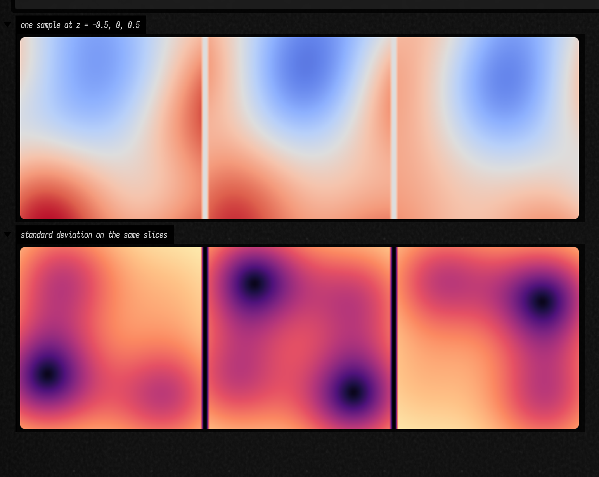

# Drawing with Gaussian processes

Pin a curve at a few places, then draw several ways it could pass between them. Or pin a scalar
field at points in a plane or volume, and draw a whole field that respects those observations.
A Gaussian process gives you a distribution over these possibilities: a mean, uncertainty, and
samples whose neighbouring values belong to the same function.

Start with four measurements and a smoothness assumption. This fits a scalar function of one
variable, then draws five possible functions over the same grid:

```diffstatic {data-lang=kotlin}
:::static
import afield.graphics.*

val xs = doubleArrayOf(-1.2, -0.35, 0.1, 0.95)
val ys = doubleArrayOf(-0.7, 0.8, 0.35, -0.4)
val gp = gp1D(xs, ys,
    noiseStd = doubleArrayOf(0.06, 0.06, 0.22, 0.06),
    kernel = GpKernels.rbf(lengthScale = 0.48))
val grid = DoubleArray(181) { -1.8 + 3.6 * it / 180 }
val posterior = gp.posterior(grid)
val draws = (0L..4L).map { seed ->
    posterior.sampleFLine(grid, seed).apply {
        color = vec(0.3, 0.65, 0.9, 0.55)
        thickness = 1.5
    }
}
val mean = posterior.meanFLine(grid).apply {
    color = vec(1, 0.5, 0.2, 1)
    thickness = 3.0
}
lines(draws + mean, w = 700.0, h = 360.0, fitToSize = true)
```

The upper plot below shows functions before seeing any measurements. The lower plot shows draws
from the conditioned distribution. The third observation is less reliable: its larger noise
standard deviation lets the functions pass further from it. Colours distinguish independent
draws, not a before/after pairing.


## Three different things to draw

The **mean** is the expected function value at each position. The **variance** describes how much
possible function values differ there. A **sample** is one entire possible function. Drawing
independent normal random numbers at each point using the right mean and variance would lose the
relationships between positions, and usually produce a jagged line.

Use the point methods when you only need one value. Variance is in squared output units; use its
square root for a distance, height or ribbon width.

```diffstatic {data-lang=kotlin}
:::static
val prediction = gp.predict(0.5)
val expectedValue = prediction.mean
val variance = prediction.variance
val standardDeviation = prediction.std
val interval = prediction.interval()  // mean ± 1.96 standard deviations
val fastMean = gp.mean(0.5)           // avoids the uncertainty solve
```

`gp.posterior(grid)` returns a `GpJoint`. Its `mean`, `variance` and full `covariance` arrays use
the same order as `grid`. It caches its sampling factor, so `posterior.samples(20, seed = 19)`
factors once and draws twenty functions. Repeated query positions have the same value in every
latent draw. A seed reproduces the result for the same model and query order.

An interval is **pointwise**: it describes one position at a time. A 95% pointwise band does not
contain 95% of whole functions. Draws can leave that band somewhere without anything being wrong.
For a 1D plot, `posterior.intervalFLines(grid)` returns its lower and upper boundary curves.

## Choose the kind of function

The covariance kernel specifies how values at different positions relate. Its length scale sets
the distance over which they remain related; its variance sets the squared output amplitude.
Look at prior samples before fitting: they show the assumptions you are imposing.


| Kernel | Useful starting point |
| --- | --- |
| `GpKernels.rbf(lengthScale, variance)` | Very smooth motion, deformation and fields. |
| `GpKernels.matern(2.5, lengthScale, variance)` | Smooth curves with less rigid local behaviour than RBF. |
| `GpKernels.matern(1.5, lengthScale, variance)` | Rougher curves; once mean-square differentiable. |
| `GpKernels.matern(0.5, lengthScale, variance)` | Continuous but rough fluctuations. |
| `GpKernels.periodic(period, lengthScale, variance)` | Exact repetition, including the connection across a loop boundary. |
| `GpKernels.rationalQuadratic(lengthScales, alpha, variance)` | A mixture of RBF length scales. |
| `GpKernels.linear(variance, origin)` | A random linear trend through an origin. |
| `GpKernels.constant(variance)` | An uncertain offset shared by every position. |

Add kernels to add independent kinds of variation. Multiply them to modulate a covariance. This
combines a slowly changing periodic component with small local deviations:

```diffstatic {data-lang=kotlin}
:::static
val kernel = GpKernels.periodic(period = 1.0, lengthScale = 0.6) *
    GpKernels.rbf(lengthScale = 4.0) +
    GpKernels.matern(nu = 1.5, lengthScale = 0.08, variance = 0.03)
val prior = GaussianProcess.prior(dimensions = 1, kernel = kernel)
val functions = prior.posterior(DoubleArray(300) { it / 60.0 }).samples(6, seed = 91)
```

For a nonzero baseline use a mean function. `gp1D(..., mean = { x -> 0.2 * x })` fits residuals
around that line. Stationary kernels such as RBF return towards the prior mean and variance far
from observations. The core does not secretly rescale either inputs or outputs.

## Pins, measurements and uncertainty

`noiseStd = 0.0` means an exact observation. Positive noise makes it a measurement the function
may depart from. Supply one standard deviation for all observations, or an array with one entry
per observation. Repeated noisy observations provide independent evidence at the same location.
Repeated identical exact observations are deduplicated; contradictory exact observations fail.

The predicted variance is for the **latent function**, excluding future measurement error. Add
that error explicitly when predicting another noisy measurement:

```diffstatic {data-lang=kotlin}
:::static
val measured = gp.predictObservation(doubleArrayOf(0.5), noiseStd = 0.2)
val noisyJoint = posterior.withObservationNoise(DoubleArray(grid.size) { 0.2 })
```

With kernel, mean and noise held fixed, moving the measured values changes the posterior mean
but not its variance. Changing observation positions or their noise changes the variance. Fitting
kernel parameters from the data can change both.

Add another observation by conditioning again. This creates a new fitted model; it does not
change the old one or any samples already drawn from it.

```diffstatic {data-lang=kotlin}
:::static
val refined = gp.condition(
    arrayOf(doubleArrayOf(0.6)), doubleArrayOf(-0.8), doubleArrayOf(0.03))
```

## A field over the plane

For a scalar field `f(x,y)`, observations are positions and scalar values. Give each axis its own
length scale when the field should stretch further in one direction. These scales use the units
of your positions, not grid indices.

```diffstatic {data-lang=kotlin}
:::static
val points = listOf(vec(-0.8, -0.5), vec(0.55, -0.5), vec(-0.3, 0.65), vec(0.65, 0.55))
val field = gp2D(points, doubleArrayOf(0.9, -0.7, -0.8, 0.65),
    kernel = GpKernels.matern(1.5, doubleArrayOf(0.55, 0.8)), noiseStd = 0.04)
val side = 25
val queries = Array(side * side) { i ->
    doubleArrayOf(-1.2 + 2.4 * (i % side) / (side - 1),
                  -1.2 + 2.4 * (i / side) / (side - 1))
}
val joint = field.posterior(queries)
val sample = joint.sample(seed = 57)
val image = Array(side) { row -> DoubleArray(side) { col -> sample[row * side + col] } }
showHeatmap(image)
```

Both lower panels are whole-field draws. They differ most where the observations leave room to
differ. The uncertainty panel shows standard deviation, not image contrast or random noise added
to the mean. All three value panels share a colour scale.


For a large uncertainty map, use `field.marginals(queries)`. It computes individual predictions
without allocating the square query covariance. For a large *sample*, use a feature path below;
sampling each tile independently would break correlations across tile boundaries.

## A field through space

`gp3D` has the same interface with `Vec3` observation positions. It models a scalar quantity at
each spatial point, such as density, displacement magnitude or a material parameter.

```diffstatic {data-lang=kotlin}
:::static
val volume = gp3D(
    listOf(vec(-0.7, -0.4, -0.5), vec(0.6, 0.4, 0.5), vec(-0.5, 0.6, 0.0)),
    doubleArrayOf(0.8, -0.8, -0.5),
    kernel = GpKernels.rbf(doubleArrayOf(0.7, 0.7, 0.9)), noiseStd = 0.04)
val atOnePoint = volume.predict(0.1, 0.2, 0.3)
val uncertainty = atOnePoint.std
```

An exact joint over a dense volume is usually too large. `GpRbfFeatures` offers a different,
explicitly approximate model: a finite collection of sine/cosine features approximates an RBF
kernel. Conditioning and uncertainty are exact **for that feature model**, not for the infinite
RBF. More frequencies improve the approximation statistically; compare several feature seeds
and sizes when the distinction matters.

Here the feature seed chooses the model, while the sample seed chooses a function from it.
Once drawn, the function can be evaluated anywhere, in any order, including in separate tiles.

```diffstatic {data-lang=kotlin}
:::static
val observations = arrayOf(
    doubleArrayOf(-0.7, -0.4, -0.5), doubleArrayOf(0.6, 0.4, 0.5),
    doubleArrayOf(-0.5, 0.6, 0.0), doubleArrayOf(0.6, -0.6, 0.0))
val featureModel = GpRbfFeatures(
    lengthScales = doubleArrayOf(0.7, 0.7, 0.9), frequencyCount = 512, seed = 77
).fit(observations, doubleArrayOf(0.8, -0.8, -0.5, 0.6), DoubleArray(4) { 0.04 })
val oneVolume = featureModel.samplePath(seed = 88)
val a = oneVolume(0.2, 0.3, 0.4)
val b = oneVolume(0.2, 0.3, 0.4)  // exactly the same value
```

These are three slices through **one** such sampled volume. Sampling each slice separately would
lose their relationship. The lower row shows the feature model's posterior standard deviation.



For a modest number of arbitrary queries, an exact model also supports
`val function = volume.samplePath(seed = 88)`. Each new position is drawn conditional on previous
queries, and repeated positions return the cached value. This mutable path grows a dense cache;
it is single-threaded and its realised values depend on query order. Its probability law is the
same GP. A feature path has fixed storage and is the better choice for many moving particles.

## A distribution over an FLine

A spatial scalar field and a spatial curve are different models. A curve is a vector-valued
function of **one** parameter: `t → (x,y,z)`. Its uncertainty is a covariance matrix of positions
at each `t`, plus cross-covariance between different parameters.

Fit explicitly placed control observations with `gpCurve`, or start with an existing FLine using
`line.gaussianProcess(...)`. The latter samples one continuous subpath and uses normalised arc
length from zero to one. Fit separate subpaths separately.

This example allows XY positions to move together through a correlated output covariance.
The default matrix is the identity: independent coordinate processes, still correlated along
each coordinate's parameter axis.

```diffstatic {data-lang=kotlin}
:::static
import afield.graphics.*

val curve = gpCurve(
    doubleArrayOf(0.0, 0.2, 0.65, 1.0),
    listOf(vec(-1.0, -0.6, 0), vec(-0.65, 0.65, 0), vec(0.6, 0.5, 0), vec(0.9, -0.5, 0)),
    kernel = GpKernels.matern(2.5, lengthScale = 0.28, variance = 0.3),
    noiseStd = DoubleArray(4) { 0.015 }, dimensions = 2,
    outputCovariance = arrayOf(doubleArrayOf(1.0, 0.35), doubleArrayOf(0.35, 0.7)))
val t = DoubleArray(121) { it / 120.0 }
val distribution = curve.posterior(t)
val alternatives = (0L..4L).map { distribution.sampleLine(it) }
val meanCurve = distribution.meanLine()
val coordinateVariances = distribution.variances
val covarianceAtMiddle = distribution.covarianceAt(60)  // 3×3; planar Z is zero
val (left, right) = distribution.normalBand()
lines(alternatives + listOf(meanCurve, left, right), w = 700.0, h = 420.0, fitToSize = true)
```

The curve mean defaults to the observations' centroid; supply `mean = vec(...)` to choose another
baseline. `dimensions = 2` retains the input's constant Z plane and never adds Z displacement.
Use `dimensions = 3` for spatial curves and a 3×3 output covariance to correlate XYZ.
The kernel variance has squared coordinate units; the output covariance is a dimensionless
relative shape.


At a parameter value the 2D position has an uncertainty ellipse. Its principal axes come from
the eigenvectors of the 2×2 covariance, and its 95% radii are
`sqrt(-2 * ln(0.05) * eigenvalue)`. A 3D position instead has an ellipsoid: for 95% coverage use
`sqrt(7.8147 * eigenvalue)` on its three axes. Neither is a simultaneous region for the whole curve.

`normalBand()` projects planar covariance onto the normal of the mean curve and offsets by
1.96 standard deviations. This is a pointwise **normal projection** interval, not the same thing
as a 95% position ellipse. In 3D there is no unique curve normal; choose a direction and call
`distribution.projectedVariance(index, direction)` or use the full covariance ellipsoid.

For an existing drawn stroke, choose the variance in the stroke's coordinate units. The period
of a closed-curve model is one because its parameter is normalised arc length.

```diffstatic {data-lang=kotlin}
:::static
import afield.graphics.*

val stroke = FLine().moveTo(0, 0).lineTo(100, 60).lineTo(180, 0)
val model = stroke.gaussianProcess(trainingSamples = 24, dimensions = 2,
    kernel = GpKernels.matern(2.5, lengthScale = 0.2, variance = 225.0), noiseStd = 2.0)
val fitted = model.posterior(DoubleArray(180) { it / 179.0 })
val variation = fitted.sampleLine(seed = 29)
```

Sampling a drawn stroke more densely adds more observations. With independent nonzero noise that
means more evidence, so uncertainty shrinks. If the observations are really a few intentional
control points, use `gpCurve` on those points rather than resampling the stroke hundreds of times.
For a closed path, use `GpKernels.periodic(period = 1.0, ...)`; identical endpoints then represent
the same random value. Contradictory exact endpoint values are not a consistent periodic model.

## Differences, slopes and integrals

A linear combination of jointly Gaussian values is also Gaussian. `linearTransform` keeps the
covariance terms when forming weighted averages, finite differences or quadrature estimates.
This computes the distribution of a central-difference slope, not an analytic derivative:

```diffstatic {data-lang=kotlin}
:::static
val h = 0.01
val nearby = gp.posterior(doubleArrayOf(0.5 - h, 0.5 + h))
val slope = nearby.linearTransform(arrayOf(doubleArrayOf(-1.0 / (2*h), 1.0 / (2*h))))
val slopeMean = slope.mean[0]
val slopeVariance = slope.variance[0]
```

The derivative interpretation depends on the kernel: shrinking `h` does not turn a rough Matérn
1/2 process into a differentiable one. General linear-functional **observations**, analytic
input-derivative kernels and non-Gaussian likelihoods are not provided by this API.

## Fit the assumptions, or choose them

`logMarginalLikelihood` scores a model's explanation of the observations, balancing fit with the
volume of functions its prior allows. It can help select length scales, amplitude and noise.
The model builder below makes their units explicit. Smile's bounded L-BFGS optimizer searches
in log space, using finite differences of Field's own likelihood:

```diffstatic {data-lang=kotlin}
:::static
val fit = fitGpHyperparametersWithSmile(listOf(
    GpParameter("lengthScale", 0.5, 0.03, 3.0),
    GpParameter("variance", 1.0, 0.01, 10.0),
    GpParameter("noiseStd", 0.1, 0.001, 0.5)
)) { p ->
    gp1D(xs, ys, GpKernels.matern(2.5, p[0], p[1]), noiseStd = p[2])
}
val fittedModel = fit.process
val settings = fit.parameters
val stationarity = fit.projectedGradientMax
```

Try several initial settings and inspect the fitted functions. Periodic models in particular can
have different plausible periods. A small projected gradient is a local stationarity diagnostic,
not proof of a global best fit. `fitGpHyperparameters` is a portable bounded pattern-search
alternative with a `converged` flag; it needs no Smile optimizer. Both propagate fitting failures.

Hyperparameter fitting selects one set of assumptions; it does not integrate uncertainty over
them. The returned variance is conditional on those settings. `leaveOneOut()` supplies held-out
means, predictive variances and standardised residuals without refitting once per observation.
Use these to notice a model that is much more certain than its prediction errors warrant.

For creative work, the prior can be a compositional decision. A likelihood optimum is not a
requirement to give up a deliberately rougher, slower or more extravagant function family.

## Keeping a random field coherent in time

Draw two independent functions from a fixed posterior and rotate between their deviations from
the mean. Every time slice still has the same posterior distribution, and the animation loops.
For this example, `featureModel` is the fitted model from the volume section.

```diffstatic {data-lang=kotlin}
:::static
val a = featureModel.samplePath(101)
val b = featureModel.samplePath(202)
fun animated(x: Double, y: Double, z: Double, phase: Double): Double {
    val m = featureModel.mean(x, y, z)
    return m + kotlin.math.cos(phase) * (a(x, y, z) - m) +
        kotlin.math.sin(phase) * (b(x, y, z) - m)
}
```

This is a loop through two sampled deviations, not new independent randomness every frame.
Query the same world-space function for both stereo eyes to keep the field spatially consistent.
Ordinary linear interpolation between two independent samples reduces their variance halfway;
the squared sine/cosine weights above sum to one.

## Cost and numerical behaviour

Exact training uses a dense Cholesky factorisation: O(n³) time and O(n²) storage. A mean query
costs O(n), a variance query O(n²). A joint over m queries adds O(mn² + m²n) work and O(m² + mn)
storage, followed by a sampling factorisation costing up to O(m³). Each later draw costs O(mr)
for sampling rank r. Kernels with expensive input maps add their own cost.

| Need | Method |
| --- | --- |
| A mean at many points | `mean(...)`; no uncertainty solve. |
| A variance map | `marginals(...)`; no full query covariance. |
| Exact draws on a manageable grid | `posterior(...).samples(...)`; reuse the joint. |
| Exact draws at a few new positions | `samplePath(...)`; conditional extension, growing cache. |
| A callable field for a large image or volume | `GpRbfFeatures(...).fit(...).samplePath(...)`; explicitly approximate. |

Vector-valued curves currently use dense inference on `(parameter, coordinate)` pairs. A
three-coordinate curve with n observations trains on 3n scalar observations. The default guards
limit training and joint distributions to 4096 **scalar** entries; this is a safety ceiling, not
a claim that that size is interactive. `GpNumerics` makes the limits explicit and adjustable.
The feature model still uses a dense training solve; it removes the large *query* covariance,
not the cubic dependence on training-set size. One feature evaluation costs O(frequencyCount ×
inputDimensions), with twice as many sine/cosine coefficients as frequencies.

Observation noise, numerical jitter and sampling rank tolerance have different meanings.
`jitterUsed` reports extra diagonal variance needed to factor a numerically singular training
matrix. It starts at zero and retries within the configured relative bounds. No failed fit turns
into a line or a spline. Rank-revealing sampling handles singular query covariance without adding
independent jitter, preserving repeated query values. `samplingRank` and
`samplingResidualVariance` report the numerical truncation. Input and output arrays are copied;
custom kernel and mean closures must remain pure and unchanged after fitting.

For low-rank kernels, exact observations must also be consistent with the kernel's function
family. A constant kernel cannot exactly explain two different observed values; such inconsistent noiseless fits are rejected when a singular training covariance needs repair.
Use a richer kernel or justified measurement noise. Check `jitterUsed` and the likelihood when working near this limit.

## Smile and further reading

Use any suitable immutable Smile `MercerKernel<DoubleArray>` through `.asGpKernel()`. The covariance
is reused directly, with Field retaining control of heteroscedastic noise, seeded sampling and
semidefinite query distributions. The existing `smileGaussianProcess` wrapper also exposes
`predictWithVariance` and `posterior`; fitting failures now propagate. Its legacy `noise` option
is a **variance**, in normalised output units when normalisation is enabled, whereas the new API
consistently calls its standard deviation `noiseStd`. Set `maxIter = 0` to keep Smile's kernel and
noise settings fixed.

Read [MacKay's *Information Theory, Inference, and Learning Algorithms*](https://www.inference.org.uk/mackay/itila/book.html),
chapter 45, for the relationship between finite parameter models and distributions over functions.
[Rasmussen and Williams, chapter 2](https://gaussianprocess.org/gpml/chapters/RW2.pdf) gives the
regression equations and Cholesky algorithm. In Field, with A = K(X,X) + diag(noiseStd²) and residual
r = y − mean(X), the implementation computes:

\[
\mu_* = m(X_*) + K(X_*,X)A^{-1}r,\qquad
\Sigma_* = K(X_*,X_*) - K(X_*,X)A^{-1}K(X,X_*).
\]

The inverse in this notation is implemented by triangular solves. A draw is
`mean + factor × independentStandardNormals`; the factor represents the **whole** covariance.
For the feature model, conditional draws use the same finite feature covariance as its reported
variance, including observation noise and any reported numerical jitter.

See also [drawing with FLines](fline_examples.md#filters-and-gp),
[functions and domains](functions_domains.md) and [statistics](statistics_examples.md).

??? aside "Reproducing the numerical figures"
    These are numerical plots of production Kotlin GP output, not Field UI captures.
    `GaussianProcessFiguresTest` writes CSV data when `FIELD_GP_FIGURE_DATA` is set;
    [the plotting script](https://github.com/OpenEndedGroup/Field4/blob/main/tools/gp/render_figures.py)
    turns that data into these figures. It contains no separate GP implementation.
    The source and verification details are in
    [the implementation note](https://github.com/OpenEndedGroup/Field4/blob/main/dev_docs/GAUSSIAN_PROCESSES.md).
