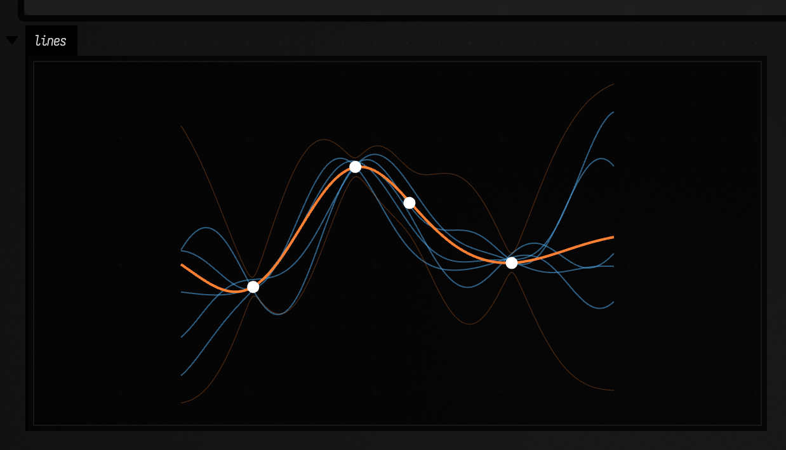
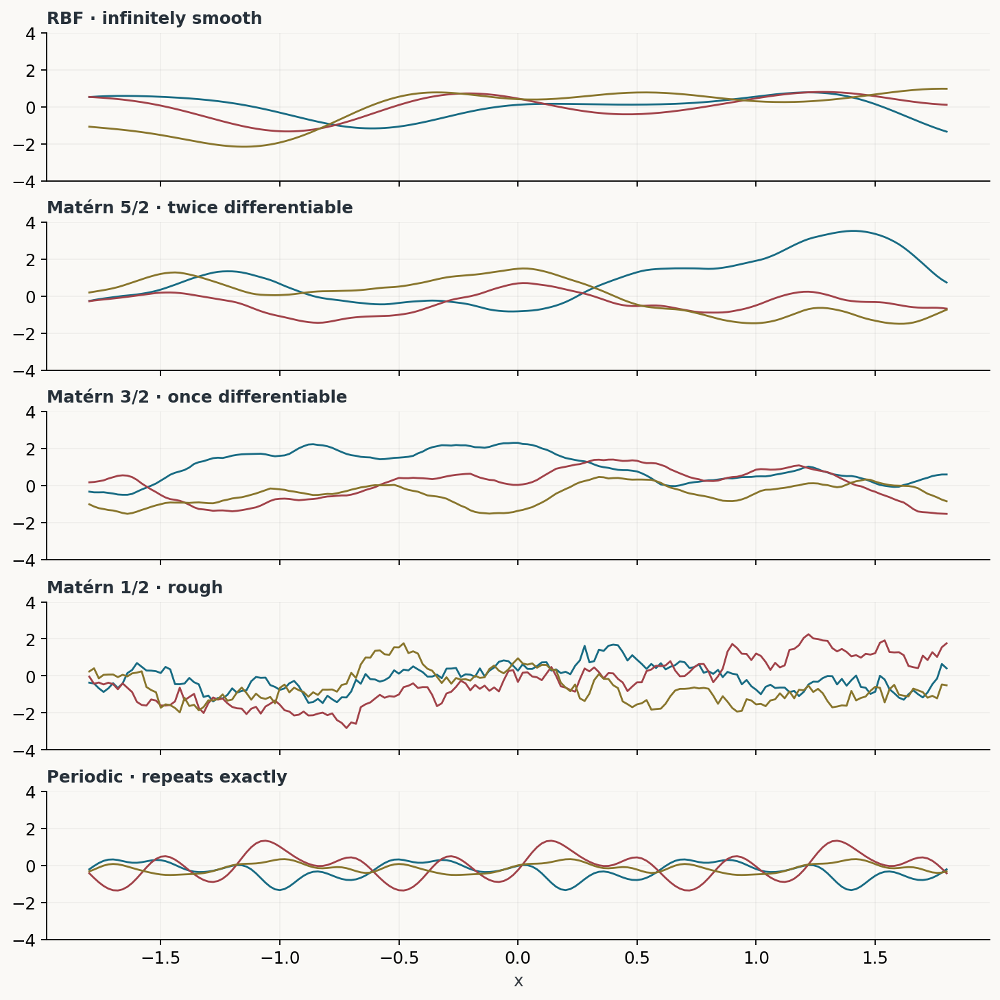
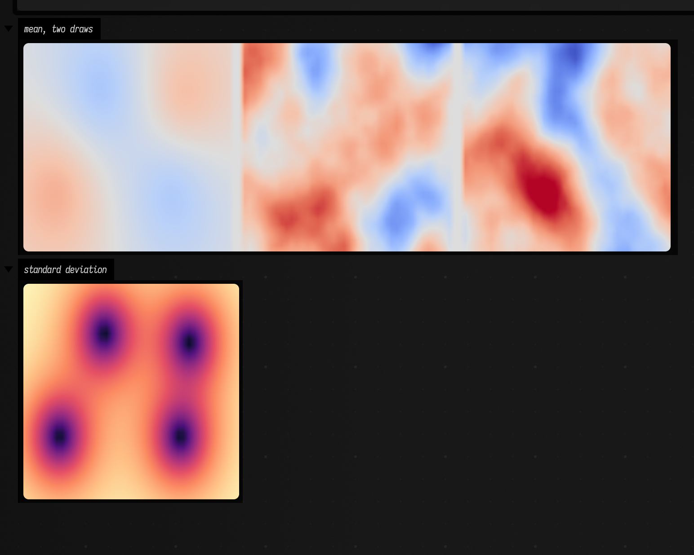
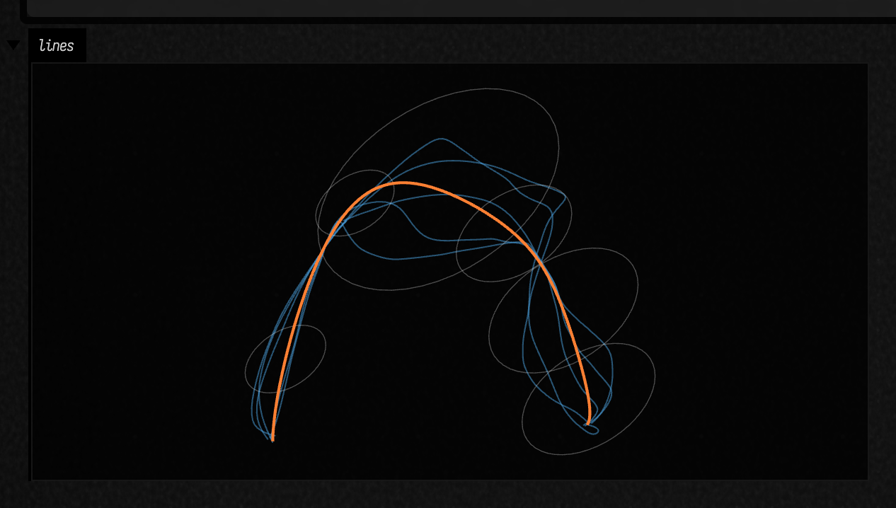
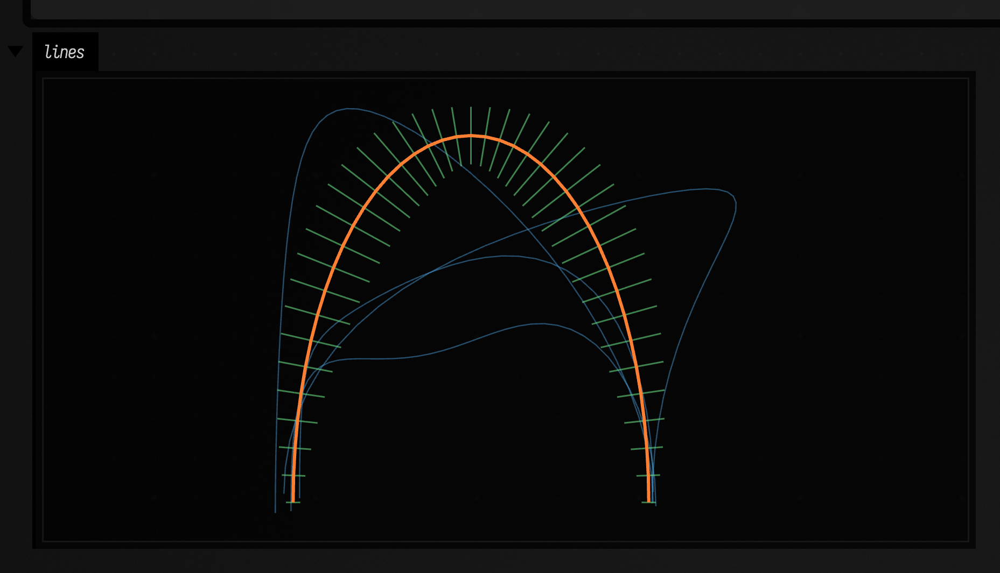
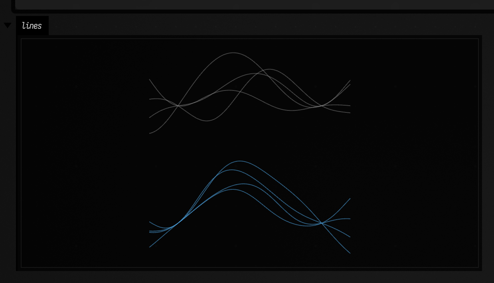

# Drawing with Gaussian processes

Pin a curve at a few places, then draw several ways it could pass between them. Or pin a scalar
field at points in a plane or volume, and draw a whole field that respects those observations.
A Gaussian process gives you a distribution over these possibilities: a mean, uncertainty, and
samples whose neighbouring values belong to the same function.

Start with four measurements and a smoothness assumption. This fits a scalar function of one
variable, then draws five possible functions over the same grid:

```diffstatic_runner {data-lang=kotlin screenshot="assets/gaussian_processes/conditioning.png" wait="1.5" capture="box" open-outputs="true" padding="20"}
:::static
val xs = doubleArrayOf(-1.2, -0.35, 0.1, 0.95)
val ys = doubleArrayOf(-0.7, 0.8, 0.35, -0.4)
val gp = gp1D(
    xs,
    ys,
    noiseStd = doubleArrayOf(0.06, 0.06, 0.22, 0.06),
    kernel = GpKernels.rbf(lengthScale = 0.48),
)
val grid = DoubleArray(181) { -1.8 + 3.6 * it / 180 }
val posterior = gp.posterior(grid)

// GP values are y-up; the SVG is y-down, so flip and scale into pixels
fun plot(line: FLine) = line.transform { vec(it.x * 180, -it.y * 120, 0) }

val draws =
    (0L..4L).map { seed ->
        plot(posterior.sampleFLine(grid, seed)).apply {
            color = vec(0.3, 0.65, 0.9, 0.7)
            thickness = 1.5
        }
    }
val (lower, upper) = posterior.intervalFLines(grid)
val band = [lower, upper].map {
    plot(it).apply {
        color = vec(1, 0.5, 0.2, 0.5)
        thickness = 1.0
    }
}
val mean = plot(posterior.meanFLine(grid)).apply {
    color = vec(1, 0.5, 0.2, 1)
    thickness = 3.0
}
val pins =
    FLine()
        .apply {
            xs.indices.forEach { moveTo(xs[it], ys[it]) }
        }
        .let(::plot)
        .apply {
            stroked = false
            pointed = true
            pointSize = 3.0
            color = vec(1, 1, 1, 1)
        }
lines(draws + band + mean + pins, w = 700.0, h = 360.0, fitToSize = true)
```

The blue lines are five draws, the thick orange line the mean, and the thin orange lines the 95%
pointwise interval. The third observation is less reliable: its larger noise standard deviation
lets the functions pass further from it. Away from the observations the draws spread back out
to the prior.



To play with the closed loop, the 1-D example and the 2-D field with live controls, open
[the `gp_drawing` document](agent_transcripts.md#gp_drawing).

## Three different things to draw

The **mean** is the expected function value at each position. The **variance** describes how much
possible function values differ there. A **sample** is one entire possible function. Drawing
independent normal random numbers at each point using the right mean and variance would lose the
relationships between positions, and usually produce a jagged line.

Use the point methods when you only need one value. Variance is in squared output units; use its
square root for a distance, height or ribbon width.

```diffstatic {data-lang=kotlin}
:::static
val prediction = gp.predict(0.5)
val expectedValue = prediction.mean
val variance = prediction.variance
val standardDeviation = prediction.std
val interval = prediction.interval() // mean ± 1.96 standard deviations
val fastMean = gp.mean(0.5) // avoids the uncertainty solve
```

`gp.posterior(grid)` returns a `GpJoint`. Its `mean`, `variance` and full `covariance` arrays use
the same order as `grid`. It caches its sampling factor, so `posterior.samples(20, seed = 19)`
factors once and draws twenty functions. Repeated query positions have the same value in every
draw. A seed reproduces the result for the same model and query order.

An interval is **pointwise**: it describes one position at a time. A 95% pointwise band does not
contain 95% of whole functions. Draws can leave that band somewhere without anything being wrong.
For a 1D plot, `posterior.intervalFLines(grid)` returns its lower and upper boundary curves.

## Choose the kind of function

The covariance kernel specifies how values at different positions relate. Its length scale sets
the distance over which they remain related; its variance sets the squared output amplitude.
Look at prior samples before fitting: they show the assumptions you are imposing. These are
three draws each, before any observation, from four kernels with the same length scale: RBF
(radial basis function, also called squared exponential), the smoothest; Matérn 3/2 and 1/2, a
family whose number sets how rough the curves are, lower being rougher; and periodic:

```diffstatic_runner {data-lang=kotlin screenshot="assets/gaussian_processes/kernels.png" wait="1.5" capture="box" open-outputs="true" padding="20"}
:::static
val grid = DoubleArray(241) { -2.0 + 4.0 * it / 240 }
val kernels = [
    GpKernels.rbf(lengthScale = 0.5),
    GpKernels.matern(1.5, lengthScale = 0.5),
    GpKernels.matern(0.5, lengthScale = 0.5),
    GpKernels.periodic(period = 1.3, lengthScale = 0.8),
]
val colors = [
    vec(0.3, 0.65, 0.9, 0.8),
    vec(0.95, 0.55, 0.25, 0.8),
    vec(0.9, 0.35, 0.55, 0.8),
    vec(0.4, 0.85, 0.5, 0.8),
]

// one row per kernel, stacked down the page; y-up within each row
val rows = kernels.flatMapIndexed { row, kernel ->
    val prior = GaussianProcess.prior(dimensions = 1, kernel = kernel)
    val joint = prior.posterior(grid)
    (0L..2L).map { seed ->
        joint
            .sampleFLine(grid, seed)
            .transform { vec(it.x * 160, row * 170 - it.y * 50, 0) }
            .apply {
                color = colors[row]
                thickness = 1.5
            }
    }
}
lines(rows, w = 700.0, h = 560.0, fitToSize = true)
```



| Kernel | Useful starting point |
| --- | --- |
| `GpKernels.rbf(lengthScale, variance)` | Very smooth motion, deformation and fields. |
| `GpKernels.matern(2.5, lengthScale, variance)` | Smooth curves with less rigid local behaviour than RBF. |
| `GpKernels.matern(1.5, lengthScale, variance)` | Rougher curves; they have a slope, but the slope itself is rough. |
| `GpKernels.matern(0.5, lengthScale, variance)` | Continuous but rough fluctuations. |
| `GpKernels.periodic(period, lengthScale, variance)` | Exact repetition, including the connection across a loop boundary. |
| `GpKernels.octavePeriodic(centerPeriod)` | Repetition whose period is uncertain within an octave; `periodicMixture` for your own candidates. |
| `GpKernels.rationalQuadratic(lengthScales, alpha, variance)` | A mixture of RBF length scales. |
| `GpKernels.linear(variance, origin)` | A random linear trend through an origin. |
| `GpKernels.constant(variance)` | An uncertain offset shared by every position. |

Add kernels to add independent kinds of variation. Multiply them to modulate a covariance. This
combines a slowly changing periodic component with small local deviations:

```diffstatic {data-lang=kotlin}
:::static
val kernel =
    GpKernels.periodic(period = 1.0, lengthScale = 0.6) * GpKernels.rbf(lengthScale = 4.0) +
        GpKernels.matern(nu = 1.5, lengthScale = 0.08, variance = 0.03)
val prior = GaussianProcess.prior(dimensions = 1, kernel = kernel)
val functions = prior.posterior(DoubleArray(300) { it / 60.0 }).samples(6, seed = 91)
```

For a nonzero baseline use a mean function. `gp1D(..., mean = { x -> 0.2 * x })` fits residuals
around that line. Kernels that depend only on the distance between two positions, such as RBF, return towards the prior mean and variance far
from observations. Inputs and outputs are used as given; nothing is rescaled.

## Pins, measurements and uncertainty

`noiseStd = 0.0` means an exact observation. Positive noise makes it a measurement the function
may depart from. Supply one standard deviation for all observations, or an array with one entry
per observation. Repeated noisy observations provide independent evidence at the same location.
Repeated identical exact observations are deduplicated; contradictory exact observations fail.

The predicted variance is for the **latent function**, excluding future measurement error. Add
that error explicitly when predicting another noisy measurement:

```diffstatic {data-lang=kotlin}
:::static
val measured = gp.predictObservation(doubleArrayOf(0.5), noiseStd = 0.2)
val noisyJoint = posterior.withObservationNoise(DoubleArray(grid.size) { 0.2 })
```

With kernel, mean and noise held fixed, moving the measured values changes the posterior mean
but not its variance. Changing observation positions or their noise changes the variance. Fitting
kernel parameters from the data can change both.

Three posteriors over the same four positions: exact pins, the same values measured with noise
0.2, and those measurements moved. The interval closes to nothing at a pin and only narrows at a
measurement; moving the measured values moves the mean and leaves the interval the same width.

```diffstatic_runner {data-lang=kotlin screenshot="assets/gaussian_processes/pins_vs_measurements.png" wait="1.5" capture="box" open-outputs="true" padding="20" embed=true name="gp-pins-vs-measurements" alt="Three panels of an orange mean between two thin orange 95% interval lines, through four white dots. Left, exact pins: the interval closes to a point at every dot. Middle, the same values as noisy measurements: the interval narrows near the dots but stays open. Right, the measurements moved to new values: the mean follows them and the interval has the same width as in the middle panel"}
:::static
val xs = doubleArrayOf(-1.2, -0.35, 0.1, 0.95)
val ys = doubleArrayOf(-0.7, 0.8, 0.35, -0.4)
val moved = doubleArrayOf(0.4, -0.5, 0.9, 0.3)
val grid = DoubleArray(181) { -1.8 + 3.6 * it / 180 }
val kernel = GpKernels.rbf(lengthScale = 0.48)

// One panel: the mean, its 95% interval and the observations, shifted right by `dx`.
fun panel(values: DoubleArray, noise: Double, dx: Double): List<FLine> {
    val posterior = gp1D(xs, values, noiseStd = DoubleArray(xs.size) { noise }, kernel = kernel).posterior(grid)
    fun plot(line: FLine) = line.transform { vec(it.x * 100 + dx, -it.y * 90, 0) }
    val (lower, upper) = posterior.intervalFLines(grid)
    val band = [lower, upper].map { plot(it).apply { color = vec(1, 0.5, 0.2, 0.5) } }
    val mean = plot(posterior.meanFLine(grid)).apply {
        color = vec(1, 0.5, 0.2, 1)
        thickness = 2.5
    }
    val dots = plot(FLine().apply { xs.indices.forEach { moveTo(xs[it], values[it]) } }).apply {
        stroked = false
        pointed = true
        pointSize = 3.0
        color = vec(1, 1, 1, 1)
    }
    return band + mean + dots
}

// Exact pins; the same points as measurements with noise 0.2; those measurements moved.
lines(panel(ys, 0.0, 0.0) + panel(ys, 0.2, 420.0) + panel(moved, 0.2, 840.0), w = 900.0, h = 260.0, fitToSize = true)
```

Add another observation by conditioning again. This creates a new fitted model; it does not
change the old one or any samples already drawn from it.

```diffstatic {data-lang=kotlin}
:::static
val refined = gp.condition(
    arrayOf(doubleArrayOf(0.6)),
    doubleArrayOf(-0.8),
    doubleArrayOf(0.03),
)
```

## A field over the plane

For a scalar field `f(x,y)`, observations are positions and scalar values. Give each axis its own
length scale when the field should stretch further in one direction. These scales use the units
of your positions, not grid indices.

```diffstatic_runner {data-lang=kotlin screenshot="assets/gaussian_processes/field2d.png" wait="1.5" capture="box" open-outputs="true" padding="20"}
:::static
val points = [vec(-0.8, -0.5), vec(0.55, -0.5), vec(-0.3, 0.65), vec(0.65, 0.55)]
val field = gp2D(
    points,
    doubleArrayOf(0.9, -0.7, -0.8, 0.65),
    kernel = GpKernels.matern(1.5, doubleArrayOf(0.55, 0.8)),
    noiseStd = 0.04,
)
val side = 40
val queries =
    Array(side * side) { i ->
        doubleArrayOf(
            -1.2 + 2.4 * (i % side) / (side - 1),
            -1.2 + 2.4 * (i / side) / (side - 1),
        )
    }
val joint = field.posterior(queries)
fun grid(values: DoubleArray) = Array(side) { row -> DoubleArray(side) { col -> values[row * side + col] } }

// panels side by side, separated by a thin gap
fun row(vararg panels: Array<DoubleArray>, gap: Double) =
    Array(side) { r ->
        panels.flatMapIndexed { i, p -> (if (i > 0) List(2) { gap } else emptyList()) + p[r].toList() }.toDoubleArray()
    }

// the mean and two whole-field draws share one colour scale; then the standard deviation
showHeatmap(
    row(grid(joint.mean), grid(joint.sample(seed = 57)), grid(joint.sample(seed = 58)), gap = 0.0),
    vmin = -2.5,
    vmax = 2.5,
    normalize = false,
    colormap = "coolwarm",
    width = 720,
    channel = "mean, two draws",
)
showHeatmap(
    grid(joint.variance.map { sqrt(it) }.toDoubleArray()),
    vmin = 0.0,
    normalize = false,
    colormap = "magma",
    width = 240,
    channel = "standard deviation",
)
```

The first panel is the mean; the next two are whole-field draws. They agree near the four
observations and differ most where the observations leave room to differ. All three share a
colour scale. The panel below is the standard deviation, dark at the observations.



For a large uncertainty map, use `field.marginals(queries)`. It computes individual predictions
without allocating the square query covariance. For a large *sample*, use the feature model in the next section;
sampling each tile independently would break correlations across tile boundaries.

## A field through space

`gp3D` has the same interface with `Vec3` observation positions. It models a scalar quantity at
each spatial point, such as density, displacement magnitude or a material parameter.

```diffstatic {data-lang=kotlin}
:::static
val volume = gp3D(
    [vec(-0.7, -0.4, -0.5), vec(0.6, 0.4, 0.5), vec(-0.5, 0.6, 0.0)],
    doubleArrayOf(0.8, -0.8, -0.5),
    kernel = GpKernels.rbf(doubleArrayOf(0.7, 0.7, 0.9)),
    noiseStd = 0.04,
)
val atOnePoint = volume.predict(0.1, 0.2, 0.3)
val uncertainty = atOnePoint.std
```

An exact joint over a dense volume is usually too large. `GpRbfFeatures` offers a different,
explicitly approximate model: a finite collection of sine/cosine features approximates an RBF
kernel. Conditioning and uncertainty are exact **for that feature model**, not for the infinite
RBF. More frequencies improve the approximation statistically; compare several feature seeds
and sizes when the distinction matters.

Here the feature seed chooses the model, while the sample seed chooses a function from it.
Once drawn, the function can be evaluated anywhere, in any order, including in separate tiles.

```diffstatic_runner {data-lang=kotlin screenshot="assets/gaussian_processes/field3d.png" wait="1.5" capture="box" open-outputs="true" padding="20"}
:::static
val observations = arrayOf(
    doubleArrayOf(-0.7, -0.4, -0.5),
    doubleArrayOf(0.6, 0.4, 0.5),
    doubleArrayOf(-0.5, 0.6, 0.0),
    doubleArrayOf(0.6, -0.6, 0.0),
)
val featureModel =
    GpRbfFeatures(
            lengthScales = doubleArrayOf(0.7, 0.7, 0.9),
            frequencyCount = 512,
            seed = 77,
        )
        .fit(observations, doubleArrayOf(0.8, -0.8, -0.5, 0.6), DoubleArray(4) { 0.04 })
val oneVolume = featureModel.samplePath(seed = 88)

// three z slices through the same sampled volume, then its uncertainty on those slices
val side = 64
fun slice(z: Double, f: (Double, Double, Double) -> Double) =
    Array(side) { row ->
        DoubleArray(side) { col ->
            f(-1.0 + 2.0 * col / (side - 1), -1.0 + 2.0 * row / (side - 1), z)
        }
    }
fun row(panels: List<Array<DoubleArray>>, gap: Double) =
    Array(side) { r ->
        panels.flatMapIndexed { i, p -> (if (i > 0) List(2) { gap } else emptyList()) + p[r].toList() }.toDoubleArray()
    }
val zs = [-0.5, 0.0, 0.5]
showHeatmap(
    row(zs.map { z -> slice(z) { x, y, zz -> oneVolume(x, y, zz) } }, gap = 0.0),
    vmin = -2.0,
    vmax = 2.0,
    normalize = false,
    colormap = "coolwarm",
    width = 720,
    channel = "one sample at z = -0.5, 0, 0.5",
)
showHeatmap(
    row(zs.map { z -> slice(z) { x, y, zz -> featureModel.predict(x, y, zz).std } }, gap = 0.0),
    vmin = 0.0,
    vmax = 1.0,
    normalize = false,
    colormap = "magma",
    width = 720,
    channel = "standard deviation on the same slices",
)
```

These are three slices through **one** such sampled volume, drawn in the same box. Sampling each
slice separately would lose their relationship; here neighbouring slices share their shapes. The
lower row shows the feature model's posterior standard deviation on the same slices, dark where a
slice passes near an observation.


For a modest number of arbitrary queries, an exact model also supports
`val function = volume.samplePath(seed = 88)`. Each new position is drawn conditional on previous
queries, and repeated positions return the cached value. This mutable path grows a dense cache;
it is single-threaded and its realised values depend on query order. Its probability law is the
same GP. A feature path has fixed storage and is the better choice for many moving particles.

## A distribution over an FLine

A spatial scalar field and a spatial curve are different models. A curve is a vector-valued
function of **one** parameter: `t → (x,y,z)`. Its uncertainty is a covariance matrix of positions
at each `t`, plus cross-covariance between different parameters.

Fit explicitly placed control observations with `gpCurve`, or start with an existing FLine using
`line.gaussianProcess(...)`. The latter samples one continuous subpath and uses normalised arc
length from zero to one. Fit separate subpaths separately.

This example allows XY positions to move together through a correlated output covariance.
The default matrix is the identity: independent coordinate processes, still correlated along
each coordinate's parameter axis.

```diffstatic_runner {data-lang=kotlin screenshot="assets/gaussian_processes/curve.png" wait="1.5" capture="box" open-outputs="true" padding="20"}
:::static
val curve = gpCurve(
    doubleArrayOf(0.0, 0.2, 0.65, 1.0),
    [vec(-1.0, -0.6, 0), vec(-0.65, 0.65, 0), vec(0.6, 0.5, 0), vec(0.9, -0.5, 0)],
    kernel = GpKernels.matern(2.5, lengthScale = 0.28, variance = 0.3),
    noiseStd = DoubleArray(4) { 0.015 },
    dimensions = 2,
    outputCovariance = arrayOf(doubleArrayOf(1.0, 0.35), doubleArrayOf(0.35, 0.7)),
)
val t = DoubleArray(121) { it / 120.0 }
val distribution = curve.posterior(t)

// y-up curve coordinates into y-down pixels
fun plot(line: FLine) = line.transform { vec(it.x * 250, -it.y * 250, 0) }

val alternatives =
    (0L..4L).map { seed ->
        plot(distribution.sampleLine(seed)).apply {
            color = vec(0.3, 0.65, 0.9, 0.7)
            thickness = 1.5
        }
    }
val meanCurve = plot(distribution.meanLine()).apply {
    color = vec(1, 0.5, 0.2, 1)
    thickness = 3.0
}

// 95% position ellipses from the 2×2 covariance at a few parameters
val ellipses =
    (10..110 step 20).map { i ->
        val c = distribution.covarianceAt(i)
        val a = c[0][0]
        val b = c[0][1]
        val d = c[1][1]
        val mid = (a + d) / 2
        val r = sqrt(((a - d) / 2).pow(2) + b * b)
        val angle = 0.5 * atan2(2 * b, a - d)
        val k = sqrt(-2 * ln(0.05))
        val r1 = k * sqrt(mid + r)
        val r2 = k * sqrt(max(0.0, mid - r))
        val p = distribution.meanPoints[i]
        FLine()
            .apply {
                breakNext()
                for (s in 0..48) {
                    val u = 2 * PI * s / 48
                    val x = p.x + r1 * cos(u) * cos(angle) - r2 * sin(u) * sin(angle)
                    val y = p.y + r1 * cos(u) * sin(angle) + r2 * sin(u) * cos(angle)
                    lineTo(x, y)
                }
            }
            .let(::plot)
            .apply {
                color = vec(1, 1, 1, 0.6)
                thickness = 1.0
            }
    }
lines(alternatives + ellipses + meanCurve, w = 700.0, h = 420.0, fitToSize = true)
```

The curve mean defaults to the observations' centroid; supply `mean = vec(...)` to choose another
baseline. `dimensions = 2` retains the input's constant Z plane and never adds Z displacement.
Use `dimensions = 3` for spatial curves and a 3×3 output covariance to correlate XYZ.
The kernel variance has squared coordinate units; the output covariance is a dimensionless
relative shape.



At a parameter value the 2D position has an uncertainty ellipse. Its principal axes come from
the eigenvectors of the 2×2 covariance, and its 95% radii are
`sqrt(-2 * ln(0.05) * eigenvalue)`. A 3D position instead has an ellipsoid: for 95% coverage use
`sqrt(7.8147 * eigenvalue)` on its three axes. Neither is a simultaneous region for the whole curve.

`normalBand()` projects planar covariance onto the normal of the mean curve and offsets by
1.96 standard deviations. This is a pointwise **normal projection** interval, not the same thing
as a 95% position ellipse. In 3D there is no unique curve normal; choose a direction and call
`distribution.projectedVariance(index, direction)` or use the full covariance ellipsoid.

For an existing drawn stroke, choose the variance in the stroke's coordinate units. The period
of a closed-curve model is one because its parameter is normalised arc length.

```diffstatic {data-lang=kotlin}
:::static
val stroke = FLine().moveTo(0, 0).lineTo(100, 60).lineTo(180, 0)
val model = stroke.gaussianProcess(
    trainingSamples = 24,
    dimensions = 2,
    kernel = GpKernels.matern(2.5, lengthScale = 0.2, variance = 225.0),
    noiseStd = 2.0,
)
val fitted = model.posterior(DoubleArray(180) { it / 179.0 })
val variation = fitted.sampleLine(seed = 29)
```

Sampling a drawn stroke more densely adds more observations. With independent nonzero noise that
means more evidence, so uncertainty shrinks. If the observations are really a few intentional
control points, use `gpCurve` on those points rather than resampling the stroke hundreds of times.

### Closed loops

For a closed path, use `GpKernels.periodic(period = 1.0, ...)` and place the pins on a parameter
that runs once round the loop, from 0 up to (but not including) 1. With a period of one,
`t = 0` and `t = 1` are the same point of the same function: every draw returns to where it
started with the same position and the same direction, so the join is as smooth as the rest. Do not pin
both `t = 0` and `t = 1`; they are one observation. The curve mean defaults to the pins'
centroid, which for a loop is its middle.

```diffstatic_runner {data-lang=kotlin screenshot="assets/gaussian_processes/loop.png" wait="1.5" capture="box" open-outputs="true" padding="20"}
:::static
// six pins around a loop; move any of them and run again
val pins = [
    vec(1.0, 0.0, 0),
    vec(0.45, 0.8, 0),
    vec(-0.5, 0.95, 0),
    vec(-1.1, 0.0, 0),
    vec(-0.4, -0.75, 0),
    vec(0.6, -0.9, 0),
]
// each pin's place on the loop's parameter, which runs once round from 0 to 1
val at = DoubleArray(pins.size) { it.toDouble() / pins.size }

// a periodic kernel with period 1 makes t = 0 and t = 1 the same point, value and slope
val loop = gpCurve(
    at,
    pins,
    kernel = GpKernels.periodic(period = 1.0, lengthScale = 0.6, variance = 0.04),
    noiseStd = DoubleArray(pins.size) { 0.01 },
    dimensions = 2,
)
val t = DoubleArray(201) { it / 200.0 }
val distribution = loop.posterior(t)

fun plot(line: FLine) = line.transform { vec(it.x * 200, -it.y * 200, 0) }

val draws =
    (0L..5L).map { seed ->
        plot(distribution.sampleLine(seed)).apply {
            color = vec(0.3, 0.65, 0.9, 0.8)
            thickness = 1.5
        }
    }
val mean = plot(distribution.meanLine()).apply {
    color = vec(1, 0.5, 0.2, 1)
    thickness = 3.0
}
val dots = plot(FLine().apply { pins.forEach { moveTo(it.x, it.y) } }).apply {
    stroked = false
    pointed = true
    pointSize = 3.0
    color = vec(1, 1, 1, 1)
}
lines(draws + mean + dots, w = 600.0, h = 520.0, fitToSize = true)

// the seam: a draw's last point is its first, and it turns there no more than anywhere else
val p = distribution.samplePoints(seed = 0L)
fun turn(a: Vec3, b: Vec3, c: Vec3): Double {
    val ux = b.x - a.x
    val uy = b.y - a.y
    val vx = c.x - b.x
    val vy = c.y - b.y
    return abs(atan2(ux * vy - uy * vx, ux * vx + uy * vy).toDouble())
}
val seamGap = hypot((p.last().x - p.first().x).toDouble(), (p.last().y - p.first().y).toDouble())
val seamTurn = turn(p[p.size - 2], p[0], p[1])
val maxTurn = (1 until p.size - 1).maxOf { turn(p[it - 1], p[it], p[it + 1]) }
println(
    "seam gap %.2e, turn at the seam %.4f rad, largest turn elsewhere %.4f rad".format(seamGap, seamTurn, maxTurn),
)
```


The box also measures the join of one draw: its last point is exactly its first, and it turns
less there than it does at its sharpest bend elsewhere. For an existing closed stroke,
`stroke.gaussianProcess(...)` with the same periodic kernel does the same, since its parameter
is normalised arc length.

### Tangents, frames and curvature

A curve model also knows its velocity. `curve.velocity(t)` is the mean of d(position)/dt, in
coordinate units per unit of parameter; `curve.velocities(ts)` is the joint over a grid.
`curve.frames(ts)` gives a moving frame along the mean curve: position, unit tangent, normal
(and binormal in 3D), speed, and `tangentAngleStd`, the standard deviation of the tangent's
direction in radians. Use it to orient strokes, glyphs or brushes along the curve, and to make
them hesitate where the direction is uncertain.

Velocities can be pinned as well as positions. The curve below is pinned at two ends only, and
told to leave its start going up and arrive at its end going down: a bulge the two positions
alone could not ask for. A tick crosses the mean curve at each frame, wider where the tangent's
direction is less certain:

```diffstatic_runner {data-lang=kotlin screenshot="assets/gaussian_processes/frames.png" wait="1.5" capture="box" open-outputs="true" padding="20"}
:::static
// two loose pins, a pinned launch direction, and a free middle
val arch = gpCurve(
    doubleArrayOf(0.0, 1.0),
    [vec(0, 0, 0), vec(1, 0, 0)],
    GpKernels.rbf(0.4),
    dimensions = 2,
    noiseStd = doubleArrayOf(0.02, 0.02),
    velocities = [0.0 to vec(0, 3, 0), 1.0 to vec(0, -3, 0)],
)
val ts = DoubleArray(41) { it / 40.0 }

fun plot(line: FLine) = line.transform { vec(it.x * 500, -it.y * 500, 0) }

// a tick across the curve at every frame, longer where the tangent direction is uncertain
val ticks =
    arch.frames(ts).map { f ->
        val w = 0.02 + 0.2 * f.tangentAngleStd.coerceAtMost(1.0)
        val p = f.position
        val n = f.normal!!
        plot(FLine().moveTo(p.x - n.x * w, p.y - n.y * w).lineTo(p.x + n.x * w, p.y + n.y * w)).apply {
            color = vec(0.4, 0.85, 0.5, 0.9)
            thickness = 1.5
        }
    }
val draws =
    (0L..3L).map { seed ->
        plot(arch.posterior(ts).sampleLine(seed)).apply {
            color = vec(0.3, 0.65, 0.9, 0.85)
            thickness = 1.2
        }
    }
val mean = plot(arch.posterior(ts).meanLine()).apply {
    color = vec(1, 0.5, 0.2, 1)
    thickness = 3.0
}
lines(draws + ticks + mean, w = 700.0, h = 420.0, fitToSize = true)

val k = arch.curvature(ts)
println(
    "curvature at the top: of mean %.2f, of draws %.2f ± %.2f".format(k.ofMean[20], k.mean[20], k.std[20]),
)
```



A planar normal is the tangent turned a quarter to the left. A spatial curve's normal is the
Frenet normal, and is null where the mean curve is straight.

`curve.curvature(ts)` draws whole velocity fields and returns, per parameter, the curvature of
the mean curve (`ofMean`) and the mean and standard deviation of the curvature of the draws.
These differ: a straight mean between two loose pins has zero curvature, while every draw from
it bends. Planar curvature is signed, positive turning left.

`sampleLine(seed, spread)` scales a draw's departure from the mean: `0.0` is the mean line,
`1.0` an unscaled sample, `2.0` the same variation exaggerated. The same seed keeps the same shape
of departure as the spread changes.

## Slopes, gradients and integrals

The derivative of a Gaussian process is another Gaussian process, jointly Gaussian with the
function itself. Ask for it directly: `derivative(axis, ...)` at one point, `gradient(...)` for
every axis with the covariance between them, or `derivativePosterior(grid)` for a whole slope
curve whose draws belong to the same functions as `posterior(grid)`.

```diffstatic {data-lang=kotlin}
:::static
val slope = gp.derivative(0, 0.5) // ∂f/∂x at x = 0.5
val slopeMean = slope.mean
val slopeStd = slope.std
val slopes = gp.derivativePosterior(grid) // a GpJoint, like posterior(grid)
val steepest = slopes.sampleFLine(grid, seed = 3)
```

Slopes can also be **observations**. Pin a value and a slope and the function leaves that point
in the direction you chose, with whatever uncertainty you give the slope:

```diffstatic_runner {data-lang=kotlin screenshot="assets/gaussian_processes/slopes.png" wait="1.5" capture="box" open-outputs="true" padding="20"}
:::static
val grid = DoubleArray(161) { -0.4 + 2.8 * it / 160 }
fun plot(line: FLine) = line.transform { vec(it.x * 220, -it.y * 120, 0) }

// the same two values, with and without a pinned launch slope at x = 0
val free = gp1D(doubleArrayOf(0.0, 2.0), doubleArrayOf(0.0, 0.0), GpKernels.rbf(lengthScale = 0.6))
val launched = gp1D(
    doubleArrayOf(0.0, 2.0),
    doubleArrayOf(0.0, 0.0),
    GpKernels.rbf(lengthScale = 0.6),
    slopes = [GpDerivativeObservation.slope(0.0, value = 1.5, noiseStd = 0.1)],
)

fun drawsOf(model: GaussianProcess, c: Vec4, offset: Double) =
    model.posterior(grid).samples(4, seed = 7).map { ys ->
        FLine()
            .apply {
                breakNext()
                grid.indices.forEach { lineTo(grid[it], ys[it] + offset) }
            }
            .let(::plot)
            .apply {
                color = c
                thickness = 1.5
            }
    }

lines(
    drawsOf(free, vec(0.6, 0.6, 0.6, 0.7), 0.0) + drawsOf(launched, vec(0.3, 0.65, 0.9, 0.9), -3.0),
    w = 700.0,
    h = 420.0,
    fitToSize = true,
)

val slope = launched.derivative(0, 0.0)
println("slope at 0: %.2f ± %.2f".format(slope.mean, slope.std))
```



In higher dimensions, `GpDerivativeObservation(point, axis, value, noiseStd)` measures one
partial derivative, and `posterior(listOf(GpFunctional.value(...), GpFunctional.derivative(axis, ...)))`
returns one joint over any mix of values and slopes.

Derivatives need a kernel that has them. RBF, rational quadratic, periodic, linear, constant and
Matérn ν = 3/2 and 5/2 do, and so do their sums, products and scalings; Matérn ν = 1/2 describes
functions with no slope, so asking for one fails. The slope of Matérn 3/2 exists but is itself
rough. A mean function's slope is taken by central difference.

A linear combination of jointly Gaussian values is also Gaussian. `linearTransform` keeps the
covariance terms when forming weighted averages, differences between positions or quadrature
estimates of an integral:

```diffstatic {data-lang=kotlin}
:::static
val nodes = DoubleArray(21) { it / 20.0 }
val area =
    gp.posterior(nodes)
        .linearTransform(
            arrayOf(DoubleArray(21) { if (it == 0 || it == 20) 0.025 else 0.05 }),
        ) // trapezoid rule
val areaMean = area.mean[0]
val areaStd = sqrt(area.variance[0])
```

Non-Gaussian likelihoods are not provided by this API.

## Fit the assumptions, or choose them

`logMarginalLikelihood` scores a model's explanation of the observations, balancing fit with the
volume of functions its prior allows. It can help select length scales, amplitude and noise.
The model builder below makes their units explicit, and each `GpParameter` gives a starting value
and lower and upper bounds. An optimiser from Smile, the Java machine-learning library Field
bundles, searches within those bounds:

```diffstatic {data-lang=kotlin}
:::static
val fit = fitGpHyperparametersWithSmile(
    [
        GpParameter("lengthScale", 0.5, 0.03, 3.0),
        GpParameter("variance", 1.0, 0.01, 10.0),
        GpParameter("noiseStd", 0.1, 0.001, 0.5),
    ],
) { p ->
        gp1D(xs, ys, GpKernels.matern(2.5, p[0], p[1]), noiseStd = p[2])
    }
val fittedModel = fit.process
val settings = fit.parameters
val stationarity = fit.projectedGradientMax
```

Try several initial settings and inspect the fitted functions. Periodic models in particular can
have different plausible periods. Stopping where the likelihood no longer improves nearby is not proof that no better fit exists
elsewhere. `fitGpHyperparameters` is a portable bounded pattern-search
alternative with a `converged` flag; it needs no Smile optimizer. Both propagate fitting failures.

When one assumption matters most, such as a period, look at the evidence for each candidate
instead of searching for a single best. `scanGpEvidence` fits once per candidate and returns
their log evidence and the posterior weights over the candidates under a uniform prior on the
grid. When the data cannot decide, the weights stay broad. Here nine noisy
samples of something that repeats are scanned over two octaves of candidate periods:

```diffstatic_runner {data-lang=kotlin screenshot="assets/gaussian_processes/evidence.png" wait="1.5" capture="box" open-outputs="true" padding="20"}
:::static
// nine noisy samples of something that repeats roughly every 0.8
val xs = DoubleArray(9) { 0.23 * it }
val ys = DoubleArray(9) { sin(2 * PI * xs[it] / 0.8) + 0.1 * cos(7.0 * it) }

val periods = DoubleArray(61) { 0.4 * 2.0.pow(2.0 * it / 60.0) } // two octaves, log spaced
val scan =
    scanGpEvidence(periods) { p ->
        gp1D(xs, ys, GpKernels.periodic(period = p, lengthScale = 0.8), noiseStd = 0.1)
    }
val weights = scan.posteriorWeights

// posterior weight over the period; ticks mark 0.4, 0.8 and 1.6 on a log axis
val bars =
    periods.indices.map { i ->
        val x = ln(periods[i] / 0.4) * 400
        FLine().moveTo(x, 0.0).lineTo(x, -300 * weights[i] / weights.max()).apply {
            color = vec(0.3, 0.65, 0.9, 1)
            thickness = 4.0
        }
    }
val axis = FLine().moveTo(0.0, 4.0).lineTo(ln(4.0) * 400, 4.0).apply {
    color = vec(0.6, 0.6, 0.6, 1)
    thickness = 1.0
}
val octaves =
    (0..2).map { o ->
        FLine().moveTo(ln(2.0.pow(o)) * 400, 4.0).lineTo(ln(2.0.pow(o)) * 400, 14.0).apply {
            color = vec(0.6, 0.6, 0.6, 1)
        }
    }
lines(bars + axis + octaves, w = 700.0, h = 260.0, fitToSize = true, channel = "period weights")
println("likeliest period %.3f".format(scan.best))

// keep that uncertainty: mix the candidates by their weights
val mixed = gp1D(xs, ys, GpKernels.periodicMixture(periods, weights, lengthScale = 0.8), noiseStd = 0.1)
val grid = DoubleArray(241) { -0.2 + 2.4 * it / 240 }
val draws =
    mixed.posterior(grid).samples(4, seed = 5).map { ys ->
        FLine()
            .apply {
                breakNext()
                grid.indices.forEach { lineTo(grid[it] * 250, -ys[it] * 100) }
            }
            .apply {
                color = vec(0.3, 0.65, 0.9, 0.7)
                thickness = 1.5
            }
    }
val dots =
    FLine()
        .apply { xs.indices.forEach { moveTo(xs[it] * 250, -ys[it] * 100) } }
        .apply {
            stroked = false
            pointed = true
            pointSize = 3.0
            color = vec(1, 1, 1, 1)
        }
lines(draws + dots, w = 700.0, h = 260.0, fitToSize = true, channel = "draws from the mixture")
```


To keep that uncertainty in the model rather than choosing, mix the candidates:
`GpKernels.periodicMixture(periods, weights)` sums periodic kernels with the given weights, and
`GpKernels.octavePeriodic(centerPeriod)` spreads equally weighted candidates over an octave.

Hyperparameter fitting selects one set of assumptions; it does not integrate uncertainty over
them. The returned variance is conditional on those settings. `leaveOneOut()` supplies held-out
means, predictive variances and standardised residuals without refitting once per observation.
Use these to notice a model that is much more certain than its prediction errors warrant.

For creative work, the prior can be a compositional decision. A likelihood optimum is not a
requirement to give up a deliberately rougher, slower or more extravagant function family.

## Keeping a random field coherent in time

Draw two independent functions from a fixed posterior and rotate between their deviations from
the mean. Every time slice still has the same posterior distribution, and the animation loops.
For this example, `featureModel` is the fitted model from the volume section.

```diffstatic {data-lang=kotlin}
:::static
val a = featureModel.samplePath(101)
val b = featureModel.samplePath(202)
fun animated(x: Double, y: Double, z: Double, phase: Double): Double {
    val m = featureModel.mean(x, y, z)
    return m + kotlin.math.cos(phase) * (a(x, y, z) - m) + kotlin.math.sin(phase) * (b(x, y, z) - m)
}
```

The same rotation drawn live: the z = 0 slice of the volume, one turn of phase every four seconds.

```diffstatic_runner {data-lang=kotlin capture="box" execution="launch" video="assets/gaussian_processes/coherent_in_time.mp4" duration="4" fps="15" open-outputs="true" wait-output="true" wait-output-kind="display" wait="3" timeout="240" padding="20" embed=true name="gp-coherent-in-time" alt="A coolwarm heatmap of one slice of the sampled field, its warm and cool patches drifting and reshaping smoothly as the phase turns, returning to where it started after four seconds"}
:::static
val observations = arrayOf(
    doubleArrayOf(-0.7, -0.4, -0.5),
    doubleArrayOf(0.6, 0.4, 0.5),
    doubleArrayOf(-0.5, 0.6, 0.0),
    doubleArrayOf(0.6, -0.6, 0.0),
)
val featureModel =
    GpRbfFeatures(lengthScales = doubleArrayOf(0.7, 0.7, 0.9), frequencyCount = 512, seed = 77)
        .fit(observations, doubleArrayOf(0.8, -0.8, -0.5, 0.6), DoubleArray(4) { 0.04 })

val a = featureModel.samplePath(101)
val b = featureModel.samplePath(202)
fun animated(x: Double, y: Double, z: Double, phase: Double): Double {
    val m = featureModel.mean(x, y, z)
    return m + kotlin.math.cos(phase) * (a(x, y, z) - m) + kotlin.math.sin(phase) * (b(x, y, z) - m)
}

// The z = 0 slice, one full turn of phase every four seconds.
val side = 48
val start = System.nanoTime()
loop {
    if (frameNumber % 2 == 0) {
        val phase = 2 * Math.PI * ((System.nanoTime() - start) / 4e9)
        val slice = Array(side) { row ->
            DoubleArray(side) { col -> animated(-1.0 + 2.0 * col / (side - 1), -1.0 + 2.0 * row / (side - 1), 0.0, phase) }
        }
        showHeatmap(slice, vmin = -2.0, vmax = 2.0, normalize = false, colormap = "coolwarm", width = 360, channel = "z = 0")
    }
}
```

This is a loop through two sampled deviations, not new independent randomness every frame.
Query the same world-space function for both stereo eyes to keep the field spatially consistent.
Ordinary linear interpolation between two independent samples reduces their variance halfway;
the squared sine/cosine weights above sum to one.

## Cost and numerical behaviour

Exact training uses a dense Cholesky factorisation: O(n³) time and O(n²) storage. A mean query
costs O(n), a variance query O(n²). A joint over m queries adds O(mn² + m²n) work and O(m² + mn)
storage, followed by a sampling factorisation costing up to O(m³). Each later draw costs O(mr)
for sampling rank r. Kernels with expensive input maps add their own cost.

| Need | Method |
| --- | --- |
| A mean at many points | `mean(...)`; no uncertainty solve. |
| A variance map | `marginals(...)`; no full query covariance. |
| Exact draws on a manageable grid | `posterior(...).samples(...)`; reuse the joint. |
| Exact draws at a few new positions | `samplePath(...)`; conditional extension, growing cache. |
| A callable field for a large image or volume | `GpRbfFeatures(...).fit(...).samplePath(...)`; explicitly approximate. |

Vector-valued curves use dense inference on `(parameter, coordinate)` pairs. A
three-coordinate curve with n observations trains on 3n scalar observations. The default guards
limit training and joint distributions to 4096 **scalar** entries; this is a safety ceiling, not
a claim that that size is interactive. `GpNumerics` makes the limits explicit and adjustable.
The feature model still uses a dense training solve; it removes the large *query* covariance,
not the cubic dependence on training-set size. One feature evaluation costs O(frequencyCount ×
inputDimensions), with twice as many sine/cosine coefficients as frequencies.

Observation noise, numerical jitter and sampling rank tolerance have different meanings.
`jitterUsed` reports extra diagonal variance needed to factor a numerically singular training
matrix. It starts at zero and retries within the configured relative bounds. No failed fit turns
into a line or a spline. Rank-revealing sampling handles singular query covariance without adding
independent jitter, preserving repeated query values. `samplingRank` and
`samplingResidualVariance` report the numerical truncation. Input and output arrays are copied;
custom kernel and mean closures must remain pure and unchanged after fitting.

For low-rank kernels, exact observations must also be consistent with the kernel's function
family. A constant kernel cannot exactly explain two different observed values; such inconsistent noiseless fits are rejected when a singular training covariance needs repair.
Use a richer kernel or justified measurement noise. Check `jitterUsed` and the likelihood when working near this limit.

## Smile and further reading

Use any suitable immutable Smile `MercerKernel<DoubleArray>` through `.asGpKernel()`. The covariance
is reused directly, with Field retaining control of per-observation noise, seeded sampling and
semidefinite query distributions. The `smileGaussianProcess` wrapper also exposes
`predictWithVariance` and `posterior`, and propagates fitting failures. Its `noise` option
is a **variance**, in normalised output units when normalisation is enabled, whereas the rest of
this API takes a standard deviation, `noiseStd`. Set `maxIter = 0` to keep Smile's kernel and
noise settings fixed.

Read [MacKay's *Information Theory, Inference, and Learning Algorithms*](https://www.inference.org.uk/mackay/itila/book.html),
chapter 45, for the relationship between finite parameter models and distributions over functions.
[Rasmussen and Williams, chapter 2](https://gaussianprocess.org/gpml/chapters/RW2.pdf) gives the
regression equations and Cholesky algorithm. In Field, with \( A = K(X,X) + \operatorname{diag}(\texttt{noiseStd}^2) \) and residual
\( r = y - m(X) \), the implementation computes:

\[
\mu_* = m(X_*) + K(X_*,X)A^{-1}r,\qquad
\Sigma_* = K(X_*,X_*) - K(X_*,X)A^{-1}K(X,X_*).
\]

The inverse in this notation is implemented by triangular solves. A draw is
`mean + factor × independentStandardNormals`; the factor represents the **whole** covariance.
For the feature model, conditional draws use the same finite feature covariance as its reported
variance, including observation noise and any reported numerical jitter.

See also [drawing with FLines](fline_examples.md#filters-and-gp),
[functions and domains](functions_domains.md) and [statistics](statistics_examples.md).

??? aside "How these figures are made"
    Every figure on this page is the docs runner's capture of the fence above it, run in Field,
    so each snippet is also checked to compile and run against the current `afield.math.gp`.
    Verification notes are in [the implementation note](https://github.com/OpenEndedGroup/Field4/blob/main/dev_docs/GAUSSIAN_PROCESSES.md).
