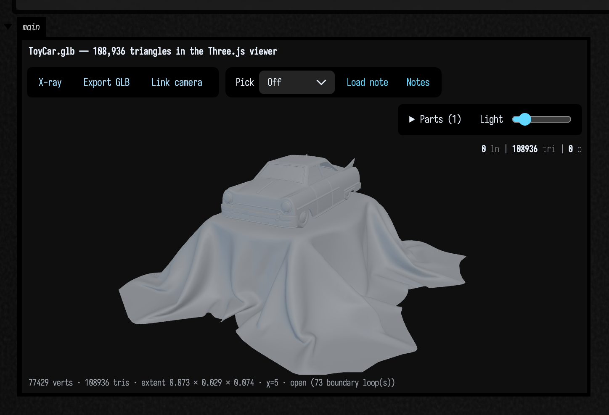

# Geometry from disk

<!-- capture-sources: src/jvmMain/kotlin/afield/graphics/scene/MeshFromDisk.kt src/jvmMain/kotlin/afield/geometry/mesh/mesh_io.kt -->

You have a mesh file, and you want to see it in Field and then compute with it. For every format,
that is one line:

```diffstatic {data-lang=kotlin}
showMesh("/path/to/thing.glb")
```

That reads the file, assembles it, and puts a shaded render you can orbit into the box's output
area, with the mesh's measurements printed underneath. Keep the mesh instead of the picture and
everything in the [mesh family](mesh_examples.md) applies: weld it, measure its volume, decimate it,
shoot a ray at it, write it back out as something else.

## What reads what

<div data-code-lang="kotlin" markdown>

| you have | the call | what you get back | works headless |
| --- | --- | --- | --- |
| `.obj` | `meshFromFile(path)` | `TriMesh`, index-for-index with the file | yes |
| `.stl` (ASCII or binary) | `meshFromFile(path)` | `TriMesh`, triangle soup — see [below](#what-each-format-loses) | yes |
| `.ply` (ASCII, binary, either endianness) | `meshFromAnyFile(path)` | `TriMesh` with the file's per-vertex colours | yes |
| `.glb`, `.gltf`, `.fbx`, `.dae`, `.3ds`, … | `meshFromAnyFile(path)` | `TriMesh`, all parts baked through their node transforms | yes |
| any of the above, textured, with PBR materials | `gltfModelHere("…")` / the [Fabricate renderer](fabricate_renderer.md) | GPU buffers, materials, textures, a live scene | no — needs a renderer |
| `.step`, `.iges`, `.brep` | **nothing** | — | — |

</div>

`meshFromAnyFile` handles everything `meshFromFile` does and more, so if you are unsure, use it.
`meshFromFile` is the pure-Kotlin reader with no native library behind it. Where each loader lives
in the source is at the [end of the page](#internals-where-the-loaders-live).

Two renderers put a mesh on screen, and both take a `TriMesh`. `showMesh` sends it to the Three.js
viewer, where you can orbit it; it is the same viewer `threeLines(...)` draws FLines in, so a solid
and its annotations can share one scene. Pass `renderer = MeshRenderer.CPU` for a still image drawn
on the CPU instead, which needs no GPU; `TriMesh.renderPng` and the inline `toHTML()` card use the
same renderer.

## A real GLB, in a real output area

This example loads the Khronos ToyCar sample, the same GLB the [Fabricate
renderer](fabricate_renderer.md) renders with full PBR materials. It has three mesh/material
buckets, a draped cloth with a lot of folds, glass, and every part positioned by a node transform
rather than baked into the vertices:

```diffstatic_runner {data-lang=kotlin screenshot="assets/geometry_from_disk/toycar.png" wait="14.0" capture="box" open-outputs="true" padding="20"}
:::static
// The same file public/docs/fabricate_renderer.md renders with full PBR — here through the plain
// Three.js viewer instead, which is `showMesh`'s default and gives you a solid you can orbit.
// `renderer = MeshRenderer.CPU` for the static z-buffer figure, which needs no GPU at all.
val glb = java.io.File("public/docs/assets/fabricate_demo/ToyCar.glb")
println("${glb.name}: ${glb.length()} bytes on disk")

val car = meshFromAnyFile(glb.path)
println(car.summary())

// Three mesh/material buckets, assembled by node transform rather than heaped at the origin.
val b = car.bounds()
println("assembled extent %.4f x %.4f x %.4f metres".format(
    b.max.x - b.min.x, b.max.y - b.min.y, b.max.z - b.min.z))
:::fold draw it
showMesh(
    car,
    view = MeshView(width = 560, height = 420, wireframe = false),
    title = "ToyCar.glb — 108,936 triangles in the Three.js viewer",
)
:::endfold
```



The caption under the picture is the mesh's own measurements:

- **77,429 vertices, 108,936 triangles** (326,808 indices), summed over the three buckets: ToyCar
  itself at 66,951 vertices, Fabric at 8,959 and Glass at 1,519.
- **extent 0.073 × 0.029 × 0.074** — the file is in metres, and it is a 7 cm toy. `MeshView`'s
  `distance` is measured in bounding-sphere radii, so the camera frames it correctly without your
  having to know that. `normalized(2.0)` is there if you want a common scale across several models.
- **χ = 1909, open, 2782 boundary loops.** χ is the Euler characteristic. An artist's model is a
  shell rather than a solid, and every UV seam and every hard edge is a real cut in the surface. Expect this of anything that came out of a
  modeller, and do not reach for `repaired()` unless you actually need watertightness (for a volume,
  a boolean, or a printer).

!!! warning "Loading a glTF without a renderer"

    `GltfSupport.loadGltfBasic(path)` with **default arguments cannot run outside a live renderer**.
    `GltfLoadConfig.loadTextures` defaults to `true`, and that path asks the box context for a
    `Renderer` so it can build stub textures. From a plain function, a test, or a headless script it
    therefore dies with a bare `NullPointerException` that says nothing about textures. Pass
    `GltfLoadConfig(loadTextures = false)` and geometry-only loading works everywhere.
    `assimpToTriMesh` does exactly that for you.

## What happens to a glTF scene

A glTF file is a node hierarchy: each node carries a **full 4×4 transform**, several nodes can
reference the same mesh, and each mesh carries its own material. Flattening that into one `TriMesh`
keeps some of it and drops the rest. The table says what `meshFromAnyFile` does with each part,
checked on a small scene of one asymmetric triangle instanced by an identity node, a translated node,
a *child* of that translated node, and a **mirrored** node with `scale (-1, 1, 1)`.

<div class="field-data-table" markdown>

| the scene has | the bridge does |
|---|---|
| several nodes referencing meshes | **merges all of them.** Four instances arrive as 4 triangles in 4 components, not "the first one". |
| a node transform | **applies it.** ToyCar's own three nodes each carry a uniform `1e-4` scale, so a bridge that dropped transforms would render the figure above 10,000× too big: 730 m across, not 0.073 m. |
| a parent chain | **composes it.** The child of the node translated by `(3, 0, 0)`, itself translated by `(0, 2, 0)`, lands at `(3, 2, 0)`. |
| a **mirror** — negative determinant | applies it, **and reverses that part's winding**, so the surface still faces outward instead of being culled away. |
| non-uniform scale | normals go through the **inverse transpose**, not the matrix, so they stay perpendicular to the surface. |
| per-vertex `COLOR_0` | kept, per instance. An all-white array — what glTF writes when the file has no colours — is dropped. |
| quads or n-gons | already triangles: Assimp's `aiProcess_Triangulate` runs before the bridge sees anything. |
| materials and textures | **dropped.** A `TriMesh` has no concept of a texture. Use the [Fabricate renderer](fabricate_renderer.md) for those. |
| animation | **dropped.** The bind pose is baked; node TRS tracks and skinning are not read. |
| a Y-up / Z-up disagreement | **nothing.** glTF is Y-up by specification and no axis conversion is applied, so a Z-up PLY or OBJ arrives on its side. `rotated(...)` is yours to apply. |

</div>

??? aside "Placing instances yourself: `bindMatrix`, not `bindPose`"

    `bindPose` is a translation / rotation / scale triple, and a mirror does not fit in one —
    `Matrix4f.getScale` is a `sqrt` per basis column, so it is never negative. A mirrored node
    arrives with 3×3 determinant −1.0 and `bindPose.toMatrix()` gives it back at +1.0: the
    reflection is gone, the instance is placed un-mirrored, and nothing warns you. `bindMatrix` is
    the un-decomposed world matrix, and it is what `assimpToTriMesh` and the GPU paths read.

    `FabricateTransform` is itself a TRS triple, so `FabricateTransform.set(Matrix4f)` checks its
    own decomposition and keeps the original matrix when recomposing does not reproduce it. While
    that override is in force the TRS fields are a lossy summary — mutating them in place does
    nothing to what is drawn — and `clearMatrix()` goes back to composing them.

    `MeshInstance.applyToMesh` defaults `model` to the instance's own node transform, so a glTF
    scene positioned by its nodes assembles instead of stacking every part at the origin.
    `PlyModel.applyToMesh` defaults to the identity, because PLY has no scene graph to drop.

    The GPU path leaves two things alone, and `MeshInstance.bindMatrix`'s KDoc in
    `simpleGLTFSupport.kt` has the reasoning: winding is not reversed for a negative-determinant
    instance (every Field pipeline sets `VK_CULL_MODE_NONE`), and normals are `mat3(modelView) * n`
    rather than the inverse transpose, which is exact for a rigid, uniformly-scaled or mirrored node
    and skewed for a non-uniformly scaled one.

## Writing a file and reading it back

What comes back from a file is not always what went out. This example writes a coloured sphere to
OBJ and STL, reads both back, and compares them.

In a document of your own, name the file and let Field place it: `"ball.obj".file` lands in the
document's own `files/` folder next to the boxes that made it ([File
management](files_and_paths.md)). The examples here write to a temp directory instead.

```diffstatic_runner {data-lang=kotlin screenshot="assets/geometry_from_disk/roundtrip.png" wait="9.0" capture="box" open-outputs="true" padding="20"}
:::static
// A coloured sphere, out to both formats and back. Nothing is written into the repository: this is a
// temp directory that the box deletes at the end.
val dir = java.nio.file.Files.createTempDirectory("mesh-round-trip").toFile()
val source = icosphereMesh(3, 1.0).withColor(0.3, 0.7, 1.0)

val objFile = java.io.File(dir, "ball.obj").also { source.saveObj(it) }
val stlFile = java.io.File(dir, "ball.stl").also { source.saveStl(it) }
println("ball.obj  ${objFile.length()} bytes")
println("ball.stl  ${stlFile.length()} bytes   (= 84 + 50 x ${source.triangleCount})")
println()

// meshFromFile picks the reader by extension. meshFromAnyFile would too, and also reads .ply/.glb.
val viaObj = meshFromFile(objFile.path)
val viaStl = meshFromFile(stlFile.path)
val welded = viaStl.weld(1e-5)

// A lambda rather than a local `fun`, because inside a box `println` is rewritten onto the box's own
// receiver and a nested function does not have it.
val row = { label: String, m: TriMesh ->
    "%-16s %5d verts  %5d tris  normals=%-5s colours=%-5s chi=%-5d %s  volume %.6f".format(
        label, m.vertexCount, m.triangleCount, m.hasNormals, m.hasColors,
        m.topology().eulerCharacteristic,
        if (m.isWatertight()) "watertight" else "open      ",
        m.signedVolume(),
    )
}
println(row("source", source))
println(row("via .obj", viaObj))
println(row("via .stl", viaStl))
println(row("via .stl, welded", welded))
:::fold draw the three of them side by side, then clean up
showMeshGrid(
    "source — icosphereMesh(3), coloured" to source,
    "via ball.obj — colours gone" to viaObj,
    "via ball.stl, welded — normals gone" to welded,
    columns = 3,
    cellWidth = 235,
)
dir.deleteRecursively()
:::endfold
```


Each difference between the pictures is something a format cannot carry.

## What each format loses

Measured on `icosphereMesh(3, 1.0).withColor(0.3, 0.7, 1.0)`, which is 642 vertices, 1280 triangles,
area 12.506493 and volume 4.152741:

| Representation | verts | tris | normals | uvs | colours | χ | closed | area | volume |
|---|---|---|---|---|---|---|---|---|---|
| **source** | 642 | 1280 | yes | — | yes | 2 | watertight | 12.506493 | 4.152741 |
| **via `.obj`** | 642 | 1280 | **yes** | yes¹ | **no** | 2 | watertight | 12.506493 | 4.152741 |
| **via `.stl`** | **3840** | 1280 | **no** | no | no | **1280** | **open** | 12.506493 | 4.152741 |
| **via `.stl`, `weld(1e-5)`** | 642 | 1280 | **no** | no | no | 2 | watertight | 12.506493 | 4.152741 |

¹ uvs survive OBJ when the mesh has them; this sphere does not. A `heightfieldMesh` round-trips its
uvs to within 1e-5.

The coordinates always survive: area and volume are identical to six decimal places through every
route, so a mesh whose *shape* changed on a round trip is a bug and not a format.

OBJ keeps structure and loses colour. It indexes positions, normals and uvs separately, so Field's
reader emits one vertex per distinct `(position, uv, normal)` corner — which is why a hard-edged cube
from a modeller faithfully comes back with 24 vertices and not 8. There is no standardised
per-vertex colour in OBJ, so `withColor` never reaches the file. STL keeps nothing but triangles: no
vertex sharing at all, so 1280 triangles become 3840 unshared vertices and every edge reads as a
boundary. `weld(1e-5)` recovers the topology exactly but not the normals, because STL never stored
one per vertex, so re-shade after welding — `shadedNormals(35.0)` is usually right. PLY is the format
that carries colour, which is generally why a file is a PLY at all: it is what photogrammetry and
scanners emit, and `meshFromAnyFile` routes `.ply` through `PlySupport` rather than Assimp for that
reason.

File size for the same 1280 triangles, with binary STL's exactly `84 + 50n` bytes as the floor:

| Format | bytes |
|---|---|
| binary `.stl` | 64,084 |
| `.obj` | 75,625 |
| ASCII `.stl` | 324,825 |

## Where the counts come from

`summary()`, `toFigureHtml()` and the inline `toHTML()` card compute topology on the mesh you hand
them rather than remembering what it was, so a format artefact arrives looking like a property of
your model:

```diffstatic {data-lang=kotlin}
icosphereMesh(3).summary()
// 642 verts, 1280 tris, extent 2.0000 …, chi=2, genus 0, watertight, area 12.5065, volume 4.1527, …

stlToTriMesh(icosphereMesh(3).toStlBinary()).summary()
// 3840 verts, 1280 tris, extent 2.0000 …, chi=1280, genus 0, open(1280), area 12.5065, …
```

The second line has no `volume`, because `summary()` only prints one for a watertight mesh, but
`signedVolume()` on the same soup still returns 4.152741: no geometry was lost. `genus 0` is
correct too, because 1280 separate triangles are 1280 discs, each of genus 0.

An unexpected vertex count is usually shading rather than the file. Writing and reading are
faithful, so look upstream at what shaded the mesh:

| Construction | vertices |
|---|---|
| `boxMesh()` | 8 |
| `boxMesh().shadedNormals(35.0)` | 24 |
| `boxMesh().flatShaded()` | 36 |
| `objToTriMesh(boxMesh().toObj())` | 8 |
| `objToTriMesh(boxMesh().shadedNormals(35.0).toObj())` | 24 |

`flatShaded()` un-welds every triangle, so a solid stops being watertight and its Euler
characteristic becomes its triangle count. Save the *unshaded* mesh and let the renderer crease-shade
it, or weld after reading.

## PLY: colours, point clouds and missing normals

This example writes a four-vertex coloured square as ASCII PLY, reads it back with `PlySupport`, and
converts it to a `TriMesh`. In a document of your own, `"square.ply".file` is the form to use.

```diffstatic_runner {data-lang=kotlin screenshot="assets/geometry_from_disk/ply.png" wait="9.0" capture="box" open-outputs="true" padding="20"}
:::static
// A four-vertex coloured square, written as ASCII PLY and read back. The same code path a 10-million-
// point scan takes; small enough to read here.
val dir = java.nio.file.Files.createTempDirectory("ply-demo").toFile()
val file = java.io.File(dir, "square.ply")
file.writeText(
    """
    ply
    format ascii 1.0
    element vertex 4
    property float x
    property float y
    property float z
    property uchar red
    property uchar green
    property uchar blue
    element face 2
    property list uchar int vertex_indices
    end_header
    0 0 0 255 40 40
    1 0 0 40 255 40
    1 1 0 60 60 255
    0 1 0 255 235 40
    3 0 1 2
    3 0 2 3
    """.trimIndent() + "\n"
)

// The loader is PlySupport — no renderer, no Vulkan, no Box context needed.
val model = PlySupport.loadPly(file.path)
val b = model.buffers
println("vertices ${b.vertexCount}, indices ${b.indexCount}, colours ${b.hasColors}, " +
    "normals in the file ${b.hasNormals}, point cloud ${b.isPointCloud}")
println("packed as ${b.vertexData.capacity() / (b.vertexCount * 4)} floats per vertex: " +
    "[pos.xyz][normal.xyz][color.rgba]")

// ...and the bridge into a TriMesh keeps the colours.
val mesh = model.toTriMesh()
println("as a TriMesh: ${mesh.summary()}")
println("colours survived: ${mesh.hasColors}, vertex 0 is ${mesh.color(0)}")
println("normals dropped: ${!mesh.hasNormals} — the file had none, and the loader's " +
    "invented (0,0,1) would shade the whole thing as if it faced you")
:::fold draw it flat on, then clean up
showMesh(
    mesh,
    view = MeshView(yawDegrees = 0.0, pitchDegrees = 0.0, width = 420, height = 315),
    title = "square.ply — per-vertex colours",
)
dir.deleteRecursively()
:::endfold
```


Three details in that output are easy to miss:

- **A PLY with no normals gets `(0, 0, 1)` written for every vertex by the loader.** That is a
  *wrong* normal rather than a missing one, and a wrong normal shades the whole model as though it
  faced the camera. `toTriMesh()` drops them when the file had none, so the render bridges
  crease-shade for you instead. Pass `keepNormals = false` to drop them even when the file has them.
- **A PLY with no `face` element is a point cloud**, and `toTriMesh()` says so rather than handing
  back a mesh with no triangles. Check `buffers.isPointCloud` first; for drawing those, the
  `plyPointCloudHere` macro renders them on the GPU as camera-facing quads.
- **All-white colours are dropped.** Both bridges do this. A glTF with no `COLOR_0`, or a PLY with no
  `red`/`green`/`blue`, gets white written for every vertex by its loader — that carries no
  information and would only override the renderer's own shading with a flat white.

## Missing formats and missing features

**STEP, IGES, BREP and other CAD formats** are not read. A `.step` file is NURBS surfaces trimmed
against each other rather than a mesh, and Field has no CAD kernel. Export STL from FreeCAD or your
CAD tool and read that. `meshFromAnyFile` on a `.step` throws rather than returning an empty mesh.

**Textures and materials** do not come across into a `TriMesh`, which has positions, normals, uvs and
per-vertex colours only; `assimpToTriMesh` drops the material. For a textured, rendered model use
`gltfModelHere` and the [`StandardRenderer`](fabricate_renderer.md); the
[Renderers](reference/renderers.md) reference page lists that path's declarations.

**Point clouds** are read by `PlySupport` and drawn on the GPU by `plyPointCloudHere`, but there is
no CPU point-cloud type, no surface reconstruction, and no downsampling. `convexHullMesh` over the
positions and `voronoi3d` are what there is.

**Gaussian splats** are better served. `SplatRaster` ([`SplatRaster.kt`](https://github.com/OpenEndedGroup/Field4/blob/main/src/jvmMain/kotlin/afield/graphics/render/SplatRaster.kt)) renders a
splat cloud on the CPU into PNG bytes, matching the GPU renderer's framing for the same `Config`.
`SplatContactSheet` puts a whole capture in one image, and `SplatCloud` lets you crop, filter,
decimate, transform and merge a cloud and write a `.compressed.ply` back out.

**Animation** is not kept. `GltfSupport.MeshInstance.animationSamples` carries the node tracks
Assimp reads, but `assimpToTriMesh` bakes the bind pose, and skinning is not read at all.

**Stepping through a mesh pipeline** has no viewer of its own. `showMeshGrid` (several meshes side
by side) and `showMeshTurntable` (one mesh from four angles) show the stages statically.

**Export** is OBJ and STL only: `toObj`, `saveObj`, `toStlAscii`, `toStlBinary` and `saveStl`.
Neither keeps per-vertex colours. The `.compressed.ply` writer above is for splats, not triangles.

## Fixing a mesh that looks wrong

Most of these show up in `summary()`, so print it before you draw anything.

<div class="field-data-table" markdown>

| symptom | cause | what to do |
|---|---|---|
| `contains no obj geometry` | the file is not what its extension says | A ZIP, a glTF or an HTML error page saved as `thing.obj`: the message says what it looks like. `meshFromAnyFile` reads most formats by their contents. |
| holes, or whole faces missing | inside-out winding, open mesh | Back faces are culled exactly as a GPU culls them, so a wrongly-wound patch is not dark, it is *gone*. `fixWinding()`, then check `topology().isConsistentlyOriented`. |
| looks fine, every measurement negative | inside-out winding, closed solid | The silhouette is unchanged and both renderers flip inward normals rather than shading them black, so the picture is no help at all. `signedVolume() < 0` is the only tell; `fixWinding()` is the fix. |
| flat, faceted or oddly uniform shading | no normals, or invented ones | A mesh with *none* is crease-shaded for you; one with wrong ones is not. Recompute with `shadedNormals(35.0)`. To drop them, `copy(normals = null)`, or `withoutAttributes()` for every attribute. |
| `isWatertight()` false on a closed solid | it came through STL | Or it was `flatShaded()` before it was written. `weld(1e-5)` recovers the topology, and `meanEdgeLength()` is the scale that tells you 1e-5 is safe rather than a guess. |
| the vertex count is exactly 3× | STL, or `flatShaded()` | Both un-weld every triangle, and the reader on the other side will not weld it back. `weld`, then `shadedNormals` if you want the hard edges again. |

</div>

## From a file on disk to a solid you can cut

To use a loaded mesh in a boolean, it has to be closed: [`toSolid()`](manifold.md) refuses anything
that is not. Two calls do the repair automatically. `diagnose()` says what is wrong, and
`repairToSolid()` fixes what it can and reports what it could not:

```diffstatic {data-lang=kotlin}
val mesh = meshFromAnyFile("scan.glb")
println(mesh.diagnose().report())          // why, worst first
val fixed = mesh.repairToSolid()
println(fixed.report())                    // what was done, and what was not
if (fixed.isSolid) display(fixed.mesh.toSolid() - drill)
```

### Defect severities: what blocks a solid

`diagnose()` sorts what it finds by severity. A blocking defect is one Manifold rejects; the
others it accepts, though some of them still deserve a look.

| defect | severity | what it means |
|---|---|---|
| `NON_FINITE_POSITION` | **blocking** | a `NaN` or infinite coordinate |
| `UNWELDED_VERTICES` | **blocking** | coincident vertices with different indices — until they merge, every seam reads as a hole |
| `DUPLICATE_FACE` | **blocking** | two triangles with the same corners; each extra copy makes its three edges non-manifold |
| `NON_MANIFOLD_EDGE` | **blocking** | an edge with three or more faces |
| `OPEN_BOUNDARY` | **blocking** | a hole |
| `UNWALKABLE_BOUNDARY` | **blocking** | boundary edges in no closed ring |
| `DEGENERATE_FACE` | suspicious | zero-area triangles — **Manifold accepts these** |
| `NON_MANIFOLD_VERTEX` | suspicious | a pinch point — **Manifold accepts these** |
| `INVERTED_ORIENTATION` | suspicious | closed but wound inward — **Manifold accepts this** |
| `MULTIPLE_COMPONENTS` | informational | disjoint pieces — **Manifold accepts these and sums the volumes** |
| `UNREFERENCED_VERTEX` | informational | vertices no triangle uses |

The dangerous *suspicious* row is `INVERTED_ORIENTATION`: an inside-out closed mesh is a legal
manifold, and Manifold hands back a **negative volume** without throwing, after which a boolean
computes the complement of what you meant. `toSolid()` refuses it for that reason (pass
`check = false` to take it anyway); `fixWinding()` flips it.

`UNWALKABLE_BOUNDARY` usually means inconsistent winding rather than anything exotic. Tracing a
boundary into a ring follows directed half-edges, so a wrongly wound patch breaks the trace and an
ordinary hole reports as unwalkable. Run `fixWinding()` and diagnose again before reading it as two
holes meeting at one vertex.

### The repair steps, in order

`repairToSolid()` runs these steps in this order, because each later step gives a wrong answer
without the earlier ones:

| step | fixes | does **not** fix |
|---|---|---|
| `weld` | unwelded seams, STL-style unshared vertices | anything, until it has run: hole and component counts are meaningless before it |
| `removeDegenerateTriangles` | zero-area faces | — |
| `removeDuplicateFaces` | duplicated faces; a back-to-back pair cancels to nothing | — |
| `removeNonManifoldFins` | dangling flaps (a non-manifold edge **and** a boundary edge on the same triangle) | two closed sheets meeting on an edge — that needs a modelling decision, so it is left alone and reported |
| `fixWinding` | inconsistent orientation | — |
| `fillHoles` | open boundary loops | a non-planar or self-intersecting rim gets a cap it flags as suspect |
| `fixWinding` again | inside-out components | — |

The second `fixWinding` does different work from the first. Its outward-facing stage only flips a
component that is *closed*, because "outward" is undefined for an open sheet, so before the caps
exist every holed component is skipped. Running it again afterwards is what stops a repaired mesh
coming back inside out with a negative volume.

**Hole filling is the part to be suspicious of.** Each ring is reversed (a cap must walk its boundary
edges the opposite way to the surface), given a Newell normal, projected into that plane and
ear-clipped; if ear clipping stalls, a centroid fan closes it anyway. Two failure modes are detected
and reported:

- **a non-planar rim** gets a flat cap over a wavy hole. The mesh is a valid solid; the *volume is
  wrong*. `BoundaryLoopInfo.planarity` measures the deviation against the loop's own diameter before
  the fill happens, so the warning is available in advance.
- **a self-intersecting rim** is what makes ear clipping stall, and the fan that closes it can pass
  through itself.

A ring that repeats a vertex is neither: it is a figure-eight, two holes pinched together, and
capping it as one polygon *creates* a non-manifold edge — the repair would make the mesh worse. Those
are split at the repeats first, so each real hole gets its own cap.

#### A sound cap can still be the wrong shape

Nothing about a hole says whether its end should be a flat cap or whether the model continued there.
These two cases have equally clean caps and opposite outcomes:

| Input surface | rim | cap | cap share of surface | result |
|---|---|---|---|---|
| uncapped cylinder | flat | clean ear clip | 16.5% | volume error **0.00000** — exactly right |
| torus with its tube severed | flat | clean ear clip | 2.7% | volume error **4.2%**, and **genus 1 becomes 0** |

Planarity, fill method, edge count and cap area are all as good or better on the wrong one, so no
cap-area threshold could flag the torus without also flagging the cylinder. `capAreaFraction` is
reported, but does not set `isSuspect`.

So **`isSuspect == false` means the cap's geometry is sound, not that the model is the one you
started with.** Only a comparison against the shape you meant catches the difference.

### What `repairToSolid` does

Beyond what `repaired()` (weld → degenerate → unused → winding, in `mesh_topology.kt`) already
does, `repairToSolid()` is responsible for exactly two families: **open boundaries**, and
**non-manifold edges** from duplicated faces or dangling fins.

It refuses rather than guesses on two shapes: a `NaN` position, because repairing around it would
silently delete the affected triangles and cap the gap, and two closed tetrahedra sharing a face.
Both report the failure instead of returning something that looks repaired.

Most broken meshes repair to the shape they came from. The ones that come back valid but the wrong
shape have curved or non-planar holes, where a fan fill is doing the best it can; a crowned rim can
be off by a third of its volume.

??? aside "Where the repair measurements are"

    The table of deliberately broken meshes, what each row is broken in, and the per-row residuals
    are in [`dev_docs/MESH_REPAIR_MEASUREMENTS.md`](https://github.com/OpenEndedGroup/Field4/blob/main/dev_docs/MESH_REPAIR_MEASUREMENTS.md).

### Repairing ToyCar

`ToyCar.glb` (77,429 vertices, 108,936 triangles, 2,197 components, 42,104 boundary edges in 2,782
traced loops) **repairs to a valid solid you can boolean**: 21,047 vertices welded, 84 holes closed
with 3,668 triangles.

There is no undamaged original to compare it against, so "valid solid" is all you can say about it.
The volume it reports, `3.16e-5`, should not be trusted as is: nine of the 84 caps are flagged
suspect, one of them a 335-edge centroid fan, a lid the size of a body panel. Look at
`result.suspectFills` before trusting any measurement of a repaired model.

### Seeing it

`Box.showMeshDiagnosis(mesh)` puts the mesh, painted by defect, beside the ordered list of what is
wrong. `TriMesh.defectFLines()` gives the same information as drawable lines to lay over your own
drawing: red for boundary loops, orange for non-manifold edges, magenta for pinched figure-eight
loops, yellow (opt-in) for winding disagreements. `TriMesh.withDefectColors()` is the per-vertex
colouring the card renders, if you want it in your own picture.

This example removes a patch of faces from a sphere, leaves one more face unwelded, and shows the
diagnosis:

```diffstatic_runner {data-lang=kotlin screenshot="assets/geometry_from_disk/mesh_defects.png" wait="9.0" capture="box" open-outputs="true" padding="20"}
:::static
// A sphere with a patch of faces removed, and one more face left unwelded — the two commonest
// ways a mesh off disk fails. Built here rather than loaded, so the picture needs no file.
val base = icosphereMesh(3, 1.0)
var broken = base.filterTriangles { it >= 4 }

// Give triangle 0 its own three vertices: the crack an STL export leaves at every seam.
val pos = broken.positions.copyOf(broken.positions.size + 9)
val idx = broken.indices.copyOf()
for (k in 0..2) {
    val v = broken.indices[k]
    val d = (broken.vertexCount + k) * 3
    pos[d] = broken.x(v); pos[d + 1] = broken.y(v); pos[d + 2] = broken.z(v)
    idx[k] = broken.vertexCount + k
}
broken = TriMesh(pos, idx)

println(broken.diagnose().report())
:::fold draw it
// No `view` argument, and that is the point: the camera aims itself at the worst defect. The hole
// is on the far side from the default three-quarter view, so without that this figure would be a
// photograph of an apparently perfect sphere captioned "4 faces removed".
showMeshDiagnosis(broken, title = "4 faces removed, plus one unwelded face")
:::endfold
```

![A grey wireframed icosphere with a black triangular hole punched through it, seen from a camera pointed straight at the damage. A red halo stains the ring of vertices around the hole, and a second, smaller red patch sits just below and right of it where one face was left unwelded. Beneath the render a legend reads "red = open boundary, orange = non-manifold edge, yellow = pinch vertex", then "645 verts, 1276 tris, 2 blocking" and three defect rows: BLOCKING UNWELDED_VERTICES x3, BLOCKING OPEN_BOUNDARY x12 with edge counts 6, 3, 3, and INFORMATIONAL MULTIPLE_COMPONENTS x2, each with the call that fixes it](assets/geometry_from_disk/mesh_defects.png)

`showMeshDiagnosis` **points the camera at the worst defect** unless you pass a view, which is why
the hole is in shot above: it sits on the far side of the sphere from the default three-quarter
view. `TriMesh.defectFacingView()` is that camera, if you want it for your own render. The red halo
and the smaller red patch are the two blocking rows of the list beside it.

### Open this to see it

The [`mesh_repair_demo`](agent_transcripts.md#mesh_repair_demo) starting point holds two boxes: one damages a sphere and shows the diagnosis
card, the other repairs it, prints what was done, and cuts the result. Both run with no files and no
network.

## What it costs

Reading a mesh off disk is cheap enough to do in a live box on every re-run. Measured on an M-series
laptop, five reads after two warm-up reads:

| Loader and input | file | triangles | time | rate |
|---|---|---|---|---|
| `ToyCar.glb` via Assimp | 5.4 MB binary | 108,936 | **83 ms** | 1310 k tri/s |
| `big.obj` via `meshFromFile` | 9.4 MB text | 132,488 | **337 ms** | 393 k tri/s |
| `big.stl` via `meshFromFile` | 6.6 MB binary | 132,488 | **185 ms** | 718 k tri/s |
| `big.obj` via `assimpToTriMesh` | the same 9.4 MB | 132,488 | **223 ms** | 595 k tri/s |

Binary reads about twice as fast as text for the same mesh, so prefer STL over OBJ for an
intermediate file nobody reads. Assimp's native OBJ reader is faster than the Kotlin one, but
`meshFromAnyFile` still routes `.obj` to the Kotlin reader, because it round-trips a file
index-for-index. If you are reading
hundreds of OBJs in a loop, `assimpToTriMesh` on them directly is the faster call.

Drawing it on the CPU costs more than reading it:

| Rendering operation | on 108,936 triangles |
|---|---|
| `renderPng(560×420, wireframe = false)` | 51 ms |
| `renderPng(560×420, wireframe = true)` | 114 ms |
| `toFigureHtml(…)` — what `showMesh(renderer = MeshRenderer.CPU)` calls | **419 ms** |

Most of the figure's cost is the caption: its `χ`, genus, watertightness and boundary-loop count
need a full topology pass over the whole mesh. If you are re-rendering in a loop and do not need the
numbers, call `renderPng` and `display` the image yourself.

The default `showMesh` uploads the mesh to the Three.js viewer once, and the browser redraws it for
free after that. The caption's topology pass costs the same either way.

## Writing back out

Three calls cover the export formats:

```diffstatic {data-lang=kotlin}
// java.io is not in a box's default imports, hence the qualified names.
mesh.saveObj(java.io.File("/tmp/thing.obj"))     // keeps normals and uvs; loses colours
mesh.saveStl(java.io.File("/tmp/thing.stl"))     // binary; positions only; every slicer reads it
java.io.File("/tmp/thing.stl").writeText(mesh.toStlAscii())   // ~5x larger, human-readable
```

**Write the un-shaded mesh**: `flatShaded()` triples the vertex count and un-welds the surface, and
the reader on the other side will not weld it back. For a printer, check `isWatertight()` and that `signedVolume()` is **positive** before writing: a
consistently-oriented but inside-out solid looks completely normal in a render (the silhouette is
unchanged and the rasterizer flips inward normals rather than shading them black) and reports a
negative volume. `fixWinding()` is the fix.

??? aside "Agents: where the pictures and counts come from"

    Each figure is a box's own output area, captured by the docs build running the fence above it.
    The ToyCar figure reads the committed `assets/fabricate_demo/ToyCar.glb`; replace that file and
    the page's counts describe a different car. The counts are pinned in
    `src/jvmTest/kotlin/afield/geometry/mesh/MeshFromDiskTest.kt`, and `MeshIoTest.kt` covers the reader
    behaviour they rest on.

## Trying it yourself

The ToyCar, round-trip and PLY examples are also a document you can open from the [`geometry_from_disk`](agent_transcripts.md#geometry_from_disk)
starting point, with the same three boxes live. Point the first box's `path` at a
mesh file of your own and re-run it, or change the second box's weld tolerance or the third's corner
colours, and watch the numbers and the picture change. Boxes two and three write only into a temp
directory they delete themselves.

## Internals: where the loaders live

Four separate pieces of code read geometry off disk:

| loader | source | reads | produces |
|---|---|---|---|
| stdlib mesh I/O | `afield/geometry/mesh/mesh_io.kt` | OBJ, STL | `TriMesh` |
| PLY | `afield/graphics/scene/simplePLYSupport.kt` | PLY, meshes and point clouds | packed 10-float GPU buffer |
| Assimp / glTF | `afield/graphics/scene/simpleGLTFSupport.kt` | glTF, GLB, FBX, DAE, 3DS, OBJ, STL, PLY, … | packed 12-float GPU buffer + materials |
| Fabricate | `afield/graphics/scene/fabricated/FabricateGltfBridge.kt` | the Assimp model above | [`FabricateScene`](reference/renderers.md#fabricatescene-kt-fabricatescene) for the PBR [`StandardRenderer`](fabricate_renderer.md) |

The PLY and Assimp loaders produce ordinary host memory rather than Vulkan allocations, so their
*buffers* need no renderer even though their *textures* do. `afield/graphics/scene/MeshFromDisk.kt`
turns them into a `TriMesh`: `PlyModel.toTriMesh()`, `assimpToTriMesh(path)`, the `meshFromAnyFile`
dispatcher, and the `showMesh(path)` overload at the top of this page. A box calls all of these with
no import. The CPU renderer is `VisionGeometryPreview`, a z-buffer whose output is deterministic.

## Reference

### Read, any format

Load a mesh through the format-dispatching entry point.

<div class="field-reference" data-code-lang="kotlin" markdown>

| Entry point | Behavior |
| --- | --- |
| `meshFromAnyFile(path)` | Loads OBJ, STL, PLY or an Assimp-supported scene into a CPU `TriMesh`. Scene parts are baked through their transforms; unreadable paths throw instead of returning an empty mesh. |
| `fun Box.showMesh(mesh: TriMesh, channel: String = "main", view: MeshView = MeshView(), caption: String? = null, title: String? = null, renderer: MeshRenderer = MeshRenderer.GPU, height: Int = 430)` | Push a rendered view of `mesh` to one of this box's output channels, with its measurements as a caption. [API](reference/graphics.md#mesh-field-kt). |
| `assimpToTriMesh(path, keepColors = true)` | Flattens a supported scene file into a `TriMesh`, applying node transforms, keeping per-vertex colours where the file has them. Textured materials do not survive the flattening. Those need the renderer path. |
| `fun VoronoiLattice.toTriMesh(shrink: Double = 0.92, boundedOnly: Boolean = false): TriMesh` | Every cell of a 3D Voronoi lattice as one [`TriMesh`](reference/graphics.md#mesh-kt-trimesh), one connected component per cell. [API](reference/graphics.md#mesh-field-kt). |

</div>

### Read, no dependencies

Read OBJ or STL through the direct readers when no native scene importer is needed.

<div class="field-reference" data-code-lang="kotlin" markdown>

| Entry point | Behavior |
| --- | --- |
| `fun meshFromFile(path: String): TriMesh` | Load a mesh from a path, choosing the reader by extension (`.obj`, `.stl`). [API](reference/graphics.md#mesh-io-kt). |
| `fun triMeshFromObj(file: File): TriMesh` | Read an OBJ file — see `objToTriMesh` for what survives. [API](reference/graphics.md#mesh-io-kt). |
| `fun objToTriMesh(text: String): TriMesh` | Parse Wavefront OBJ text into a [`TriMesh`](reference/graphics.md#mesh-kt-trimesh). [API](reference/graphics.md#mesh-io-kt). |
| `fun triMeshFromStl(file: File): TriMesh` | Read an STL file, ASCII or binary — see `stlToTriMesh`. [API](reference/graphics.md#mesh-io-kt). |
| `fun stlToTriMesh(bytes: ByteArray): TriMesh` | Parse STL, ASCII or binary — the format is sniffed, not declared. [API](reference/graphics.md#mesh-io-kt). |

</div>

### Write

Write OBJ or STL files for other tools. Check the format comparison above before relying on preserved normals or colours.

<div class="field-reference" data-code-lang="kotlin" markdown>

| Entry point | Behavior |
| --- | --- |
| `fun TriMesh.toObj(name: String = "mesh", decimals: Int = 6): String` | This mesh as Wavefront OBJ text: `v` positions, then `vn` normals and `vt` uvs if present, then `f` faces with 1-based indices. [API](reference/graphics.md#mesh-io-kt). |
| `fun TriMesh.saveObj(file: File, name: String = file.nameWithoutExtension)` | Write this mesh to `file` as OBJ. Creates parent directories. [API](reference/graphics.md#mesh-io-kt). |
| `fun TriMesh.toStlAscii(name: String = "mesh"): String` | This mesh as ASCII STL. One `facet` per triangle with its face normal, no vertex sharing (the format has none). [API](reference/graphics.md#mesh-io-kt). |
| `fun TriMesh.toStlBinary(header: String = "Field afield.stdlib mesh_io.kt"): ByteArray` | This mesh as binary STL: an 80-byte header, the triangle count, then 50 bytes per triangle (little-endian float normal, three float positions, a zero attribute short). [API](reference/graphics.md#mesh-io-kt). |
| `fun TriMesh.saveStl(file: File)` | Write binary STL to `file`. Creates parent directories. [API](reference/graphics.md#mesh-io-kt). |

</div>

### Look at it

Inspect shape and appearance in an output panel.

<div class="field-reference" data-code-lang="kotlin" markdown>

| Entry point | Behavior |
| --- | --- |
| `fun Box.showMesh(mesh: TriMesh, channel: String = "main", view: MeshView = MeshView(), caption: String? = null, title: String? = null, renderer: MeshRenderer = MeshRenderer.GPU, height: Int = 430)` | Push a rendered view of `mesh` to one of this box's output channels, with its measurements as a caption. [API](reference/graphics.md#mesh-field-kt). |
| `fun Box.showMeshGrid(vararg panels: Pair<String, TriMesh>, channel: String = "main", columns: Int = 2, cellWidth: Int = 380, view: MeshView = MeshView(), renderer: MeshRenderer = MeshRenderer.GPU)` | Several meshes side by side, each rendered and captioned — the fastest way to see a whole pipeline (generated / subdivided / smoothed / decimated) side by side. [API](reference/graphics.md#mesh-field-kt). |
| `fun Box.showMeshTurntable(mesh: TriMesh, channel: String = "main", views: List<MeshView> = MeshView.turntable(4), cellWidth: Int = 260, title: String? = null, renderer: MeshRenderer = MeshRenderer.GPU)` | A turntable contact sheet of one mesh: the same shape from `views`, laid out in a row. [API](reference/graphics.md#mesh-field-kt). |
| `MeshView` | How to draw a [`TriMesh`](reference/graphics.md#mesh-kt-trimesh) in a preview: where the camera stands and what the frame looks like. [API](reference/graphics.md#mesh-field-kt). |
| `fun TriMesh.summary(): String` | A one-line factual summary of a mesh: counts, extent, topology and volume — the thing to `print` when you want the numbers rather than the picture. [API](reference/graphics.md#mesh-field-kt). |
| `three(subject = mesh)` | Opens an orbitable Three.js view of a mesh. Use a scene block to combine solids and line annotations. |
| `threeGrid(…)` | Displays several subjects as titled viewports. |
| `threeTurntable(…)` | Displays a subject from a sequence of viewing directions. |

</div>

### Look at it without a GPU

Render a still or an interactive figure using the CPU path when a native GPU renderer is unavailable.

<div class="field-reference" data-code-lang="kotlin" markdown>

| Entry point | Behavior |
| --- | --- |
| `fun TriMesh.renderPng(view: MeshView = MeshView(), caption: String? = null, title: String? = null): ByteArray` | This mesh rasterised to PNG bytes: perspective, z-buffer, two-light lambert shading over the per-vertex colours, and a depth-tested wireframe. [API](reference/graphics.md#mesh-field-kt). |
| `fun TriMesh.renderPixels(view: MeshView = MeshView()): VisionGeometryPreview.Raster` | This mesh's raster as ARGB ints plus its size — for compositing several meshes into one figure. [API](reference/graphics.md#mesh-field-kt). |
| `fun TriMesh.toFigureHtml(view: MeshView = MeshView(), caption: String? = null, title: String? = null): String` | A complete `<figure>` — this mesh rendered as an inline PNG plus its measurements as a caption — for `display(…)` in a box output or for the value visualizer. [API](reference/graphics.md#mesh-field-kt). |
| `fun Box.showMesh(mesh: TriMesh, channel: String = "main", view: MeshView = MeshView(), caption: String? = null, title: String? = null, renderer: MeshRenderer = MeshRenderer.GPU, height: Int = 430)` | Push a rendered view of `mesh` to one of this box's output channels, with its measurements as a caption. [API](reference/graphics.md#mesh-field-kt). |

</div>

### Repair what you read

Repair connectivity before solid operations. Normal generation and normalization affect shading or scale, so choose them separately from topology repair.

<div class="field-reference" data-code-lang="kotlin" markdown>

| Entry point | Behavior |
| --- | --- |
| `fun TriMesh.weld(tolerance: Double = 1e-6): TriMesh` | Merge vertices closer together than `tolerance` and renumber the triangles onto the survivors. [API](reference/graphics.md#mesh-topology-kt). |
| `fun TriMesh.fixWinding(): TriMesh` | Make the winding consistent across the whole mesh, then make it point **outward**. [API](reference/graphics.md#mesh-topology-kt). |
| `fun TriMesh.removeDegenerateTriangles(areaEpsilon: Double = 1e-14): TriMesh` | Drop triangles with no area — a repeated index, or three collinear corners — and any vertex that leaves unreferenced. [API](reference/graphics.md#mesh-topology-kt). |
| `fun TriMesh.repaired(tolerance: Double = 1e-6): TriMesh` | Weld, drop degenerate triangles, drop unused vertices and fix the winding — the one call to make before trusting a mesh that came from a file, a scanner, or a per-cell generator. [API](reference/graphics.md#mesh-topology-kt). |
| `fun TriMesh.largestComponent(): TriMesh` | The largest connected component, by triangle count — the usual way to throw away the specks a noisy iso-surface leaves around the shape you wanted. [API](reference/graphics.md#mesh-topology-kt). |
| `fun TriMesh.shadedNormals(creaseAngleDegrees: Double = 35.0): TriMesh` | Crease-aware normals: smooth across edges where the two faces are within `creaseAngleDegrees` of each other, hard where they are not. [API](reference/graphics.md#mesh-process-kt). |
| `fun TriMesh.normalized(size: Number = 1.0): TriMesh` | This mesh recentred on its own bounding box and scaled so its longest axis is `size`. [API](reference/graphics.md#mesh-field-kt). |

</div>

### On the GPU instead

Load an asset directly into a native renderer when drawing is the next step rather than CPU mesh processing.

<div class="field-reference" data-code-lang="kotlin" markdown>

| Entry point | Behavior |
| --- | --- |
| `plyModelHere("model.ply")` | Loads a PLY model into the current renderer’s module context. |
| `plyPointCloudHere("scan.ply")` | Loads PLY data for point-cloud drawing in the current renderer. Use it when samples should remain points instead of forming a triangle surface. |
| `gltfModelHere("model.glb")` | Loads glTF geometry, materials and textures into the renderer. This requires a live renderer and preserves rendering data a flattened CPU mesh does not. |
| `modelWithTextureHere(…)` | Loads geometry with a texture for a renderer module: the material-aware scene path. |

</div>

### Let the AI read it

Register geometry locations with Field’s AI tools so it can resolve and inspect those assets.

<div class="field-reference" data-code-lang="kotlin" markdown>

| Entry point | Behavior |
| --- | --- |
| `GeometryAgentTools.addSearchRoot(directory)` | Registers a directory to search when an AI geometry tool resolves assets. The argument is a `File` naming the directory. |
| `GeometryAgentTools.register()` | Registers the geometry inspection tools with Field’s AI tool registry. |

</div>


## Letting Field's AI look at your geometry

Two lines turn everything on this page into something the AI can use:

```diffstatic {data-lang=kotlin}
GeometryAgentTools.addSearchRoot(File(System.getProperty("user.home"), "scans"))
GeometryAgentTools.register()
```

`ListGeometryFiles` tells the model what you have. `InspectGeometryFile` loads one and returns the
same measurements this page describes, plus a *rendered image*: the CPU rasteriser behind it needs no
GPU and no window, so a model can look at a scan rather than reason about its bounding box. It will
only read inside roots you have added.

See [Give the AI a tool of your own](aiFeatures.md), which uses this tool set as its worked example
and shows the schema and the picture the model receives.

Related pages: [Meshes and 3D geometry](mesh_examples.md) for everything you can *do* with a mesh
once you have one; [the Fabricate renderer](fabricate_renderer.md) for textured PBR rendering of the
same files; [Field 4 graphics](afield_four_graphics.md) for the module/shader layer the GPU
loaders plug into; [FLine examples](fline_examples.md) for `toFLines`, the route from a mesh back into
Field's drawing. Developer notes: [`dev_docs/MESH_GEOMETRY.md`](https://github.com/OpenEndedGroup/Field4/blob/main/dev_docs/MESH_GEOMETRY.md) and
[`dev_docs/ply_loader.md`](https://github.com/OpenEndedGroup/Field4/blob/main/dev_docs/ply_loader.md).
