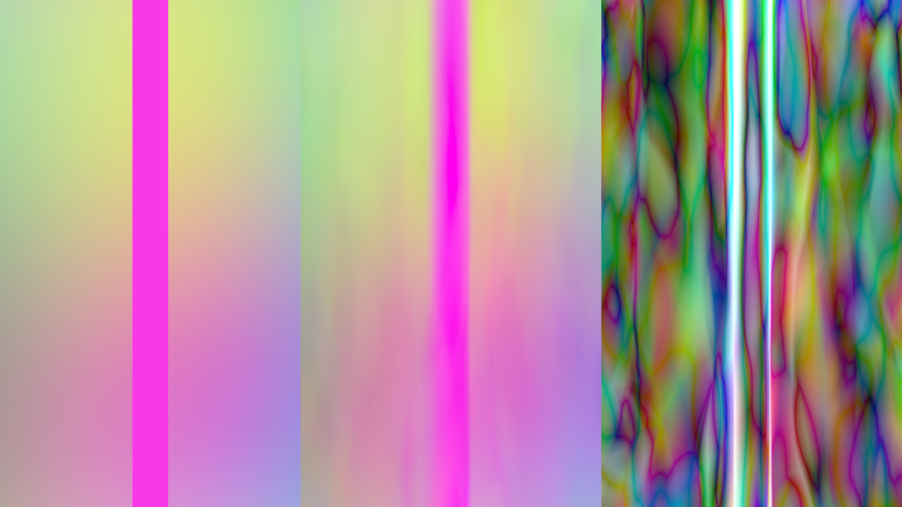
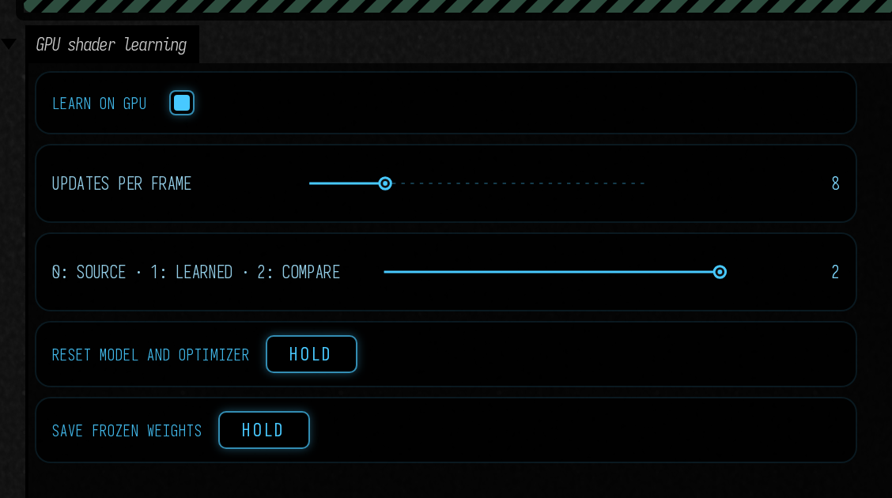

# Learn from a shader on the GPU

The [learned shader](learned_shader.md) workflow can now train directly from a Field render target without exporting a pixel dataset. Your `moduleHere()` shader renders its normal image; a GPU pass samples that image, Slang differentiates a small network, and cooperative-vector operations accumulate its weight gradients. You can watch the approximation improve while editing the source.



## Open the experiment

Build the optional shaders with `./gradlew buildLearnedShaders`, then open **Starting points → gpu_shader_learning**. It needs enabled cooperative-vector **training**, not just inference. Field now uses the shared, checksummed **Slang 2026.18.3** compiler; the optional shader build uses that pin and makes it available to the existing Slang runtime. Explicit runtime compiler overrides retain their normal priority.

The three panels are **source**, **learned output** and **absolute RGB error × 8**. The purple stripe sits in the middle of each source/learned panel: its two hard edges make a deliberately discontinuous target. Training visits thirteen normalized time values. Turning off **Learn on GPU** animates through intermediate values, so you can see how the fit interpolates. Select **1: Learned** with learning disabled to stop executing the teacher entirely. The learned texture remains available as `lab.model.output`.

<video controls muted loop playsinline preload="metadata" src="assets/gpu_shader_learning/animation.mp4" width="1920" height="1080" style="max-width:100%;height:auto;aspect-ratio:16/9"></video>

Edit the **fragment** property to change what is learned. Successful shader changes reset the fit in this Starting Point; a failed compilation retains the working shader. **Reset model and optimizer** restores the seeded initial weights and clears Adam's history. Uniform, texture, camera or other semantic changes are yours to reset explicitly.



## Start with the shader you want to learn

Here is the complete teacher **fragment** shader from the Starting Point, formatted for reading. This is the source to edit. `p.state.xy` holds the render target's width and height; `p.state.z` is the normalized training parameter, −1…1. The shader turns pixel coordinates into the same normalized x/y domain used by the learner.

```diffstatic {data-lang=glsl}
:::fold Fragment interface
#version 460
layout(push_constant) uniform P { vec4 state; } p;
layout(location = 0) out vec4 color;
:::endfold

void main() {
    vec2 xy = gl_FragCoord.xy / p.state.xy * 2 - 1;
    float t = p.state.z;

    vec3 rgb = .5 + .22 * cos(
        vec3(xy.x * 2 + t, xy.y * 2 - t * .7, xy.x + xy.y + t * .5)
        + vec3(0, 2, 4));
    for (int k = 1; k <= 96; k++) {
        float a = float(k) * .61803399;
        rgb += .028 / float(k) * sin(
            vec3(xy.x * cos(a) + xy.y * sin(a)) * 3
            + t + vec3(0, 2, 4) + a);
    }
    // Two hard edges: a deliberately discontinuous target for the small network.
    float stripe = step(-.12, xy.x) * (1 - step(.12, xy.x));
    color = vec4(mix(rgb, vec3(.95, .04, .8), stripe), 1);
}
```

Change the colour offsets `vec3(0, 2, 4)`, replace the `rgb` expression, or increase the spatial frequencies to make the fit harder. Use **Update Shader**, then watch the learned panel catch up and the error panel settle. Keep the interface declarations and opaque output while replacing the function's body. The learner sees the resulting RTT pixels; there is no second copy of your formula to edit in Slang or Python. Changing the teacher starts a new fit; extending an already frozen result instead happens in its [host shader](learned_shader.md#keep-learning-finished-keep-the-material-editable).

## From `moduleHere()` to a learned texture

The teacher is an ordinary module attached to one linear RGBA16F or RGBA32F `RenderToTexture`. Keep RGB unclamped and alpha one. Invalid/nonfinite or nonopaque samples are rejected; the network learns RGB, not coverage, latent pigment channels or arbitrary attachments.

```diffstatic {data-lang=kotlin}
val source = RenderToTexture(renderer) {
    width=1920; height=1080; useDepth=false
    format=VK_FORMAT_R32G32B32A32_SFLOAT
}
val teacher = moduleHere { source.apply() }
source += "teacher" to teacher
// Add your existing meshes and bind their uniforms as usual.

val lab = GpuShaderLearningView(renderer, source) { normalizedTime ->
    mesh.push["state"] = vec(source.width, source.height, normalizedTime, 0)
}.install()
lab.parameter = .25f
lab.iterationsPerFrame = 8
```

The view borrows the source target, records source → sample/train → inference → comparison, and owns its learner and comparison images. It does not attach the source as a second render pass. Close the view before retiring the source. The lower-level `GpuShaderTraining.train(command, image, parameter, iterations)` and `evaluate(command, index, parameter)` methods let your own `Target` schedule the same work.

This is still a learned **(screen x, screen y, one parameter) → RGB** function. The parameter is explicitly normalized to −1…1. Hold everything else fixed unless you extend the network's input contract. A fit of a rendered image does not learn its geometry, feedback state or material response to unseen cameras. Sharp discontinuities and tiny features may need more capacity or may be better left as ordinary shader code.

## Keep and reuse the result

**Save frozen weights** writes a new directory under `build/shader-learning/`. Between frames, Field converts the driver-specific training matrices into the existing portable row-major layout, reads back the small model once, and writes `weights.f16` and a checksummed `weights.json`. Training and evaluation themselves have no CPU image or weight readback.

```diffstatic {data-lang=kotlin}
lab.model.save(File("build/my-fit-001"),
    ShaderTraining.sourceDigest(source),
    "Fixed camera and texture; normalized time is the only changing input")

val frozen = LearnedShader(renderer, 1920, 1080,
    weightsFile=File("build/my-fit-001/weights.f16"),
    manifestFile=File("build/my-fit-001/weights.json"))
```

The saved model works through cooperative-vector inference or `cooperative=false` ordinary shader arithmetic. You can continue extending its [host shader](learned_shader.md#keep-learning-finished-keep-the-material-editable): sampling coordinates, compositing, texture lookups and effects around the learned function remain yours. The saved manifest records training steps, seed, domain and source identity; saving alone makes no quality claim.

## What training actually does

The network has the same fixed architecture as the existing learner: sixteen positional features, two 32-unit ReLU layers, and three linear RGB outputs. Slang's reverse-mode derivative computes the chain rule. The layer derivative uses real Vulkan cooperative-vector outer-product and reduction operations. Matrices use the queried training-optimal layout; FP32 master weights and Adam moments update FP16 published weights. Gradients accumulate in FP16 with fixed loss scaling. This is an inspectable small-function experiment, not a general model-training framework.

### The complete learning shader

This is the complete `src/jvmMain/resources/afield/four/neural/train.slang`, formatted for reading. `model()` is the learned function. The three compute entry points train against sampled teacher pixels, update the weights, and evaluate the current fit across the output image. Buffer declarations, feature encoding, layer derivatives and optimizer details are folded; **Copy** includes the entire file.

```diffstatic {data-lang=slang}
:::fold Buffers and dispatch parameters
// Field's GPU-resident 16 -> 32 -> 32 -> RGB experiment.
// Uses Slang 2026.18 native CoopVec autodiff and Vulkan training intrinsics directly.
// This fixed network deliberately does not import RTXNS's older CoopVec autodiff extension.
[[vk::binding(0, 0)]] ByteAddressBuffer weights;
[[vk::binding(1, 0)]] RWByteAddressBuffer gradients;
[[vk::binding(2, 0)]] RWStructuredBuffer<float4> optimizer;
[[vk::binding(3, 0)]] StructuredBuffer<float4> samples;
[[vk::binding(4, 0)]] RWStructuredBuffer<float4> pixels;
[[vk::binding(5, 0)]] RWByteAddressBuffer mutableWeights;
struct Params {
    uint count; uint step; uint w0; uint b0; uint w1; uint b1; uint w2; uint b2;
    float rate; uint width; uint height; float time; uint words; uint view;
};
[[vk::push_constant]] Params p;
:::endfold

:::fold Encode x, y and the parameter into sixteen features
CoopVec<half, 16> features(float3 v) {
    float x = v.x, y = v.y, t = v.z;
    const float pi = 3.14159265359;
    float f[16] = {
        x, y, t, 1, sin(x*pi), cos(x*pi), sin(y*pi), cos(y*pi), sin(t*pi), cos(t*pi),
        sin((x+y)*pi), cos((x-y)*pi), sin(2*x*pi), sin(2*y*pi), cos(2*x*pi), cos(2*y*pi)
    };
    CoopVec<half, 16> result;
    for (int i = 0; i < 16; i++) result[i] = half(f[i]);
    return result;
}
:::endfold

:::fold Cooperative-vector layer and its backward derivative
[BackwardDerivative(backwardLayer<I, O>)]
CoopVec<half, O> layer<let I:int, let O:int>(CoopVec<half, I> x, uint matrix, uint bias) {
    return coopVecMatMulAdd<half, O>(
        x, CoopVecComponentType::Float16, weights, matrix, CoopVecComponentType::Float16,
        weights, bias, CoopVecComponentType::Float16, CoopVecMatrixLayout::TrainingOptimal, false, 0);
}
void backwardLayer<let I:int, let O:int>(
    inout DifferentialPair<CoopVec<half, I>> x, uint matrix, uint bias, CoopVec<half, O> gradient
) {
    coopVecOuterProductAccumulate(gradient, x.p, gradients, matrix, 0,
        CoopVecMatrixLayout::TrainingOptimal, CoopVecComponentType::Float16);
    coopVecReduceSumAccumulate(gradient, gradients, bias);
    x = diffPair(x.p, coopVecMatMul<half, I>(gradient, CoopVecComponentType::Float16,
        weights, matrix, CoopVecComponentType::Float16, CoopVecMatrixLayout::TrainingOptimal, true, 0));
}
:::endfold

[Differentiable]
CoopVec<half, 3> model(CoopVec<half, 16> x) {
    var h1 = max(layer<16, 32>(x, p.w0, p.b0), CoopVec<half, 32>(half(0)));
    var h2 = max(layer<32, 32>(h1, p.w1, p.b1), CoopVec<half, 32>(half(0)));
    return layer<32, 3>(h2, p.w2, p.b2);
}

[shader("compute")][numthreads(64, 1, 1)]
void train(uint3 id:SV_DispatchThreadID) {
    if (id.x >= p.count || samples[id.x*2+1].w == 0) return;
    var input = features(samples[id.x*2].xyz);
    var prediction = model(input);
    float3 target = samples[id.x*2+1].rgb;
    CoopVec<half, 3> loss;
    for (int c = 0; c < 3; c++)
        loss[c] = half((float(prediction[c]) - target[c]) * (2.0 * 128.0 / (3.0 * p.count)));
    var differentiableInput = diffPair(input);
    bwd_diff(model)(differentiableInput, loss);
}

:::fold Adam optimizer, FP32 master weights and packed FP16 publication
// Each invocation owns a packed pair, avoiding racing 16-bit updates. FP32 master weights/moments
// retain sub-half-ulp updates; FP16 gradients are loss-scaled by 128 and cleared before each step.
[shader("compute")][numthreads(64, 1, 1)]
void optimize(uint3 id:SV_DispatchThreadID) {
    uint word = id.x;
    if (word >= p.words) return;
    uint old = weights.Load(word*4), grad = gradients.Load(word*4), packed = 0;
    for (uint lane = 0; lane < 2; lane++) {
        uint index = word*2 + lane;
        float4 state = optimizer[index];
        float master = p.step == 1 ? f16tof32((old >> (lane*16)) & 65535) : state.x;
        float g = f16tof32((grad >> (lane*16)) & 65535) / 128.0;
        if (!isfinite(g)) g = 0;
        g = clamp(g, -10.0, 10.0);
        float m = .9*state.y + .1*g, v = .999*state.z + .001*g*g;
        master -= p.rate * (m / (1 - pow(.9, float(p.step))))
                        / (sqrt(v / (1 - pow(.999, float(p.step)))) + 1e-8);
        optimizer[index] = float4(master, m, v, 0);
        packed |= (f32tof16(master) & 65535) << (lane*16);
    }
    mutableWeights.Store(word*4, packed);
}
:::endfold

[shader("compute")][numthreads(8, 8, 1)]
void evaluate(uint3 id:SV_DispatchThreadID) {
    if (id.x >= p.width || id.y >= p.height) return;
    var result = model(features(float3(
        (float2(id.xy) + .5) / float2(p.width, p.height) * 2 - 1, p.time)));
    pixels[id.y*p.width + id.x] = float4(result[0], result[1], result[2], 1);
}
```

Each training sample occupies two `float4`s: normalized x/y/parameter in the first, target RGB and a validity flag in the second. `train()` seeds differentiation with the RGB mean-squared-error gradient, scaled by 128 for FP16 accumulation. Field clears the gradient buffer before training, dispatches `optimize()` with the necessary barriers, then runs `evaluate()` to produce the learned image. A GLSL resolve pass exposes that RGB buffer as `lab.model.output`; the renderer continues to own scheduling and image lifetime.

Edit the teacher's **fragment** property to change the function being fitted. To experiment with the learning algorithm itself, edit this `train.slang` file, run `./gradlew buildLearnedShaders`, then stop and relaunch the Starting Point. Changes to layer sizes, feature count or weight layout also require matching changes in the Kotlin allocation/export code and frozen-model inference shader; those contracts are fixed in this experiment.

### Measured fit and cost

Eight minibatches of 256 samples are a useful starting point. Every eighth hashed pixel is withheld from sampling; the GPU check additionally evaluates an entire image at time **0.173**, absent from the thirteen training slices. After 4,001 updates on the striped teacher, its RGB MSE fell from **0.350** to about **0.00186**. See the [measurement record](assets/gpu_shader_learning/measurements.json) for the measured training batch time and allocations. The checkpoint test compares reloaded inference with the live trained model; a first-step numerical test checks Adam's weights and both moments against a CPU calculation.

The purple stripe is part of the learned function. Its sharp source edges become finite transitions in the approximation; the error panel makes them conspicuous. Within 0.02 normalized x units of either edge, RGB MSE was **0.0233**, versus **0.000974** away from those bands. The bands cover 3.96% of the image, and maximum individual channel error was **0.409**. A small whole-image average does not mean the discontinuity was reproduced exactly.

Eight 256-sample updates measured **0.188 ms median / 0.200 ms p95** in the recorded striped run, with automatic GPU clocks. Learner allocations were **65.46 MiB** at 1080p, mostly the output buffer and image; this excludes the teacher and comparison target.

These measurements include sample gathering, gradient clearing, differentiation, optimizer dispatches and their synchronization. They exclude the teacher render and full-resolution evaluation, which remain separate work. Float16 accumulation is not bitwise deterministic; the seed fixes initialization and sampled coordinates, not atomic summation order.

No new NVIDIA SDK or Python worker is required for this training path beyond Field's existing optional Slang setup. The pinned RTXNS inference example remains separate; this shader uses Slang's built-in differentiation support. On devices without training support, [offline capture and training](learned_shader.md#train-on-your-own-modulehere-shader) remains available. Ordinary docs builds neither compile these optional shaders nor run the GPU experiment.
