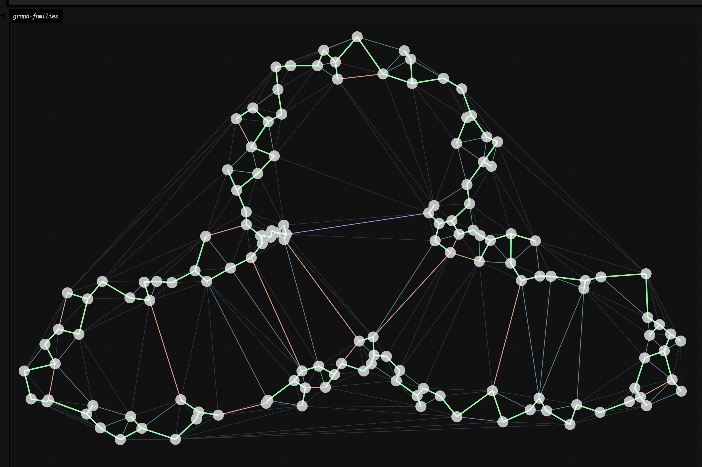
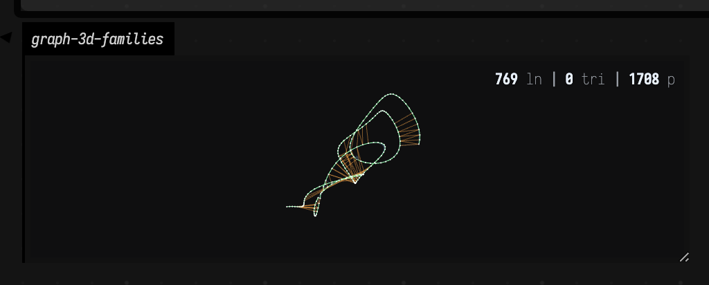
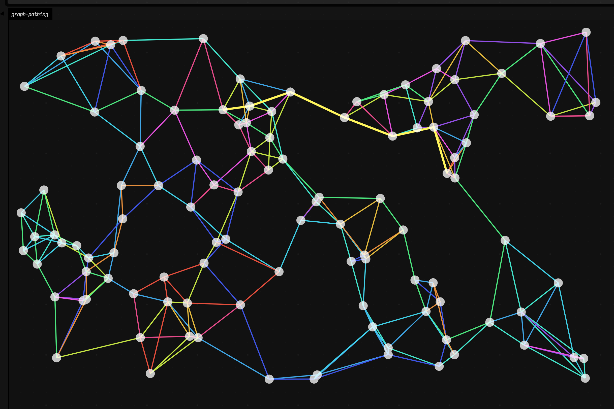

# Graph connectivity to FLine examples

Graphs are one of those topics that become much less mysterious the moment you draw them. In data science they organize structure in a cloud of points; in creative coding they become scaffolds for growth, routing, and composition; in musical systems they can describe proximity, voice-leading, or navigation through a space of states. These examples keep the algorithms attached to pictures.

## Geometric graph families on one point cloud

Suppose you have one point cloud and several plausible ways to connect it. Which graph gives you a generous scaffold? Which one trims aggressively? Which one keeps only the bare minimum needed to stay connected? Those are not academic questions if the graph is about to drive routing, clustering, or a generative drawing.

```diffstatic_runner {data-lang=kotlin screenshot="assets/graph_connectivity_examples/geometric_families.png" wait="1.0" capture="window" open-outputs="true"}
:::static
import afield.graphics.FLine
import afield.stdlib.*
import kotlin.math.PI
import kotlin.math.cos
import kotlin.math.sin

val points = List(140) { i ->
    val a = i / 140.0 * PI * 2.0
    val r = 180.0 + 95.0 * sin(a * 3.0)
    vec(560.0 + cos(a) * r + (-24.0 + random() * 48.0), 360.0 + sin(a) * r * 0.65 + (-18.0 + random() * 36.0))
}

val delaunay = vec2DelaunayGraph(points)
val gabriel = vec2GabrielGraph(points)
val urquhart = vec2UrquhartGraph(points)
val rng = vec2RelativeNeighborhoodGraph(points)
val mst = vec2MinimumSpanningTree(points)

fun graphLine(graph: PointGraph, color: Vec4, thickness: Double): FLine = fline {
    graph.edges.forEach { e ->
        val a = points[e.i]
        val b = points[e.j]
        moveTo(a.x, a.y)
        lineTo(b.x, b.y)
    }
    this.color = color
    this.thickness = thickness
}

val cloud = fline {
    points.forEach { p -> moveTo(p.x, p.y) }
    pointed = true
    pointSize = 3.2
    stroked = false
    color = vec(1.0, 1.0, 1.0, 0.72)
}

lines(
    listOf(
        graphLine(delaunay, vec(0.52, 0.62, 0.75, 0.25), 1.0),
        graphLine(gabriel, vec(0.56, 0.92, 1.0, 0.45), 1.3),
        graphLine(urquhart, vec(0.92, 0.55, 1.0, 0.5), 1.45),
        graphLine(rng, vec(1.0, 0.7, 0.32, 0.55), 1.6),
        graphLine(mst, vec(0.56, 1.0, 0.67, 0.95), 2.6),
        cloud
    ),
    channel = "graph-families",
    w = 1180.0,
    h = 760.0,
    fitToSize = true
)
```

So the scene stays fixed while the graph family changes. A single `graphLine(...)` helper draws Delaunay, Gabriel, Urquhart, relative-neighborhood, and minimum-spanning structures with different visual weights, making the structural differences carry the comparison.



The picture gives you a quick vocabulary for the families. Delaunay is generous, Gabriel is choosier, Urquhart trims the triangulation toward a transport-like backbone, RNG is choosier still, and the spanning tree is the austerity program. Once you can *see* that progression, choosing the right scaffold for a pathing or clustering problem becomes much easier. For local queries on similar point sets, see [Smile neighbors examples](smile_neighbors_examples.md).

## 3D graph families with `threeLines(...)`

Projected drawings are fine until the point cloud really wants depth. Once points coil, stack, or drift behind one another, the right move is to put the graph into the Three.js viewer and orbit around it.

```diffstatic_runner {data-lang=kotlin screenshot="assets/graph_connectivity_examples/three_graph_families.png" wait="1.0" capture="box" open-outputs="true" w="1200"}
:::static
import afield.graphics.FLine
import afield.graphics.threeLines
import afield.stdlib.*
import kotlin.math.PI
import kotlin.math.cos
import kotlin.math.sin

val points = List(170) { i ->
    val t = i / 170.0 * PI * 7.0
    val radius = 95.0 + 34.0 * sin(t * 0.72)
    val x = cos(t) * radius + cos(t * 2.4) * 22.0
    val y = sin(t * 1.08) * 118.0 + sin(t * 0.31) * 28.0
    val z = -230.0 + i * 2.8 + cos(t * 1.6) * 44.0
    vec(x, y, z)
}

val knn = vec3KnnGraph(points, k = 4)
val gabriel = vec3GabrielGraph(points)
val mst = vec3MinimumSpanningTree(points)

fun graphLine3(graph: PointGraph, color: Vec4, thickness: Double): FLine = fline {
    graph.edges.forEach { e ->
        val a = points[e.i]
        val b = points[e.j]
        moveTo(a)
        lineTo(b)
    }
    this.color = color
    this.thickness = thickness
}

val cloud = fline {
    points.forEach { moveTo(it) }
    pointed = true
    pointSize = 0.2
    stroked = false
    color = vec(1.0, 1.0, 1.0, 0.78)
}

threeLines(
    listOf(
        graphLine3(knn, vec(0.52, 0.7, 0.95, 0.18), 1.0),
        graphLine3(gabriel, vec(0.96, 0.64, 0.28, 0.5), 1.6),
        graphLine3(mst, vec(0.58, 1.0, 0.68, 0.96), 3.1),
        cloud
    ),
    channel = "graph-3d-families",
    height = 500,
    editable = false
)
```

That view is less about exact planarity-style relationships and more about spatial scaffolding. The faint 4-NN graph gives you the permissive local neighborhood, Gabriel shows the cleaner mid-density structure, and the spanning tree leaves only the bare backbone.



This is also where `threeLines(...)` earns its keep: instead of guessing from a flattened projection, you can actually orbit the graph and inspect crossings, depth layering, and long bridges. For now, `vec3UrquhartGraph(...)` still uses the same MST-based approximation as the 3D spanning tree, so a separate 3D Urquhart picture would currently land in the same place.

## Pathing: anchored cover + A* overlay

A graph is only interesting once you ask it to do something. Can it help you cover a space from a given anchor? Can it produce a route from here to there? Can one sparse base structure support both a global reading and a local path?

```diffstatic_runner {data-lang=kotlin screenshot="assets/graph_connectivity_examples/path_cover_astar.png" wait="1.0" capture="box"}
:::static
import afield.graphics.FLine
import afield.stdlib.*

val points = List(110) { vec(80.0 + random() * 940.0, 80.0 + random() * 560.0) }
val base = vec2KnnGraph(points, k = 4)

val anchor = 0
val cover = graphAnchoredGreedyThenDiameterCover(base, anchor)
val goal = points.indices.last
val path = vec2AStarPath(base, points, start = anchor, goal = goal)

fun edgeLine(graph: PointGraph, c: Vec4, t: Double): FLine = fline {
    graph.edges.forEach { e -> moveTo(points[e.i].x, points[e.i].y); lineTo(points[e.j].x, points[e.j].y) }
    color = c
    thickness = t
}

val baseLine = edgeLine(base, vec(0.62, 0.7, 0.8, 0.25), 1.0)

val coverLines = cover.paths.mapIndexed { i, p ->
    val hue = (i % 12) / 12.0
    val c = okhsv(hue, 0.82, 0.96, 0.92)
    fline {
        p.edges.forEach { e -> moveTo(points[e.i].x, points[e.i].y); lineTo(points[e.j].x, points[e.j].y) }
        color = c
        thickness = 2.3
    }
}

val aStar = path?.let { p ->
    fline {
        p.nodes.forEachIndexed { idx, node ->
            val pt = points[node]
            if (idx == 0) moveTo(pt.x, pt.y) else lineTo(pt.x, pt.y)
        }
        color = vec(1.0, 0.96, 0.36, 1.0)
        thickness = 4.2
    }
}

val dots = fline {
    points.forEach { p -> moveTo(p.x, p.y) }
    pointed = true
    pointSize = 3.0
    stroked = false
    color = vec(1,1,1,0.75)
}

val out = mutableListOf<FLine>()
out += baseLine
out += coverLines
if (aStar != null) out += aStar
out += dots

lines(out, channel = "graph-pathing", w = 1180.0, h = 760.0, fitToSize = true)
```

That is the experiment here. We build a modest k-nearest-neighbor graph, then ask it for two quite different answers: a cover that spreads outward from one anchor, and an A* path to a chosen goal. The faded base graph stays in the background so those answers cannot pretend they appeared from nowhere.



The result is a graph doing double duty. The colored cover paths tell you how the structure fans out from the anchor; the bright A* overlay tells you how to get somewhere specific. That combination is useful in navigation, decomposition, interactive layouts, and any system that needs both "show me the territory" and "show me the route". For statistics and dependence measures on related datasets, continue with [Correlations examples](correlations_examples.md) and [Stats examples](stats_examples.md).
