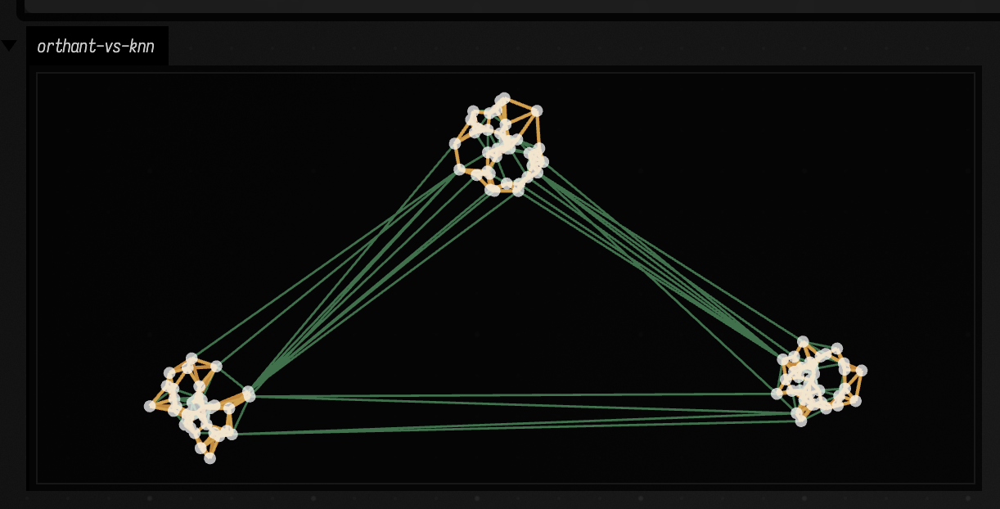

# Neighbors & graph connectivity to FLine examples

*Every public declaration used below is listed, with its KDoc, in the codebase reference: [`graph_connectivity.kt`](reference/graphics.md#graph-connectivity-kt), [`smile_neighbors.kt`](reference/data.md#smile-neighbors-kt). Start from [what's already in the box](reference/index.md).*

A point cloud gives you a different answer depending on what you ask it. Which
points are *near* a query is a question about the coordinates and nothing else.
Which points are *connected* depends on the edges you decide to draw between
them, and there is more than one defensible answer. How you *route* from one
point to another is then a question about the graph those edges make. This page
works up through them in that order, with a drawing at each step.

## Query neighborhood with exact and approximate search

"Nearby" is three different questions. The closest `k` things is a question about
rank; everything inside a radius is a question about density; and an approximate
answer to either is a question about how much error buys how much speed. The
fence below asks all three of the same cloud.

```diffstatic_runner {data-lang=kotlin screenshot="assets/smile_neighbors_examples/query_edges.png" wait="1.0" capture="window" open-outputs="true"}
:::static
import afield.graphics.FLine

val points = List(220) {
    vec(80.0 + random() * 900.0, 70.0 + random() * 550.0)
}

val exact = vec2NN(points, mode = VecNNMode.EXACT)
val approx = vec2NN(points, mode = VecNNMode.APPROXIMATE)

val q = vec(530.0, 340.0)
val kExact = exact.kNearest(q, 10)
val kApprox = approx.kNearest(q, 10)
val radius = exact.withinRadius(q, 140.0)

val cloud = fline {
    points.forEach { p -> moveTo(p.x, p.y) }
    pointed = true
    pointSize = 3.0
    stroked = false
    color = vec(0.7, 0.78, 0.88, 0.7)
}

fun edgeSet(neighbors: List<VecNeighbor2>, c: Vec4, t: Double): FLine = fline {
    neighbors.forEach { n ->
        moveTo(q.x, q.y)
        lineTo(n.point.x, n.point.y)
    }
    color = c
    thickness = t
}

val queryDot = fline {
    moveTo(q.x, q.y)
    pointed = true
    pointSize = 10.0
    stroked = false
    color = vec(1.0, 0.9, 0.35, 1.0)
}

lines(
    listOf(
        cloud,
        edgeSet(kApprox, vec(0.55, 1.0, 0.66, 0.35), 1.2),
        edgeSet(kExact, vec(0.56, 0.86, 1.0, 0.95), 2.2),
        edgeSet(radius, vec(1.0, 0.62, 0.36, 0.45), 1.5),
        queryDot
    ),
    channel = "neighbors-query",
    w = 1120.0,
    h = 720.0,
    fitToSize = true
)
```

Same geometry, same query point, same drawing code; only the question changes.


The exact set is the reference answer and the approximate set is the real-time
compromise against it, so where a thin green edge leaves the thick blue ones and
lands on a different point, that is what the speed cost. The radius query
answers something else entirely: it returns however many points happen to be
close, which is a reading of local density rather than of rank, and in a sparse
part of the cloud it can come back with fewer than `k` or with none.

## Diff: tune LSH build options

Approximate search becomes real when you tune it. Bucket width, projection count,
and hash size all change which relationships later code will believe.

```diff_runner {data-lang=kotlin screenshot="assets/smile_neighbors_examples/lsh_tuning.png" wait="1.0" capture="box"}
:::before
import afield.graphics.FLine

val points = List(260) { vec(50.0 + random() * 1000.0, 50.0 + random() * 600.0) }
val q = vec(550.0, 330.0)
val index = vec2NN(points, mode = VecNNMode.APPROXIMATE)
val nn = index.kNearest(q, 14)

val edges = fline {
    nn.forEach { n -> moveTo(q.x, q.y); lineTo(n.point.x, n.point.y) }
    color = vec(0.62, 0.9, 1.0, 0.95)
    thickness = 2.0
}
val dots = fline { points.forEach { p -> moveTo(p.x, p.y) }; pointed = true; pointSize = 2.4; stroked = false; color = vec(1,1,1,0.65) }
lines(listOf(dots, edges), channel = "neighbors-lsh", w = 1120.0, h = 720.0, fitToSize = true)
:::after
import afield.graphics.FLine

val points = List(260) { vec(50.0 + random() * 1000.0, 50.0 + random() * 600.0) }
val q = vec(550.0, 330.0)
val index = vec2NN(
    points,
    mode = VecNNMode.APPROXIMATE,
    options = VecNNBuildOptions(lshBucketWidth = 0.75, lshProjectionCount = 14, lshUniversalHashSize = 20011)
)
val nn = index.kNearest(q, 14)

val edges = fline {
    nn.forEach { n -> moveTo(q.x, q.y); lineTo(n.point.x, n.point.y) }
    color = vec(0.56, 1.0, 0.68, 0.95)
    thickness = 2.4
}
val dots = fline { points.forEach { p -> moveTo(p.x, p.y) }; pointed = true; pointSize = 2.4; stroked = false; color = vec(1,1,1,0.65) }
lines(listOf(dots, edges), channel = "neighbors-lsh", w = 1120.0, h = 720.0, fitToSize = true)
```

The diff keeps the query, point cloud, and drawing identical. Only the LSH build
options change.


These options decide which geometric relationships the next layer ever sees, so
if a neighborhood feels unstable, fix the index before building clustering,
pathing, or interaction code on top of it. With a stable index, the same cloud
can carry *persistent* structure: the graph families below.

## Geometric graph families on one point cloud

One point cloud supports several plausible graphs, and four of the five below
nest inside one another. The minimum spanning tree is a subset of the
relative-neighborhood graph, which is a subset of the Gabriel graph, which is a
subset of the Delaunay triangulation. Urquhart sits off to the side of that
chain: it is the Delaunay triangulation with the longest edge of each triangle
removed.

```diffstatic_runner {data-lang=kotlin screenshot="assets/graph_connectivity_examples/geometric_families.png" wait="1.0" capture="window" open-outputs="true"}
:::static
import afield.graphics.FLine

val points = List(140) { i ->
    val a = i / 140.0 * PI * 2.0
    val r = 180.0 + 95.0 * sin(a * 3.0)
    vec(560.0 + cos(a) * r + (-24.0 + random() * 48.0), 360.0 + sin(a) * r * 0.65 + (-18.0 + random() * 36.0))
}

val delaunay = vec2DelaunayGraph(points)
val gabriel = vec2GabrielGraph(points)
val urquhart = vec2UrquhartGraph(points)
val rng = vec2RelativeNeighborhoodGraph(points)
val mst = vec2MinimumSpanningTree(points)

fun graphLine(graph: PointGraph, color: Vec4, thickness: Double): FLine = fline {
    graph.edges.forEach { e ->
        val a = points[e.i]
        val b = points[e.j]
        moveTo(a.x, a.y)
        lineTo(b.x, b.y)
    }
    this.color = color
    this.thickness = thickness
}

val cloud = fline {
    points.forEach { p -> moveTo(p.x, p.y) }
    pointed = true
    pointSize = 3.2
    stroked = false
    color = vec(1.0, 1.0, 1.0, 0.72)
}

lines(
    listOf(
        graphLine(delaunay, vec(0.52, 0.62, 0.75, 0.25), 1.0),
        graphLine(gabriel, vec(0.56, 0.92, 1.0, 0.45), 1.3),
        graphLine(urquhart, vec(0.92, 0.55, 1.0, 0.5), 1.45),
        graphLine(rng, vec(1.0, 0.7, 0.32, 0.55), 1.6),
        graphLine(mst, vec(0.56, 1.0, 0.67, 0.95), 2.6),
        cloud
    ),
    channel = "graph-families",
    w = 1180.0,
    h = 760.0,
    fitToSize = true
)
```

The scene stays fixed while the graph family changes. One `graphLine(...)`
helper defined in the fence draws all five, taking the colour and thickness for
each as arguments.


The drawing encodes that ordering as weight. Delaunay is drawn thinnest and
faintest, at thickness 1.0 and alpha 0.25, and each successive family is thicker
and more opaque up to the spanning tree at 2.6 and 0.95 — so the sparser a
family is, the more it stands out, and the edges every family agrees on are the
ones drawn five times over.

## Orthant neighborhoods: one edge per direction

A k-nearest-neighbor graph asks only *how close*, so on a clustered cloud every
edge stays inside its cluster and the graph falls apart into islands.
`vec2OrthantGraph(...)` also asks *which way*. It splits the plane around each
point into four quadrants along the coordinate axes and joins the point to its
nearest neighbor in each quadrant that has one. That gives each point at most
four edges of its own, and the points other points choose add more. A point on
the edge of a cluster facing another cluster has an empty quadrant on its own
side, so its nearest neighbor in that direction is across the gap.

```diffstatic_runner {data-lang=kotlin screenshot="assets/graph_connectivity_examples/orthant_vs_knn.png" wait="1.0" capture="window" open-outputs="true"}
:::static
import afield.graphics.FLine

val centers = listOf(vec(250.0, 550.0), vec(600.0, 250.0), vec(950.0, 520.0))
val points = centers.flatMap { c ->
    List(40) {
        val a = random() * PI * 2.0
        val r = random() * 60.0
        vec(c.x + cos(a) * r, c.y + sin(a) * r)
    }
}

val knn = vec2KnnGraph(points, k = 4)
val orthant = vec2OrthantGraph(points)

fun graphLine(graph: PointGraph, color: Vec4, thickness: Double): FLine = fline {
    graph.edges.forEach { e ->
        val a = points[e.i]
        val b = points[e.j]
        moveTo(a.x, a.y)
        lineTo(b.x, b.y)
    }
    this.color = color
    this.thickness = thickness
}

val cloud = fline {
    points.forEach { p -> moveTo(p.x, p.y) }
    pointed = true
    pointSize = 3.2
    stroked = false
    color = vec(1.0, 1.0, 1.0, 0.72)
}

lines(
    listOf(
        graphLine(orthant, vec(0.56, 1.0, 0.67, 0.8), 1.4),
        graphLine(knn, vec(1.0, 0.7, 0.32, 0.9), 2.2),
        cloud
    ),
    channel = "orthant-vs-knn",
    w = 1180.0,
    h = 760.0,
    fitToSize = true
)
```

The orange 4-NN edges are drawn on top and never leave their cluster. The green
orthant edges are the ones that also run between clusters.



The quadrants follow the coordinate axes, not the data, so rotating the cloud
changes the graph. `vec3OrthantGraph(...)` does the same with the eight octants
in 3D. The ranking inside each quadrant uses
`GraphConnectivityOptions.customDistanceMetric` if you pass one, and Euclidean
distance otherwise.

## 3D graph families with `threeLines(...)`

A flat projection stops working once points coil, stack or sit behind one
another, because a crossing on the page and an edge in space look the same. The
Three.js viewer takes the graph directly, so you can orbit instead of guessing.

```diffstatic_runner {data-lang=kotlin screenshot="assets/graph_connectivity_examples/three_graph_families.png" wait="1.0" capture="box" open-outputs="true" w="1200"}
:::static
import afield.graphics.FLine
import afield.graphics.threeLines

val points = List(170) { i ->
    val t = i / 170.0 * PI * 7.0
    val radius = 95.0 + 34.0 * sin(t * 0.72)
    val x = cos(t) * radius + cos(t * 2.4) * 22.0
    val y = sin(t * 1.08) * 118.0 + sin(t * 0.31) * 28.0
    val z = -230.0 + i * 2.8 + cos(t * 1.6) * 44.0
    vec(x, y, z)
}

val knn = vec3KnnGraph(points, k = 4)
val gabriel = vec3GabrielGraph(points)
val mst = vec3MinimumSpanningTree(points)

fun graphLine3(graph: PointGraph, color: Vec4, thickness: Double): FLine = fline {
    graph.edges.forEach { e ->
        val a = points[e.i]
        val b = points[e.j]
        moveTo(a)
        lineTo(b)
    }
    this.color = color
    this.thickness = thickness
}

val cloud = fline {
    points.forEach { moveTo(it) }
    pointed = true
    pointSize = 0.2
    stroked = false
    color = vec(1.0, 1.0, 1.0, 0.78)
}

threeLines(
    listOf(
        graphLine3(knn, vec(0.52, 0.7, 0.95, 0.18), 1.0),
        graphLine3(gabriel, vec(0.96, 0.64, 0.28, 0.5), 1.6),
        graphLine3(mst, vec(0.58, 1.0, 0.68, 0.96), 3.1),
        cloud
    ),
    channel = "graph-3d-families",
    height = 500,
    editable = false
)
```

This view is less about exact planar relationships and more about spatial
scaffolding. The faint 4-NN graph gives the permissive local neighborhood,
Gabriel shows the cleaner mid-density structure, and the spanning tree leaves only
the bare backbone.


There is no 3D Urquhart picture here because there is no 3D Urquhart graph:
`vec3UrquhartGraph(...)` is one line, `return vec3MinimumSpanningTree(points,
options)`, so asking for it returns the spanning tree already drawn above. Its
KDoc gives the reason. Urquhart is defined by deleting the longest edge of each
Delaunay triangle, and there is no 3D Delaunay wired in through JTS to delete
from. The 2D one is the real thing.

## Pathing: anchored cover + A* overlay

A graph becomes more useful once you ask it to do something: cover a space from an
anchor, produce a route, or support both a global reading and a local path.

```diffstatic_runner {data-lang=kotlin screenshot="assets/graph_connectivity_examples/path_cover_astar.png" wait="1.0" capture="box"}
:::static
import afield.graphics.FLine

val points = List(110) { vec(80.0 + random() * 940.0, 80.0 + random() * 560.0) }
val base = vec2KnnGraph(points, k = 4)

val anchor = 0
val cover = graphAnchoredGreedyThenDiameterCover(base, anchor)
val goal = points.indices.last
val path = vec2AStarPath(base, points, start = anchor, goal = goal)

fun edgeLine(graph: PointGraph, c: Vec4, t: Double): FLine = fline {
    graph.edges.forEach { e -> moveTo(points[e.i].x, points[e.i].y); lineTo(points[e.j].x, points[e.j].y) }
    color = c
    thickness = t
}

val baseLine = edgeLine(base, vec(0.62, 0.7, 0.8, 0.25), 1.0)

val coverLines = cover.paths.mapIndexed { i, p ->
    val hue = (i % 12) / 12.0
    val c = okhsv(hue, 0.82, 0.96, 0.92)
    fline {
        p.edges.forEach { e -> moveTo(points[e.i].x, points[e.i].y); lineTo(points[e.j].x, points[e.j].y) }
        color = c
        thickness = 2.3
    }
}

val aStar = path?.let { p ->
    fline {
        p.nodes.forEachIndexed { idx, node ->
            val pt = points[node]
            if (idx == 0) moveTo(pt.x, pt.y) else lineTo(pt.x, pt.y)
        }
        color = vec(1.0, 0.96, 0.36, 1.0)
        thickness = 4.2
    }
}

val dots = fline {
    points.forEach { p -> moveTo(p.x, p.y) }
    pointed = true
    pointSize = 3.0
    stroked = false
    color = vec(1,1,1,0.75)
}

val out = mutableListOf<FLine>()
out += baseLine
out += coverLines
if (aStar != null) out += aStar
out += dots

lines(out, channel = "graph-pathing", w = 1180.0, h = 760.0, fitToSize = true)
```

This example builds a modest k-nearest-neighbor graph, then asks for two different
answers: a cover that spreads outward from one anchor, and an A* path to a chosen
goal. The faded base graph stays in the background.


The two answers read differently off the same edges. `graphAnchoredGreedyThenDiameterCover`
covers *edges*, not points: it repeatedly walks from the anchor to the nearest
edge it has not used yet, and then hands whatever those walks could not reach to
a diameter decomposition instead. So the coloured paths together account for
every edge of the base graph, but not all of them start at the anchor — the
later ones are the leftovers, so a long path far from the anchor is not
necessarily something the anchor reached. The A* overlay is a
single route by cost, drawn on top, and it is free to leave the cover's edges
wherever a cheaper one exists. For statistics and dependence measures on related
datasets, continue with [Values over time: interpolants, keyframes & estimation](interpolants_examples.md).

Everything on this page assumes the points sit still and the edges are given. When they do not —
when the cloud moves every frame and the graph has to be continually proposed, reinforced and
forgotten — the family to reach for is [graphs that change while you
watch](dynamic_graph_systems_examples.md), which snapshots back into the `PointGraph` this page
consumes with a `minWeight` cut that keeps only what has persisted.
