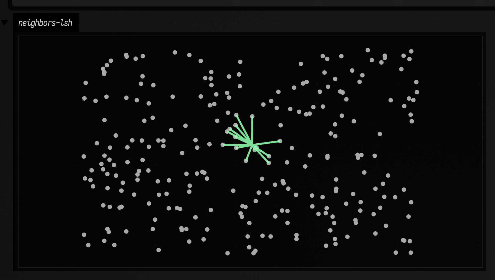
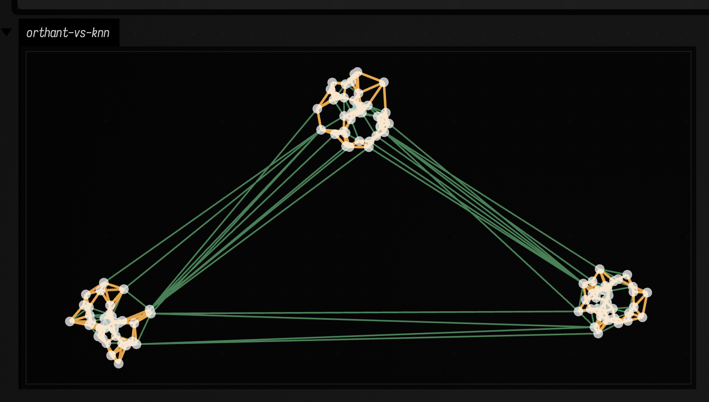

# Neighbours and graphs on a point cloud

Start with a cloud of points. Which ones are close to you? Join each point to a few neighbours and
another question appears: can you get from one side of the cloud to the other? Change how you
draw the edges and the answer can change too. We'll draw the searches, connections and routes as
we go.

## Query neighborhood with exact and approximate search

"Nearby" is three different questions. The closest `k` things is a question about
rank; everything inside a radius is a question about density; and an approximate
answer to either is a question about how much error buys how much speed. The
fence below asks all three of the same cloud.

```diffstatic_runner {data-lang=kotlin screenshot="assets/smile_neighbors_examples/query_edges.png" wait="1.0" capture="window" open-outputs="true"}
:::static
val points = List(220) {
    vec(80.0 + random() * 900.0, 70.0 + random() * 550.0)
}

val exact = vec2NN(points, mode = VecNNMode.EXACT)
val approx = vec2NN(points, mode = VecNNMode.APPROXIMATE)

val q = vec(530.0, 340.0)
val kExact = exact.kNearest(q, 10)
val kApprox = approx.kNearest(q, 10)
val radius = exact.withinRadius(q, 140.0)

val cloud = fline {
    points.forEach { p -> moveTo(p.x, p.y) }
    pointed = true
    pointSize = 3.0
    stroked = false
    color = vec(0.7, 0.78, 0.88, 0.7)
}

fun edgeSet(neighbors: List<VecNeighbor2>, c: Vec4, t: Double): FLine = fline {
    neighbors.forEach { n ->
        moveTo(q.x, q.y)
        lineTo(n.point.x, n.point.y)
    }
    color = c
    thickness = t
}

val queryDot = fline {
    moveTo(q.x, q.y)
    pointed = true
    pointSize = 10.0
    stroked = false
    color = vec(1.0, 0.9, 0.35, 1.0)
}

lines(
    [
        cloud,
        edgeSet(kApprox, vec(0.55, 1.0, 0.66, 0.35), 1.2),
        edgeSet(kExact, vec(0.56, 0.86, 1.0, 0.95), 2.2),
        edgeSet(radius, vec(1.0, 0.62, 0.36, 0.45), 1.5),
        queryDot,
    ],
    channel = "neighbors-query",
    w = 1120.0,
    h = 720.0,
    fitToSize = true,
)
```


The exact search is the correct answer, and the approximate search trades some
accuracy for speed. Where an approximate edge lands on a point the exact search
did not choose, that is the accuracy you gave up. The radius query returns
however many points are close, so in a sparse part of the cloud it can return
fewer than `k` points, or none.

## Tuning the approximate index

The approximate search is built on locality-sensitive hashing (LSH), and its
build options decide which neighbours it finds. Bucket width, projection count
and hash size all change the answer. The example below changes only those
options, and keeps the query, the point cloud and the drawing as they were.

```diff_runner {data-lang=kotlin screenshot="assets/smile_neighbors_examples/lsh_tuning.png" wait="1.0" capture="box"}
:::before
val points = List(260) { vec(50.0 + random() * 1000.0, 50.0 + random() * 600.0) }
val q = vec(550.0, 330.0)
val index = vec2NN(points, mode = VecNNMode.APPROXIMATE)
val nn = index.kNearest(q, 14)

val edges = fline {
    nn.forEach { n ->
        moveTo(q.x, q.y)
        lineTo(n.point.x, n.point.y)
    }
    color = vec(0.62, 0.9, 1.0, 0.95)
    thickness = 2.0
}
val dots = fline {
    points.forEach { p -> moveTo(p.x, p.y) }
    pointed = true
    pointSize = 2.4
    stroked = false
    color = vec(1, 1, 1, 0.65)
}
lines([dots, edges], channel = "neighbors-lsh", w = 1120.0, h = 720.0, fitToSize = true)
:::after
val points = List(260) { vec(50.0 + random() * 1000.0, 50.0 + random() * 600.0) }
val q = vec(550.0, 330.0)
val index = vec2NN(
    points,
    mode = VecNNMode.APPROXIMATE,
    options = VecNNBuildOptions(lshBucketWidth = 0.75, lshProjectionCount = 14, lshUniversalHashSize = 20011),
)
val nn = index.kNearest(q, 14)

val edges = fline {
    nn.forEach { n ->
        moveTo(q.x, q.y)
        lineTo(n.point.x, n.point.y)
    }
    color = vec(0.56, 1.0, 0.68, 0.95)
    thickness = 2.4
}
val dots = fline {
    points.forEach { p -> moveTo(p.x, p.y) }
    pointed = true
    pointSize = 2.4
    stroked = false
    color = vec(1, 1, 1, 0.65)
}
lines([dots, edges], channel = "neighbors-lsh", w = 1120.0, h = 720.0, fitToSize = true)
```



Anything you build on the neighbours (clustering, paths, interaction) sees only
what the index returns, so if a neighbourhood looks unstable, tune the index
first.

## Geometric graph families on one point cloud

One point cloud supports several reasonable graphs, and four of the five below
nest inside one another. The minimum spanning tree is a subset of the
relative-neighborhood graph, which is a subset of the Gabriel graph, which is a
subset of the Delaunay triangulation. Urquhart sits off to the side of that
chain: it is the Delaunay triangulation with the longest edge of each triangle
removed. The example draws all five over the same cloud.

```diffstatic_runner {data-lang=kotlin screenshot="assets/graph_connectivity_examples/geometric_families.png" wait="1.0" capture="window" open-outputs="true"}
:::static
val points =
    List(140) { i ->
        val a = i / 140.0 * PI * 2.0
        val r = 180.0 + 95.0 * sin(a * 3.0)
        vec(560.0 + cos(a) * r + (-24.0 + random() * 48.0), 360.0 + sin(a) * r * 0.65 + (-18.0 + random() * 36.0))
    }

val delaunay = vec2DelaunayGraph(points)
val gabriel = vec2GabrielGraph(points)
val urquhart = vec2UrquhartGraph(points)
val rng = vec2RelativeNeighborhoodGraph(points)
val mst = vec2MinimumSpanningTree(points)

fun graphLine(graph: PointGraph, color: Vec4, thickness: Double): FLine = fline {
    graph.edges.forEach { e ->
        val a = points[e.i]
        val b = points[e.j]
        moveTo(a.x, a.y)
        lineTo(b.x, b.y)
    }
    this.color = color
    this.thickness = thickness
}

val cloud = fline {
    points.forEach { p -> moveTo(p.x, p.y) }
    pointed = true
    pointSize = 3.2
    stroked = false
    color = vec(1.0, 1.0, 1.0, 0.72)
}

lines(
    [
        graphLine(delaunay, vec(0.52, 0.62, 0.75, 0.25), 1.0),
        graphLine(gabriel, vec(0.56, 0.92, 1.0, 0.45), 1.3),
        graphLine(urquhart, vec(0.92, 0.55, 1.0, 0.5), 1.45),
        graphLine(rng, vec(1.0, 0.7, 0.32, 0.55), 1.6),
        graphLine(mst, vec(0.56, 1.0, 0.67, 0.95), 2.6),
        cloud,
    ],
    channel = "graph-families",
    w = 1180.0,
    h = 760.0,
    fitToSize = true,
)
```

The scene stays fixed while the graph family changes. One `graphLine(...)`
helper defined in the fence draws all five, taking the colour and thickness for
each as arguments.


Delaunay is drawn thinnest and faintest, and each sparser family is drawn
thicker and more opaque, up to the spanning tree. The sparser a family is, the
more it stands out, and the edges every family agrees on are drawn five times
over.

## Orthant neighborhoods: one edge per direction

A k-nearest-neighbor graph asks only *how close*. On this clustered cloud, every
edge stays inside its cluster and the graph falls apart into islands.
`vec2OrthantGraph(...)` also asks *which way*. It splits the plane around each
point into four quadrants along the coordinate axes and joins the point to its
nearest neighbor in each quadrant that has one. That gives each point at most
four edges of its own, and the points other points choose add more. A point on
the edge of a cluster facing another cluster has an empty quadrant on its own
side, so its nearest neighbor in that direction is across the gap. The example
draws both graphs over three clusters.

When no two points share an x or a y coordinate, the orthant graph is always
connected: it is the four-cone Yao graph, which is known to be a spanner. The
quadrants are open, though, so a point lying exactly on another point's axis is
in none of its quadrants. Points on a grid, or a row with equal y values, can
come out with missing edges or no edges at all; jitter them slightly first.

```diffstatic_runner {data-lang=kotlin screenshot="assets/graph_connectivity_examples/orthant_vs_knn.png" wait="1.0" capture="window" open-outputs="true"}
:::static
val centers = [vec(250.0, 550.0), vec(600.0, 250.0), vec(950.0, 520.0)]
val points = centers.flatMap { c ->
    List(40) {
        val a = random() * PI * 2.0
        val r = random() * 60.0
        vec(c.x + cos(a) * r, c.y + sin(a) * r)
    }
}

val knn = vec2KnnGraph(points, k = 4)
val orthant = vec2OrthantGraph(points)

fun graphLine(graph: PointGraph, color: Vec4, thickness: Double): FLine = fline {
    graph.edges.forEach { e ->
        val a = points[e.i]
        val b = points[e.j]
        moveTo(a.x, a.y)
        lineTo(b.x, b.y)
    }
    this.color = color
    this.thickness = thickness
}

val cloud = fline {
    points.forEach { p -> moveTo(p.x, p.y) }
    pointed = true
    pointSize = 3.2
    stroked = false
    color = vec(1.0, 1.0, 1.0, 0.72)
}

lines(
    [
        graphLine(orthant, vec(0.56, 1.0, 0.67, 0.8), 1.4),
        graphLine(knn, vec(1.0, 0.7, 0.32, 0.9), 2.2),
        cloud,
    ],
    channel = "orthant-vs-knn",
    w = 1180.0,
    h = 760.0,
    fitToSize = true,
)
```

The orange 4-NN edges are drawn on top and never leave their cluster. The green
orthant edges are the ones that also run between clusters.



The quadrants follow the coordinate axes, not the data, so rotating the cloud
changes the graph. `vec3OrthantGraph(...)` does the same with the eight octants
in 3D. The ranking inside each quadrant uses
`GraphConnectivityOptions.customDistanceMetric` if you pass one, and Euclidean
distance otherwise.

### Orthant slots for a particle buffer

A particle pass keeps its positions as one packed `FloatArray` of XYZ triples and wants its
neighbours in a fixed layout it can index without allocating. `OrthantNeighbors3D.build(xyz)` in
`afield.geometry.spatial` returns exactly that: eight directed slots per particle, one per octant,
with `neighbors[i * 8 + octant]` the index of the closest particle in that octant and
`distances[i * 8 + octant]` how far it is. A slot with no particle holds `-1`.
`OrthantNeighbors3D.octant(dx, dy, dz)` gives the slot for an offset; its bits mark negative X, Y
and Z, and a zero component counts as positive, so unlike the graph functions particles on a grid
keep their edges.

Here 300 particles in a shell are joined to their slot neighbours, each edge coloured by its
octant:

```diffstatic_runner {data-lang=kotlin screenshot="assets/graph_connectivity_examples/orthant_slots_3d.png" wait="2.0" capture="box" open-outputs="true" w="1200" alt="a hollow shell of white dots joined by short edges in eight colours, each colour one octant direction; every dot sends edges of several colours to its neighbours on the shell"}
:::static
val rnd = java.util.Random(4)
val xyz = FloatArray(300 * 3)
for (i in 0 until 300) {
    val d = vec(rnd.nextGaussian(), rnd.nextGaussian(), rnd.nextGaussian()).normalize()
    val r = 150.0 + rnd.nextDouble() * 30.0
    xyz[i * 3] = (d.x * r).toFloat()
    xyz[i * 3 + 1] = (d.y * r).toFloat()
    xyz[i * 3 + 2] = (d.z * r).toFloat()
}

val slots = OrthantNeighbors3D.build(xyz)
println("cell ${slots.cellSize.f1}, empty slots ${slots.neighbors.count { it < 0 }}, ring-limited ${slots.ringLimited}")

fun at(i: Int) = vec(xyz[i * 3], xyz[i * 3 + 1], xyz[i * 3 + 2])

val edges = (0 until 8).map { octant ->
    fline {
        for (i in 0 until slots.count) {
            val j = slots.neighbors[i * 8 + octant]
            if (j >= 0) {
                moveTo(at(i))
                lineTo(at(j))
            }
        }
        color = okhsl(octant * 45.0, 0.8, 0.65, 0.7)
        thickness = 1.2
    }
}
val cloud = fline {
    for (i in 0 until slots.count) moveTo(at(i))
    pointed = true
    pointSize = 0.25
    stroked = false
    color = vec(1.0, 1.0, 1.0, 0.85)
}

threeLines(edges + cloud, channel = "orthant-slots", height = 500, editable = false)
```

The search walks rings of grid cells outward from each particle, and `maxRings` (6 by default)
caps how far. The cap is what makes it cheap enough to rebuild every frame, at the price that a
far-away neighbour can be missed; `ringLimited` counts the particles where that might have
happened. Raise `maxRings` when it is high, or pass `Int.MAX_VALUE` to search until no remaining
cell could hold a closer particle. `vec3OrthantGraph(...)` uses the same grid search for its
Euclidean case, and turns the slots into a `PointGraph` for you.

To give two clouds a shared identity, so that a layout can morph into another one particle at a
time, match them with `matchPoints`, which takes `Vec2` or `Vec3` lists; see
[Matching in 3D](optimal_transport.md#matching-in-3d).

## 3D graph families with `threeLines(...)`

A flat projection stops working once points coil, stack or sit behind one
another, because a crossing on the page and an edge in space look the same. The
Three.js viewer takes the graph directly, so you can orbit around it. The
example draws three graph families over a coiled 3D cloud.

```diffstatic_runner {data-lang=kotlin screenshot="assets/graph_connectivity_examples/three_graph_families.png" wait="1.0" capture="box" open-outputs="true" w="1200"}
:::static
val points =
    List(170) { i ->
        val t = i / 170.0 * PI * 7.0
        val radius = 95.0 + 34.0 * sin(t * 0.72)
        val x = cos(t) * radius + cos(t * 2.4) * 22.0
        val y = sin(t * 1.08) * 118.0 + sin(t * 0.31) * 28.0
        val z = -230.0 + i * 2.8 + cos(t * 1.6) * 44.0
        vec(x, y, z)
    }

val knn = vec3KnnGraph(points, k = 4)
val gabriel = vec3GabrielGraph(points)
val mst = vec3MinimumSpanningTree(points)

fun graphLine3(graph: PointGraph, color: Vec4, thickness: Double): FLine = fline {
    graph.edges.forEach { e ->
        val a = points[e.i]
        val b = points[e.j]
        moveTo(a)
        lineTo(b)
    }
    this.color = color
    this.thickness = thickness
}

val cloud = fline {
    points.forEach { moveTo(it) }
    pointed = true
    pointSize = 0.2
    stroked = false
    color = vec(1.0, 1.0, 1.0, 0.78)
}

threeLines(
    [
        graphLine3(knn, vec(0.52, 0.7, 0.95, 0.18), 1.0),
        graphLine3(gabriel, vec(0.96, 0.64, 0.28, 0.5), 1.6),
        graphLine3(mst, vec(0.58, 1.0, 0.68, 0.96), 3.1),
        cloud,
    ],
    channel = "graph-3d-families",
    height = 500,
    editable = false,
)
```

The faint 4-NN graph shows every local neighbourhood, Gabriel shows a cleaner
structure in between, and the spanning tree leaves only the backbone.


## Paths: covering a graph and finding a route

A graph becomes more useful once you ask it to do something. This example builds
a k-nearest-neighbor graph and asks it for two answers: a cover that spreads
outward from one anchor, and an A* path to a chosen goal. The base graph stays
faded in the background.

```diffstatic_runner {data-lang=kotlin screenshot="assets/graph_connectivity_examples/path_cover_astar.png" wait="1.0" capture="box"}
:::static
val points = List(110) { vec(80.0 + random() * 940.0, 80.0 + random() * 560.0) }
val base = vec2KnnGraph(points, k = 4)

val anchor = 0
val cover = graphAnchoredGreedyThenDiameterCover(base, anchor)
val goal = points.indices.last
val path = vec2AStarPath(base, points, start = anchor, goal = goal)

fun edgeLine(graph: PointGraph, c: Vec4, t: Double): FLine = fline {
    graph.edges.forEach { e ->
        moveTo(points[e.i].x, points[e.i].y)
        lineTo(points[e.j].x, points[e.j].y)
    }
    color = c
    thickness = t
}

val baseLine = edgeLine(base, vec(0.62, 0.7, 0.8, 0.25), 1.0)

val coverLines =
    cover.paths.mapIndexed { i, p ->
        val hue = (i % 12) / 12.0
        val c = okhsv(hue, 0.82, 0.96, 0.92)
        fline {
            p.edges.forEach { e ->
                moveTo(points[e.i].x, points[e.i].y)
                lineTo(points[e.j].x, points[e.j].y)
            }
            color = c
            thickness = 2.3
        }
    }

val aStar = path?.let { p ->
    fline {
        breakNext()
        p.nodes.forEach { node ->
            val pt = points[node]
            lineTo(pt.x, pt.y)
        }
        color = vec(1.0, 0.96, 0.36, 1.0)
        thickness = 4.2
    }
}

val dots = fline {
    points.forEach { p -> moveTo(p.x, p.y) }
    pointed = true
    pointSize = 3.0
    stroked = false
    color = vec(1, 1, 1, 0.75)
}

val out = mutableListOf<FLine>()
out += baseLine
out += coverLines
if (aStar != null) out += aStar
out += dots

lines(out, channel = "graph-pathing", w = 1180.0, h = 760.0, fitToSize = true)
```


The two answers read differently off the same edges. `graphAnchoredGreedyThenDiameterCover`
covers *edges*, not points: it repeatedly walks from the anchor to the nearest
edge it has not used yet, and then hands whatever those walks could not reach to
a diameter decomposition instead. So the coloured paths together account for
every edge of the base graph, but not all of them start at the anchor — the
later ones are the leftovers, so a long path far from the anchor is not
necessarily something the anchor reached. The A* overlay is a
single route by cost, drawn on top of the cover.

## Seeing what A* explored

`graphAStarPath` returns only the route. `graphAStarSearch` runs the same search and also
returns `expanded`, the nodes it took off its queue, in order. That is the work the search did,
and it is what a heuristic is for: A* expands nodes in order of *cost so far + estimated cost
to go*, so a better estimate keeps it from expanding nodes that lead away from the goal.
With the default estimate of zero, A* is Dijkstra's algorithm and spreads out evenly in every
direction until it reaches the goal.

The estimate has to be a lower bound — never more than the real remaining cost — or A* can
return a longer route. Straight-line distance is the usual one (`vec2AStarSearch` uses it), but
it only knows geometry: around a wall it guesses far too low, and on a graph whose edge
weights are not lengths it means nothing.

## Landmarks: a heuristic made from distance tables

Landmarks (the "ALT" method of Goldberg and Harrelson, explained interactively by
[Red Blob Games](https://www.redblobgames.com/pathfinding/heuristics/differential.html)) buy a
better estimate with memory. Pick a few nodes L, and run Dijkstra once from each to store its
distance to every node. For any node n and goal g, the triangle inequality gives

    d(n, g) ≥ |d(L, g) − d(L, n)|

so the largest of those bounds over all landmarks is an estimate that never overestimates. It
uses real path distances, so it already accounts for walls. It is exact when the shortest path
runs straight towards or away from a landmark, and it costs `landmarks × nodes` stored distances
(`memory`). `graphFarthestPointLandmarks(graph, count)` places them: it starts from one node,
then repeatedly adds the node farthest, by path distance, from all landmarks chosen so far, which
pushes them out to the edges of the graph where they help most.

This example runs the same query on a grid with a wall four ways and draws, in blue, every cell
each search expanded. The yellow route is the same length in all four.

```diffstatic_runner {data-lang=kotlin screenshot="assets/graph_connectivity_examples/landmark_explored.png" wait="1.0" capture="box"}
:::static
val grid = vec2GridGraph(36, 24, spacing = 20.0) { c, r -> c == 18 && r in 4 until 24 }
val start = grid.index(5, 12)
val goal = grid.index(31, 12)

val dijkstra = graphAStarSearch(grid.graph, start, goal)
val one = graphLandmarks(grid.graph, [grid.index(0, 12)])
val several = graphFarthestPointLandmarks(grid.graph, 4)
val sideways = graphLandmarks(grid.graph, [grid.index(18, 0)])

fun dots(nodes: Iterable<Int>, dx: Double, dy: Double, size: Double, c: Vec4) = fline {
    nodes.forEach { n -> moveTo(grid.points[n].x + dx, grid.points[n].y + dy) }
    pointed = true
    pointSize = size
    stroked = false
    color = c
}

fun panel(result: GraphSearchResult, landmarks: List<Int>, dx: Double, dy: Double): List<FLine> {
    val open = grid.points.indices.filter { it !in grid.blocked }
    val route = fline {
        result.path!!.nodes.forEachIndexed { i, n ->
            val p = grid.points[n]
            if (i == 0) moveTo(p.x + dx, p.y + dy) else lineTo(p.x + dx, p.y + dy)
        }
        color = vec(1.0, 0.9, 0.3, 1.0)
        thickness = 4.0
    }
    return [
        dots(open, dx, dy, 3.0, vec(0.6, 0.65, 0.75, 0.4)),
        dots(result.expanded, dx, dy, 9.0, vec(0.25, 0.55, 1.0, 0.85)),
        dots(grid.blocked, dx, dy, 10.0, vec(0.8, 0.82, 0.88, 1.0)),
        route,
        dots(landmarks, dx, dy, 13.0, vec(1.0, 0.3, 0.5, 1.0)),
        dots([start, goal], dx, dy, 11.0, vec(1.0, 0.9, 0.3, 1.0)),
    ]
}

val out =
    panel(dijkstra, emptyList(), 0.0, 0.0) +
        panel(one.search(start, goal), one.landmarks, 800.0, 0.0) +
        panel(several.search(start, goal), several.landmarks, 0.0, 560.0) +
        panel(sideways.search(start, goal), sideways.landmarks, 800.0, 560.0)

lines(out, channel = "landmarks", w = 1180.0, h = 820.0, fitToSize = true)
```

![four copies of the same grid, each with a vertical wall rising from the bottom edge to near the top in the middle (pale grey), a start cell on the left and a goal on the right joined by a yellow route that climbs over the top of the wall. Top left, no landmarks: blue expanded cells fill almost the whole grid. Top right, one pink landmark on the left edge behind the start: the blue region is a band along the route. Bottom left, four pink landmarks spread to the corners and edges by farthest-point placement: the blue region is narrow. Bottom right, one landmark at the top of the wall, to the side of the route: blue fills most of the grid again](assets/graph_connectivity_examples/landmark_explored.png)

Top left is plain Dijkstra. Top right has one landmark on the left edge, behind the start:
moving right means moving away from it, so its bound is close to the true distance along the
whole route. Bottom left lets `graphFarthestPointLandmarks` place four.

## When a landmark does not help

Bottom right is the landmark placed badly: in the gap above the wall, which the route passes
through. Going from start to goal first moves towards it and then away from it, so d(L, n) and
d(L, goal) are nearly equal along most of the route, the bound is close to zero, and the search
falls back to spreading out like Dijkstra. It is still correct — the bound is still a lower
bound — it just stops saving work. This is why landmarks are placed at the edges of the graph, and why several are kept:
for any query, some landmark is likely to lie roughly behind the start or the goal.

## How many nodes each heuristic visits

The heuristics also work on graphs Field builds from points. This example counts expanded nodes
for one query on the grid above and on a Delaunay graph of random points, where straight-line
distance is also available.

```diffstatic_runner {data-lang=kotlin screenshot="assets/graph_connectivity_examples/landmark_counts.png" wait="1.0" capture="box"}
:::static
val grid = vec2GridGraph(36, 24, spacing = 20.0) { c, r -> c == 18 && r in 4 until 24 }
val gs = grid.index(5, 12)
val gg = grid.index(31, 12)

val rng = java.util.Random(4)
val points = List(600) { vec(rng.nextDouble() * 1000.0, rng.nextDouble() * 600.0) }
val delaunay = vec2DelaunayGraph(points)
val ds = points.indices.minBy { points[it].x }
val dg = points.indices.maxBy { points[it].x }

fun row(name: String, graph: PointGraph, s: Int, g: Int, euclid: GraphSearchResult?): String {
    val n0 = graphAStarSearch(graph, s, g).expandedCount
    val lm1 = graphFarthestPointLandmarks(graph, 1, first = s).search(s, g).expandedCount
    val lm4 = graphFarthestPointLandmarks(graph, 4).search(s, g).expandedCount
    val lm8 = graphFarthestPointLandmarks(graph, 8).search(s, g).expandedCount
    return "| $name | ${graph.pointCount} | $n0 | ${euclid?.expandedCount ?: "–"} | $lm1 | $lm4 | $lm8 |"
}

markdown(
    """
    | graph | nodes | Dijkstra | straight line | 1 landmark | 4 landmarks | 8 landmarks |
    |---|---|---|---|---|---|---|
    ${row("grid with wall", grid.graph, gs, gg, vec2AStarSearch(grid.graph, grid.points, gs, gg))}
    ${row("Delaunay, 600 points", delaunay, ds, dg, vec2AStarSearch(delaunay, points, ds, dg))}
    """.trimIndent(),
)
```


On the grid, straight-line distance is fooled by the wall and every landmark column beats it. On
the Delaunay graph the edges are straight-line lengths, so straight-line distance is already a
good estimate: one landmark at the start does worse, and it takes four to match it. Landmarks
earn their keep where geometry says little about path cost — walls, mazes, weighted edges.
More landmarks cost memory (`memory` is 8 × 600 distances for the last column of the Delaunay
row) and pay off across many queries, not just this one.

Everything on this page assumes the points sit still. When the cloud moves every
frame and its edges have to be proposed, strengthened and forgotten as it goes,
see [graphs that change while you watch](dynamic_graph_systems_examples.md). Its
snapshots turn back into the `PointGraph` used here, keeping only the edges that
have lasted.

*The public declarations used on this page are listed, with their KDoc, in the codebase reference: [`graph_connectivity.kt`](reference/graphics.md#graph-connectivity-kt), [`smile_neighbors.kt`](reference/data.md#smile-neighbors-kt). Start from [what's already in the box](reference/index.md).*
