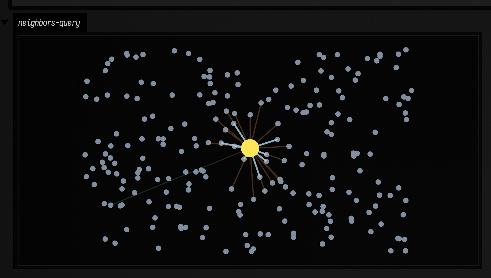
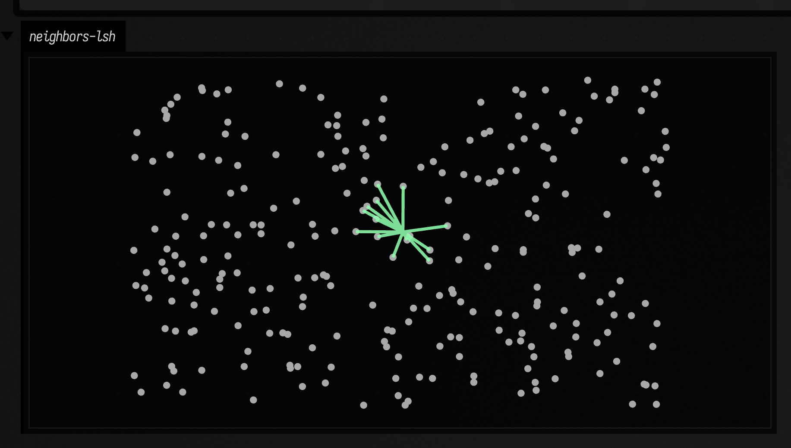

# Neighbors & graph connectivity to FLine examples

*Every public declaration used below is listed, with its KDoc, in the codebase reference: [`graph_connectivity.kt`](reference/graphics.md#graph-connectivity-kt), [`smile_neighbors.kt`](reference/data.md#smile-neighbors-kt). Start from [what's already in the box](reference/index.md).*

One point cloud can be read at three scales: which points are *near* a query,
which points are *connected* into a structure, and how you *route* through that
structure. All three become far clearer once they are drawn. In data work they
organize point clouds; in creative coding they become scaffolds for growth,
routing, and composition; in musical systems they describe proximity,
voice-leading, or navigation through a space of states. These examples keep the
algorithms attached to pictures — starting local with neighbor queries, then
building the graph, then pathing across it.

## Query neighborhood with exact and approximate search

There is more than one kind of "nearby". Sometimes you want the closest `k`
things. Sometimes you want everything inside a radius. Sometimes you want an
approximate answer because speed matters more than perfection. Those choices come
up in clustering, picking, live interaction, and spatial music systems.

```diffstatic_runner {data-lang=kotlin screenshot="assets/smile_neighbors_examples/query_edges.png" wait="1.0" capture="window" open-outputs="true"}
:::static
import afield.graphics.FLine

val points = List(220) {
    vec(80.0 + random() * 900.0, 70.0 + random() * 550.0)
}

val exact = vec2NN(points, mode = VecNNMode.EXACT)
val approx = vec2NN(points, mode = VecNNMode.APPROXIMATE)

val q = vec(530.0, 340.0)
val kExact = exact.kNearest(q, 10)
val kApprox = approx.kNearest(q, 10)
val radius = exact.withinRadius(q, 140.0)

val cloud = fline {
    points.forEach { p -> moveTo(p.x, p.y) }
    pointed = true
    pointSize = 3.0
    stroked = false
    color = vec(0.7, 0.78, 0.88, 0.7)
}

fun edgeSet(neighbors: List<VecNeighbor2>, c: Vec4, t: Double): FLine = fline {
    neighbors.forEach { n ->
        moveTo(q.x, q.y)
        lineTo(n.point.x, n.point.y)
    }
    color = c
    thickness = t
}

val queryDot = fline {
    moveTo(q.x, q.y)
    pointed = true
    pointSize = 10.0
    stroked = false
    color = vec(1.0, 0.9, 0.35, 1.0)
}

lines(
    listOf(
        cloud,
        edgeSet(kApprox, vec(0.55, 1.0, 0.66, 0.35), 1.2),
        edgeSet(kExact, vec(0.56, 0.86, 1.0, 0.95), 2.2),
        edgeSet(radius, vec(1.0, 0.62, 0.36, 0.45), 1.5),
        queryDot
    ),
    channel = "neighbors-query",
    w = 1120.0,
    h = 720.0,
    fitToSize = true
)
```

All three questions use the same cloud and the same query point. Nothing else
changes: same geometry, same source set, same drawing.



The picture keeps the meanings distinct. The exact set is the reference answer.
The approximate set is the real-time compromise. The radius query tells a
different story: local density rather than rank. That distinction matters in
picking, local clustering, and proximity-sensitive drawing.

## Diff: tune LSH build options

Approximate search becomes real when you tune it. Bucket width, projection count,
and hash size all change which relationships later code will believe.

```diff_runner {data-lang=kotlin screenshot="assets/smile_neighbors_examples/lsh_tuning.png" wait="1.0" capture="box"}
:::before
import afield.graphics.FLine

val points = List(260) { vec(50.0 + random() * 1000.0, 50.0 + random() * 600.0) }
val q = vec(550.0, 330.0)
val index = vec2NN(points, mode = VecNNMode.APPROXIMATE)
val nn = index.kNearest(q, 14)

val edges = fline {
    nn.forEach { n -> moveTo(q.x, q.y); lineTo(n.point.x, n.point.y) }
    color = vec(0.62, 0.9, 1.0, 0.95)
    thickness = 2.0
}
val dots = fline { points.forEach { p -> moveTo(p.x, p.y) }; pointed = true; pointSize = 2.4; stroked = false; color = vec(1,1,1,0.65) }
lines(listOf(dots, edges), channel = "neighbors-lsh", w = 1120.0, h = 720.0, fitToSize = true)
:::after
import afield.graphics.FLine

val points = List(260) { vec(50.0 + random() * 1000.0, 50.0 + random() * 600.0) }
val q = vec(550.0, 330.0)
val index = vec2NN(
    points,
    mode = VecNNMode.APPROXIMATE,
    options = VecNNBuildOptions(lshBucketWidth = 0.75, lshProjectionCount = 14, lshUniversalHashSize = 20011)
)
val nn = index.kNearest(q, 14)

val edges = fline {
    nn.forEach { n -> moveTo(q.x, q.y); lineTo(n.point.x, n.point.y) }
    color = vec(0.56, 1.0, 0.68, 0.95)
    thickness = 2.4
}
val dots = fline { points.forEach { p -> moveTo(p.x, p.y) }; pointed = true; pointSize = 2.4; stroked = false; color = vec(1,1,1,0.65) }
lines(listOf(dots, edges), channel = "neighbors-lsh", w = 1120.0, h = 720.0, fitToSize = true)
```

The diff keeps the query, point cloud, and drawing identical. Only the LSH build
options change.



Tuning is not bookkeeping. It changes which geometric relationships the next layer
receives. If a neighborhood feels unstable, fix the index before building
clustering, pathing, or interaction code on top of it. Once the index is stable,
the same point cloud can carry *persistent* structure — the graph families below.

## Geometric graph families on one point cloud

One point cloud can support several plausible graphs. Some are generous
scaffolds. Some trim aggressively. Some keep only the minimum needed to stay
connected. That choice matters when the graph drives routing, clustering, or a
generative drawing.

```diffstatic_runner {data-lang=kotlin screenshot="assets/graph_connectivity_examples/geometric_families.png" wait="1.0" capture="window" open-outputs="true"}
:::static
import afield.graphics.FLine

val points = List(140) { i ->
    val a = i / 140.0 * PI * 2.0
    val r = 180.0 + 95.0 * sin(a * 3.0)
    vec(560.0 + cos(a) * r + (-24.0 + random() * 48.0), 360.0 + sin(a) * r * 0.65 + (-18.0 + random() * 36.0))
}

val delaunay = vec2DelaunayGraph(points)
val gabriel = vec2GabrielGraph(points)
val urquhart = vec2UrquhartGraph(points)
val rng = vec2RelativeNeighborhoodGraph(points)
val mst = vec2MinimumSpanningTree(points)

fun graphLine(graph: PointGraph, color: Vec4, thickness: Double): FLine = fline {
    graph.edges.forEach { e ->
        val a = points[e.i]
        val b = points[e.j]
        moveTo(a.x, a.y)
        lineTo(b.x, b.y)
    }
    this.color = color
    this.thickness = thickness
}

val cloud = fline {
    points.forEach { p -> moveTo(p.x, p.y) }
    pointed = true
    pointSize = 3.2
    stroked = false
    color = vec(1.0, 1.0, 1.0, 0.72)
}

lines(
    listOf(
        graphLine(delaunay, vec(0.52, 0.62, 0.75, 0.25), 1.0),
        graphLine(gabriel, vec(0.56, 0.92, 1.0, 0.45), 1.3),
        graphLine(urquhart, vec(0.92, 0.55, 1.0, 0.5), 1.45),
        graphLine(rng, vec(1.0, 0.7, 0.32, 0.55), 1.6),
        graphLine(mst, vec(0.56, 1.0, 0.67, 0.95), 2.6),
        cloud
    ),
    channel = "graph-families",
    w = 1180.0,
    h = 760.0,
    fitToSize = true
)
```

The scene stays fixed while the graph family changes. A single `graphLine(...)`
helper draws Delaunay, Gabriel, Urquhart, relative-neighborhood, and
minimum-spanning structures with different visual weights.


The picture gives the families a quick vocabulary. Delaunay is generous. Gabriel
is choosier. Urquhart trims the triangulation toward a transport-like backbone.
RNG is choosier still. The spanning tree is the austerity program. Once that
progression is visible, choosing the right scaffold for a pathing or clustering
problem is easier.

## 3D graph families with `threeLines(...)`

Projected drawings are fine until the point cloud wants depth. Once points coil,
stack, or drift behind one another, put the graph into the Three.js viewer and
orbit around it.

```diffstatic_runner {data-lang=kotlin screenshot="assets/graph_connectivity_examples/three_graph_families.png" wait="1.0" capture="box" open-outputs="true" w="1200"}
:::static
import afield.graphics.FLine
import afield.graphics.threeLines

val points = List(170) { i ->
    val t = i / 170.0 * PI * 7.0
    val radius = 95.0 + 34.0 * sin(t * 0.72)
    val x = cos(t) * radius + cos(t * 2.4) * 22.0
    val y = sin(t * 1.08) * 118.0 + sin(t * 0.31) * 28.0
    val z = -230.0 + i * 2.8 + cos(t * 1.6) * 44.0
    vec(x, y, z)
}

val knn = vec3KnnGraph(points, k = 4)
val gabriel = vec3GabrielGraph(points)
val mst = vec3MinimumSpanningTree(points)

fun graphLine3(graph: PointGraph, color: Vec4, thickness: Double): FLine = fline {
    graph.edges.forEach { e ->
        val a = points[e.i]
        val b = points[e.j]
        moveTo(a)
        lineTo(b)
    }
    this.color = color
    this.thickness = thickness
}

val cloud = fline {
    points.forEach { moveTo(it) }
    pointed = true
    pointSize = 0.2
    stroked = false
    color = vec(1.0, 1.0, 1.0, 0.78)
}

threeLines(
    listOf(
        graphLine3(knn, vec(0.52, 0.7, 0.95, 0.18), 1.0),
        graphLine3(gabriel, vec(0.96, 0.64, 0.28, 0.5), 1.6),
        graphLine3(mst, vec(0.58, 1.0, 0.68, 0.96), 3.1),
        cloud
    ),
    channel = "graph-3d-families",
    height = 500,
    editable = false
)
```

This view is less about exact planar relationships and more about spatial
scaffolding. The faint 4-NN graph gives the permissive local neighborhood,
Gabriel shows the cleaner mid-density structure, and the spanning tree leaves only
the bare backbone.


`threeLines(...)` earns its keep here. A flattened projection leaves you guessing;
the 3D viewer lets you orbit the graph and inspect crossings, depth layering, and
long bridges. For now, `vec3UrquhartGraph(...)` still uses the same MST-based
approximation as the 3D spanning tree, so a separate 3D Urquhart picture would
currently land in the same place.

## Pathing: anchored cover + A* overlay

A graph becomes more useful once you ask it to do something: cover a space from an
anchor, produce a route, or support both a global reading and a local path.

```diffstatic_runner {data-lang=kotlin screenshot="assets/graph_connectivity_examples/path_cover_astar.png" wait="1.0" capture="box"}
:::static
import afield.graphics.FLine

val points = List(110) { vec(80.0 + random() * 940.0, 80.0 + random() * 560.0) }
val base = vec2KnnGraph(points, k = 4)

val anchor = 0
val cover = graphAnchoredGreedyThenDiameterCover(base, anchor)
val goal = points.indices.last
val path = vec2AStarPath(base, points, start = anchor, goal = goal)

fun edgeLine(graph: PointGraph, c: Vec4, t: Double): FLine = fline {
    graph.edges.forEach { e -> moveTo(points[e.i].x, points[e.i].y); lineTo(points[e.j].x, points[e.j].y) }
    color = c
    thickness = t
}

val baseLine = edgeLine(base, vec(0.62, 0.7, 0.8, 0.25), 1.0)

val coverLines = cover.paths.mapIndexed { i, p ->
    val hue = (i % 12) / 12.0
    val c = okhsv(hue, 0.82, 0.96, 0.92)
    fline {
        p.edges.forEach { e -> moveTo(points[e.i].x, points[e.i].y); lineTo(points[e.j].x, points[e.j].y) }
        color = c
        thickness = 2.3
    }
}

val aStar = path?.let { p ->
    fline {
        p.nodes.forEachIndexed { idx, node ->
            val pt = points[node]
            if (idx == 0) moveTo(pt.x, pt.y) else lineTo(pt.x, pt.y)
        }
        color = vec(1.0, 0.96, 0.36, 1.0)
        thickness = 4.2
    }
}

val dots = fline {
    points.forEach { p -> moveTo(p.x, p.y) }
    pointed = true
    pointSize = 3.0
    stroked = false
    color = vec(1,1,1,0.75)
}

val out = mutableListOf<FLine>()
out += baseLine
out += coverLines
if (aStar != null) out += aStar
out += dots

lines(out, channel = "graph-pathing", w = 1180.0, h = 760.0, fitToSize = true)
```

This example builds a modest k-nearest-neighbor graph, then asks for two different
answers: a cover that spreads outward from one anchor, and an A* path to a chosen
goal. The faded base graph stays in the background.


The graph does double duty. The colored cover paths show how the structure fans
out from the anchor; the bright A* overlay shows how to get somewhere specific.
That combination is useful in navigation, decomposition, interactive layouts, and
systems that need both territory and route. For statistics and dependence measures
on related datasets, continue with [Values over time: interpolants, keyframes & estimation](interpolants_examples.md).
