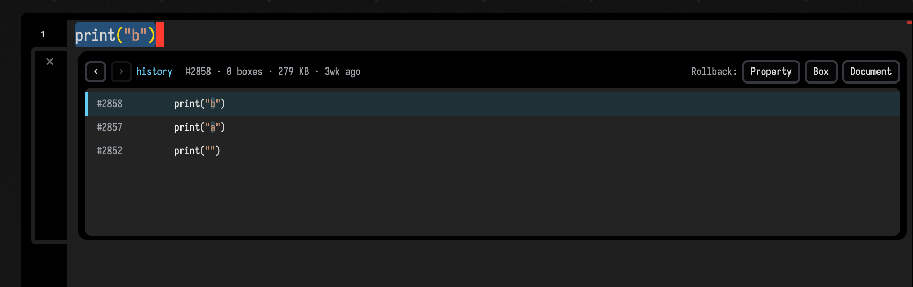

# Inline History: the History Lens

The [document history](document_history.md) view works on the whole document. You leave the editor, pick a version out of a timeline, and restore it. That is a lot of machinery for the question you usually have, which is what one line said a few saves ago.

The **History Lens** answers that question where the line is.

## Open it

Put your cursor on a line (or select a range), **right-click**, and choose **Show History Lens for Line / Selection** from the editor context menu.

The lens opens as a small zone directly beneath your selection. It has no keyboard shortcut; it is in the context menu only.

## What it shows

The lens traces the selected line or range back through the saved versions, using line alignment
and selection-change detection, and lists the versions where that trace changed. Saves that left
the line alone are skipped.

Each row is one matching version, labelled the same way the [history panel](document_history.md)
labels it (`#2858`, `#2857`, …), with metadata such as box count, size, and age. The value at that
version is shown with changed tokens highlighted, so the difference between two rows is legible
without reading both in full.

Step through the versions with the ‹ › arrows to preview each one. When you find the state you want, the **Rollback** buttons put it back at the scope you choose:

- **Property** — restore just this property to the selected version
- **Box** — restore the whole box
- **Document** — fall through to a full [document restore](document_history.md)

## How it relates to the history panel

The History Lens and the [document history panel](document_history.md) read the same saved versions. They differ in how much of the document they work on:

- **History panel** — whole document, its own view, restore or cherry-pick whole boxes.
- **History Lens** — one line or selection, inline in the editor, lift a single past value back.

Reach for the lens when the question is "what did *this* used to be?" and for the panel when the question is "what did the *document* used to be?".

## A different "history" in the editor

Field has a second inline visual also called `history`, and the two are easy to confuse.

The **`history()` visualizer** (`m.history(value)`) draws a live chart of the last N *runtime* values of an expression, printed inline next to the code that produced it. It tracks a value while your code runs, rather than your source across saves. It is covered with its siblings `histogram()` and `stats()` on the [Visualizers & Controls](visualizers.md) page.

| | History Lens | `history()` visualizer |
| --- | --- | --- |
| What it tracks | your source code across saved versions | a numeric value across runtime iterations |
| Backed by | saved document backups | a rolling in-memory buffer |
| Opened by | right-click → *Show History Lens* | calling `m.history(x)` in running code |
| Survives a restart? | yes — it is on disk | no — it is live only |

