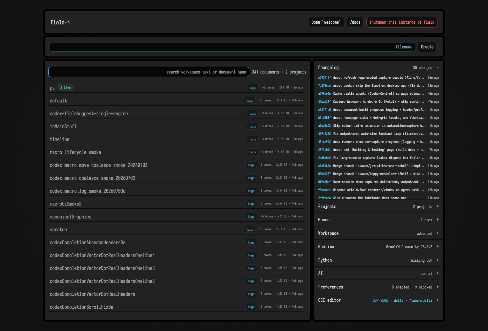
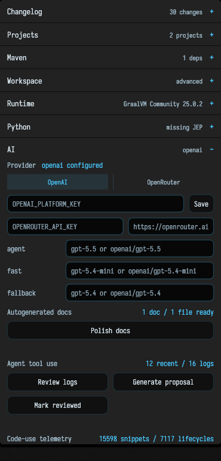

# Your History with Field

Field keeps several kinds of history, each with its own lifetime. Saved document versions live on
disk. Some runtime visualizers keep a short in-memory window of values. AI4 writes a tool-use log
per send. The semantic index holds whatever corpus it last indexed. None of them is a complete
record of everything that happened, and they are spread across a handful of tools:

- **[Document history](document_history.md)** — a full-page timeline of the versions in the document's history store, with restore, cherry-pick and diff.
- **[Inline history: the History Lens](history_lens.md)** — scrub a single line or selection back through its versions without leaving the editor.
- **[AI tool-use history](ai_tool_use_history.md)** — the per-send tool calls recorded by AI4, and a loop that reads those logs back to propose improvements.
- **[AI documentation polish](ai_doc_polish.md)** — the cache of AI-generated documentation and the cycle that folds it back into real source comments.
- **[The semantic index](semantic_index.md)** — a searchable, meaning-aware index of the indexed
  workspace code corpus.

## The `/welcome` dashboard

The AI-facing history tools are launched and monitored from the **welcome page**, Field's landing page. The server opens `https://localhost:<port>/welcome` on startup, and in the desktop app it is the first tab (the `+` button opens a fresh one).

You can also reach it at any time from the hero buttons of a running instance, or by navigating straight to `/welcome`.

The left of the page is about *documents*: a search box, the workspace list, and currently running
documents. Searching combines `/api/workspace-search` text/name matches with semantic matches when
the [semantic index](semantic_index.md) is enabled and available. Semantic failures do not remove
the ordinary workspace-search results.

The right of the page is a stack of collapsible panels. **AI** is the one that runs the background tasks:

- **Autogenerated docs** — runs the [documentation polish cycle](ai_doc_polish.md).
- **Agent tool use** — reviews the [tool-use logs](ai_tool_use_history.md) and proposes improvements.
- **Code-use telemetry** — opens the `/code-use` browser (a related record of how code has been run).
- **Semantic search** — configures and rebuilds the [semantic index](semantic_index.md).

Each task card carries a live status badge. When a task finishes a run, writes a report or rebuilds
the index, the page updates itself over a `/welcome-events` WebSocket without a reload.

A task's run button starts the work and opens its inspection page in a new tab. Those pages are the
subject of the rest of this section.

## Picking a tool

| I want to… | Use |
| --- | --- |
| Roll a document back to an earlier save | [Document history](document_history.md) |
| See how one line changed across versions, without leaving the editor | [History Lens](history_lens.md) |
| Watch a running value change over time | the inline `history()` visualizer — see [Visualizers & Controls](visualizers.md) |
| Understand what the agents are doing and make them do it better | [AI tool-use history](ai_tool_use_history.md) |
| Turn scattered AI-written docs into real source comments | [AI documentation polish](ai_doc_polish.md) |
| Find indexed workspace code by describing it | [The semantic index](semantic_index.md) |
