# Imaging and computer vision

`afield.stdlib` can look at a picture as well as make one. Its CPU imaging and computer-vision
family has a single value type, `Img`, and around it a set of operations that turn a raster into
structure, from convolution and gradients up through edges, corners, lines, blobs, pyramids, warps
and motion. It is the raster counterpart to the time-domain
[timeseries toolkit](timeseries_examples.md) and the frequency-domain
[spectral family](spectral_examples.md), and it is built the same way: pure Kotlin, no external
dependency, works headless in a box.

Every detector here reduces pixels to *geometry*, and geometry in Field is an
[`FLine`](fline_examples.md), so a Canny result, a set of corners, a Hough line or an optical-flow
field lands in the same drawing, animation and export machinery as anything you drew by hand.
Scalar responses colour-map through the same [`Colormaps`](rectsl_examples.md) tables RectSL uses.
And `Img` implements `ToHTML`, so evaluating one in a box shows the picture, not `Img@3f1a2b`.

Everything here is arithmetic you could have written out by hand. For the two questions you cannot
(how far away is this, and what is it a picture *of*), see [depth and CLIP](onnx.md), which runs
neural models over the same RGBA bytes an `Img` converts to in a dozen lines.

## The value type

```diffstatic {data-lang=kotlin}
Img(width, height, channels, data)
```

`width * height * channels` floats, interleaved, row-major, origin **top-left**, the same layout
`BufferedImage`, PNG and a GPU upload all want. Channels are 1 (scalar / gray / mask / gradient /
distance), 3 (RGB) or 4 (RGBA); nothing else.

Three choices change what the numbers mean:

- **Float, not bytes.** Every operation is float math. Nothing quantises mid-pipeline, so a
  twelve-stage chain does not accumulate rounding steps; clamping happens once, on output.
- **Signed where it should be.** Gradients, Laplacians and differences legitimately go negative and
  are left that way. `colormapDiverging(...)` is the right way to look at them.
- **Gradients are in true units-per-pixel.** The Sobel derivative factor is `[-1, 0, 1]/2` and the
  smoothing factor is normalised, so `sobel().dx` on a ramp of slope *s* really is *s*, and a unit
  step edge integrates to a total gradient of exactly 1. That makes a threshold like `0.05` mean
  something, instead of depending on which textbook's unscaled kernel you happened to use.

Build one from a function, a file, a `BufferedImage`, PNG bytes or a plain `FloatArray`:

```diffstatic {data-lang=kotlin}
val ramp   = Img.generate(64, 64) { x, _ -> x / 63f }
val photo  = imgFromFile("cat.png")            // javax.imageio under the hood
val fromGl = floatsToImg(heights, w, h)        // a heightfield, a spectrogram, any scalar grid
```

## Basics — resample, luma, HSV, threshold

`resize` area-averages when it shrinks (the anti-aliased answer) and interpolates bilinearly when it
grows. `luma()` is BT.709. `otsuThreshold()` computes the best two-way split of the histogram rather
than making you guess a number.

```diffstatic_runner {data-lang=kotlin screenshot="assets/imaging_examples/basics.png" wait="1.5" capture="box" open-outputs="true" padding="20"}
:::static
// An Img is width x height x channels floats, interleaved, origin top-left.
// Build one straight from a function of (x, y) — the usual way to make a test image.
val card = Img.generateRGB(240, 180) { x, y ->
    val u = x / 239f
    val v = y / 179f
    val disc = if (hypot(x - 60.0, y - 60.0) <= 34.0) 1f else 0f
    val bar = if (y in 130..142 && x in 20..219) 1f else 0f
    Triple(
        (0.15f + 0.7f * u * (1f - disc) + disc * 0.9f + bar).coerceIn(0f, 1f),
        (0.15f + 0.6f * v + disc * 0.25f + bar).coerceIn(0f, 1f),
        (0.55f - 0.4f * u + disc * 0.1f + bar).coerceIn(0f, 1f)
    )
}

val gray = card.luma()                 // BT.709 perceptual grayscale
val hsv = card.rgbToHsv()              // h, s, v each in 0..1
val small = card.resize(60, 45)        // area-averaged (anti-aliased) downsample
val backUp = small.resize(240, 180)    // bilinear upsample: the detail is really gone
val t = gray.otsuThreshold()           // computed, not guessed

showImgGrid(
    "source RGB (${card.width}x${card.height})" to card,
    "luma()" to gray,
    "hue channel" to hsv.channel(0),
    "saturation channel" to hsv.channel(1),
    "resize(60,45) then back up" to backUp,
    "thresholdOtsu() @ ${"%.3f".format(t)}" to gray.threshold(t),
    columns = 3,
    cellSide = 260,
)
println("Img ${card.width}x${card.height} x${card.channels} ch, mean ${"%.3f".format(card.mean())}, " +
    "otsu ${"%.3f".format(t)}, foreground ${gray.threshold(t).data.count { it > 0.5f }} px")
```

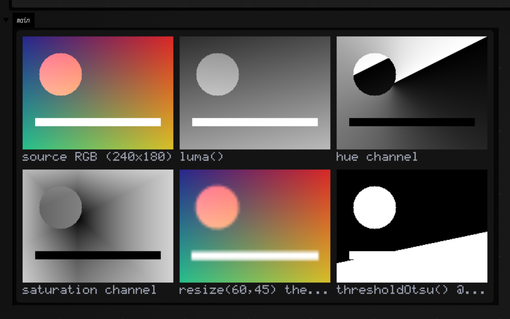

`showImgGrid(...)` is the fastest way to see a whole pipeline: it lays captioned panels out side by
side, maps every panel through one shared display range, and pushes one PNG to the box output through
`Img.toPngBytes()` → `PngEncoder` → `display(...)`. Ordinary images use `0..1`; out-of-range panels
choose one common automatic range, or you can pass `displayRange = -1f..1f` (for example). No AWT is
involved, so it works anywhere.

## Filters — and choosing the right one

Four smoothers with genuinely different characters, and the box prints each one's residual against
the clean source. On impulse noise the median is two orders of magnitude better than the Gaussian.
The bilateral filter, which is excellent at preserving edges, is bad at impulses: a salt pixel is
far away in *range* and so keeps its own weight.

```diffstatic_runner {data-lang=kotlin screenshot="assets/imaging_examples/filters.png" wait="1.5" capture="box" open-outputs="true" padding="20"}
:::static
// A clean synthetic source, and the same source with 4% salt-and-pepper corruption.
val clean = Img.generate(240, 180) { x, y ->
    var v = 0.12f + 0.10f * (y / 180f)
    if (hypot(x - 60.0, y - 70.0) <= 34.0) v = 0.85f
    if (x in 120..185 && y in 30..95) v = 0.65f
    if (y in 135..142 && x in 20..219) v = 0.95f
    v
}
val rng = kotlin.random.Random(11)
val noisy = clean.copy()
repeat((noisy.pixelCount * 0.04).toInt()) {
    noisy.data[rng.nextInt(noisy.pixelCount)] = if (rng.nextBoolean()) 0f else 1f
}

val gauss = noisy.gaussianBlur(2.0)     // separable, normalised: preserves the image mean
val med = noisy.median(2)               // the right tool for impulse noise
val bil = noisy.bilateral(sigmaSpace = 3.0, sigmaRange = 0.12)
val sharp = clean.gaussianBlur(2.0).unsharpMask(sigma = 2.0, amount = 1.4)

showImgGrid(
    "clean source" to clean,
    "+ 4% salt-and-pepper" to noisy,
    "gaussianBlur(2.0)" to gauss,
    "median(2)" to med,
    "bilateral(3.0, 0.12)" to bil,
    "blur then unsharpMask(2.0, 1.4)" to sharp,
    columns = 3,
    cellSide = 260,
)
println(
    "residual vs clean — gaussian ${"%.4f".format(gauss.meanAbsDiff(clean))}, " +
        "median ${"%.4f".format(med.meanAbsDiff(clean))}, " +
        "bilateral ${"%.4f".format(bil.meanAbsDiff(clean))}"
)
```

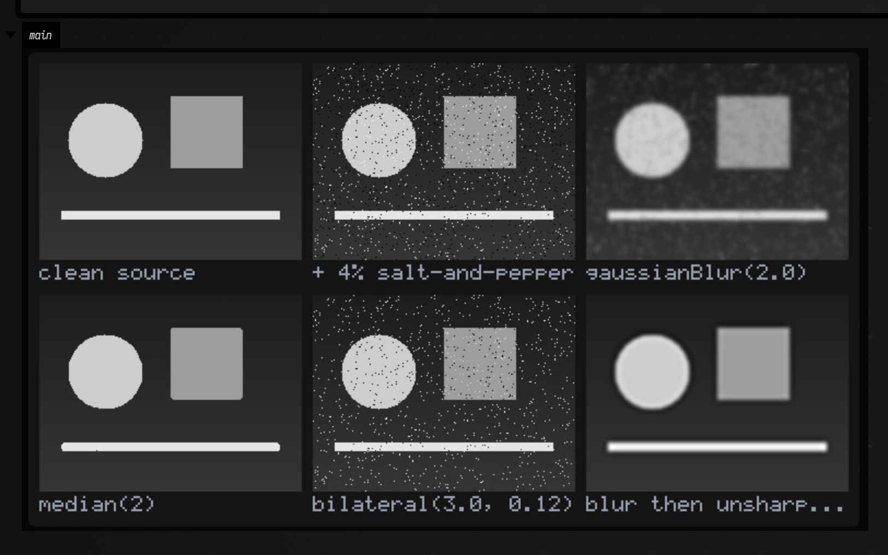

`boxBlur(radius)` is also there, computed with running sums so its cost is independent of the
radius, and `boxBlurApproxGaussian(sigma)` chains three of them when sigma is large and you care
more about speed than about the exact kernel shape.

## Gradients, edges, and the FLines they become

`sobel()` returns a `Gradient`: `dx`, `dy`, and derived `magnitude()`, `orientation()` and a
hue-encoded `toColorImg()`. `canny()` runs the four classic stages (smooth, gradient, non-maximum
suppression, hysteresis) and returns a thin binary mask. `toContourFLines(...)` traces that mask and
hands back drawable `FLine`s, simplified with Ramer–Douglas–Peucker so a staircase pixel boundary
becomes a handful of straight runs.

```diffstatic_runner {data-lang=kotlin screenshot="assets/imaging_examples/edges.png" wait="1.5" capture="box" open-outputs="true" padding="20"}
:::static
val src = Img.generate(240, 180) { x, y ->
    var v = 0.12f + 0.08f * (y / 180f)
    if (hypot(x - 62.0, y - 70.0) <= 34.0) v = 0.85f
    if (x in 120..185 && y in 30..95) v = 0.68f
    val tx = x - 210.0; val ty = y - 40.0
    if (ty in 0.0..60.0 && kotlin.math.abs(tx) <= ty * 0.5) v = 0.95f
    v
}

// Sobel here is scaled to true units-per-pixel: a unit step edge integrates to 1.
val grad = src.sobel()
val edges = src.canny(low = 0.05, high = 0.11, sigma = 1.2)
val auto = src.cannyAuto()          // thresholds derived from this image's own gradients

// Edges are geometry, and geometry in Field is an FLine.
val flines = edges.toContourFLines(minPerimeter = 12, simplifyTolerance = 1.2)

showImgGrid(
    "source" to src,
    "sobel().dx (signed, coolwarm)" to grad.dx.colormapDiverging("coolwarm"),
    "sobel().dy (signed, coolwarm)" to grad.dy.colormapDiverging("coolwarm"),
    "magnitude (inferno)" to grad.magnitude().normalized().colormap("inferno"),
    "orientation as hue x magnitude" to grad.toColorImg(),
    "canny(0.05, 0.11)" to edges,
    columns = 3,
    cellSide = 260,
)
println(
    "|grad| max ${"%.3f".format(grad.magnitude().max())}; " +
        "canny ${edges.data.count { it > 0.5f }} px, cannyAuto ${auto.data.count { it > 0.5f }} px; " +
        "${flines.size} FLines, ${flines.sumOf { it.nodes.size }} nodes total"
)
```

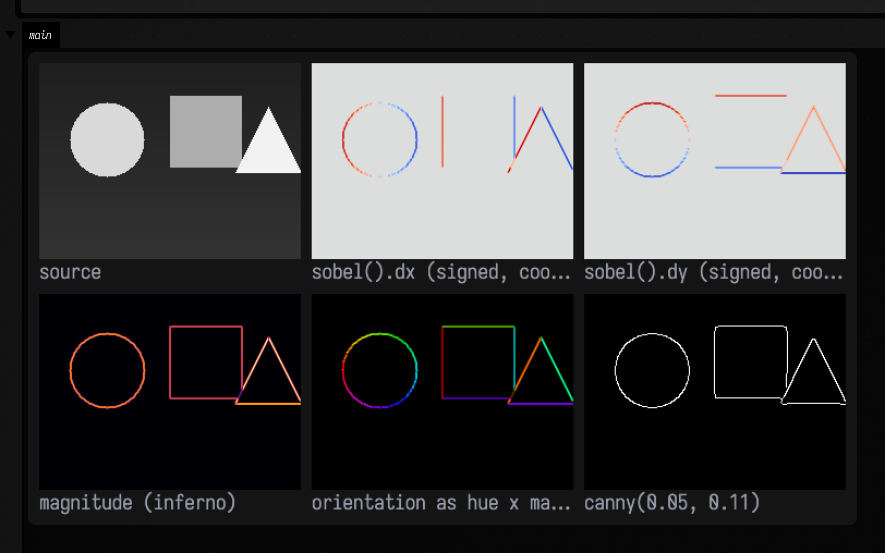

`dx` fires on vertical edges and `dy` on horizontal ones; the orientation panel wheels its hue right
around the disc, because that is what the gradient direction does.

### Canny on low-contrast images

A `(low, high)` pair tuned on a bright synthetic card finds almost nothing in a dark, softly-lit
photograph. The thresholds are in gradient-magnitude units, and a dark image does not reach them.
`cannyAuto(...)` derives them from the image's own distribution: it takes a percentile of the
non-maximum-suppressed magnitudes as the strong seed threshold and Canny's own recommended ratio for
the weak one.

The figure below is a real repo PNG run through the whole pipeline. The fixed pair finds 252 edge
pixels, barely the car at all. `cannyAuto()` finds 1952, and traces the whole silhouette; the last
panel is those edges as 57 `FLine`s drawn back over the source.

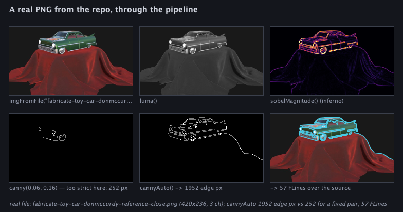

## Corners

Three detectors, all on a square whose corners are at exactly known coordinates, so each detector's
answer can be measured against the truth.

- `harrisResponse()` — `det(M) - k·trace(M)²` over the structure tensor. Large and positive at a
  corner, **negative along an edge**, near zero on flat ground; the diverging colour map in the
  figure is showing exactly that sign structure.
- `shiTomasiResponse()` — the smaller eigenvalue of the same tensor. No magic `k`, and directly
  interpretable: it is the weakest intensity variation over any direction, so a large value means
  the point is localisable in *both* axes. A straight edge scores ~0, which is the aperture problem
  stated numerically. This is the response an optical-flow tracker wants, and
  `goodFeaturesToTrack(...)` is its friendlier name.
- `fastCorners()` — no gradients and no eigenvalues, just a wrap-around run-length test on a
  16-pixel circle. Much faster, and it scores each corner by the largest threshold at which it would
  still qualify.

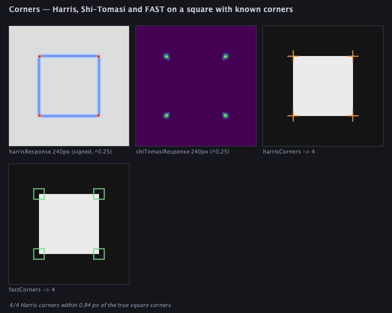

Run headless, Harris and Shi–Tomasi each return exactly four corners, and the worst of the four sits
**0.94 px** from the true corner of the square (sub-pixel refinement is on by default, via a
three-tap parabola fit in x and y). `cornersToFLines(...)` turns them into drawable crosses or boxes.

## Hough — global structure from local evidence

Every edge pixel votes for every line through it; a real line becomes a bright peak in `(rho, theta)`
accumulator space, with no grouping step in between.

The figure has three planted lines and a decoy ring. All three lines come back at their exact polar
coordinates: `(rho=1500, θ=0.00)`, `(rho=400, θ=1.57)`, `(rho=283, θ=2.36)`. The ring is not
fitted.

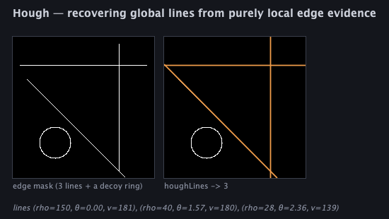

`HoughLine.clipTo(w, h)` clips the infinite line to the image rectangle, and `linesToFLines(...)`
gives you the visible segments as `FLine`s. `houghCircles(...)` is there too, for a known radius
range.

## Morphology, blobs and distance

`erode` / `dilate` / `open` / `close` with square, disc or cross structuring elements;
`connectedComponents(...)` for labels plus per-blob area, bounding box, centroid and fill ratio;
`distanceTransform()` for the exact Euclidean distance to the nearest background pixel (the
Felzenszwalb–Huttenlocher two-pass algorithm, not a chamfer approximation).

```diffstatic_runner {data-lang=kotlin screenshot="assets/imaging_examples/morphology.png" wait="1.5" capture="box" open-outputs="true" padding="20"}
:::static
// Three disjoint discs of known radius, then noise on top of them.
val discs = listOf(Triple(55.0, 60.0, 28.0), Triple(150.0, 55.0, 20.0), Triple(110.0, 135.0, 14.0))
val clean = Img.generate(220, 180) { x, y ->
    if (discs.any { (cx, cy, r) -> hypot(x - cx, y - cy) <= r }) 0.85f else 0.15f
}
val rng = kotlin.random.Random(3)
val noisy = clean.copy()
repeat((noisy.pixelCount * 0.03).toInt()) {
    noisy.data[rng.nextInt(noisy.pixelCount)] = if (rng.nextBoolean()) 0f else 1f
}

val mask = noisy.thresholdOtsu()
val cleaned = mask.open(2, StructuringElement.DISC).close(2, StructuringElement.DISC)
val cc = cleaned.connectedComponents(8)
val dt = cleaned.distanceTransform()

showImgGrid(
    "noisy source" to noisy,
    "thresholdOtsu()" to mask,
    "open(2,DISC).close(2,DISC)" to cleaned,
    "erode(4)" to cleaned.erode(4, StructuringElement.DISC),
    "dilate(4)" to cleaned.dilate(4, StructuringElement.DISC),
    "distanceTransform (magma)" to dt.normalized().colormap("magma"),
    columns = 3,
    cellSide = 250,
)
println("${cc.count} components after cleaning (planted ${discs.size} discs):")
cc.components.sortedByDescending { it.area }.forEach {
    println("  area=${it.area} centroid=(${"%.1f".format(it.centroidX)}, ${"%.1f".format(it.centroidY)}) " +
        "bbox=${it.boundingWidth}x${it.boundingHeight} fill=${"%.2f".format(it.fillRatio)}")
}
println("distance-transform peak ${"%.1f".format(dt.max())} (largest planted radius ${discs.maxOf { it.third }})")
```

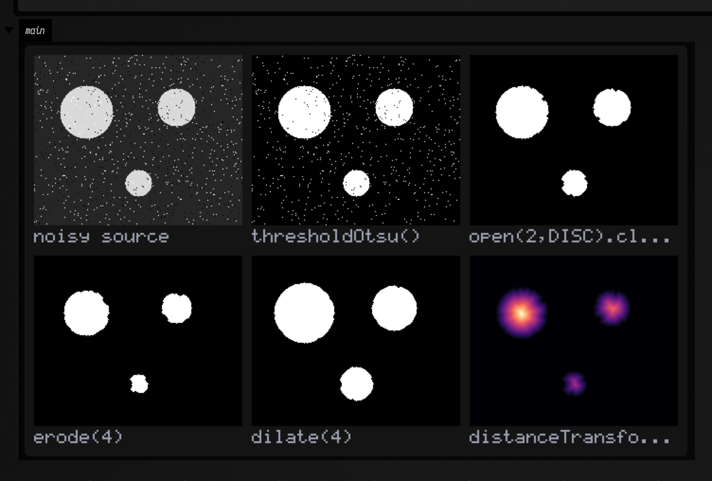

Three discs in, three components out, with areas of 2419, 1226 and 584 against the analytic
`πr²` of 2463, 1257 and 616 (the shortfall is the `open(2)` erosion), and centroids at (54.8, 60.1),
(150.1, 55.0) and (110.2, 134.9) against planted centres of (55, 60), (150, 55) and (110, 135).

For sub-pixel-smooth contours rather than a pixel-staircase boundary, `isoContourFLines(iso)` adapts
the image to the `ScalarField2D` that Field's existing marching-squares extractor
([contours](fline_examples.md)) already marches, so a distance transform or a blurred response
becomes a smooth curve with no glue code.

## Multiscale

`gaussianPyramid(levels)` halves each octave (blurring first, so it does not alias);
`laplacianPyramid(levels)` splits the image into band-pass detail plus a coarse residual, and
`reconstruct()` inverts it. The round-trip is exact to within float precision, at a maximum
absolute error of **1.49e-08** on the figure below. That is small enough to build multiband
blending and detail transfer on, rather than only to look at.

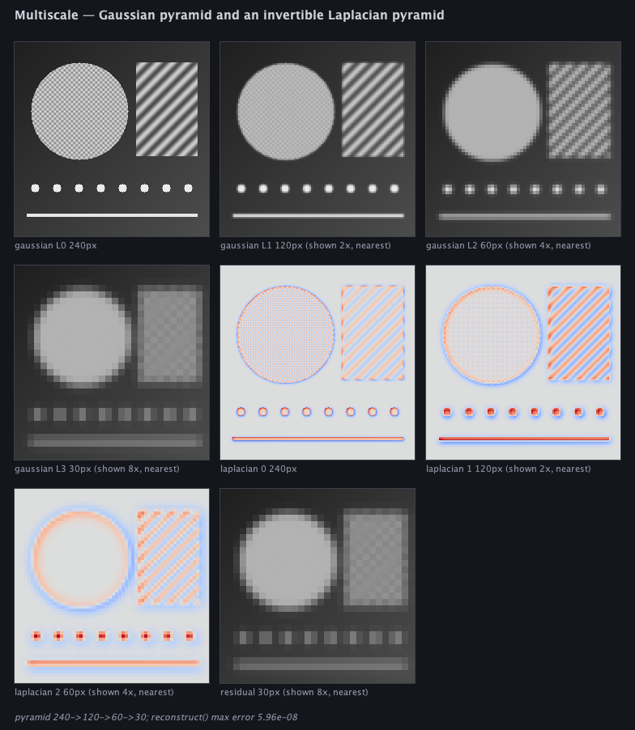

(Levels below the base are magnified by integer pixel replication for display; each caption states
the real size and the zoom factor.)

## Geometry — affine and projective warps

`Affine2D` uses the same six-number layout as `java.awt.geom.AffineTransform` and SVG's
`matrix(a, b, c, d, e, f)`. `Homography` is the 3×3 projective version. `warpAffine` and
`warpPerspective` map **source → destination** and invert internally, doing the correct backwards
resample, so there are no holes.

`findHomography(src, dst)` is the Direct Linear Transform: exact through four correspondences,
least-squares through more. The points are Hartley-normalised first; without that, the conditioning
on pixel-scale coordinates is bad enough to visibly distort the fit.
`warpQuadToRect(quad, w, h)` wraps it up as the "flatten the photographed page" operation.

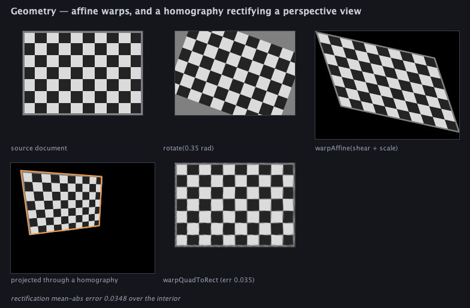

The rectified checkerboard matches the original to a mean absolute error of 0.0036 over the interior.

## Motion

`opticalFlowLK(a, b, points)` is pyramidal Lucas–Kanade. Seed it with `goodFeaturesToTrack(...)`,
which selects exactly the points where the 2×2 tracking system is well conditioned, and it returns
a `FlowField` of `FlowVector`s, each of which reports whether it converged. A track is marked
`ok = false` when the system is ill-conditioned (a smooth region, or a straight edge) or the point
leaves the frame.

The pyramid is there for large motions. Solve at the coarsest octave, where the displacement is
small enough for the linearisation to hold, then propagate the estimate down. A 9-pixel shift that
a single level cannot recover comes back to within half a pixel with four.

```diffstatic_runner {data-lang=kotlin screenshot="assets/imaging_examples/motion.png" wait="2.0" capture="box" open-outputs="true" padding="20"}
:::static
// Two frames related by a transform we choose, so the answer is known in advance.
val a = Img.generate(200, 200) { x, y ->
    (0.5 + 0.24 * kotlin.math.sin(x * 0.21) * kotlin.math.cos(y * 0.17) +
        0.16 * kotlin.math.sin((x + y) * 0.11)).toFloat().coerceIn(0f, 1f)
}
val planted = Affine2D.rotationAbout(0.05, 100.0, 100.0).compose(Affine2D.translation(5.0, -3.0))
val b = a.warpAffine(planted, border = Border.CLAMP)

// Seed only where the 2x2 tracking system is well conditioned.
val seeds = a.goodFeaturesToTrack(maxCount = 200, minDistance = 9)
    .filter { it.x in 24.0..176.0 && it.y in 24.0..176.0 }
    .map { it.toVec2() }
val flow = opticalFlowLK(a, b, seeds, windowRadius = 8, levels = 3)
val fit = findHomographyRansac(
    flow.sourcePoints(), flow.targetPoints(),
    threshold = 1.5, iterations = 1200, seed = 3L
)

// How far is the recovered model from the one we planted, in pixels, on a probe grid?
var worst = 0.0
for (gx in 40..160 step 40) for (gy in 40..160 step 40) {
    val (fx, fy) = fit.homography.apply(gx.toDouble(), gy.toDouble())
    val (tx, ty) = planted.apply(gx.toDouble(), gy.toDouble())
    worst = maxOf(worst, hypot(fx - tx, fy - ty))
}

showImgGrid(
    "frame A" to a,
    "frame B (rot 0.05 rad + shift 5,-3)" to b,
    "|A - B| (inferno)" to frameDifference(a, b).normalized().colormap("inferno"),
    "B warped back by the fitted model" to b.warpPerspective(fit.homography.inverse(), border = Border.CLAMP),
    columns = 2,
    cellSide = 280,
)
val (mdx, mdy) = flow.medianDisplacement()
println("${flow.tracked().size}/${seeds.size} tracked; median displacement " +
    "(${"%.2f".format(mdx)}, ${"%.2f".format(mdy)}) px")
println("RANSAC ${fit.inlierCount} inliers of ${flow.tracked().size} after ${fit.iterations} iterations")
println("recovered model agrees with the planted transform to ${"%.3f".format(worst)} px over the probe grid")
println(fit.homography.toString())
```

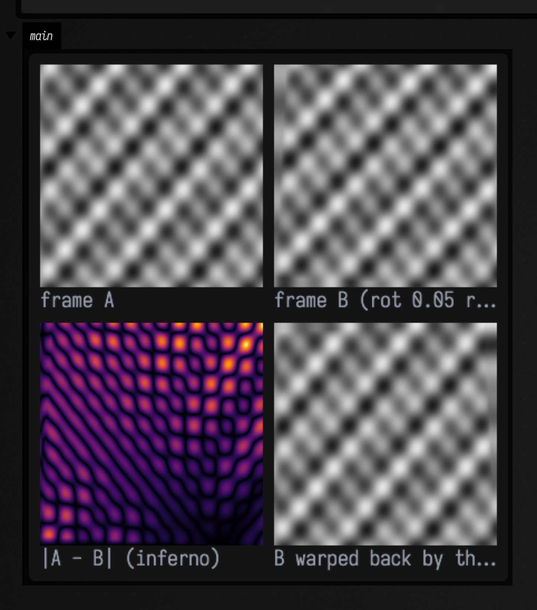

With `findHomographyRansac(...)` half the correspondences can be garbage and the answer is still
right, because a wrong model has no reason to be *consistently* wrong across many points. It samples
four correspondences at a time, scores the consensus, keeps the
best, and refits least-squares on the inliers. The seed is explicit, so a docs capture or a test
gets the same answer every time.

`opticalFlowBlockMatch(...)` is the brute-force alternative for displacements large enough to break
Lucas–Kanade's linearisation, and `frameDifference(...)` / `updateBackground(...)` are the crude,
reliable motion cues; pair them with `open(...)` to drop sensor noise and `connectedComponents(...)`
to count what moved.

`FlowField.toFLines(scale, ...)` draws the whole field as arrows, shaft plus arrowhead, so direction
is visible and not just magnitude:

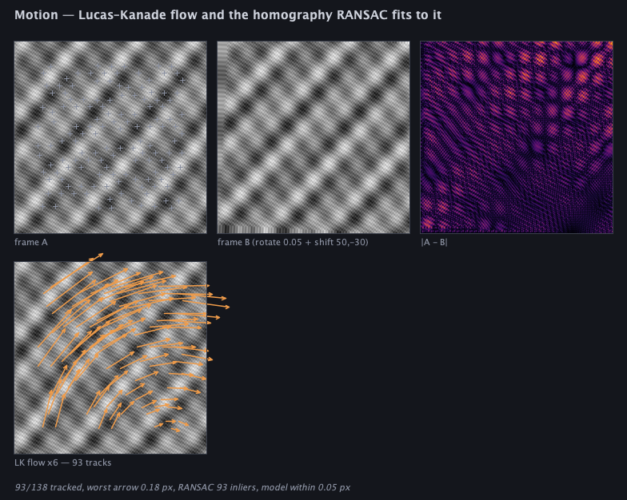

## Colour

`luma()`, `rgbToHsv()` / `hsvToRgb()`, and `toLinear()` / `toSrgb()`. Blurring, downsampling and
averaging are only *correct* in linear light, so `img.toLinear().gaussianBlur(4.0).toSrgb()` is
measurably different from blurring the encoded values. The panel below shows both, and the
amplified difference between them.

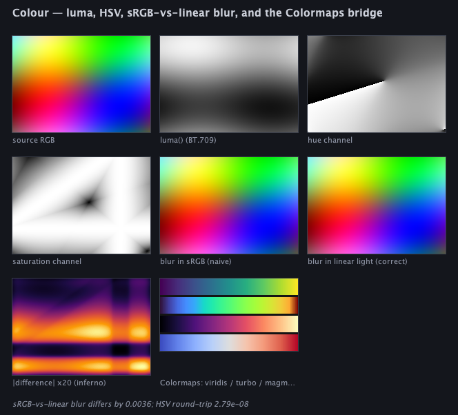

`colormap(name, lo, hi)` runs a 1-channel image through any of the `Colormaps` ramps (`viridis`,
`magma`, `inferno`, `plasma`, `turbo`, `coolwarm`, `grayscale`); `colormapDiverging(name)` picks a
symmetric range around zero, the right default for anything signed.

## Where the pictures come from

Everything on this page is real output, and there are three routes to reproducing it:

<div class="field-data-table" markdown>

| what | how |
|---|---|
| the code fences above | executed by the docs build; the image under each is that box's own output |
| the analytic figures | `python3 tools/run_field_tests.py --id imaging.gallery --port 9520` |
| the whole family, live | replay `dev_docs/agents/transcripts/imaging_cv_examples.yaml` |

</div>

The gallery is a FIELD_TEST: it builds every figure from real `Img` pipelines and **fails** if the
invariants break: if Canny stops being thinner than a raw threshold, if the four corner marks drift
more than four pixels off the four corners, if Hough stops recovering the planted lines, if the
Laplacian pyramid stops round-tripping, or if a flow arrow disagrees with the planted motion by more
than three pixels.

The transcript is a loadable document: replay it into a fresh Field with the agent backdoor
(`field_run_transcript`) and you get six live boxes you can edit. Change a sigma, a threshold or the
planted motion, re-run the box, and watch it update. See [Agent transcripts](agent_transcripts.md).

## Speed, against OpenCV

These filters are pure Kotlin with no native dependency. The repository carries a benchmark that
puts them beside OpenCV in the same JVM, on the same pixels: `tools/imaging-bench`, run with

```diffstatic {data-lang=bash}
./gradlew :tools:imaging-bench:jmh
```

Underneath is a small layer of vectorized span kernels (Java Vector API, `imaging_simd.kt`), and
three of the operations get more from doing less work than from doing it wider — `pyrDown` filters
only the rows and columns that survive the decimation, `boxBlur` accumulates a row at a time instead
of a column, and `bilateral` reads a table instead of calling `Math.exp` per tap.
`dev_docs/IMAGING_VECTOR_KERNELS.md` is that layer: what is in it, the checklist for adding an
operator, and three lessons about register accumulators that cost real time to learn.

<!-- BEGIN imaging-bench table — generated by tools/imaging_bench_doc.py, do not edit -->

| operation | before (scalar) | now | OpenCV 4.9, 1 thread | now vs OpenCV |
|---|---|---|---|---|
| Gaussian blur, sigma 2, gray | 91.59 ± 2.61 | 7.09 ± 0.07 | 7.13 ± 0.39 | **0.99x** |
| Gaussian blur, sigma 2, RGB | 263 ± 8.68 | 19.61 ± 0.15 | 21.81 ± 0.48 | **0.90x** |
| Sobel | 52.94 ± 0.13 | 4.49 ± 0.04 | 2.09 ± 0.03 | 2.14x |
| Scharr | — | 4.49 ± 0.04 | 2.21 ± 0.03 | 2.03x |
| Laplacian | — | 2.68 ± 0.02 | 1.61 ± 0.08 | 1.66x |
| Dense 11x11 convolution | — | 26.19 ± 0.21 | 27.22 ± 0.91 | **0.96x** |
| Luma (RGB to gray) | — | 1.96 ± 0.01 | 1.14 ± 0.01 | 1.72x |
| Box blur, radius 2 | — | 2.60 ± 0.03 | 1.89 ± 0.10 | 1.38x |
| Median, radius 2 | — | 425 ± 5.30 | 120 ± 7.82 | 3.53x |
| Resize to half | — | 3.65 ± 0.06 | 0.73 ± 0.01 | 4.99x |
| Bilateral | — | 749 ± 95.18 | 628 ± 4.25 | 1.19x |
| pyrDown | — | 2.07 ± 0.02 | 0.50 ± 0.02 | 4.12x |

<!-- END imaging-bench table -->

Bold means we are faster. A dash in the "before" column means that operation has no preserved
scalar original to compare against, not that its speedup is unknown.

Gaussian blur, box blur and the Laplacian run the same operation with the same parameters on both
sides, and the benchmark fails if their outputs stop agreeing. The rest are matched in work but not
in definition, so their ratios compare slightly different operations: our `luma` is BT.709 where
`cvtColor` is BT.601; our Sobel and Scharr are scaled to true units-per-pixel, so ours is OpenCV's
divided by a constant; our `pyrDown` takes a configurable sigma where OpenCV's is a fixed 5-tap
kernel; and `median`/`bilateral` have matched parameters but different internal algorithms. Our API
also returns a fresh `Img` each call, so part of our cost is an allocation OpenCV is not paying.

Gaussian blur, dense convolution and the RGB blur are at or slightly past OpenCV; box blur, the
Laplacian, Scharr, Sobel, luma and bilateral are all inside about 2x, close enough that the
pure-Kotlin path is the reasonable default. `bilateral`'s interval is wide, so read its row as
"about 1.2x". Three rows are meaningfully behind, and you should know which before choosing:

- **`median`** is an algorithmic gap: it sorts 25 floats per pixel where OpenCV uses a sorting
  network.
- **`resize` to half** has data-dependent inner loops that do not vectorize.
- **`pyrDown`** is doing more arithmetic, not doing it worse: ours applies `gaussianKernel1D(sigma)`,
  9 taps at the default, where OpenCV's `pyrDown` is a fixed 5-tap `[1,4,6,4,1]/16`. That is close to
  twice the work, in exchange for a better filter and a sigma that is yours to choose.

The benchmark's conditions, the agreement tolerances, and what the absolute milliseconds depend on
are in `dev_docs/IMAGING_MEASUREMENTS.md`.

## Reference

<div data-code-lang="kotlin" markdown>

### Value type

Load, construct and save floating-point images. `Img` holds pixels; `Border` specifies how sampling behaves outside them.

<div class="field-reference" data-code-lang="kotlin" markdown>

| Entry point | Behavior |
| --- | --- |
| `Img` | A CPU raster image: `width * height * channels` floats, interleaved, row-major, origin **top-left** (the image-processing convention, matching `BufferedImage` and PNG). [API](reference/imaging.md#imaging-kt). |
| `Border` | How a filter resolves coordinates that fall outside the image. [API](reference/imaging.md#imaging-kt). |
| `fun imgFromFile(path: String, channels: Int? = null): Img` | Loads an image from a file path, straight through `ImageIO` — the path is used verbatim and does **not** go through `FileManager`, so a workspace-relative spec will not resolve here. [API](reference/imaging.md#imaging-kt). |
| `fun imgFromBytes(bytes: ByteArray, channels: Int? = null): Img` | Decode an image from in-memory encoded bytes (PNG/JPEG/… — whatever `ImageIO` handles). [API](reference/imaging.md#imaging-kt). |
| `fun floatsToImg(values: FloatArray, width: Int, height: Int): Img` | Wrap a plain `FloatArray` of scalars as a 1-channel image — the bridge from the rest of the stdlib (a heightfield, a spectrogram frame stack, a `DoubleArray` reduction) into imaging. [API](reference/imaging.md#imaging-kt). |
| `fun Img.toBufferedImage(): BufferedImage` | Convert to a `BufferedImage` for AWT drawing / `ImageIO`. Samples are clamped to `0..1` and quantised to 8 bits at this point (and only at this point). A 1-channel image becomes gray RGB. [API](reference/imaging.md#imaging-kt). |
| `fun Img.toPngBytes(): ByteArray` | Encode straight to PNG bytes with **no AWT** (via `PngEncoder`) — the path a box uses to put a picture in its own output, and the path `Img.toHTML` uses for its thumbnail. [API](reference/imaging.md#imaging-kt). |
| `fun Img.savePng(path: String): File` | Write this image to `path` as a PNG (creating parent directories). Returns the file. [API](reference/imaging.md#imaging-kt). |

</div>

### Sampling / shape

Change the image extent or sample positions. Use nearest sampling for discrete labels and bilinear sampling for interpolated image values.

<div class="field-reference" data-code-lang="kotlin" markdown>

| Entry point | Behavior |
| --- | --- |
| `fun Img.sampleNearest(x: Double, y: Double, c: Int = 0, border: Border = Border.CLAMP): Float` | Nearest-neighbour sample at continuous coordinates. [API](reference/imaging.md#imaging-kt). |
| `fun Img.sampleBilinear(x: Double, y: Double, c: Int = 0, border: Border = Border.CLAMP): Float` | Bilinear sample at continuous coordinates — pixel centres sit at integer coordinates, so `sampleBilinear(3.0, 4.0) == at(3, 4)` exactly. [API](reference/imaging.md#imaging-kt). |
| `fun Img.crop(x: Int, y: Int, w: Int, h: Int): Img` | Rectangular sub-image. Coordinates are clamped into range; the result is at least 1x1. [API](reference/imaging.md#imaging-kt). |
| `fun Img.pad(pad: Int, border: Border = Border.CLAMP): Img` | Grow the image by `pad` pixels on every side, filling from `border`. [API](reference/imaging.md#imaging-kt). |
| `fun Img.resize(newWidth: Int, newHeight: Int, areaAverage: Boolean = true): Img` | Resize to `newWidth x newHeight`. [API](reference/imaging.md#imaging-kt). |
| `fun Img.scaleBy(factor: Double, areaAverage: Boolean = true): Img` | Resize by a scale factor (both axes). See `resize`. [API](reference/imaging.md#imaging-kt). |
| `fun Img.flipX(): Img` | Mirror left-right. [API](reference/imaging.md#imaging-kt). |
| `fun Img.flipY(): Img` | Mirror top-bottom. [API](reference/imaging.md#imaging-kt). |
| `fun Img.rotate90(): Img` | Rotate 90 degrees clockwise (width and height swap). [API](reference/imaging.md#imaging-kt). |
| `fun Img.transpose(): Img` | Transpose (x and y swap). [API](reference/imaging.md#imaging-kt). |

</div>

### Channels / colour

Select channels or change colour representations. Convert between sRGB and linear light explicitly when the calculation depends on intensity.

<div class="field-reference" data-code-lang="kotlin" markdown>

| Entry point | Behavior |
| --- | --- |
| `fun Img.channel(c: Int): Img` | Extract channel `c` as a 1-channel image. [API](reference/imaging.md#imaging-kt). |
| `fun Img.split(): List` | Split into one 1-channel image per channel. [API](reference/imaging.md#imaging-kt). |
| `fun mergeChannels(vararg parts: Img): Img` | Merge 1-channel images into a multi-channel image. All inputs must share a shape and the count must be 1, 3 or 4. [API](reference/imaging.md#imaging-kt). |
| `fun Img.luma(): Img` | Perceptual grayscale (BT.709 luma) as a 1-channel image. A 1-channel input is returned as a copy; an RGBA input ignores alpha. [API](reference/imaging.md#imaging-kt). |
| `fun Img.toRGB(): Img` | Replicate a 1-channel image into 3 channels (the inverse direction of `luma`). [API](reference/imaging.md#imaging-kt). |
| `fun Img.toRGBA(alpha: Float = 1f): Img` | Add an opaque (or `alpha`-valued) alpha channel. [API](reference/imaging.md#imaging-kt). |
| `fun Img.toLinear(): Img` | Decode sRGB-encoded samples to linear light. Blurring, downsampling and averaging are only *correct* in linear light; `img.toLinear().gaussianBlur(2.0).toSrgb()` is the physically right blur, and visibly different from blurring the encoded values. [API](reference/imaging.md#imaging-kt). |
| `fun Img.toSrgb(): Img` | Encode linear-light samples back to sRGB. Inverse of `toLinear`. [API](reference/imaging.md#imaging-kt). |
| `fun Img.rgbToHsv(): Img` | RGB → HSV, in place of the channels: `h` in `0..1` (hue angle / 360), `s` in `0..1`, `v` in `0..1`. Requires a 3- or 4-channel image; alpha is dropped. [API](reference/imaging.md#imaging-kt). |
| `fun Img.hsvToRgb(): Img` | HSV → RGB, the inverse of `rgbToHsv`. [API](reference/imaging.md#imaging-kt). |

</div>

### Statistics

Measure or remap intensity distributions. Threshold helpers produce masks; difference and PSNR measurements compare two images.

<div class="field-reference" data-code-lang="kotlin" markdown>

| Entry point | Behavior |
| --- | --- |
| `fun normalized(): Kernel1D` | A copy scaled so the taps sum to 1. Throws for a zero-sum (derivative) kernel. [API](reference/imaging.md#imaging-filters-kt). |
| `fun Img.normalizedPercentile(pLow: Double = 0.01, pHigh: Double = 0.99): Img` | Robust normalisation: map the `pLow`/`pHigh` percentiles of the sample distribution to `0..1` and clamp. Far more useful than `normalized` on noisy gradient/response images, where one hot pixel otherwise squashes everything else to black. [API](reference/imaging.md#imaging-kt). |
| `fun Img.histogram(bins: Int = 256, lo: Float = 0f, hi: Float = 1f): IntArray` | Histogram of a 1-channel image over `[lo, hi]` with `bins` equal-width buckets. Values outside the range land in the first/last bucket. [API](reference/imaging.md#imaging-kt). |
| `fun Img.equalize(bins: Int = 256): Img` | Histogram equalisation of a 1-channel image: remap intensities through the cumulative histogram so the output distribution is (approximately) flat. Classic contrast enhancement. [API](reference/imaging.md#imaging-kt). |
| `fun Img.otsuThreshold(bins: Int = 256): Float` | Otsu's method: the intensity threshold in `[lo, hi]` that maximises between-class variance — i.e. the best two-way split of a bimodal histogram, computed rather than guessed. [API](reference/imaging.md#imaging-kt). |
| `fun Img.threshold(threshold: Float): Img` | Binarise: samples `> threshold` become 1, everything else 0. Result is 1-channel. [API](reference/imaging.md#imaging-kt). |
| `fun Img.thresholdOtsu(bins: Int = 256): Img` | Binarise at the `otsuThreshold`. [API](reference/imaging.md#imaging-kt). |
| `fun Img.thresholdAdaptive(radius: Int = 8, bias: Float = 0.02f): Img` | Adaptive (local-mean) threshold: each pixel is compared to the mean of a `(2*radius+1)` square neighbourhood, minus `bias`. Handles uneven illumination that defeats a global threshold. [API](reference/imaging.md#imaging-kt). |
| `fun Img.meanAbsDiff(other: Img): Double` | Mean absolute difference per sample against `other` — a blunt but unbiased similarity measure. [API](reference/imaging.md#imaging-kt). |
| `fun Img.psnr(other: Img): Double` | Peak signal-to-noise ratio in dB against `other`, assuming a `0..1` signal range. [API](reference/imaging.md#imaging-kt). |

</div>

### Filters

Smooth, sharpen or apply a custom kernel. Choose bilateral filtering when preserving edges matters and median filtering for isolated outliers.

<div class="field-reference" data-code-lang="kotlin" markdown>

| Entry point | Behavior |
| --- | --- |
| `Kernel1D` | A 1-D convolution kernel: `taps` centred on the middle element (so the length is normally odd). [API](reference/imaging.md#imaging-filters-kt). |
| `Kernel2D` | A dense 2-D convolution kernel, `width` x `height`, centred (odd dimensions expected). [API](reference/imaging.md#imaging-filters-kt). |
| `fun Img.convolveSeparable(kx: Kernel1D, ky: Kernel1D? = kx, border: Border = Border.CLAMP): Img` | Separable convolution: `kx` along x then `ky` along y (or `kx` both ways if `ky` is null). `O(kx + ky)` per pixel per channel. [API](reference/imaging.md#imaging-filters-kt). |
| `fun Img.convolve2D(k: Kernel2D, border: Border = Border.CLAMP): Img` | Dense 2-D convolution with `k`. True convolution (the kernel is flipped); pass an already-flipped kernel or a symmetric one if you want correlation. `O(kw * kh)` per pixel per channel — this is the general fallback, and the reference the separable path is tested against. [API](reference/imaging.md#imaging-filters-kt). |
| `fun Img.correlate2D(k: Kernel2D, border: Border = Border.CLAMP): Img` | Cross-correlation with `k` (kernel *not* flipped). This is what most "apply this stencil" intuitions actually mean; identical to `convolve2D` for symmetric kernels. [API](reference/imaging.md#imaging-filters-kt). |
| `fun Img.gaussianBlur(sigma: Double, truncate: Double = 4.0, border: Border = Border.CLAMP): Img` | Gaussian blur with standard deviation `sigma`, run as two separable 1-D passes. [API](reference/imaging.md#imaging-filters-kt). |
| `fun Img.boxBlur(radius: Int, border: Border = Border.CLAMP): Img` | Box (mean) blur over a `(2*radius+1)²` window, computed with running sums so the cost is independent of `radius`. [API](reference/imaging.md#imaging-filters-kt). |
| `fun Img.boxBlurApproxGaussian(sigma: Double, border: Border = Border.CLAMP): Img` | Three successive `boxBlur` passes, which by the central limit theorem approximate a Gaussian of standard deviation `sigma` — `O(1)` per pixel at any sigma. Use when sigma is large and you care more about speed than about the exact kernel shape. [API](reference/imaging.md#imaging-filters-kt). |
| `fun Img.median(radius: Int = 1, border: Border = Border.CLAMP): Img` | Median filter over a `(2*radius+1)²` window — the standard salt-and-pepper de-noiser, and unlike a mean it does not smear edges. [API](reference/imaging.md#imaging-filters-kt). |
| `fun Img.bilateral(sigmaSpace: Double = 3.0, sigmaRange: Double = 0.1, border: Border = Border.CLAMP): Img` | Bilateral filter: a Gaussian blur whose weights are additionally attenuated by intensity distance, so it smooths flat regions while leaving edges sharp. [API](reference/imaging.md#imaging-filters-kt). |
| `fun Img.unsharpMask(sigma: Double = 1.5, amount: Double = 1.0, threshold: Float = 0f): Img` | Unsharp mask: `image + amount * (image - gaussianBlur(image, sigma))`. The oldest sharpening trick there is; `threshold` suppresses amplification of low-contrast noise. [API](reference/imaging.md#imaging-filters-kt). |

</div>

### Gradients

Measure spatial changes in intensity. First derivatives describe edge direction and strength; Laplacian operators measure second-order change.

<div class="field-reference" data-code-lang="kotlin" markdown>

| Entry point | Behavior |
| --- | --- |
| `Gradient` | A gradient field: per-pixel partial derivatives of a scalar image. [API](reference/imaging.md#imaging-filters-kt). |
| `fun Img.sobel(border: Border = Border.CLAMP): Gradient` | Sobel gradients. The 3x3 Sobel operator factors into a `[-1, 0, 1]` derivative across the gradient axis and a `[1, 2, 1]/4` smoothing along it, so both components run separably. [API](reference/imaging.md#imaging-filters-kt). |
| `fun Img.sobelMagnitude(border: Border = Border.CLAMP): Img` | Shorthand for `sobel().magnitude()`. [API](reference/imaging.md#imaging-filters-kt). |
| `fun Img.scharr(border: Border = Border.CLAMP): Gradient` | Scharr gradients — same structure as `sobel` but with the `[3, 10, 3]/16` smoothing factor, which has markedly better rotational symmetry (the direction estimate is more accurate on diagonal edges). [API](reference/imaging.md#imaging-filters-kt). |
| `fun Img.gaussianGradient(sigma: Double, truncate: Double = 4.0, border: Border = Border.CLAMP): Gradient` | Gradients of a Gaussian-smoothed image at scale `sigma`, computed as the analytic derivative of the Gaussian (not a blur followed by a difference), so the scale is exact. [API](reference/imaging.md#imaging-filters-kt). |
| `fun Img.laplacian(eightNeighbour: Boolean = false, border: Border = Border.CLAMP): Img` | Discrete Laplacian (second derivative). `eightNeighbour` picks `LAPLACIAN_8` over `LAPLACIAN_4`. [API](reference/imaging.md#imaging-filters-kt). |
| `fun Img.laplacianOfGaussian(sigma: Double = 1.5, border: Border = Border.CLAMP): Img` | Laplacian of Gaussian at scale `sigma` — computed as the difference of the image and its blur's Laplacian, i.e. `laplacian(gaussianBlur(img, sigma))`. Zero crossings are edges at that scale. [API](reference/imaging.md#imaging-filters-kt). |
| `fun Img.differenceOfGaussians(sigma1: Double = 1.0, sigma2: Double = 2.0, border: Border = Border.CLAMP): Img` | Difference of Gaussians, `blur(sigma1) - blur(sigma2)` with `sigma1 < sigma2` — the cheap band-pass approximation to `laplacianOfGaussian` and the basis of blob detection. [API](reference/imaging.md#imaging-filters-kt). |

</div>

### Multiscale

Build coarse-to-fine image representations. Gaussian pyramids hold smoothed levels; Laplacian pyramids hold differences between levels.

<div class="field-reference" data-code-lang="kotlin" markdown>

| Entry point | Behavior |
| --- | --- |
| `fun Img.pyrDown(sigma: Double = 1.0): Img` | One-octave downsample: blur by `sigma` then take every other pixel. The blur is what keeps this from aliasing — a bare decimation of a fine texture produces moiré, not a small picture. [API](reference/imaging.md#imaging-filters-kt). |
| `fun Img.pyrUp(targetWidth: Int = width * 2, targetHeight: Int = height * 2, sigma: Double = 1.0): Img` | One-octave upsample to exactly `targetWidth` x `targetHeight` (default 2x), bilinear then smoothed by `sigma` to suppress the interpolation grid. The approximate inverse of `pyrDown`. [API](reference/imaging.md#imaging-filters-kt). |
| `fun Img.gaussianPyramid(levels: Int = 4, sigma: Double = 1.0, minSize: Int = 8): GaussianPyramid` | Build a [`GaussianPyramid`](reference/imaging.md#imaging-filters-kt-gaussianpyramid) with at most `levels` octaves, stopping at `minSize` pixels. [API](reference/imaging.md#imaging-filters-kt). |
| `fun Img.laplacianPyramid(levels: Int = 4, sigma: Double = 1.0, minSize: Int = 8): LaplacianPyramid` | Build a [`LaplacianPyramid`](reference/imaging.md#imaging-filters-kt-laplacianpyramid): at each octave, `band = level - pyrUp(pyrDown(level))`. The reconstruction is exact up to the upsampling filter, so it is a genuine invertible band-splitting — the basis of multiband blending, texture synthesis and detail transfer. [API](reference/imaging.md#imaging-filters-kt). |

</div>

### Edges / features

Find edge pixels or repeatable corner locations. Use corner responses when you need a score image, and corner detectors when you need point coordinates.

<div class="field-reference" data-code-lang="kotlin" markdown>

| Entry point | Behavior |
| --- | --- |
| `fun Img.canny(low: Double = 0.08, high: Double = 0.20, sigma: Double = 1.0): Img` | Canny edge detection. [API](reference/imaging.md#imaging-features-kt). |
| `fun Img.cannyAuto(highPercentile: Double = 0.90, lowRatio: Double = 0.4, sigma: Double = 1.0): Img` | `canny` with the thresholds chosen from the image instead of guessed. [API](reference/imaging.md#imaging-features-kt). |
| `fun nonMaximumSuppression(magnitude: Img, gradient: Gradient): Img` | Thin a gradient-magnitude image to ridge crests: a pixel survives only if its magnitude is >= both neighbours sampled along the gradient direction (quantised to the nearest of the four 45-degree axes). Exposed because it is useful on its own, on any gradient field. [API](reference/imaging.md#imaging-features-kt). |
| `fun hysteresis(thinned: Img, low: Float, high: Float): Img` | Double-threshold + connectivity: pixels above `high` are edges; pixels above `low` become edges only if 8-connected (transitively) to one. Returns a binary mask. [API](reference/imaging.md#imaging-features-kt). |
| `fun Img.harrisResponse(k: Double = 0.04, sigma: Double = 1.5, gradientSigma: Double = 1.0): Img` | Harris corner response image, `det(M) - k * trace(M)²` over the `structureTensor` `M`. Large and positive at a corner, negative along an edge, near zero on flat ground. [API](reference/imaging.md#imaging-features-kt). |
| `fun Img.shiTomasiResponse(sigma: Double = 1.5, gradientSigma: Double = 1.0): Img` | Shi–Tomasi ("good features to track") response: the **smaller eigenvalue** of the structure tensor. Unlike Harris it needs no magic `k`, and the response is directly interpretable — it is the weakest intensity variation over any direction, so a large value means the point is localisable in both axes. This is the response optical-flow trackers want. [API](reference/imaging.md#imaging-features-kt). |
| `fun Img.harrisCorners(k: Double = 0.04, threshold: Double = 0.01, minDistance: Int = 5, maxCount: Int = 200, sigma: Double = 1.5): List<Corner>` | Harris corners: `harrisResponse` followed by `peakCorners`. [API](reference/imaging.md#imaging-features-kt). |
| `fun Img.shiTomasiCorners(threshold: Double = 0.01, minDistance: Int = 5, maxCount: Int = 200, sigma: Double = 1.5): List<Corner>` | Shi–Tomasi corners: `shiTomasiResponse` followed by `peakCorners`. The default tracker seed. [API](reference/imaging.md#imaging-features-kt). |
| `fun Img.goodFeaturesToTrack(maxCount: Int = 200, threshold: Double = 0.01, minDistance: Int = 5): List<Corner>` | Alias for `shiTomasiCorners` under the name the OpenCV-literate will reach for first. [API](reference/imaging.md#imaging-features-kt). |
| `fun Img.fastCorners(threshold: Double = 0.08, contiguous: Int = 9, minDistance: Int = 5, maxCount: Int = 300): List<Corner>` | FAST corner detection (Rosten & Drummond): a pixel is a corner if at least `contiguous` of the 16 pixels on a radius-3 circle around it are all brighter than `centre + t` or all darker than `centre - t`. No gradients, no eigenvalues — just a wrap-around run-length test, which is why it is the fastest usable corner detector. [API](reference/imaging.md#imaging-features-kt). |
| `fun peakCorners(response: Img, threshold: Double = 0.01, minDistance: Int = 5, maxCount: Int = 200, subPixel: Boolean = true): List<Corner>` | Peak extraction shared by the corner detectors: keep local maxima of `response` that clear `threshold * max(response)`, sort by strength, and greedily drop any peak within `minDistance` pixels of a stronger one. [API](reference/imaging.md#imaging-features-kt). |
| `fun Img.structureTensor(sigma: Double = 1.5, gradientSigma: Double = 1.0): Triple` | The per-pixel structure tensor (second-moment matrix) of a scalar image, Gaussian-weighted over a neighbourhood — the shared engine behind Harris, Shi–Tomasi and optical flow. [API](reference/imaging.md#imaging-features-kt). |

</div>

### Lines / blobs

Group local evidence into shapes. Hough transforms detect lines and circles; morphology cleans masks before component labelling or contour tracing.

<div class="field-reference" data-code-lang="kotlin" markdown>

| Entry point | Behavior |
| --- | --- |
| `fun houghLines(edges: Img, thetaSteps: Int = 360, rhoStep: Double = 1.0, threshold: Int = 0, maxLines: Int = 20, minSeparationTheta: Double = 0.15, minSeparationRho: Double = 12.0): List<HoughLine>` | Standard Hough line transform over a binary edge mask. [API](reference/imaging.md#imaging-features-kt). |
| `fun houghCircles(edges: Img, minRadius: Int = 8, maxRadius: Int = 40, radiusStep: Int = 2, threshold: Double = 0.5, maxCircles: Int = 10, minSeparation: Double = 10.0, angleStepDeg: Double = 3.0): List<HoughCircle>` | Hough circle transform over a binary edge mask, brute force over the radius range. Each edge pixel votes for the centres of all circles of each candidate radius passing through it. [API](reference/imaging.md#imaging-features-kt). |
| `fun Img.erode(radius: Int = 1, shape: StructuringElement = StructuringElement.SQUARE): Img` | Grayscale erosion: each pixel becomes the **minimum** over the structuring element. On a binary mask this shrinks bright regions and deletes anything thinner than the element. [API](reference/imaging.md#imaging-features-kt). |
| `fun Img.dilate(radius: Int = 1, shape: StructuringElement = StructuringElement.SQUARE): Img` | Grayscale dilation: each pixel becomes the **maximum** over the structuring element. On a binary mask this grows bright regions and bridges gaps narrower than the element. [API](reference/imaging.md#imaging-features-kt). |
| `fun Img.open(radius: Int = 1, shape: StructuringElement = StructuringElement.SQUARE): Img` | Erode then dilate — removes specks and thin protrusions, keeps the overall size of what remains. [API](reference/imaging.md#imaging-features-kt). |
| `fun Img.close(radius: Int = 1, shape: StructuringElement = StructuringElement.SQUARE): Img` | Dilate then erode — fills pinholes and hairline cracks, keeps the overall size. [API](reference/imaging.md#imaging-features-kt). |
| `fun Img.morphologicalGradient(radius: Int = 1, shape: StructuringElement = StructuringElement.SQUARE): Img` | `dilate - erode`: a one-pixel-ish outline of every bright region. [API](reference/imaging.md#imaging-features-kt). |
| `fun Img.topHat(radius: Int = 3, shape: StructuringElement = StructuringElement.SQUARE): Img` | `image - open(image)`: bright detail smaller than the element (specks, text on a gradient). [API](reference/imaging.md#imaging-features-kt). |
| `fun Img.blackHat(radius: Int = 3, shape: StructuringElement = StructuringElement.SQUARE): Img` | `close(image) - image`: dark detail smaller than the element. [API](reference/imaging.md#imaging-features-kt). |
| `fun Img.connectedComponents(connectivity: Int = 8): ComponentLabelling` | Two-pass connected-component labelling of a binary mask (samples > 0.5 are foreground), with per-blob area, bounding box and centroid. [API](reference/imaging.md#imaging-features-kt). |
| `fun Img.distanceTransform(): Img` | Euclidean distance transform of a binary mask: each foreground pixel's value becomes its distance (in pixels) to the nearest background pixel. [API](reference/imaging.md#imaging-features-kt). |
| `fun Img.traceContours(minPerimeter: Int = 8): List<List<Vec2>>` | Trace the outline of every blob in a binary mask as a closed pixel-boundary polygon (Moore-neighbour tracing). Complements `connectedComponents`' statistics with actual geometry — feed the result to `contoursToFLines` in `imaging_field.kt` to draw it. [API](reference/imaging.md#imaging-features-kt). |

</div>

### Geometry / motion

Align images or measure motion between frames. Use RANSAC when correspondences include outliers, and optical flow for local displacement.

<div class="field-reference" data-code-lang="kotlin" markdown>

| Entry point | Behavior |
| --- | --- |
| `Affine2D` | A 2-D affine transform, `[a c e; b d f; 0 0 1]` — the same six-number layout as `java.awt.geom.AffineTransform` and SVG's `matrix(a, b, c, d, e, f)`. [API](reference/imaging.md#imaging-geometry-kt). |
| `Homography` | A 2-D projective transform (homography), a 3x3 matrix in row-major order, mapping `(x, y) -> ((m0 x + m1 y + m2)/(m6 x + m7 y + m8), (m3 x + m4 y + m5)/(m6 x + m7 y + m8))`. [API](reference/imaging.md#imaging-geometry-kt). |
| `fun findHomography(src: List<Vec2>, dst: List<Vec2>): Homography` | Direct Linear Transform: the exact homography through 4 correspondences, or the least-squares homography through more. [API](reference/imaging.md#imaging-geometry-kt). |
| `fun findHomographyRansac(src: List<Vec2>, dst: List<Vec2>, threshold: Double = 3.0, iterations: Int = 500, seed: Long = 0L): RansacFit` | RANSAC homography estimation: repeatedly fit a homography to a random minimal sample of 4 correspondences, score it by how many of the rest it maps to within `threshold` pixels, and keep the best consensus set — then refit on that set with a full least-squares `findHomography`. [API](reference/imaging.md#imaging-geometry-kt). |
| `fun Img.warpAffine(t: Affine2D, outWidth: Int = width, outHeight: Int = height, bilinear: Boolean = true, border: Border = Border.ZERO): Img` | Resample through an affine transform. The transform maps **source → destination**; the implementation inverts it and does the correct backwards mapping (for every output pixel, find where it came from), so there are no holes. [API](reference/imaging.md#imaging-geometry-kt). |
| `fun Img.warpPerspective(h: Homography, outWidth: Int = width, outHeight: Int = height, bilinear: Boolean = true, border: Border = Border.ZERO): Img` | Resample through a projective transform, mapping **source → destination** (inverted internally, see `warpAffine`). Pixels whose source falls outside the image are resolved by `border`. [API](reference/imaging.md#imaging-geometry-kt). |
| `fun Img.warpQuadToRect(quad: List<Vec2>, outWidth: Int, outHeight: Int, bilinear: Boolean = true): Img` | Rectify a quadrilateral in this image to a `outWidth x outHeight` rectangle — the "flatten the photographed page" operation, and the most immediately convincing use of a homography. [API](reference/imaging.md#imaging-geometry-kt). |
| `fun Img.rotate(radians: Double, bilinear: Boolean = true, border: Border = Border.ZERO): Img` | Rotate about the image centre by `radians`, keeping the same canvas size. Positive angles rotate clockwise on screen (y points down). [API](reference/imaging.md#imaging-geometry-kt). |
| `fun opticalFlowLK(a: Img, b: Img, points: List<Vec2>, windowRadius: Int = 7, levels: Int = 3, iterations: Int = 20, minEigenvalue: Double = 1e-4, epsilon: Double = 0.01): FlowField` | Pyramidal Lucas–Kanade sparse optical flow. [API](reference/imaging.md#imaging-geometry-kt). |
| `fun opticalFlowBlockMatch(a: Img, b: Img, step: Int = 16, blockRadius: Int = 8, maxShift: Int = 12): FlowField` | Dense block-matching flow on a regular `step`-pixel grid: for each grid cell, search `[-maxShift, maxShift]²` for the integer displacement minimising the sum of absolute differences over a `(2*blockRadius+1)²` block. Brute force, but robust to the large displacements that break Lucas–Kanade's linearisation, and it needs no gradient. [API](reference/imaging.md#imaging-geometry-kt). |
| `fun frameDifference(a: Img, b: Img, threshold: Double = 0.0, blurSigma: Double = 0.0): Img` | Absolute frame difference, optionally thresholded to a binary motion mask. The crudest and most reliable motion cue there is; pair with `Img.open` to drop sensor noise and `Img.connectedComponents` to count what moved. [API](reference/imaging.md#imaging-geometry-kt). |
| `fun updateBackground(background: Img, frame: Img, alpha: Double = 0.05): Img` | Running background model: `background = (1 - alpha) * background + alpha * frame`. Returns the updated background; difference the next frame against it for a cheap foreground mask that adapts to slow lighting changes. [API](reference/imaging.md#imaging-geometry-kt). |

</div>

### Field integration

Turn analysis results into Field geometry or output panels. Compose images with overlays or stacks before displaying them.

<div class="field-reference" data-code-lang="kotlin" markdown>

| Entry point | Behavior |
| --- | --- |
| `fun Img.toContourFLines(minPerimeter: Int = 8, simplifyTolerance: Double = 1.0, z: Number = 0): List<FLine>` | Trace this binary mask's blob outlines and hand them back as `FLine`s — the one-call path from "I thresholded an image" to "I have drawable geometry". [API](reference/imaging.md#imaging-field-kt). |
| `fun contoursToFLines(contours: List<List<Vec2>>, closed: Boolean = true, z: Number = 0): List<FLine>` | Convert many point lists (e.g. from `Img.traceContours`) to one `FLine` each. [API](reference/imaging.md#imaging-field-kt). |
| `fun cornersToFLines(corners: List<Corner>, size: Double = 4.0, box: Boolean = false, z: Number = 0): List<FLine>` | Draw each corner as a small cross (or box) `FLine` at its location, sized by `size`. [API](reference/imaging.md#imaging-field-kt). |
| `fun linesToFLines(lines: List<HoughLine>, w: Int, h: Int, z: Number = 0): List<FLine>` | Clip each [`HoughLine`](reference/imaging.md#imaging-features-kt-houghline) to a `w x h` image rectangle and return the visible segments as `FLine`s. [API](reference/imaging.md#imaging-field-kt). |
| `fun circlesToFLines(circles: List<HoughCircle>, segments: Int = 48, z: Number = 0): List<FLine>` | Draw each [`HoughCircle`](reference/imaging.md#imaging-features-kt-houghcircle) as a closed polygon of `segments` sides. [API](reference/imaging.md#imaging-field-kt). |
| `fun FlowField.toFLines(scale: Double = 1.0, minMagnitude: Double = 0.25, headSize: Double = 3.0, z: Number = 0): List<FLine>` | Draw a sparse optical-flow field as one arrow `FLine` per tracked point — shaft plus a two-stroke arrowhead, so direction is visible and not just magnitude. [API](reference/imaging.md#imaging-field-kt). |
| `fun Img.isoContourFLines(iso: Double, cells: Int = max(width, height), z: Number = 0): List<FLine>` | Extract smooth iso-contours at `iso` through Field's existing marching-squares extractor and return them as `FLine`s. Unlike `toContourFLines` (which traces the pixel boundary of a binary mask) this interpolates between samples, so the contour is sub-pixel smooth — the right tool for a distance transform, a blurred response or a height field. [API](reference/imaging.md#imaging-field-kt). |
| `fun Img.asScalarField2D(border: Border = Border.CLAMP): ScalarField2D` | Adapt this 1-channel image to the `ScalarField2D` that `contours.kt` marches — the image becomes a bilinearly-interpolated continuous field over `[0, width-1] x [0, height-1]`. [API](reference/imaging.md#imaging-field-kt). |
| `fun Img.colormap(name: String = "viridis", lo: Float? = null, hi: Float? = null): Img` | Colour-map a 1-channel image through one of Field's [`Colormaps`](reference/visualization.md#colormaps-kt-colormaps) ramps (`viridis`, `magma`, `inferno`, `plasma`, `turbo`, `coolwarm`, `grayscale`), returning a 3-channel RGB image. [API](reference/imaging.md#imaging-field-kt). |
| `fun Img.colormapDiverging(name: String = "coolwarm"): Img` | Colour-map with a symmetric range around zero — the correct default for a **signed** image (a Laplacian, a difference of Gaussians, a gradient component), where the meaningful thing is which side of zero a pixel is on. Pair with a diverging map like `coolwarm`. [API](reference/imaging.md#imaging-field-kt). |
| `fun Img.maskToRGBA(color: Color4 = Color4(1.0, 0.35, 0.15), alpha: Double = 1.0): Img` | Tint a binary mask a single colour over a transparent background — for overlaying a detection on the original picture with `overlay`. [API](reference/imaging.md#imaging-field-kt). |
| `fun Img.overlay(top: Img, opacity: Double = 1.0): Img` | Alpha-composite `top` (RGBA, or RGB treated as opaque) over this image, returning RGB. The standard way to show a mask/overlay on top of the source picture. [API](reference/imaging.md#imaging-field-kt). |
| `fun hstack(vararg images: Img, gap: Int = 8, background: Float = 0.08f): Img` | Lay images out left-to-right into one strip; heights are matched by scaling to the tallest. [API](reference/imaging.md#imaging-field-kt). |
| `fun vstack(vararg images: Img, gap: Int = 8, background: Float = 0.08f): Img` | Lay images out top-to-bottom into one column; widths are matched by scaling to the widest. [API](reference/imaging.md#imaging-field-kt). |
| `fun Box.showImg(img: Img, channel: String = "main", maxSide: Int = 900, caption: String? = null)` | Push an [`Img`](reference/imaging.md#imaging-kt-img) to one of this box's output channels as a real PNG, at up to `maxSide` pixels on the long edge. Signed / out-of-range images are normalised for display, and when a `caption` is asked for the caption says so. [API](reference/imaging.md#imaging-field-kt). |
| `fun Box.showImgGrid(vararg panels: Pair<String, Img>, channel: String = "main", columns: Int = 2, cellSide: Int = 320, displayRange: ClosedFloatingPointRange<Float>? = null)` | Show several images side by side with their captions burned in — the fastest way to see a whole pipeline (source / blurred / gradient / edges) at a glance. [API](reference/imaging.md#imaging-field-kt). |
| `fun simplifyPolyline(points: List<Vec2>, tolerance: Double): List<Vec2>` | Ramer–Douglas–Peucker polyline simplification: recursively keep the point furthest from the chord until every dropped point is within `tolerance` of the retained line. Exposed on its own because pixel-traced contours are unusable without it. [API](reference/imaging.md#imaging-field-kt). |

</div>


</div>

Source: `src/jvmMain/kotlin/afield/stdlib/imaging.kt`, `imaging_filters.kt`,
`imaging_features.kt`, `imaging_geometry.kt`, `imaging_field.kt`.
