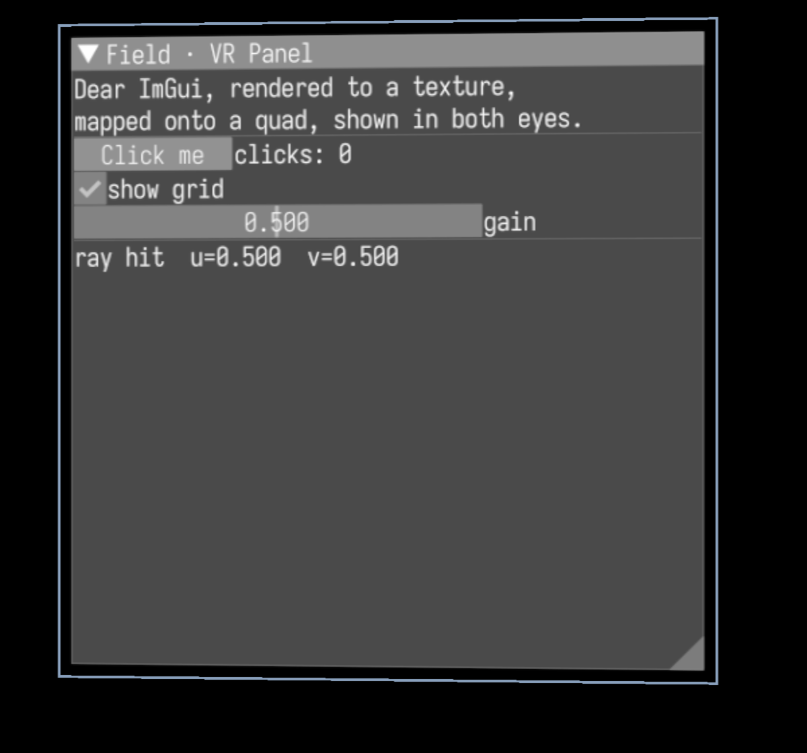
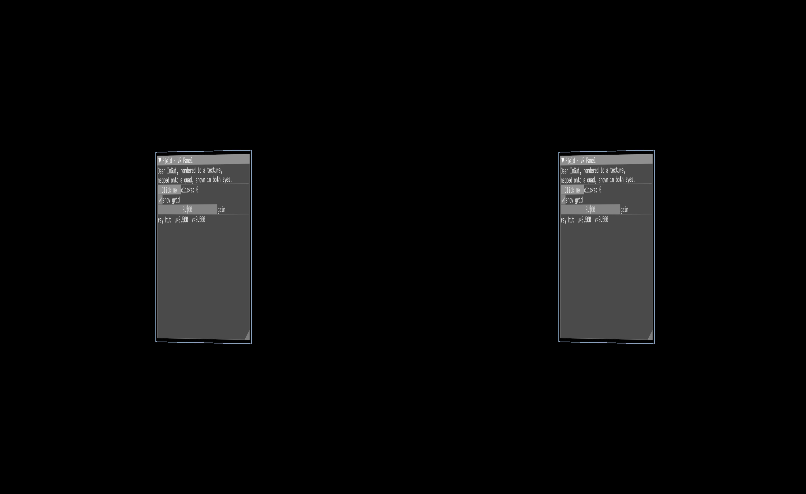

# ImGui as an in-VR panel

Field can float a live [Dear ImGui](https://github.com/ocornut/imgui) panel *inside* a 3D scene —
a clickable control surface hanging in space in front of you. ImGui draws into a texture, the
texture is mapped onto a quad, the quad is rendered once per eye into a side-by-side stereo image,
and a controller ray is hit-tested against it so buttons and sliders actually work. On a headset the
same stereo image feeds the eye swapchains; on the desktop it previews in the window.

The side-by-side stereo target underneath this demo is the same one the Vision Pro front end renders
through — see **[Apple Vision Pro](vision.md)**, where those eye matrices can come from an uplinked
head pose instead of from OpenXR or the desktop mock.



That is one eye of the running demo, cropped for legibility. The panel title, body text, `Click me`
button, `show grid` checkbox, `gain` slider, and the live `ray hit u=0.500 v=0.500` readout are all
drawn by ImGui into a texture and sampled onto the quad.

## Try it

Run the interactive desktop preview (move the mouse to aim the ray, left-click to press):

```diffstatic {data-lang=bash}
./gradlew runImGuiVrPanelDemo
```

Or run the automated smoke, which builds the whole pipeline on a real Vulkan window and checks that
a ray aimed at the panel centre lands exactly at its centre:

```diffstatic {data-lang=bash}
python3 tools/run_field_tests.py --id examples.four.imgui-vr-panel-smoke
```

## The pipeline

The whole thing is one chain:

```diffstatic {data-lang=text}
Dear ImGui frame
      │  drawn into
      ▼
render-to-texture (a 2048×2048 panel image)
      │  mapped onto
      ▼
a world-space quad, 1.5 m in front of your eyes
      │  rendered once per eye by the side-by-side stereo target
      ▼
one packed side-by-side image
      ├─ blitted to the desktop window (what you see without a headset)
      └─ copied into the OpenXR eye swapchains (what you see with one)
```

Because the quad is drawn once per eye, you get correct stereo depth: the panel really sits at a
distance in the scene, not pasted flat on the screen. Here is the full packed side-by-side frame —
the same pixels a headset would show, one panel per eye:



Each eye looks tall and narrow because the two eye views share the window's width, so each is
horizontally squished by half; the headset (or the crop above) stretches it back out.

## Aiming and clicking

A controller ray drives the panel. Each frame Field:

1. reads the controller pose (a real controller in XR; the mouse on the desktop),
2. casts a ray from it and intersects it with the panel plane,
3. converts the hit point into the panel's UV coordinates, and
4. injects that UV into ImGui as the mouse position, with the trigger as the left button.

So hovering the ray over a button highlights it and pressing the trigger clicks it. When the ray
misses the panel, the pointer is parked off-screen so nothing hovers.

## If you build your own

!!! note "The camera has to look down +Z"
    With that orientation world-right maps to screen-right and the ImGui text reads correctly; look
    the other way and the whole panel comes out mirrored left-to-right. The demo sets this up for
    you.

The developer-facing writeup (the `ImGuiPanel` helper API, the render-graph wiring, and the
capture gotchas) lives in `dev_docs/imgui_vr_panel.md`.
