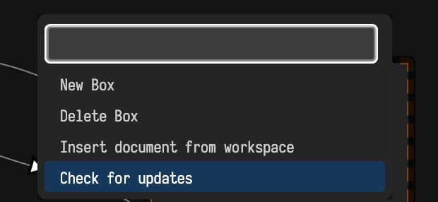

# Installation

Field is distributed as source. You install it by cloning it:

```diffstatic {data-lang=bash}
git clone https://github.com/OpenEndedGroup/Field4.git
```

There are no binaries and no installer — the checkout is the installation.

## Starting Field

Launch Field·4 by double-clicking the appropriate file in the repository:

- **Mac**: double-click `field.command` in Finder. It runs the Gradle `runDesktop` task.
- **Windows**: double-click `field.bat` in File Explorer. It delegates to `field.ps1` when present,
  otherwise it runs `gradlew runDesktop`.
- **Linux**: double-click `field.sh` in a file manager. The script tries several common terminal
  emulators and falls back to running in its current process.

The first Gradle build downloads dependencies and compiles the JVM and browser code, so it can take
substantially longer than later starts.

Eventually you'll be greeted with the boot-screen:

![A dark terminal filling the window with the word FIELD drawn very large in ASCII art, each letter built from slashes and dots. Beneath it three lines each tagged with a dim "welcome" marker read "welcome to Field, ß-023" and "http://localhost:9092/index.html?file=helloVideo". Below those, the server's own log: Ktor reporting "Application started in 0.206 seconds" and "Responding at http://0.0.0.0:9092", the filestore persisting its cache, "indexed 243 files, 3617 definitions", "found 54429 classes on classpath in 1.851s", and at the bottom a Gradle progress line reading "96% EXECUTING" against the still-running `:runJvm` task](assets/screenshot_22.png)

The desktop launcher opens Field's Electron shell. You can also open
[`https://localhost:9092/index.html?file=firstDocument`](https://localhost:9092/index.html?file=firstDocument)
in a browser. The development certificate is self-signed, so the browser may require an explicit
local-certificate exception. Press `?` for help, or consult the [survival guide](survivalGuide.md).

That URL is a real web server, running inside Field and listening on your machine. If you share a
network with anyone else, read [What Field Exposes, and What Stops It](server_surface.md) for what
it exposes and what does, and does not, protect it.

## Troubleshooting

_Field·4_ is still beta software. Report reproducible problems through the public repository's
[GitHub issue tracker](https://github.com/OpenEndedGroup/Field4/issues).

On Mac you might find that Apple cannot abide the idea of you downloading some code from the internet, building it and running it — all outside their ecosystem. Most likely, this complaint is framed in terms of security and privacy. It's possible that you'll have to give `Terminal` permission to read files from your home directory. For reporting bugs with our installation process, beyond that I'll be very interested in the contents of your Security and Privacy settings page:

![macOS System Settings open on the Privacy & Security pane, that row highlighted in the sidebar among Desktop & Dock, Displays, Notifications, Sound, Lock Screen and the rest. The pane is scrolled to its lower half: Screen & System Audio Recording with 3 apps, Speech Recognition with 0, Sensitive Content Warning off, Analytics & Improvements, Apple Advertising, Apple Intelligence Report on. Then a Security section with "Allow applications from — App Store & Known Developers", "Allow accessories to connect — Ask for New Accessories", FileVault off and Lockdown Mode off, with an Advanced button bottom right](assets/screenshot_4.png)

## Updating

Update it the same way:

```diffstatic {data-lang=bash}
git pull
```

and then start it again, which rebuilds whatever changed.

The `F1` command palette includes **Check for updates**, which tells you whether that is worth
doing. It asks `origin` what it has on your branch with one `git ls-remote`, fetching nothing at
all if you are already level, and reports how many commits you are behind, along with any local
commits of your own that `origin` does not have.

It will not pull, merge, rebase or write anything into your working tree; only you know whether
that checkout has work in it. If the answer is "7 new commits on origin/main", the `git pull` is
yours to run when you are ready.



The command says when it cannot answer. If you unpacked Field from an archive instead
of cloning it, if `HEAD` is detached, if there is no `origin`, or if the network is down, it says
which of those happened rather than reporting that you are up to date.

??? aside "For maintainers: making an update announce itself"
    Most commits should pass without comment — the count is enough. When a commit needs everyone
    who pulls it to *do* something, give it a `Field-Notice` trailer:

    ```diffstatic {data-lang=text}
    feat(repl): move to the 2.5.255 Kotlin fork

    ...body...

    Field-Notice: the Kotlin fork moved — run ./gradlew clean before your next build
    ```

    Anyone whose update check spans that commit sees the trailer's text verbatim, instead of the
    subject of the newest commit. Several notices in one range are all shown, deduplicated.
